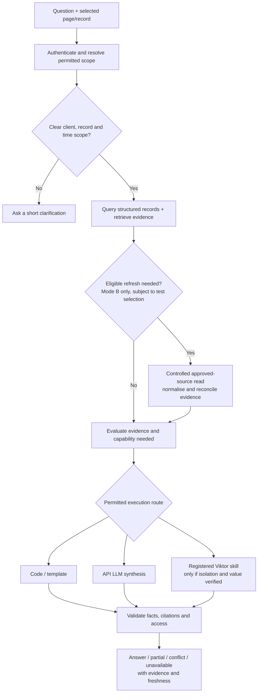

# Client Knowledge Base — chatbot scope and solution assessment

**Prepared for:** Wedding Industry Ads · **Prepared by:** E2M Solutions · **Date:** 20 October 2026

**Revised:** 21 October 2026 — selected hybrid cost-control, embedding reuse and semantic intent-routing methodology.

**Status:** Scope draft for review. The user requests an in-platform chatbot about the KB's data and an assessment of API LLM/Viktor routing. **KB-only answering and controlled live reads remain two modes to test before selection.** Scope the feature now; decide delivery order during implementation planning. This document does not implement a chatbot, select the final providers/models, create Viktor skills or execute paid runs.

Related: [Feasibility Study](knowledge_base/wia-knowledge-base/docs/Client-Knowledge-Base-Feasibility-Study.md), [agreed changes](knowledgebase_changes.md), [Viktor/API comparison](knowledge_base_viktor_llm_comparison.md), [backend SOP](backend_build.md).

**Cost/QA clarification, 20 October:** The user additionally requires smart reuse of repeated/similar queries, FAQ-style direct answers and token conservation while preserving accuracy. Section 13 specifies the proposed cost-saving mechanisms and validity rules; Section 15 defines how their quality and savings must be tested. No cache hit rate, savings percentage or runtime QA result is established yet.

**Hybrid methodology approved, 21 October:** [KB-CH-68](knowledgebase_changes.md#kb-ch-68--hybrid-chatbot-cost-control-methodology) adopts deterministic lookup and dependency-valid reuse, followed where needed by guarded semantic intent matching, incremental evidence/query embedding reuse and bounded generation/specialist execution. [Sections 13.11–13.15](#1311-selected-hybrid-execution-method) specify the implementation and evaluation gates. Embedding/model/threshold choices and measured savings remain unverified; semantic full-answer reuse stays disabled initially. Chat Mode A/B, background hybrid-versus-Viktor-led selection and feature delivery order are unchanged.

## 1. What this chatbot means for this platform

**The chatbot is a conversational interface to the maintained client record, its evidence and the questions that evidence can support.** It helps a WIA team member find, connect and understand permitted KB information without manually moving through every client tab, action, message and transcript.

It should answer questions such as what happened, what was agreed, who owes what, why an action exists, which evidence supports a displayed assessment and what remains unknown. It can also propose next steps based on that context, clearly distinguishing recommendations from recorded decisions.

Its factual authority comes from the same records, source evidence, definitions and access rules used by the application. The LLM supplies language understanding and synthesis; it does not establish the truth of an assignment, payment, deadline or meeting attendance. A conversation with the assistant does not automatically become a new client fact or alter the action register.

The interface belongs inside the WIA frontend. This is a distinct capability from a Slack bot, ChatGPT integration, external client-facing support chat or unrestricted assistant. None of those delivery channels is added by this scope.

### Intended business outcomes

- Reduce time spent reconstructing account history, locating decisions and understanding an action's background.
- Help team members understand the client and service engagement before a handover or call.
- Make assignments, commitments, blockers and unknowns easier to find and follow up.
- Explain the evidence behind the UI so users can assess and open the supporting material.
- Reduce repeated factual retrieval and overlapping analysis where the KB can reliably answer, while preserving useful specialist Viktor work.

No numerical productivity or cost-reduction target is agreed. Measure these outcomes against comparable existing work before claiming improvement.

## 2. Confirmed boundaries and decisions still being tested

| Topic | Current position |
|---|---|
| Core purpose | Questions about specific displayed records and permitted client data, including meetings, actions, context and assignments |
| Delivery order | **Scope now; decide during implementation planning.** Chatbot is not automatically added to the Action Items/Client Portfolio launch commitment |
| Source freshness mode | **Test both KB-only and controlled live reads.** Neither has been selected as the operating mode |
| Evidence retention | Architecture Q3 selects retained facts/excerpts and provenance metadata, with full originals fetched when needed; no permanent full-text archive is selected. This is separate from the chatbot freshness-mode test |
| Source deletion and corrections | Q6 retains facts/excerpts with a deleted-source warning. Q5 preserves reviewed corrections and routes later conflicts to review; chat and caches must reflect both policies |
| New source scope | Existing approved eight: Gmail, Slack, ClickUp, historical Zoom, Fathom, Drive, LeadLock and Calendar; no automatic expansion through Viktor |
| Provider design | Assess a smart hybrid for chat; preserve the existing hybrid-versus-Viktor-led implementation evaluation |
| Access | Existing per-user client and whole-module/section controls apply to questions, evidence, conversation context and responses |
| Conversation privacy | Private user threads; admins see operational metadata only. Admin inspection of conversation content and shared threads are excluded for now under Architecture Q15 |
| Retention and load | Q16 selects admin-configurable category policies; durations remain to configure. Q18 supplies about ten users, all potentially simultaneous; capacity/latency/cost still need testing |
| Action authority | Recommend an initially read-only assistant. Existing first-release policy already leaves ClickUp creation and notifications Coming soon; later writes require WIA review |
| Open configuration | Actual skills/route eligibility, chat feature grants, history retention, provider settings, test samples, cost budgets and acceptance thresholds |
| Cost/QA objective | Use safe caching, reusable query intents and approved direct-answer patterns; preserve the required correctness, evidence, freshness, completeness and access behaviour |

The examples and proposed contracts below define scope for review. They are not claims that the current frontend supports these behaviours or that every source needed for them is already complete.

## 3. Questions and conversations it should cater to

| Chat category | Representative question | Required behaviour and evidence |
|---|---|---|
| **Understand the current screen** | "Why is this action overdue?" / "What does this health label mean?" | Resolve the selected record and displayed version; explain its actual deadline/rule or stored assessment drivers. If the reason was not recorded, say so rather than invent it |
| **Client background** | "What does this business do, and what are we helping them achieve?" | Use reviewed profile/engagement records and relevant questionnaire/document evidence; distinguish separate services |
| **Last-call recall** | "What was discussed in the last call with this client?" | Identify the relevant call type/date and latest usable evidence; summarise decisions, asks and commitments with transcript timestamps and coverage caveats |
| **Meeting history** | "What changed between the last two strategy calls?" | Compare matched calls of the requested type and date window; preserve later amendments and conflicting evidence |
| **Actions and accountability** | "What is assigned to Jacqueline for this client?" / "What are we waiting on from the client?" | Query reconciled actions by owner/side/status; report unknowns and distinguish current tasks, proposals and Needs review |
| **Action context** | "Why was this task created? What did the client ask for?" | Retrieve the action's originating request, surrounding relevant conversation and later clarification; distinguish recorded rationale from an inferred explanation |
| **Assignment history** | "Who assigned this task, and when?" | Use an actual assignment/change event if available. Current assignee information alone does not identify the assigner or assignment time |
| **Delivery and verification** | "Was this completed and checked?" | Separate reported Done evidence from the named reviewer's Verified check; assignment and acknowledgement are separate again |
| **Decisions and conflicts** | "Was Friday still the agreed deadline after the next call?" | Apply field-specific authority, retain both sources and surface material ambiguity; meeting commitments take precedence over conflicting ClickUp due dates under the agreed policy |
| **Find evidence** | "Show the message where the client approved the draft" | Find the actual approval, author/date and source locator; a draft or a bot's recap is not the client's approval |
| **Handover and preparation** | "Bring me up to speed before the next strategy call" | Assemble permitted profile, relevant history, current commitments, client asks and gaps; label suggested agenda separately from agreed items |
| **Engagement and support** | "What concerns have they raised, and which remain unresolved?" | Use dated feedback/issues and resolution evidence; distinguish reported concerns from generated sentiment |
| **Lead/outcome explanation** | "How many inquiries booked a consultation this month?" | Use reconciled LeadLock records and agreed metric/date definitions; compute in code. If outcome access/history is absent, explain the limitation |
| **Programme participation** | "Which sessions does the attendance sheet show them attending?" | Use mapped member/session rows and reconciled rules. Do not infer attendance from RSVP, past calendar time or transcript presence |
| **Commercial history, if permitted** | "What signing/payment events do we have on record?" | Cite evidenced events. A Dubsado payment notification does not establish the complete invoice balance or full contract terms |
| **Portfolio/team queries** | "Which of my accessible clients have overdue WIA commitments?" | Query only authorised clients/sections, calculate using agreed definitions and state the scope; show pagination/coverage honestly |
| **Contextual recommendations** | "Based on these open commitments and concerns, what should we discuss next?" | Give evidence-grounded suggestions with assumptions and unknowns. Consider a tested Viktor skill if it improves the result |
| **Follow-up conversation** | "Which of those is still open?" / "Show the source for the second point" | Resolve references to stable record/evidence IDs, recheck access/freshness and preserve the selected client/engagement context |

These categories include both simple lookup and multi-source reasoning. A question's length, use of the word "why", or mention of advertising does not by itself establish a need for Viktor.

## 4. Critical interpretation rules

### "Last call" has to mean something precise

Resolve the business, service engagement, call type and requested time window. Use the most recent relevant call with usable evidence; exclude demos, unrelated vendor/internal syncs and cancelled/future calendar entries. A programme office hour and a one-to-one strategy call are different candidates. Ask a short clarification when the distinction matters.

If the KB has a transcript for an earlier call and a later scheduled event without content, describe that distinction: the latest available transcript is not proof of the latest meeting that actually occurred. A past invitation does not establish attendance or completion. State the call date/type and available coverage in the answer.

### State, evidence and inference are different

"Assigned to X" does not establish "assigned by Y". "Done" does not establish "Verified". "No closure found" does not establish "still open". An inferred reason for a client's concern is not a statement made by that client. Explain only the actual rationale attached to a displayed label; if offering a new interpretation, label it separately.

For commitments, preserve unknown owners/dates, the active-versus-Needs-review distinction and separate AI proposals. Owner acknowledgement follows the existing explicit-acceptance/manual-action/configured-reaction policy. A chat answer cannot create acknowledgement or verification by asserting it.

### Dates, counts and reporting boundaries must be explicit

Resolve "today", "this month" and "last week" using the agreed user/client reporting timezone. Distinguish event date, source update, ingestion time and answer time. Do not silently aggregate clients with incompatible outcome definitions.

For "how many", use an authorised structured query/count over the full relevant record set, not the number of semantic search hits or visible rows. For "all", either enumerate the complete requested scope with pagination or state what remains unsearched. A bounded top-k retrieval is not an exhaustive answer.

### Missing evidence is an answer condition

Differentiate no matching evidence within the checked scope, incomplete ingestion, access unavailability, a linked-but-unprocessed file and conflicting evidence. Avoid unsupported zero values, health conclusions or promises that a complete answer will appear after refreshing. Neither model can recover information that the permitted sources do not supply.

## 5. Relationship to the current frontend

The frontend is a React preview with fictional clients/evidence, hash-based view/client/call routing, in-memory/browser-local action changes and no production chat or permission-enforced data service. Its keyword workspace search is useful navigation, but it does not answer multi-source questions. This inspection establishes integration points, not completed chatbot feasibility tests.

| Existing surface | Chat entry point to assess | Context to resolve on the backend |
|---|---|---|
| Client record | "Ask about this client" | Business ID, service engagement, selected tab and record/version scope |
| Action drawer/row | "Explain this action" | Action ID, origin/current state, selected UI version and relevant evidence |
| Meeting/call preparation | "Ask about this call" | Call/occurrence ID, type, scheduled versus recorded evidence and related businesses |
| Evidence drawer | "Ask about this source" | Source ID, authorised excerpt/range/version and linked records |
| Health/outcome card | "Explain this assessment" | Published assessment/metric snapshot and actual supporting drivers/definitions |
| Portfolio/action list | "Ask about this view" | Current filters, sorting, date window and complete permitted result scope, not just rendered rows |
| Global navigation/header | General KB question | User-selected authorised client(s), section/time scope and permitted conversation history |

Recommended presentation is one consistent assistant with contextual entry buttons, a side panel on larger displays and an appropriate full-screen/sheet layout on smaller screens. A larger conversation view can be assessed for long research. This is a UX proposal, not a committed layout. It must work on the agreed phones, tablets, laptops, MacBooks and iMacs, including keyboard/touch use and readable citations.

> **Update (22 Oct 2026):** The contextual entry buttons and the side panel were dropped in favour of a **single Client 360 tab in the sidebar**. There is no header button, keyboard shortcut or per-page *Ask about this…* entry point. Users set the client and period in the tab's scope bar, so the per-surface context in the table above no longer applies. See `kb_tab_scope/06-chatbot.md`, decision N2.

Use visible client/engagement/scope indicators and source links that open the existing evidence/record views. Do not rely on hidden page text as model input. The browser supplies record IDs and view/filter metadata; the server validates them and loads authoritative permitted records. Provider secrets stay on the backend.

### Context switching and conversation continuity

Keep the conversation scope explicit. Navigation alone must not silently reinterpret earlier references as a different client. If a user moves to another client while a thread is pinned to the previous one, show the difference and offer switching/starting a thread. An explicit question about another authorised client can change scope visibly; ambiguous "this client" references require clarification.

When discussing "the data shown", reconcile the displayed snapshot/version with the current backend record. If values changed after the page loaded, explain which version is being answered and offer the current record. Browser-local preview edits are not production truth.

## 6. Answer contract and evidence experience

Every answer should provide what is useful without forcing a long template on simple questions:

1. **Direct answer**, with facts, interpretation and recommendations distinguishable.
2. **Resolved scope:** business/engagement, record or call and relevant period where needed.
3. **Supporting evidence** attached to substantive factual claims, including source dates/locators.
4. **Freshness/coverage** when it affects reliability; distinguish KB snapshot from a newly refreshed result.
5. **Gaps/conflicts/unknowns** that materially limit the answer.
6. **Useful links**, such as the action, transcript segment, client history or source drawer.

Recommended machine result categories are `answered`, `partial`, `clarification_required`, `no_evidence`, `unavailable`, `conflict` and `analysis_pending`, with internal failure details logged separately. Access-denial messages must not disclose otherwise hidden clients/documents. Do not invent confidence percentages as a substitute for evidence.

An answer envelope should carry conversation/turn/run IDs, resolved scope, answer blocks, factual versus analysis labels, authorised evidence references, source/record versions, coverage/freshness, missing information and permitted navigation links. Record the internal execution route and skill/model/context versions for audit. These are proposed fields; exact schemas belong in implementation preparation.

For reused results, retain the original generation/evidence timestamps separately from the time the cached answer is served. A cache hit must not make old evidence appear newly obtained. Explain relevant freshness in user terms; keep internal cache/debug details optional.

Generate citations from the backend's known evidence registry. Validate that referenced IDs were retrieved, are currently permitted and support the associated claim; a valid JSON reference alone is insufficient. Display transcript timestamp, message author/date, document section or sheet range where available. Do not manufacture a quotation or URL. An external source link may still require separate provider access; a KB-visible excerpt does not guarantee the user can open the original application.

For example, a last-call answer can identify the selected call, list decisions and commitments with references, separate its current action state from what was said then, and disclose later calls without readable content. This describes the response shape; it does not invent an answer for a real client.

## 7. Why a hybrid is promising, and where routing can go wrong

The hybrid is a good **candidate** because the workload mixes exact database questions, evidence-based language tasks and potentially valuable specialist analysis. Using an agent for every count/status lookup adds work that the KB already performs. Conversely, forcing a generic model to recreate a useful WIA-specific skill may lose quality or increase maintenance.

The recommended design is **one KB assistant coordinator with controlled retrieval/query tools, API LLM synthesis where needed and a registered Viktor skill route for demonstrated advantages**. Retrieve and validate the facts first. Route based on the capability the task needs, the evidence available, permission compatibility and measured quality/cost—not just a keyword or the model's confidence.

This recommendation does not settle the wider hybrid-versus-Viktor-led backend choice. A Viktor-led intake pipeline can still populate the owned ledger from which quick chat queries are answered. Interactive query routing and background knowledge ingestion are separate decisions. An API answering baseline in chatbot tests is not a third replacement platform implementation.

| Request | Recommended path to assess | Why / escalation boundary |
|---|---|---|
| Known action status, owner, deadline or filtered count | Deterministic KB service; optional short model parsing/wording | Source fields and arithmetic should remain exact; not every such turn is necessarily zero-model-cost |
| "What was agreed in the last call?" | Scoped call retrieval + API LLM synthesis | An evidence-recall task; use raw relevant transcript sections, not only an earlier generated summary |
| "What is the context behind this action?" | Action-origin links + surrounding evidence + bounded synthesis | Existing provenance should answer before any new agent work |
| "What did Viktor previously recommend?" | Retrieve the existing attributed Viktor report | Reading an existing report is different from commissioning a new analysis |
| "Create a contextual agenda from these commitments and concerns" | Compare API synthesis and a specific Viktor preparation skill | Viktor's reported preparation strength makes this a useful benchmark; it does not prove the new route will match it |
| "Recommend how to address these recurring client concerns" | Evidence-based API analysis; compare a defined Viktor review skill where useful | A specialist route must demonstrate added usefulness, not merely longer output |
| "Why did performance deteriorate?" | Establish available outcome evidence/definitions first | Missing LeadLock records or fresh ad data cannot be solved by escalating an unsupported question |
| "Inspect current Meta/Google configuration" | Outside fresh first-release paid-media scope | Existing reports can be explained with their dates; broader live analysis is separately scoped |

The registered skill route is not a generic "ask Viktor anything" fallback. If a request needs only KB facts and no registered skill improves the result, answer through the normal KB path. If a multi-part request mixes facts and advice, return the validated facts and distinguish the advisory portion; avoid making every sub-question repeat the entire retrieval.

### Alternatives

| Alternative | Strength | Limitation / assessment |
|---|---|---|
| **Search and structured filters without chat** | Exact navigation/counts; useful baseline and companion | Does not provide conversational recall, context reconstruction or synthesis |
| **KB tools + API LLM for all eligible chat interpretation** | Simple provider path, controlled context, good comparison baseline | May require recreating useful WIA-specific skills; must be tested for usefulness |
| **Viktor for every question** | Consistent agent context and existing skill/tool ecosystem | Agent latency/credits and permission mismatch for ordinary KB questions; backend validation still required |
| **Keyword-based API/Viktor switch** | Easy to implement | "Ads" may mean a past client statement rather than live diagnostics; keywords are not a sufficient routing rule |
| **Send every question to both** | Useful for a bounded evaluation | Routine duplicate cost/latency, conflicting answers and more reconciliation work |
| **KB coordinator + selective tested specialist skills** | Uses exact queries, evidence retrieval and specialist work appropriately | Recommended candidate; needs clear contracts, routing tests, budgets and demonstrated access isolation |

## 8. Two source-freshness modes to evaluate

The user has explicitly left this choice to testing. The recommendation to begin with KB evidence is a design hypothesis, not an accepted operating restriction.

| Mode | Operation | Benefit | What must be tested |
|---|---|---|---|
| **Mode A — KB evidence only** | Answer from currently ingested, permitted records; source refresh runs through ingestion separately | Stable evidence/citations, consistent UI state and simpler permission enforcement | Whether the fifteen-minute freshness target and existing KB coverage answer actual team questions sufficiently |
| **Mode B — KB first with controlled live reads** | Use the KB first; when eligible, perform scoped read/refresh against approved sources through authorised services or a verified Viktor route | May close a freshness/coverage gap at question time | Added completeness/usefulness versus cost, latency, permissions, provider limits and reconciliation complexity |

For Mode B, specify which intents can trigger retrieval, whether it is automatic under admin policy or user-requested, allowed source/account/time windows, result limits and costs. Those settings are not selected here. Restrict all reads to the approved eight sources and the user's permitted clients/sections. Fresh paid-media retrieval and private-DM import are not implicitly enabled.

Live results need source identity, retrieval time, versions and citations, and must enter the normal evidence/validation path. Reconcile them with the ledger/UI; do not maintain a second untracked "chat truth". Preserve conflicts and route material ambiguity to review. Raw provider reads are not authority to overwrite reviewed facts or create active commitments indiscriminately.

Show whether the answer uses stored evidence, newly refreshed evidence or a mixture, and disclose any UI snapshot lag. If a read fails, return the permitted known facts with their age/limitations rather than claiming a fresh answer. Mode B cannot repair genuinely absent evidence or access by searching broader accounts.

Where candidate modes have different source reach, record that explicitly in the evaluation. Do not interpret access advantages as evidence of stronger reasoning or compare their cost as if they did identical work.

Architecture Q20 confirms last-known data remains available during temporary source failure/lag with an explicit **Last synced at [time, date, timezone]** message and stale/unavailable-source status. Failed attempts, page reloads and cache hits must not advance last successful sync. Historical answers can use supported retained evidence with limitations; current-verification questions receive partial/unavailable answers without fresh support. This does not choose Mode A versus Mode B.

## 9. Retrieval and answer mechanism

The backend should combine **structured queries and evidence retrieval**, rather than apply vector search to every request. This is often described as retrieval-augmented generation, but the important design is the record selection and validation behind it.

**Storage constraint from Architecture Q3:** local search covers retained facts, supporting excerpts and source/version/coverage metadata, not necessarily every sentence originally processed. Detailed recall, full quotations or new extraction may require an authorised fetch of the original. Under Mode A, missing context must arrive through the permitted ingestion/refresh path; Mode B may test fetching it during the question. Neither mode is selected by the storage decision. See [architecture discovery](knowledge_base/wia-knowledge-base/docs/Client-Knowledge-Base-Architecture-Discovery.md#52-consequences-of-factsexcerpts-storage).

Identify whether supporting text is the earlier retained excerpt or a newly fetched, possibly edited version. If the original is unavailable, answer only what the retained evidence supports, disclose incomplete context and record the gap. Do not imply exhaustive source recall or quote unretained text without retrieving it. Search indexes, prompt logs and caches must not silently recreate a permanent full-source archive. Temporary original/context caching needs an explicit bounded cleanup policy; exact retention/deletion periods remain open.

Architecture Q6 explicitly retains facts/excerpts after confirmed upstream deletion with a deleted-source warning. They remain eligible for permitted answers/search rather than being automatically quarantined or withdrawn. Cite the retained KB evidence, its observation time and the unavailable original; do not imply successful live verification or invent missing surrounding text. Historical support does not prove a mutable current state. Confirmed deletion differs from denied access or temporary failure, and current user restrictions still apply. Revise dependencies so cached answers also show the warning and limitations. See [deleted-source handling](knowledge_base/wia-knowledge-base/docs/Client-Knowledge-Base-Architecture-Discovery.md#54-confirmed-source-deletion-retain-evidence-with-warnings).

Under Architecture Q5, use reviewed KB corrections for the maintained value and disclose relevant unresolved conflicts with later source observations. An answer must not silently switch back to the incoming value or conceal a disagreement behind a cached response. Q7 selects per-user read state cleared by opening change details or Mark as read, with later changes unread again and unresolved conflicts retaining separate status. Shared factual answer caches must not copy another user's read indicators. Answering a question or rendering a citation does not implicitly mark all related change records read; the explicit details/read workflow controls that metadata. Reading is not factual acceptance, conflict resolution, owner acknowledgement or action verification.

Q8/Q10/Q13 select custom editing/review roles plus scoped Inherit/Allow/Deny overrides; user Deny wins over role grants and Allow cannot reveal a hidden client/section or restore revoked membership. Q9 makes self-verification admin-configurable. These rights belong to the permissioned KB workflows and do not expand the chatbot's recommended read-only scope. When explaining Verified, retain the named reviewer/follow-up evidence and distinguish self-verification where recorded. Do not require an independent reviewer in every case or imply that self-verification permits evidence-free completion. Actual role/default grants remain to configure. See [custom operation rights](knowledge_base/wia-knowledge-base/docs/Client-Knowledge-Base-Architecture-Discovery.md#55-custom-operation-rights-and-configurable-self-verification).

1. Authenticate the user; establish current client, section and chatbot feature permissions.
2. Resolve explicit client names/IDs, selected records, pinned thread scope, filters and dates. Ask when materially ambiguous.
3. Form a validated query plan: facts/counts, source recall, explanation, comparison, analysis or mixed request; required evidence and freshness mode.
4. Retrieve through authorised backend services. Use IDs/relations for an action's origin, date/type ordering for meetings, SQL for counts and keyword/semantic retrieval for narrative evidence.
5. Check coverage, conflicts and sufficiency. Retrieve relevant surrounding context and later amendments where needed; avoid drawing a conclusion from one isolated matching sentence.
6. Select an eligible execution route. Use templates/code for exact facts where appropriate, API synthesis for evidence-based language tasks and a tested Viktor skill for an identified advantage.
7. Validate tool arguments, returned scope, schema, citations, definitions, access and unsupported claims. Preserve honest partial answers.
8. Return the answer with evidence/navigation and record permitted audit metadata. Continue the conversation using stable entity references and refreshed access checks.



Proposed typed tools include `get_client_context`, `get_action_with_history`, `list_actions`, `get_meeting_evidence`, `search_evidence`, `get_outcome_snapshot`, `get_source_coverage` and `run_approved_skill`. A source-refresh tool exists only for a selected/authorised Mode B configuration. Their names are illustrative; they are not implemented endpoints.

The model proposes a tool call; backend code authorises and executes it. Use allowlisted typed arguments and parameterised data queries, not unrestricted model-written SQL, shell or arbitrary URLs. Enforce pagination and scope on every call. OpenRouter documents tool calling and endpoint-dependent structured output support; actual selected endpoints need verification and backend validation. [Tool calling](https://openrouter.ai/docs/guides/features/tool-calling), [structured outputs](https://openrouter.ai/docs/guides/features/structured-outputs).

Begin with relational links, exact search and metadata filters; assess semantic search/reranking where they improve recall. No separate vector database or large agent framework is justified solely by adding a chat box. Reuse the KB's chosen evidence/search infrastructure and evaluate retrieval quality.

The low-cost paths in Section 13 can return approved definitions, dynamic template answers or validated stored results before new generation. They still perform the applicable scope, permission, dependency and freshness checks. Cache lookup does not bypass this workflow's evidence rules.

Q22/Q23 require chat to reflect applied versus proposed corrections and current versus historical verification accurately. A proposal does not replace a maintained value; a genuine mapped ClickUp reopening automatically reopens progress and supersedes old verification. Later completion does not restore that old check. Invalidate affected answer/collection dependencies and distinguish “was verified” from “is currently Verified”. These backend lifecycle rules do not add conversational mutation authority.

## 10. Viktor specialist integration and its limits

Viktor documents programmatic agent runs and structured results. Its compatible chat interface runs the full agent rather than a bare model call; plan for different latency/cost and asynchronous interaction. These are vendor capabilities, not verified WIA integration results. [Public API](https://viktor.com/docs/public-api), [compatible API](https://viktor.com/docs/chat-completions).

### Proposed skill contracts

Assess bounded skills such as an evidence-based call agenda, a commitment-context review or an engagement-issue review. A skill should declare its eligible intents, required evidence, client/engagement scope, output fields, unknown handling, citations, interpretation boundaries and tool permissions. General business expertise may inform a clearly labelled recommendation; client-specific claims must come from the authorised evidence.

Inputs include the resolved question, necessary conversation context, relevant business/service definitions, allowed evidence IDs/versions, permitted time/source scope and resource limits. Outputs separate facts, attributed analysis, suggestions, citations, missing information, freshness and conflicts. Store approved instruction/schema/context versions with the run. A schema-compliant answer can still be incomplete or wrong. [Viktor skills](https://viktor.com/docs/skills).

### Permission compatibility is an enablement gate

The KB's client/section controls do not automatically map to Viktor's workspace access. **Passing filtered snippets or writing "use only these sources" in a prompt does not prove isolation.** The existing agent may also have workspace memory, files, private/shared connections or other client information. Establish what the actual execution identity can access and how that is constrained for the requesting KB user.

Viktor documents tool and connection permissions; those controls are not evidence of KB-specific client/module enforcement. Test inherited context, tool reach and returned output. A team key is not a per-user permission bridge. If a safe execution boundary cannot be demonstrated, disable that route for the affected user/query and answer through permitted KB evidence. Assess an isolated configuration if available; do not weaken the user's access or change WIA's existing workflows merely to make routing work. [Integration permissions](https://viktor.com/docs/integration-permissions).

For Mode A, a no-new-source-context boundary must be enforceable in the selected Viktor configuration, not only requested. For Mode B, permit only verified read tools and the approved account/source windows. Disable source writes, broad arbitrary API tools and external messaging for this assistant's execution path. A prompt is not a substitute for those controls.

### Run lifecycle

Use internal API integration, not public Slack requests to Viktor. Map runs to authorised conversations/turns with idempotency and bounded retries. A slow specialist job can return validated KB facts first and show analysis as pending. Support understandable failure/cancellation and retain the user's question; do not show raw provider traces as answer content.

Viktor's API can return a request for further input/approval. Treat that as an unresolved interaction, not completed analysis, and do not automatically approve new authority. Provider continuation/thread identifiers must be scoped to the relevant user/conversation and evidence boundary; never reuse a broad shared provider conversation across unrelated users.

No Viktor job, skill upload, integration setting or schedule is created by this scope. Actual WIA API access, isolation, output quality, latency and credits still require evaluation.

## 11. Access, conversation history and factual authority

**Chat must not become a route around hidden information.** Apply client and whole-module restrictions before querying, retrieving, preparing model context and returning answers. First-release admin controls remain at client/module level; this does not require a new per-field admin interface.

Evidence needs module-aware classification. A financial section hidden from a user cannot remain available through a raw email thread, global source search, handover, aggregate count or specialist answer. Use permitted fragments or exclude inseparable mixed evidence; filtering only the final text is insufficient. Test this against actual mixed-source examples.

Recheck permissions on each turn, history load, citation, cached result and resumed job. If access changes while a response is pending, check again before delivery. Partition caches by permission scope, client/engagement, evidence version and relevant definitions. Prior conversation context can itself contain revoked material; rebuild safe context or block the affected history when it cannot be safely separated.

Q11 selects KB-only revocation while central login stays active. Central sign-in must not bypass inactive KB membership; prevent further protected chat output and access to cached answers/history/citations after revocation. Role/override changes need the same effective-access checks. Central account disabling is separate and still needs to be honoured by the trusted authentication integration. User provisioning or role administration does not confer chat-content inspection; Q15 excludes it for now.

**Selected in Architecture Q15:** private user threads and admin operational-metadata access only. Admin inspection of conversation content is expressly excluded for now; shared threads and cross-user history retrieval are later proposals. Q16 selects admin-configurable retention by data category; numerical durations, existing-record expiry and own-thread export remain to define. Conversation storage should retain the entity/evidence relationships needed to enforce current access, not an ungoverned copy of all model prompts. A user cannot recover revoked evidence merely because it remains in their private thread.

Apply that privacy boundary to admin analytics, logs/traces, validation/provider error bodies and cache inspection: sanitise errors rather than echo prompts, answers, source excerpts or tool results. Retain only appropriate usage/cost/status/error metadata in the admin view. Reusable evidence-based artifacts must not publish private conversation text or personal context as shared FAQ answers or another user's model context. Q17 confirms full testing-data access for E2M/WIA without a separate testing-access gate; this does not add production admin chat-content inspection or claim physical isolation from database operators. See [private thread policy](knowledge_base/wia-knowledge-base/docs/Client-Knowledge-Base-Architecture-Discovery.md#59-private-chatbot-threads-and-admin-metadata-boundary).

User corrections or new statements in chat are not silently promoted into authoritative client facts. The initial recommended scope answers and navigates. If a user wants to change an assignment, mark Verified or record a new decision, direct them to the applicable permissioned workflow. Later conversational writes would need separate scope, permission checks and reviewed mutation contracts. Chat history is not automatically a ninth external intake source or model-training dataset.

Treat retrieved source text as evidence, not instructions to change tools, permissions or output rules. Do not execute embedded commands or follow arbitrary links merely because a message/document requests it. Protect provider credentials, redact inappropriate operational logs and configure data routing/retention consistently with WIA's requirements; no particular provider retention guarantee is assumed.

## 12. In scope, dependent and outside the initial recommendation

**Core capability to deliver when scheduled:** read-only contextual questions, structured action/client lookups, meeting/source recall, evidence-backed explanation, multi-turn references, permitted cross-client queries, explicit limitations and navigation to records/evidence.

**Conditional capabilities:** selected fresh-read mode; new Viktor skill jobs after value/isolation tests; outcome/support/attendance/financial answers only when their evidence and definitions support them; deeper recommendations visibly labelled as analysis. A later feature's data being retained in the KB does not automatically grant chatbot access to it. Define chat access independently or inherit the owning module's enabled/access policy; do not bypass a Coming soon gate by accident.

**Outside the initially recommended chat scope:** autonomous assignment/status edits, marking Done/Verified, task creation, Slack/email notifications, changing ads/accounts or permissions, web research, private-DM import, new media transcription/OCR, general-purpose business advice disconnected from KB evidence, public client-facing support and external chat-channel delivery. Existing approved review rules continue to govern later external actions.

The assistant should explain unavailable capability briefly and offer a relevant record/workflow or supported question. It should not pretend a mutation occurred, silently broaden source scope or replace missing evidence with general advice presented as client-specific fact.

## 13. Operational behaviour, cost and performance

### 13.1 Optimise cost subject to QA, not the other way around

**Use the least expensive path that can satisfy the required answer contract.** A correct cached/direct answer is useful; a stale, incomplete or wrongly scoped answer is a failure even if it costs no generation tokens. Cache hit rate is an efficiency measure, not a correctness target.

The selected hybrid order is: approved definition or parameterised query; valid exact answer/result/artifact reuse; guarded semantic intent matching if deterministic recognition is insufficient; bounded planning/retrieval/API synthesis; a tested Viktor skill when it adds needed value. Resolve entities, intent, access and freshness before deciding what can be reused. A reusable plan may still need current data, and a reusable transcript summary may still need surrounding source text for a new question. Semantic matching is not required before every answer; Sections 13.11–13.15 define its conditional execution and activation tests.

### 13.2 Separate FAQ definitions from dynamic client answers

Build an approved intent catalogue with aliases, required slots, exclusions, query/template versions, evidence requirements and owning policy/configuration references. These are proposed starting entries:

| Intent / example | Low-cost handling | Accuracy condition |
|---|---|---|
| "What does Verified mean?" | Versioned approved definition | Use the named-reviewer/follow-up-evidence rule; invalidate if policy changes |
| "What counts as acknowledgement?" | Approved definition plus permitted configuration where relevant | Do not invent an emoji allowlist; configured owner reactions differ from assignment |
| "Who owns this action?" | `action_id` lookup and template | Recheck current record; unknown stays unknown |
| "Who assigned it?" | Assignment-history lookup and template | If the assigner/event was not captured, say that; do not substitute the current owner |
| "What is overdue for this client?" | Parameterised action query and exact count/list | Use actual dates/statuses, client/engagement, timezone and current clock; unknown dates are not overdue |
| "What are we waiting on from the client?" | Query agreed client-side commitments | Do not reuse the list of WIA-side obligations |
| "What happened in the last strategy call?" | Resolve latest eligible call, then reuse its applicable cited summary or synthesise evidence | Validate the latest-call selection, call type, coverage and summary completeness |
| "Why does this action exist?" | Action-origin links and a reusable context artifact where sufficient | Preserve later clarification; distinguish recorded rationale from inference |
| "Where did that statement come from?" | Resolve the referenced answer block to its authorised evidence IDs | Verify the reference still supports the claim and is accessible |

Stable product definitions can have approved text. **Client-specific FAQs are normally reusable query-and-answer patterns, not permanently written answers.** The same template should return a changed owner/status when records change, without asking a model to rewrite a simple sentence.

Contextual buttons/suggested questions can send an approved intent with validated record IDs, avoiding model interpretation entirely. Typed questions can use a high-precision alias/rule path where unambiguous. Rules must preserve negation, task side, status, time and identity. If recognition is uncertain, clarify or use bounded interpretation; a forced cheap match is not an accuracy improvement.

### 13.3 Layers of reuse

| Layer | What is reused | What is still required |
|---|---|---|
| **Approved FAQ/policy answers** | Reviewed definitions, response templates and glossary | Current policy/configuration version and applicable access |
| **Intent/query-plan reuse** | A verified intent and parameterised query/tool plan | Resolve and validate current slots; execute against a valid current snapshot |
| **Structured result cache** | Scoped query results, counts and evidence references | Matching query, permissions, collection/record revisions and time boundary |
| **Evidence/artifact reuse** | Retrieved evidence packs, cited meeting summaries, action-context records and prior Viktor reports/skill outputs | Same purpose and input/context versions; sufficient coverage for the new question |
| **Exact validated answer cache** | Complete answer blocks with citations and dependency manifest | Same resolved meaning/context, allowed scope, definitions, source state and freshness policy |
| **Semantic intent matching** | Paraphrases mapped to the same verified intent/slot structure | Validate all material constraints; similarity alone does not approve answer reuse |
| **Evidence embedding reuse** | Vectors for identical approved retained evidence text under the same versioned embedding contract | Current evidence scope/retention; changes to embedding input/builder/model contract trigger replacement |
| **Query embedding reuse** | Vector for the same exact query input under its embedding/privacy contract | Current user/partition rules; filters and answer dependencies are still checked separately |
| **Provider prompt caching** | Eligible repeated model input prefixes | Provider support/configuration, actual cache pricing/usage and unchanged applicable context; output generation may still be billed |

Prefer the simpler layers first. Semantic full-answer caching is an experimental extension for tightly bounded cases after QA, not the universal first implementation. Reusing a canonical intent plus current validated data can satisfy similar questions safely without treating two loosely similar sentences as the same answer.

### 13.4 Safe handling of repeated and similar questions

"Who owns this task?" and "Who is responsible for it?" can use the same owner lookup if they resolve to the same action and ask about its current assignee. "Who assigned it?" needs different evidence. "What was agreed on the call?" and "What is still open now?" have different temporal meanings.

Resolve a canonical request containing at least intent, explicit entities, client/engagement, record/call IDs, task side, status, owner/user filters, period/timezone, snapshot/current-state meaning, requested completeness, output requirements and relevant follow-up references. Do not normalise away "not", "before", "after", "all", "only", "WIA" or "client". Resolve "me" to the authenticated person and "those" to the actual prior entity set.

An embedding/semantic score can identify a candidate intent or stored result; it cannot prove equivalence. Gate reuse on compatible validated slots, evidence/coverage, policy and permissions. Test thresholds on held-out paraphrases and near-miss pairs rather than adopting an arbitrary similarity number as a quality guarantee. If equivalence is uncertain, reuse retrieved evidence or the plan and generate/clarify as required.

Do not share free-form personalised history/recommendations between users simply because their visible client lists match. Initially keep such answers user/conversation-scoped. Sharing neutral artifacts or structured results needs an explicit eligibility rule and equivalent permitted evidence; every recipient is still checked individually.

### 13.5 Cache identity and admission

A cache key or validated manifest should represent:

```text
organisation + cache/intent schema version
+ user/private-context identity or explicitly approved visibility partition
+ current permission/feature-policy revision
+ canonical intent and fully resolved slots
+ client/engagement/record scope, dates, timezone, filters and reference set
+ evidence, collection-membership, coverage and derived-record revisions
+ business definitions, template/skill/context and answer-contract versions
+ selected freshness policy and relevant output requirements
```

Hash/encode the manifest for storage; do not expose private query text, credentials or source contents in cache keys/logs. An opaque key is an identifier, not an access-control boundary.

Cache complete outputs only after their normal validation passes. Store source/citation IDs and locators, original generation time, evidence-as-of/sync state, dependency versions, coverage/gaps and expiry conditions alongside the answer. Create permissioned navigation or expiring download links at delivery time rather than relying on cached signed URLs.

A completed query with zero results may be cached with its query/collection/coverage dependencies. A provider error, denied read or unfinished search must not become a cached assertion that no work or evidence exists. Clarifications remain tied to their unresolved context. Negative or uncertain outcomes should not be given long-lived final-answer reuse merely because they are cheap to store.

If a user or reviewer identifies a wrong answer, invalidate/quarantine the relevant answer/artifact and dependent results, preserve review evidence and investigate the failed rule/retrieval. Repetition or a thumbs-up does not turn an answer into an approved FAQ. Use observed repeated questions to propose catalogue additions for review; do not auto-promote private conversation content into shared truth.

### 13.6 Invalidation and the freshness budget

**Expiry is a backstop; dependency changes are the primary invalidation signal.** Examples:

| Change / boundary | Invalidate or re-evaluate |
|---|---|
| Owner/status/due date or acknowledgement/verification changes | Action lookups, affected filtered lists/counts and dependent summaries |
| A new relevant meeting/transcript is ingested | Latest-call selection and its dependent answers, even if the previous transcript itself is unchanged |
| A new action appears, or a record enters/leaves the queried set | Collection/query result caches, including previously empty results |
| Transcript/message/document is edited, deleted or remapped | Evidence/artifact versions and all affected factual answers. Confirmed deletion retains excerpts but invalidates unqualified cached presentation so the deleted-source warning is included |
| WIA resolves a conflict, overrides an extraction or rejects a proposal | Derived state, explanatory answers and relevant policy-dependent artifacts |
| Source access/coverage improves or fails | Partial/no-evidence answers and claims of completeness/freshness |
| Permissions, grants or enabled modules change | Affected results and histories immediately; recheck before delivery |
| Reporting period changes or a deadline is crossed | Time-sensitive status/counts, even with unchanged source records |
| Metric, FAQ, template, skill or routing rules materially change | Results dependent on the old definition/behaviour |

Record revisions and collection/coverage revisions matter together. Tracking only the record IDs cited in the old answer misses newly created records that should now change the answer. Relative dates must resolve to absolute windows with a known timezone; a cache keyed only by the words "this month" will eventually be wrong.

For time-sensitive facts, recompute cheaply or expire no later than the next relevant deadline/period boundary. For a fixed historical transcript, a source-versioned summary can remain reusable until evidence, scope or interpretation rules change. In both cases citation access and source-coverage statements still need current checks. Exact TTLs are configuration to test by answer class; one universal fifteen-minute TTL is not the recommendation.

The agreed target is fifteen-minute updates once provider data becomes available. **Do not allow fifteen minutes of ingestion lag plus another fifteen minutes of answer-cache lag.** New accepted KB state must invalidate/revise dependent answers when published. Validate source-sync age as well as cache age. If freshness cannot be established, show the known snapshot with its limitation or refresh under the selected mode; do not present it as newly verified.

Mode A and Mode B remain subject to the previously requested testing. A "check the latest source now" request cannot be satisfied solely by an old KB cache hit. If Mode B is enabled, a controlled read that confirms unchanged source state may permit reuse of prior interpretation; new generation is not automatically necessary. Distinguish source refresh, rewording and commissioning a new analysis so the system does not pay for all three unnecessarily.

### 13.7 Race conditions, duplicate work and failure handling

Read values and their revision/coverage markers consistently. Recheck relevant revisions and permissions before publishing a newly generated or in-flight answer. If evidence changed while generation ran, revalidate/recompute within limits or disclose the earlier snapshot; do not mark it current and cache it under newer revisions.

Maintain revision publication/recovery with durable database state. A lost Redis key, delayed invalidation message or restart must not make old entries appear valid. When the revision state is uncertain, bypass affected cached results and revalidate. Caches are disposable accelerators; the ledger and evidence store remain authoritative.

Q12 selects assessing one-hour maximum lost KB changes and four-hour restoration, subject to actual backup/restore tests. After database recovery, discard or change the cache namespace for pre-restore answers and reconcile current membership/role/override restrictions before reopening chat. Restored revision numbers alone must not accidentally validate surviving newer cache entries or reinstate revoked access. Any approved retained chat history follows its separate privacy/retention policy; source originals cannot reconstruct it. See [recovery targets](knowledge_base/wia-knowledge-base/docs/Client-Knowledge-Base-Architecture-Discovery.md#57-recovery-targets-and-evidence-that-they-can-be-met).

Coalesce simultaneous equivalent requests within the same valid privacy/evidence scope into one in-flight generation or skill job. Each waiter must pass its own access/freshness checks before receiving the result. Use expiring ownership/lease controls, safe owner-specific release and provider idempotency where available; recover from worker failure without indefinite waiting or uncontrolled duplicate paid runs. Late results must not overwrite a newer source-versioned answer.

The existing Redis/RQ design can support cache entries and coordinated background work; exact deployment, memory limits and consistency mechanisms belong in the Solution Architecture. Redis documents conditional creation and expiry primitives, but those alone do not establish correct application invalidation or concurrency. [Redis SET](https://redis.io/docs/latest/commands/set/).

If the cache is unavailable, a direct authorised query or bounded generation can still work. Apply concurrency and spending controls so a cache outage does not send every waiting request to Viktor at once. When resources cannot satisfy the QA contract, return a clear bounded/partial result instead of a fabricated answer or unbounded retries.

### 13.8 Prompt/provider caching is a separate optimisation

Application answer caching can avoid a new generation. **Prompt caching** reuses eligible input processing while a new answer is generated. OpenRouter documents provider-dependent support, cache writes/reads and usage reporting; some writes have an extra cost. Cache genuinely repeated instructions/context, inspect actual usage and account for writes as well as reads. Do not pad prompts to reach cache-size thresholds or send more private context merely to improve hits. [Prompt caching](https://openrouter.ai/docs/guides/best-practices/prompt-caching).

OpenRouter also documents optional complete-response caching for identical requests, scoped to the API key/request body rather than KB users/records. Its documented hits have no token billing, but simultaneous uncached requests are not coalesced. This is an optional secondary layer, not the authority for KB cache validity. Recommend leaving it disabled initially until application-level freshness/access tests cover it. If enabled, invalidate/bypass appropriately, represent relevant scope/evidence changes in the supported request body and recheck delivery permissions. An attribution/user header alone is not a KB permission partition. Account-level retention settings may also affect eligibility. [Response caching](https://openrouter.ai/docs/guides/features/response-caching).

A cached model tool-call proposal is not a cached tool result: the backend still validates and executes the permitted read against an eligible snapshot. Conversely, a saved provider conversation may carry older evidence/permissions even when the visible new message is short; rebuild/replace that context when necessary rather than relying only on an application cache key.

### 13.9 Further token conservation without losing required context

- Reuse source-versioned cited meeting summaries, action-origin context and existing Viktor reports; retrieve raw supporting sections when the question needs detail or a quotation the summary omits.
- Prepare artifacts on relevant changes or demand, prioritising observed useful intents. Debounce bursts and avoid precomputing every hypothetical question for every client every fifteen minutes.
- Select relevant evidence with structured filters and retrieval before generation. Preserve material conflicts, later amendments, unknowns and necessary surrounding context; do not compress away qualifiers to meet an arbitrary token target.
- Keep conversation state as resolved entity references and a versioned permitted context summary where appropriate. Retrieve the original turns/evidence when required; repeated whole-history submission is not the default, and lossy memory is not authoritative.
- Choose model/skill depth by measured task quality. Simple approved definitions and query templates need no generative rewrite. Interpretive work may use a lower-cost endpoint only after it passes the relevant evaluation; a stronger bounded route remains available where required.
- Validate exact fields/counts, citation membership, access and revisions in code. Do not add a second LLM call to judge every known FAQ/cache hit. Narrative support still needs appropriate validation and sampled human/independent review; syntactic checks alone cannot prove it.
- Apply bounded repairs/fallbacks and reuse successful intermediate work. Do not call API and Viktor routinely for the same task, or ask an agent repeatedly for genuinely absent evidence.

### 13.10 Economics and operational measurements

```text
Cost per turn = intent/scope resolution + cache/dependency checks
              + queries/retrieval/embeddings/reranking actually performed
              + API input/output/reasoning and provider-cache writes/reads
              + new Viktor work, if any
              + validation/repairs/retries and allocated serving/storage

Net change in spend = added chatbot costs not already in the KB budget
                    - measured reduction in previous spending

Total after rollout = remaining existing spend + incremental KB/chat costs
```

Allocate shared infrastructure, generation/precomputation and review once. Measure all turns, including misses and failed/partial attempts; excluding them makes the design appear cheaper than it is. Add cache memory/operations, classifier/embedding calls and background warming rather than describing cache hits as a free system.

For arithmetic only, imagine 1,000 turns split into 200 approved definitions, 300 deterministic queries, 250 valid reused answers, 200 new API answers and 50 new specialist jobs. That would avoid new answer generation on 750 turns **only if the recognition/validation paths also avoid it**. It does not establish a 75% bill saving, an expected route distribution, model quality or zero cost for those 750 turns. Cheap routing still has infrastructure costs, semantic matching may use embeddings, and specialist work can dominate expenditure.

Measure direct-answer coverage, exact/intent/semantic candidate acceptance, rejected unsafe hits, cold/warm hit rates, duplicate jobs avoided, stale-answer defects, grounded factual accuracy, completeness, corrections, answer latency and total cost per accepted useful answer. Split by query class, client/source coverage and freshness mode. Do not hide correct abstentions or penalise the system into guessing to improve a hit/answer rate.

The approximately $1,000/month existing Viktor spend is still a recalled baseline. Actual team volume and specialist frequency determine savings; prepared-prompt illustrations are not a chatbot quote. No fixed savings percentage or monthly cap is established. Detailed vendor price inputs and their limits remain in the [comparison](knowledge_base_viktor_llm_comparison.md).

Set admin-configured resource limits, concurrency, budgets and cost alerts; Architecture Q19 requires version-controlled AI prompt/skill/routing changes with evaluation before release, without direct admin activation. Normal questions within enabled scope/budget should not need repeated confirmation. Use meaningful progress and async jobs for slow work, validate before releasing factual content, and measure time to initial useful response/full completion by category. Q18 supplies about ten team users, all potentially concurrent, with headcount variable. Test simultaneous mixed UI/chat use and request bursts alongside backfill/intake, including cold/warm reuse, coalescing and private-context isolation. Exact request rates, latency objectives, budgets, TTLs and future headcount remain to configure/measure. Resource pressure must not relax accuracy, access or source boundaries.

### 13.11 Selected hybrid execution method

This methodology is selected for implementation design. Activation of a semantic component requires its QA gate; selection does not prove a working implementation or choose a model, threshold, TTL or savings target. It optimises total cost subject to factual support, completeness, access and freshness.

| Order | Decision / operation | Paid work and exit condition |
|---|---|---|
| 1 | Authenticate; resolve selected/pinned business, record, user/person, absolute period, timezone and displayed/current meaning | Code and authorised lookups. Material ambiguity gets clarification; never widen client scope to force a match |
| 2 | Recognise contextual buttons, approved definitions and high-precision intent aliases/rules | No embedding or generation for a sufficient recognised path. Validate slots and execute an exact query/template or dependency-valid result |
| 3 | Check an eligible exact prior answer/artifact candidate | Known manifest must match resolved meaning/context, source/collection/clock and current permissions. A raw identical question alone is insufficient, especially 'this', 'me' or follow-ups |
| 4 | For unresolved language, search approved intent examples with a cached/new query embedding | Embed only on an eligible miss. Compare candidate intents, not unrestricted stored answers or private conversations |
| 5 | Apply candidate acceptance rules and parameter checks | An accepted intent reuses its typed query plan, then queries current records or valid results. High similarity is not permission to skip these steps |
| 6 | If intent competition/meaning is uncertain, use at most the existing bounded planner allowance or ask a targeted clarification | One planner is shared with Section 9's query coordinator, not an extra judge plus another planner. Low similarity alone does not require clarification when a novel question can use normal retrieval |
| 7 | Retrieve sufficient permitted evidence and reuse suitable cited artifacts; generate only when interpretation is needed | One eligible bounded API/specialist route; no routine dual execution. A recognised exact answer can finish without generation |
| 8 | Validate factual support, scope, revisions and result; publish/coalesce/cache through Section 13.7 | Record route/usage and actual source-as-of. Insufficient evidence produces partial/unavailable, not repeated paid attempts to invent missing data |

Example: 'Who is responsible for this?' may resolve to `current_action_owner(action_id)`, execute the maintained-owner query and return a template with support. A later ownership change changes the answer through the same plan. 'Who assigned this?' resolves to a different intent requiring assignment history; a similar embedding cannot substitute current owner for assigner. 'Was it Verified?' also requires historical semantics rather than the current-state intent.

A private free-language question can select a generic approved intent, but its user text/history is never automatically added to the shared intent catalogue or answer cache. Propose useful catalogue examples through reviewed engineering changes using synthetic/redacted wording where appropriate. Routing and prompt/skill changes remain version-controlled and evaluated; admin business settings do not activate unreviewed routes.

### 13.12 Guarded semantic intent routing

Each approved intent entry contains `intent_id`, version, definition, example utterances/aliases, required/optional slots, exclusions, typed query/tool plan, response contract and evidence/freshness requirements. Router input preserves negation, task side, temporal operators and question meaning; entity placeholders may reduce irrelevant name variation only after trusted identity resolution, without deleting material constraints. No embedding-only identity match grants source access.

Proposed initial shortlist: five distinct eligible intent IDs, aggregating repeated examples per intent before comparing the strongest alternatives. This candidate count is an engineering starting value to measure. Maintain an embedding contract and catalogue/version signature so a changed model or example set cannot silently reuse an old acceptance decision.

| Match class | Required checks | Allowed handling |
|---|---|---|
| Deterministically recognised | Unambiguous approved alias/button, complete validated slots, no exclusion | Skip semantic routing and execute approved plan |
| Strong semantic candidate | Calibrated per-intent acceptance band, adequate separation from competing intent, compatible output requirements, no hard meaning conflict and all required slots resolved | Accept the intent/plan; fetch current data or dependency-valid result. No automatic full-answer replay |
| Ambiguous/competing | Weak separation, unresolved material slot or conflicting meaning | Existing single bounded planner or clarification; do not average different answers or select the cheapest interpretation |
| No eligible candidate | Novel question, excluded query class or unsupported feature | Use normal permitted retrieval/planning or explain the capability limit; do not force an FAQ match |

Hard constraints include business/engagement and entity identity, owner versus assigner, WIA versus client responsibility, current versus historical state, Done versus Verified, acknowledged versus not acknowledged, date/period/timezone, list/count/completeness and current rights. Validate in code/typed tools when possible. If text cannot be resolved reliably without interpretation, the strong-match path cannot pretend that its slots were deterministically established.

Thresholds and competing-intent margins are selected per embedding model/query class from reviewed positive paraphrases and difficult near-misses. A cosine score is not a calibrated probability of correctness. No numeric threshold from an unrelated matching task is selected here. Store score convention (distance versus similarity), contract/version and decision reason; stale calibration disables semantic acceptance for the affected route while direct/keyword paths remain available.

The router's vector shortlist and the RAG evidence shortlist are different operations. Reuse a query vector between them only when exact input text, builder and embedding contract are identical and privacy permits it. A rewritten retrieval query or a different router/evidence model requires its own valid vector; do not compare incompatible spaces.

### 13.13 Versioned evidence embedding reuse

When optional evidence embeddings qualify, embed only approved retained evidence units, not a permanent mirror of every original processing window. Construct bounded, versioned input from the exact supporting text and necessary permitted context. Store provenance and locator separately; generated context never becomes a verbatim quote. Include the input builder/normalisation version and model endpoint/identifier/revision/dimension in the contract.

Proposed fingerprint: `HMAC(organisation, protected_partition, embedding_contract, input_builder_version, exact_embedding_input_hash)`. `source_version_id` and excerpt IDs link to that vector through accepted provenance. Identical eligible input can reuse a stored vector; an edit that changes the input schedules replacement. A metadata-only source revision or permission remapping does not require a new embedding when the exact input/contract remains identical, but does require current source/scope/index reconciliation. Model or builder changes create a separate generation; never compare old/new incompatible vectors as if they shared a space.

Batch compatible pending inputs within provider/token/file limits to reduce request overhead; batching does not make input tokens free or prove lower token rates. Before dispatch, deduplicate exact inputs and check the compatible cache. Before attaching a response, validate count/index/model/dimension/finite nonzero values and confirm that input/current evidence still qualifies. Durable claims/fencing and response receipts reuse successful intermediate work after recoverable failures; uncertain upstream acceptance is reconciled rather than blindly resubmitted. Exactly-once billing is not guaranteed by an application hash.

Vectors and cached inputs remain protected derivatives. Keys/logs contain no raw text or vectors. Avoid persisting a second copy of full input text if retained evidence already supplies it. Expiry/erasure removes the affected links/index entries and eligible unreferenced vectors under category policy; shared eligible references require explicit reference/lifecycle handling, not exemption from deletion. Permission changes immediately affect retrieval even when the underlying vector is reusable. No vector cache becomes an alternate evidence authority.

### 13.14 Exact query-vector cache and fallback

Use the same versioned contract for query embeddings, with a separate purpose/privacy namespace where required. Proposed key inputs are organisation, user/private-context partition, purpose, exact embedding input hash, builder version and embedding contract. Keep private/free-language query vectors user-scoped initially; shared approved generic intent-example vectors can use an explicitly eligible organisation catalogue. A cache key is opaque and still requires authorised service access.

Check a bounded process-local cache and, where justified, the existing Redis cache before a provider call. Local caching alone loses reuse across processes/restarts; Redis reuse needs explicit category TTL/retention, bounds and isolation. Exact cache topology/capacity/expiry requires measurement/configuration; no additional vector service is required solely for caching. Coalesce equivalent in-flight embedding misses within the allowed partition and store only validated results. A local or Redis failure permits a bounded uncached path, not an unbounded paid stampede.

Vector reuse is independent of answer reuse: changing a client/status/date filter may reuse the same exact query vector while executing fresh authorised retrieval. Changing the question input or model contract cannot reuse that vector. Re-serving a vector does not update source-as-of, answer age or retention basis; usage must not extend private data beyond its applicable expiry policy.

If embeddings are disabled, unavailable or invalid, continue sufficient exact/keyword paths and report material retrieval limitations. Semantic absence is not evidence absence; a keyword miss does not prove a complete negative answer. Do not substitute an untested embedding model automatically. Report missing compatible evidence vectors/index coverage so a partial semantic index is not presented as complete.

**Full-answer semantic caching remains off initially.** Approved intent-plan reuse plus valid structured results/artifacts is the selected safe reuse path. Any later activation of similarity-based full-answer replay is a separate evaluated change requiring all Section 13.4–13.7 context, dependency, freshness and privacy checks; a strong vector score alone never enables it.

### 13.15 Hybrid activation gates and cost evaluation

Separate three variants on the same reviewed questions, source/permission/clock snapshots and answer contracts:

| Variant | Purpose |
|---|---|
| R0: exact rules/templates and dependency-valid results/artifacts | Establish the already inexpensive baseline and its unsupported/ambiguous cases |
| R1: R0 plus versioned evidence/query embedding reuse on eligible retrieval | Measure encoding calls/tokens avoided, batching/reuse overhead, index coverage and recall without changing answer authority |
| R2: R1 plus guarded semantic intent routing | Measure additional valid plan reuse, planner/generation calls avoided, wrong-intent acceptance, clarification and end-to-end cost/latency |

Use held-out paraphrases, competing-intent near-misses, novel questions, long/short wording, current-versus-historical state, changed ownership, later meetings, empty-to-nonempty collections, restricted financial scope and private cross-user context. Tune on a development set and report held-out results; do not choose a threshold using the same pairs used to claim success. Replay recorded fixtures first and use only approved bounded paid evaluation for actual provider costs. Shadow routing can record candidate decisions without changing production answers while qualification is incomplete.

Activation requires the agreed deterministic/permission/invalidation fixtures to pass, no observed wrong-client/forbidden-content or fabricated-support defects, and narrative correctness/completeness meeting the agreed rubric without material regression. Define the accepted per-intent precision and competing-match targets before enabling semantic acceptance. Disable classes that cannot qualify; exact queries/results still work. Do not purchase a higher hit rate by lowering required correctness.

Measure routing false accepts/rejects, accepted plan reuse, stale answers, source recall, necessary-fact completeness, correction rate, warm/cold latency and cost per accepted useful answer. Include query/evidence embeddings, catalogue changes/re-encoding, classification, reranking, missed/rejected cache lookups, generation, specialist credits, repair/retry, Redis/storage/CPU and precomputation. Report avoided *generation* separately from avoided *embedding* and total cash spending. Batching and a vector-cache hit are not automatically an equivalent reduction in invoice cost.

The hybrid qualifies economically only when its additional embedding/routing/cache costs are justified by avoided work at the required QA and latency. No hit-rate or saving percentage is assumed. The recalled existing Viktor spend does not establish the chatbot's route mix or actual avoidable cash cost. Model/contract/catalogue changes trigger targeted recalibration and regression evaluation; testing eligibility is separate from feature release sequencing and Mode A/B selection.

## 14. Fit with the backend implementation standard

Keep the existing React frontend and FastAPI backend SOP. Add chat as a feature behind the same identity, evidence, client and access services; do not build an independent client database inside the assistant.

Proposed responsibilities, subject to the Solution Architecture:

- Thin chat routes for turn submission, conversation/history and status/streaming; server-owned user identity and permissions.
- Chat services for scope resolution, query planning, retrieval coordination, route eligibility, answer/evidence validation and provider adapters.
- Typed request/result structures for context, plans, tools, citations, coverage and job lifecycle; SQL migrations for approved conversation/run/audit persistence.
- Existing evidence/query services as the read interface; Redis/RQ workers for long specialist or refresh jobs where required by the SOP.
- Server-side configuration and secrets, structured operational logging and evaluation fixtures.

Conversation/run cancellation, reconnect/resume and idempotency need explicit contracts. Exact endpoints, database entities, schemas, model IDs, libraries and instruction files are implementation decisions. No particular multi-agent framework or number of model calls per turn is committed by this document.

## 15. Testing and selection criteria

Test the **interaction route** and the **source-freshness mode** separately. Otherwise, a larger input dataset can be mistaken for a better model, and faster stale answering for a better product. Use the same reviewed question set, users/permissions, client mappings, expected evidence and reporting windows wherever comparison is intended.

Compare a KB/API answering baseline, registered hybrid routes and Viktor-led answering against required outputs. Separately compare Mode A with Mode B on tasks where freshness could change the answer. Record source differences, skill/context versions, plan/tool calls, allowed results and corrections. Do not repeatedly query paid agents merely to produce a favourable example.

| Evaluation dimension | Required observation |
|---|---|
| Correctness and evidence | Claims match retrieved records, quotations/citations resolve and numeric results use exact definitions |
| Retrieval recall/completeness | Finds required evidence, handles amendments and honestly reports bounded/incomplete searches; "all"/counts cannot be inferred from top-k hits |
| Context resolution | Correct client/engagement, call type, date window, selected item, follow-up references and page/thread scope switching |
| Product semantics | Unknown owner/date, stale requests, proposals, assignment versus assigner, acknowledgement and Done/Verified behave as agreed |
| Access isolation | No restricted-client/section leakage through tools, mixed evidence, histories, aggregates, cached answers, provider context or resumed jobs |
| Specialist value | Viktor route adds measured usefulness on its registered tasks, satisfies required output formation and preserves provenance |
| Fresh-read value | Mode B closes relevant gaps without unsupported updates, excessive delay, cost, permission expansion or divergence from the UI/ledger |
| Reliability and UX | Understandable clarification/partial/failure states; reconnect/cancel/deduplication; usable evidence links and responsive layouts |
| Latency and economics | Measure per-category completion times, tokens/credits, accepted-useful answers, retries, human corrections and workload-level cost |
| FAQ/direct-answer correctness | Approved definition version, exact query semantics, valid slots and supported template output; unknowns must survive the fast path |
| Cache safety and value | Correct dependency/time/access checks, unsafe-hit rejection, current evidence, race/restart behaviour and net savings after routing/cache/warming costs |

Representative cases must include:

1. A task-status lookup and an exact filtered count larger than one display/search page.
2. The last strategy call versus a more recent office hour or scheduled event with no content.
3. An action's original context, a later deadline amendment and an old request subsequently resolved.
4. Missing owner/date, current assignee without assignment history and Done without named verification.
5. Shared-business evidence, ambiguous names and a scope change during a multi-turn chat.
6. A source report attributed to Viktor versus a direct client statement; a new specialist analysis requested separately.
7. A mixed communication/financial document for a user without financial-section access.
8. Access revoked after a cached answer or while a specialist job is pending.
9. Missing LeadLock outcome reads, partial archive coverage and an unprocessed recording/image.
10. Mode B returning a newer conflicting record, a duplicate refresh, a failed provider and a slow/requires-input Viktor run.
11. An instruction embedded in source material that asks for broader access or an external write.
12. Phone/tablet/desktop chat, long sources, keyboard/touch navigation and opening evidence without losing conversation context.

### Cache/direct-answer QA contract

Use reviewed expected facts/evidence, not just the uncached model's output, as the reference. An uncached answer can also be wrong. Compare cache-on and cache-bypassed runs against the same reference and data/time/permission snapshot, then deliberately change each dependency to test invalidation. Disable provider response caching in the uncached reference path; otherwise an apparent independent run may simply replay the same answer.

| Test group | Cases to include | Required behaviour |
|---|---|---|
| **Approved FAQs and query templates** | Policy definitions, current owner/status, unknown owner/date, full-set counts and query-side/status filters | Every agreed deterministic fixture matches the expected values/definition and source requirements exactly; no invented fill values |
| **Paraphrase reuse** | Same meaning with different words, selected-record versus explicit-ID wording | Same canonical intent/slots may reuse the valid plan/result; answer requirements remain satisfied |
| **Near-miss rejection** | Owner versus assigner; WIA versus client owes; Done versus Verified; last-call commitments versus current open actions; "not acknowledged" versus "acknowledged" | Reject an answer-cache match when the material meaning/slot differs, even if text is very similar |
| **New collection members** | A later meeting appears; new matching task arrives; previously empty result gains evidence | Prior latest/list/count/no-evidence result is invalidated despite unchanged old cited records |
| **Clock and date changes** | Deadline crossed, midnight/month boundary, different reporting timezone and DST where applicable | Re-evaluate temporal conditions; an unchanged source revision alone cannot validate a time-sensitive answer |
| **Access and privacy** | Same wording from two users; role grants with user Deny; hidden financial fragments; revoked membership; private history; admin error/log inspection and shared API key | No disallowed content reaches the requesting user/model context or metadata-only admin surfaces; a provider cache does not replace KB checks |
| **Input and rule changes** | Edited/deleted evidence, source remapping, WIA correction, review/status change, new metric/FAQ/skill version | Invalidate affected answers/artifacts and preserve reviewed values/conflicts. Retain excerpts after confirmed source deletion with warnings; cached answers must not conceal the status. A read marker alone changes no factual authority |
| **Coverage and freshness** | Unreadable source, partial history becomes complete, successful refresh finds unchanged or changed data | Distinguish unknown from zero, update limitations and honour the selected freshness mode |
| **Concurrent and failed work** | Simultaneous equivalent requests, worker crash/expired lease, cache outage, late old result | Coalesce only within valid scope, recover within limits, avoid duplicate paid work and do not overwrite newer state |
| **Cache admission and correction** | Malformed/unsupported answer, invented reference, explicit user/reviewer correction | Do not admit failed output as a reusable truth; quarantine/invalidate affected entries |

Recommended release gates are: all agreed deterministic and invalidation fixtures pass; no observed restricted-data/wrong-client exposure or fabricated supporting evidence in the release test set; and narrative answers meet WIA's expected factual support/completeness without material regression from the qualified uncached path. These are proposed acceptance requirements, not results or a claim of error-free production behaviour. Define the narrative grading rubric, held-out set size and measurable thresholds before execution. Passing relative to a weak baseline alone is insufficient.

For semantic matching, record false accepted matches as well as valid hits and misses. Optimise for avoiding incorrect reuse rather than forcing a high hit rate. Leave semantic full-answer reuse disabled for query classes that cannot meet the agreed precision and context checks; valid intent/structured-result reuse can still conserve tokens.

Run correctness and failure-invalidation tests before volume/cost tuning. Then replay a representative workload with cold/warm cache, bursts and actual data changes; report cost and latency by answer class and in aggregate. Include classifier/embedding calls, precomputation, misses, rejected entries, retries and operations. Observe grounded claim correctness, required-fact completeness, stale answers and human corrections alongside savings. Use sampled ongoing review and targeted regression cases when rules/providers/skills change; do not spend a second large-model call judging every deterministic cache hit.

These are proposed fixtures, not completed tests or invented expected client facts. Existing real Fathom production examples from The Penny/Ridgefield and Carmen's office hours can inform meeting fixtures, subject to mapping and reviewed expected answers. The 20 October source correction verifies those samples; complete meeting history is still open. See [Fathom scope](fathom_scope.md). LeadLock outcomes remain an access dependency, and [other source checks](tobeverified_knowledgebase.md) continue to apply.

Define owners, sample size, numeric quality/latency thresholds, budgets and execution permission before live evaluation. Access leakage and fabricated evidence require correction before release; a lower price cannot compensate. Select routing/freshness settings only after results show their usefulness and reliability. No live chatbot, paid comparison or user acceptance test has run for this scope.

## 16. Delivery proposal and outstanding decisions

**The user confirms scope now and delivery sequencing during implementation planning.** Do not attach a new release date or silently expand the existing November targets.

Recommended build progression is the common evidence/query/permission foundation and contextual chat shell; cited lookup/recall and multi-turn behaviour; comparative freshness/provider/skill prototypes; then the accepted specialist/live capabilities. The team can evaluate specialist skills early in parallel with the core design without making an unverified route a universal dependency. This is a proposed engineering progression, not a committed phase schedule.

Outstanding decisions/configuration:

- Select Mode A, Mode B or an explicitly defined per-intent policy from evidence; decide automatic versus requested refresh only if live reads qualify.
- Establish which Viktor skills have a measured advantage and an enforceable user/source boundary; determine how chat fits the wider two-candidate implementation outcome.
- Configure the chatbot feature grant, allowed owning modules/Coming soon behaviour and default eligible client scope within WIA's custom access model.
- Implement selected private-thread/admin metadata-only boundaries and admin-configurable category retention; set durations/deletion behaviour and own-thread export. Shared threads/production admin content inspection remain later proposals. Both teams already have full testing-data access.
- Agree expected answers/evidence, execution budgets, latency/concurrency targets and business success measures.
- Configure cache eligibility, version/invalidation guarantees, time-dependent expiry, FAQ catalogue ownership and semantic acceptance thresholds from the cache-on/cache-bypassed QA comparison; no cache design is considered passed merely because it reduces tokens.
- Implement the selected Section 13.11 hybrid and qualify its semantic/embedding components through the R0/R1/R2 evaluation; choose model-specific thresholds, competing-intent margins, batch/cache bounds and privacy retention before activation. Semantic full-answer reuse remains disabled initially.
- Assign the release position and final UI layout during implementation planning.

These open decisions do not prevent producing this scope; they prevent claiming a final tested production design. The best current recommendation is the controlled KB coordinator with selective specialist routing, with the source-freshness boundary deliberately left to the requested testing.

## 17. Reference and verification notes

**Local product evidence inspected:** [frontend application/search](knowledge_base/wia-knowledge-base/frontend/src/App.tsx), [types](knowledge_base/wia-knowledge-base/frontend/src/types.ts), [actions](knowledge_base/wia-knowledge-base/frontend/src/views/Actions.tsx), [evidence drawer](knowledge_base/wia-knowledge-base/frontend/src/components/EvidenceDrawer.tsx), current architecture direction, feasibility decisions and source scopes. No frontend/runtime behaviour was changed.

**Vendor documentation reviewed on 20 October 2026:** [Viktor public API](https://viktor.com/docs/public-api), [compatible agent API](https://viktor.com/docs/chat-completions), [skills](https://viktor.com/docs/skills), [integration permissions](https://viktor.com/docs/integration-permissions), [OpenRouter tools](https://openrouter.ai/docs/guides/features/tool-calling) and [structured outputs](https://openrouter.ai/docs/guides/features/structured-outputs). These establish documented capabilities; WIA configuration and comparative chatbot results remain unverified.

**Caching documentation additionally reviewed:** [OpenRouter prompt caching](https://openrouter.ai/docs/guides/best-practices/prompt-caching), [OpenRouter response caching](https://openrouter.ai/docs/guides/features/response-caching) and [Redis conditional/expiry primitives](https://redis.io/docs/latest/commands/set/). The application validity, cost-control and QA rules in Section 13 are proposed KB design; these vendor pages do not prove they are implemented or that the projected workload will achieve a particular saving.

**Status discipline:** user-requested capability, recommended design, factual source readiness, vendor capability and passed evaluation are different. This document establishes the chatbot's intended scope and testable solution choices; it does not establish a working provider integration or cost-saving result.

**Hybrid design review, 21 October:** the user approved the methodology recorded in KB-CH-68. [Semantic intent routing](https://docs.redisvl.com/en/latest/user_guide/08_semantic_router.html) and [semantic cache filtering/threshold guidance](https://docs.redisvl.com/en/latest/user_guide/03_llmcache.html) support capability assessment, not a requirement to adopt a new library. The KB uses its own scope/dependency/retention checks and calibrated intent acceptance; provider examples/defaults are not production thresholds or evidence of measured savings.

The [Solution Architecture draft](knowledge_base/wia-knowledge-base/docs/Client-Knowledge-Base-Solution-Architecture.md) incorporates the chatbot, its access/cache contracts and decisions through Architecture Q23. Chatbot delivery order, provider eligibility and source-freshness mode remain as stated in this scope.

The [technical-depth revision](knowledge_base/wia-knowledge-base/docs/Client-Knowledge-Base-Solution-Architecture.md) adds typed plans/tools, bounded execution, progress/final response protocol and cache publication mechanics. Those proposed operating values require evaluation; delivery order and Mode A/Mode B remain unchanged.
