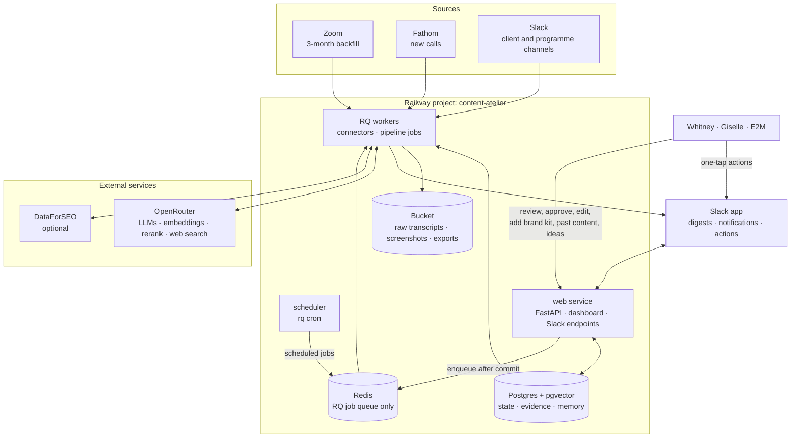
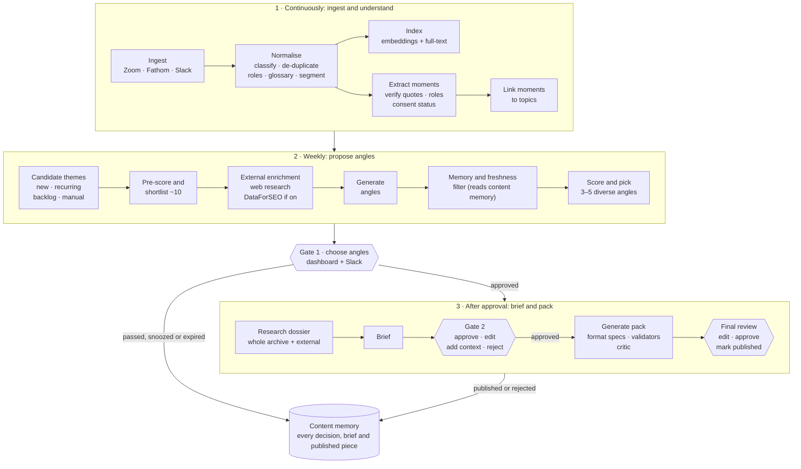
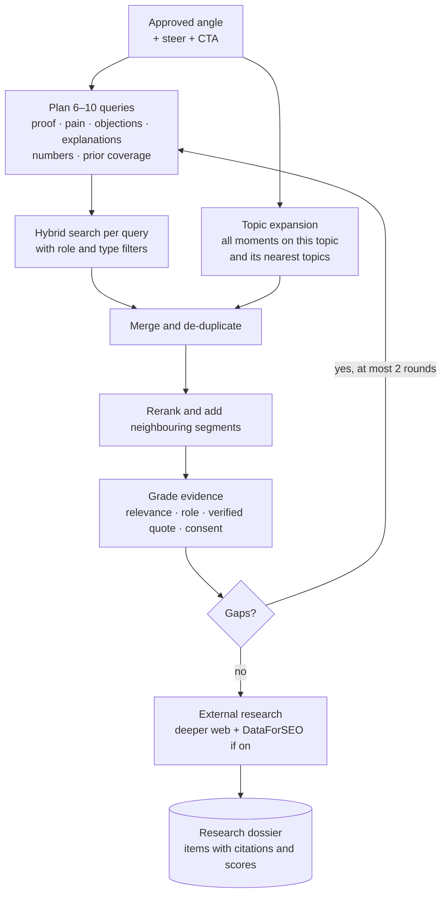
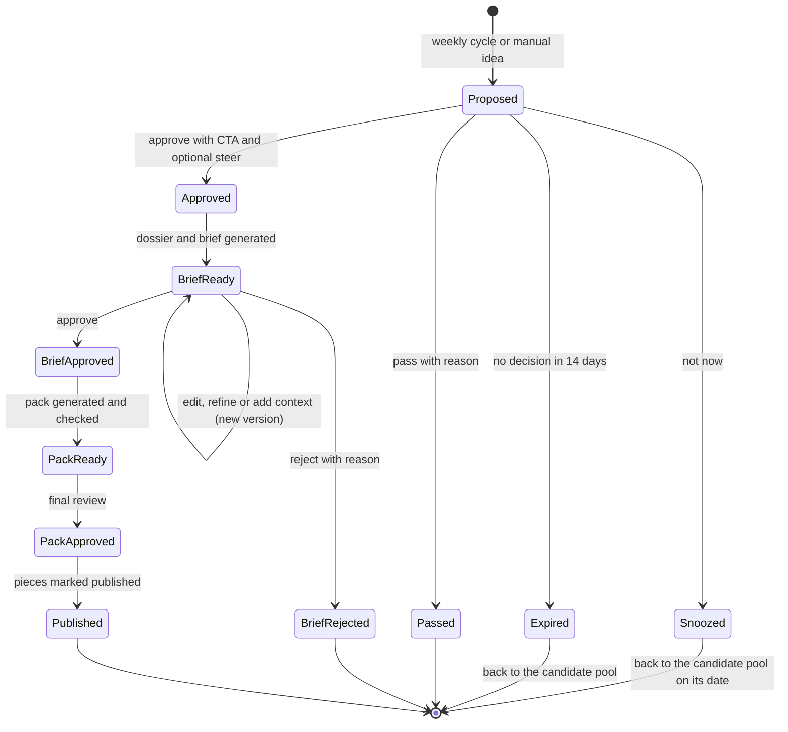
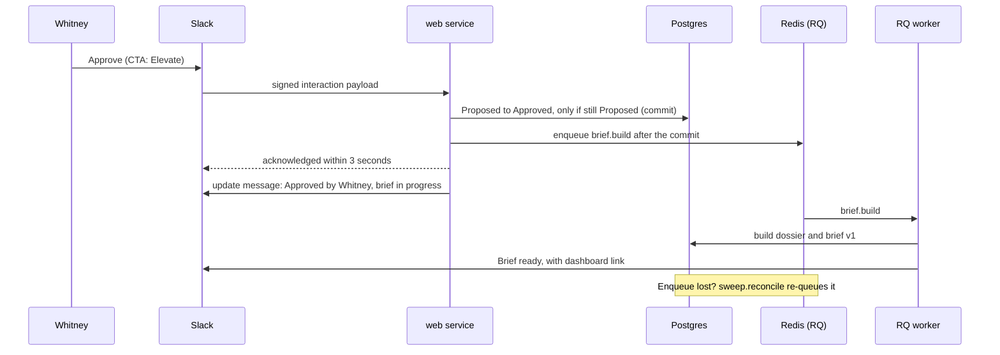

# Content Atelier: Solution Architecture

<!-- governing-plan-note -->
> **Target state, amended (18 October 2026, plan item S.B9).** Read this together with [the implementation plan](Content-Atelier-Implementation-Plan-Brief-Generation.md), whose rulings (section 4.2, Appendix E) amend it. Where they differ, the plan wins.

**For:** Wedding Industry Ads (WIA) · **Prepared by:** E2M Solutions, AI division · **Status:** Proposed architecture for review (rev. 2: Python stack, RQ on Redis for jobs) · **Date:** 4 October 2026

**Builds on:** `Content-Atelier-Pitch.html` (workflow pitch), `Content-Atelier-Feasibility-Study.md` (29 September 2026) and `transcript.md` (WIA × E2M sync, 16 September 2026). Vendor capabilities were re-checked against current documentation on 4 October 2026 (Appendix B).

> **How to read this document.** Section 0 is the decision summary. Sections 3 to 7 are the core design: the knowledge layer, the pipeline, external research, approvals and memory. Section 13 separates what is essential for v1 from what can wait and what to avoid. Section 14 is the build sequence. Appendix A gives the engineering team a starting repository layout, interfaces and settings.

---

## 0. The short version

Content Atelier should be one small Python application on Railway. A **web service** runs the dashboard, the API and the Slack endpoints. **RQ workers** run the connectors and the AI pipeline, fed by a **Redis** job queue, and RQ's cron scheduler runs the schedules. **One Postgres database** with pgvector holds all state, evidence and memory, and a Railway bucket holds raw files. Postgres is the source of truth; Redis only carries work and can be rebuilt from Postgres. No other infrastructure is needed to run it in production.

Four things will decide the system's quality, so the architecture spends its complexity there and keeps everything else plain:

1. **Grounding.** Every idea, brief and asset traces back to verified moments from WIA's own calls and Slack, with timestamps and links.
2. **Judgement.** Ideas are ranked against explicit, tunable criteria across all of the week's evidence, not by a single "is this good?" prompt.
3. **Retrieval depth.** Briefs draw on the whole archive. A topic discussed five times over three months is researched as five discussions, not one.
4. **Memory.** The system knows what it has proposed, what was chosen, what was published and when. It lets a topic return when there is something new to say.

### Key decisions

| # | Area | Recommendation | Instead of | Why |
|---|---|---|---|---|
| 1 | Datastore | One Postgres database for pgvector, full-text search and all relational state, including approval states. Redis holds only the RQ job queue. Raw files in a Railway bucket. | A separate vector database or graph database | The corpus is small: roughly 0.5–1.5M tokens after the backfill. Filters, joins and exact phrases matter more than raw similarity. One thing to back up and secure. |
| 2 | Knowledge model | Three tiers: the **brand kit** (always loaded whole), the **evidence store** (transcript segments, Slack items, moments, topics) and **content memory** (angles, briefs, assets, published content) | One undifferentiated vector index | Each tier has a different access pattern and a different failure mode. |
| 3 | Unit of insight | Verified **moments** linked to a lightweight **topic registry** | Call summaries, or a yes/no verdict per call | Moments are reusable evidence. Topics make recurrence, retrieval and freshness explainable. |
| 4 | Brief research | A bounded research loop: several targeted hybrid searches, topic expansion and at most two follow-up rounds, saved as a cited **research dossier** | One similarity search on the angle title | It finds the same idea said in different words months apart, and every claim can be audited. |
| 5 | Workflow engine | Approval gates are **database states** in Postgres. **RQ on Redis** runs the work, and RQ's cron scheduler runs the schedules. A reconciliation sweep re-queues anything Redis lost. | Temporal, Inngest, Trigger.dev, n8n | Nothing needs to wait in memory for days, and RQ is what the team already runs well. |
| 6 | Ingestion | Scheduled, idempotent **polling** of Zoom, Fathom and Slack | Webhooks first | The cycle is weekly. Polling is simpler and recovers on its own after downtime. |
| 7 | Angle generation | A **funnel**: evidence, shortlist, external enrichment, angles, memory filter, then arithmetic ranking with a diversity rule to pick 3–5 angles | One "give me five ideas" prompt | Consistent from week to week, tunable and explainable. |
| 8 | External research | Two pluggable providers. **Web research** is on by default and runs through OpenRouter's web search. **SEO data** comes from DataForSEO behind a feature flag. Both are cached, budgeted and non-blocking. | SerpAPI and DataForSEO side by side, or a hard dependency | One SERP vendor instead of two. The system keeps working when either provider is off or down. |
| 9 | MCP | **Not on the pipeline's critical path.** DataForSEO is called through its REST API by a small typed adapter. MCP is an optional later add-on for open-ended research and ad-hoc use. | MCP as the integration layer | The pipeline runs fixed query recipes, which are cheaper, deterministic and testable as direct calls. |
| 10 | Approvals | The **dashboard is the system of record**. Slack carries digests, notifications and one-tap actions that call the same approval service. | Approvals only in Slack, or only in the dashboard | Briefs need real editing, and Slack is where attention already is. |
| 11 | Output formats | **Format specs and pack templates are data.** The anchor piece is written first, then rule validators and a critic from a different model family check the pack. | A hard-coded content pack | Formats will change. Adding one should take configuration and a prompt, not new pipeline code. |
| 12 | Freshness | Similarity checks at **topic, angle and asset** level, status-based cooldowns, and re-eligibility when new evidence arrives | Permanent de-duplication | Strong topics should come back once enough time has passed or the story has moved on. |
| 13 | Models | OpenRouter only, with a model chosen per stage, structured outputs, zero-data-retention routing and prompt caching for the brand kit. Every model switch is preceded by an evaluation run. | One model for everything | Cost and quality differ by stage, and client data is sensitive. |
| 14 | Stack | A Python monorepo: a FastAPI web app and RQ workers that share Pydantic models and domain logic | A service per stage | One codebase, the team's own language, and the same models in the UI, the API and the LLM outputs. |

### Scope at a glance

- **Essential for v1:**
  - Ingestion: the three connectors, the evidence store and hybrid search.
  - Ideas: moment extraction with verification, the topic registry, the weekly angle cycle with web research, and the DataForSEO adapter behind a flag.
  - Approval and writing: both approval gates in the dashboard and Slack, researched briefs, configurable content packs with checks, and a final review that records what was used.
  - Memory and operations: content memory with cooldowns, cost caps, logging and an evaluation set.
- **Later:** the learning loop that proposes scoring and voice updates, a Slack "send to Atelier" shortcut, webhooks, an industry news watchlist, deeper DataForSEO use and MCP, automated import of published content, a calendar and exports.
- **Not now:** a separate vector or graph database, a workflow engine, a heavier message broker (Kafka, RabbitMQ), multi-agent frameworks, fine-tuning, self-hosted models, auto-publishing, multi-tenancy.

Section 13 has the full lists, with reasons.

---

## 1. Requirements and context

### 1.1 What the system must do

| # | Requirement | Where it is addressed |
|---|---|---|
| R1 | Ingest about 3 months of Zoom calls once, collect new calls from Fathom continuously, and monitor client Slack channels (text, pasted text, screenshots) | §4.1–4.2 |
| R2 | Identify genuinely content-worthy moments, not summaries | §4.3–4.4 |
| R3 | In each weekly cycle, propose about 3–5 angles grounded in internal evidence **and** external research, with optional DataForSEO enrichment that can be switched on and off | §4.5, §5 |
| R4 | Angles appear in the dashboard, are posted to Slack, and wait for a person to choose | §6 |
| R5 | Approved angles get a researched brief that draws on the whole history: backfill, new calls, Slack and stored content | §3, §4.6 |
| R6 | Briefs can be approved, edited, given extra context or instructions, or rejected before anything is written | §4.6, §6 |
| R7 | Generate the final assets from the approved brief, without locking the system into today's formats | §4.7 |
| R8 | Remember what was proposed, approved and used; avoid repeats and near-repeats; let topics return when appropriate | §7 |
| N1 | Run on Railway, keeping services and data inside Railway where practical | §2.3, §9 |
| N2 | Use OpenRouter for model access | §8 |
| N3 | Understandable and maintainable over impressive | Throughout; §13.3 |
| N4 | Consistent, high-quality output over novelty | §4.5, §4.7, §11 |
| N5 | Human approval is intentional and stays | §6 |
| N6 | External enrichment helps but never becomes a fragile dependency | §5.2, §9.3 |

### 1.2 Context from the materials

- **People.**
  - Whitney: founder, with the final say on content.
  - Giselle: turns approved copy into Canva, Descript and email work, and is the natural delegate.
  - Jacqueline and Carmen: run the Meta and Google Ads office hours, recorded in Fathom.
  - The E2M team: operators and admins.
- **What good output looks like.**
  - One content pack per approved idea:
    - one marketing email;
    - one carousel of 7–10 "high value" slides following *hook → problem → solution → transformation → how we help → CTA*;
    - three reel scripts with distinct angles;
    - long-form captions.
  - First person when it is Whitney's story or a one-to-one conversation; "we" when it is general.
  - The pieces should share threads without feeling redundant to someone who sees all of them.
- **CTA logic.** Workshop and Accelerator topics point to the Accelerators, and one-to-one client results point to Elevate. Whitney wants to be asked about the CTA, at least at first.
- **Brand kit.** A lengthy founder voice document, a content strategy document from a consultant (topics and "hot button" items), and past content suites, including the "10 weeks without posting, leads didn't stop" suite.
- **A useful lesson.** Whitney gets better results from a fresh ChatGPT chat than from a project with accumulated memory. So every AI step here gets a fresh, purpose-built context rather than an ever-growing conversation.
- **Out of scope.** Design, video, publishing and scheduling. The system prepares approved copy, and people publish it.
- **Data quality is a known issue.**
  - The sample transcript has garbled terms: *GPD*, *OpenRodder*, *RGHL*, and *campus* for campaigns.
  - The feasibility study found about 12 of 103 turns attributed to the wrong speaker.
  - Any quote used publicly must therefore be checked against the recording.

### 1.3 Vocabulary

| Term | Meaning |
|---|---|
| Source document | One call, or one Slack message with its thread |
| Segment | A searchable chunk of a source document |
| Moment | A structured, verified insight from a source: type, quote, speaker, client, consent status |
| Topic | A canonical subject that moments, angles and published pieces link to |
| Candidate theme | A topic plus the current evidence, considered for angles in a cycle |
| Angle | A specific take on a topic for an audience, with hooks and proof. This is what Gate 1 decides on. |
| Research dossier | The saved internal and external evidence gathered for an approved angle |
| Brief | The one-page plan for a pack. This is what Gate 2 decides on. |
| Pack | The set of assets produced from one brief |
| Format spec, pack template | Data that defines a content format, and which formats a pack contains |
| Content memory | Everything proposed, decided, produced and published, used for freshness |

### 1.4 Where this architecture agrees with the earlier material, and where it changes it

The feasibility study got the fundamentals right:

- a moments ledger;
- ranking across calls rather than judging each call alone;
- Postgres instead of a vector database;
- the brand kit loaded in full;
- deterministic code wherever exactness matters.

This architecture keeps all of that and changes the following:

| Topic | Feasibility study / pitch | This architecture | Why |
|---|---|---|---|
| SEO and SERP data | SerpAPI as the preferred source, with DataForSEO mentioned for search volumes | **DataForSEO as the single SEO/SERP provider, behind a flag.** Web research through OpenRouter covers news and industry conversation. | You asked for DataForSEO. It covers search volume, CPC and competition, which SerpAPI does not, as well as People Also Ask and related searches. One vendor is simpler, and it avoids depending on a supplier in active litigation with Google. |
| Memory | "Novelty" as one scoring criterion | A **topic registry** plus an explicit **content-memory** tier with cooldown rules | Freshness is a first-class requirement and needs its own model. |
| Where Gate 1 happens | In Slack | The **dashboard is the system of record**. Slack carries the digest and one-tap actions. | Both work, but state must live in one place. |
| Gates | Three: angle, brief, final pack | **Two decision gates** (angle and brief) plus a **lightweight final review** | The final review is where edits happen, and where the system learns what was actually used, which memory needs. |
| New-call detection | Webhooks with a scheduled backstop | **Scheduled polling only** in v1 | Weekly cadence, and one mechanism instead of two. |
| Slack scope | Three named channels | A **channel registry**: per-client channels plus programme and social-proof channels, each mapped to a client where possible, with a cheap triage step before extraction | You described a channel per client, which means more channels and more operational chatter. |
| Learning loop | In the core design | **Capture decisions and edits from day one, and build the automated loop later** | The data is cheap to capture. The loop is only useful after a few months of it. |
| Founder-initiated ideas | Flag an idea in Slack | **"Add an idea" in the dashboard in v1**, with a Slack message shortcut later | Same outcome, smaller v1. |

---

## 2. Architecture at a glance

### 2.1 System context



### 2.2 Pipeline



### 2.3 Railway topology

| Railway service | Runs | Notes |
|---|---|---|
| `web` (public domain) | FastAPI: dashboard, API, Slack interactivity endpoint, sign-in | Stateless. One instance is enough. |
| `worker` (no public domain) | RQ worker processes for the `interactive`, `default` and `bulk` queues (§9.2) | One service running a small pool of worker processes |
| `scheduler` (no public domain) | `rq cron` with the schedule config, `TZ` set to WIA's timezone | One tiny always-on process. It only enqueues; workers execute. |
| `redis` | Railway Redis, holding only RQ queues and registries | Private networking only. A volume with append-only persistence. Nothing in it is the only copy of anything. |
| `postgres` | Postgres 17 or 18 with the `vector` and `pg_trgm` extensions | Private networking only. Scheduled backups plus point-in-time recovery. The source of truth. |
| `bucket` | Raw source payloads (VTT, JSON), Slack images, periodic `pg_dump` exports | Private. Screenshots are viewed through short-lived presigned URLs. |

**Environments.** Use two Railway environments, **staging** and **production**. Each gets its own database and bucket, and its own Slack app or at least its own private test channel.

**Schedules run in RQ's cron scheduler, not Railway's cron.** Railway's cron service runs in UTC, has a 5-minute minimum interval and skips a run if the previous one is still going. RQ's `CronScheduler` (`rq cron <config>.py`) takes cron strings in the scheduler process's local timezone (set with `TZ`), and enqueues ordinary RQ jobs, so they get the same retries and monitoring as everything else.

- **It is marked beta** in RQ's docs (introduced in RQ 2.4; cron strings in 2.5). Pin the RQ version. If it misbehaves, the mature `rq-scheduler` package is a drop-in alternative for the same handful of schedules.
- **Missed runs are covered by idempotency, not by the scheduler.** Every scheduled job is keyed by its period (for example, the ISO week for `cycle.run`), and the `sweep.reconcile` job (§9.2) starts the weekly cycle if it has not run by its due time.

**pgvector on Railway.** Railway's documentation is not consistent about whether its default Postgres image includes pgvector. Its RAG guide says to use the pgvector template, while a 2026 Railway blog post describes pgvector as built in. On day one:

- confirm that `CREATE EXTENSION vector;` works on the chosen image;
- confirm that backups and point-in-time recovery work with that same image.

### 2.4 Recommended stack

| Concern | Recommendation | Notes |
|---|---|---|
| Language | Python 3.12+, with the web app, workers and domain logic in one repository | The team's standard |
| Web app | FastAPI, with server-rendered Jinja templates and HTMX for the dashboard | One language end to end. Editors are forms, so no single-page app is needed. If the team prefers React for the dashboard, put it in front of the same FastAPI API. |
| Database access | SQLAlchemy 2 with Alembic migrations, psycopg 3 and `pgvector-python`; raw SQL for search | Hybrid search is one hand-written SQL function |
| Jobs and schedules | RQ on Redis, with RQ's cron scheduler | The team's standard. §9.2 sets out how it is used safely. |
| Validation | Pydantic v2 models shared by the API, the templates and LLM structured outputs | One definition each of a "moment", an "angle" and a "brief"; `model_json_schema()` produces the schema sent to OpenRouter |
| LLM access | OpenRouter, through the OpenAI Python SDK pointed at OpenRouter's base URL | Chat, embeddings, rerank and web search all go through one gateway |
| Slack | Bolt for Python with its FastAPI adapter, in HTTP mode | Served by the same public `web` service |
| Text utilities | `rapidfuzz` for quote verification; `webvtt-py` or a small parser for Zoom VTT | |
| Auth | Sign in with Slack or Google, restricted to an email allowlist, with four roles: admin, approver, editor, viewer | |
| Object storage | Railway Bucket (S3-compatible) | `boto3` or any S3 client works |

---

## 3. The knowledge and retrieval layer

This is the central design question: how to store, index and retrieve the material so that research is reliable, simple and able to grow.

### 3.1 Three tiers, each with its own access pattern

| Tier | Contents | How it is used | Why it is separate |
|---|---|---|---|
| **1. Brand kit** | Founder voice document, content strategy (pillars and hot-button topics), CTA catalogue and rules, exemplar packs (source moment to finished suite), glossary, banned phrases, point-of-view rules | **Loaded whole** into every writing prompt, as a cached prefix. Short distilled versions, approved by a person, are used for extraction and scoring. | Rules that apply every time must not depend on search ranking. Chunking a voice guide is how systems lose a voice. |
| **2. Evidence store** | Source documents (calls and Slack posts), **segments** (searchable chunks of transcript or message text), screenshot text, **moments** (structured, verified insights) and **topics** | **Hybrid search** (semantic plus keyword) with metadata filters, plus **topic expansion** | This is the archive. It grows every week and is the main retrieval target. |
| **3. Content memory** | Every angle in any state, brief versions, assets, published content (including pieces imported from before the Atelier), and every human decision with its reason | **Similarity plus rules** on status and time | Drives freshness, and tells the brief writer what WIA has already said. |

### 3.2 Options considered

| Option | Verdict |
|---|---|
| **A. Put everything in the prompt** | Right for the brand kit. Anthropic's guidance is that a knowledge base under about 200,000 tokens can simply go in the prompt. The call archive will already be about 0.5–1.5 million tokens after the backfill, and it grows every week, so cost, latency and missed details would all get worse. **Use this for tier 1 only.** |
| **B. Postgres with pgvector, full-text search and relational metadata** | **Recommended.** One store holds state, evidence and memory. Filters and joins run in the same query. One transaction can both approve an angle and record that its research is due, so no approval is lost even if the job queue is. It handles this scale easily and runs natively on Railway. |
| **C. A dedicated vector database alongside Postgres** (Pinecone, Qdrant, Weaviate) | Adds a second source of truth and a sync job, in exchange for scale this system will not need for years. Metadata filters and joins with workflow state get harder. |
| **D. A knowledge graph or GraphRAG** | Expensive to extract and maintain, and hard to debug. The useful part, knowing which moments relate to which theme, is covered by the topic registry. |
| **E. A hosted file-search or vector-store API** | Quick to start. But chunking and ranking are opaque, retrieval becomes tied to one model vendor outside OpenRouter, and it sits apart from the workflow state. |

### 3.3 What gets indexed

| Unit | What it is | Size and boundaries | Indexed as |
|---|---|---|---|
| **Source document** | One call or one Slack thread, with metadata: date, client, call type, channel, participants, links | — | Metadata only |
| **Segment** | A searchable chunk of a document | See "How segments are cut" below. | Embedding and full-text |
| **Moment** | A structured insight extracted from a document (§4.3) | One idea, with a verbatim quote where there is one | Embedding of type, title, summary and quote; full-text |
| **Topic** | A canonical subject such as "lead flow without organic posting" | Name and description | Embedding |
| **Memory item** | An angle signature ("topic · take · core claim"), a brief's message spine, or a published piece's key message | Short | Embedding |

**How segments are cut:**

- **Calls.** Consecutive speaker turns grouped into windows of roughly 200–400 tokens, about 1–2 minutes of talk.
  - A turn is never split unless it is very long.
  - Each window overlaps the previous one by one turn.
  - Each keeps its start and end timestamps, speakers and speaker roles.
- **Slack.** A message plus its thread replies, split only if long.
- **Screenshots.** The extracted text and a description, stored as their own segment and linked to the message.

**Every segment gets a context header.** Before a segment is embedded and indexed, a deterministic one-line header is added, for example `2026-09-16 · Meta Ads office hours · client: <client> (planner) · speakers: Jacqueline [WIA], <name> [client]`.

- This is a cheap version of Anthropic's "contextual retrieval".
- Anthropic reported that adding chunk context cut retrieval failures by 35% with embeddings alone, and by 49% when combined with keyword search.
- A one-sentence LLM-written context can be added later if the retrieval evaluation shows misses.

**Every embedded row records its embedding model.**

- The default is `openai/text-embedding-3-small` through OpenRouter: 1,536 dimensions at $0.02 per million tokens.
- Recording the model lets the team re-embed everything later, which at this scale costs cents.

### 3.4 One hybrid search primitive

Everything that searches uses one function: the weekly cycle, brief research, the dashboard's archive search and the memory checks.

`search(target, query_text, filters, k)`, where `target` is segments, moments or memory.

1. **Semantic.** Cosine distance on the embedding, with filters applied, top 50.
   - Below roughly 100,000 rows, an exact scan is fine.
   - Beyond that, use an HNSW index with pgvector's iterative scans (`hnsw.iterative_scan`, available from pgvector 0.8.0), so that filters do not starve the results.
2. **Keyword.** `websearch_to_tsquery('english', …)` against a generated `tsvector` column with a GIN index, top 50. Use `pg_trgm` for fuzzy matching of names.
3. **Fusion.** Reciprocal Rank Fusion, `score = Σ 1 / (60 + rank)`, with optional per-method weights.
4. **Optional rerank.** The top ~50 can be reranked through OpenRouter's `/rerank` endpoint, where Cohere and other rerankers have been available since April 2026. Turn it on if the retrieval evaluation shows a gain.
5. **Citations.** Each result comes back with its source, timestamp or permalink, speaker and role, client, and consent status.

**Filters:** date range, client, source type, call type, Slack channel, speaker role (client or staff), named speaker, moment type, consent status, topic.

```sql
-- Sketch: hybrid search over segments (semantic + keyword, fused with RRF)
WITH semantic AS (
  SELECT id, ROW_NUMBER() OVER (ORDER BY embedding <=> $1) AS r
  FROM segments
  WHERE occurred_at >= $3 AND ($4::uuid IS NULL OR client_id = $4)
  ORDER BY embedding <=> $1
  LIMIT 50
),
keyword AS (
  SELECT id, ROW_NUMBER() OVER (ORDER BY ts_rank_cd(tsv, q) DESC) AS r
  FROM segments, websearch_to_tsquery('english', $2) AS q
  WHERE tsv @@ q AND occurred_at >= $3 AND ($4::uuid IS NULL OR client_id = $4)
  ORDER BY ts_rank_cd(tsv, q) DESC
  LIMIT 50
)
SELECT id,
       COALESCE(1.0 / (60 + semantic.r), 0) + COALESCE(1.0 / (60 + keyword.r), 0) AS score
FROM semantic FULL OUTER JOIN keyword USING (id)
ORDER BY score DESC
LIMIT $5;
```

### 3.5 Retrieval recipes

| Need | Searches | Strategy |
|---|---|---|
| Weekly candidates | Moments since the last cycle, plus topic statistics | Plain SQL over the moments ledger. No similarity search needed. |
| Corroboration ("this isn't a one-off") | Moments | Topic expansion plus hybrid search. Speaker role = client. Types: result, testimonial, story. |
| The problem in members' own words | Segments and moments | Speaker role = client. Types: question, objection. |
| How Whitney explains it | Segments | Speaker = Whitney, or workshop calls |
| What WIA has already said | Content memory | Similarity to the angle signature |
| Archive search in the dashboard | Segments and moments | Filters chosen by the user. Results show quotes and timestamps. |

### 3.6 Research loop for briefs

A single similarity search on an angle title misses most of what matters. The brief stage runs a short, bounded research loop and saves the result as a **research dossier**.



**Limits:** at most 2 follow-up rounds, about 12 queries in total, and about 40 graded evidence items passed to the brief writer.

**What the dossier records:** every query, every hit with its score, and every grading decision. A weak brief can then be traced to either a retrieval miss or a writing problem.

**Topic expansion is what makes the "discussed several times over months" case reliable.** Every moment is linked to a topic when it is extracted. An approved angle therefore starts from every related moment in the archive, whatever words were used. Hybrid search then adds what the topic links missed.

### 3.7 Scale, and when to revisit

- **Expected volume.**
  - Backfill: about 50–150 calls. This is the feasibility study's estimate and still needs confirming.
  - Ongoing: perhaps 5–20 calls a week.
  - That is roughly 10,000–40,000 segments and 2,500–20,000 moments a year, plus Slack.
  - pgvector handles millions of rows on a modest instance.
- **Revisit only if:**
  - segments pass a few million;
  - query latency goes above a second;
  - the system is extended to several brands.

  Even then, the next steps stay inside Postgres: HNSW tuning, `halfvec`, partitioning by year.
- **Everything derived can be rebuilt.** Raw payloads are kept in the bucket, and every derived row records the version of the pipeline step that made it. Changing the chunking, the embedding model or the extraction prompt means re-running jobs, not migrating data by hand.

---

## 4. The pipeline, stage by stage

### 4.1 Ingestion

Each connector, in summary:

| Connector | Mode | How it works | Cadence |
|---|---|---|---|
| **Zoom** | One-off backfill, re-runnable | A Server-to-Server OAuth app in WIA's Zoom account lists users, then each user's cloud recordings in windows of up to one month, then downloads the transcript files (VTT) and metadata. | Run once. Optionally weekly as a safety net, if some client calls stay on Zoom. |
| **Fathom** | Backfill and incremental | An API key per recording host (Whitney, Jacqueline, Carmen) calls `GET /external/v1/meetings?created_after=…&include_transcript=true` and follows the cursor. | Every 2–4 hours |
| **Slack** | 3-month backfill and incremental | A custom app created in WIA's own workspace, with the bot added to the registered channels. It reads `conversations.history` with a per-channel `oldest` cursor, `conversations.replies` for threads, and downloads screenshots with the bot token. | Every 1–2 hours, plus a nightly re-scan of the last 14 days to catch edits and deletions |
| **Manual** | On demand | Dashboard upload or paste of brand kit documents, past published content (CSV or paste), client consent settings, the glossary and idea seeds | — |

**Zoom: what to watch for**

- The app is internal to WIA's account, so it needs no marketplace review.
- Transcripts exist only for cloud recordings made on a paid plan with **audio transcript** turned on at the time. Local recordings are not available through the API.
- Processing can take up to about twice the meeting's length, and occasionally up to 24 hours.
- If WIA used AI Companion transcripts instead, they come from `GET /meetings/{meetingUUID}/transcript`, using the past-meeting instance UUID.
- If only audio exists, transcribing it ourselves is the fallback.
- **Run the backfill early**, in case cloud recordings are set to auto-delete.

**Fathom: what to watch for**

- There are no organisation-wide keys. Private, unshared calls are visible only to the host's own key.
- Alternative to per-host keys: one admin key, if the admin has view access to all shared calls and calls are shared to a team.
- Rate limits are 60 requests per minute, with transcript requests capped at 30 per minute and sometimes reduced to 5. Throttle requests and honour `Retry-After`.
- Transcripts arrive only after Fathom's processing finishes.
- Useful fields:
  - `calendar_invitees_domains_type`, `calendar_invitees[].is_external` and `meeting_type`, for classifying calls;
  - `meeting_url`, for Zoom de-duplication;
  - transcript items with `speaker.display_name`, `matched_calendar_invitee_email` and `timestamp`;
  - highlights, via `include_highlights`. When a host clips a highlight, treat it as a human signal of importance.
- Also backfill Fathom's own history for the 3-month window, since office hours may already be there.

**Slack: what to watch for**

- Since 29 May 2025, new installs of non-Marketplace apps distributed to other workspaces are limited to 1 request per minute and 15 messages per call for history methods.
- Internal, customer-built apps keep 50+ requests per minute and up to 1,000 messages. **Create the app inside WIA's workspace** so that it is clearly internal.
- Scopes: `channels:history`, `groups:history`, `channels:read`, `groups:read`, `files:read`, `users:read`, `chat:write`, plus `channels:join` to join new public client channels.

**Why polling and not webhooks in v1.** Every connector is an idempotent "sync since cursor" job:

- it upserts by `(source, external_id)`;
- it advances the cursor only after a successful batch;
- it can be re-run safely.

Webhooks add work without helping a weekly cycle:

- Fathom's webhook fires once per meeting, may be retried, and does not fire for short calls without a summary.
- Slack's Events API needs fast acknowledgement and retry handling.

Both are worth adding only if near-real-time capture ever matters.

### 4.2 Normalisation

1. **Store the raw payload** in the bucket and create a `source_documents` row. Raw data is never modified.
2. **Classify the call.** Rules come first, and an LLM handles only the leftovers.
   - Rules use attendee email domains (WIA, E2M, client domains), Fathom's `calendar_invitees_domains_type` and `meeting_type`, title patterns ("Office Hours", "Workshop", "Weekly Sync") and recurring series.
   - Categories: `client_1on1`, `office_hours`, `workshop`, `prospect`, `internal`, `vendor`, `other`. Whether each one is included is a setting.
   - Suggested defaults:
     - include `client_1on1`, `office_hours` and `workshop`;
     - include `prospect` calls for questions and objections only, always anonymised;
     - exclude `internal` and `vendor`. This leaves out E2M's own sync calls, including the 16 September call.
3. **De-duplicate across sources.** The same meeting can exist in both Zoom and Fathom. Match on the Zoom meeting number in Fathom's `meeting_url` plus overlapping start times. Keep one canonical document, preferring the source with better speaker identity, and link the other.
4. **Resolve speakers and roles.**
   - Map display names and emails to a `people` table. WIA staff come from configuration; client contacts come from calendar invitees and the clients table.
   - Each turn gets a role: `staff`, `client`, `prospect` or `unknown`.
   - An LLM resolves unknowns from context and flags low confidence.
   - This matters most for testimonials.
5. **Apply the glossary without changing the original.**
   - High-confidence replacements (*OpenRodder* → OpenRouter, *RGHL* → GHL) produce a normalised text, which is used for search and extraction.
   - The raw text is kept for quote verification and display.
   - Context-dependent fixes (*campus* → campaigns) go to the extraction prompt as glossary hints rather than being replaced blindly.
6. **Segment and index** (§3.3).
7. **Triage Slack before extraction.** Client channels contain a lot of operational chatter ("budget updated", "campaign live").
   - A fast model classifies messages and threads in batches: is there a content signal, and of what kind?
   - Only messages with a signal go on to moment extraction.
   - Each channel has a mode:
     - `full`: all messages are triaged;
     - `social_proof`: every message is treated as a candidate;
     - `off`.
   - Screenshots in candidate messages go to a vision model, which extracts the text word for word, describes the image and notes who the sender appears to be.

**Coverage report.** A Sources page shows, for each connector and each Fathom host:

- the last successful sync;
- what arrived this week;
- any errors.

"Jacqueline's office hours didn't arrive this week" should be visible before it becomes a gap in the digest.

### 4.3 Moment extraction

This is the step that keeps the Atelier from being a summarisation pipeline. Each included document is read once by a strong model, using structured output. The model is asked "what in here could feed content, and why?", using a taxonomy and a strength rubric. It is not asked to summarise the call.

- **It records every candidate moment.** Ranking happens later, across the whole week.
- **Each call fits in one prompt.** A 60-minute call is roughly 10,000–12,000 tokens.

**Moment types** (a starting taxonomy, editable in settings):

| Type | Captures | Example from WIA's material |
|---|---|---|
| `result` | A measurable client outcome | "Their business has doubled… their best month ever" |
| `testimonial` | A client's own words about working with WIA | "You made this so easy" |
| `story` | A before-and-after narrative | From slow season to fully booked |
| `question` | What members ask or struggle with | "How much should I spend on Meta?" |
| `objection` | A doubt or hesitation from a client or prospect | "Is Google worth it for planners?" |
| `teaching` | Whitney or staff explaining a concept | Defining your unique value proposition (Vault workshop) |
| `opinion` | A strong or contrarian point of view | "Your feed isn't your lead engine" |
| `data_point` | A number: leads, cost per lead, spend, bookings | "10 weeks without posting, and leads held" |
| `trend_signal` | Something changing in the market or on the ad platforms | "CPMs jumped this month" |
| `soundbite` | A line that works word for word | "I haven't posted anything organically on Instagram in like 10 weeks" |

**Each moment records:**

- **What it is:** type, title and a two-sentence summary.
- **Who said it:**
  - verbatim quote(s) with start time;
  - speaker and role;
  - client;
  - evidence kind:
    - `direct_quote`;
    - `team_report`, when a staff member relays something;
    - `screenshot_text`.
- **Why it matters:**
  - a "why this could be content" line;
  - one or two seed angle ideas;
  - a strength score from 1 to 5 against a written rubric (specificity, proof value, emotion, relevance, uniqueness).
- **How it can be used:** sensitivity flags (revenue figures, names, health or personal matters), consent status, and a deep link to the recording or the Slack permalink.

**Deterministic checks after extraction:**

1. **Quote verification.** Each quote must fuzzy-match the raw text within about 90 seconds of its timestamp, with a normalised similarity of at least 0.9. A quote that fails is marked unverified and can only be used as a paraphrase.
2. **Role plausibility.** Testimonials, praise and results must come from a client, or be the client's own words in a screenshot or pasted text.
   - Praise of WIA spoken by WIA staff is not a testimonial.
   - A result relayed by staff becomes a `team_report`.
3. **Numbers must appear in the source.** Any figure in a summary or quote must be present in the raw text.
4. **Consent status.** Each moment gets one of:
   - `cleared`: the client allows named use;
   - `anonymise`: the default;
   - `internal_only`;
   - `do_not_use`.

   The status is derived from the clients table and the sensitivity flags.

**The ledger is useful on its own.** The dashboard shows the week's moments, with a "make this an angle" button. That gives Whitney and Giselle a searchable archive of proof, even in weeks when they do not want a full pack.

### 4.4 Topic registry

Topics are short, canonical subjects, such as "lead flow without organic posting", "Meta or Google first" or "defining your unique value". Each is tagged with one or more **content pillars** from the strategy document.

- **Assignment.**
  - For each new moment, retrieve the five nearest topics by embedding.
  - A fast model either picks one or two of them, or proposes a new topic with a name and description.
  - Showing the model the nearest candidates is what stops near-duplicate topics from multiplying.
- **Statistics, kept up to date:**
  - mentions in the last 30, 90 and 365 days;
  - distinct clients;
  - last mention;
  - coverage history from content memory.
- **Admin controls.** Rename, merge, split or block a topic. A monthly job that suggests merges is a later addition.

The registry is a flat list, not a taxonomy tree. Its jobs are:

- counting recurrence;
- expanding retrieval;
- giving memory a stable key.

### 4.5 The weekly angle cycle

The cycle runs once a week, for example early on Monday in WIA's timezone, and can also be started from the dashboard. It runs as a single resumable job with bounded internal concurrency. Each theme's results are saved as they finish, so a re-run skips completed work.

1. **Window.** Moments created since the last cycle.
2. **Candidate themes.** Group the new moments by topic, then add:
   - **rising topics**, for example three or more distinct clients in 30 days, or mentions doubling;
   - **snoozed angles** that are due again;
   - **manual ideas**;
   - if there are fewer than about 10 candidates, the strongest unused **backlog** topics from the archive.
3. **Pre-score in code.** Evidence strength (best moment strength, verified quotes, distinct clients, recency), multiplied by the freshness factor from memory and the pillar-balance factor. Keep about 8–12 themes.
4. **External enrichment for the shortlist**, in parallel and cached (§5):
   - web research on the current conversation, recent news or platform changes, and how others frame the topic;
   - DataForSEO, when it is enabled.
5. **Generate one to three angles per theme.** An angle is a specific take for a specific audience, not a topic. Each one includes:
   - **Framing:**
     - title and a one-sentence angle statement;
     - two or three hook options;
     - audience segment (planners, photographers, venues and so on);
     - pillar.
   - **Rationale:**
     - why it matters, in clients' own words;
     - why now, from internal recency and external evidence;
     - differentiation: what others say, compared with WIA's take.
   - **Evidence:**
     - proof (moment IDs with verified quotes);
     - external sources;
     - SEO data, if available.
   - **Next steps:**
     - a suggested CTA track, with the reason;
     - risks such as consent or anonymisation;
     - for a topic covered before, **what is new since then**.
6. **Memory filter** (§7). Block near-duplicates that are still in cooldown, apply penalties, and enforce the "what is new" rule.
7. **Score against a rubric.** For each criterion, the LLM returns a 1–5 score, a one-line reason and the evidence it relied on. The total is **plain arithmetic**: weighted rubric score × freshness factor × balance factor, with weights from settings.

   | Criterion | Question | Type | Start weight |
   |---|---|---|---|
   | Proof | Is there a verified, specific moment behind it? | Gate (at least one verified moment), then weighted | 0.25 |
   | Usable | Can it be used publicly, or anonymised safely? | Gate | — |
   | Audience pain | Does it hit something wedding pros feel, and map to a pillar or hot-button topic? | Weighted | 0.20 |
   | Timeliness | Is there a current conversation, platform change or seasonal reason? | Weighted | 0.15 |
   | Offer fit | Is there a natural route to the Accelerators or Elevate? | Weighted | 0.10 |
   | Recurrence | Has it come up across several calls, clients or posts? | Weighted | 0.10 |
   | Differentiation | Is WIA's take different from what is widely said? | Weighted | 0.10 |
   | Search demand | (DataForSEO) Are people searching or asking about it? | Weighted, light | 0.10 |
   | Freshness | From the memory policy | Multiplier | — |

   When DataForSEO is off, the search-demand weight is 0 and the other weights are rescaled. The ranking never depends on it.
8. **Select.** Apply a quality floor, then pick greedily with a diversity rule:
   - no two angles on the same topic;
   - no two angles above the "related" similarity threshold;
   - at most two per pillar;
   - a mix of CTA tracks where possible.

   The target is 3–5 angles. If fewer than 3 clear the floor, either fill the gap with the best archive angles, labelled "from the archive", or send fewer with a note. Two strong ideas in a week beat five padded ones.
9. **Publish.** Show the angles in the dashboard and post the Slack digest (§6).

**Calibration before launch.**

- Whitney labels about 30–50 backfilled moments or angles as *would make content* or *wouldn't*.
- The rubric wording and the weights are tuned until the ranking agrees with her.
- The labels are kept as a regression test (§11).

### 4.6 Research dossier and brief

When an angle is approved, with a CTA and an optional "steer" note, the worker builds the dossier (§3.6) and then writes the brief. The brief is stored as **structured JSON** and rendered for editing.

| Section | Content |
|---|---|
| Working title and angle statement | One sentence |
| Why now | Internal recency plus external context, with dated sources |
| Audience and pain | The segment, and the problem in clients' own words (cited) |
| Core insight | The single idea the pack exists to land |
| Message spine | The 3–4 lines every piece shares |
| Proof points | Verified quotes and results, each with its source, a timestamp link and its consent status |
| Supporting data | Search and trend data, if enabled, labelled as directional |
| Differentiation | What is commonly said, and how this take differs |
| Hook options | Three to five |
| Format plan | What each piece in the pack uniquely does (for example, three reel scripts with three different hooks), and which piece is the anchor |
| CTA | Track and specific action, as confirmed at Gate 1 |
| Constraints | For example: anonymise client X, avoid revenue figures, flag claims that need permission |
| Open questions for Whitney | Anything the system could not settle |
| Sources | Every evidence item used, with a link |

**Validation before anyone sees the brief:**

- every proof point cites at least one evidence ID;
- every quote is verified;
- every number appears in the dossier;
- claims that need consent are flagged;
- the CTA is set.

A failure triggers one automatic repair attempt. Anything still failing is shown on the brief.

### 4.7 Content generation

**Formats are data, not code.**

- Each format is a versioned **format spec**.
- A **pack template** lists which formats to produce, how many of each, and in what order.

```yaml
# Example format spec (stored in the database, editable by admins)
key: carousel
version: 3
purpose: "High-value educational carousel that teaches and sells softly"
output_schema: carousel.schema.json   # slides[], caption, cta
rules:
  slides: { min: 7, max: 10 }
  beats: [hook, problem, solution, transformation, how_we_help, cta]
  max_words_per_slide: 60
  cta_must_match_brief: true
prompt: prompts/formats/carousel.v3.md
exemplars: [pack_10_weeks.carousel]
---
# Example pack template
key: wia_standard
formats:
  - { key: carousel, count: 1 }
  - { key: email, count: 1 }
  - { key: reel_script, count: 3, distinct_by: hook }
  - { key: caption, for: [carousel, reel_script] }
anchor: from_brief          # the brief's format plan picks the anchor piece
```

Adding a LinkedIn post or a blog outline later means writing a spec, a schema, a prompt and a few exemplars, then adding the format to a pack template. No pipeline code changes.

**Generation order.**

1. **The anchor piece is written first**, from the brief, the brand kit (loaded whole) and the relevant exemplars.
2. **The other pieces follow**, with the anchor and the message spine in context. They share threads without repeating each other.

This mirrors how Whitney works today in a single chat, except that each piece gets a fresh, purpose-built context.

**Checks before anyone sees the pack:**

1. **Rule validators, in code:**
   - counts and lengths;
   - required beats are present;
   - the CTA matches the brief;
   - first-person versus "we" rules are followed;
   - captions are present;
   - no banned phrases;
   - no client names unless the client is cleared;
   - no numbers that are not in the dossier;
   - the three reel scripts differ from each other (pairwise similarity under a threshold).
2. **A critic**: an LLM from a different model family than the writer. It checks:
   - the voice, against the exemplars;
   - specificity;
   - adherence to the framework;
   - that every claim traces to the dossier;
   - lines that read as AI-written;
   - distinctness across pieces.

   It returns specific fixes.
3. **One revision pass.** The critic's fixes are applied and the validators run again. Anything still failing is shown to the reviewer as a flag; the system does not loop.

**Final review and hand-off.** Whitney or Giselle reads the pack in the dashboard. They can:

- edit in place;
- regenerate a single piece with instructions;
- approve the pack;
- mark pieces as published, with a date and link, when they go out.

Approval notifies Giselle in Slack. Every edit is saved as a new asset version, so the difference between draft and final copy is available for the later learning loop.

---

## 5. External research and the DataForSEO layer

### 5.1 What external research is for

- **Internal evidence** decides **whether WIA has something true and specific to say**.
- **External research** decides **whether it is timely, differentiated and wanted**.

Every angle must have internal proof. External signals adjust the ranking and sharpen the framing.

| Question | Source | Stage |
|---|---|---|
| Is this being talked about now? | Web research: news, industry blogs, ad-platform announcements and forums from the last ~90 days | Angles (light), briefs (deeper) |
| What is already being said, and how is WIA's take different? | Web research on how others frame the topic, plus top SERP results (DataForSEO) | Briefs, with a light check at the angle stage |
| Are wedding pros asking about it? | People Also Ask and related searches (DataForSEO SERP), plus forum threads found by web research | Angles (hooks), briefs |
| How much search demand and commercial value is there? | Google Ads search volume, CPC and competition (DataForSEO) | Angles, at a light weight |
| Is there a seasonal moment? | The 12-month search history returned with the volume data | Timing, and "why now" |
| Can market data itself be content? *(later)* | A tracked list of couples' search terms (for example "wedding venues near me" or "elopement photographer") and how their CPC and volume change | New "data moment" candidates |

**Treat search data as directional.** WIA's audience is a niche B2B market, so volumes for a query like "Meta ads for wedding photographers" will be small.

- Use search data to sharpen hooks and framing, never as a veto.
- It still matters for an Instagram-first brand. Since 10 July 2025, Google and Bing can index public photos, videos and reels from professional Instagram accounts. Keyword-aware captions and slide text therefore have some search value.

### 5.2 Provider design: optional by construction

Both external sources sit behind small interfaces in the worker (Appendix A):

- `WebResearchProvider.research(topic, questions, recencyDays)` returns findings, each with a URL, title, publication date and snippet.
- `SeoDataProvider.keywordMetrics(keywords)`, `.serpQuestions(keyword)` and `.relatedKeywords(seed)` return metrics and questions.

Each provider has:

- **Feature flags**, global and per stage (`angles`, `briefs`).
- **A cache**, keyed by request hash. Its lifetime depends on the data type, for example 30 days for search volumes and 7 days for SERP and web results.
- **Budgets.** A per-cycle cap and a monthly cap in dollars, with a hard stop and an alert.
- **A timeout and one retry.** If the call still fails, the stage continues and the angle or brief is labelled "external check unavailable" or "search data unavailable".
- **A sanitiser.** Outgoing queries never contain client names or personal data. External services receive topics and keywords only.

Everything returned is stored with its angle or brief. Reviewers can see the sources, and the system never pays twice for the same data.

### 5.3 Web research (on by default)

**Use OpenRouter's web search**, so that model access and billing stay in one place.

- **How to enable it.** Add the `:online` suffix to a model ID, or use the `web` plugin.
- **Engines.** It can use the model provider's native search, or engines such as Exa, Parallel and Perplexity.
- **Controls.** It supports domain include and exclude lists.
- **Cost.** Published prices on 4 October 2026 are fractions of a cent per request (for example, $0.005 for the Perplexity engine, or $0.007 for Exa with 10 results), plus model tokens.

**Rules that keep the results trustworthy:**

- **Recency.** Ask for **dated sources**, and drop results outside the recency window in post-processing. OpenRouter's date filters apply only to some engines, so do not rely on them.
- **Domains.** Keep a configurable **allowlist and blocklist** of domains, and have WIA edit them. Seed the allowlist with:
  - ad-platform news (Meta for Business, Google Ads);
  - search-industry news (Search Engine Land, Search Engine Roundtable);
  - social-media trade press;
  - wedding-pro publications and communities;
  - relevant subreddits.
- **Citations.** The summarising model may use only the retrieved results, and must cite them. No uncited claim reaches a brief.
- **Fallback.** If recency or domain control turns out to be weak, swap the provider for Exa's or Tavily's API directly. The interface does not change.

### 5.4 DataForSEO (optional, behind a flag)

**How to connect.** Call the REST API directly, through a small typed client.

- **Billing:** pay-as-you-go, with a $50 minimum deposit and no subscription.
- **Locale:** default to `location: United States` and `language: English`. Add state-level locations if WIA wants regional market data.

| Need | DataForSEO API | Mode | Published price (4 Oct 2026) | Used at |
|---|---|---|---|---|
| Volume, CPC, competition, 12-month history | Keywords Data, Google Ads search volume | Standard queue or Live | $0.06 per task (standard) or $0.09 (live), up to 1,000 keywords per task | Angles (one batched task per cycle), briefs |
| Related keywords, suggestions, difficulty, intent | DataForSEO Labs (Google) | Live | $0.012 per task plus $0.00012 per item | Briefs |
| People Also Ask, related searches, top results | SERP API, Google organic (advanced) | Live, or standard for batches | $0.002 per SERP (live) or $0.0006 (standard) | Angles (questions), briefs (what ranks) |
| Trend direction *(optional)* | DataForSEO Trends | Live | $0.0012 per task, up to 5 keywords | Later |
| Web mentions and sentiment *(later)* | Content Analysis | Live | $0.024 per request plus $0.000036 per row | Later |

**The recipe for each shortlisted theme:**

1. An LLM proposes 5–10 seed keywords in two lenses:
   - **pro:** what wedding pros search, such as "how to get more wedding inquiries";
   - **couple:** what their customers search.
2. One batched volume task covers every theme in the cycle.
3. One SERP call per theme collects the questions people ask.

At WIA's volume this costs well under a dollar a week.

### 5.5 Should DataForSEO be connected through MCP?

| | Direct REST adapter | DataForSEO MCP server |
|---|---|---|
| Fits fixed query recipes | Yes; the calls are deterministic | No; the model chooses the tools and parameters |
| Cost control | Per-call caps and caching in code | Harder; an agent can over-call |
| Context overhead | None | Tool definitions and raw JSON responses go into the model's context |
| Testing | Unit tests with recorded responses | Needs agent-level evaluations |
| Moving parts | Nothing extra | An extra process or a remote server, plus its authentication |
| Interface stability | DataForSEO's v3 REST API | The tool surface has changed across releases: module-based tools earlier, and a docs-search plus generic `api_request` design in the current repository |
| Best use | Pipeline enrichment | Open-ended exploration by an agent or a person |

**Recommendation: use the REST adapter in the pipeline.** MCP adds value in two later situations:

- **An open-ended research agent** at the brief stage that decides its own keyword exploration. Even then, give it a small set of curated tools that wrap the same adapter, with budgets. That is safer than handing it the full server.
- **People at E2M or WIA** using DataForSEO from Claude or ChatGPT.

If E2M later wants MCP so the tools can be reused across clients, expose the curated tools as an MCP server at that point. The official server runs locally (`npx dataforseo-mcp-server`) or remotely at `mcp.dataforseo.com`, and calls are billed at normal API rates.

---

## 6. Human approval design

### 6.1 Gates are states, not paused workflows

Nothing sits in memory waiting for a person.

- Each object has a status in Postgres.
- A human action changes the status in a Postgres transaction. After the commit, the next RQ job is enqueued.
- If that enqueue fails, or Redis later loses the job, nothing is lost: the status still says the work is due, and the reconciliation sweep (§9.2) re-queues it within minutes.

This survives deploys, restarts and Redis outages, and "what is waiting for whom" becomes a simple query.



### 6.2 The dashboard

| Screen | What it does | v1? |
|---|---|---|
| **This week** | Angle cards: the angle statement, hooks, proof quotes linked to the recording moment, why now, external sources, SEO data if on, the score breakdown and "last covered" notes from memory. Actions: approve (with CTA), pass (with reason), snooze, steer, edit text. | v1 |
| **Briefs** | A structured editor with version history. Actions: refine with instructions, add context (free text, or evidence picked from archive search), approve, reject. | v1 |
| **Packs** | Per-format editors with copy buttons, plus validator and critic flags. Actions: regenerate one piece with instructions, approve, mark published. | v1 |
| **Moments and archive** | Hybrid search with filters and this week's moments. Actions: make this an angle, add to brief. | v1 |
| **Topics and memory** | Topic list with mentions, coverage history and cooldown status. Actions: block, unblock, merge, import past content. | v1 |
| **Sources** | Connector health, coverage per host and per channel, failed jobs, re-run buttons | v1 |
| **Settings** | Brand kit documents (versioned), glossary, clients and consent, the Slack channel registry, format specs and pack templates, feature flags, models per stage, weights, thresholds, cooldowns, schedules, budgets | v1 (admins only) |
| **Calendar and exports** | Planned and published content by date; Google Docs export | Later |

**Why a custom dashboard.**

- **Low-code tool builders (Retool, Appsmith).** Fast for simple record screens, but awkward for:
  - evidence with timestamp links;
  - versioned structured briefs;
  - per-format editors;
  - two-way state with Slack.
- **Notion or Airtable as the interface.** These would turn state into a two-way sync problem.

A focused FastAPI and HTMX app in the same codebase is the simplest option that does the job well.

### 6.3 Slack

**Where:** a private channel such as `#content-atelier` for Whitney, Giselle and E2M, plus optional direct messages to the approver.

**The weekly digest:**

- A short parent message, for example "4 angles this week · 2 from new calls, 1 recurring, 1 from the archive".
- One threaded message per angle, showing:
  - its title and one-line take;
  - the top proof quote, anonymised unless the client is cleared;
  - one line on why now.
- Buttons on each angle:
  - **Approve**, with a CTA dropdown preset to the suggestion;
  - **Pass**, which opens a short modal with reason codes;
  - **Snooze**;
  - **Open in dashboard**.
- "Steer" opens a modal with a text field.

**Notifications:**

- Brief ready: a summary, with **Open brief** and **Approve as-is**.
- Pack ready: **Open pack**.
- Pack approved: sent to Giselle.
- Reminders.

**One source of truth.**

- Slack buttons carry only object IDs, and call the same approval service as the dashboard.
- After any action, from either place, the Slack message is updated to show the decision and who made it.
- A stale click gets a private note, such as "already approved by Giselle at 10:42".

**Mechanics:**

- Verify Slack's request signature.
- Acknowledge within 3 seconds and do the work in a job.
- Check that the Slack user is mapped to a dashboard user with the approver role.



### 6.4 Timing, delegation and fatigue

- **Default timings** (all in settings):
  - the cycle runs Monday at 06:00 WIA time, and the digest is posted by 08:00;
  - one reminder after 48 hours;
  - angles expire after 14 days and return to the pool;
  - briefs and packs get a reminder after 3 days.

  Briefs are usually ready within minutes of approval.
- **Delegation.** Anyone with the approver role can act: Whitney, and Giselle as her delegate. Every action records who took it.
- **Guarding against fatigue.**
  - At most 5 angles a week.
  - One tap for the common path.
  - "Nothing strong this week" is an acceptable digest.
- **Manual ideas.** "Add an idea" in the dashboard takes free text, optionally with linked moments. An idea added by an approver can go straight to brief generation. A Slack message shortcut ("Send to Atelier") is a small later addition.

### 6.5 Capture now, learn later

**v1 stores every decision** with its reason code and note:

- pass reasons;
- snooze dates;
- steer text;
- brief edits;
- asset edits, saved as versions.

This data feeds memory and the dashboard.

**The learning loop comes later.** Once a month, it summarises the data into **proposed** changes to rubric weights, voice notes and banned phrases.

- A person approves every change; nothing retrains itself silently.
- A one-off factual correction ("it was 12 weeks, not 10") must not become a style rule.

---

## 7. Content memory and freshness

### 7.1 What is remembered

- Topics.
- Every angle, in every state, with dates and reasons.
- Brief versions.
- Assets and their published dates.
- **Imported past content**: emails, carousels and reels WIA published before the Atelier existed. Without this import, the first months would happily re-propose what WIA has already posted.

### 7.2 Three levels of "too similar"

1. **Same topic.** The same `topic_id`, or topic embeddings that are very close.
2. **Same angle.** The **angle signature** ("topic · take · core claim") is compared by embedding:
   - **Above the duplicate threshold:** it is a near-duplicate.
   - **Between the related and duplicate thresholds:** a fast LLM judge decides whether it is the same angle, the same topic with a genuinely new angle, or different.
   - **Below the related threshold:** it is different.
3. **Same as published content.** The new angle is compared with the key messages of published pieces, both Atelier-made and imported.

**Starting thresholds** for `text-embedding-3-small`:

- cosine ≥ 0.90: duplicate;
- 0.78–0.90: related, so ask the judge.

**These must be calibrated** on labelled pairs during the first weeks, because similarity scales differ between embedding models.

### 7.3 Freshness policy

These are defaults; every value is a setting.

| What happened before | Near-duplicate angle | Same topic, new angle | Becomes eligible again when |
|---|---|---|---|
| Published, or pack approved | Blocked for 6 months | ×0.5 for 6 weeks, then ×0.8 until 12 weeks | The cooldown ends, **or** meaningful new evidence arrives (§7.4). It then returns as a "new evidence" follow-up. |
| Approved and still in progress | Blocked | Blocked, so that two packs are never in progress on one topic | The work is published or discarded |
| Passed: "done before" | Treated as published today | As for published | As for published |
| Passed: "not now", or snoozed | Hidden until the snooze date (6 weeks by default) | No penalty | The snooze date |
| Passed: "weak proof" | Hidden | No penalty | New verified evidence arrives on the topic |
| Passed: "off-brand" or "not relevant" | Blocked for 12 months and kept as a negative example | ×0.7 for 12 weeks | Someone unblocks it manually |
| Proposed, but no decision (expired) | ×0.7 for 4 weeks | No penalty | Automatically |
| Brief rejected | Follows the matching pass reason | Follows the matching pass reason | Follows the matching pass reason |

### 7.4 What counts as meaningful new information

Any one of these lifts a cooldown. A person still decides at Gate 1.

- At least two new verified moments on the topic, from at least two clients, since it was last covered.
- A new `result` or `testimonial` moment with a strength of 4 or 5.
- An external spike:
  - a dated news item or platform change on the topic;
  - or, if DataForSEO is on, a sharp rise in search interest.

**An angle on a topic that was covered before must:**

- cite at least one moment dated after the last coverage;
- state **what is new**.

The angle card shows it, for example: "Last covered 12 Aug (email, carousel, 3 reels) · 3 new client moments since · new: CPMs rising this month".

### 7.5 Portfolio balance

A mild penalty (×0.85) applies when a pillar has appeared in two of the last four approved angles. This keeps the mix varied without hard quotas, and the penalty is shown in the score breakdown.

---

## 8. Where AI belongs, and the model strategy

### 8.1 AI versus deterministic code

| Task | Approach |
|---|---|
| Pulling data, cursors, de-duplication, scheduling, state transitions | Code |
| Call classification | Rules first, then a fast LLM for the leftovers |
| Slack triage; reading screenshots | A fast LLM; a vision model |
| Moment extraction | A strong LLM with structured output |
| Quote verification, number checks, role plausibility | Code (fuzzy matching and rules) |
| Topic assignment | Embeddings, then a fast LLM choosing among the nearest topics |
| Grouping and pre-scoring candidates | Code |
| Summarising external research | An LLM, restricted to the retrieved sources |
| Angle generation | A strong LLM |
| Per-criterion scoring | An LLM, with evidence. **Ranking and selection happen in code.** |
| "Is this the same idea?" | Embeddings, with an LLM judge only in the ambiguous band |
| Query planning and evidence grading for briefs | A fast LLM |
| Writing briefs and assets | The best writing model, with the brand kit loaded whole |
| Counts, lengths, CTA match, banned phrases, names | Code validators |
| Voice and claim checks | A critic LLM from a different model family, then a person |
| Publishing | A person, outside the system |

### 8.2 Model tiers on OpenRouter

Pin an exact model ID for each stage in settings. Change a model only after an evaluation run (§11).

| Tier | Used for | What to look for |
|---|---|---|
| **Fast** | Classification, Slack triage, topic assignment, query planning, evidence grading, the similarity judge | Low cost, speed, reliable structured output |
| **Vision** | Screenshots | Accurate text extraction from images |
| **Strong analysis** | Moment extraction, angle generation, rubric scoring, research synthesis | Careful reading of messy conversation. The corpus is small, so quality matters more than cost here. |
| **Writing** | Briefs and assets | The best writer on WIA's exemplars, chosen by a blind side-by-side test |
| **Critic** | Checking drafts | A **different model family** from the writer, so that no model grades its own style |
| **Embeddings** | All vectors | `openai/text-embedding-3-small` (1,536 dimensions) to start |
| **Rerank** *(optional)* | Research | A Cohere reranker through OpenRouter's `/rerank` endpoint |

### 8.3 OpenRouter settings

- **Structured outputs.**
  - Send `response_format` with a JSON schema, and set `provider.require_parameters: true` so requests only reach endpoints that support it.
  - Validate every response with the stage's Pydantic model.
  - Allow one repair attempt, then fail visibly.
- **Fallbacks.** A short `models` list per stage covers outages, using the same output schema.
- **Privacy.** Turn on zero data retention (ZDR) for the account.
  - This removes Anthropic's own first-party endpoints. Anthropic models stay available through Amazon Bedrock and Google Vertex.
  - Check that the chosen writing model is available under ZDR.
- **Prompt caching for the brand kit.** Put the brand kit first, as a stable prefix.
  - Anthropic models need explicit `cache_control` breakpoints; cached reads cost about a tenth of normal input.
  - OpenAI and Gemini models cache automatically above a minimum prompt size.
- **Cost logging.** Record the token usage and cost from every response in `llm_runs`.

### 8.4 Context management

- **A fresh, purpose-built context for every call**, never a growing conversation. This matches Whitney's own experience.
- **The brand kit is loaded whole for writing.** Analysis steps get distilled criteria instead.
- **Evidence goes in with IDs, and outputs must cite those IDs.** Validators reject uncited claims.
- **Prompts are versioned files in the repository.** Every output records the model, the prompt version and the input IDs, so any result can be reproduced and explained.

---

## 9. Orchestration, reliability and operations

### 9.1 Options considered

| Option | Verdict |
|---|---|
| **A database state machine in Postgres plus RQ on Redis** | **Recommended.** RQ is the team's standard, so it is the most maintainable choice. Jobs take seconds to minutes, waiting for a person is just a state in Postgres, and RQ supplies retries, timeouts, a failed-job registry, scheduling and a cron scheduler. The rules in §9.2 close the gap left by having the queue outside the database. |
| A Postgres-backed queue (Procrastinate) or DBOS durable workflows | Technically tidier: no second datastore, and enqueueing in the same transaction as the state change. The right choice for a team without an existing queue habit. Not chosen because the team already operates RQ, and at this volume familiarity is worth more than the difference. |
| Inngest or Trigger.dev | Excellent developer experience. But each is either a SaaS outside Railway, or a self-hosted server with its own dependencies (Inngest's own guidance for production is external Postgres plus Redis). Not needed. |
| Temporal | Built for much larger problems, and heavy to operate. |
| n8n | Fine for linear automations. This system's core (retrieval, scoring, state, a custom UI and tests) would become node graphs that are hard to test and version. |

### 9.2 Using RQ safely, and the job catalogue

Redis sits outside the Postgres transaction, so an approval and its enqueue cannot be atomic. Five rules make that safe:

1. **Postgres is the source of truth.** Every unit of work is visible as a status in Postgres (an angle in `Approved` with no brief, a document in `ingested` with no moments, and so on). Redis only carries work; losing Redis loses no decisions.
2. **Enqueue after commit.** The web service and the jobs commit their state change first, then enqueue the next job. A failed enqueue is logged and left to the sweep; it never fails the user's action.
3. **A reconciliation sweep.** `sweep.reconcile` runs every 10 minutes. It finds work that is due in Postgres but has no queued, started or recently finished RQ job, and re-enqueues it. It also starts the weekly cycle if it is overdue. This one job covers lost enqueues, Redis restarts, and workers killed mid-job (which RQ moves to its failed-job registry as abandoned).
4. **Every job is idempotent.** Each job is keyed as in the table below and checks Postgres before doing work, so running it twice does no harm. Use the key as the RQ `job_id` too, which makes "is there already a job for this?" a cheap lookup.
5. **Results live in Postgres, not Redis.** Jobs write their outputs to Postgres and record start, finish and status in a `job_runs` table. Keep RQ's `result_ttl` short and its `failure_ttl` long (for example, 14 days) so failures stay inspectable.

**RQ settings that matter here:**

- **Timeouts.** RQ's default job timeout is 180 seconds, which is too short for LLM-heavy jobs. Set `job_timeout` explicitly per job type (for example, 30 minutes for `cycle.run`, 15 for `brief.build` and `pack.generate`, 10 for `extract.moments`).
- **Retries.** Enqueue with `Retry(max=3, interval=[30, 120, 600])` for jobs that call external APIs. Rate-limit responses are retried inside the job using `Retry-After`.
- **Queues and workers.** Three queues, listened to in priority order (`rq worker interactive default bulk`), across a small pool of worker processes:
  - `interactive`: work a person is waiting for (briefs, packs, regenerations, Slack updates);
  - `default`: incremental syncs, document processing, extraction, the weekly cycle;
  - `bulk`: the backfill and re-processing runs, so they never block a brief.
- **Rate-limited connectors.** Run Fathom syncs one host at a time (one job per host, chained or serialised by the sweep) so the 60-requests-per-minute limit is never shared between parallel jobs.
- **Concurrency inside a job.** An RQ worker runs one job at a time. Where a job fans out (the weekly cycle's themes, a pack's pieces), use a bounded thread pool or `asyncio` inside the job rather than many small RQ jobs that then need joining.
- **Monitoring.** The Sources page reads `job_runs` and RQ's failed-job registry. `rq-dashboard` is optional for E2M.

**Job catalogue:**

| Job | Queue | Triggered by | Idempotency key (also the RQ `job_id`) |
|---|---|---|---|
| `sync.zoom` | `bulk` | Manually for the backfill; optionally weekly | User + month window |
| `sync.fathom` | `default` | `rq cron`, every 2–4 hours, per host | Host + run window |
| `sync.slack` | `default` | `rq cron`, every 1–2 hours, per channel; plus a nightly 14-day re-scan | Channel + run window |
| `process.document` | `default` (`bulk` during backfill) | A new or changed document | Document + pipeline version |
| `extract.moments` | `default` (`bulk` during backfill) | A processed document that is included | Document + extractor version |
| `link.topics` | `default` | New moments | Moment |
| `cycle.run` | `default` | `rq cron` weekly, or manually. A single resumable job. | ISO week |
| `brief.build`, `brief.revise` | `interactive` | A Gate 1 approval; Gate 2 actions | Angle + version |
| `pack.generate`, `asset.regenerate` | `interactive` | A Gate 2 approval; the regenerate action | Brief version + format + index |
| `notify.slack` | `interactive` | State changes | Event |
| `sweep.reconcile` | `interactive` | `rq cron`, every 10 minutes | Time slot |
| `remind.pending`, `expire.stale` | `default` | `rq cron`, daily | Date |
| `memory.refresh` | `default` | `rq cron`, nightly | Date |
| `backup.export` | `bulk` | `rq cron`, nightly (`pg_dump` to the bucket) | Date |

```python
# cron_config.py, run with: TZ=<WIA timezone> rq cron cron_config.py
from rq.cron import register
from atelier.jobs import cycle_run, sweep_reconcile, sync_fathom_all, sync_slack_all

register(cycle_run,       queue_name="default",     cron="0 6 * * 1", job_timeout=1800)
register(sweep_reconcile, queue_name="interactive", cron="*/10 * * * *")
register(sync_fathom_all, queue_name="default",     cron="0 */3 * * *")
register(sync_slack_all,  queue_name="default",     cron="15 * * * *")
```

### 9.3 Graceful degradation

| Failure | Behaviour |
|---|---|
| DataForSEO is off or failing | Skip it, rescale the weights, and label angles "search data unavailable" |
| Web research is failing | Retry once, then continue on internal evidence, labelled "external check unavailable" |
| An OpenRouter model returns errors | Retry with backoff, then use the fallback model; alert after repeated failures |
| Fathom or Slack rate-limits the connector | Honour `Retry-After`, and do not advance the cursor until the batch succeeds |
| Redis is unavailable, or loses jobs | Approvals and edits still save in Postgres; enqueue failures are logged; once Redis is back, `sweep.reconcile` re-queues everything that is due. Slack messages show "queued" rather than failing. |
| A worker dies mid-job | RQ moves the job to its failed-job registry; the sweep re-queues it, and idempotency makes the re-run safe |
| Part of a weekly cycle fails | Finish with the themes that succeeded; never post a half-built digest; alert E2M |
| An LLM returns invalid output | Validate against the schema, make one repair attempt, then show a failed state with a re-run button |

### 9.4 Observability and cost control

- **Run logs.**
  - `llm_runs` records the stage, model, prompt version, input IDs, tokens, cost, latency and status.
  - `external_calls` records the provider, request hash, cost and whether the cache was hit.
  - `job_runs` records each RQ job's key, queue, start, finish, status and error, so job health is a SQL query alongside the business data.
- **Costs and budgets.** The Sources page shows a weekly cost summary per stage and per provider. Budget caps per cycle and per month stop non-essential calls and alert E2M.
- **Alerts.** Errors and coverage gaps go to a private E2M operations channel in Slack.
- **Tracing, later.** OpenRouter's Broadcast feature can send traces to Langfuse without code changes. Weigh the privacy implications first, because the traces contain client data.

### 9.5 Deployment and backups

- **Deployment:**
  - separate staging and production environments;
  - migrations run on deploy;
  - secrets live in Railway variables;
  - the database is reachable only over private networking.
- **Backups, in three layers:**
  - Railway's daily, weekly and monthly volume backups;
  - point-in-time recovery, with a window of roughly 4 weeks archived to a bucket;
  - a nightly `pg_dump` to the bucket, as a copy that does not depend on Railway.

  Do one restore drill before launch.
- **Redis needs no backup beyond its append-only file.** Everything in it can be rebuilt from Postgres by the sweep.

---

## 10. Data model (key tables)

The column lists are indicative; the engineering team owns the final schema.

| Area | Table | Key columns and purpose |
|---|---|---|
| Reference | `clients` | Name, business type, programme (Accelerator or Elevate), aliases, email domains, Slack channel IDs, consent level (`named_ok`, `quote_ok`, `anonymise_only`, `no_use`) |
| | `people` | Name, emails, Slack ID, role (`staff`, `client` or `prospect`), client_id |
| | `slack_channels` | Channel ID, name, kind (`client`, `programme`, `social_proof`, `other`), client_id, mode (`full`, `social_proof`, `off`), cursor |
| | `connections` | Connector, owner, encrypted credentials, cursor, last sync, status |
| Evidence | `source_documents` | Source, external_id (unique together with source), title, occurred_at, call_type, included, client_id, participants, links, raw object key, content hash, canonical_document_id (for duplicates), processing versions |
| | `segments` | document_id, sequence, start_ms, end_ms, speakers, roles, header, text_raw, text_normalised, `tsv` (generated), `embedding vector(1536)`, embedding_model |
| | `attachments` | The message's document_id, object key, kind, vision text, description |
| | `moments` | document_id, segment_ids, type, title, summary, quote_raw, quote_display, quote_verified, start_ms, speaker_id, speaker_role, evidence_kind, client_id, strength, sensitivity flags, consent status, seed angles, `tsv`, `embedding`, extractor version |
| | `topics`, `moment_topics` | Name, description, pillars, `embedding`, status (`active`, `merged` or `blocked`), merged_into; the link table carries a confidence |
| Workflow | `cycles` | Week, status, statistics, a snapshot of the settings used |
| | `candidates` | cycle_id, topic_id, moment_ids, pre-score, external findings (JSON), SEO data (JSON) |
| | `angles` | cycle_id, topic_id, origin (`system` or `manual`), content (JSON), signature, `embedding`, scores (JSON), status, decision fields (by, at, reason code, note, steer, CTA), snooze_until |
| | `research_dossiers` | angle_id, queries, hits with scores, graded evidence, external results |
| | `briefs`, `brief_versions` | angle_id; version, content (JSON), author (`system` or a user), instructions, added context, locked fields, status |
| | `packs`, `assets`, `asset_versions` | brief_version_id, template; format key, index; content (JSON plus rendered text), check results, critic notes, status, published_at, published_url |
| Memory | `published_content` | Imported or Atelier-made pieces: date, channel, title, text, key message, `embedding`, topic_id |
| | `decisions` | Every human action: object, action, reason code, note, user, timestamp, and where it was taken (dashboard or Slack) |
| Config | `brand_kit_docs` | Kind, version, content, active, approved_by |
| | `glossary_terms`, `format_specs`, `pack_templates`, `settings` | Versioned configuration |
| Operations | `llm_runs`, `external_calls`, `job_runs`, `users`, `audit_log` | RQ's own state lives in Redis and is disposable |

**Locked fields.** When a person edits a brief field, it is marked as locked. "Refine with instructions" then rewrites around the locked fields, unless the instruction explicitly asks to change them. Human edits are never silently overwritten.

---

## 11. Quality, evaluation and calibration

The system succeeds or fails on judgement and voice, so evaluation starts in the first milestone, not after launch.

| Check | How | When |
|---|---|---|
| **Golden acceptance test** | The "10 weeks without posting" call is very likely in the backfill window, and WIA has already published the content it inspired. The system must extract the moment with a verified quote, rank it in the top 3 of its cycle, and produce a pack that Whitney rates as close to what she shipped. | Before launch, and after any change to prompts or models |
| **Ranking calibration** | Whitney's 30–50 labelled moments or angles; measure how often the top 5 match her picks | Before launch; then kept as a regression set |
| **Retrieval set** | 10–15 topics with the relevant moments marked by hand; measure the research loop's recall in the top 20 | On any change to chunking, embeddings, search or reranking |
| **Extraction health** | The share of quotes verified, role errors found in review, and duplicate moments | Weekly, automatically |
| **Output checks** | The validator pass rate, critic flags, and how much text survives human edits | Every pack |
| **Live metrics** | The angle approval rate; briefs approved without major edits; time from digest to decision; packs shipped per month; repeats flagged by reviewers | A monthly review with WIA |

**Change control.**

- Prompts, models, weights and thresholds change only through a pull request that includes an evaluation run.
- The results are stored with the run.
- So "the digest got worse in November" can be traced to a specific change.

---

## 12. Security, privacy and consent

- **Data location.** All stored data stays in Railway, in Postgres and the bucket. External calls carry only what each step needs:
  - OpenRouter runs with zero data retention;
  - DataForSEO and web search receive topics and keywords only, never client names or quotes.
- **Consent is a gate, not a note.**
  - Each client's consent settings drive the consent status of their moments.
  - Anonymisation is the default.
  - Briefs list every claim that needs permission.
  - Validators block client names in drafts unless the client is cleared.
- **Access:**
  - single sign-on with an allowlist, and roles;
  - Slack request signatures verified, and Slack users mapped to dashboard users;
  - least-privilege scopes for every connector;
  - Fathom keys encrypted at rest.
- **Deletion.**
  - The nightly Slack re-scan removes moments that came from deleted messages.
  - A client's removal request deletes that client's documents, segments and moments, and marks every item that depended on them.
- **Speaker attribution.** Every quote used publicly carries a link to its timestamp. A person must confirm it against the recording at the final review.

---

## 13. Scope: essential for v1, later, and not now

### 13.1 Essential for the first production version

| # | Capability | Notes |
|---|---|---|
| 1 | Railway setup: `web`, `worker`, `scheduler`, Redis, Postgres with pgvector and a bucket, in staging and production | |
| 2 | Connectors: Zoom backfill, Fathom backfill and polling, Slack backfill and polling with screenshots | Polling only |
| 3 | Normalisation: call classification, cross-source de-duplication, speaker roles, glossary, segmentation, embeddings, full-text search | |
| 4 | Moment extraction with quote verification, role checks and consent status | |
| 5 | The topic registry, with assignment and basic admin (rename, merge, block) | |
| 6 | The weekly cycle with web research, and the DataForSEO adapter behind a flag (volume, CPC, questions) | |
| 7 | Gate 1 in the dashboard and Slack (approve with CTA, pass with reason, snooze, steer), plus manual ideas | |
| 8 | The research dossier, the structured brief, and Gate 2 (edit, refine with instructions, add context, reject, versions) | |
| 9 | Format specs and the WIA standard pack; anchor-first generation; validators; critic; final review; "mark published" | |
| 10 | Content memory: similarity checks, the freshness policy, and import of past content | Needed from the first cycle |
| 11 | The dashboard screens marked v1 in §6.2 | |
| 12 | `llm_runs`, `job_runs`, the reconciliation sweep, cost caps, alerts, the coverage report, backups and a restore drill | |
| 13 | Evaluation: the golden call, calibration labels and the retrieval set | |

### 13.2 Later, once v1 is trusted

| Capability | Why later |
|---|---|
| The learning loop: monthly proposals for weights, voice notes and banned phrases, approved by a person | It needs a few months of decisions and edits, which v1 captures |
| A Slack "Send to Atelier" message shortcut and slash command | Small; the dashboard covers it in v1 |
| Fathom and Slack webhooks | Only if same-day capture starts to matter |
| An industry watchlist: RSS and news from chosen sources, matched against topics | Adds outside-in timeliness; useful once the core is stable |
| Market-data moments: a tracked list of couples' search terms and how their CPC and volume change | A distinctive content source for an ads agency, built on the DataForSEO adapter |
| Deeper DataForSEO use (Trends, Content Analysis, competitor SERP analysis), and an agentic research step with curated tools or MCP | Only if the external sections of briefs prove too thin |
| An Atelier MCP server, so WIA and E2M can query the archive from Claude or ChatGPT | Valuable, but not part of the pipeline |
| A dedicated reranker; LLM-written context headers on segments | Turn on if the retrieval evaluation shows misses |
| Automated import of published content (Instagram Graph API, GHL), and a one-off import of Whitney's ChatGPT history for exemplars | Manual import is enough to start |
| A content calendar, Google Drive or Docs export, Canva autofill | Whitney mentioned wanting a calendar, but it is not core to the first version |
| Performance feedback (Instagram insights, email replies) feeding into scoring | Closes the loop on what resonates; needs publishing data first |
| More formats (LinkedIn posts, blog or SEO articles, YouTube scripts) | Configuration plus prompts, thanks to format specs |
| Multi-brand support | Only if E2M reuses the Atelier for other clients; until then, deploy a separate copy per client |

### 13.3 Unnecessary complexity at this stage

| Avoid | Why |
|---|---|
| A separate vector database | Postgres handles the scale and keeps one source of truth |
| A knowledge graph, GraphRAG or a graph database | The topic registry gives the useful part at a fraction of the cost |
| A workflow engine (Temporal, or self-hosted Inngest or Trigger.dev), or a heavier message broker (Kafka, RabbitMQ) | RQ plus database states in Postgres covers it |
| A microservice per stage or per connector | One worker service with three queues is easier to run and debug |
| Multi-agent frameworks, or autonomous agents choosing pipeline steps | Unpredictable cost and quality, when the pipeline is known in advance |
| Fine-tuning or custom models | Prompting with the brand kit, exemplars and calibration is enough, and stays editable |
| Self-hosted LLMs | OpenRouter with zero data retention meets the need |
| Real-time streaming ingestion | The cycle is weekly |
| Auto-publishing | Out of scope by design |
| A multi-tenant SaaS architecture | There is one client; copy the deployment if a second one comes |
| MCP as the backbone for internal calls | Direct calls are simpler and testable |
| A collaborative rich-text editor | Structured fields and Markdown are enough for briefs |
| Topic-modelling pipelines (BERTopic, UMAP, HDBSCAN) | Embeddings plus LLM assignment are enough at this size |
| A self-hosted observability stack | An `llm_runs` table first; hosted tracing later if needed |

---

## 14. Build plan

Each milestone ends with something that can be demonstrated. Durations depend on team size and are left to the delivery plan.

| Milestone | Delivers | Done when |
|---|---|---|
| **M0. Access and data audit** | The Zoom Server-to-Server app; Fathom keys; the Slack app created in WIA's workspace and added to channels; brand kit documents; past content; consent rules; approvers; WIA's timezone | 5 sample calls and one month of Slack are in a scratch database, and there is a report on transcript coverage for the backfill window |
| **M1. Foundations** | The repository, schema and Railway environments; connectors (backfill and incremental); normalisation; segments, embeddings and full-text; archive search; the Sources page | The full backfill is ingested and de-duplicated, and search finds the "10 weeks" moment both by keyword and by paraphrase |
| **M2. Moments and topics** | Extraction, verification, consent status, the topic registry, the moments view | Almost all extracted quotes verify; role errors have been reviewed; Whitney has completed the calibration labels |
| **M3. Weekly cycle and Gate 1** | Candidates, web research, the DataForSEO adapter behind its flag, angle generation, the memory filter, scoring and selection, the dashboard inbox, the Slack digest and actions | Two dry-run cycles on backfilled weeks have run; the golden moment ranks in the top 3; the ranking agrees acceptably with Whitney's labels |
| **M4. Research, briefs and Gate 2** | The research loop and dossier, the brief schema and editor, versions, "refine" and "add context", notifications | Briefs cite several distinct sources when they exist; the retrieval set meets its recall target; every Gate 2 action works, including versioning |
| **M5. Packs and final review** | Format specs, the WIA standard pack, generation, validators, the critic, the review screen, "mark published", memory updates | Whitney rates the golden pack as close to what she shipped, and edit capture works |
| **M6. Hardening and launch** | Budgets, alerts, backups and a restore drill, a runbook, the production cut-over | The first live cycle runs unattended and lands in Slack on schedule |

**What we need from WIA before M1** (updated from the feasibility study):

1. The founder voice document, the content strategy document, and 3–5 past content suites, including the "10 weeks" suite.
2. A Zoom admin to create the Server-to-Server app. Also confirmation of which users hosted client calls in the window, and whether cloud recording with audio transcripts (or AI Companion transcripts) was on.
3. Fathom API keys from each recording host, or an admin key with access to all shared calls. Also a commitment that client-facing calls will be recorded in Fathom from now on.
4. The Slack app installed in WIA's workspace, and the list of client and programme channels. Also whether any of them are Slack Connect channels shared with clients.
5. A consent rule: when a client may be named or quoted, and whether redacted screenshots can be used.
6. The approvers and delegates for each gate, and the preferred digest day and time.
7. Past published content (an email export and Instagram captions) to seed memory.
8. Whether to turn DataForSEO on at launch, and whose account pays for it.

---

## 15. Running costs (order of magnitude)

These estimates use published unit prices on 4 October 2026, at the volumes in §3.7.

| Item | Estimate |
|---|---|
| Railway (Pro plan, web, worker and scheduler services, Redis, Postgres, a bucket) | Tens of dollars a month. Bucket storage is $0.015 per GB-month, with free API operations and free bucket egress. |
| OpenRouter models | The backfill is a one-off of a few dollars to a few tens of dollars. Ongoing extraction, the weekly cycles, and a few briefs and packs a week come to roughly tens of dollars a month, driven mostly by the choice of writing model. The feasibility study's estimate of about $1–3 per finished pack still holds. |
| Embeddings | Well under $1 a month, at $0.02 per million tokens |
| Web research | A few dollars a month |
| DataForSEO, if on | Usually under $5 a month; the $50 minimum deposit lasts for months |

The running cost is small next to the real investment: the build, the calibration, and Whitney's feedback in the first few weeks.

---

## 16. Risks, open questions and assumptions

### 16.1 Main risks and where they are handled

| Risk | Handled by |
|---|---|
| A quote is credited to the wrong speaker, and is presented as a testimonial | Role resolution, plausibility rules, quote verification, timestamp links, and human confirmation at the final review (§4.2, §4.3, §12) |
| Client confidentiality | Consent as a gate, anonymisation by default, and no client data sent to search providers (§5.2, §12) |
| Calls are missed (private Fathom calls, a host without a key, Zoom-only calls) | A key from every host, the coverage report, and the optional Zoom safety-net sync (§4.1, §4.2) |
| Ideas are padded, or sound generic | Every angle needs internal proof, a quality floor, a short list, and Whitney's calibration labels (§4.5, §11) |
| Drafts sound AI-written | The brand kit loaded whole, exemplars, banned phrases, a cross-family critic, and human edits captured for later (§4.7, §6.5) |
| The same topic is proposed too often | The memory tiers, the cooldown policy, and the "what is new" rule (§7) |
| An external provider breaks or changes | Provider interfaces, flags, caching, budgets, and non-blocking behaviour (§5.2, §9.3) |
| Jobs are lost (Redis restart, failed enqueue, killed worker) | Postgres states as the source of truth, enqueue after commit, the reconciliation sweep, idempotent jobs (§9.2) |
| An OpenRouter model changes or is deprecated | Pinned model IDs, fallbacks, and an evaluation before any switch (§8) |
| Approval fatigue | At most 5 angles, one-tap actions in Slack, delegation, reminders and expiry (§6.4) |

### 16.2 Open questions that change the build

1. **Slack.**
   - How many client channels exist, and how are they named?
   - Are any of them Slack Connect channels where clients post directly? A client's own post is a direct quote, which changes how consent is handled.
2. **Zoom.**
   - Were transcripts on during the backfill window?
   - Were they made through cloud recording or AI Companion?
   - Is there an auto-delete policy?
3. **Fathom history.** Were Jacqueline's and Carmen's office hours already recorded in Fathom during the backfill window?
4. **Call scope.**
   - Should prospect or sales calls be included, for questions and objections only, anonymised?
   - Are workshops in scope?
5. **Purely external ideas.** Should the system ever propose an angle with no internal proof, such as a pure trend? Default: no. Every angle needs internal evidence.

### 16.3 Assumptions

- One client (WIA) per deployment.
- English only.
- The United States is the default search market.
- The output is copy only; design and publishing stay with people.

---

## Appendix A. Starting point for the engineering team

### A.1 Repository layout

```text
content-atelier/
  atelier/
    web/              FastAPI app: dashboard (Jinja + HTMX), API, Slack endpoints (Bolt), auth
    jobs/             RQ job functions, enqueue helpers, the reconciliation sweep
    core/             domain logic: state machines, scoring, selection, memory policy
    models/           Pydantic models (moment, angle, brief, asset, ...) and SQLAlchemy tables
    db/               session handling, SQL functions (hybrid search)
    connectors/       zoom, fathom, slack
    llm/              OpenRouter client, prompt loader, schema validation, run logging
    research/         retrieval, research loop, dossier, web and SEO providers
    formats/          format specs, pack templates, validators
  migrations/         Alembic
  cron_config.py      RQ cron schedule (§9.2)
  prompts/            versioned prompt files (extraction, angles, scoring, brief, formats, critic)
  evals/              golden sets, recorded fixtures, runners
  tests/
```

### A.2 Key interfaces

```python
from datetime import datetime
from typing import Iterator, Literal, Protocol
from pydantic import BaseModel

class SourceConnector(Protocol):
    key: Literal["zoom", "fathom", "slack"]
    def sync(self, cursor: str | None = None, since: datetime | None = None,
             until: datetime | None = None) -> Iterator[RawItem]: ...

class WebResearchProvider(Protocol):
    # Each finding carries url, title, published_at and snippet
    def research(self, topic: str, questions: list[str], recency_days: int) -> list[Finding]: ...

class SeoDataProvider(Protocol):
    def enabled(self, stage: Literal["angles", "briefs"]) -> bool: ...
    def keyword_metrics(self, keywords: list[str], loc: Locale) -> list[KeywordMetric]: ...  # volume, cpc, competition, monthly
    def serp_questions(self, keyword: str, loc: Locale) -> SerpQuestions: ...                # people also ask, related searches
    def related_keywords(self, seed: str, loc: Locale) -> list[KeywordIdea]: ...

class SearchRequest(BaseModel):
    target: Literal["segments", "moments", "memory"]
    text: str
    filters: SearchFilters | None = None  # dates, client, source_type, call_type, speaker_role, speaker, moment_type, consent, topic
    k: int = 20
    rerank: bool = False

def search(req: SearchRequest) -> list[Hit]: ...  # every hit carries its citation

class FormatSpec(BaseModel):
    key: str
    version: int
    output_model: str        # dotted path to the Pydantic model; its JSON schema goes to OpenRouter
    rules: RuleSet           # run by deterministic validators
    prompt: str              # path under /prompts
    exemplars: list[str]
```

### A.3 Settings with starting values

```yaml
cycle:
  schedule: "0 6 * * MON"            # in WIA's local time
  timezone: "<WIA timezone>"          # to confirm with WIA
  angles: { min: 3, max: 5, quality_floor: 3.2 }
  shortlist_size: 10
scoring_weights:                      # rescaled when a criterion is unavailable
  proof: 0.25
  audience_pain: 0.20
  timeliness: 0.15
  offer_fit: 0.10
  recurrence: 0.10
  differentiation: 0.10
  search_demand: 0.10                 # 0 when DataForSEO is off
memory:
  similarity: { duplicate: 0.90, related: 0.78 }   # calibrate in the first weeks
  cooldowns:
    published_same_angle_days: 180
    published_same_topic: [{ days: 42, factor: 0.5 }, { days: 84, factor: 0.8 }]
    snooze_default_days: 42
    off_brand_block_days: 365
    expired_penalty: { days: 28, factor: 0.7 }
  new_evidence: { min_moments: 2, min_clients: 2, strong_moment_strength: 4 }
  pillar_balance: { window_angles: 4, penalise_at_count: 2, factor: 0.85 }
approvals:
  reminder_after_hours: 48
  angle_expiry_days: 14
jobs:                                 # RQ
  queues: [interactive, default, bulk]  # listened to in this order
  sweep_every_minutes: 10
  failure_ttl_days: 14
  timeouts_seconds: { cycle_run: 1800, brief_build: 900, pack_generate: 900, extract_moments: 600, default: 300 }
  retry: { max: 3, intervals_seconds: [30, 120, 600] }
providers:
  web_research: { enabled: true, recency_days: 90, budget_usd_month: 20 }
  dataforseo:   { enabled: false, stages: [angles, briefs], location: "United States",
                  language: "English", budget_usd_month: 25 }
models:                               # pin exact OpenRouter IDs after the bake-off
  fast: "<model-id>"
  vision: "<model-id>"
  analysis: "<model-id>"
  writing: "<model-id>"
  critic: "<model-id from a different family than writing>"
  embedding: "openai/text-embedding-3-small"
```

---

## Appendix B. Verification log (checked 4 October 2026)

| Claim | Source |
|---|---|
| Fathom's list-meetings endpoint, its filters (`calendar_invitees_domains_type`, `created_after`, `include_transcript`, `recorded_by[]`, `teams[]`) and transcript fields | [Fathom API: list meetings](https://developers.fathom.ai/api-reference/meetings/list-meetings) |
| Fathom allows 60 requests per minute; heavy requests 30 per minute, which may drop to 5 | [Fathom API overview](https://developers.fathom.ai/api-overview) |
| Fathom has per-user keys only; an admin can read calls shared across teams; private unshared calls need the host's key; `include_transcript` is not available to OAuth apps; the API is on all plans | [Fathom API FAQ](https://developers.fathom.ai/faq) |
| Fathom webhooks fire once when a recording finalises, may be retried (de-duplicate on `webhook-id`), and skip short calls without summaries | [Fathom FAQ](https://developers.fathom.ai/faq) · [Fathom webhooks](https://developers.fathom.ai/webhooks) |
| Fathom added `meeting_url`, `meeting_type` and `shared_with` in June 2026 | [Fathom changelog](https://developers.fathom.ai/changelog) |
| Zoom recordings are listed per user, in one-month windows | [Zoom developer forum](https://devforum.zoom.us/t/how-to-list-all-cloud-recordings/123754) |
| Zoom transcripts need a paid plan, cloud recording and audio transcript; they are VTT files; processing can be delayed | [Recall.ai: Zoom transcript API](https://www.recall.ai/blog/zoom-transcript-api) · feasibility study, Appendix A |
| Zoom AI Companion transcripts come from `GET /meetings/{meetingUUID}/transcript`, using the past-meeting instance UUID | [Zoom developer forum, March 2026](https://devforum.zoom.us/t/api-to-get-an-ai-companion-generated-transcript/142661) |
| Slack limits non-Marketplace distributed apps to 1 request per minute and 15 objects; internal customer-built apps keep 50+ per minute and 1,000 objects | [Slack changelog, 29 May 2025](https://docs.slack.dev/changelog/2025/05/29/rate-limit-changes-for-non-marketplace-apps/) · [Clarification, 3 June 2025](https://docs.slack.dev/changelog/2025/06/03/rate-limits-clarity/) |
| Railway cron runs in UTC, with a 5-minute minimum, and skips overlapping runs | [Railway cron jobs](https://docs.railway.com/reference/cron-jobs) |
| Railway Buckets are S3-compatible and private, cost $0.015 per GB-month, and have free API operations and bucket egress | [Railway Storage Buckets](https://docs.railway.com/storage-buckets) |
| Railway Postgres has scheduled backups and point-in-time recovery (a window of about 4 weeks) | [Railway backups](https://docs.railway.com/guides/postgres-backups-restores) · [Railway PITR](https://docs.railway.com/volumes/point-in-time-recovery) |
| pgvector on Railway: the RAG guide recommends a template, while a Railway blog post describes it as built in | [Railway RAG guide](https://docs.railway.com/guides/rag-pipeline-pgvector) · [Railway blog](https://blog.railway.com/p/best-postgresql-hosting-2026) |
| pgvector index limits (2,000 dimensions for `vector`, 4,000 for `halfvec`), iterative scans from 0.8.0, and exact search for small tables | [pgvector](https://github.com/pgvector/pgvector) |
| Hybrid search in Postgres with Reciprocal Rank Fusion | [Supabase: hybrid search](https://supabase.com/docs/guides/ai/hybrid-search) |
| Contextual retrieval cut retrieval failures by 35%, 49% and 67%; a knowledge base under about 200k tokens can go in the prompt | [Anthropic: contextual retrieval](https://www.anthropic.com/news/contextual-retrieval) |
| OpenRouter has an embeddings endpoint, and recommends `text-embedding-3-small` as the default (1,536 dimensions, $0.02 per million tokens) | [OpenRouter embeddings](https://openrouter.ai/docs/api/reference/embeddings) · [OpenRouter embedding guide, 2026](https://openrouter.ai/blog/insights/best-embedding-models-2026/) |
| OpenRouter added a rerank endpoint in April 2026 | [OpenRouter April 2026 release spotlight](https://openrouter.ai/blog/announcements/april-release-spotlight/) |
| OpenRouter web search: `:online`, the `web` plugin, engines, domain filters and prices | [OpenRouter web search](https://openrouter.ai/docs/guides/features/plugins/web-search) |
| OpenRouter structured outputs and `require_parameters` | [OpenRouter structured outputs](https://openrouter.ai/docs/guides/features/structured-outputs) |
| OpenRouter zero data retention, and its effect on Anthropic endpoints | [OpenRouter ZDR](https://openrouter.ai/docs/guides/features/zdr) |
| OpenRouter prompt caching, by provider | [OpenRouter prompt caching](https://openrouter.ai/docs/guides/best-practices/prompt-caching) |
| OpenRouter Broadcast can send traces to Langfuse | [OpenRouter Broadcast](https://openrouter.ai/docs/guides/features/broadcast) |
| DataForSEO Google Ads search volume pricing | [DataForSEO Google Ads API pricing](https://dataforseo.com/pricing/keywords-data/google-ads) |
| DataForSEO Labs pricing | [DataForSEO Labs pricing](https://dataforseo.com/pricing/dataforseo-labs/dataforseo-google-api) |
| DataForSEO SERP pricing | [DataForSEO Google organic SERP pricing](https://dataforseo.com/pricing/serp/google-organic-serp-api) |
| DataForSEO Trends and Content Analysis pricing | [Trends pricing](https://dataforseo.com/pricing/keywords-data/dataforseo-trends-api-pricing) · [Content Analysis API](https://dataforseo.com/apis/content-analysis-api) |
| DataForSEO is pay-as-you-go, with a $50 minimum deposit | [ContextBolt: DataForSEO MCP pricing](https://contextbolt.com/blog/dataforseo-mcp-pricing/) |
| The DataForSEO MCP server runs locally or remotely, and its tool design has changed between releases | [DataForSEO MCP setup guide](https://dataforseo.com/help-center/setting-up-the-official-dataforseo-mcp-server-simple-guide) · [GitHub: mcp-server-typescript](https://github.com/dataforseo/mcp-server-typescript) · [npm package](https://www.npmjs.com/package/dataforseo-mcp-server) · [DataForSEO MCP page](https://dataforseo.com/model-context-protocol) |
| Search engines can index public posts from professional Instagram accounts from 10 July 2025 | [The Keyword](https://www.thekeyword.co/news/instagram-to-let-google-and-bing-index-public-posts-from-professional-accounts) |
| Google's DMCA lawsuit against SerpApi | [Search Engine Journal](https://www.searchenginejournal.com/google-files-dmca-suit-targeting-serpapis-serp-scraping/563847/) |
| RQ scheduling: `enqueue_at` / `enqueue_in`, workers run with `--with-scheduler`, `Repeat` from 2.2 | [RQ: scheduling](https://python-rq.org/docs/scheduling/) |
| RQ `CronScheduler` (`rq cron`), beta, introduced in 2.4, cron strings in 2.5, timezone from `TZ` | [RQ: cron scheduler](https://python-rq.org/docs/cron/) |
| RQ retries, the 180-second default job timeout, the failed-job registry, `result_ttl` | [RQ: results and failures](https://python-rq.org/docs/results/) |
| DBOS runs durable workflows on Postgres alone | [DBOS Transact (Python)](https://github.com/dbos-inc/dbos-transact-py) |
| Self-hosted Inngest needs Postgres and Redis in production | [Inngest self-hosting](https://www.inngest.com/docs/self-hosting) |
