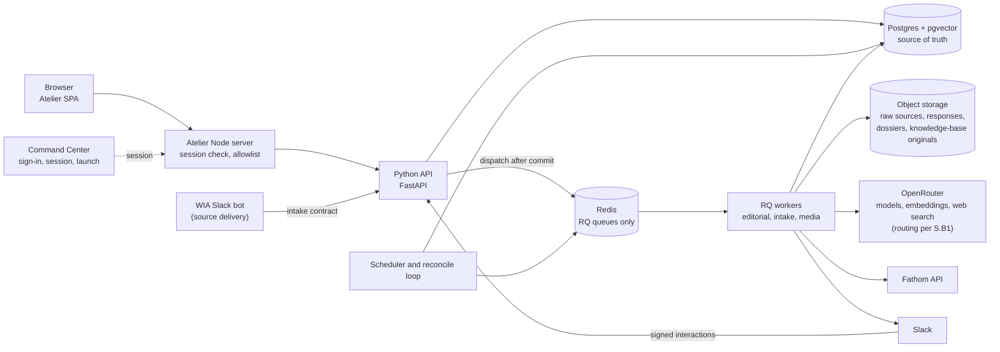
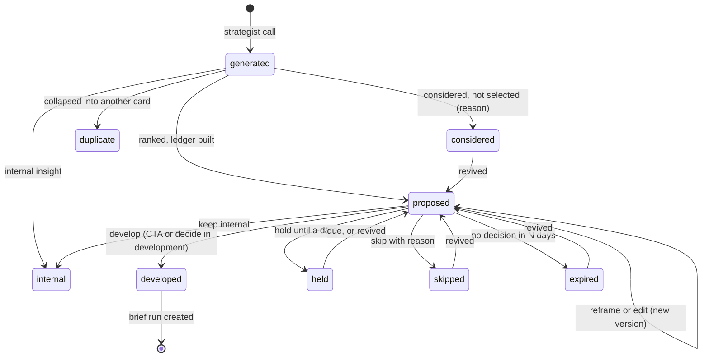
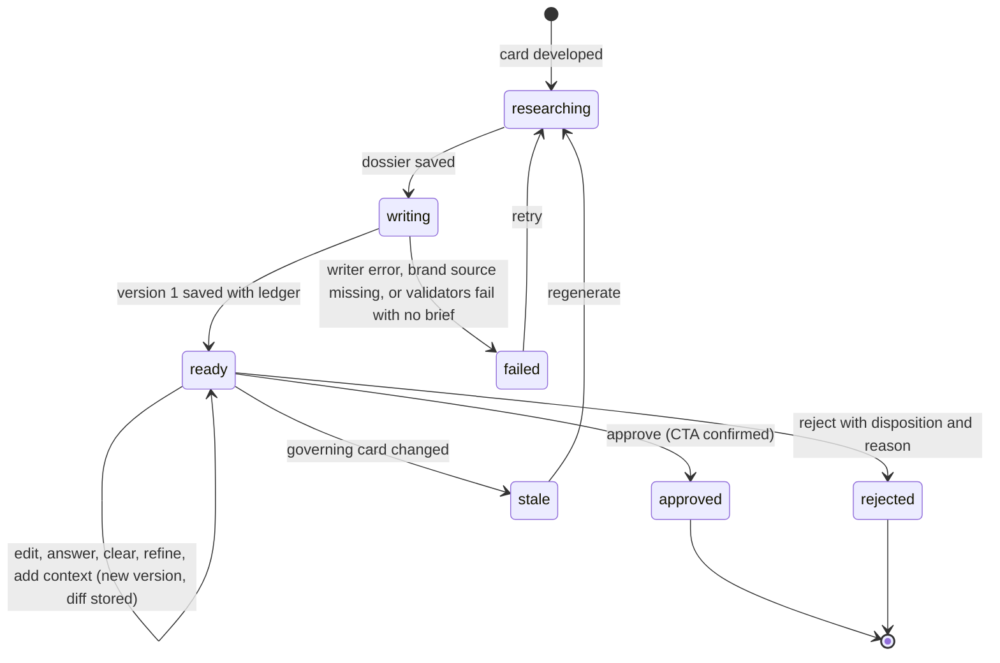
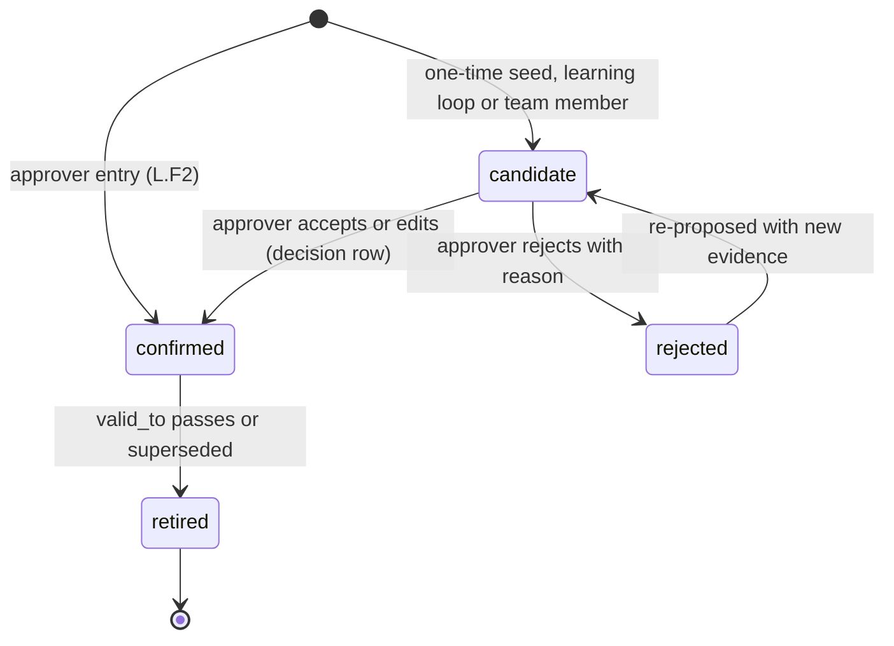
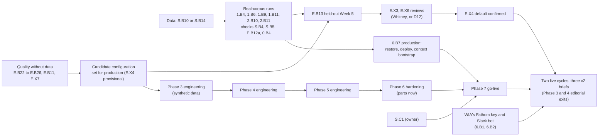

# Content Atelier: Implementation Plan Through Brief Generation (revision 7.3, archived)

> **Archived 22 October 2026. Superseded by revision 8** (`backend/docs/Content-Atelier-Implementation-Plan-Brief-Generation.md`), which is the plan of record. This file is revision 7.3 byte for byte below this note. It is kept because commits, handover notes and research READMEs cite its sections, item rows, rulings and logs. Where it and revision 8 differ, revision 8 wins; revision 8's Appendix A says where every item ID went.

**Date:** 19 October 2026 (first issued 10 October; revision 7.2 on 21 October; revision 7.3 recorded after it) · **Revision:** 7.3 (7, the final reconciliation; 7.1, the run of 20 October; 7.2, the Week 2 packs rebuild's proposals, section 1.10; 7.3, the v2 reassessment, the tone and format review and the combined quality track, section 1.11) · **Status:** the engineering roadmap of record · **Baseline:** every implemented phase verified independently on 19 October 2026 (branch `verify/2026-10-19`; see "Implementation status", section 1.9 and Appendix H)

**What this revision is.** Revision 7 is the final reconciliation and stabilisation pass of 19 October 2026. It re-verified every implemented phase (S, E, L, 0, 1, 2 and the transfer tools) against the code, independently of earlier logs, and repaired what was wrong; reconciled this plan with the solution architecture, the client's feedback, the ChatGPT export and the context strategy; measured one change to the brief writer; and set out the remaining work in dependency order. Section 1.9 records its findings, Appendix H its verification. Revision 6 (one plan built from revision 5 and `Content-Atelier-Content-Quality-Analysis.md`, whose sections 10 and 11 it superseded) and revision 6.1 (Phases L and 7, the logs) stand where revision 7 does not change them; section 1 keeps their evidence.

**Other documents:**

- **Target state:** `Content-Atelier-Implementation-Roadmap-Brief-Generation.md` and `Content-Atelier-Solution-Architecture.md`, as amended by the rulings here.
- **How to run the strategist profile today:** `Angle-Prompt-Profiles.md`.
- **Earlier revisions of this plan:** git history (revision 5 is `c822ed1`).
- **Phase hand-overs:** `Phase-S-Stabilise-Handover.md`, `Phase-0-Platform-Handover.md`, `Phase-1-Evidence-Handover.md`, `Phase-2-Moments-Handover.md`.
- **The final reconciliation's record:** `research/final-reconciliation-2026-10-19/` (the E.B22 experiment, the Week 2 simulation extract).

### Implementation status (19 October 2026, revision 7: the final reconciliation; updated the same evening for the run on the restored data, and on 20 October for the unattended run, revision 7.1)

Every implemented phase (S, E, L, 0, 1, 2 and the transfer tools) was verified again on 19 October, independently of the earlier logs: each item against every clause of its "done when", with the tests re-run on fresh databases, and each defect repaired at its cause with a test that fails before the fix (section 1.9, Appendix H). An item is **Done** only when its whole "done when" is met; otherwise it is **Partly done**, with an actionable remainder in its row. Reviews the plan assigns to WIA were performed under D12 and are recorded as delegated (R55). There is one environment, production (D13). The eight status snapshots revision 6.1 accumulated are in git history (`183a561`).

| Phase | Done (verified 19 October) | Partly done (remainder in the row) | Not started | Deferred or optional |
| --- | --- | --- | --- | --- |
| S | S.X2, S.B2, S.B3, S.B4, S.B5, S.B6, S.B7, S.B9, S.B10, S.B11, S.B12, S.B13, S.X1, S.F1 to S.F4 (S.B4, S.B5, S.B10 and S.X1 on 19 October, on the restored handover and the working copy) | S.B1 (account dashboard, the owner's), S.B8 (a container replay brief) | — | S.C1 (owner); S.B14 closed (not needed) |
| E | E.B3, E.B6, E.B7, E.B10, E.B11 (20 October), E.B12 (19 October, the weekly default switched to the ledger's scenes v2), E.B12a, E.B17, E.B16, E.B19, E.B20, E.B21, E.B22, E.B23, E.B24, E.B25, E.B26, E.F3, E.X1, E.X2, E.X7 (E.B23, E.B25, E.B26 and E.X7 on 20 October; knowledge base version 8 the default) | E.B1 (Week 5's plan), E.B2 (Week 5 labels; the Funktastic chain), E.B15 (the Week 5 brief, E.B13; the Funktastic reference), E.F1, E.F2, E.F4 (Whitney's reviews in the app) | E.B5, E.B8, E.B13, E.B18, E.X3, E.X4 (the candidate configuration is set provisionally), E.X6; proposed 21 October (section 1.10): E.B27, E.B28, E.B29; proposed in revision 7.3 (section 1.11): E.B30, E.B31, E.B32, E.B33, E.X8 | E.X5 (optional) |
| L | L.B3 to L.B11 (L.B9 and L.B11 on 20 October), L.F1 to L.F3, L.X1, L.X2 (amended by D14 and D16) | L.B1, L.B2 (their production runs, 0.B7) | L.B12, L.B13 (proposed in revision 7.3, section 1.11) | — |
| 0 | 0.B3, 0.B4, 0.B5, 0.B6, 0.B8, 0.B9, 0.B11, 0.B12, 0.F1, 0.F3 | 0.B7 (the production services, restore and sign-in) | — | — |
| 1 | 1.B1, 1.B2, 1.B3, 1.B5, 1.B6, 1.B7, 1.B8, 1.B10, 1.B12, 1.B13, 1.B14, 1.F1 to 1.F5 | 1.B4, 1.B9, 1.B11 (met on the local working copy, D20; production's run) | — | — |
| 2 | 2.B1 to 2.B10 (2.B10 on the real Weeks 1 and 2, 19 October), 2.B12, 2.F1 to 2.F3 | 2.B11 (backfill done on the working copy, 94% verified, recall 14/15, 10 documents read, re-partitioned under the current repair rules on 20 October: 96.2% verified; left: the Funktastic chain, blocked on production) | — | 2.B13 |
| 3 to 6 | 3.B16 (built in Phase E) | 5.B12 (`3a14c3a`: a revision no longer treats its own angle as prior coverage) | every other item, including 3.B17 and 5.B13 (proposed 21 October; 5.B13 waits on D22; revision 7.3 raises 3.B17 to P0 and re-scopes 5.B13, section 1.11.4) | 3.B15, 4.B14, 4.B16, 6.B10, 6.B11 (P3) |
| 7 | — | 7.B3 (the inventory tool; Jainil's report), 7.B5 (the transfer tools; the restore and dry run) | 7.B1, 7.B2, 7.B4, 7.B6, 7.F1, 7.F2, 7.X1, 7.X2 | — |

- **Repairs on 19 October:** 52 repair commits (more than 60 defects), each with a test that fails before it, across every verified phase (Appendix H lists them by item). The most serious: a do-not-use client's scenes reached the strategist and brief research; reframed or revived cards could never be developed; the verifier blocked Whitney's own beliefs; delegated decisions counted as Whitney's ground truth; an open redirect after sign-in and a relay that exposed unused paid and admin routes; four blockers in importing the real archive; knowledge base version 4 lost 27 accepted entries and could not be reproduced from committed inputs; and the SQL path's model calls were recorded to a local file instead of `llm_runs`.
- **Quality:** brief writer v3 (E.B22) and copy checks (E.B24) are built; knowledge base version 5 (`wia-kb-2026-10-19.c-0b931261`) is rebuilt from committed inputs, benchmarked against version 4 on benchmark v1 and committed as the default, with version 4 archived: no new accuracy problem (blocking flags 0 against 0.33 in Week 2; USD 0.61), but fewer ATTRACT cards (an ATTRACT card in 1 of 6 samples against 5 of 6), which E.B26 and E.B13 check; the candidate configuration for production is a committed file (`backend/deploy/production-settings.json`, E.X4 provisional).
- **Tests (local, the CI commands, on the merged branch):** backend: `ruff check`, `openapi --check`, the migration runner on both test databases (103 checks each), `schema_catalog --check` and `pytest -q -rs` with both database suites: 1,319 passed, 6 skipped (inputs kept off git and a live S3 test), none failed (10 min 52 s); the two test files changed after that run pass (12 tests). Frontend: lint, 318 unit tests passed and 1 skipped (it needs the recordings), 50 server tests passed, the build. CI repeats them on the pull request.
- **20 October (revision 7.1, unattended run; every review the engineer's under D21):** L.B9, L.B11, E.B11, E.X7, E.B23 (with section 1.9.7's hand-off view), E.B25, E.B26 done; E.B15's engineering remainders repaired; 2.B11's 27 documents re-partitioned from their saved responses (96.2% verified, USD 0); E.B3's pairwise judge built (`judge-compare`); knowledge base version 8 (`wia-kb-2026-10-20.c-6bf62f94`: version 6's refiled rules, version 7's superseded lines, twelve months of published central points behind a same-point check, the editing guide, the prefix within its 30,000-token budget by a recorded priority) is the committed default after three benchmarks (versions 6, 7 and 8, each against its predecessor); the production configuration names strategist v6 and brief contract v3 with writer v4 (E.X4 provisional). Verifier false positives repaired on real samples: a named colleague read as credited speech, scene timestamps read as figures, the reader's own work read as WIA's; a run plan can no longer be passed by its last call. S.B8 is partly done (a container's live research replayed in a fresh one; the writer step waits for budget). Spend: about USD 4.23 of the USD 4.36 the two keys had at the start (internal USD 2.93, about 0.08 past its weekly limit, before the plan fix; client USD 1.30); every paid call under a file or database plan, now closed or exhausted.
- **21 October (revision 7.2, proposals only; section 1.10):** the Week 2 packs rebuild's fifteen recommendations are recorded as proposed work, all **Not started (proposed 21 October)**: new items E.B27 (full-week strategist input), E.B28 (weekly strategy brief), E.B29 (cross-call synthesis and the story card), 3.B17 (account memory) and 5.B13 (a minimal pack stage, waiting on D22); extensions to 1.B12, 1.B13, 3.B5, 3.B10, E.B1, E.B3, E.B24, E.B25, E.X7, L.B2 and 6.B1; owner decisions D22 to D27. An extended item keeps its status for its original "done when"; its extension is a separate clause, marked **Extension**, with its own status and its own "done when". No code changed, no paid call was made and production was not touched for this revision.
- **Revision 7.3 (proposals only; section 1.11):** the owner rejected 7.2's rebuilt packs as repeating the mistakes WIA had rejected; an independent reassessment, a tone and format review and two blind reviews against Whitney's own finished pieces followed, and the packs were rebuilt by hand (v2, the target the system is built to reach; not system output). Its findings and 7.2's are combined into one quality track (section 1.11.5) and a pack standard (section 2.4b). New items, all **Not started (proposed in revision 7.3)**: E.B30 (point tests: the five-test gate), E.B31 (human-line and counter-expected scenes), E.B32 (the angle card in WIA's own format, and the title rule), E.B33 (brief and pack writer v4: register by format, offer descriptors, the house style), E.X8 (blind comparison with Whitney's finals, a diagnostic), L.B12 (transformation exemplars, knowledge-base document 19) and L.B13 (weekly "what stood out" founder notes). Changes to 7.2's proposals: E.B27's done-when, E.B28 (beliefs to prove, not slots), E.B29 (no ranking by call count), 3.B17 raised to P0, 5.B13 (one idea, different doors; the pack standard as validators). Further extensions to E.B3, E.B24, E.B25 (j) and E.X7; a note on E.B26's title rule. Owner decisions D28 to D34. No code changed, no paid call was made and production was not touched; the client key is still at about USD 2.98.
- **Paid calls on 19 October:** USD 1.78, all under run plans that are now closed or exhausted: the E.B22 experiment (USD 1.17, `research/final-reconciliation-2026-10-19/`) and the version 5 benchmark (USD 0.61, `research/benchmark-v1/`; its first plan closed after a 502 upstream error and the run finished under a second). USD 1.51 is left on the key (D18).
- **Production:** an empty Postgres, Redis, two buckets and the mock Frontend in the Railway project "Content Atelier"; no API, worker or scheduler; Command Center still runs with `AUTH_DISABLED=1` (S.C1). Nothing in production was changed on 19 October.

**The data arrived (19 October 2026, afternoon).** Jainil's handover `2026-10-19` was restored on the owner's machine and its checks run (S.B10, E.B12a, 0.B4, S.B4, S.X1, 2.B10: `research/restore-checks-2026-10-19/`); the real-corpus pipeline runs on a local working copy (D20), the budget is the two keys and E.B13 is not funded in this round (D18), and every review the plan gives a person is the engineer's (D21). **What unblocks the rest:** E.B13's budget; S.C1 before go-live; the owner's go-ahead for production (D13). Everything in "Where to resume", step 3, needs none of them technically, but the owner deferred it until the developer's data arrives (D19): it is **not started**.

### Where to resume (start here on any machine)

1. **Ground the machine.** Run prompt 1 of `Implementation-Prompts.md` (grounding). It needs: Python 3.12 with `backend/requirements.txt`; Node 22.12 or later (24 recommended, `frontend/.nvmrc`); Docker with a `pgvector/pgvector:0.8.2-pg17` test container (`Phase-S-Stabilise-Handover.md`); `gh`; the Railway CLI logged in; `backend/.env` with `OPENROUTER_API_KEY` (never committed). The raw ChatGPT export is not needed by any stage; the owner keeps it as a reference (D14). Local quirks are in DEPLOYMENT.md, "Running it locally".
2. **Check for the developer's data.** From `backend/`: `python scripts/transfer/fetch_and_verify.py list`. If a handover shows `complete`, restore it on the local machine first (`Data-Handover-Runbook.md`, step C), then run, in order: E.B12a's re-validation of the saved Week 1 and 2 responses, 0.B4's replay, S.B4's validation of the two v1 briefs, S.B5's full-archive research check, the Phase 1 real-corpus commands (`documents import`, `normalise --all --estimate` then `--all`, `dates --apply` with `--calendar-timezone` or the Zoom list, `agreement`, `reembed --estimate`; DEPLOYMENT.md, "Documents and evidence"; approve the re-embedding plan before normalising and run the two back to back, because brief research refuses the archive while new chunks lack vectors, until 4.B4), 2.B10's `moments import-saved --dry-run` and 2.B11's pilot (`Phase-2-Moments-Handover.md`). If nothing has arrived by the date the owner sets (D17), take the fallback (S.B14).
3. **Started 19 October after the restore; step 3.1 is done on 20 October except where noted.** In this order (no step needs the data technically; each paid measurement needs a run plan and budget, D18):
   1. **Quality, Phase E remainders that need no data (done 20 October: E.B25, E.B26, E.B23, E.B11, E.X7, E.B3's judge, E.B17's Week 5 guard, L.B11; E.B15's engineering remainders; left: S.B8's writer step):** E.B25's remainder (the prefix within budget, superseded lines, the editing guide, twelve months of published history; measured on benchmark v1); E.B26 (stance and experience rules, strategist v6, with E.B21's v6 recommendations and the ATTRACT share version 5's benchmark showed); E.B23 (brief contract v3: the ledger in its own step, Reel scripts, the anchor piece, message spine and piece keys the later production stage needs); E.B11's remainder; E.X7 (the rubric in the review form, the judge and the decision API) and E.B3's calibrated judge; E.B15 (g) (a different-family reviewer on v2 briefs); a Week 5 held-out guard (E.B17); L.B11.
   2. **Phase 3 engineering on synthetic data:** 3.B1 (the cycle migration), 3.B2, 3.B3 on the assembly service, 3.B5 and 3.B6 with E.B25 (f)'s published history, 3.B7 and 3.B9, 3.F1 to 3.F3, 3.B11; L.B9 and L.B10 alongside 3.B10. Its editorial exit still needs two live cycles.
   3. **Phase 4 and 5 engineering:** 4.B2 (the briefs migration), 4.B5, 4.B1 under run plans, 4.B8 (with E.B24), 4.F1 to 4.F3; 5.B11, 5.B12, 5.F1 to 5.F3.
   4. **Phase 6 parts that need no data:** 6.B3, 6.B4, 6.B6, 6.F2 to 6.F4, 6.F8, 6.X2, 6.C1 to 6.C3 (in `WIA-Command-Center`).
   5. **Proposed 21 October (revision 7.2, section 1.10; not started):** the Week 2 packs rebuild's items, in the findings' order: E.B27 (full-week input), E.B28 (the weekly strategy brief) and the published register at piece level with recency in ranking (E.B25 (i), 3.B10's and 3.B5's extensions) first; then E.B29 (synthesis and the story card) and 1.B13's extension (team practice); then 1.B12's extension (identities) and E.B24's extension (copy checks); then 5.B13 once D22 is answered; then 3.B17 (account memory). E.B1's, E.B3's, E.B25 (j)'s, E.X7's, L.B2's and 6.B1's extensions fill gaps. Each paid measurement needs a run plan and budget (D18).
   6. **Proposed in revision 7.3 (section 1.11; not started): work the combined quality track in section 1.11.5, milestone by milestone (Q0 to Q6).** It supersedes item 5's order where they differ. Q0 needs no build: ask Whitney for the weekly founder notes (L.B13, D29) and the decisions D28 to D34. Q1 (E.B30, E.B32 and E.B28 with beliefs) is the cheapest change with the largest effect, and can be tested on Week 1 against Whitney's own rewrites.
4. **When the data is restored:** E.B13 (held-out Week 5, three samples, on the configuration E.B22 to E.B26 leave), then E.X3, E.X6 and E.X4 (Whitney's reviews; under D12 the engineer performs them unless the owner takes D15), E.B6, E.B8, E.B18, E.B5.
5. **Production** (0.B7 and Phase 7): restore the data into the empty `postgres` first, then deploy the API (its pre-deploy migration upgrades the restored schema), the scheduler and the workers, run `context-seed` and apply the reviewed decisions (L.B1, L.B2), and point the Frontend at the API only after S.C1 (DEPLOYMENT.md, "Production services on Railway", corrected on 19 October).
6. **Owner actions outstanding:** D15 (an early read by Whitney), D17 (the fallback date), D18 (the OpenRouter budget), S.C1 (Command Center's `AUTH_DISABLED=1` before go-live), D22 to D27 (the Week 2 packs rebuild's decisions, section 15.1), D28 to D34 (revision 7.3's: Week 2 as a benchmark, founder notes, pack size, stance confirmation, the angle title rule, the "how we worked through it" framing, export text as exemplars), and chasing the developer's handover (`Jainil-Handover-Prompt.md`).

---

## Read this first

**What the system must do.** Turn WIA's calls into a weekly set of content ideas that show what WIA knows, how it thinks, how it works and why that matters, for WIA's ideal client. Let WIA choose among them. Turn each chosen idea into a researched brief in WIA's voice that WIA approves without rewriting its central point. Run unattended, on shared infrastructure, with every decision recorded. Grow its own knowledge of WIA from WIA's approved work, without ChatGPT.

**Where it stands on 19 October 2026 (revision 7, section 1.9):**

1. **The machinery through Phase 2 is built and independently verified.** One migration runner; one `llm` module with privacy routing, run plans and an `llm_runs` row per call; one RQ executor and scheduler; settings, users and roles; week-less, classified, role-resolved, dated documents; a moments ledger with per-document scene extraction and search; the context system (store, review queue, compiler, assembly service, learning loop); cards with a verification ledger, dispositions and a card screen for a non-technical reviewer; brief v2 with Gate 2 and a reader. The verification of 19 October found and repaired more than 60 defects in 52 commits, each with a test (Appendix H).
2. **Nothing has been validated by WIA since Week 1.** Whitney rated the first batch "1's across the board". Every review since 18 October was made by the engineer under D12; the configuration's evidence is development weeks, excerpts and LLM judges (K53).
3. **Angles are close; briefs and the knowledge base's shape are now the binding constraints on quality** (section 1.9.2): caveats and writer instructions inside copy, softened stances, a prefix three times the size of the configuration that won, and engineer-approved, model-written text ranked as WIA's best voice. E.B22 to E.B26 answer them, with no data needed. Measured on 19 October: brief writer v3 won all six judgements against v2 on the live week's cards (edits needed 2.2 against 3.8, no caveat phrase in copy; section 1.9.8) and is the production writer. Knowledge base version 5 (rebuilt from committed inputs, the 27 lost entries restored, Whitney's own copy first) showed no new accuracy problem against version 4 and is the committed default; it gave fewer ATTRACT cards, which E.B26 checks (section 1.9.3).
4. **The one external dependency is the developer's data (S.B10):** the saved Week 1 to 4 responses, the held-out Week 5 and 6 documents and the full transcripts. No handover had arrived on 19 October; S.B14 is the fallback through WIA's own Zoom and Fathom (section 1.9.6).
5. **Production** (Railway project "Content Atelier", the only environment, D13) has an empty Postgres, Redis and two buckets, and the mock Frontend; no API, worker or scheduler. Command Center production still runs with `AUTH_DISABLED=1` (S.C1, deferred by the owner, a hard prerequisite of go-live).
6. **Context after ChatGPT** is designed and built to grow only from WIA's work in Content Atelier (section 4.12, R51, R52). What is missing: capture of what WIA publishes (L.B9) and an owner for the content plan (L.B10). The raw export stays with the owner as a reference (D14); the switch-over moves to go-live (D16).

**The plan in one table:**

| Order | Phase | What it delivers | State on 19 October 2026 |
| --- | --- | --- | --- |
| 1 | **S. Stabilise** | Privacy recorded and enforced; CI; gate and validator defects fixed; real data backed up and shared; scope flags | Built and verified. Open: S.B10 and S.B14 (the data), the checks that need it (S.B4, S.B5, S.B8, S.X1), S.C1 (owner) |
| 2 | **E. Editorial quality** (the critical path for WIA) | Strategist cards with a ledger; the card screen with dispositions; knowledge base; benchmark and evaluation; brief v2; WIA's acceptance of a held-out week | Built and verified, except what needs the data (E.B13 and WIA's reviews). New in revision 7: E.B22 to E.B26 (quality work that needs no data) |
| 3 | **L. Living context** | Context store, review queue, compiled versions, one assembly service, the one-time seed, a learning loop | Built and verified. Open: its production runs (0.B7), L.B9 to L.B11 |
| 4 | **0. Platform** | Runner, `llm` module, executor, settings, roles, the production environment | Built and verified. Open: production services (0.B7), the real replay (0.B4), matching settings the SQL path ignores (0.B8) |
| 5 | **1 and 2. Evidence and scenes** | Classified, dated, role-resolved documents; per-document scenes; search | Built and verified on synthetic data. Open: the real-corpus runs (the data) |
| 6 | **3, 4 and 5. Cycle, briefs, Gate 2** | Scheduled cycle on the ledger; live, durable briefs; Gate 2 lifecycle | Not started; the engineering can start now on synthetic data |
| 7 | **6. Hardening** | Live connectors, budgets, alerts, backups, end-to-end tests, mocks removed | Not started; much of it needs no data |
| 8 | **7. Go-live** | Real frontend on production, data transferred, live verification and sign-off | The transfer tools are built; the rest follows the data and Phases 3 to 6 |

**Decisions the owner still owns** (section 15.1): D15 (one early read by Whitney), D17 (the date for S.B14's fallback), D18 (the OpenRouter budget), S.C1 (Command Center's sign-in before go-live), and D22 to D27 (21 October: a minimal pack stage, the repetition window, internal calls as evidence, account-memory permissions, the presentation's framing and the permissions to request from WIA), and D28 to D34 (revision 7.3, section 1.11).

---

## 0. How to use this document

| Section | Contents |
| --- | --- |
| 1 | Verification of the two earlier analyses: findings, corrections, conflicts and their resolution, how strong the editorial evidence is, what the full ChatGPT-export analysis adds (1.8), the final reconciliation of 19 October 2026 (1.9), the Week 2 packs rebuild of 21 October 2026 (1.10), and the v2 reassessment, tone review and combined quality track (1.11) |
| 2 | Target state: the workflow, the editorial requirements, success measures, what counts as a successful brief, and the pack standard (2.4b) |
| 3 | Current state at `502dd05`: reuse, modify, missing, mock, beyond scope, structural blockers, audit findings |
| 4 | Architecture and rulings: the editorial pipeline, rulings R40 to R55, the context system (4.12), the knowledge base, the card and ledger, brief v2, models, runtime, data model, state machines, configuration and failure behaviour |
| 5 | Phases, priorities, sequence and parallel tracks |
| 6 to 14A | Phases S, E, L (section 7A), 0, 1, 2, 3, 4, 5, 6 and 7 (go-live, section 14A). Each has a purpose, its verified current state, work items with "done when", dependencies and exit criteria |
| 15 | Decisions and risks |
| 16 | Definition of done |
| Appendices | A traceability; B job catalogue; C API surface; D settings keys; E register of rulings; F revision history; G implementation log; H verification log |

### Priority labels

| Label | Meaning |
| --- | --- |
| **P0 Critical** | The workflow, or output WIA would accept, cannot exist without it. Blocks later work. |
| **P1 Required** | Needed for the scoped system to be complete and reliable. Does not block the next phase from starting. |
| **P2 Hardening** | Makes the implementation robust enough for intended use. |
| **P3 Deferred** | Not needed for the target state. Listed so nobody builds it by accident. |

Every P0 item has its own "done when". A P1 or P2 item without one is done when the phase exit criterion that names its outcome passes.

**Item IDs.** Work items carry IDs such as `2.B4` (phase 2, backend item 4). The letters mean:

- `F`: the Atelier frontend;
- `C`: Command Center;
- `X`: cross-system or client work.

Phases S and E use `S.` and `E.` prefixes. IDs from revision 5 and from the analysis (E.B9 to E.B12, E.F2, E.X2) are kept, because commits cite them. An item marked **Built** or **Done** is kept for traceability. "V" numbers refer to section 1.2's findings.

### Where the frontend lives

The Atelier app (`WIA-Content-Atelier/frontend`) is the only Atelier UI: a React SPA plus a small Node server that checks the Command Center session and proxies to the Python backend. Command Center (`WIA-Command-Center`) holds a link and the sign-in hand-off, and is where users sign in. Its old Atelier screen, proxy and fixture data are removed in Phase 6.

WIA reviewers use the Atelier app as Command Center `team` users on the approver list (R50). Command Center needs no work before Phase 6 except S.C1; revision 5's per-phase "no change" items (0.C1 to 5.C1, E.C1) are dropped.

### Working an item (developer conventions)

Each phase section has, in order:

1. Purpose.
2. Current state.
3. Required changes (Phases E and L).
4. Item tables (backend, frontend, cross-system).
5. Dependencies.
6. Build order.
7. Exit criteria.

Work an item as follows.

1. **Pick.** Take an item whose prerequisites in its phase's build order are met. Branch `item/<ID>-<short-name>` from `main`.
2. **Read.** Read the item row, every ruling and section it cites, and its "done when". If anything is ambiguous, resolve it with the owner before coding, and record the answer in the item row.
3. **Put code in the right place.**
   - Backend code goes in the `backend/backend_pipeline/` sub-package named in section 4.7.
   - Prompts are new versioned files in `prompt_templates/`. Never edit a released profile: add a new profile ID and record each example's provenance (E.B17).
   - Migrations are numbered SQL files applied by the runner (0.B3). They are additive, one per row of section 4.8.
   - Frontend code goes in `frontend/src`. Every new route the app calls is added to the Node server allowlist (`frontend/server/allowlist.mjs`), and only those, with a server test.
4. **Test.**
   - Offline unit tests, with the fake provider, for logic.
   - The database suite for persistence and constraints.
   - Frontend unit and server tests for screens and the relay.
   - Every "done when" has an automated test, or a recorded manual check named in the pull request.
5. **Paid calls.**
   - Only under an active run plan (E.B1).
   - Only through the provider module (the `llm` module once 0.B4 lands), with S.B1's routing.
   - Never from tests.
   - The cost is recorded.
6. **Client data.**
   - No client material outside `research/` and `backend/knowledge_base/` (R48).
   - No raw ChatGPT export in git (R52).
   - Fixtures are synthetic or redacted.
7. **Flags.** Anything a user can see stays behind a feature flag until its phase exits.
8. **Review.**
   - Title the pull request `<ID>: 
`.
   - CI must be green (S.B2), with one reviewer.
   - The description lists the evidence for each "done when".
9. **Status.** In the same pull request, mark the item row **Done (`sha`)** or **Partly done (`sha`)** with an actionable remainder, update the Implementation status table, and add a row to the implementation log (Appendix G). A verification run adds a row to the verification log (Appendix H).
10. **Docs.** When behaviour or configuration changes, update the runbook: `Angle-Prompt-Profiles.md`, `DEPLOYMENT.md` or the hand-over note. A new setting gets an Appendix D row.

### Decisions already taken

| # | Decision (10 and 11 October) | Status at revision 7 |
| --- | --- | --- |
| 1 | Job execution moves to RQ on Redis with a reconciliation sweep; Postgres stays the source of truth | Built for every job (0.B5, 0.B6; R35). |
| 2 | Slack carries approvals, not only notifications | Kept (O27, 18 October); built in Phase 3 (3.B12). |
| 3 | No cap on angles | Amended by R43: no numeric cap; the strategist selects, and every considered idea is listed and revivable. |
| 4 | The frontend lives only in the Content Atelier repository | Followed; Command Center's old screen, proxy and fixtures are removed in Phase 6 (6.C1 to 6.C3). |

---

## 1. Verification of the two earlier analyses

### 1.1 What was checked and how

- **Code:** `main` at `502dd05`, which equalled `origin/main`; re-checked on 18 October at `6fa2543`, which merges `fix/phase-s-stabilise` (`3012346`) and `feat/strategist-cards-downstream` with no reconciliation needed (see "Implementation status"). `feat/content_brief` (`64d7cbc`) is an ancestor, and the local `feat/wia-strategist-profile` points at `502dd05` and is merged. `WIA-Command-Center` was fetched: `main` is `a1e98b5` (6 October); no branch is newer.
- **Documents treated as claims:**
  - this plan's revision 5 (18 October, written against `64d7cbc`);
  - `Content-Atelier-Content-Quality-Analysis.md` (18 October);
  - `Angle-Prompt-Profiles.md`;
  - the commits that landed after revision 5:
    - `f0ff0a0`: strategist profile, knowledge-base loader, lean card, per-stage angle model;
    - `502dd05`: client documents, knowledge base, analysis, experiment harness.
- **Method:** five independent reviews, each checking claims line by line against the code:
  - extraction, angles and Gate 1;
  - research, briefs and Gate 2;
  - frontend and Command Center;
  - platform, privacy and tests;
  - the analysis's evidence, experiments, knowledge base and ChatGPT findings.
- **Run:** backend offline tests (304 passed, 101 skipped, 4 failed: the same four as at `64d7cbc`, all reading untracked files; the 44 new passes are the strategist tests); frontend type check (clean), unit tests (119 passed, 1 skipped) and server tests (15 passed), from a clean copy. The validators were exercised offline on constructed briefs. The experiment tallies were re-derived from the saved runs.
- **Not run:** database-backed tests, any model call, the production frontend build (it needs Node 22.12 or later), Docker builds (the frontend image's failing step, a plain `npm ci`, was reproduced locally), and anything against the developer's database.

### 1.2 Findings that change the plan

Ordered by consequence. "Blocker" means the plan as written cannot proceed past this point.

| # | Finding | Evidence | Severity | Addressed by |
| --- | --- | --- | --- | --- |
| V1 | **The strategist profile cannot reach Gate 1 or a brief through the product.** See the detail after this table. | `matching.py:163-164,204-207`; `repository.py:309-310,332,340`; `gate_one.py:55-59,151-152,189-192`; `contracts.py:10,15`; `sql_pipeline.py:229-231`; `SQLWeeklyAngles.tsx:45` | Blocker | E.B16 (API path **done**, `6fa2543`); E.F2 (screen); E.B15 (brief writing) |
| V2 | **The proposed live re-run cannot run as described.** The analysis's next step re-runs Weeks 1 to 4 "from saved extraction output". Production extraction fails the whole week on one inexact quote. The partial-pool runner that kept valid moments (`calibration.py`) supports only the legacy contract. The saved artifacts exist only on the developer's machine. | `pipeline.py:688-690`; `calibration.py:44-51,98`; plan K21 | Blocker for E.B13 | E.B12a (SQL path **done**, `6fa2543`; real saved responses not yet re-validated; file runner and calibration still strict), S.B10 |
| V3 | **Brand context for briefs is broken on a fresh checkout and split from the knowledge base.** With briefs enabled, Gate 1 approval creates the brief run inside the same transaction and loads the brand bundle; a missing or placeholder bundle rolls back the approval itself. The only committed bundle is the placeholder. Briefs never use the knowledge base, so angles and briefs now have two unlinked brand sources with different hashes and approval models. | `gate_one.py:172-174`; `briefs/workflow.py:23`; `briefs/runtime.py:48-58`; `knowledge_base.py` used only by `pipeline.py:82`, `sql_pipeline.py:193,265` | Blocker for briefs | S.B13 (rollback **fixed**, `3012346`); E.B11 (f) and E.B15 (the two brand sources remain) |
| V4 | **One generation-only run breaks every later brief.** Prior-coverage lookup raises if any earlier angle lacks a compatible vector, and history admits every completed generation. `Angle-Prompt-Profiles.md` recommends generation-only runs for the strategist. | `retrieval.py:146-147`; `matching.py:53-75` | Major | E.B16 (**done** for never-encoded angles, `6fa2543`; an angle whose vector changed still pauses matching) |
| V5 | **Brief v2 needs more than a new prompt:** • `checks()` and `blockers()` parse every brief as v1 on every read, including the pack gate, so any non-v1 row returns 409 everywhere. • The 120,000-character request preflight would be exceeded by the knowledge base (about 46,000), the schema (about 7,300) and a large dossier. • The analysis's Appendix B schema has no evidence IDs, no prior coverage and a free-text CTA. | `briefs/validation.py:11,89`; `gate_two.py:110`; `packs/workflow.py:31`; `briefs/runtime.py:74`; `research/.../proposed_brief_schema.json` | Major | E.B15, section 4.5 |
| V6 | **The brief success conditions (section 2.4; section 2.2 in revision 5) are only partly enforced:** • The three N2 defects are present. • Condition 5 (claim labels are not numbers) is not implemented. • Condition 3 lets inference claims cite nothing. • Condition 7 checks only speaker labels, not client names in text. • Condition 8 makes "no explicit ask" impossible, because Gate 1 requires CTA text. | `briefs/validation.py:17,30,35-37,52-58,60-62`; `gate_one.py:158` | Major | S.B4 (N2 and condition 5 **fixed**, `3012346`); E.B16 (deferred CTA for cards); E.B15, R46 (conditions 3, 7, 8) |
| V7 | **The embedding fix in revision 5 is incomplete.** Five separate contracts hash the endpoint. The model string differs too: the code has `text-embedding-3-small`; `.env.example` has `openai/text-embedding-3-small`. Fixing the endpoint alone still rejects the archive. | `chunk_encoding.py:20-21`; `storage_config.py:79`; `briefs/runtime.py:20,155`; `briefs/search.py:9`; `config.py:25,27` | Major | S.B5 (engineering done, `3012346`; full-archive check after S.B10) |
| V8 | **The frontend's production build fails:** • The Dockerfile runs a plain `npm ci`, which fails on the esbuild peer conflict. • Vite 8 needs Node 20.19 or 22.12 or later, and local start needs 22.9 or later. • `docker-compose.yml` omits the two variables every SQL screen needs. | `frontend/Dockerfile:7`; `package.json`; `app.mjs:136` | Blocker for deploy | **Resolved** by `3012346` (esbuild `^0.28`, Node pin, compose variables) |
| V9 | **Whitney cannot review in the app as planned:** • Real screens need a Command Center `team` session plus a backend allowlist entry; new Command Center users default to `client`. • The brief screen is engineer-facing (passage IDs, offsets, "scoped review"). • Phase E and the analysis assume she labels in the app, while S.F3 makes it team-only. | `app.mjs:135,176`; CC `.env.example:149`; `SQLBriefs.tsx` | Major | R50, E.F2, 4.F2 |
| V10 | **The strategist sees less than it needs:** • Scenes reach it without their sensitivity, destination or qualifications, so an `internal_only` moment can become a public card. • It still receives the six Reel scripts with client results (N9 applies to it too). • Containers cannot load the knowledge base: it is neither copied nor mounted. | `angle_profiles.py:59-67`; `pipeline.py:750`; `backend/.dockerignore`; `compose.editorial.yml` | Major | E.B16 (scene tags reach profile v4 only, `6fa2543`); E.B11 (Reels, containers: open) |
| V11 | **Client material is in the shared history.** `502dd05` committed WIA's guides, Whitney's review document and call transcript turns (`research/.../sources/week1.json`, `week2.json`). This was the project owner's decision; revision 5's "audit before pushing" (S.B2, O29) no longer applies. Earlier commits had already pushed transcript text in `research/root-cause-2026-10-16/`, `client_review/*.docx` and `testing/document_qa/` (on `feat/content_brief` since 13 to 16 October). `research/quality-experiments-2026-10-18/ledger.jsonl` also records the hash ID and spend limit of the OpenRouter key used for the experiments (no secret), from six refused calls. | `502dd05` | Major | R48, S.B12 |
| V12 | **Defaults differ between code and example environments.** Every brief stage defaults to Luna in code; Sol writes only because `.env.example` and `storage.env.example` say so. External context is labelled `disabled`, not `unavailable`, by default. | `briefs/runtime.py:16-17,64`; `config.py:19,36` | Minor, but a fresh deploy writes briefs on Luna | 0.B8, S.B8 |
| V13 | **Failure behaviour is overstated in revision 5 (4.8):** • The web provider has no retry, and network errors fail the stage. • For briefs, a failure "after commit" happens inside the commit (V3). • The brief run key ignores mode and brand hash, so a later live request or a new bundle returns the old run. | `briefs/external.py:64-65,88-89`; `briefs/workflow.py:18-22` | Minor | 4.B1, 3.B13, section 4.11 |
| V14 | **Gate 2 has two latent defects:** • A revision treats its own parent as a prior angle it must "distinctly treat". • An edit discards the reviewer's findings. | `retrieval.py:129-143`; `briefs/validation.py:52-53`; `gate_two.py:114` | Minor | 5.B12 |
| V15 | **Command Center honours `AUTH_DISABLED=1` in production.** It then issues `team` sessions for any email, and the Atelier's allowlists key on that email. | CC `server/index.mjs:456-475,490-501` | Major; live in production (`AUTH_DISABLED=1` verified 18 October) | S.C1, 7.B2 |
| V16 | **Mock behaviour still misleads:** • "Pass with reason" claims to record a learning signal and stores nothing. • The whole app refuses to load if the mock deployment endpoint fails. | `IdeaDetailModal.tsx:243-250`; `App.tsx:57-82` | Minor | S.F2, 6.F3 |
| V17 | **No retention control on any request.** Chat calls send only `require_parameters` and `allow_fallbacks: false`; embedding calls send no provider preferences at all; the experiment harness's runner bypasses `provider.py` entirely and allows fallbacks. | `provider.py:40,56-57`; `research/.../runner.py:27-37` | Blocker for further real-data calls (S.B1) | S.B1, 0.B4 |
| V18 | **A container built from `main` cannot run the editorial path.** The image excludes `backend/.env`; outside compose `storage_config` keeps only `ATELIER_*` keys, so model settings fall back to code defaults (Luna); since S.B5 the embedding default matches the archive. Neither the knowledge base nor a brand bundle is in the image or mounted. | `config.py:76`; `storage_config.py:42-48`; `backend/.dockerignore`; `compose.*.yml` | Major | S.B8, 0.B7, 0.B8, E.B11 |
| V19 | **"Decide in development" is blocked by the schema, not only the code:** migration 001 requires `selected_cta` on an approved angle. | `backend/migrations/001_approved_schema.sql:93` | Major for R46 | Worked around in E.B16 (`{choice: "decide_in_development"}`, `6fa2543`); the constraint change is 3.B1 |
| V20 | **SQL matching ignores the configured thresholds** (0.78, 28 days, 0.90 and 70 are hard-coded); the `CONTENT_ATELIER_*_THRESHOLD` variables reach only the file pipeline. Six variable names in revision 5's Appendix D do not exist (the code reads `CONTENT_ATELIER_*`). | `matching.py:37-38,177,213,216`; `pipeline.py:316-318`; `config.py:99,114-118` | Minor | 0.B8, Appendix D; `6fa2543` adds a fifth literal, `DUPLICATE_COSINE = 0.90` (`matching.py:43`), to be read from settings (E.B16 l) |
| V21 | **The 18 October experiments support the direction but not its size.** Each comparison rests on one generated pair, so "4 of 4" measures judge agreement, not replication. The judge rubric reuses the strategist prompt's own wording (the audience and voice lines) and the brief judge's standard restates BR1's specification, and the brief judge could tell the two contracts apart from their JSON shape. Two judges flipped with presentation order; the B1 against B0 result is position noise, not a finding. The strategist prompt contains paraphrases of Whitney's Week 1 alternative 6 and a voice example adapted from a Week 2 title, so neither week was fully unseen: at most three of the six Week 1 directions were reached independently, not four. P1 also changed five things at once (prompt, knowledge base, roster, contract, input format), so the gain cannot be attributed to any one of them. | `research/quality-experiments-2026-10-18/exp_judge.py:28,49`; `exp_brief_judge.py:21`; `angle_generation.wia_strategist_v3.md:28,33,42`; `judge_summary.py` re-run | Major for decisions that rest on it | E.B17, E.B3, E.X3; section 1.6 |
| V22 | **The knowledge base has factual errors and is not what its labels say.** The roster omits Jacqueline (a Meta ads manager), lists Fallon although she was leaving in August, and calls Whitney "founder" where she signs "Co-Founder". Savannah is labelled "WIA's content strategist"; the export shows she is an external marketing consultant, and the "Tier 1 Accelerator" document is from her programme, filled in by WIA, which a model can confuse with WIA's own Ads Accelerators. The offer sheet says ELEVATE is "waitlist only" where Whitney has offered "one spot available"; the Visibility Blueprint is unverified. The Accelerator document is about 70% of its source (verbatim, with sections omitted, including the buyer-type finding). The loader presents the unconfirmed roster and offer sheet under an "authoritative" header. One judge "overclaim" flag (Jacqueline on the team) was a false positive caused by the roster. | `backend/knowledge_base/04-team-roster.md`, `05-offer-sheet.md`, `manifest.json`; `knowledge_base.py:22-25`; `gpt_export` conversations | Major (K38) | E.X2, E.B11 |
| V23 | **The guides contradict each other and the rules built from Whitney's corrections.** The content strategy and voice guide endorse the "it's not X, it's Y" and "The goal isn't" forms the strategist prompt bans, and Whitney's own approved copy uses them; the guides disagree on referrals and organic marketing, on DIY ads, on the CTA for WARM content, and on posting cadence (three versions). Unresolved, these produce inconsistent output and a lint that would fail her own copy. | `01-content-strategy.md:56,107,114-117,122,141,150-157,205,209`; `02-founder-voice-guide.md:20-21,39-42,71,100,134,195`; `03-accelerator-strategy.md:252,261-262,383-387`. The voice guide itself uses em dashes, "Not because X. Because Y." and stacked fragments | Major | E.X2 (WIA rules on each), E.B10 (lint warns, scoped to generated titles and hooks) |
| V24 | **Inputs that drive Whitney's best content are missing from the plan.** Her ChatGPT work mostly repackages material she wrote (Reel transcripts, a settled email) and facts no call contains (spend, bookings, results), while Content Atelier must originate from calls. The export holds WIA's Google Ads, Meta Ads and landing-page playbooks, its client-method documents and the corpus behind the voice guide, which the knowledge base lacks (section 1.8: most are readable in the export itself). There is no register of client results with permissions (CONVERT and social-proof content depend on it), no agreed weekly volume, purpose mix or channel set, and no list of recently published titles and hooks for distinctiveness. | `gpt_export/library_files.json`; analysis 7.2 | Major | E.X1, E.X2, E.B11, E.B18 |

**V1 in detail: why the strategist profile cannot reach Gate 1 or a brief.**

- **Never approvable.** Cards are stored with no score. Matching therefore marks them `awaiting_quality`, so they are never visible or approvable, and the job reports a misleading "vectors" wait.
- **Unsafe workaround.** The only way through is a legacy self-score typed by a person, with no role check, followed by a week reassessment. That reassessment is refused when the week also holds comparison angles.
- **Edits always fail.** Editing a card always returns 409, because the card keys are rejected by the legacy draft model.
- **Wrong runner.** The UI's only run button starts the comparison workflow, which refuses cards. It does so only at the angle stage, after a possibly paid extraction.
- **Week-level reasoning hidden.** `week_summary`, `considered_not_selected` and the rank reach the browser only inside job results, and the angles are ordered by ID.

The analysis and `Angle-Prompt-Profiles.md` described the profile as "implemented behind a setting". At `502dd05` it stopped at persistence. Since `6fa2543` (E.B16) cards reach Gate 1 and `brief_prepare` through the API; the screen (E.F2) and v2 writing (E.B15) remain.

### 1.3 Corrections to revision 5

| Revision 5 said | Verified on 18 October |
| --- | --- |
| `origin/main` is `2c5a851`; push only after review and CI (S.B2) | `main` was pushed at `c822ed1`, `f0ff0a0` and `502dd05` without CI or review. |
| Phase E "prepared, not started" | E.B9 (angle half) and E.B11 (files) are built and opt-in; nothing else in Phase E exists. |
| "Every production angle path requests the strategic discovery contract" | Two contracts now exist; the API and CLI default to `two_call_v1`, and only that runner (and the file-backed one) accepts cards. |
| `citation_adapter.py` repairs extraction citations | It adapts angle assertion prefixes, in the comparison workflow only. |
| 4.B7: Sol writes, Luna plans and reviews | Only through the example environment files; code defaults are Luna everywhere (V12). |
| The brief run ID derives from angle, approved hash "and the inputs" | Only workflow, angle and approved hash (V13). |
| Section 2.2 condition 5 is satisfied by the validators | Not implemented (V6). |
| Section 4.4: frontend types generated from the model | Hand-written and already drifting (`reader_decision: string`). |
| Section 4.8: web provider gets one retry; dispatch failure leaves the decision standing | No retry; for briefs, a bundle error aborts the approval (V3, V13). |
| N3: fix the endpoint | Endpoint and model string, in five contracts (V7). |
| 5.F6: nothing says no pack follows | Worse: a consumable brief says "Ready for a separate production handoff". |
| N17: per-moment rejection on real weeks | Production fails the whole week; the counts come from diagnostic runs. |
| Frontend: production build "not run" | It fails in Docker (V8). |
| Backend tests 260 passed, 101 skipped, 4 failed | 304, 101, 4 at `502dd05` (the strategist tests added 44). |
| 50 distinct `ATELIER_*` variables | 52, counting `CONTENT_ATELIER_*`; two added by `f0ff0a0` as environment variables rather than settings. |
| Reasoning effort `high` globally | `high` comes only from `.env.example`; the code default is none. |
| Appendix D variable names | Six do not exist (V20). |

Everything else in revision 5's status section that the reviews covered was confirmed:

- the Gate 1 regressions (N1, N4);
- the open R27, R28, R33 and R34;
- N2, N3 (as corrected), N7, N9, N12 and N14;
- the mock inventory;
- the Node relay limits;
- the Command Center state;
- the brief pipeline's stages and limits.

### 1.4 Corrections to the content quality analysis

| The analysis said | Verified on 18 October |
| --- | --- |
| The angle prompt is 34,388 characters | The five system templates total 24,871; 34,388 includes the 9,517-character user contract and excludes the 13,138 characters of Reel scripts also sent. The restrictive share (about half) is confirmed by an independent count. |
| Moments are rejected individually for inexact quotes (2 of 9, 2 of 7, 5 of 7) | In production one inexact quote fails the whole week; the counts are from diagnostic partial-pool runs (V2). |
| `BriefDocument` has 29 fields | 30. |
| Brief writer Sol, review inherits Luna | True of the example environment only (V12). |
| The client's guides never reach the model | True except for the opt-in strategist profile, which now loads them. |
| E.B4 (clean the default prompt) is superseded by the strategist profile | Partly: the strategist still receives the Reel scripts with client results (V10). |
| "Implement E.B9 and E.B11 behind a flag" was the step before the live re-run | Implemented up to persistence only; the live re-run also needs E.B16 and E.B12a (V1, V2). |
| The analysis's Appendix B is the v2 brief | Its schema lacks evidence IDs, prior coverage and a structured CTA, and its speaker-credit rule would trip the private-speaker validator on every brief. Section 4.5 merges it with revision 5's v2 list. |
| "8 generation calls and 9 judge calls" (section 1) | 11 generation calls and 32 judge calls, plus 6 refused; total USD 2.40 confirmed. |
| The knowledge base loads the three guides verbatim and is about 12,000 tokens | Two guides verbatim; the Accelerator document about 70% (verbatim sections); about 9,600 tokens by the input-token difference. |
| The judges were blind | Partly (V21). |
| On Week 1 the strategist "independently reached her direction on four of the six" with "no Week 1 example anywhere in its prompt" | At most three; the prompt paraphrases her alternative 6 (V21). The baseline also kept the LeadLock objection internal. |
| Adding the guides to the current prompt "changed nothing measurable"; "documents only help once the task changes" | The 2–1–1 split is position noise; the second claim was never tested (no arm with the new prompt and no knowledge base). |
| "Whitney rated this one moderate" (section 8.3) | Those were an analyst's preferences; the rating tables in the review document are empty. Whitney's only verdict is her message ("1's across the board"). |
| "Her own five criteria" (section 11) | The review form's five criteria were written by the team. |
| The export has no custom-GPT instructions, memory entries or project files | Corrected twice. The second analysis (section 1.8) found that 320 of the 336 library files are present as raw files, including WIA's playbooks, the Landing Page AI Operating Guide, the UVP workshop decks and the benchmark trainings. The instructions of one writing GPT are pasted into a conversation. Not exported: the two main custom GPTs' instructions and knowledge files, and ChatGPT memory. The "Founder Voice Knowledge Base" PDF is the corpus of 4 Reels and 17 list emails from which ChatGPT wrote the voice guide. |
| Generated audiences copy the profession of the person on the call | Partly: two of Whitney's alternatives also target photographers and venues; the difference is that hers generalise the situation to WIA's market. |
| The pipeline is "not told" that WIA is the subject | Overstated: `wia_strategy.md` asks for what WIA knows and says the participant is not automatically the audience; the instruction exists but is buried among restrictions. |
| Results "unlikely to be noise" | Not shown; one generation per condition (V21). |
| The MCP write test worked | Confirmed in the export: a development connector wrote a test payload and, after a connection check, a scheduled call succeeded. Not a production install and not real verdicts. |

### 1.5 Conflicts between the two analyses, and how this revision resolves them

| # | Conflict | Resolution |
| --- | --- | --- |
| C1 | Runner: revision 5 (R32) made `historical_comparison_v1` the one runner; the strategist runs only on `two_call_v1` and the comparison workflow refuses it | One weekly runner built from the comparison workflow's stages without self-scores (R43, E.B16, 3.B3) |
| C2 | Scoring: R34 kept the self-score as the interim rule and planned a rubric call; the analysis drops self-scores | Rank by the strategist's judgement; a scoring call only if it predicts dispositions (R43, E.B5) |
| C3 | Volume: decision 3 proposes everything above a floor; the strategist is selective | No numeric cap; every considered idea is listed with a reason and revivable (R43) |
| C4 | Generation unit: 3.B3 generates per theme; the strategist ranks the whole week | One call per cycle over the whole week; fan out by topic only above the context budget (R43) |
| C5 | Brand context: revision 5 kept a brief-only bundle (4.B3, Phase 4) and the architecture asks for distilled versions for analysis steps; the analysis loads the whole knowledge base everywhere | One knowledge base (the brand kit), whole for the strategist and brief writer, a reviewed extract for extraction; its store pulled into migration 005 (R41) |
| C6 | CTA: R33 records a CTA at Gate 1; the analysis chooses it in the brief; the code requires CTA text at Gate 1 | "Decide in development" by default; the brief proposes; Gate 2 confirms (R46) |
| C7 | Brief v2: revision 5's structured list versus the analysis's ten sections | Editorial body plus structured header plus claims ledger (R47, section 4.5) |
| C8 | Extraction: 2.B2 (per-document, strategic contract) versus the analysis's neutral scenes | Per-document scene extraction with the roster (E.B12, 2.B2) |
| C9 | Gate 1 screen: S.F1 repairs the old screen for strategic angles; the analysis builds the card screen once | S.F1 reduced to stopping errors; E.F2 builds the card screen that becomes 3.F1 |
| C10 | Model order: E.B8 last (P2, the root-cause report's P8); the analysis P0 | P0, limited to held-out comparisons of whole configurations, since prompt and model interact (R44) |
| C11 | Benchmark: label old Weeks 1 to 4 with WIA in two sessions; the analysis seeds from existing labels | Seed from what exists; new labels come from live weekly reviews through the disposition control (E.B2, E.F1) |
| C12 | Whitney's time: S.X1 shows her the two v1 briefs; the analysis shows v1 and v2 | She reads a v2 brief on a card she chose; v1 briefs are read internally (S.X1, E.X3) |
| C13 | Paid runs: R39 needs a run plan; the analysis's live re-run has none | E.B1 before E.B13 |
| C14 | Repository content: O29 and S.B2 keep client content out of git; `502dd05` committed it | R48: kept under conditions, pending WIA's answer |
| C15 | Handbook authority: open (revision 5's O21); the analysis treats the guides as the authority | Guides are the authority; the handbook is an interpretation (decision D4), pending Whitney |
| C16 | Item IDs: E.B9 to E.B12, E.F2 and E.X2 existed only in the analysis, but code cites them | Adopted into this plan with the same IDs |
| C17 | Reviewer access: S.F3 makes the app team-only, while Phase E has Whitney labelling in it | WIA reviewers are Command Center `team` users on the approver list (R50) |

### 1.6 How strong is the evidence for the editorial direction?

Three things are well supported: the current prompt does not produce WIA-framed angles (none of five on Luna or Sol, none of six in Week 1); the current brief reads as an audit document; and Whitney's corrections (em dashes, academic register, wrong audience, AI constructions) are real and recurrent in her own words. The cost figures are exact.

The size of the improvement from the strategist configuration, the claim that the knowledge base helps only once the task changes, Sol being the best model, and the brief rubric results are weakly supported or untested (V21). The direction stays the same; the confidence does not. This revision therefore:

- treats the strategist configuration as the leading candidate, not the answer, and makes Whitney's dispositions on a clean held-out week (E.X3) the first real test;
- removes week-derived examples from the strategist prompt before that test and records the provenance of every example (E.B17, done in profile v4; v4 is the profile E.B13 uses);
- requires the evaluation command to sample several generations per configuration, randomise presentation order, keep judge rubrics independent of candidate prompts, and calibrate any LLM judge against Whitney's labels before it is used as a pre-screen (E.B3);
- schedules cheap ablations (prompt alone, contract alone, input format alone) only if the held-out result is ambiguous, rather than as a precondition.

### 1.7 Revision 5 findings still referenced (N1 to N17)

Revision 5 numbered its newly discovered gaps N1 to N17; later sections still cite them. Their state at `502dd05`:

| # | Finding | State | Addressed by |
| --- | --- | --- | --- |
| N1 | The Gate 1 screen sends legacy fields, so it cannot edit or rescore strategic angles; reject is disabled for comparison angles | Confirmed at `502dd05`; since `6fa2543` cards are approvable through the API, but the screen still sends legacy fields | S.F1, E.F2 |
| N2 | Three brief validator defects block both real briefs | **Fixed** with regression tests (`3012346`); the two v1 briefs are not yet re-validated | S.B4 |
| N3 | The embedding contract includes the endpoint; defaults differ | **Fixed** (S.B5, `3012346`) | S.B5 |
| N4 | Gate 1 role checks only in some modes; editors can clear `research_required` | Confirmed | S.B3 |
| N5 | Live intake documents never reach extraction or angles | Confirmed | 1.B13 |
| N6 | Two Fathom normalisers disagree | Confirmed | 1.B14 |
| N7 | Prior coverage can never see published content | Confirmed | 3.B10 |
| N8 | Editorial quality has no measure | Still true | E.B2, E.B3 |
| N9 | The default angle prompt carries week-specific calibration and Reel scripts with client results | Confirmed; the strategist also receives the Reels (V10) | E.B11, E.X4 |
| N10 | Experiment code ships inside the backend package | Confirmed; the 18 October runner adds a fourth call path | S.B7, E.B3 |
| N11 | Tests and documents depend on files on one machine; absolute paths; missing `Calendar-Deployment.md` | Confirmed (271 occurrences in 43 files) | S.B6, S.B8 |
| N12 | Allowlists match two identity headers | Confirmed, latent | R37, 0.F1 |
| N13 | Intake buckets can wait forever with no alert | Confirmed | 6.B4 |
| N14 | Reachable mock behaviour is broken or misleading | Confirmed, plus a fake "Pass with reason" (V16) | S.F2 |
| N15 | The handbook asks for records neither the brief contract nor the plan had | Folded into section 4.5 and the knowledge base (4.3) | E.B11, E.B15 |
| N16 | Research and review material may include transcript excerpts | Confirmed, and more since `502dd05` (V11) | R48, S.B12 |
| N17 | Whole-week extraction keeps failing exact-quote checks | SQL weekly path keeps valid moments (E.B12a, `6fa2543`); the file runner still fails the week | E.B12a, 2.B2 |

### 1.8 What Whitney's ChatGPT export adds (second, full analysis, 18 October)

The first analysis read about 45 of the 349 conversations. This pass covered the whole export:

- all 349 conversations were inventoried;
- the 309 business conversations were read in full by 12 readers working in parallel (the 40 personal ones were excluded);
- the 70 document attachments and the 336-entry file library were analysed;
- findings were cross-checked against the knowledge base;
- two budgeted tests were run.

**Where the evidence is.** All of it is in `research/chatgpt-export-2026-10-18/`, committed once D11 was answered (18 October), so the work continues on any machine; the raw export itself stays out of git (R52):

- `synthesis.md`;
- draft knowledge-base documents in `kb-candidates/`;
- test code, data and results.

The raw export stays outside the repository.

**What the export is, and is not.**

| # | Finding | Consequence in this plan |
| --- | --- | --- |
| X1 | **The library files are in the export.** 320 of the 336 entries are readable: WIA's Google Ads, Meta Ads and landing-page playbooks, the Landing Page AI Operating Guide, the UVP workshop decks, the messaging and positioning questionnaires, the Client Marketing Profile template (with four evidence labels), the strategy and budget structure, the Accelerator timeline and the benchmark trainings. Not exported: the instructions and knowledge files of the two main custom GPTs ("Whitney's AI Assistant", 148 conversations; "[WIA]", 39), and ChatGPT memory. The instructions of one writing GPT are pasted into a conversation. | The process catalogue can be drafted now, not requested (4.3, E.B11 h); the GPT instructions and memory are requested (E.X1). Corrects analysis 7.1 and the first correction in 1.4. |
| X2 | **The "Founder Voice Knowledge Base" is a corpus, and the voice guide was written from it by ChatGPT.** The PDF holds 4 Reels and 17 list emails, Whitney's published copy from about a year. ChatGPT wrote Voice Guide v2.0 from it on 8 July 2026, when she said she was unclear on her voice. The guide misquotes one result (17 to 90 DJ events, not weddings), contradicts her on attention ("the goal kind of is more attention"), and ends with ChatGPT addressing Whitney. The corpus itself breaks some of the guide's bans ("skyrocketed", "magic", double dashes) and holds dated proof stories, signature lines and positions the guide omits, including respect for SEO and referrals. | The corpus becomes dated exemplars with an era tag (`voice_knowledge_base`, `exemplars`). The guide stays, marked as derived; its errors go to E.X2. |
| X3 | **It is a team tool, not only Whitney's.** About 45 of the 309 business conversations, and at least 20% of user turns, were typed by team member Gisselle Jiménez, another team member or the developer. Gisselle typed the whole 439-turn email conversation, most client chats from late August and every Slack recap, relaying Whitney's feedback. Most of the style bans that the first analysis credited to Whitney ("it's not X, it's Y", stacked fragments, buzzwords) are the team's. Whitney's own corrections are mostly about positioning, accuracy and "refine, don't replace". Their verdicts sometimes differ. | Every decision and label records its author (E.B20); every rule is tagged Whitney or team (R52, K49). |
| X4 | **How WIA actually makes content.** It starts from one real asset (a call, a client result, a training, a Reel) and turns it into a set across Instagram and email over about two weeks. A piece is reused in a new format only if it performed. Each format gets its own hook. Posts carrying a CTA are chosen deliberately. Emails must make sense to someone who missed earlier sends. Video is cut word for word from WIA's own recorded conversations ("It is what it is"). She edits inside ChatGPT's editor, so many finals are not in the export. | `content_workflow` and `format_guide` (4.3); the brief's format plan (4.5 Body 7); founder seeds (E.B19); verbatim clips; performance as context (L.B7). |
| X5 | **The corrections, at scale and with dates.** Several hundred corrections were catalogued. The most frequent: • refine, don't replace; • get every fact and process step exactly right; • keep WIA's scope true (an ads agency; the Accelerators are guided, not done-for-you; LeadLock supports follow-up but does not replace it, and handles no contracts or invoices); • write for established, growth-minded businesses ("We're not here to fix broken brands"); • thought leadership, not surface level; • never disparage SEO, referrals or organic; • no prices in public content; • scarcity claims must be true; • time-limited offers in captions only. Rules change over time: the em-dash ban starts on 26 December 2025, and the "you don't have an X problem" hook was banned on 30 April 2026 and again, absolutely, on 4 August 2026, although she had used it herself in April. Her approved copy still uses "it's not X, it's Y". | `rejection_rules` with date, author, scope, and ban or flag (4.3, E.B11). The lint treats one hook as an absolute ban and the rest as flags (E.B10). Locked approved lines (2.4a a). |
| X6 | **Facts the knowledge base lacks or gets wrong.** • A dated offer and price table from June 2025 to October 2026, with public, gated and internal prices. • The audit at $297 (5 a year). • Minimum ad spend for applicants. • ELEVATE's status changing from open, to full, to waitlist, to by proposal. • The team roster: Fallon left on 14 August 2026; Jacqueline, Tina, Ivy and Christina are missing; Whitney signs "Co-Founder". • Named methods: Five Foundations, the 9-step sales email, the messaging and positioning interview, the UVP "Why You?" method, the Client Marketing Profile, Learn and Launch. • A published "395%" that should read 295%. | `offer_sheet` with validity dates; corrected roster; `process_catalogue`; `results_register` (4.3); E.X2 confirms; L.F2 keeps them current. |
| X7 | **Where the audience's own words are.** In DMs, emails, Accelerator applications and Whitney's notes from sales calls. Not in ChatGPT's "market research" options, which it wrote, and not only in calls. Whitney's ideal client is a successful business that wants to double down on what works, which contradicts the pain-led "feast or famine" lines in KB 01 and 03. | `audience_language` (4.3); a V23-style ruling on the pain-led lines (E.X2). |
| X8 | **ChatGPT's own failure modes, which she fought.** • It fabricated testimonials and results attributed to named clients (October 2025), so the ideal-client profile from that chat is suspect. • It claimed to have read recordings and files it had not (18 corrections). • It silently reverted approved lines and re-inserted em dashes in "full and final" copy, which she approved without noticing. • Its memory was stale: in May 2026 it listed retired offers, left out co-founder Daniela and named the wrong staff. | R52: memory and model-written claims are never imported as fact. K48. Approved lines are locked (2.4a a). The final text is linted (E.B10). |
| X9 | **Performance data exists.** • LeadLock nurture clicks fell from 34.58% on email 1 to 0% by email 4. • A re-engagement send to 279 people booked no demos. • 73 summit opt-ins booked no demos. • The host's email, ghost-written by Whitney, booked demos, while the same copy to her own list booked none. | `published_content.performance` and the situational block (L.B7); "reuse what performed" (`content_workflow`). |
| X10 | **She already designed her own context system.** In May 2026 she asked ChatGPT to split her context by how fast it changes: identity (rarely), operating (quarterly) and situational (weekly). She rejects tools that need back-and-forth. | The layers in section 4.12 follow her split; Gate review is one pass (E.F2, L.F1). |
| X11 | **Sensitive material is mixed in:** a credit-card statement, HR details, revenue figures and goals, client disputes, candid remarks about a client, lead forms with contact details, and private client results in Slack recaps. | Excluded from every draft; D11; never loaded by the seed (L.B2); the raw export retired (L.X2). |

**Tests (18 October; spend recorded in `research/chatgpt-export-2026-10-18/ledger.jsonl`, under the USD 3.70 cap).** The requests were sent with the "no data collection" provider preference. WIA marketing copy only; nothing flagged as private client information, and no one-to-one client or prospect correspondence.

**T1: can a model judge predict which version Whitney chose?**

- **Data:** 38 preference pairs, each an AI or team draft against the version Whitney wrote or approved.
- **Method:** each pair was judged in both presentation orders. Accuracy is the share of the 76 judgements that picked her version; "both orders" counts the pairs judged right in both orders.
- **Configurations:**
  - **J0:** a one-paragraph description of WIA only.
  - **J1:** J0 plus today's knowledge base.
  - **J2:** J1 plus the export pack: a 5,000-character "how Whitney edits" sheet and 14 to 20 of her approved pieces, with any piece from the same conversation removed.

| Judge | J0 | J1 | J2 |
| --- | --- | --- | --- |
| Claude Haiku 5.5 | 43% (10 of 38 both orders) | 51% (14) | 68% (20) |
| GPT-6 Luna | 43% (12) | 62% (21) | 64% (19) |
| Claude Sonnet 5.5 | not run | 61% (19; 8 order flips) | **86% (31 of 38; 3 order flips)** |

Readings:

- **Generic taste runs against Whitney's.** Without WIA context, models prefer the AI draft more often than her version.
- **Today's knowledge base helps a little.** The export pack helps a lot. With a capable judge, it lifts agreement from 61% to 86%.
- **This is in-distribution evidence.** The pack and the pairs come from the same author, though from different conversations. It is not proof on live content.

Conclusions for the plan:

- An automatic pre-screen (E.B3) is viable only with the export-derived rules, only on a capable model from a different family than the writer, and only after it is calibrated on Whitney's live Week 5 dispositions.
- It stays a smoke test, never the gate.

**T2: does the export pack make first drafts closer to what Whitney approves?**

- **Data:** 10 real requests Whitney made of ChatGPT: captions, emails, a carousel, Threads, stories, a sponsor blurb and podcast pitches.
- **Writers:** GPT-6.1 Sol wrote each piece cold from the request, with no conversation history:
  - **G1** had the knowledge base;
  - **G2** had the knowledge base plus the export pack.
- **Baseline:** ChatGPT's own first draft (A0), which had the conversation's history and memory.
- **Judging:** Claude Sonnet 5.5 picked the candidate needing fewer edits, using Whitney's approved version as the reference. Each comparison ran in both orders; 8 of 60 replies did not parse.

| Comparison | Wins | Tasks won in both orders |
| --- | --- | --- |
| G2 against ChatGPT's draft | 9 against 10 | 4 against 4 |
| G1 against ChatGPT's draft | 9 against 9 | 3 against 4 |
| G2 against G1 | 9 against 6 | 3 against 1 |

**Style findings (lint):** G1 20, ChatGPT's drafts 14, G2 9, Whitney's own finals 10.

Readings:

- Writing cold, with no conversation history, the planned writer already matches ChatGPT's first drafts.
- The export pack makes it slightly better on substance.
- The pack halves the constructions Whitney rejects, down to the level of her own finals.

It does not exceed her ChatGPT yet. The gap that remains is in substance, which is what the knowledge-base corrections (E.X2), the exemplar bank (E.B11 g) and the brief standard (2.4a) target.

**Spend:** USD 2.46 in all, under the USD 3.70 cap.

**What changes in this plan because of this analysis:**

- **Context architecture and the one-time seed:** section 4.12 and Phase L (section 7A), with rulings R51 and R52 and decision D11. The export is used once; later context comes only from approved work in Content Atelier.
- **Knowledge-base documents:**
  - section 4.3 gains `format_guide`, `cta_catalogue`, `content_workflow` and `audience_language`;
  - the existing rows now cite the export drafts and their corrections;
  - E.B11 (g) seeds the exemplar bank;
  - E.B11 (h) adds the drafted documents with draft status.
- **Strategist:** profile v5 (E.B21) carries the positioning rules, ranking criteria and series.
- **Brief:** standard 2.4a, the format plan and the locked lines (E.B15).
- **Verifier and lint:** E.B10 gets the absolute-ban and flag split, former-staff checks and final-text checks.
- **Authors:** decisions and labels carry them (E.B20).
- **Published content:** L.B2 seeds it once from the export log; 3.B10 imports WIA's own export and confirms the matches.
- **Evaluation:** the export's preference pairs become E.B3's judge-calibration set. That set is not held-out content.
- **Requests and risks:** E.X1 asks for the custom GPT instructions, memory and the referenced PDFs; risks K48 to K52 are added.

### 1.9 Final reconciliation of 19 October 2026 (revision 7)

**What was checked, and how.** `main` at `183a561` (every branch and pull request merged; nothing outside `main`). Every implemented phase was re-verified independently of the earlier logs, by domain, each against its items' "done when", with the tests re-run on fresh databases and repairs made at the cause with a test that fails first (Appendix H, row of 19 October): the platform and transfer tools (Phase 0, S.B1, S.B5, S.B8, S.B12, E.B1), evidence and intake (Phase 1), the moments ledger and search (Phase 2, E.B12, E.B12a), the strategist, cards, verification and Gate 1 (E.B2, E.B3, E.B10, E.B16, E.B17, E.B19 to E.B21, S.B3, S.B6, S.B7), research, briefs and Gate 2 (E.B15, S.B4, S.B13), the context system and knowledge base (Phase L, E.B11) and the frontend and Node server (every F item). Two further reviews read without changing code: one of the editorial output against Whitney's feedback, the guides, the knowledge base and the ChatGPT export; one of the plan against the solution architecture and the later pipeline stages. The production project was inspected read-only with the Railway CLI, and the OpenRouter budget was used for one measured experiment (E.B22).

#### 1.9.1 Why WIA was dissatisfied, and what now answers each cause

Whitney's verdict on the first batch was "1's across the board". Her own alternative to the six angles (the review document's second part) states what she wants: content that shows what WIA knows, how it thinks and how it works, with the call as evidence.

| # | Cause, in her terms | What answers it | State on 19 October |
| --- | --- | --- | --- |
| 1 | The system found what was discussed, not what the call shows about WIA | R40; strategist v5; scene extraction v2 (neutral scenes, no proposition); the verifier's R40 check; the critic and reframe | Built. Titles naming WIA's work rose from none of 22 (old default) to 14 or 15 of 20 to 22 (benchmark v1). Not yet judged by WIA |
| 2 | Narrow exchanges were not zoomed out | v5's zoom-out rule and invented illustration | Built; the live week's cards zoom out, but one of three rests on a thin scene |
| 3 | The audience was the person on the call | v5's ideal-client rule; rubric criterion 3 | Built |
| 4 | No strategic purpose | Card `pillar`, `content_type`, `series`; the content strategy in the prefix | Built |
| 5 | The six-field form was wrong (merge argument and take; mechanism as WIA in action; reader decision optional; add purpose and evidence) | The card contract (`core_perspective`, `wia_in_action`, `evidence_points`, `pillar`) | Built for cards. **Brief v2 re-introduces a required reader "do"** (`IntendedShift.do`): E.B23 |
| 6 | One idea per call; internal intelligence made public | v5 allows several ideas per call; `internal_insights`; internal-only scene tags | Built |
| 7 | No ranking by strategic fit, distinctiveness, audience resonance and source strength | v5's ranking order; why-these panel | Built; distinctiveness is weak because `recent_published` holds two pieces (E.B25 f) |
| 8 | Academic, AI-sounding register; caveats inside the idea | The lean card with a separate ledger (R42); voice guide; rejection rules; style lint | **Better for cards, regressed in briefs** (1.9.2): E.B22, E.B23, E.B24 |
| 9 | No learning from her verdicts | Dispositions, labels, the learning loop | Built; no WIA label exists since Week 1, because every review since 18 October was made under D12 (1.9.6) |

#### 1.9.2 The quality of today's output

**Evidence.** The live development week of 18 October (`research/live-week-2026-10-18/`: Week 2 excerpts only, six moments, three cards, three v2 briefs approved under D12); E.B21's smoke (v4 and v5 tie at about 2.9 of 5 on the calibrated judge); benchmark v1 on the development weeks; and the E.B22 experiment of 19 October (1.9.8). None of it is a held-out week read by WIA (E.B13 and E.X3 wait for S.B10).

**Cards meet the structural ask but not yet the "worth attention" bar.** They make WIA the subject, write for WIA's market and explain the selection. Against rubric 2.3a, the editorial review estimates the three live cards at about 2.4, 2.4 and 3.2 of 5: card 1's central point is a generic owner lesson whose WIA move is half a former employee's; card 2 removes the one real professional position in its scene (a strategist's checkpoint before judging a campaign) and ends on "she kept the open questions open"; card 3 is Whitney's own view, softened, and repeats a point WIA published on 10 June, which the strategist could not see (E.B25 f). About 70% of v5 titles follow one template ("Why/What/How we...").

**Briefs are not yet publishable without rewriting.** Confirmed in all three live briefs:

- **Caveats inside public copy.** "That remains an idea to explore", "both were recommendations on that call, not changes we have documented", "these are observations ... not independently verified". Section 2.2 (8) and standard 2.4a (g) put rigour beside the idea, not inside it, but no check enforced it.
- **Writer instructions inside copy.** Captions and two of the three emails are directions ("Develop a substantive caption...", "Explain that..."), not copy. The contract invites it: `CaptionPlan.adds` and `EmailPlan.argument` read as directions, and every Reel, slide and email carries `evidence_ids`, so assets read as claims. Every brief needed its repair call, which cost more than the writing and added qualifiers.
- **Stance softened.** Whitney's first-person observations and a strategist's working rule were treated as unsupported prevalence claims and removed.
- **A former employee named in public copy** (brief 1), approved with a note saying the opposite. Rule RR-27 forbids presenting them as current; standard 2.4a (h) forbids naming them in public copy. 2.4a (h) now governs public copy (E.B24).

**The verifier blocked Whitney's own beliefs.** The strategist quotes her belief statements (as v5 asks); the verifier never received `belief_statements` and flagged the quotes as invented, one as a blocking misattribution. Repaired (E.B10, 1.9.9).

**The knowledge base teaches the hedge.** Version 4's exemplar document opens with the three live-week brief sections (model-written, approved by the engineer under D12) at the highest priority, above Whitney's published finals, so the newest "WIA-approved" voice examples are the hedged ones. The prefix has also grown from about 47,000 characters (the configuration that won on 18 October) to about 131,000 for the strategist, against a 30,000-token budget that is only flagged, and it still contains lines WIA's rulings supersede (referrals as a ceiling, "you can't DIY", "feast or famine", the staccato rhythm the voice guide teaches). Repairs and the remainder: E.B25.

**Verdict.** The diagnosis behind Phase E is right and the angle side is close; the brief side and the knowledge base's shape are the binding constraints on quality now, and both are fixable without the developer's data. Nothing can be called accepted until WIA reads a held-out week (E.X3) or, failing that, real cards (D15).

#### 1.9.3 Brand context and the knowledge base

- **How it reaches the models.** One assembly service (L.B5) builds each stage's context from the active compiled version: the strategist and writer get the whole prefix, the verifier the roster, offers, rules, results and (since 19 October) beliefs, extraction the roster and process catalogue. Runs record what they used. This works.
- **What is wrong with what it carries.** Size (above); superseded lines left verbatim in the three supplied documents; compile artefacts in the rules (a rule with no statement, codes with no text, a legend rendered as a rule); a content plan whose heading says draft and whose status says confirmed; rule authorship (Whitney or team) recorded in the drafts but not shown; the strongest measured lever, the export's "how Whitney edits" pack (judge agreement with Whitney 61% to 86%; it halved rejected constructions in first drafts, section 1.8), loaded at no stage; contrastive pairs reaching no prompt.
- **Whose confirmation.** Every "confirmed" status since 18 October is the engineer's, under D12, not WIA's. That is what the owner decided, and it stands; the risk is recorded (K53) and every such item stays overridable in the app.
- **What changes:** E.B25 (shape and hygiene, measured before and after on the benchmark), E.B26 (stance and experience rules).
- **Version 5 (19 October).** Rebuilt byte for byte from committed inputs, it restores the 27 accepted entries version 4 lost, puts Whitney's own copy ahead of model-written text and gives the verifier her beliefs. Benchmarked against version 4 it shows no new accuracy problem, and it is the committed default; it does not yet give fewer template titles, and it gave fewer ATTRACT cards (1 of 6 samples against 5 of 6), which E.B26 checks. E.B25 (c) to (f) remain.

#### 1.9.4 The ChatGPT export: what it gave, what is unused, and the transition

- **Used once, as intended (R52).** 704 reviewed candidates compiled into documents 04 to 16; 84 dated rules; 43 accepted exemplars; a 56-entry published log; 38 judge-calibration pairs and 10 writing tasks; the roster and offer corrections and rulings R-1 to R-16. Nothing at run time reads ChatGPT or the export: every stage reads the compiled knowledge base through the assembly service.
- **Still unused, and worth taking before the export leaves reach:** Whitney's editing patterns as generation input (the edit pack and the contrastive pairs: E.B25); more of her 112 approved finals (only about 13 reach the strategist, cut at 900 characters); how she builds a campaign from one asset (a mode for later phases, 3.B8 and beyond); the Week 2 simulation's angles and scenes, which E.B18 needs. The last was extracted on 19 October as a derived, model-written reference (`research/final-reconciliation-2026-10-19/week2-chatgpt-simulation.md`); its own moment catalogue was a generated file that is not in the export.
- **The raw export.** By the owner's decision of 19 October (D14) it stays in the owner's custody outside every repository, available on the next machine as a reference; it is never re-imported (R52). L.X2 is amended accordingly.
- **The switch-over date.** Moved from 19 October to production go-live (7.X2), because WIA cannot plan content in Content Atelier before it runs in production; at go-live an approver brings offers, the plan and recent published pieces up to date through the operating-facts editor (L.F2), which R52 allows, so nothing created in ChatGPT in between is lost (D16).

#### 1.9.5 Context after the switch-over

What is built is sound: dated items with validity and nightly retirement, a review queue with authors, approval-only compilation, run records, and a rule candidate that needs two independent decisions. Where the context would still decay:

| Gap | Effect | Answer |
| --- | --- | --- |
| What WIA actually publishes is never captured: final copy is written outside the system, and the published-content export was declined | The richest signal (Whitney's line edits on real copy) never arrives; distinctiveness memory empties (both recent pieces leave the 90-day window by mid-November) | L.B9 (published-content capture: paste or connector, linked to its brief, with the final-against-brief diff), E.B25 (f) (12 months of published central points), 6.B16 (connectors) |
| No owner for the content plan and campaign calendar | "Strategic fit" ranks against nothing current | L.B10 (a monthly plan entry by the review owner; a cycle warns, then names the gap, when it is stale) |
| Model-written, engineer-approved text becomes voice exemplars | The loop learns its own register | E.B25 (a): voice exemplars are WIA-authored, or WIA-confirmed in the app; approved directions are listed separately |
| No path for Whitney's own voice beyond typed seeds; seeds never reach the writer | Her best work starts from her own words | E.B19 follow-up in Phase 3 (3.B8): seeds and their locked lines carried to the brief |
| Audience language has no future source | The audience document freezes | P2: an intake question set for DMs and applications (6.B17) |
| Review fatigue | Nothing confirms; context freezes | K52 mitigations stand; the weekly queue summary on the cycle (L.B8) |

#### 1.9.6 Data: what genuinely needs the developer's machine

S.B10 was treated as the blocker for almost everything. What is irreplaceable on that machine is narrow: the saved Week 1 to 4 extraction and angle responses (for cost-free replay and the benchmark's exact inputs) and the two v1 briefs. The 170 transcripts themselves (164 Zoom, 6 Fathom) are WIA's own recordings, and re-embedding the whole archive costs a few cents (about 1.7 million tokens on `text-embedding-3-small`). S.B14 records the fallback: if the handover has not landed by the date the owner sets, take the transcripts and recording dates from WIA's Zoom cloud and Fathom, import them through Phase 1, re-embed under a run plan, and budget fresh extraction for Weeks 1 to 5. That also answers 1.B11's dates (Zoom's recording list).

#### 1.9.7 Architecture and future stages

Recorded from the architecture review (Appendix H, 19 October); the plan text is corrected where it said otherwise.

**Alignment.** The plan's main departures from the solution architecture are recorded rulings, and they are the right calls for output quality: one production environment (D13, with two compensating controls: rehearse every migration on a restored copy, and have backups before real data arrives); one whole-week strategist call ranked by judgement instead of a per-theme scored funnel (R43; the architecture's same-topic collapse, pillar balance and cooldowns stay as flags, not ranking); four context layers inside the architecture's three tiers (R41, R51); the learning loop brought forward (R51, R52); dispositions (R45); the CTA confirmed at Gate 2 (R46); the 30-second reconcile loop (R35, better than the architecture's sweep); the React app with Command Center sign-in (decision 4, R15, R23, R37, R50). Unrecorded drifts, now recorded or scheduled:

| # | Drift | Consequence | Where it is answered |
| --- | --- | --- | --- |
| A1 | Brief v2 has no anchor piece and no message spine (architecture §4.6, §4.7) | The production stage has nothing to write first or to keep siblings consistent | E.B23 (brief contract v3) |
| A2 | "Formats are data" (architecture key decision 11) was not carried over: `FormatPlan` is a closed schema, `format_rule` items are free text, packs hard-code five slots, `threads` is a channel with no slot | Every new format or platform is a contract change | R53 (new): format specifications are structured brand-kit items compiled both to `format_guide` prose and to validator specs, with one vocabulary of format keys; E.B23 and E.B25 |
| A3 | Consent: the architecture's four client levels became three (`quote_ok` dropped), and the brief path never reads `key_moments.consent_status` or the client's level; a brief's pinned moment hash ignores consent changes | A moment marked do-not-use can still support a brief | 4.B8 extended (block a brief whose cited moment is `do_not_use`, or internal behind a public claim; consent in the pinned hash); `quote_ok` restored or dropped by ruling with 3.B1 (O3) |
| A4 | "Published" is recorded twice: brief prior coverage reads `calendar_entries`, the strategist reads `published_content`; neither links to the other | Two memories of what WIA published | 3.B10 (one publication ledger, `published_content`; `publications.confirmed` reads it) |
| A5 | Live Slack: the bot pushes, one document per message; its intake route has no public path (the API has no public domain and the Node server relays only `/storage`) | Live Slack cannot arrive in production | Recorded as built differently (6.B2); the public ingress is decided with 3.B12 |
| A6 | The `settings` table doubles as the scheduler's claim and state ledger, re-read every 5 seconds and growing by one row per period | Load and noise in the settings screen | A `scheduler_periods` table in the cycle migration (3.B1) |
| A7 | Every gate decision labelled `proxy=false, source='gate'`, whoever made it | Decisions made under D12 would calibrate the judge, E.B5 and E.B6 as if they were Whitney's | R55; repaired on 19 October (`18c39c8`): a decision by someone outside the WIA reviewer list (`ATELIER_WIA_REVIEWERS`) writes a delegated proxy label, which calibration and the benchmark's ground truth leave out |

**Later stages (packs, scheduling, publishing, performance).** IDs are not week-derived, the moments ledger belongs to documents, brand-kit items carry validity and already have kinds for campaigns, plan entries and performance, and `llm_runs`, jobs and settings are open-ended. What would force rework, and the smallest change now:

- **Packs accept only v1 briefs and a fixed five-piece pack** (`gate_two` forces `can_consume` false for v2; `packs/workflow.py` refuses v2; `packs/service.py` accepts exactly five slots). Give each v2 format-plan piece a stable key and an anchor flag, define a version-independent hand-off view (`GET /briefs/{id}/handoff`), and let `can_consume` be true for an approved v2 brief with no blocker: E.B23. `can_consume` is computed per request, not persisted (section 2.1 step 13 and 4.9 are corrected).
- **The v2 format plan lacks what production needs:** platform per piece, the anchor, a caption per Reel or carousel, a job on the email and caption, the card's series and publishing order, the topic, consent per evidence item: E.B23 (optional fields, or extensible `pieces`), before v2 or v3 becomes the default.
- **`published_content` cannot attribute performance to an asset** (no asset, calendar entry, URL or post ID; no source kind for a piece made in the Atelier; `topic_id` without its foreign key; performance as a JSON array): the cycle migration (3.B1) adds them, with L.B9.
- **The assembly service knows four stages** and rejection-rule patterns are read from a file at every check, not pinned to the version: add a `production` stage before production approves its first version, allow a `pack` rule scope, version the patterns (E.B11, E.B25).
- **Week-bound columns** (`content_angles`, `content_briefs`, `content_packs` require `week_id`; a week must be seven days): manual ideas, revived ideas and repurposing are not week-bound; `week_id` becomes optional in the cycle migration, and a week is a run container, never a publishing period.
- **Closed lists:** `decisions.item_kind` lacks pack, asset and calendar kinds; job routing uses the `pack_` name prefix; the pack stages are missing from the provider's JSON stages; the calendar hard-codes Instagram and a time zone. Fixed when packs come into scope; the item kinds go into the cycle migration.

**Production topology** (DEPLOYMENT.md, "Production services on Railway", corrected on 19 October): the order restores the data before the first migration; `ATELIER_DATABASE_URL` is composed from the `postgres` service's variables (the custom image publishes no `DATABASE_URL`); the API binds `::`, because Railway's private network is IPv6; the bucket's addressing style and real name come from the bucket's own variables; `ATELIER_BACKEND_ORIGIN` carries scheme and port; `pg_restore` runs from the `pgvector/pgvector:0.8.2-pg17` image through a temporary TCP proxy; the context bootstrap (`context-seed`, `context-review-apply`, compile, hash check against the committed version) runs from a checkout through that proxy, because `research/` is not in the image; the editorial worker retries its schema check while `api`'s pre-deploy migration runs; volume backups and 6.B6 come before any restore; a separate bulk worker keeps the backfill from blocking briefs.

#### 1.9.8 The E.B22 experiment (brief writer v3 against v2)

**Question.** Does a writer prompt that keeps finished copy apart from direction, and every caveat in Before publishing and Claims (R54), give briefs Whitney would edit less, without new accuracy problems?

**Set-up** (`research/final-reconciliation-2026-10-19/`, `exp_brief_writer.py`). One variable: the writer prompt, released v2 against the v3 candidate (now `brief_write.v3.md`, byte for byte). Everything else is what the product sends the v2 writer: the knowledge base assembled for the brief stage (version 4), `writer_packet_v2`'s packet rebuilt from the live development week's three developed cards and the evidence their briefs used, `writer_schema_v2`, GPT-6.1 Sol at high reasoning effort; no repair call in either arm. Judge: the calibrated configuration J2 (Claude Sonnet 5.5 with the knowledge base and the export's editing pack, which agreed with Whitney on 31 of 38 pairs in both orders, section 1.8), asked a brief-level question, in both presentation orders, on reader-facing text rendered the same for both arms, with a rubric written from section 2.2 (8) and standard 2.4a, not from either prompt (K45). Deterministic checks count claim-boundary language and writer instructions in copy fields. Every call through the product's `dispatch` (privacy routing, file run plans); USD 1.17 in all (14 calls, two provider errors retried, one judge request refused by the routing before sending).

| | v2 (released) | v3 (candidate) |
| --- | --- | --- |
| Judgements won (3 cards × 2 orders) | 0 | **6** |
| Mean "edits needed" (1 publish as is, 5 rewrite) | 3.8 | **2.2** |
| Accuracy problems the judge listed | 22 (hedging, writer notes, a client's private context in copy) | 18 (small paraphrase and title slips, such as a Meta ads manager called a strategist) |
| Claim-boundary phrases in copy | 9 | **0** |
| Writer instructions in copy | 2 | 1 |

**Readings.**
- v3 is better on what Whitney complained about, with no new class of accuracy problem: the production configuration uses it (E.B22 Done; R44 satisfied by this recorded result).
- **The repair step did most of the damage in the live week.** The live week's briefs (v2 writer plus one repair each) had 4 to 8 claim-boundary phrases and 6 to 13 writer instructions in copy; the same writer with no repair had 0 to 8 and 0 to 1. Writer v3 comes with repair v3 (`brief_repair.v3.md`: fix a finding by rewording, never by adding a caveat), which this experiment did not measure on its own; E.B23 limits repair further.
- Both arms still retell the call more than they state WIA's view, and both soften the founder's stance (E.B26). The judge wanted a Reel script where the contract asks for beats, which the brief contract v3 should settle (E.B23).
- **Limits:** one sample per arm per card, three cards from a development week's excerpts, an LLM judge calibrated on copy pairs rather than briefs. It is direction, not proof; WIA's reading of v3 briefs (E.X6) is the test.

#### 1.9.9 Corrections made by this revision

| Where | Correction |
| --- | --- |
| Top of the plan | One "Implementation status" replaces the eight snapshots revision 6.1 accumulated; "Where to resume" added; "Read this first" rewritten to the state of 19 October |
| 1.8, 7A | The analysis folder is committed (D11), not "uncommitted until D11"; the raw export stays out of git with the owner (D14) |
| 2.1 | The state column re-baselined from `6fa2543` to 19 October; `can_consume` is computed on read, not stored |
| 3, each phase's "Current state" | Marked as historical baselines at `502dd05`; the item rows and the status are current |
| 4.2, Appendix E | Rulings R53 (formats are data), R54 (rigour beside the copy) and R55 (delegated reviews are not WIA's labels); R9, R19, R25, R28, R30 and R37 brought up to date |
| 4.6, 4.7, 4.10 | Models from the settings' defaults; the packages and the runtime as built; the editorial defaults are still the configuration WIA rated 1 of 5, so production sets the candidate configuration explicitly |
| 4.8 and every reference | Migrations named by file: `005` to `008` merged (plan labels 005, 010, 006 and 007), the cycle migration (3.B1) and the briefs migration (4.B2) planned |
| 4.12 | The context store's migration file; the research folder's drafts removable on WIA's request |
| 5.1 to 5.3 | Status current; the sequence by dependency, not by plan week; Phase L no longer "after E acceptance"; Phase 3's build no longer gated on E.X4 (only the default switch is); 4.B8 no longer waits on E.X6; live intake (6.B1, 6.B2) pulled forward, because the Phase 3 and 4 exits need live cycles; 3.B10 uses the seeded published log, since WIA's own export was declined |
| 0.B7, 6.B5, 7.B1 | 0.B7's "done when" split into the platform and the sign-in parts (S.C1 stays a hard prerequisite of the second); 6.B5 is production only (D13); `Implementation-Prompts.md` no longer mentions staging |
| 14A | The production state as checked read-only on 19 October |
| 15 | Decisions D14 to D18; open decisions O2, O16, O24, O27, O28 and O29 settled or brought up to date; risks K21 and K50 updated, K53 to K55 added |
| 16 | The definition of done gains the copy rule (R54), published-content capture (L.B9) and WIA-authored exemplars (R55) |
| Phase items | New: E.B22 to E.B26, S.B14, L.B9 to L.B11, 6.B16, 6.B17. Downgraded: E.B17 (no Week 5 guard). Widened: E.X7 (rubric ratings in the decision API), E.B15 (a different-family reviewer on v2 briefs). Provisional: E.X4. Every verified item row carries a "Verified 19 October" note |
| Appendices B, C | The executor column (every stage on RQ), and the routes that exist (`GET /me`, the documents API) |
| Section 0 | The allowlist lives in `frontend/server/allowlist.mjs`, and only routes the app calls go on it; decisions 1 to 4 brought up to date |
| `DEPLOYMENT.md` | The production runbook restores the data before the first migration and fixes four configuration gaps (database URL from the `postgres` variables, IPv6, the bucket's addressing style, the backend origin's port); the candidate configuration is applied with `settings apply`; the context bootstrap checks the store with `kb-compile --on 2026-10-19` (`unchanged`) instead of a hash that no later compile date can give |
| `Context-Switch-Over-Record.md` | The custody record (D14) and the switch-over moved to go-live (D16) |

### 1.10 The Week 2 packs rebuild of 21 October 2026 (revision 7.2)

**What happened.** An unattended run on 20 and 21 October rebuilt, mostly by hand, the three content packs WIA rejected on 13 October, from the same source week: benchmark Week 2, the Zoom batch of 8 to 14 June 2026, eleven recordings (T01 to T11; confirmed from inside the recordings). The rebuilt packs are a target for the system, not system output, and neither were the 13 October packs, which the developer wrote in Whitney's ChatGPT (D26). The run wrote an internal findings document, `Content-Atelier-Findings-and-System-Improvements.md` (21 October; internal, not for the client), kept with the owner's deliverables outside the repository and, from revision 7.3, in `research/week2-packs-rebuild-2026-10-21/` with the packs, the client's 13 October feedback call, the week's compact transcripts, the working notes and the tools (R48). This section and the rows it names carry everything later runs need from it; client names are left out of this plan as elsewhere.

**What it found.** Most of the gap between what WIA wants and what the system produces sits upstream of the writer, in what the system reads and how it chooses:

- **The input was five excerpts.** Benchmark v1's Week 2 packet is five hand-picked excerpts, 99 turns, one per meeting. A whole prospect call (T10), half of the office hours (T07), a client's Meta audit and budget reset (T01) and every internal call were never in it, so strategists v5 and v6 were measured on a human pre-selection, not on their judgement over a week (E.B27).
- **Internal calls are excluded at normalisation,** and they hold WIA's standards and process: 5 of the week's 11 recordings (1.B13's extension).
- **There is no strategy brief, cross-call synthesis or account memory,** so the system cannot notice that four calls share one idea, see that an angle repeats a point published two weeks earlier or undercuts a live offer, or know that the June recommendations were built by September (E.B28, E.B29, 3.B17).
- **The published register hides campaign content** (the 5 October giveaway is one line, "apply for a free audit", not its pieces' points), and the same-point flag does not affect ranking: a point published on 10 June ranks first in all three v6 Week 2 samples (E.B25 (i), 3.B5's and 3.B10's extensions).
- **One client story becomes several tactic cards.** v6 turns one venue account's tour follow-up into two or three narrow, educational cards; Whitney's model (13 October) is one story: the scene, how we worked through it, what we built, the standard to expect (E.B29).
- **Identities are not resolved:** aliases and spellings of one contact, a prospect's pronoun, two people who share a first name, a former staff member presented as current, a client who must never be named or linked to her published case study (1.B12's extension).
- **Packs are parked by R31, but the client judges the system on packs,** and contract v3 is already most of one (5.B13, D22).

**The fifteen recommendations and where they land.** Every row is **Not started (proposed 21 October)**. Effort: S under a day, M one to three days, L a week or more.

| # | Recommendation | Item | P | Effort | Needs |
| --- | --- | --- | --- | --- | --- |
| 1 | Full-week input for the strategist (benchmark v2: the window's verified scenes, not excerpts) | E.B27 (new) | P0 | M | 2.B11's scenes; 3.B3's packet builder |
| 2 | Internal calls admitted as "team practice" evidence: WIA's perspective and process, never client quotes, names or figures | 1.B13 extension (with a 2.B scene type and the verifier) | P0 | M | D24 |
| 3 | A weekly strategy brief before angles, with an offer calendar; every card cites the need it serves | E.B28 (new; extends L.B10 and 3.B3) | P0 | M | — |
| 4 | The published register at piece level, and same-point recency as a ranking input | E.B25 (i); 3.B10 and 3.B5 extensions | P0 | S to M | D23 (the window) |
| 5 | Cross-call synthesis, and a story card (strategist profile v7) | E.B29 (new) | P0 | M to L | E.B27 |
| 6 | Account memory: a per-client timeline with the account's current state and consent | 3.B17 (new; proposed as "3.B14", which is taken) | P1 | L | D25; 1.B12's extension |
| 7 | Identity resolution: aliases, pronouns, staff status with dates, do-not-name and do-not-link flags | 1.B12 extension | P1 | S to M | — |
| 8 | A minimal pack stage over brief contract v3 | 5.B13 (new) | P1 | L | D22 (reopens R31 and O24) |
| 9 | Spoken-voice exemplars from Whitney's own call turns, for scripts only | E.B25 (j) (knowledge-base document 18) | P1 | S | — |
| 10 | Six new copy checks: caveats, outcome verbs against evidence, self-audit endings, sibling overlap, the weekly CTA count, banned phrases | E.B24 extension | P1 | M | — |
| 11 | The ChatGPT export read properly: attachments, branches, authorship, sample provenance | L.B2 extension | P1 | M | — |
| 12 | An automated critic from a second model family before Gate 2, given the claims ledger | E.B3 extension | P1 | S to M | — |
| 13 | A provider failure: null content with a length finish | E.B1 extension | P1 | S | — |
| 14 | October Fathom intake (33 meetings between 5 and 19 October) | 6.B1 extension | P1 | S to M | 0.B7 and D13 for production |
| 15 | Pack-level rubric anchors from Whitney's 13 October lines | E.X7 extension | P1 | S | — |

**Order** (the findings'): 1, 3 and 4 first, since they are the cheapest and change the most; then 5 and 2; then 7 and 10; then 8, once D22 is answered; then 6. The rest fill gaps. Section 15.1 holds the owner's decisions (D22 to D27).

**Also noted, not proposed as items.** Week 2's rows carry `meeting_dates_unknown`; inferring dates from transcript content (fixtures, explicit dates, relative references) would back up the calendar labels (1.B dates). The run's critic called "here's how we worked through it" instruction; that is a judgement against Whitney's own words of 13 October, to ask her and record as a ruling. The run spent USD 0.73 of the client key on two critic passes and three failed Sonnet 5.5 attempts (recommendation 13); revision 7.2 itself spent nothing.

---

### 1.11 The v2 reassessment, the tone review and the combined quality track (revision 7.3)

**What happened.** The owner judged revision 7.2's rebuilt packs (section 1.10) as repeating the mistakes WIA had already rejected. An independent reassessment followed on the same source week (benchmark Week 2, the Zoom batch of 8 to 14 June 2026, T01 to T11): every client and prospect call read in full, an inventory of the five internal calls, both review documents, the 13 October call, Whitney's written note on the angles, and about 30 content threads in the ChatGPT export, followed draft by draft to what she published. The packs were rebuilt by hand three times (v2): after a first blind review, after the owner's review of tone, titles and format, and after a second blind review. Like the 13 October and 21 October packs, **the v2 packs are not system output**; they are the target the pipeline is built to reach (D26). The records are in `research/v2-reassessment-2026-10-20/` (the diagnosis, the reproducibility findings, the v2 packs as Markdown and as a .docx in the layout WIA reviews, the superseded drafts, Whitney's finished pieces as the blind-review bundle, and the tools) and in sections 0A and 14 of `research/week2-packs-rebuild-2026-10-21/Content-Atelier-Findings-and-System-Improvements.md`; each folder's README maps its files to plan items (R48: transcript text only under `research/`). This section carries everything later runs need from them; client names are left out, as elsewhere in this plan.

#### 1.11.1 What it found

**The central finding.** Complete inputs were not enough: the 21 October run had all eleven recordings, the knowledge base, the export and strategist v6, and still chose a platform lesson ("Meta takes your instructions literally") and an office-hours troubleshooting walkthrough. The system tests the *subject* of an idea (is WIA in it?), never its *point* (is what it says WIA's belief, standard or way of working?). Whitney's own move is different: one real moment, what it shows about WIA, a business belief, written for established owners, the standard to expect, then the offer. Revision 7.2's input items (section 1.10) are necessary, not sufficient.

| # | Finding | Evidence (Week 2 and Whitney's finals) | Lands in |
| --- | --- | --- | --- |
| V1 | **Rules test the subject, not the point.** Strategist v6's "name the WIA move" passes every technical scene, because every technical scene contains a WIA move | The 21 October Pack 1 satisfied "WIA is the subject", "zoom out" and "established owners" literally, and still taught a setting; its critic changed the subject ("what we did on three accounts") and left the point | E.B30 |
| V2 | **No surprise test and no takeaway test.** Pass: the reader thinks "I want a team that thinks like this" or "I hadn't looked at it that way". Fail: "I should change this in my account" | Campaign objectives are known to anyone who has run Meta ads; the takeaways were instructions ("Save this for your engagement-season planning") | E.B30; E.B24 |
| V3 | **The audience was inverted.** A prospect spending about $100,000 a year on ads, with his own booking automation ("on paper… it's just all fine… but I think there's massive room for improvement"), is Whitney's ELEVATE buyer word for word; the pack recast him as a cautionary tale for people who boost posts | T10; Whitney's 29 June buyer definition | E.B30 (reader fit with a buyer-profile match) |
| V4 | **Ranking by amount of evidence selects mechanics.** "Backed by more than one moment or call" favours what account calls discuss most: campaign structure | All six of Whitney's reference finals rest on one moment; the week's strongest moments are single (T01's budget reset, T02's "the things that are kind of beyond the ads", T11's "I don't know what we changed") | E.B29 (change) |
| V5 | **The human lines are drowned.** One line of T10's 186 defines the prospect; summarising, counting or retrieving by topic loses it. Two scene types are missing: a verbatim human line, and a counter-expected WIA decision | T10, T11, T01 | E.B31 |
| V6 | **"Process content" was read as a procedure.** The packs narrated sequences of checks (about seven operational details in one story); Whitney's process pieces show one practice, the belief behind it and how it differs from other agencies, with one or two concrete details | The 21 October Packs 2 and 3; her finals | E.B24 (detail density); E.B33 |
| V7 | **Offer positioning was wrong:** a lead form offered as WIA's method (KB 07: "We do not recommend lead form ads on Meta"); an Accelerator pack opened on a member's "we're spending money, and we're not getting anything" (an offer presented as frustrating) | KB 07; KB 17; T03 | E.B30 (reader and fit tests); E.B33 (offer descriptors) |
| V8 | **Format completeness splits one idea into micro-lessons** (16,100 words; Reels became sub-lessons) | Her campaigns: one story through a different door per format | 5.B13 (change) |
| V9 | **We encoded her rules, not her moves.** Nothing shows a raw moment becoming her published piece, which is where her judgement is visible | KB 15's exemplars are truncated snippets | L.B12 |
| V10 | **The evaluators could not see what mattered:** the critic had neither the transcripts nor her finals; the lint passes aphoristic AI kickers her team rejects | "Meta is great at following instructions. Somebody has to write good ones." | E.B3; E.B24; E.X8 |
| V11 | **Hooks overstate the evidence:** who decided ("our first recommendation was to spend less", when the client asked), how much of a call something took | The first v2 draft, caught by the first blind review | E.B24 (hook fidelity) |
| V12 | **AI is a recurring client theme** (a prospect's AI assistant set up her Google Ads in June; a client's AI agent's warning in September) | T11; the 24 September email | E.B28 (buyer-world shifts) |
| T1 | **Angle titles should describe WIA's work plainly** ("How we…", "What our…", "What goes into our…"); the hook belongs in the copy. Strategist v6 says the opposite ("at most one title in the slate may open with 'Why we', 'What we', 'How we' or 'We'") | All six angles in Whitney's preferred-angles tab | E.B32; D32 |
| T2 | **The angle card should use her tab's fields, at her length:** content pillar / type, audience, why this matters, WIA's expertise or process, evidence in the referenced call, editorial guardrail / next step; one to three sentences each | Her tab; the v2 draft's cards were long evidence dumps | E.B32 |
| T3 | **The brief is part of the deliverable.** WIA criticised the 13 October brief's content (how-to drift), not its structure; the deliverable per idea is an angle, a brief, an email, three Reels and a carousel | 13 October call; the owner | 5.B13; 2.4b |
| T4 | **Savannah's framework must be visible in every caption,** problems, desires and symptoms in the reader's world before the story | "Does this follow Savannah's framework?" (15 September, 1 October); "Did you actually follow the caption structure I prescribed?" (25 June) | E.B24 (format checks); E.B33 |
| T5 | **The register depends on the format:** casual and spoken for scripts only ("a little more casual, a little less polished", 13 October, 19:38); emails and captions clean and declarative; scripts open on a crisp first line | Her sent emails, approved captions and recorded Reels | E.B33; E.B25 (j) |
| T6 | **Offers are named, explained and sold without apology,** with fixed descriptors ("ELEVATE, our full-service advertising management program"); WIA is positioned against "most agencies", never against the reader | 10 June ("sell in the caption but in a very intentional, non-sleazy way") | E.B33; KB 05 |
| T7 | **Her carousels have a shape:** slide 1 an insight about the reader, the story over two to four slides, the reader's situation and the reframe, a belief slide, a CTA for both DIY and done-for-you readers; "we" and "us"; real text on every slide | The 4 August and 13 August approved carousels | 2.4b; E.B24 |
| T8 | **The rules were already written down and still not applied:** knowledge-base document 09 holds the email send metadata, flowing paragraphs, signed captions, varied covers, real slide text and the caption framework; the writer treated it as background, not a checklist | KB 09 | E.B24 (format checks) |

**What the second blind review added** (a judge that first read eight of Whitney's finished pieces, both approved carousels among them, ranked the rewritten packs first, the pre-review v2 close behind and the 21 October packs last; predicted "light edits" on all three rewritten packs, with Pack 2's hooks to rewrite). Its 29 items were checked against the transcripts and her pieces; 27 were applied. The lessons for the system:

- **S1. Feedback captured at a gate must be locked into every later draft.** The rewrite lost Whitney's own subject line and slide-1 wording from 13 October, which the 21 October pack had kept (W8, RR-46).
- **S2. The CTA catalogue must hold her real closing patterns and exclude ones she never uses** ("follow along" appeared about 13 times and never appears in her finals).
- **S3. Sibling overlap must cover repeated lists of details, not only repeated sentences** (the same build list in six assets of one pack).
- **S4. Claim fidelity covers verbs and hedges:** "it brought her four good leads" credited her AI when the campaign brought them; "helping them launch" understated that WIA launches; Whitney's "sometimes" was dropped; "wasn't working at all" overstated "no tracked leads".
- **S5. The takeaway test applies to every asset, not only the angle** (stance Reels drifted into "before you raise your ad budget, ask…").
- **S6. A client's weak spot must not be published,** even accurately (a venue's lack of a separate indoor ceremony space, three times): a guardrail field on the card that the writer reads.
- **S7. Feeling and personal beats stay thinner than in her finals,** and the cadence is too uniformly polished. The hardest part to automate, and the reason a Gate 2 voice pass stays human; personal reaction lines are flagged in the pack for Whitney to keep or cut.

#### 1.11.2 The method as a pipeline

The v2 packs were made by a procedure every step of which a stage can do. This is the target pipeline for "similar quality"; the right column is where it is built.

| Step | What it does | Stage and items | Automatable |
| --- | --- | --- | --- |
| 1. Purpose before proof | Four to six beliefs WIA's market should hold this window, each with its offer and the published pieces it must not repeat (KB 16, 14, 01, 05; the register) | E.B28 (beliefs, rec 18); E.B25 (i); 3.B5 and 3.B10 extensions | Yes |
| 2. The moment hunt | Over the full calls, four kinds of moment: a human line; a counter-expected WIA decision; a WIA practice in Whitney's framing; something the owner knows that a dashboard does not | E.B27 (full week); E.B31 (scene types); 1.B13 extension (team practice) | Mostly |
| 3. Pair a moment with a belief | The point in one sentence, in Whitney's register | Strategist v7 (E.B29, E.B30) with L.B12's exemplars and L.B13's founder notes | Yes, with exemplars |
| 4. The gate | Five tests on the point: point not subject; surprise for an experienced advertiser; reader takeaway; reader fit; offer fit | E.B30 (card fields and verifier) | Yes |
| 5. Compress the story | One moment, at most two concrete details, the right person credited, the belief stated once, an ending on a standard or an invitation | E.B33 (writer); E.B24 (detail density, hook fidelity) | Partly |
| 6. Plan the pack | One idea, different doors: the email tells the whole story, a story Reel, a stance Reel, a b-roll text Reel, a carousel that goes deeper; never sub-lessons | 5.B13 (pack plan, rec 23, 33) | Yes |
| 7. Write in her register | Format by format, to the pack standard (2.4b) | E.B33; E.B25 (j); E.B24 (format checks) | Mostly; scripts need a voice pass |
| 8. Verify | Quotes, later records, identities, hook and claim fidelity, five or fewer permission items | E.B10 (built); 3.B17; 1.B12 extension; E.B24 | Yes |
| 9. Compare with her work | A judge that has read her finals compares candidates blind; WIA's ratings remain the measure | E.X8; E.B3; E.X7 | Yes, as a diagnostic |

#### 1.11.3 Recommendations 16 to 39 and where they land

Recommendations 1 to 15 are section 1.10's. 16 to 33 are the findings document's (section 14); 34 to 39 are numbered here from the second blind review (S1 to S7) and the client deliverable. Every row is **Not started (proposed in revision 7.3)**. Effort: S under a day, M one to three days, L a week or more.

| # | Recommendation | Item | P | Effort | Needs |
| --- | --- | --- | --- | --- | --- |
| 16 | Point tests: required card fields `point`, `point_is_about` (WIA belief, WIA standard, client experience, platform or tactic), `surprise_for_experienced_advertiser` with its reason, `reader_takeaway` (the reader's thought), `belief_ref`; the verifier rejects a public card whose point is a platform or tactic or whose takeaway is an instruction | E.B30 (new; strategist v7) | P0 | S to M | E.B28 for `belief_ref` |
| 17 | Human-line and counter-expected scenes, with a ranking boost | E.B31 (new; scene profile v3) | P0 | M | E.B27 |
| 18 | Beliefs, not slots: the weekly brief outputs beliefs to prove, each with its offer and do-not-repeat list; every card cites one | E.B28 (change) | P0 | S on top of E.B28 | — |
| 19 | Synthesis without ranking by count: keep the story card; synthesis surfaces patterns as context, never as a score | E.B29 (change) | P0 | S | — |
| 20 | Transformation exemplars: six to eight chains of her raw summary, the drafts she rejected and why, and her published piece | L.B12 (new; KB 19) | P0 | S to M | D34 |
| 21 | Blind comparison harness: generated pieces mixed with her real ones; a judge that read her finals guesses authorship and applies the five tests | E.X8 (new) | P1 | M | E.B3 |
| 22 | Weekly "what stood out" founder notes through the existing seeds | L.B13 (new; E.B19 built) | P1 | S | D29 |
| 23 | One idea, different doors: formats share the point and differ in scene and hook; two Reels allowed; no sub-lessons | 5.B13 (change) | P1 | in 5.B13 | D22, D30 |
| 24 | Four more copy checks: aphoristic kickers; the same sentence or title across formats; detail density (more than three operational details in one story); hook fidelity against the ledger | E.B24 (extension) | P1 | M | E.B23's ledger |
| 25 | A critic that sees her work: her verbatim finals (KB 19) and the source transcripts in its bundle | E.B3 (extension) | P1 | S | L.B12 |
| 26 | Account memory raised toward P0: later records are the only route to outcome stories, her strongest format, and they carry the cautions about an account's current state | 3.B17 (raised to P0) | P0 | L | D25 |
| 27 | "What's changing in our buyers' world" (AI agents, platform changes, the season) as a strategy-brief input, with sources | E.B28 (change) | P2 | S | — |
| 28 | Angle titles follow WIA's own model: plain descriptions of WIA's work or perspective; v6's title limit is replaced in v7 | E.B32 (new) | P0 | S | D32 |
| 29 | The angle card contract is her tab: her six fields, one to three sentences each; evidence detail moves to the ledger | E.B32 (new) | P1 | S | — |
| 30 | Enforce the format guide when writing: deterministic checks from KB 09, and a model check that each caption has problems, desires and symptoms before the story | E.B24 (extension); 5.B13 | P1 | M | — |
| 31 | Register by format in the writer: spoken scripts, clean emails and captions, scripts opening on a crisp first line modelled on her recorded Reels | E.B33 (new); E.B25 (j) | P1 | S | — |
| 32 | Offer descriptors from the offer sheet: one approved "how to describe it" line per offer; CONVERT pieces name the offer as the solution before the CTA | E.B33 (new); KB 05 | P1 | S | — |
| 33 | Reel set composition: a story Reel, a stance Reel and a b-roll text Reel unless the idea calls for otherwise | 5.B13 (change) | P2 | S | D30 |
| 34 | Locked text: wording a reviewer gives at Gate 1 or Gate 2 (a subject line, a slide-1 note) is carried verbatim into every later draft, and a draft that drops it is flagged (S1) | E.B33 (new); 5.B13 | P1 | S | — |
| 35 | The CTA catalogue holds her real closing patterns, by format and funnel stage, and lists the ones she never uses as banned (S2) | E.B33 (new); KB 10 | P1 | S | — |
| 36 | Sibling overlap covers detail lists, and claim fidelity covers verbs and hedges against the ledger (S3, S4) | E.B24 (extension) | P1 | S | — |
| 37 | The takeaway test and the DIY-drift check run on every asset, not only the card (S5) | E.B24 (extension); E.B30 | P1 | S | — |
| 38 | A client's weak spot is a card guardrail the writer reads, and personal reaction lines written in Whitney's voice are flagged in the pack for her to keep or cut (S6, S7) | E.B32; 5.B13 | P1 | S | — |
| 39 | The weekly review document: angles, briefs and packs exported as one document in the layout WIA reviews (the 13 October and v2 .docx layout), so a week is reviewed as she reviews it today | 5.B13 (change); E.B23's hand-off view | P2 | S to M | D22 |

#### 1.11.4 Changes to revision 7.2's proposals

| Item | Change | Why |
| --- | --- | --- |
| E.B27 | Done-when: the full week surfaces T01's budget reset and T10's "on paper… it's all fine" human line, not only T10's "Meta is literal" teaching turn | The teaching turn is the scene that produced the rejected Pack 1 |
| E.B28 | Outputs beliefs to prove this window, each with its offer and do-not-repeat list, and the buyer-world shifts (recs 18, 27); funnel slots are derived from the beliefs, never chosen first | Slots lead the strategist to the most-evidenced topic for each slot |
| E.B29 | Independent-support counts are dropped as a ranking input; synthesis appears on a card as context ("two owners this week said their spend had crept up") | Recurrence favours mechanics; her reference finals are single moments |
| 3.B17 | Raised from P1 to P0 | Every v2 pack's strongest beat ("what we built", the September AI email, the caution about an account's current results) came from later records |
| 5.B13 | The pack plan is "one idea, different doors"; the deliverable is the angle card (E.B32), the brief (13 October structure with Savannah's outline), the email, three Reels (story, stance, b-roll text; two allowed) and a carousel, to the pack standard (2.4b) as validators; locked text, offer descriptors, a `register` per asset, flagged personal lines, the weekly review document | V8, T3, S1, S7, rec 39 |
| E.B3 | The critic's bundle includes KB 19 (her verbatim finals and chains) and the source transcripts, and it compares against them | The 21 October critic flagged her verbatim lines as polish and missed the real problem |
| E.B24 | Recs 24, 30, 36 and 37 added to recommendation 10's six checks | Each was a defect the existing lint passed |
| E.B25 (j) | Her recorded Reel transcripts (the 18 August Reel and the $70K Reel) come first in document 18, before call turns | They are her spoken voice in the target format |
| E.B26 (done) | Its "at most one 'we'-led title per slate" rule contradicts Whitney's tab; v7 replaces it (E.B32, D32); v6 stays byte for byte | T1 |
| E.X7 | The five tests join the pack-level anchors | They are what the blind reviews scored |

#### 1.11.5 The combined quality track (recommendations 1 to 39 in one order)

Each milestone has an exit that can be checked. Paid measurements need run plans and budget (E.B1, D18). Week 2 stays out of prompts (D28); contrastive pairs come from Week 1, whose review document holds Whitney's own rewrites.

| Milestone | Items (recommendations) | Exit |
| --- | --- | --- |
| **Q0. No build, now** | L.B13 founder notes (22); D28 to D34 asked; D22 to D27 still open | Whitney's first weekly notes arrive as seeds; the decisions are recorded |
| **Q1. Test the point** | E.B30 (16, 37 for cards), E.B32 (28, 29, 38 guardrail), E.B28 with beliefs (3, 18, 27) | On Week 1, a card such as "Give distinct markets distinct landing pages" is rejected or reframed with the reason shown; titles read like her tab; every card cites a belief |
| **Q2. See the whole week, and her moves** | E.B27 (1), E.B31 (17), 1.B13 extension (2), L.B12 (20), E.B25 (i) and (j) (4, 9, 31), 3.B5 and 3.B10 extensions (4) | Benchmark v2's Week 2 packet contains T01's budget reset, T02's "beyond the ads" line and T11's "I don't know what we changed" as scenes of the new types; KB 19 is compiled |
| **Q3. Choose like Whitney** | E.B29 with the change (5, 19), strategist v7 (E.B29, E.B30, E.B32 together), 1.B12 extension (7), 3.B17 at P0 (6, 26) | v7 on benchmark v2's Week 2 has the three v2 ideas (the budget approach, what strategy calls cover, understanding your own account) in its slate or considered list, with at least two in the slate, and none of the rejected ones (a platform lesson, the office-hours walkthrough) in the slate; a smoke result against v6 |
| **Q4. Write to the standard** | E.B33 (31, 32, 34, 35), E.B24 extensions (10, 24, 30, 36, 37), E.B3 extension (12, 25) | A v3 brief on each Q3 card passes every check with no blocking item; the critic's notes sit beside the copy; the v2 first draft's known defects are flagged in tests |
| **Q5. Packs** (after D22) | 5.B13 with the changes (8, 23, 33, 34, 38, 39) | Each Q3 card produces a pack to the pack standard (2.4b) with no blocking item, and the week's review document |
| **Q6. Measure** | E.X8 (21), E.X7 extension (15), E.B13 on benchmark v2's held-out week, then WIA's reviews (E.X3, E.X6) | E.X8 predicts "light edits" or better on at least two of three generated packs against the v2 packs and her finals (a diagnostic); the success measure stays WIA's ratings (section 2.3) |

Gaps filled alongside: E.B1's extension (13), L.B2's (11), 6.B1's (14).

**Honest expectations.** Ideas: with Q1 to Q3, the system has a credible path to proposing all three v2 ideas; the budget and strategy-call ideas are the strongest bets, and the AI idea depends most on the pairing step. Copy: emails and carousels should reach "publish after light edits"; scripts will need a voice pass. WIA should be told so.

#### 1.11.6 What stays human

| Judgement | Can the system do it? |
| --- | --- |
| Recognising the ELEVATE buyer in a prospect who is doing well | Yes, with work: the full call (E.B27) and a buyer-profile match in the reader test (E.B30) |
| Seeing a counter-expected decision as the surprising point | Yes: E.B30 with E.B31 |
| Linking a June call to a September email on the same theme | Partly: account memory and cross-source search (3.B17) |
| Cutting forensic detail | Partly: detail density (E.B24) and exemplars (L.B12); expect editing |
| Keeping internal philosophy and a client's weak spots out of public copy | No: surfaced as internal or as a guardrail, WIA decides (1.B13 extension, D24; E.B32) |
| Her spoken register and personal beats | Mostly: KB 18; a Gate 2 voice pass stays, with personal lines flagged (5.B13) |
| Confirming a public stance (for example, on AI) | Stays human: a stance-confirmation flag on the card (E.B30, D31) |
| Choosing at Gate 1, and permissions and consent | Stays human (R50, D27) |

**Cost.** No paid call in the reassessment, the tone review or this revision; judges and reviews used Claude subagents. The client key is still at about USD 2.98.

## 2. Target state

"Fully functional through Brief Generation" has two halves, and this plan treats them as equal. **Functional completeness:** the system runs unattended from new calls to an approved brief, on shared infrastructure, with every state persisted and recoverable. **Content quality:** what it proposes and writes is something WIA would choose to publish, judged by WIA. Revision 5 had the first half in detail and the second as an exit criterion. Revision 6 makes the second a design input to every stage.

### 2.1 Functional target: the workflow

Each step names what is persisted, so state can be traced through the database. The last column is the state verified by the final reconciliation of 19 October 2026 (section 1.9).

| # | Step | Trigger | Processing | Persisted state | What the user sees | State on 19 October 2026 (revision 7) |
| --- | --- | --- | --- | --- | --- | --- |
| 1 | Intake | Live: hourly Fathom collection; Slack pushed by WIA's bot. Backfill: an import command. Manual: an idea | Fetch since the checkpoint; store raw bytes; upsert by source and external ID; revisions; tombstones | `transcripts` row, raw artifact, `intake_*` provenance, checkpoint | Sources view: last sync, items, errors | Built: the Fathom collector and the Slack bot contract (tested; not run live, keys not supplied); `documents import`, week-less and idempotent (1.B3). The 170 real transcripts are on the developer's machine (S.B10, S.B14). |
| 2 | Normalise | New or changed document | Occurrence date where evidence exists; call type; inclusion; speakers resolved to people and roles; glossary hints; segmentation with a context header | `occurred_at` and source, `call_type`, `included`, `client_id`, `participants`; `transcript_chunks` | Document status; undated documents marked | Built (Phase 1): classification by rules then a fast model, speaker roles from the roster, dates from evidence only, segmentation v2. Run on synthetic transcripts only. |
| 3 | Index | Normalised, included document | Embed segments; text search on the same rows | Chunk embeddings with provenance | — | Built: one embedding contract (S.B5); re-embedding as a planned bulk run (1.B6). The 2,657 real chunk embeddings are on the developer's database. |
| 4 | Extract scenes | Included document without extraction at the current extractor version | One request per document, with the roster and process catalogue (R41); each scene validated alone; near-miss quotes repaired deterministically and recorded; one schema repair | `key_moments` with type, speaker role, consent status, `quote_verified`; `llm_runs` | Moments ledger | Built (Phase 2): one `moment_extraction` job per document with scene profile v2, each scene validated alone, repairs recorded, unverified scenes never proof. The weekly runner still uses its per-run extraction until Phase 3 reads the ledger. |
| 5 | Link topics | New moments | Embed; nearest topics; a fast model picks or proposes | Moment embeddings, `topics`, `moment_topics` | Topic on each moment | Built (2.B7): `topics assign` under a run plan; its thresholds are defaults, not measurements. |
| 6 | Weekly cycle | Schedule (R36) or "Run cycle" | Window the ledger; one strategist call over the week's scenes with the whole knowledge base (R43); verification builds the ledger (R42); embed; match prior angles and published content; collapse duplicates | `weeks` with a settings snapshot; `content_angles` (cards); `cycle_reviews` (week summary, ranking, internal insights, considered ideas); runs, jobs, events | Ranked cards, why-these panel, dropped ideas, internal insights | A manual run per week on the SQL runners. Strategist v5 is opt-in: the code default is still `2026-10-16.reel-editorial.v1`, the configuration WIA rated 1 of 5, so production sets the candidate configuration explicitly (E.X4). Verification and the ledger are built (E.B10). No schedule and no window over the ledger (Phase 3). |
| 7 | Digest | Cycle reaches review | Slack digest if O27 keeps decision 2; otherwise a notification with a link | Notification record | Slack message; app banner | Not started (3.B12; O27 keeps decision 2). |
| 8 | Gate 1 | Approver acts in the app (or Slack) | Disposition for every card (develop, reframe, hold, internal, skip) with a reason; edit; revive a dropped idea; CTA or "decide in development" (R46); hash-bound | Angle status fields; `decisions`; calibration labels (R45) | Updated card | Built for cards (E.B20, E.F1, E.F2): dispositions with reason codes and authors, reframe as a new version, revive, hold. A reframed or revived card is re-checked automatically and can be developed (repaired 19 October, `3d930e3`). |
| 9 | Enqueue brief | Develop disposition commits | Same transaction: brief run and job rows; dispatch after commit | `pipeline_runs`, `pipeline_jobs` | "Researching" on the card | Built: the run is created in a savepoint; a failure is a failed run with its reason and a retry on the card (S.B13, S.F4). Live activation is still a command (4.B1). |
| 10 | Research | Brief stages | Grounding, planned queries, hybrid search, grading, prior coverage, optional external context | Dossier (file today; table in the briefs migration, 4.B2) | Staged progress | Built. Run twice on real data (v1) and three times on the live development week (v2). The dossier is a file, not a table (4.B5). |
| 11 | Write brief | Writer and verification | Knowledge base as trusted prefix; brief v2 (R47); claims ledger; deterministic validators; reviewer from another family; one repair | `content_briefs` (v2) with ledger and findings | "Brief ready" | v2 built (E.B15): the knowledge base as the trusted prefix through the assembly service, the claims ledger, validators. v1 is still the code default (`ATELIER_BRIEF_SCHEMA`). Writer v3 (E.B22, finished copy kept apart from direction) is chosen by `prompts.profile.brief_writer`; the production configuration (`backend/deploy/production-settings.json`) sets brief v2 with writer v3. |
| 12 | Gate 2 | Approver acts | Edit, answer, clear, refine, add context, confirm the CTA, approve or reject with a disposition; edits stored as diffs | New brief versions; `decisions`; labels | Version history, final state | Built for v1 and v2: CTA confirmation, clearances, approver-only answers. Three v2 briefs approved under D12 on the live development week; never used by WIA. |
| 13 | End of scope | Brief approved or rejected | Nothing enqueued; `can_consume` computed on read | `approval_status`, `approved_hash` | Read-only brief at a URL, Markdown export | Built. `can_consume` is computed per request and is false for v2 until the hand-off view exists (E.B23). The brief's URL is its app route. |
| 14 | Context upkeep | Weekly; on an approval, gate reason or edit; when an approver changes a fact; once for the ChatGPT seed | Candidates from approved cards and briefs, gate reasons, edits, published pieces and performance (and, once, the export seed); review; compile; staleness | `brand_kit_items`, `decisions`, `brand_kit_docs` versions | Review queue; "what the system knows"; version diffs | Built (Phase L): store, review queue, compiler, assembly service, learning loop, staleness. Seeded once from the export and reviewed under D12; version 4 active and committed. Capturing what WIA publishes is missing (L.B9). |

### 2.2 Editorial target: what WIA is asking for

From Whitney's feedback, her alternative angles, the three guides and her own ChatGPT work (analysis sections 2, 3 and 7):

1. **WIA is the subject (R40).** Content demonstrates what WIA knows, how it thinks, how it works with clients and why its approach matters. A call is evidence for that, not a source of lessons.
2. **Zoom out.** A narrow exchange (a keyword, a landing-page image, a tour schedule) is evidence of a broader WIA belief, process step or offer value. The concrete scene stays as proof.
3. **Serve the marketing strategy.** Every idea has a purpose (ATTRACT, WARM, CONVERT) and a content type from Savannah's strategy, and the week's set supports what WIA is currently promoting (the content plan) without every piece selling.
4. **The reader is WIA's market,** not the person on the call: established wedding business owners who already invest in marketing.
5. **Public content and internal intelligence are separate.** A prospect's objection to a WIA price is sales intelligence, not a public lesson.
6. **It sounds like Whitney:** plain, confident, specific to weddings, never academic; none of the constructions she has rejected.
7. **The selection is explained:** why these ideas, and what was considered and dropped.
8. **Rigour stays, beside the idea, not inside it.** Accuracy, attribution and consent are kept, in a ledger and at most two short checks per idea.
9. **The point, not only the subject, is WIA's** (revision 7.3, proposed; section 1.11, E.B30). Each idea passes five tests: its point is a WIA belief, standard or client experience, not a platform or tactic; it would surprise an established owner who already runs ads; the reader comes away thinking "I want a team that thinks like this", never "I should change this in my account"; it is written for the established reader, never from desperation and never presenting ads or a WIA offer as frustrating; it fits the offer calendar and is not a recent repeat.
10. **One real moment proves one belief** (revision 7.3, proposed). The idea rests on a single human moment or WIA decision, not on how often a topic recurs; the story carries one or two concrete details, not a sequence of checks.

### 2.3 Success measures

Measured by WIA, on weeks no prompt or knowledge-base text derives from. Model self-scores and LLM judges are diagnostics, not success measures. The round-one bar is all three of the first rows' round-one targets; Phase E's acceptance bar and E.X4 use exactly this bar.

**O28 (recorded by E.B7, 18 October):** the round-one bar below is in force. **Final bar set under D12 (18 October):** the "done" column below is the final bar, with the rubric target made concrete (3.5 or more overall and 3 or more on every criterion). It is measured on WIA's own reviews of live cycles; WIA can raise it after seeing the final product. The rubric is confirmed as `rubric-2.3a.v1` (E.X7, `WIA-Rulings-2026-10-18.md` section 3).

| Measure | Target for the first acceptance round (analysis section 11) | Target for "done" (section 16) |
| --- | --- | --- |
| Share of a week's proposed cards Whitney marks develop, or reframe with the central point kept ("accepted share") | At least half, on held-out Week 5, on a slate of at least four public cards | At least three of the top five on two consecutive live cycles, and no skip in the top three (O28: this is the final bar) |
| Average on the review rubric (section 2.3a), rated by Whitney on the sample chosen before generation (E.B13) | 3 or more overall, and 3 or more on criterion 1 (her Week 1 verdict was "1's across the board"; no per-criterion ratings were recorded, so E.X3 records the first) | 3.5 or more overall and 3 or more on every criterion, on two consecutive live cycles (O28, set under D12) |
| Briefs approved at Gate 2 without rewriting the central point | At least one of the two v2 briefs in E.X6, and neither rejected for voice or format | At least three, on angles WIA selected in live cycles |
| Factual problems found by WIA in proposed cards or briefs | Recorded | None that the ledger did not flag |
| Duplicates of published or prior content reaching Gate 1 | Recorded | None unflagged |

### 2.3a Review rubric v1

Used by Whitney in E.X3 and, as a smoke test only, by E.B3's judge. It replaces the team-written form, whose five criteria (audience relevance, complexity, angle fit to the brand, voice and tone, distinctiveness) do not measure either of Whitney's two complaints. Each card is rated 1 to 5, using anchors stated on the E.X7 form (1 = would not publish; 3 = publishable after a light reframe; 5 = publish as is):

1. **WIA is the subject.** The card shows what WIA knows, how it thinks or works with clients, or why its approach matters (R40; steps 4 and 6 of Whitney's seven-step framework in the review document). An education or opinion card passes when the view is WIA's own.
2. **Strategic purpose.** The pillar, content type and offer connection fit Savannah's strategy and the current content plan (framework step 2).
3. **Audience.** It speaks to WIA's market: established, growth-minded wedding businesses. It does not speak to the person on the call, or to an owner in a place of desperation (framework step 3).
4. **Worth attention.** It carries a real tension, and it is distinct from the week's other cards and from recent content (framework step 5; "distinctiveness" is her ranking criterion).
5. **Sounds like Whitney.** Plain, confident and specific to weddings; none of her rejected constructions.

Rules for the rubric:

- The text is frozen before any prompt change and is never copied from a candidate prompt.
- Whitney confirms it (E.X7; confirmed under D12 as `rubric-2.3a.v1`, overridable by WIA).
- A version change is recorded like a knowledge-base change.

### 2.4 What counts as a successfully generated brief

A brief is successful when all of the following hold. Conditions 1 to 10 are checked by code (Phase 4); condition 11 is WIA's judgement (Phase E).

1. It exists as a `content_briefs` row whose `angle_hash` equals the approved card's hash.
2. Every section of the contract of record is present (v2, section 4.5; v1 rows remain readable).
3. Every claim in the ledger cites at least one evidence ID in the linked dossier.
4. Every quoted passage is an exact substring of its preserved source passage.
5. Every number stated as fact appears in a source-bound claim. Claim labels such as `[C3]` and format numbering are not numbers.
6. No external research item is cited as proof of a WIA or client result.
7. No client is named and no quote is public unless that client's consent level or a recorded clearance allows it.
8. The CTA is the one a person confirmed at Gate 1 or Gate 2, or "no explicit ask" chosen by a person (R46).
9. Prior coverage lists the overlapping published or prior pieces, or says none were found and how complete the comparison set was.
10. The knowledge-base version and its hashes are pinned on the brief, and every banned-construction finding in the body is shown to the reviewer (as a warning until WIA rules on the conflicting guidance, V23).
11. **An approver at WIA has read it and approved it without rewriting its central point.**

### 2.4a Brief standard v1 (what makes a WIA brief excellent)

Conditions 1 to 11 check integrity and approval. This standard checks quality. Items (a), (d), (e), (g) and (h) are deterministic checks (4.B8; E.B15 for those that exist in week 4). Items (b), (c) and (f) are findings from a reviewer of a different model family.

- **(a) Refine, don't replace.** The approved title and core perspective appear unchanged in the header, including a Gate 1 reframe. Any sharpening is a separate `sharpened_point` with a reason, shown as a diff.
- **(b) WIA perspective first.** It is written as "we". "I" is used only for Whitney's own verified experience.
- **(c) One complete argument** in Savannah's framework: hook, problem, desire or symptom, main point, transformation, CTA. The transformation covers changed thinking, not only changed numbers.
- **(d) Every format in the confirmed channel set** follows its `format_guide` structure (section 4.3), including the caption and the Reel cover text.
- **(e) Distinct openings and CTAs.** Openings are distinct across assets, and the caption hook differs from the Reel hook. CTAs come from the CTA catalogue and vary across assets unless a person chose one.
- **(f) Credit and grounding.** The supporting example credits who did what. Belief claims cite a knowledge-base document.
- **(g) Clean public copy.** Public copy has no banned construction and no hedge (as warnings until E.X2 rules), and there are at most five before-publishing items.
- **(h) No one named who shouldn't be.** No former staff member and no uncleared client is named in public copy.

**2.4a rating.** At E.X6 and later Gate 2 reviews, the approver marks each of (a) to (h) met or not met and gives one overall score from 1 to 5, stored on the decision's calibration label.

### 2.4b Pack standard v1 (house style by format; proposed in revision 7.3)

What a WIA pack must look like, from Whitney's own finished pieces (section 1.11, T1 to T8 and S1 to S7). It is the specification for the angle card (E.B32), the writer (E.B33), the pack contract (5.B13) and the copy checks (E.B24). Where a rule is already in knowledge-base document 09 or 17, it is not new; it has to be checked, not only loaded. A pack is one idea entered through different doors: an angle card, a brief, an email, three Reels (two allowed, D30) and a carousel.

| Asset | Structure | Rules | Evidence |
| --- | --- | --- | --- |
| **Angle** | **Title:** a plain description of WIA's work or perspective ("How we…", "What our…", "What goes into our…"). **Fields:** content pillar / type, audience, why this matters, WIA's expertise or process, evidence in the referenced call, editorial guardrail / next step | One to three sentences per field; evidence detail in the ledger; the hook belongs in the copy | Whitney's preferred-angles tab; her 13 October critique |
| **Brief** | In order: central point; strategic purpose and desired response; audience and reason to care; WIA perspective; supporting example with timestamps; narrative outline (hook, problems/desires/symptoms, main point, transformation, CTA); format and creative approach (one editorial job per asset); CTA and essential boundaries | No caveat in the central point; every asset's job named before any copy | The 13 October brief structure; Savannah's framework (KB 01) |
| **Email** | **Header:** DATE, SEND TIME, RECIPIENTS, SUBJECT, PREVIEW TEXT. **Body:** "Hi {{contact.first_name}},"; an opening scene; the argument in short flowing paragraphs; one bold key line; the principle; the offer named with its descriptor as the solution; the CTA; "Talk soon, Whitney" | Subject: a specific observation or quote about the problem, not the process. CTA: a low-barrier reply or a sales-page link, varied across weeks; never "DM" in an email. No bullet lists. Stands on its own | KB 09; the 10 June and 15 September sent emails; 13 October call |
| **Reel script** | A crisp first line (a result, a stance, a question or a client conversation); backstory in plain speech; what WIA did or saw; the client's own words; the principle; a soft CTA or DM keyword | Spoken and casual; about 45 to 90 seconds; no "Okay, so…" opener; personal reaction lines flagged for Whitney | Her recorded Reels; 13 October call, 19:38 |
| **Reel set** | A story Reel, a stance Reel and a b-roll text Reel | They share the idea and differ in scene and hook | The September UVP set; the May and June b-roll Reels |
| **B-roll text Reel** | One to three screens | A statement that stands on its own; the caption carries the story | KB 09 |
| **Cover** | A short statement | Distinct within the pack and the week's grid; most do not start with "Why"; CAPS emphasis allowed | KB 09 |
| **Caption** | Savannah's framework: a hook different from the Reel's; problems, desires and symptoms in the reader's world, with wedding-specific detail; the main point with the story as proof; the transformation; the CTA. CONVERT captions name the offer | 150 to 300 words, clean and declarative; "-Whitney" on first-person captions; at most one "it's not X, it's Y"; no staccato chains; no aphoristic kickers | KB 09 and 17; the 25 June and 1 October approved captions |
| **Carousel** | 9 to 12 slides: slide 1 an insight or curiosity about the reader (different from the Reel and email hooks); the story over two to four slides; the reader's situation and the reframe; a belief slide ("We believe…"); a CTA slide for both DIY and done-for-you readers | Real text on every slide; "we" and "us" throughout | The 4 August and 13 August approved carousels |
| **Across the pack** | One idea, different doors | Repeat ideas, not language (sentences or detail lists); one offer CTA a week on Instagram; ATTRACT and WARM pieces end on the principle or carry a "no offer" variant; offers named with approved descriptors; positioning against "most agencies" allowed, against the reader never; ads and offers never presented as frustrating; no CTA pattern she never uses ("follow along"); text a reviewer gave is kept verbatim; caveats only in "before you publish" (at most five items) | KB 10, 14 and 17; the second blind review (S1 to S7) |

### 2.5 What the system exposes at the end of scope

- The approved brief at a stable URL, read-only at its approved version, with Markdown export and copy.
- Its lineage: the card and its ledger, the scenes and passages behind it with source references, the dossier, and the knowledge-base version used.
- Version history and every decision, with actor, time, surface and disposition.
- For each cycle: the week summary, why these cards were chosen, what was considered and dropped, and the internal insights.
- An explicit statement that no pack is generated, or, when the packs feature is on, the hand-off to the pack stage, which is outside this plan (R31).

---

## 3. Baseline state at `502dd05` (historical)

> **Historical (revision 7).** This section records the code as revision 6 found it (`502dd05`, updated to `6fa2543`). It is kept because the item rows and findings cite it. The current state is "Implementation status" at the top, the last column of section 2.1, and each item row.

File paths are relative to `WIA-Content-Atelier/`; backend paths omit `backend/backend_pipeline/` where unambiguous; `CC/` is Command Center. Test results: backend 304 passed, 101 skipped (100 need Postgres, 1 needs local research artifacts), 4 failed (all read untracked files); frontend type check clean, 119 unit tests passed and 1 skipped, 15 server tests passed. No database-backed test had run anywhere but the developer's machine. **At `6fa2543`:** offline 353 passed, 107 skipped, 4 deselected; CI runs both database suites (459 passed, 1 skipped, 4 deselected); frontend 119 passed and 1 skipped, 15 server tests passed; the production build and both images pass in CI. Rows below carry `6fa2543` updates where the code changed.

### 3.1 Exists and can be reused

| Capability | Where | Note |
| --- | --- | --- |
| Immutable source capture with exact passage offsets (including native Fathom JSON) | `storage_sources.py`, `fathom_sources.py` | Offsets round-trip checked |
| Quote binding to source passages | `repository.py` `evidence`, `save_moments` | Exact substring, or a recorded whitespace and punctuation repair on the SQL path (E.B12a) |
| Request fingerprinting, artifact cache, replay, outbound guards | `pipeline.py`, `store.py`, `briefs/runtime.py`, `backfill.py` | Identical requests are never re-billed; the backfill's transport guard is the model for run plans (E.B1) |
| Hash-bound approval and superseding edits | `gate_one.py`, `briefs/gate_two.py`; constraints `angle_approval_is_bound`, `brief_approval_is_bound` | One pattern for angles, briefs and packs |
| Chunk embeddings with provenance; hybrid chunk search | `chunk_encoding.py`, `retrieval.py` | 2,657 chunks on the developer's database; one contract (`config.py:18-32`), checked at start-up (S.B5) |
| **Knowledge-base loader** | `knowledge_base.py`, `backend/knowledge_base/`, `knowledge_base.example/` | Manifest, refusal of placeholders and paths outside the folder, per-document and prefix hashes recorded per run. Used by the strategist only |
| **Strategist prompt profile and lean card contract** | `angle_profiles.py`, `prompt_templates/angle_generation.wia_strategist_v3.md`, `card_contracts.py` | Prompt byte-identical to the tested P1; contract stricter than the tested schema; moment-ID validation; persisted to `content_angles` with week-level results in job `result_refs`. v4 adds invented examples, scene tags and short scene references; cards reach Gate 1 and `brief_prepare` through the API (E.B16) |
| Per-stage angle model | `config.py` `OPENROUTER_ANGLE_GENERATION_MODEL`, `provider.py` | Applies to card profiles only (`config.py:74-80`); becomes a setting (0.B8) |
| The brief pipeline (prepare, research loop, prior coverage, dossier, writer, validators, reviewer, one repair, persistence, retry from saved responses) | `briefs/*` | Ran twice on real data (developer's records); v1 contract |
| Gate 2 service (edit with locked fields, answers, clearances, scoped review, approve, reject, revise, add dossier evidence, versions, exports) | `briefs/gate_two.py`, `storage_api.py` | Never completed on a real brief; needs v2 dispatch (E.B15) |
| Comparison angle workflow (eight stages) | `angle_workflow.py`, `comparison.py`, `refinement.py`, `sql_pipeline.py` | Accepts cards with refinement skipped (`comparison.py:139`); base for the one runner (3.B3, R43) |
| Live intake (Fathom pull, Slack bot push, attachments with OCR and speech-to-text, revisions, tombstones, RQ dispatch with a SQL reconcile loop) | `intake/*`, `003_future_intake.sql` | Not run live; the executor pattern for R35 |
| Sources view | `frontend/src/components/SourcesView.tsx` | Intake sources only, cap of 200 |
| Model provider with schema-enforced output and a fake provider | `provider.py` | No retention routing (S.B1) |
| Node server security boundary and sign-in hand-off | `frontend/server/app.mjs`, `sso.mjs`; `CC/server/atelier-sso.mjs` | Server-held secret, allowlist, CSRF checks, per-request session check, PKCE |
| Synthetic-data guard | `repository.py` `connection` | Synthetic runs only against a database ending in `_test` |
| Containers and local stacks | `backend/Dockerfile`, `compose.*.yml`, `frontend/Dockerfile` | Both images build in CI; the backend image still lacks the knowledge base and environment (V10) |
| Offline test suites | `backend/backend_pipeline/tests/`, frontend unit and server tests | Including the strategist tests, `test_phase_s.py`, `test_cards_downstream.py` and `test_cards_sql.py`; CI runs all of them (S.B2) |
| The 18 October experiment harness | `research/quality-experiments-2026-10-18/` | Hand-curated packets; becomes `backend/evaluation/` (E.B3); its runner bypasses `provider.py` and must route through it |
| Mock brief and pack renderers | `productionBriefMarkdown.ts`, `MarkdownDocument.tsx`, `BriefingOverview.tsx` | Target for 4.F2 |
| Corpus classification and staff roster | `CC/corpus/index-zoom.mjs` | Seed for 1.B2, 1.B4, 1.B5 |

### 3.2 Exists but needs modification

| Capability | Where | What must change | Item |
| --- | --- | --- | --- |
| Matching and selection | `matching.py` | Cards accepted without scores and collapsed within a cohort (done, E.B16); cross-week collapse (3.B6); thresholds from settings (hard-coded at 0.78, 28 days, 0.90, 70 and the new card `DUPLICATE_COSINE` 0.90) | E.B16 l, 3.B6, 0.B8 |
| Gate 1 service | `gate_one.py` | Card edit path, card approval rule and deferred CTA done (E.B16); roles on every action (R28: legacy-runner approvals with briefs off still skip the role check); dispositions and labels; the `001` constraint | S.B3, 3.B7, 3.B1 |
| Gate 1 screen | `SQLWeeklyAngles.tsx` | Sends legacy fields; renders cards as legacy aliases with blank rows; ignores rank, pillar, type, why it matters, offer connection, evidence points, verify items, why selected and every week-level field; offers a legacy score form on cards | S.F1, E.F2 |
| Extraction | `sql_pipeline.py`, `pipeline.py`, `moment_extraction.*` | One request per week; per-moment validation on the SQL path only (E.B12a); WIA is one lens among several; no roster | E.B12, 2.B2 |
| Brief inputs and writer | `briefs/inputs.py`, `runtime.py`, `brief_*.v1.md` | Brand bundle as data in the dossier; prompts assume a strategy record and a reader decision; v1-only parsing everywhere; request budget | E.B11, E.B15 |
| Brief validators | `briefs/validation.py` | N2 fixed (S.B4); conditions 3, 7, 8, 9 partial | E.B15, 4.B8 |
| Brief run trigger | `gate_one.py`, `briefs/workflow.py` | Created in a savepoint of the approval transaction, failure recorded as a failed run (S.B13); run key ignores mode and brand; live activation and retry CLI-only | 4.B1 |
| Brief screen | `SQLBriefs.tsx` | Engineer-facing; evidence by ID; editor omits several fields; refine replay-only; misleading end-state text | 4.F2, 5.F1, S.F2 |
| Provider calls | `provider.py`, `runner.py` | No retention or data-collection preference; the harness bypasses `provider.py`; pack stages missing from the stage allowlist (packs out of scope) | S.B1, 0.B4 |
| Configuration | `config.py`, `storage_config.py`, env examples | 53 behavioural variables (plus `ATELIER_ALLOW_EMBEDDING_CONTRACT_CHANGE`); code defaults differ from examples (brief writer Luna, reasoning effort none, `json_schema`); the image has no `backend/.env` and `storage_config` drops non-`ATELIER_*` keys outside compose | 0.B8, S.B8 |
| Migrations | `database.py`, 001 to 004 | Three bespoke apply functions; eight catalogues; 004 applied by nothing automatic | 0.B3 |
| Sources and documents API | `intake/api.py` | Intake only; no backfilled documents; no filters | 1.B8 |
| Live intake | `intake/*` | No alert on stuck buckets; Slack messages without thread context; live Fathom drops speaker email | 6.B4, 1.B14 |
| Frontend build and shell | `frontend/` | No router; no error boundary; mock-gated start-up (the build was fixed by S.B2) | 1.F1, 1.F2, 6.F3 |

### 3.3 Missing

Grouped by what they serve.

- **Editorial quality:** the verification step and evidence ledger; dispositions and calibration labels; the benchmark and an evaluation command in the product; a why-these view; brief v2; a confirmed roster, offer sheet and content plan; the knowledge-base store and review process; run plans for paid calls.
- **Evidence:** classification; speaker roles; clients, people and consent; occurrence dates for 164 Zoom transcripts; glossary; per-document extraction; moment embeddings and search; topics.
- **Cycle and gates:** a scheduled cycle; duplicate collapse; published-content ledger; decisions log; Slack digest and actions; manual ideas; revive, hold and steer.
- **Platform:** migration runner; `llm` module with routing, run plans and `llm_runs`; one executor; settings; users and `/me`; staging and production; object storage; a second-engineer review of what landed; backups; budgets; alerts; frontend routing and generated types.

### 3.4 Mocked, hard-coded or simulated, still reachable

| Item | Where | Disposition |
| --- | --- | --- |
| Previous Concepts library in `localStorage`; revive into a screen that never shows it | `App.tsx`, `EditorialHub.tsx` | S.F2 marker; 3.F5 replaces |
| Mock inspector with a fake brief timer and a "Pass with reason" that stores nothing | `IdeaDetailModal.tsx` | S.F2 removes or marks |
| "Flag idea" creating mock ideas with invented scores | `FlagIdeaModal.tsx` | S.F2; 3.F6 replaces |
| Brand Kit modal on static data | `BrandKitModal.tsx` | 4.F5 replaces with the knowledge base |
| Next run computed in the browser | `NextRun.tsx` | 3.F7 |
| Shell counts from the mock library | `App.tsx` | S.F2, 3.F7 |
| Deployment reset and the mock start-up gate | `studioDeployment.ts`, `/api/studio/deployment` | Remove together (6.F3) |
| Catch-all "saved mock workflow" response | `app.mjs` | 6.F4 |
| Unreachable prototypes (Moments, Research, Inbox, ideas grid, packs, scheduled, Client Intelligence) | various | Design references for 2.F1, 4.F4 |

| Mock behaviour (revision 5's table, restored) | Where | Plan item |
| --- | --- | --- |
| Header search and the shortcut | `App.tsx` | 2.F1 (calls `POST /search`); hidden while the calendar is off (S.F2) |
| Inbox and approvals desk | `InboxApprovalsView.tsx` | 6.F2 ("waiting for whom") |
| Rationale block; evidence with roles | `AngleRationale.tsx`, `AngleEvidence.tsx` | E.F2, 2.F2 |
| "What we will generate"; four-month similarity review | `BriefingOverview.tsx` | 4.F2 (format plan, prior coverage) |
| Founder documents used | `AngleResearch` | 4.F4 |
| Copy brief; CTA from three tracks | `IdeaDetailModal.tsx` | 4.F2; R46 and 5.F2 |
| Weekly capacity of four | `editorialWeeks.ts` | Dropped (R43); removed in 6.F3 |

Prototype behaviour that becomes product behaviour in this plan: pass reasons tied to a learning loop (R45, E.F1); "anti-AI" voice rules (rejection-rules document and lint, E.B10); a reviewer hand-off state (decisions log); capturing a founder thought with a target offer (3.B8 manual ideas); a published-precedent benchmark view (golden fixture, 3.B10).

### 3.5 Built beyond scope

Packs (with a third gate) and the scheduling calendar are real, behind `ATELIER_PACKS_ENABLED` and `ATELIER_CALENDAR_ENABLED` (default off), but in default navigation. R31 stands: kept, flag-controlled, no further investment until briefs meet the editorial bar (O24). Live pack generation also fails today because the pack stages are missing from the provider's stage allowlist; not in scope to fix.

### 3.6 Structural issues that would stop the scoped workflow

| # | Issue | Fixed in |
| --- | --- | --- |
| S1 | No general migration path | 0.B3 |
| S2 | Whole-week extraction fails on one inexact quote | SQL path fixed (E.B12a); file runner and per-document extraction: 2.B2 |
| S3 | The pipeline is keyed by week; live documents never reach extraction | 1.B13 |
| S4 | Moments are not embedded or searchable | 2.B5, 2.B6 |
| S5 | No classification, roles or consent | 1.B4, 1.B5, 2.B4 |
| S6 | Several model-call implementations, none with retention routing | S.B1, 0.B4 |
| S7 | No staging or production; all real state on one machine | S.B10, 0.B7 |
| S8 | Role checks incomplete and on two identities | S.B3, 0.B9 |
| S9 | Mock state still drives the shell | S.F2, 3.F7 |
| S10 | Unrecorded privacy position | S.B1 |
| S11 | 164 documents undated | 1.B11 |
| S12 | RQ needs Unix processes | Mitigated: compose runs workers in Linux containers (0.B12) |
| S13 | Node relay limits | 1.F5, 4.B10, 5.B1 |
| S14 | Embedding contract mismatch | S.B5 (engineering done, `3012346`; full-archive check after S.B10) |
| S15 | Artifacts and the knowledge base on a local volume | 0.B7, E.B11 |
| S16 | Gate 1 screen broken for current angles | S.F1, E.F2 |
| S17 | Validators block every real brief | Fixed in code (S.B4); the two v1 briefs are still to be re-validated |
| S18 | No editorial acceptance measure | E.B2, E.B3 |
| S19 | Strategist cards cannot be approved, edited or briefed | API path **fixed** (E.B16, `6fa2543`); screen: E.F2 |
| S20 | Approval rolls back when brief configuration is missing | **Fixed** (S.B13, `3012346`) |
| S21 | Frontend production build fails | **Fixed** (S.B2, `3012346`) |
| S22 | **Two brand sources** | E.B11, E.B15 |

### 3.7 Conformance audit findings still open

The 10 October audit's sixteen deviations (its own numbering, D1 to D16, distinct from the decisions D1 to D11 in section 15.1), as of `502dd05`: D1 whole-week extraction (partly: the SQL path keeps valid moments; E.B12a, 2.B2), D2 week-centric model (partly; 1.B13), D3 unused schema (less so; migrations 005 to 009), D4 consent, roles, classification (open; Phase 1, 2), D5 scoring and selection (changed: R43 replaces self-scoring; E.B16, 3.B6), D6 several specifications (worse: the handbook, the developer's agenda and the analysis; S.B9 and this revision), D7 LLM usage and privacy (worse: more routes; S.B1, 0.B4), D8 Postgres queue (partly; R35), D9 freshness from generation time (open; 3.B5), D10 cross-repository drift (open; 6.C1 to 6.C4), D11 mock beyond the architecture (packs and calendar now real; R31), D12 client access to the bundle (open; S.F3; roles: S.B3, 0.B9), D13 taxonomy (open; 2.B3), D14 segmentation (open; 1.B6), D15 maintainability (worse: experiment code and a fourth call path; S.B7), D16 portability (worse: 271 absolute paths in 43 files; S.B6).

---

## 4. Architecture and rulings

This section is what every phase builds towards. It combines the architecture and data direction of revision 5 with the editorial design from the content quality analysis, and it settles where the two disagreed.

### 4.1 The editorial pipeline

The functional chain is unchanged: documents, moments, a weekly cycle, Gate 1, research, a brief and Gate 2. What changes is the question each stage answers and the context each one receives.

```mermaid
flowchart LR
    KB[("Knowledge base<br/>versioned, approved<br/>(brand kit)")]
    D["Documents<br/>(calls, Slack, files)"] --> X["Extraction<br/>per document<br/>scenes, not lessons"]
    KB -. roster, process catalogue .-> X
    X --> L[("Moments ledger<br/>verified spans")]
    L --> G["Weekly strategist call<br/>whole week, ranked cards<br/>why these, dropped ideas"]
    KB == whole, trusted prefix ==> G
    G --> V["Verification<br/>span binding, attribution,<br/>overclaims, banned patterns"]
    V --> M["Memory and duplicates<br/>prior angles, published content"]
    M --> G1{{"Gate 1<br/>dispositions + reasons"}}
    G1 -->|develop| R["Research<br/>dossier"]
    R --> B["Editorial brief v2<br/>WIA perspective first"]
    KB == whole, trusted prefix ==> B
    B --> V2["Verification<br/>claims ledger, validators"]
    V2 --> G2{{"Gate 2<br/>dispositions + edits"}}
    G1 -. labels .-> E[("Benchmark and<br/>calibration labels")]
    G2 -. labels, diffs .-> E
    E -. reviewed additions .-> KB
```

| Stage | Question it answers | Context it receives | Output | Model (target) |
| --- | --- | --- | --- | --- |
| Extraction | What happened in this call that shows WIA at work, or that WIA's market would care about? | The document, its speaker roles, the roster, the process catalogue, glossary hints | Scenes: setup, what a WIA person asked, noticed, recommended or decided, what the client contributed, what was left open, with exact spans. No interpretive proposition. | Chosen by recall on the benchmark (E.B8); Luna until then |
| Weekly strategist | Which ideas from this week let WIA show what it knows, how it thinks, how it works and why that matters, for WIA's ideal client? | The whole knowledge base as a trusted system prefix; the week's scenes; the current content plan; recent published and approved items | Ranked cards, week summary, why each was selected, internal insights, ideas considered and dropped | `openai/gpt-6.1-sol` |
| Verification | Is every factual statement on the card supported by a span, correctly attributed, and free of overclaims and banned constructions? | The card, the scenes and their spans, the roster | The evidence ledger: bound spans, attribution checks, flags, at most two "verify before publishing" items | Deterministic first; a cheaper model from a different family second |
| Memory | Has WIA already said this? | Prior angles, briefs and published content, by embedding and date | Overlap notes; same-source and same-week duplicates collapsed | Embeddings; a fast judge in the uncertain band |
| Gate 1 | Develop, reframe, hold, keep internal or skip? | Card, ledger (collapsed), why-these panel, dropped ideas, overlap notes | A disposition with a reason for every card; reframed text where given | Person |
| Research | What else in the archive supports or complicates the approved idea? | The approved card and its moments | Dossier | Luna for planning and grading until evaluated |
| Editorial brief | How should WIA make this idea, in its voice? | The whole knowledge base as a trusted prefix; the approved card; evidence turns; exemplars | Brief v2 (section 4.5) | `openai/gpt-6.1-sol` |
| Brief verification | Are quotes exact, numbers sourced, clients cleared, the CTA a person's choice? | The brief, dossier, clearances | Claims ledger and validator findings beneath the brief | Deterministic; reviewer from a different family |
| Gate 2 | Approve, edit, reframe or reject? | Brief, ledger, findings, versions | A decision with a reason; edits stored as diffs | Person |

### 4.2 Rulings added in revisions 6, 6.1 and 7

R51 and R52 were added in revision 6.1, and R53 to R55 in revision 7. These join the rulings that stay in force (Appendix E lists every ruling with its current status).

| # | Topic | Ruling | Replaces or amends |
| --- | --- | --- | --- |
| R40 | **The editorial rule** | WIA is the subject; the call is the evidence; the reader is WIA's ideal client (established, growth-minded wedding business owners who already invest in marketing). Every prompt, contract, judge and acceptance test is written against this rule. Content that teaches a lesson drawn from a client's situation without showing WIA's thinking, process or value fails it. | New. Adopts the analysis's decision 1. |
| R41 | **The knowledge base is the brand kit** | WIA's guides and reference documents are versioned, owned and approved documents, loaded whole as a stable, trusted system prefix for the weekly strategist and the brief writer. Extraction receives a reviewed extract (roster, process catalogue, glossary), not the whole kit. Knowledge-base text never travels inside evidence JSON. Transcripts, history and external text are the only untrusted inputs. Every run records the version and hashes it used. The three `content_guides` documents are the authority; the 13 October handbook is an interpretation until WIA says otherwise (decision D4). **Outcome (E.B7, 18 October):** D4 adopted under WIA's delegation. Knowledge base version 2 (`8aa016b`) records WIA's rulings R-1 to R-16 on the guides' contradictions (V23) in `WIA-Rulings-2026-10-18.md`; scene extraction receives only the roster and process catalogue (E.B12, `4017f3a`). | Amends R11 and 4.B3; resolves O9; settles the architecture's "distilled for analysis" rule for extraction only. |
| R42 | **Card and ledger** | The creative call returns the lean editorial card. Source binding, attribution, qualifiers and risk flags are built by a separate verification step into an evidence ledger attached to the card. Approval binds the card and its ledger. The strategic discovery contract (`2026-10-13.wia-strategic-discovery.v1`) remains readable and runnable as the comparison baseline, not as the target. | Amends R32. |
| R43 | **One weekly runner, ranked by judgement** | New cycles run one runner: per-document extraction feeds the ledger; one strategist call per cycle sees the whole week (fanning out only when the input exceeds the context budget); then verification, embedding, memory, duplicate collapse and Gate 1. The strategist's rank is the ranking. No self-score enters ranking. A separate scoring call is added only if E.B5 shows it predicts WIA's dispositions. There is no numeric cap: every idea the strategist considered is either proposed or listed as considered with a reason, and any listed idea can be revived at Gate 1. In this scope the weekly strategist uses no external research; web research enters at brief depth (3.B13, 4.B11). | Amends R32 and R34, decision 3 and 3.B3's "per theme" unit. |
| R44 | **Models are part of the configuration under test** | Sol for the weekly strategist and the brief writer. The verifier and the brief reviewer come from a different family once a route for it is recorded under S.B1. Extraction keeps its model until the benchmark measures its recall. No model or prompt becomes the default without a recorded result on the benchmark (architecture §0, key decision 13). | Amends 4.B7 and O10; raises E.B8. |
| R45 | **Dispositions are the labels** | Gate 1 and Gate 2 record a disposition for every item shown: develop, reframe, hold, internal or skip, with a reason code and, for reframe, the reframed title or central point and whether the central point was kept (a light reframe) or changed. "Develop" is approval. These rows are the benchmark. Corrections reach prompts only as reviewed knowledge-base versions (exemplars, rejection rules), never as paragraphs written into a template. | Unifies the handbook's dispositions, the analysis's list and 3.B7's reason codes. |
| R46 | **CTA timing** | Gate 1 records "decide in development" by default and may record a CTA. The card names only an offer connection. The brief writer proposes a CTA, or "no explicit ask", with its reason, from the dated offer sheet. A person confirms it at Gate 2. **Outcome (E.B7, 18 October):** D5 adopted under WIA's delegation. Built: Gate 1 records "decide in development" (E.B16 m); a v2 brief's CTA is the writer's proposal until a person confirms it, or "no explicit ask", through `POST /briefs/{id}/cta` (E.B15, `f93c9e4`). | Amends R33; resolves O22 provisionally. |
| R47 | **Brief contract v2 is an editorial brief with a ledger** | The reader-facing brief has the sections in 4.5, with the WIA perspective as its centre. Claims, evidence IDs, numbers and clearances live in a ledger beneath it, where the deterministic validators run. v1 rows stay readable. **Outcome (E.B7, 18 October):** D3 adopted under WIA's delegation; `BriefDocumentV2` is built (`f93c9e4`) and WIA confirms it when Whitney reads the first two v2 briefs (E.X6). | Resolves O23 subject to WIA's reading of the first v2 brief. |
| R48 | **Client material in the repository** | On 18 October the project owner decided to keep WIA's guides, the knowledge base, Whitney's review document and the experiment call excerpts in the private repository. This holds on three conditions: repository access is limited to named people; WIA's answer to C-05 and C-06 is recorded; and no further transcript text is committed outside `research/` and `backend/knowledge_base/`. If WIA objects, the history is rewritten and the material moves to access-controlled storage. | Amends S.B2 and O29. |
| R49 | **ChatGPT is a companion, not the engine** | Content Atelier does not depend on Whitney's ChatGPT account. An optional review connector (two tools: list the week's candidates, submit a verdict) may follow once dispositions exist; verdicts arrive tagged "ChatGPT-assisted". | New. From analysis 7.7 and 9.8. |
| R50 | **Who reviews in the app** | Whitney and the WIA reviewers she names (Giselle at least, O2) are Command Center `team` users and are on the approver list. The app stays team-only (S.F3); there is no separate client-reviewer role in this scope. Screens they use (E.F2, 4.F2, 5.F1) are designed for a non-technical reviewer: no passage IDs, offsets or pipeline vocabulary on the surface. | New. Resolves the conflict between S.F3 and Phase E's in-app labelling. |
| R51 | **Context architecture** | WIA's context is held in four layers (identity, operating, situational, learned) plus imported material (section 4.12). Structured brand-kit items, with source, author, date, validity and visibility, are the source of truth for operating facts and learned rules. Knowledge-base documents are either supplied whole or compiled from confirmed items, and are versioned and approved. Stages receive context only through the assembly service (L.B5). Nothing unreviewed or model-written becomes trusted text. Every run records the context it used. This works within the architecture's three tiers: brand-kit items and documents are tier 1; content memory (tier 3) is read, never copied; the learning loop is the architecture's own (§6.5), brought forward. | Amends R41 (documents may be compiled from items) and R45 (corrections reach prompts through the review queue). Resolves O30: items compiled to documents, because the UI edits operating facts. |
| R52 | **The ChatGPT export is a one-time seed** | Whitney's 14 October export is used once, with WIA's permission (D11), as a source of candidates that a person reviews (L.B2). There is no second export and no further outside import (WIA's own published-content and performance records, 3.B10 and L.B7, are content memory under architecture §3.1 and §7.1, not imported context, and reach prompts only through the situational block or reviewed candidates): from the switch-over on, context grows only from WIA's approved work in Content Atelier (L.B6). The raw export and the analysis's working copies are retired after the seed is reviewed (L.X2), never in git. It is never evidence for a weekly cycle. ChatGPT memory and model-written claims are never imported as fact. Author attribution separates Whitney from the team and from the model. | Amends R49. |
| R53 | **Formats are data** (revision 7) | A format (Reel, carousel, email, caption, stories, Threads, and later pack pieces) is a structured brand-kit item: a typed `format_rule` body (format key, platform, counts, lengths, beats, caption rules) that compiles both to the `format_guide` prose the models read and to the specifications the validators check. One vocabulary of format keys serves `briefs.channels`, exemplars, `published_content.channel` and pack pieces. | Restores the architecture's key decision 11, which revision 6 did not carry over (section 1.9.7, A2). |
| R54 | **Rigour beside the copy** (revision 7) | Reader-facing copy (cards' titles and perspectives, every copy field of a brief) carries no claim-boundary, permission or audit language and no writer instruction; caveats live in the ledger, Claims and Before publishing. A WIA team member's recommendation or working rule is stated as WIA's practice, without the client's figures, never as a measured result. A former staff member is never named in public copy (standard 2.4a (h) governs public copy; rule RR-27 governs everything else). | Makes section 2.2 (8) and standard 2.4a (g, h) binding on every stage, the lint and the learning loop (E.B22, E.B24). |
| R55 | **Delegated reviews are not WIA's labels** (revision 7) | A review performed under D12 is recorded as delegated: its calibration label is a proxy with its own source, and it never calibrates a judge, E.B5 or E.B6 as Whitney's. Voice exemplars are WIA-authored, or confirmed by a WIA reviewer in the app; text approved only under D12 is listed as an approved direction, never ranked above her own copy. | Keeps section 2.3 ("measured by WIA") true while D12 stands (section 1.9.2, 1.9.7 A7; E.B25 a). |

### 4.3 Knowledge base

**Documents.** Each has a key, a version, an owner, a status (`supplied`, `confirmed`, `draft`) and an approver.

Statuses below are those recorded by version 2 (`wia-kb-2026-10-18.v2`, `8aa016b`) under WIA's rulings; the earlier wording describes version 1, archived for replay. Since version 3 (`c-3ccde8c5`, compiled from the reviewed store) every document except the three WIA supplied is confirmed; version 4 (`wia-kb-2026-10-18.c-0cb353e4`, the verification of 18 October) is version 3 with held-out Week 6 withheld (E.B17) and the live week's approved exemplars, and is the committed one.

| Key | Content | Source | Status at 18 October | Loaded for |
| --- | --- | --- | --- | --- |
| `content_strategy` | Pillars, idea banks, the Hook to CTA framework, priority series | `Strategy from Savannah.docx` (Savannah is WIA's external marketing consultant, not staff; the manifest says otherwise, V22) | Supplied; verbatim | Strategist, brief |
| `founder_voice_guide` | Voice guide v2.0, core beliefs, hook styles, off-brand words | `Whitney _ Founder Voice Guide.docx` | Supplied; verbatim. Written by ChatGPT on 8 July 2026 from her emails, when she said she was unclear on her voice; misquotes one result (17 to 90 DJ events, not weddings); ends with a ChatGPT note to Whitney to strip (section 1.8) | Strategist, brief |
| `accelerator_strategy` | Ideal client, buying behaviour, objections, topics, behind-the-scenes processes, founder story | WIA's workbook from Savannah's Tier 1 Accelerator programme (not WIA's Ads Accelerators; rename the heading) | Supplied; about 70% of the source, verbatim; buyer-type finding omitted | Strategist, brief |
| `team_roster` | Who works for WIA, with roles, current or former, and who types in shared tools | Drafted for the experiments; corrections drafted from the export (`kb-candidates/roster-corrections.md`) | **Confirmed** in version 2 (rulings 2.1): Jacqueline, Tina, Ivy and Gisselle added; Fallon, Christina and Yulia listed as former; Savannah as external. | Extraction, strategist, verifier, brief |
| `offer_sheet` | Offers, what each includes, availability, what WIA does not do, with `valid_from` and `valid_to`; public versus internal-only prices | Drafted for the experiments; a dated offer and price table drafted from the export (`kb-candidates/offer-facts.md`) | **Confirmed** in version 2 (rulings 2.2), dated, with no prices. | Strategist, brief (CTA) |
| `content_plan` | What WIA is promoting this month and next; launches, enrolment windows; weekly volume, purpose mix and channels | Not yet supplied | **Draft**: WIA's own plan was not received (E.X1), so a six-week draft is written from the dated offers and content workflow (E.B11 i); WIA confirms it on the E.X2 form. | Strategist, brief |
| `process_catalogue` | WIA's named processes and what each involves: the messaging and positioning interview, the UVP method, the Client Marketing Profile, the strategy and budget structure, creative approval, the Accelerator timeline, the audit, the playbook principles | The playbooks and method documents in the export, and the delivery conversations (`kb-candidates/process-catalogue.md`). WIA's own trainings win any conflict, because ChatGPT generated the playbooks on 25 August 2026 | **Draft** in version 2 (built from WIA's own material and the export, awaiting WIA's confirmation) | Extraction, strategist |
| `voice_knowledge_base` | The corpus behind the voice guide: 4 Reels and 17 list emails, verbatim, each tagged with channel, date, offer, story, CTA and era (before or after the guide) | The "Founder Voice Knowledge Base" PDF, a chat attachment in the export | Available in the export; becomes part of `exemplars` (E.B11 g, h) | Strategist, brief |
| `results_register` | Client results with date, figures, period, source, attribution caveats and permission level (public, approved, private) | WIA; public results and the case-study method drafted from the export (`kb-candidates/case-study-method.md`); WIA's case-studies PDF requested (E.X1) | **Draft** in version 2 (built from WIA's own material and the export, awaiting WIA's confirmation) | Strategist (CONVERT, social proof), brief, verifier |
| `exemplars` | Accepted angles, briefs, published Reels, captions and emails, and contrastive pairs (AI draft against her version, with her reason), each dated and labelled "pattern, not formula" | Gate decisions; published content; the export's approved finals and preference pairs (`kb-candidates/exemplar-bank.jsonl`) | **Draft** in version 2 (built from WIA's own material and the export, awaiting WIA's confirmation); Reel 5 and the result behind it are withheld because they derive from held-out Week 6 (E.B17) | Strategist, brief |
| `recent_published` | Titles, hooks and sibling assets published in the last 90 days, with performance where known | Published-content export (3.B10); a first log drafted from the export (`kb-candidates/published-content-log.md`) | **Draft** in version 2 (built from WIA's own material and the export, awaiting WIA's confirmation) | Strategist (distinctiveness) |
| `rejection_rules` | Her full anti-AI list, banned constructions, wrong-audience framings, positioning and scope rules (ads agency; guided versus done-for-you; LeadLock's limits; referrals and SEO), accuracy rules (true scarcity, literal timelines, no prices in public content), each with its origin, date, author (Whitney or team), scope and whether it is an absolute ban or a flag, and WIA's ruling where the guides disagree (V23) | Analysis 7.3; the export (`kb-candidates/rejection-rules.md`); Gate decisions | Draft from the export; in the strategist prompt text only today | Strategist, verifier, brief, lint |
| `content_workflow` | How a week or campaign is planned: one real asset into a multi-format set over about two weeks, reuse only of what performed, a hook per format, deliberate CTA posts, standalone emails | The export (`kb-candidates/content-workflow.md`) | **Draft** in version 2 (built from WIA's own material and the export, awaiting WIA's confirmation) | Strategist, brief |
| `audience_language` | Ideal-client signals and prospects' own words, objections and desires, with source and date | DMs, emails, applications and Whitney's sales-call notes in the export (`kb-candidates/audience-language.md`) | **Draft** in version 2 (built from WIA's own material and the export, awaiting WIA's confirmation) | Strategist, brief |
| `format_guide` | Per-channel structure and limits: Reel (job, cover text, spoken opening, beats, read time; existing clip with verified cut points, or new script); carousel (default 7 to 10 slides, a job per slide); email (subject options, preview, opening, argument, transformation, ending); caption (hook distinct from the Reel's, what it adds, ending); stories | Taste report section 6; published assets; export (section 1.8) | **Draft** in version 2 (built from WIA's own material and the export, awaiting WIA's confirmation) | Brief |
| `cta_catalogue` | Per offer: keyword or link, the pillar it suits, whether it is currently open, dated | Offer sheet; export (section 1.8) | **Draft** in version 2 (built from WIA's own material and the export, awaiting WIA's confirmation) | Brief (CTA proposal) |

The guides' core beliefs and idea banks, together with `exemplars`, serve as the analysis's "belief bank" (9.2). Version 2 also adds `belief_statements` (draft), Whitney's beliefs in her words, which strategist profile v5 cites; `voice_knowledge_base` is not loaded on its own, and its pieces feed `exemplars`.

**Conflicts between documents** are resolved by WIA, not by the model. Until WIA rules (E.X2), the strategist prompt's rules win for generated titles, hooks and perspectives, and the verifier reports style findings as warnings only, because Whitney's own approved copy uses some of the constructions she rejects in AI output.

**Loading.** The active version of each document is loaded whole, in a fixed order, after the stage's instructions, as the system prompt prefix. The prefix is identical from week to week, so provider prompt caching applies. With the three guides, roster and offer sheet the knowledge base is about 45,600 characters (about 9,600 tokens), and the whole strategist system prompt about 51,300 characters. The loader refuses a missing document, an empty file, a file outside the folder and placeholder text outside fake runs (built, `knowledge_base.py`).

**Storage.** Phase L replaces the files with the context store (section 4.12): operating facts and learned rules as items, compiled into versioned documents. Files in `backend/knowledge_base/` serve development and offline tests (built), and stay the offline fixture. Deployed environments read the `brand_kit_docs` table (4.B3, migration 009 moved to 005), seeded from the files, with object storage for originals. A run records the knowledge-base version, the manifest hash, each document's hash and the hash of the assembled prefix (built for angles).

**Trust.** Knowledge-base text is trusted instruction, so it must contain only WIA's statements: template instructions, notes addressed to the reader and anything written by a model are stripped before a version is approved. Every document carries an effective date and a review interval; the prefix shows each document's status, and a document past its review date raises a warning (6.B14).

**Change process** (built in Phase L as the review queue, L.B3 and L.F1; until then by code-owner review of the files). Nothing enters the knowledge base unreviewed. Each week a person reviews candidate additions drawn from the dispositions and Gate 2 edits (new exemplars, new rejection rules with their reason) and publishes a new version with its approver recorded. A version change is a configuration change and needs a benchmark result before it reaches production (R44).

### 4.4 The angle record: card and ledger

**Card** (`card_contracts.py` `WeeklyAngleCards`, built): `week_summary`; per angle `rank`, `title`, `pillar` (ATTRACT, WARM, CONVERT), `content_type` (12 values), `audience`, `core_perspective`, `why_it_matters`, `wia_in_action`, `offer_connection`, `moment_ids`, `evidence_points`, `verify_before_publishing` (at most two), `why_selected`; `internal_insights`; `considered_not_selected`.

The schema describes `why_it_matters` as "the tension: the misconception, desire, trade-off or contrast that makes this worth attention", because Whitney asked to keep audience and tension. An optional `series` names one of Savannah's priority series, and `week_summary` proposes a publishing order, because Whitney plans a week as a sequence (E.B21, shown by E.F2).

**Ledger** (E.B10, to build), one per card:

| Field | Content | Produced by |
| --- | --- | --- |
| `bindings` | Each evidence point bound to one or more exact spans (document, passage, offsets, speaker, role) | Deterministic match, then a model for paraphrased points |
| `attribution` | Each action credited on the card checked against the roster and the span's speaker | Deterministic, from roster and speaker roles |
| `flags` | Tense and status overclaims ("removed" for "will remove"), invented reasons, frequency and prevalence claims, client results without consent, banned constructions | Deterministic lint first; a model second |
| `qualifiers` | What must stay true when the idea is developed | Model |
| `readiness` | `ready`, `needs_check` (with the item), or `research_required` | Derived |
| `ledger_hash` | Hash of the above | Deterministic |

The card shows the ledger collapsed. A card with an unresolved blocking flag can be held or reframed but not developed.

**Persistence.** Each card is a `content_angles` row (built: `content_body.card`, `source_family_id`; `quality_scores` and `base_score` null). The cycle migration (3.B1, section 4.8) promotes `rank`, `pillar`, `content_type`, `disposition`, `reason_code`, `reframe`, `ledger_hash`; week-level fields (`week_summary`, ranking, internal insights, considered ideas, unreferenced moments) move from the angle job's `result_refs` to a `cycle_reviews` table so Gate 1 can read them without a job.

### 4.5 Brief contract v2

Resolves revision 5's O23 (R47). The body is what the editor reads; the header carries the structured fields other stages and the UI need; the ledger carries the proof.

| Part | Field or section | Notes |
| --- | --- | --- |
| Header | `schema_version`, `angle_id`, `angle_hash`, `purpose`, `content_type`, `audience`, `intended_shift` (understand, believe, do), `point_of_view` ("we" for WIA, "I" only for Whitney's own experience), `cta` (`{choice, track, action, offer_connection, chosen_by}`, "no explicit ask" allowed), pinned inputs (knowledge-base version, offer-sheet version, content-plan version, published-history completeness) | Carried from the card or chosen at Gate 2 |
| Body 1 | Approved angle | Title and core perspective exactly as approved (including a Gate 1 reframe), locked; optional `sharpened_point` with a reason, shown as a diff (2.4a a) |
| Body 2 | Strategic purpose | Pillar, type and why now for WIA |
| Body 3 | Audience and reason to care | |
| Body 4 | **WIA perspective** | The central section: what WIA believes and does, in its voice |
| Body 5 | Supporting example | The scene, WIA's move, the client's contribution |
| Body 6 | Narrative outline | Savannah's framework: hook options in different styles, problems, desires or symptoms, main point, transformation, CTA |
| Body 7 | Format plan | One entry per channel in the set WIA confirms (E.X2), each structured per `format_guide`. Reel: job, cover text, spoken opening, beats, read time; an existing clip with verified cut points, or a new script; up to three, each a distinct supported claim (fewer when evidence is thin). Carousel: the configured range (default 7 to 10), a job per slide, no filler. Email: subject options, preview, opening, argument, transformation, ending. Caption: a hook distinct from the Reel's, what it adds, the ending. Stories or TikTok when in the set. |
| Body 8 | CTA and why | Tied to the offer sheet |
| Body 9 | Before publishing | At most five items, each a real check |
| Body 10 | Evidence | Quoted turns with their source references |
| Ledger | Claims with class (particular interaction, general approach, recommendation, prevalence, outcome), evidence IDs, numeric facts, clearances, prior-coverage notes, validator findings. A "general approach" claim cites a knowledge-base document key | Where the deterministic validators run |

### 4.6 Models and data routes

| Stage | Model now | Target | Route condition |
| --- | --- | --- | --- |
| Extraction | `openai/gpt-6-luna` | By recall on the benchmark | Recorded under S.B1 |
| Weekly strategist | `models.angle_generation` (card profiles only), blank by default, so `models.default` (Luna); Sol in every tested configuration | Sol, set explicitly in the production configuration (E.X4) | Recorded under S.B1 |
| Refinement (comparison workflow) | Luna | Retired with self-scores (R43) | — |
| Verification | Deterministic pass, then a model pass when `models.card_verification` is set (blank by default, so skipped; Claude Sonnet 5.5 in every tested run, E.B10) | Deterministic plus a different-family model, set in the production configuration | Recorded under S.B1 (the Sonnet 5.5 route has a zero-retention endpoint) |
| Brief plan, grade, review | `models.brief_review`, default `anthropic/claude-sonnet-5.5` | Plan and grade: by retrieval evaluation (4.B15); review: different family | As above |
| Brief writer and repair | `models.brief`, default `openai/gpt-6.1-sol`; a live brief refuses to run unless the writer and review models are set explicitly (S.B8) | Sol, set explicitly | Recorded under S.B1 |
| Embeddings | `openai/text-embedding-3-small` through OpenRouter (the archive's contract, also the code default since S.B5) | Unchanged; one contract (S.B5) | Recorded under S.B1 |

Reasoning effort becomes per stage (0.B4). Provider routing that enforces the recorded retention position is added in one place, the `llm` module, and covers every call site.

### 4.7 Runtime shape and packages

Target:

Since Phase 0 (19 October), every job runs on one RQ executor with one scheduler and reconcile loop (0.B5, 0.B6), every model call goes through `llm/` (0.B4), and artifacts go through one store with a local and an S3-compatible implementation (0.B7). One backend image serves every process and carries the OCR and speech-to-text dependencies only the media worker needs.

Packages stay inside `backend/backend_pipeline`:

| Sub-package | Holds | State |
| --- | --- | --- |
| `llm/` | Request build, fingerprint, cache, dispatch, raw-response save, cost, validation, one repair, `llm_runs`, provider routing, run-plan check, stable-prefix layout | Exists (0.B4) |
| `jobs/` | Queue policy, dispatch, the executor, lost-worker recovery, the scheduler and reconcile loop, keyed periodic tasks, job health | Exists (0.B5, 0.B6); the stage handlers stay where they were (`SQLWorker.execute`, `intake/runtime.execute`) |
| `artifacts.py` | The artifact-store interface: a local folder and an S3-compatible bucket; restore command | Exists (0.B7) |
| `knowledge/` | Brand kit: knowledge-base loading, versions and hashes; brand-kit items; the compiler; the context-assembly service; the learning-loop job | Exists (Phase L); `knowledge_base.py` remains the file loader the compiler's output uses |
| `intake/` | Fathom, Slack, file import, attachments | Exists |
| `normalise/` | Classification, speakers, segmentation, dates | Exists (Phase 1), with `documents/` (import, selection, the documents API) |
| `moments/` | Per-document scene extraction, repair, checks, topics | Exists (Phase 2) |
| `search/` | Hybrid search over chunks and moments | Exists (2.B6, `POST /search`); `retrieval.py` still serves brief research |
| `cycle/` | Weekly strategist call, verification and ledger, memory, duplicates, selection | Partly: verification and seeds (`cycle/verification.py`, `cycle/seeds.py`); the strategist and matching are still `angle_profiles.py`, `card_contracts.py`, `angle_workflow.py`, `comparison.py`, `matching.py`, absorbed in Phase 3 |
| `gates/` | Gate 1 and Gate 2 services, decisions, labels, roles | Partly: decisions, roles and access (`gates/`); the services are still `gate_one.py` and `briefs/gate_two.py` |
| `briefs/` | Research, dossier, v2 contract, writer, ledger, validators | Exists (v1 and v2) |
| `slack/` | App, messages, interactions | Planned (3.B12) |
| `packs/`, `calendar/` | Out of scope (R31) | Exist |

Experiment harnesses leave the package: the developer's to `experiments/`, the 18 October harness to `backend/evaluation/` (S.B7, E.B3). The legacy file-backed runner stays for replay only.

### 4.8 Data model and migrations

Migrations are SQL files in `backend/migrations/`, applied in numeric order by one runner (`storage_cli migrate`, 0.B3) and checked against one catalogue per version (`schema-catalog-NNN.json`; CI fails on drift). Revision 7 names every migration by its **file**. Earlier revisions used planned labels (005 to 010) that no longer match the files; the "Earlier label" column maps them, so older item rows and commits can still be read.

| File | Earlier label | Change | Phase | State on 19 October |
| --- | --- | --- | --- | --- |
| `001` to `004` | 001 to 004 | Approved schema (23 tables), brief retrieval index, future intake, packs and calendar | Before revision 5 | Merged |
| `005_platform.sql` | 005 | `schema_migrations` (seeded with 001 to 004, absorbing `intake_schema_migrations`); `settings`; `users` (email, role, Slack user ID); `decisions`; `calibration_labels` (item, `decision_id` (nullable, for imported proxy labels), disposition, reason code, reframe, central point kept, rubric ratings, rater, author, source, proxy flag); one disposition is one `decisions` row plus a label that points to it. `decisions` with `llm_runs` serve as the architecture's audit log (§10); `run_plans`; `llm_runs`; `external_calls`; `brand_kit_docs` (key, version, owner, status, effective date, review interval, approver, hash, object key); `seeds` (founder seeds). `pipeline_jobs` gains `queue`, `rq_job_id`, `priority`. | 0 (pulled forward for Phase E) | Merged (0.B3) |
| `006_context_store.sql` | 010 | `brand_kit_items` (section 4.12). `published_content` (date, channel, title, text, key message, pillar, content_type, sibling_group, status (unconfirmed or confirmed), source_kind, source_ref (unique with source_kind), `embedding`, `topic_id` (nullable, with no foreign key until the cycle migration adds it), `angle_id`, `brief_id`, `performance`). `brand_kit_docs` gains `compiled_from` (item IDs and hashes) and `benchmark_state`. | L | Merged (L.B1, `bc46672`) |
| `007_evidence_model.sql` | 006 | `clients`, `people` (seeded from the confirmed roster), `glossary_terms`, `slack_channels`; `transcripts` gains `occurred_at_source`, `call_type`, `included`, `exclusion_reason`, `client_id`, `participants`, `canonical_document_id`, `raw_object_key`, `speaker_map`, `classification`, `normaliser_version`, `normalised_at`, `extraction_status`; `transcript_chunks` gains `header`, `occurred_at`, `speaker_roles`, `embedding_model`, `segmentation_version`, `is_current`, `search_text`, generated `tsv`. | 1 | Merged (1.B1, `e790e65`) |
| `008_moments_ledger.sql` | 007 | `key_moments` gains `document_id`, `moment_type`, `speaker_id`, `speaker_role`, `speaker_label`, `evidence_kind`, `client_id`, `consent_status`, `quote_verified`, `quote_repair`, `unverified_reason`, `checks`, `sensitivity`, `destination`, `occurred_at`, `extractor_version`, `is_current`, `embedding`, `embedding_model`, `embedding_input_hash`, `tsv`; `week_id` and `run_id` nullable. `topics`, `moment_topics`; `decisions` may record `topic`. | 2 | Merged (2.B1, `aa9e614`) |
| **Cycle migration** (next free number, expected `009`) | 008 | `weeks` gains `settings_snapshot`, `stats`, `window_start`, `window_end`. `cycle_reviews` (week summary, ranking, internal insights, considered ideas, unreferenced moments). `content_angles` gains `origin`, `rank`, `pillar`, `content_type`, `topic_id`, `disposition`, `reason_code`, `reframe`, `steer`, `hold_until`, `ledger`, `ledger_hash`, `cta_choice`, `source_occurred_at`; the approval constraint accepts "decide in development"; `published_content.topic_id` gains its foreign key. `offer_records` and `content_plans` are not created: offers and plans are brand-kit items (O30, R51). E.B16 landed without a migration (card state in `content_body` and the matching result; the deferred CTA a JSON object that satisfies 001); this migration promotes them. | 3 (3.B1) | Planned |
| **Briefs migration** (next free number after the cycle migration, expected `010`) | 009 | `research_dossiers`. `content_briefs` gains `version`, `dossier_id`, `author`, `instructions`, `added_context`, `locked_fields`, `answers`, `validation_result`, `ledger`, `rejection_reason`, `disposition`, `stale`, `schema_version`, `knowledge_base_version`. `brief_edits` (field-level diffs with editor and reason). | 4, 5 (4.B2) | Planned |

The runner applies files in numeric order, so a planned migration takes the next free number when it merges; the two planned ones are named here by purpose for that reason. Each row's dependencies are stated, and no migration depends on one that may merge after it. Rules: additive where possible; promote existing JSON (`content_body.card`, `content_body.strategy`, `moment_body`) into columns in the same migration, never regenerate; one catalogue per version, generated from a migrated database; `transcripts` keeps its name; out-of-scope tables are not touched (R31). Every plan reference to "migration 008" for Phase 3 means the cycle migration, and "migration 009" for Phases 4 and 5 means the briefs migration.

### 4.9 State machines

Card (`content_angles`):

Every transition out of `proposed` writes a decision and a calibration label (R45). A card with a blocking ledger flag cannot move to `developed`.

Brief (`content_briefs`, per version):

Brand-kit item (`brand_kit_items`, R51):

Only confirmed items valid on the run date compile into a knowledge-base version or reach a stage. Model-written text never skips `candidate`.

`researching`, `writing` and `failed` derive from job rows; the API returns one combined status per developed card. `can_consume` (computed on read, never stored) is the only hand-off to packs (R31) and applies to v1 briefs until packs are mapped to v2.

### 4.10 Configuration

- Secrets and endpoints stay in environment variables; everything behavioural becomes a setting (0.B8): models and reasoning effort per stage, prompt profile per stage, knowledge-base version pin, embedding contract, thresholds and cutoffs, schedule and timezone, budgets, feature flags, digest size.
- A cycle and a brief run snapshot the settings and the knowledge-base version they used (built for strategist runs; extend to all).
- Code defaults equal the documented defaults (built in 0.B8: every registered setting has a typed default, listed in DEPLOYMENT.md, "Settings", and checked by a test). Live mode refuses a paid brief stage whose model is not set explicitly (S.B8). The defaults of the editorial configuration are still the pre-revision-6 ones (strategist `2026-10-16.reel-editorial.v1`, weekly extraction v3, brief v1), which WIA rated 1 of 5; production sets the candidate configuration explicitly (E.X4).
- One loader replaces `backend/.env`, the root `.env`, `.env.storage.local` and `.env.intake.local`; the "allow generation", "allow encoding", "allow brief generation" and `ATELIER_ALLOW_EMBEDDING_CONTRACT_CHANGE` switches stay as environment-only safety catches.
- The embedding contract (endpoint, model string, dimensions) is pinned in one place; a mismatched process refuses to start (built in S.B5: `config.py`, `startup.py`; the check is skipped with a warning when the database is unreachable).

### 4.11 Failure behaviour by stage

"Built" marks behaviour that exists; the rest is the target.

| Stage | Failure | System behaviour | What the user sees | Recovery |
| --- | --- | --- | --- | --- |
| Intake | Connector error or rate limit | Checkpoint not advanced; backoff and `Retry-After` (built) | Sources view: last error, last success | Automatic; manual retry |
| Intake | Bucket cannot close | Bucket stays open; alert after a threshold | What the bucket waits for | Resolve, or force-close with a reason |
| Normalise | Unreadable file | Document failed with a reason | Document row | Fix and re-import |
| Knowledge base | Missing, empty, placeholder or out-of-folder document | Refused before extraction spends anything (built; also checked at API submit) | Run failed with the document named | Fix the document or the pin |
| Knowledge base | A document past its review date, or unconfirmed | Run proceeds; recorded on the run; warning shown | Warning on the cycle | Review and publish a version |
| Extraction | Schema failure | One repair; then the document's job fails; others unaffected | Extraction failed, retry | Retry from saved response |
| Extraction | A quote does not bind | Deterministic repair, recorded; else kept unverified, never proof (built on the SQL weekly and scene paths, the file runner and calibration; unverified moments live in the job record until migration 007). A week with no bound moment stops before the strategist call (built) | Moment marked unverified; the week's reason | None needed |
| Strategist | Invalid card (unknown moment ID, ranks) | One repair (built for scene-reference problems in profile v4); then the cycle's angle job fails with the reason | Run status | Retry from saved response |
| Verification | Model pass unavailable | Ledger saved with deterministic results and "model check unavailable"; card can be held or developed only with per-item acknowledgement (built in the verification of 18 October: each point only the model could check is a blocking flag to acknowledge; a plan or budget refusal still stops the run) | Label on the card | Re-run verification |
| Memory | Earlier angle was never encoded | Skipped and recorded as a coverage gap (built: `history_gaps`, `prior_gaps`) | "Comparison incomplete" note (E.F2; not shown yet) | Encode the earlier run |
| Memory | Earlier angle's recorded vector changed | Matching pauses and prior coverage raises (built, deliberately) | A message naming the angle and the re-encode step (E.B16 o) | Re-encode under the current contract |
| Gate 1 or 2 | Stale hash | 409; nothing changes | Conflict message; input kept | Reload and reapply |
| Gate 1 | Brief run cannot be created (brand source, budget) | Decision stands; brief run fails with the reason (built in S.B13; shown on the card with a retry since S.F4 and the verification of 18 October) | "Brief generation failed" on the card | Fix and retry |
| Research | Web provider fails | One retry, then the dossier is labelled "external check unavailable" (today: no retry, and transport errors fail the stage) | Label on dossier and brief | Optional re-run |
| Research | Too little internal evidence | Dossier completes with gaps; the brief states them and asks (built), except that today a first round outside 6 to 10 planned queries fails the stage (4.B4) | Thin-evidence warning | Add context, or reject |
| Brief writing | Validators fail after one repair | Brief saved with findings; blocking findings prevent approval (built) | Findings on the brief | Edit, refine, regenerate |
| Brief writing | Model error or timeout | Job fails; card stays developed (built) | Failed, with retry | Retry from saved responses |
| Any | Worker killed, Redis flushed | Job row still shows work due | Progress pauses | Reconcile loop re-dispatches; handlers idempotent |

### 4.12 Context system: layers, provenance and lifecycle (R51, R52)

**What it is.** Everything Content Atelier knows about WIA beyond this week's calls. It is held so that it:

- supports generation once the system is deployed;
- can be traced to its source, author and date;
- never lets unreviewed or model-written text become trusted instruction;
- grows from WIA's own approved work in Content Atelier.

**How it fits the solution architecture.** The architecture's knowledge model has three tiers (§3.1). This section works inside that model and extends it only where WIA's switch from ChatGPT requires.

- **Tier 1, the brand kit** (`brand_kit_docs`): loaded whole, versioned and approved by a person. The extension is structured brand-kit items (`brand_kit_items`) for the parts that change often or must be dated: offers and prices, team, CTAs, results with permission, rules and exemplars. They compile into the same versioned documents, and a stage still receives documents, not rows.
- **Tier 3, content memory** (§7): angles in every state, brief versions, decisions with reasons, published content. It is built by Phases 0, 3 to 5 and L.B1 (`content_angles`, `content_briefs`, `brief_edits`, `decisions`, `published_content`). This section reads it; the only copies are reviewed exemplar candidates (L.B6). The only schema extension is that `published_content` also links the approved brief behind a piece and records its performance (migration 010, L.B1).
- **The learning loop** is the architecture's own (§6.5): capture every decision and edit from day one, and turn them into proposals a person approves. The architecture placed the loop "later". This plan brings it into Phase L, because after the switch from ChatGPT it is the only source of new context. Its guard is kept: a one-off factual correction never becomes a style rule.
- **The ChatGPT import** is the architecture's deferred "one-off import of Whitney's ChatGPT history for exemplars" (§13.2, "later, once v1 is trusted"). It is brought into scope and widened to rules and facts, as a one-time seed (R52).
- **The situational block** a stage receives (content plan, campaigns, seeds, recent published pieces) is assembled from tiers 1 and 3. It is not a new store.

**Where context comes from.**

- **Once:** Whitney's ChatGPT export (14 October 2026) seeds the context. Its content is turned into reviewed candidates a single time, and the raw export is then retired.
- **After that, only from Content Atelier itself.** That means items WIA approves (cards, briefs and published pieces), the reasons WIA records at the gates, and facts an approver enters. No further exports or outside imports.

Phase L (section 7A) builds the system. Until then, Phase E uses the file-backed knowledge base (E.B11) with every document's status shown.

**Layers, split by how fast they change.** This follows Whitney's own split in the export: identity, operating, situational.

| Layer | Changes | Contents | Held as | Reaches a model how |
| --- | --- | --- | --- | --- |
| Identity (brand kit, tier 1) | Rarely; reviewed quarterly | Voice guide, beliefs, positioning, ideal client, content strategy, rejection rules, format guide | Knowledge-base documents (`brand_kit_docs`). Rules and format are compiled from items | Whole, in the trusted, cached system prefix (R41) |
| Operating (brand kit, tier 1) | When something changes; reviewed monthly | Offers and prices (`valid_from` and `valid_to`, public or internal), team roster (current or former, name variants), CTA catalogue, process catalogue, results register (with permission level), campaign calendar | `brand_kit_items`, compiled into knowledge-base documents per version | As compiled documents in the prefix. Only items valid on the run date are included, and internal items are labelled "internal: never state publicly" |
| Situational (assembled from tiers 1 and 3) | Weekly | Content plan, active campaigns and launches, founder seeds, pieces published in the last 90 days with their performance | `brand_kit_items` (plan, campaigns), `seeds`, `published_content` | Per cycle, in the user message, dated, not cached |
| Learned (content memory, tier 3) | Continuously, from approved work | Approved cards and briefs, their Gate 2 edit diffs, gate reasons (including skips), published pieces linked to approved briefs, performance | `content_angles`, `content_briefs`, `decisions`, `calibration_labels`, `brief_edits`, `published_content` (built by Phases 3 to 5) | Never directly. The learning loop turns them into candidates for review |
| Seed (once) | Once, by L.B2, from the 14 October export | Rules, facts, exemplars, process and audience material from the ChatGPT export | Candidates loaded by L.B2, with provenance | Never directly. Candidates for review; the raw export is then retired (L.X2) |

**Brand-kit item** (`brand_kit_items`, `006_context_store.sql`). Fields:

- **Identity and content:** `id`, `kind`, `key` (a stable natural key such as `offer:google_search_accelerator`), `body` (typed per kind, validated by a schema per kind), `text` (rendered).
- **Validity:** `valid_from`, `valid_to`, `status`.
- **Exposure:** `visibility` (public or internal), `sensitivity` (none, client-private, personal, confidential; the store refuses personal and confidential), and `permission` for results (published, client permission, none).
- **Provenance:** `source_kind` (export seed, knowledge base (the E.X2-confirmed documents), Gate decision, approved card, approved brief, brief edit, published piece, performance entry, approver entry, seed, learning loop), `source_ref` (as built: the draft entry's position for the seed, or the decision, card, brief, edit or published-piece reference; unique per source kind, so loading is idempotent), `source_detail` (every citation: conversation files, attachments, chunk reports, decisions, diffs), `statement_date`.
- **Authorship:** `author` (Whitney, a named team member, or "model"), `model_written`.
- **Review:** `confidence`, `supersedes_id`, `reviewed_by`, `reviewed_at`, `review_note`.
- **Matching:** `embedding` (for exemplars and duplicate detection), `hash`.

**Kinds:** rule, exemplar, offer, price, roster member, result, CTA, process step, belief, audience phrase, format rule, campaign, content-plan entry, performance note.

**Lifecycle.**

- **States:** `candidate`, then `confirmed` or `rejected` by an approver. `confirmed` becomes `retired` when its `valid_to` passes or a newer item supersedes it.
- **Approver entries:** a fact an approver enters directly in the editor (L.F2) is confirmed on entry, with the approver as reviewer.
- **What compiles:** only confirmed items valid on a date compile into an approved knowledge-base version.
- **Model-written text** can only ever be a candidate. A person must confirm its exact wording, and a fact taken from the export must cite the conversation and date it came from.
- **History:** every decision on a candidate is a `decisions` row (migration 005), with the diff when the reviewer edits the text.

**Compilation and versioning.**

- `kb_compile` renders each compiled document (roster, offer sheet, CTA catalogue, public results, rejection rules, format guide, process catalogue, exemplars) from confirmed items valid on a date. The output is a new draft knowledge-base version, recording the item IDs and hashes behind it. Compilation is deterministic: the same items give the same hashes.
- Approving a version makes it active.
- **Operating changes** (a price, a link, a team member) take effect on approval.
- **Identity changes** (rules, exemplars, voice) also need an E.B3 smoke result before they become the production default (R44). Until then the version shows "approved, pending benchmark".

**Use at generation time.** One context-assembly service (L.B5) builds each stage's context. No stage reads files or tables itself.

| Stage | What it receives |
| --- | --- |
| Extraction | Current roster with name variants and roles; process catalogue extract; glossary |
| Weekly strategist | Active knowledge-base version, whole, as the prefix. A situational block: content plan, active campaigns, seeds, and recent published titles and hooks with performance. Internal items, labelled |
| Brief writer | Prefix; the card and evidence; up to `context.exemplars.k` confirmed exemplars chosen by channel and pillar (by embedding, with era tag); the CTA catalogue entries valid now |
| Verifier and lint | Roster (former staff flagged); results-register permissions; internal-only items; rejection-rule patterns (absolute bans and flags) |

- **Recorded on every run:** the knowledge-base version, document hashes, and the IDs and hashes of the situational items and exemplars used.
- **Budgets** come from settings: prefix about 30,000 tokens (cached), situational block about 6,000, exemplars about 4,000.

**The one-time ChatGPT seed (R52).**

1. **Permission.** WIA's permission is recorded (D11, with C-05 and C-06).
2. **Source.** The 18 October analysis is the extraction. It read all 309 business conversations, the attachments and the library files. Its outputs in `research/chatgpt-export-2026-10-18/` are:
   - the draft documents in `kb-candidates/`;
   - the exemplar bank;
   - the published-content log;
   - the synthesis.

   WIA's custom GPT instructions and memory copy (E.X1), if supplied before L.B2 runs, are part of the same seed. Nothing from ChatGPT is accepted after L.B2. Documents E.X1 supplies before then are loaded by L.B2 as candidates; afterwards new facts enter only through L.F2.
3. **Structure (L.B2).** A one-time, idempotent command turns each draft entry into a candidate item. Each carries:
   - its kind;
   - the conversation file and date;
   - its author (Whitney, a named team member, or the model);
   - a model-written flag;
   - visibility (internal for every client-private or internal-price fact).

   Personal and confidential material is not carried: financial statements, HR details, revenue, contact details.
4. **Review.** An approver accepts, edits or rejects every candidate in the queue (L.B3, L.F1). Nothing confirms automatically; entries already confirmed in E.X2 keep that review (L.B2).
5. **Retire the raw export (L.X2).** Once the seed is reviewed, delete or move to WIA-controlled storage:
   - the raw export;
   - the working copies made for the analysis (the flattened conversations and extracted attachments on the analysis machine);
   - the research folder's drafts, if WIA asks (`storage_cli context-delete-source`, then a commit).

   Record what was kept and where. Confirmed items keep their source summary (conversation file and date).
6. **Never:**
   - a second export;
   - ChatGPT memory or model-written claims as facts;
   - client-private results in public copy;
   - the export as evidence for a weekly cycle (it is not a call source).

**Building context after the seed: only from Content Atelier.** The learning loop (L.B6) proposes candidates only from WIA's own work in the system:

- **Approved cards** (develop, or reframe with the central point kept) and **approved briefs.** Their final sections become exemplar candidates, labelled with channel, pillar and date.
- **Gate reasons and edits.** Reasons WIA records at Gate 1 and Gate 2 (including skips) and the diffs of edits on approved briefs (5.B11) are grouped by category (voice, accuracy, positioning, scope, format). A recurring pattern becomes a rule candidate, citing its decisions or diffs and their author.
- **Published pieces** linked to the approved brief that produced them, and their **performance** (3.B10, L.B7). These feed "reuse what performed", the content plan and the strategist's situational block.
- **Facts an approver enters** in the editor (L.F2): offers, prices, team changes, results with permission, CTAs. These are confirmed on entry, with validity dates.
- **Founder seeds (E.B19)** stay situational. A seed Whitney marks "always true" becomes a belief candidate.
- **Staleness (L.B8).** Each document and item kind has a review interval. An overdue item warns on the cycle, and the run records it.
- **Weekly review.** The owner named in E.X2 clears the queue, with a target of 15 minutes a week. The queue shows what each candidate would change in the next version.

---

## 5. Phases, priorities and sequence

### 5.1 Phase overview

| Phase | Name | Outcome | Priority | Indicative effort | Status on 19 October (revision 7) |
| --- | --- | --- | --- | --- | --- |
| S | Stabilise the baseline | Privacy recorded and enforced; CI; gate and validator defects fixed; real data backed up and shared; scope flags; client-material conditions met | P0 items first; nothing live before S.B1 and S.B10 | 1 to 2 weeks, one engineer, plus the developer's time | Built and verified (19 October). Open: S.B10 or S.B14 (the data) and the checks behind it (S.B1 volumes, S.B4, S.B5, S.B8, S.X1); S.C1 (owner) |
| E | Editorial quality (critical path) | Strategist on the product path with a verification ledger, card screen with why-these and dispositions, knowledge base confirmed, benchmark and evaluation command, brief v2; WIA accepts a held-out week and a v2 brief | P0, the client relationship depends on it | 3 to 4 weeks, one engineer plus WIA review sessions | Built and verified (19 October) except what needs the data (E.B13, WIA's reviews) and the new quality items E.B22 to E.B26 (E.B22 and E.B24 done) |
| L | Living context and the switch from ChatGPT | Context store with provenance and validity; review queue; compiled knowledge-base versions; one context-assembly service; a one-time seed from the ChatGPT export, then retirement of the raw export; a weekly learning loop from approved work; staleness | P0 for L.B1 to L.B6, L.F1, L.F2, L.X1 and L.X2 | 3 to 4 weeks, one engineer, plan weeks 5 to 11 | Built and verified (19 October). Open: L.B1 and L.B2 in production (0.B7), L.B9 to L.B11 |
| 0 | Platform baseline | Migration runner, `llm` module, one executor, settings, users and roles, the production environment with object storage (D13) | P0 for 0.B3 to 0.B7, 0.B9 and 0.F1 | 3 to 4 weeks, one engineer, in parallel with E | Built and verified (19 October). Open: the production services (0.B7) and the real Week 1 replay (0.B4) |
| 1 | Evidence model and intake | Documents classified, role-resolved, dated, segmented, connected to the pipeline | P0 | 2 to 3 weeks | Built and verified on synthetic data (19 October). Open: the real-corpus runs (the data) |
| 2 | Moments ledger and retrieval | Per-document scene extraction, verified spans, moment search | P0 | 2 weeks | Built and verified on synthetic data (19 October). Open: 2.B11 on the real corpus (the data) |
| 3 | Weekly cycle and Gate 1 | One scheduled runner on the accepted configuration; memory with published content; Gate 1 with dispositions in the app (and Slack if O27) | P0 | 2 to 3 weeks | Not started; the engineering needs no data |
| 4 | Research and brief generation | Live, durable, measured v2 briefs | P0 | 1 to 2 weeks after E.B15 | Built on v1 and v2 (E.B15); run on real data twice (v1) and on the live development week (v2); live start, durable dossier and the ledger validators not started |
| 5 | Gate 2 and brief lifecycle | v2 editor, dispositions, diffs, first real approvals | P0 | 1 to 2 weeks | Built on v1 and v2; never used by WIA; 5.B12 partly done |
| 6 | Integration, live intake and hardening | Live connectors, budgets, alerts, production, end-to-end tests, mocks removed, Command Center a link | P1 | 2 to 3 weeks | Not started; much of it needs no data |
| 7 | Go-live (section 14A) | Real frontend through brief generation; production services in the existing Railway project; Command Center link; data transfer from the developer's machine without re-embedding; live verification | P0 | 2 weeks, one engineer, plus the developer's time | Transfer tools built (7.B3, 7.B5); production holds empty Postgres, Redis and two buckets and the mock Frontend; Command Center production has `AUTH_DISABLED=1` |

Efforts are indicative, for planning only. Revision 7 orders the remaining work by dependency, not by plan week (section 5.2); data weeks are defined in E.B2. The editorial exits of Phases 3 to 5 need two consecutive live cycles and three v2 briefs from live cycles, so they may extend past plan week 11.

### 5.2 Sequence and critical path (revision 7)

Revision 6 sequenced the work by plan week from a starting point that no longer exists: Phases S, E, L, 0, 1 and 2 are built and were verified on 19 October, and Phase L was built before E acceptance on the owner's instruction. Revision 7 orders what remains by dependency only. "Data" means the developer's handover (S.B10) or its fallback (S.B14).

**Order of work.** "Where to resume" at the top of the plan is the checklist; this is its rationale.

1. **Quality work that needs no data comes first,** because the binding constraint on output quality is now the brief writer and the knowledge base's shape (section 1.9.2), not the platform:
   - E.B22 (writer v3) and E.B24 (copy checks); E.B23 (brief contract v3, including the anchor piece, the message spine and stable piece keys that the later production stage needs, section 1.9.7) if E.B22 alone leaves copy that needs rewriting, and in any case before v2 or v3 becomes the production default;
   - E.B25 (knowledge base version 5: WIA-authored voice exemplars, a prefix within budget, superseded lines removed, twelve months of published central points), measured against version 4 on benchmark v1;
   - E.B26 (stance and experience: strategist v6);
   - E.B11's remainder (rule categories, the lint patterns derived from the compiled version), E.X7 and E.B3's calibrated judge (E.B3's judge must exclude delegated labels, R55).
   Each measurement runs under a run plan; together they need about USD 3 (D18).
2. **Set the candidate configuration explicitly for production** (E.X4, provisional): the code defaults are the configuration WIA rated 1 of 5, and E.X4's confirmation waits on data. The candidate (strategist v5 or v6 on Sol, scene extraction v2, verification on Sonnet 5.5, brief v2 or v3 with writer v3, knowledge base version 4 or 5) is written as settings rows with its benchmark result (R44); E.X4 later confirms or reverts it.
3. **Phase 3, 4 and 5 engineering on synthetic data,** in their build orders. Only switching the production default needs E.X4; building the runner, the gates and the brief lifecycle does not. Phase 3 also takes 3.B10 with L.B9 (published content in one ledger) and L.B10; 4.B8 uses the live development week's v2 briefs and S.B4's constructed cases as its evaluation set, not E.X6.
4. **Phase 6 parts that need no data,** alongside: budgets, alerts, backups (6.B6 before any data reaches production), mock removal, the deep link, the role matrix, Command Center reduced to a link.
5. **When the data arrives:** restore it once into production (after a rehearsal on a scratch database; DEPLOYMENT.md, "Production services on Railway"), deploy the services on it (0.B7), bootstrap the context store, and run the real-corpus pipeline there under run plans (1.B4, 1.B6, 1.B9, 1.B11, 2.B10, 2.B11). The local restore on the owner's machine (`Data-Handover-Runbook.md`, step C) serves development checks (S.B4, S.B5, E.B12a, 0.B4). 7.B6 then shrinks to freezing the developer's machine and pointing the connectors at production.
6. **Then the held-out evaluation and the reviews:** E.B13 on Week 5, E.X3 and E.X6 (Whitney's, if the owner takes D15; otherwise under D12, recorded as delegated, R55), E.X4's confirmation, then E.B6, E.B8, E.B18 and E.B5.
7. **Live intake is pulled forward:** the editorial exits of Phases 3 and 4 need two consecutive live cycles and three v2 briefs from live cycles, which need WIA's Fathom key and Slack bot (6.B1, 6.B2). Ask for them now.
8. **Go-live** (Phase 7) needs S.C1 first: Command Center must refuse `AUTH_DISABLED` and have real accounts before the Frontend points at the API.

**Critical path:** the data (S.B10 or S.B14) → the real-corpus runs → E.B13 → WIA's reviews (or D12) → E.X4 → two live cycles (with WIA's keys) → go-live and sign-off. In parallel and not on the data path: E.B22 to E.B26, Phases 3 to 5 engineering, Phase 6 hardening, S.C1.

**Not pinned to an order:** S.X1, E.B7, E.B18, E.B19's follow-up and E.X5 fill gaps.

**Proposed on 21 October (revision 7.2, section 1.10):** the Week 2 packs rebuild moves the quality question upstream of the writer, to what the strategist reads and how it chooses. Its items need no new data (Week 2's scenes are on the working copy) and join the quality track: E.B27, E.B28 and the piece-level register (E.B25 (i), 3.B10's and 3.B5's extensions) first; then E.B29 and 1.B13's extension; then 1.B12's and E.B24's extensions; 5.B13 only after D22; 3.B17 last. E.B27's benchmark v2 should be in place before E.B13, so the held-out week is judged on the full week rather than excerpts.

**Proposed in revision 7.3 (section 1.11):** the reassessment shows the inputs are necessary but not sufficient: the strategist must test the point of an idea, see the human layer of a call, learn from Whitney's own transformations, and write to a pack standard. Revision 7.2's items and the new ones are one quality track with seven milestones (section 1.11.5): Q0 (no build: founder notes and decisions), Q1 (point tests, her card format, beliefs to prove), Q2 (the full week with the new scene types, exemplars), Q3 (strategist v7, identities, account memory), Q4 (writer v4 and the checks), Q5 (packs, after D22), Q6 (measurement against her work and WIA's reviews). Q1 is testable on Week 1 now. E.B13's held-out run should follow Q3, so WIA's first review is of the configuration this track produces.

### 5.3 What can run in parallel

| Track | Can start | Needs | Must finish by |
| --- | --- | --- | --- |
| Quality without data: E.B22 to E.B26, E.B11's remainder, E.X7, E.B3's judge | Now | The OpenRouter budget (D18) | Before the production configuration is set (E.X4, provisional) |
| Phases 3 to 5 engineering | Now, on synthetic data | Nothing outside the plan | Before the first live cycle |
| Phase 6 hardening that needs no data (6.B3, 6.B4, 6.B6, 6.F2 to 6.F4, 6.F8, 6.X2) | Now | Nothing | Before go-live; 6.B6 before any data reaches production |
| The data (S.B10, or S.B14's fallback) | Now: the owner chases the handover and sets D17 | The developer's run of `Jainil-Handover-Prompt.md`, or WIA's Zoom and Fathom | Before E.B13 and the real-corpus runs |
| The production platform (0.B7) | When the data is restored (or on S.B14's import) | The owner's approval of deployments in Railway | Before the first live cycle |
| WIA's inputs: the Fathom key and the Slack bot (6.B1, 6.B2), the approver emails (7.B2), the monthly plan owner (L.B10) | Now | WIA | Before the first live cycle |
| Command Center: S.C1, then 6.C1 to 6.C3 | Any time | The owner (S.C1) | Before the Frontend points at the API |

---

## 6. Phase S. Stabilise the baseline

### Purpose

Make the code on `main` safe to build on and safe to run on real data: a recorded privacy position, CI, the authorisation and validator defects fixed, the one copy of the real data backed up, and out-of-scope features behind flags. Phase E needs S.B1 and S.B10 before its first live run; everything else in this phase runs alongside Phase E.

### Current state (verified at `502dd05`, updated to `6fa2543`)

> Historical baseline (revision 7 note): this describes the code before the phase's work, as verified at `502dd05`. What is built now is in the item rows below, "Implementation status" at the top and section 2.1's last column.

- `main` (`6fa2543`) is the only line of work and has CI (both database suites, frontend checks and build, both images), green on `3012346` and `6fa2543`; nobody but its authors has reviewed it. Command Center has no CI.
- Backend offline tests at `6fa2543`: 353 passed, 107 skipped, 4 deselected (they read untracked files). The frontend production image builds (V8 resolved).
- No request carries a retention or data-collection preference, and the experiment harness bypasses the provider module (V17). Real call content has gone to at least five chat routes and one embedding route.
- Gate 1 roles are checked only in some modes (N4; comparison-owned card approvals now check roles). An approval no longer rolls back on a missing brand bundle (S.B13). The N2 validator defects are fixed in code (S.B4). There is one embedding contract (S.B5).
- The only real database, artifacts and reviewed brand bundle are on the developer's machine (K21).
- Packs and calendar are in default navigation; the bundle and fixtures are served to `client` sessions; several mock actions still look real (V16).
- Client documents and call excerpts are in the shared history by the owner's decision (V11).

### Backend work

| ID | P | Work | Done when |
| --- | --- | --- | --- |
| S.B1 | P0 | **Partly done (`9154e04`): remaining are confirming the OpenRouter account's default privacy settings in its dashboard (request-level routing already enforces the position) and the developer-run volumes, which need S.B10.** **Verified 19 October (revision 7): confirmed for the code: the preferences go on every chat and embedding call, a 404 fails closed, and the source scan finds no direct post to a model endpoint. The dashboard settings and the developer-run volumes remain.** **Verified 18 October (`c619a77..28da81e`, branch `verify/2026-10-18`): every call site, the evaluation harness included, sends the preferences, now proven by a test that captures the harness's request and flags any POST to a model endpoint outside `provider.send()` (`bace949`).** **Privacy record and enforcement.** List every model and embedding route that has received real call content, with dates and volumes: the developer's runs since 6 October (Luna, Luna Pro, Sol, Sonnet 5.5, the embedding model) and the 18 October experiments (OpenAI Sol and Luna; Anthropic Sonnet 5 through Claude Platform on AWS; Sonnet 5.5 through Azure; all through OpenRouter). Confirm the OpenRouter account's data-collection and retention settings and each route's policy. Add provider preferences that enforce the confirmed position (for example `data_collection: "deny"` and zero-data-retention routing) to every chat **and embedding** request, failing closed when no compliant route exists, in one function used by every call site (it moves into the `llm` module in 0.B4). Route the experiment harness's runner through `provider.py` (V17). Ask WIA C-05 and record the answer. | The addendum lists routes, settings and the routing enforced; a test shows every call site, embeddings included, sends the preferences; C-05 answered. |
| S.B2 | P0 | **Done (`3012346`, `0629ab6`, `fea8aa6`): CI on pushes to `main` and every PR; `bun.lock` removed; ruff runs its default rule set (E701/E702 compact statements ignored, recorded in `pyproject.toml`); the review of Phases S, E and L is recorded in Appendix H (18 October, eight findings, all repaired in `fea8aa6`).** **CI, a working build, and a review of what landed.** `main` was pushed on 18 October (`c822ed1` to `502dd05`) without CI or review. Fix the frontend build first: align esbuild with Vite 8's peer range so a plain `npm ci` (which the Dockerfile runs) succeeds, and pin Node (`.nvmrc`, `engines`) to the version Vite 8 needs (V8). Add CI: backend lint and offline tests; both database suites against Postgres with pgvector (`ATELIER_TEST_DATABASE_URL`, `INTAKE_TEST_DATABASE_URL`); frontend type check, unit and server tests and the production build; both Docker builds. Review the backend packages, the strategist profile and the frontend shell with a second engineer. | CI runs on pushes to `main` and on every pull request, and shows both database suites, the frontend build and both images passing; ruff runs its default rule set; review notes recorded. |
| S.B13 | P0 | **Done (`3012346`, `271c0e9`).** **Approval must not depend on brief configuration (V3).** Commit the Gate 1 decision, then create the brief run; a missing or invalid brand source fails the run with a visible reason, never the approval. Until E.B11(f) lands, document how to install the reviewed bundle and refuse to enable briefs without it at start-up. | Approving with briefs enabled and no bundle records the approval and a failed brief run with a clear reason. `error_summary` is shown on the card and brief screens; a database test covers this; an API retry exists for an unqueued run. |
| S.B3 | P0 | **Done (`c022456`).** **Verified 19 October (revision 7): confirmed (`test_users_db` covers every mutating route, dispositions included); the edit path that let an editor clear a blocking flag is repaired (`6c13ad3`).** **Verified 18 October (`c619a77..28da81e`, branch `verify/2026-10-18`): an editor could empty a card's verify-before-publishing list, or lift an approver's hold, with a plain edit; both now need an approver and a note (`3d9e9e4`).** **Gate 1 authorisation (R28, N4).** Approve and reject require the approver list in every mode; edit and rescore require editor or approver; readiness leaves `research_required` only through an approver action with a note. Cover card angles as well as strategic ones. Use the email identity (R37): accept only the email header for decisions now; 0.F1 later drops the Node server's `user.id` branch. | A non-approver gets 403 on every decision route in every mode; an editor cannot change readiness. |
| S.B4 | P0 | **Done (`3012346`, `0ca4cbe`, `3ce2e38`): both v1 briefs re-validated with no model call (`scripts/revalidate_v1_briefs.py`); the N2 false positives are gone, and two more found on them were repaired (a second finding computed from the placeholder status; an exact-string qualification match that called a widened caveat lost). Every remaining blocking finding is judged correct: prose statuses from before the enum, uncleared consent, and two claims that drop part of a source caveat (`research/restore-checks-2026-10-19/`, delegated review under D12, R55). Exemplars no longer travel in the writer's dossier.** **Validator fixes that survive into v2 (N2, V6).** The number scan ignores claim labels (`[C3]`), slide, step and week numbering; claim status becomes the six-value enum in the writer's schema; the prior-difference map is constrained to the supplied prior-angle IDs, and exemplars no longer travel beside the prior set. Add regression tests for each (none exist). Re-run validation (deterministic, no model call) on the two existing v1 briefs and record the result. | Both v1 briefs have a recorded validation result with no false positive; the fixed checks are the ones E.B15 moves onto the ledger. Exemplars no longer travel in the dossier's brand bundle. |
| S.B5 | P0 | **Done (19 October, on the local working copy, D20): brief research's archive snapshot under the default contract (OpenRouter, `openai/text-embedding-3-small`, 1,536) covers all 91 included documents (1,647 current chunks, provenance verified, no refusal), and one embedded query over the full archive ranked chunks semantically (`atelier-work/tools/sb5_archive_check.py`). Engineering: `3012346`.** **Verified 19 October (revision 7): confirmed (`test_phase_s`); the full-archive check waits for the data.** **Verified 18 October (`c619a77..28da81e`, branch `verify/2026-10-18`): a process now waits for the database (`ATELIER_STARTUP_DATABASE_WAIT_SECONDS`) and refuses to start when the contract cannot be checked, and the API and editorial worker refuse a database that is not at the code's migration (`e62b610`).** **One embedding contract (N3, R17, V7).** Define the contract (endpoint, model string, dimensions) once and use it in all five places that hash it (`chunk_encoding.py`, `storage_config.py`, `briefs/runtime.py` twice, `briefs/search.py`). Default it to what the archive was built with (OpenRouter, `openai/text-embedding-3-small`, 1,536) in code and in every environment example, including `intake.env.example`. A process whose contract differs from the archive's refuses to start. | A process with a different endpoint or model string refuses to start; research runs over the full archive with default settings. |
| S.B10 | P0 | **Done (19 October 2026, `71c4bef`, `a6679e6`): the handover `2026-10-19` was restored by the owner (Data-Handover-Runbook step C: every part checksum-verified, counts as Jainil reported, migrated to 008, embedding contract passed, 3,410 artifacts copied and read back), and Week 2's saved extraction replays on it with no provider call: 11 of 11 meetings matched and 6 of 6 moments bind (`research/restore-checks-2026-10-19/`). The runbook's artifact copy command was repaired (it failed as a module) and the transfer tools accept a Railway workspace token.** **Back up and share the real state.** Dump the developer's database and copy `backend/.storage-artifacts/` (both brief runs, the reviewed brand bundle, saved extraction and angle artifacts for Weeks 1 to 4, backfill originals) to access-controlled shared storage, with a restore procedure someone else has run. | A second engineer restores it and replays Week 2's saved extraction. |
| S.B14 | P0 | **Closed, not needed (19 October 2026): S.B10 is done, so the fallback is not taken (D17 closed).** **Data fallback if the handover does not land** (new, 19 October; section 1.9.6). What is irreplaceable on the developer's machine is the saved Week 1 to 4 responses and the two v1 briefs; the transcripts are WIA's own recordings. If S.B10 has not landed by the date the owner sets, ask WIA for the Zoom cloud recordings' transcripts and recording list (June to October 2026) and the Fathom API key, import them with `documents import` (1.B3), date them from the recording list (1.B11), re-embed under a run plan (1.B6, about USD 0.05 for the archive), and budget fresh extraction for Weeks 1 to 5 in E.B13's plan. | Either S.B10 is done, or the 170 transcripts (or WIA's replacements) are imported, dated and embedded from WIA's own sources, and Weeks 1 to 6 are fixed as document sets. |
| S.B12 | P0 | **Done (`9154e04`): access list and WIA's answers in `Privacy-Routing-Addendum.md`; a CI guard stops transcript text outside `research/` and `backend/knowledge_base/`; the key is kept (D10).** **Verified 19 October (revision 7): confirmed (`test_client_material_guard`).** **Verified 18 October (`c619a77..28da81e`, branch `verify/2026-10-18`): the guard recognised only caption files; it now also recognises JSON turns, timestamped speaker lines, quoted passages with time and speaker, and office files or PDFs, the test suite has no blanket exemption, and the files kept from before 18 October are listed by name (`71c442d`, `ada4611`).** **Client material conditions (R48).** Record who has repository access; record WIA's answers to C-05 and C-06 on keeping its documents and call excerpts in the repository; stop committing further transcript text outside `research/` and `backend/knowledge_base/`; correct the stale notes that say the knowledge base is git-ignored (done in `3012346`); delete the OpenRouter key whose hash ID and limit appear in `research/quality-experiments-2026-10-18/ledger.jsonl` if it is still active (it has been replaced). Note that earlier commits on both remote branches already carry transcript text (`research/root-cause-2026-10-16/`, `client_review/`, `testing/document_qa/`). | Access list and WIA's answer recorded; if WIA objects, history rewritten on both remote branches and material moved. |
| S.B6 | P1 | **Done (`a63c77b`).** **Verified 19 October (revision 7): the reviewers' suites ran with no skip from a clean worktree; the full run of 19 October is in Appendix H.** **Reproducibility.** Synthetic or redacted fixtures for the four tests that read uncommitted files, or a skip with a stated reason; no absolute paths in documents or scripts; the backfill's database identity and start date parameterised. Make the strategist tests use fixture copies, so they do not skip silently if the client material moves. | A clean checkout passes or skips every test with a reason. |
| S.B7 | P1 | **Done (`a63c77b`); the 18 October harness moves under E.B3.** **Verified 19 October (revision 7): confirmed (`test_phase_s`, `.dockerignore`, `Dockerfile`).** **Experiments out of the package.** Move `model_experiment.py`, `reviewed_experiment.py`, `handbook_testing.py`, `handbook_contracts.py` and the one-off scripts to `experiments/`; exclude it from the image. The 18 October harness moves to `backend/evaluation/` under E.B3, not here. | The image contains no experiment code; the harnesses still run. |
| S.B8 | P1 | **Partly done (20 October, `research/sb8-container-2026-10-20/`): the image built from `backend/Dockerfile` and started with only documented variables (`container.env`) migrated a copy of the working database (103 checks) and ran a first v2 brief live (prepare, two research rounds of brief_plan and brief_grade with query vectors, context; USD 0.41); a fresh container on an untouched copy, with no key, no plan and generation off, replayed those stages from the shared artifact store with no provider call (four `llm_runs` rows `replayed`, USD 0). Remaining: the writer step was refused by the exhausted run plan, so the replay stops at brief_writing ("No compatible brief response is cached"): one paid writer call (USD 0.1 to 0.3) in container A, then the replay repeated end to end (commands in the folder's README). Found on the way: OpenRouter refuses (HTTP 402) a request whose worst case exceeds what the key has left (a documented `CONTENT_ATELIER_LLM_COMPLETION_TOKENS` fixes it), and a run plan could be passed by its last call, now checked before the call (E.B1).** Earlier: **Partly done (`799b900`): remaining is running a replay brief end to end in a container. The two v1 runs' saved responses (restored, S.B10) no longer replay: S.B4 changed the writer prompt and the dossier, so today's requests are new (checked 19 October on a scratch copy: "No compatible brief response is cached"). The replay uses a brief made by this phase's paid E.B23 measurement. A container from the documented variables starts, serves `/health` and `/storage/flags`, and refuses to start with briefs on and no bundle.** **Verified 19 October (revision 7): partly confirmed: every documented variable is read, but the documented-variables test counts a variable absorbed by an unread setting (`CONTENT_ATELIER_CLOSE_THRESHOLD`, see 0.B8) as read. The container replay brief waits for the data.** **Configuration and documentation that match the code (V12, V18).** List the variables each container needs and supply them in every compose file and environment example (model per stage, embedding contract, knowledge-base path, `ATELIER_BACKEND_ORIGIN` and `ATELIER_API_SECRET` for the Node server); require an explicit brief writer model in live mode instead of falling back to Luna; rewrite `DEPLOYMENT.md` to what exists (it names `ATELIER_API_TOKEN`, `ATELIER_WHITNEY_EMAIL` and `FATHOM_WEBHOOK_SECRET`, which no code reads); remove or write the missing `Calendar-Deployment.md`. | A container started from the documented variables runs a replay brief end to end; every link resolves; every variable named is read by the code. |
| S.B9 | P1 | **Done (`799b900`).** **One governing plan.** Mark the older plans and specifications as historical, and mark sections 10 and 11 of the content quality analysis as superseded by this revision. | Each document carries the note. |
| S.B11 | P1 | **Done (`ae2d515`).** **Verified 19 October (revision 7): confirmed (`ScopeFlags.test`, `appRoutes.test`).** **Feature flags reach the frontend.** One read-only route returns which of briefs, packs and calendar are enabled. | The app hides disabled features from the route's answer. |

### Frontend work

| ID | P | Where | Work | Done when |
| --- | --- | --- | --- | --- |
| S.F1 | P1 | Atelier app | **Done (`85b2f6d`).** **Verified 19 October (revision 7): repaired (`8f53b43`): the screen offered viewers and editors every decision, revive and seed control, and each click returned a 403 naming configuration variables; it now reads `GET /me` and offers each person only what the server accepts (`gateOneRoles.test.tsx`). Older weeks still render on this screen with scores and cosines, as its scope allows.** **Old Gate 1 screen: stop the damage only (N1).** Enable reject for comparison angles; disable edit and rescore for strategic angles with an explanation instead of sending legacy fields. No further investment: E.F2 replaces it for new cycles. | No action on the screen produces a 4xx from a valid user. |
| S.F2 | P0 | Atelier app | **Done (`ae2d515`).** **Verified 19 October (revision 7): repaired (`8151026`): the notification bell showed a waiting mark when nothing waited. The fixture-backed prototypes stay reachable only at `/sample/*` by URL, marked "Sample data" and out of navigation (1.F4); 6.F3 deletes them. Read the done-when as "no out-of-scope screen in navigation".** **Scope and mock hygiene (R31, N14, V16).** Packs, Scheduled Content and the calendar appear only when their flags are on (`/calendar/config` already returns both flags); the approved brief says no pack is generated when packs are off, replacing "Ready for a separate production handoff"; Home shows a minimal summary from existing APIs when the calendar is off; "Flag idea", Previous Concepts' revive and the mock "Pass with reason" (which claims to record a learning signal and stores nothing) are removed or marked "sample data"; shell counts come from the API or are removed. | With all flags off, no fixture-backed count, fake action or out-of-scope screen is reachable. |
| S.F3 | P0 | Atelier Node server and app | **Done (`7bb6ae9`).** **Verified 19 October (revision 7): confirmed (`app.test.mjs`: a `client` session gets a 403 and no `index.html`, bundle or fixture; `AuthGate` checks the role).** **Team-only application (was 0.F2).** No bundle, `index.html` or fixture for `client` sessions; `AuthGate.tsx` checks the role. | A `client` session receives no bundle. |
| S.F4 | P1 | Atelier app | **Done (`85b2f6d`).** **Verified 19 October (revision 7): confirmed (`CardReview.test`, `SQLWeeklyAngles.test`); the brief link sits inside the collapsed brief panel.** **Verified 18 October (`c619a77..28da81e`, branch `verify/2026-10-18`): a strategist card showed "Developed" with no brief; the card screen now shows the brief's progress, a failed step's reason with a retry, and the link (`595ce6c`).** **Link angle and brief** both ways, with failure states and retry in the research panel. | A brief opens from its card and the card from its brief; a failed stage shows its reason and a retry. |
| S.C1 | P0 | Command Center | **Deferred by the owner (18 October): `AUTH_DISABLED=1` stays in production for now; risk accepted (section 15.1). Before it is removed, set `SESSION_SECRET` and real accounts, or the committed default password hash becomes the login (DEPLOYMENT.md).** **Refuse `AUTH_DISABLED` in production (V15). Urgent: Command Center production has `AUTH_DISABLED=1` set (verified with the Railway CLI on 18 October).** so no deployment can issue `team` sessions for arbitrary emails that the Atelier's allowlists would trust. Set Whitney and named WIA reviewers to `team` (R50). | A production start with `AUTH_DISABLED=1` fails. |

### Cross-system integration

| ID | P | Work | Done when |
| --- | --- | --- | --- |
| S.X1 | P1 | **Done (19 October 2026, under D12): read against 2.4a and section 4.5 (`research/restore-checks-2026-10-19/``sx1-v1-brief-reading.md`); both 2 of 5, unpublishable without rewriting for the reasons section 1.9.2 gives; the findings feed E.B23, E.B26 and E.B25 (f), since E.B15's template was versioned before the data arrived.** **Internal reading of the two v1 briefs** against brief standard 2.4a and section 4.5, by the team, not WIA. Whitney's time goes to Week 5 and the first v2 briefs (E.X3, E.X6). | Findings recorded as input to E.B15, before its template is versioned. |
| S.X2 | P0 | **Done (18 October): answers in section 15.1.** **Decision session.** Walk the project owner through D1 to D11 (section 15.1), which cover the new rulings R40 to R52, plus O16/R35 (executor), O24 (packs and calendar) and O27 (Slack approvals); record each answer, and the approval of E.B13's run plan, in section 15. | Each decision has a recorded answer and date. |

### Dependencies

- The developer's availability to back up the database and walk through the code.
- Access to the OpenRouter account settings.
- WIA's answers to C-05 and C-06.

### Build order

Steps are in dependency order. "Parallel" means a step can run alongside the step before it, once its own prerequisites are met.

| Step | Items (priority) | Purpose | Prerequisites | Move on when | Parallel |
| --- | --- | --- | --- | --- | --- |
| 1 | S.X2 (P0) | Get the owner's recorded answers to D1 to D11, O16, O24 and O27 | None. D6 is approved only once S.B1 is recorded | Each decision has a recorded answer and date | n/a |
| 2 | S.B10 (P0) | Back up the developer's database and artifacts, and share them | The developer's time; shared storage | A second engineer restores them and replays Week 2's saved extraction | Yes |
| 3 | S.B1 (P0) | Record the privacy routes, and enforce routing on every chat and embedding call | OpenRouter account access; C-05 asked (E.X1) | The addendum lists routes, settings and routing; a test shows every call site sends the preferences, embeddings included; C-05 answered | Yes |
| 4 | S.B12 (P0) | Record repository access and WIA's answer on client material; stop new transcript commits | S.X2 (D7); C-05 and C-06 answered (E.X1) | Access list and WIA's answer recorded; history rewritten on both remote branches if WIA objects | Yes |
| 5 | S.C1 (P0), S.F3 (P0) | Close the two access holes: `AUTH_DISABLED` in production, and the bundle served to `client` sessions | None (S.C1 needs a Command Center deploy) | A production start with `AUTH_DISABLED=1` fails; Whitney and the named reviewers are `team` users (R50); a `client` session gets no bundle | Yes |
| 6 | S.B2 (P0, remainder only), S.B13 (P0, remainder only) | Finish the CI review, and the approval path that is independent of brief configuration | None | Review notes recorded; `bun.lock` no longer pins esbuild 0.25; the lint gate is widened; `error_summary` shown on the card and brief screens; a database test proves an approval with no bundle records a failed run with a reason; an API retry exists for an unqueued run | Yes |
| 7 | S.B3 (P0) | Check approver and editor roles on every Gate 1 route, cards included | None in phase; the email header (R37) | A non-approver gets 403 on every decision route in every mode; an editor cannot change readiness | Yes |
| 8 | S.B4 (P0, remainder only), S.B5 (P0, landed; full-archive check only) | Re-check the validators and the embedding contract on the restored data | S.B10 | Both v1 briefs have a recorded validation result with no false positive; exemplars no longer travel in the dossier's brand bundle; research covers the full archive with default settings | Yes, once S.B10 is done |
| 9 | S.F2 (P0), S.B11 (P1) | Hide out-of-scope and mock features behind flags, served from one flags route | None (S.F2 can start on `/calendar/config`) | With all flags off, no fixture-backed count, fake action or out-of-scope screen is reachable; the app reads the flags route | Yes |
| 10 | S.F1 (P1), S.F4 (P1) | Stop the old Gate 1 screen producing 4xx errors; link card and brief, with failure states | S.B3; the S.B13 remainder (reason and retry) | No action on the old screen gives a valid user a 4xx; a brief opens from its card and the reverse; a failed stage shows its reason and a retry | Yes |
| 11 | S.B6 (P1), S.B7 (P1) | Make a clean checkout reproducible, and keep experiment code out of the image | S.B1 (harness routed through `provider.py`); do the harness move once, with E.B3 | A clean checkout passes, or skips with a reason, every test; the image has no experiment code; the harnesses still run | Yes |
| 12 | S.B8 (P1), S.B9 (P1) | Make configuration and documents match the code; mark superseded plans | None | A container started from the documented variables runs a replay brief end to end; every variable named is read by the code; each older document carries the note | Yes |
| 13 | S.X1 (P1) | Team reading of the two v1 briefs against a v2 brief | The S.B4 remainder; standard 2.4a | Findings recorded before E.B15's template is versioned | Yes |
| Later | None | Phase S has no P2 or P3 items | — | — | — |

**Not in build order:** none.

### Exit criteria

| Workstream | Complete when |
| --- | --- |
| Privacy | Routes, settings and enforced routing recorded; C-05 answered; enforcement tested. |
| CI, build and review | CI green on `main`, including both database suites, the frontend production build and both images; review recorded. |
| Approval path | An approval with briefs enabled and no brand source is recorded, and its brief run fails with a clear reason. |
| Gates | No non-approver can decide; validators raise no false positive on the two v1 briefs. |
| Embeddings | A mismatched process refuses to start; research covers the full archive. |
| Real state | Restorable by someone other than its author. |
| Scope and access | Flags hide out-of-scope features; `client` sessions get no bundle. |
| Client material | Access list and WIA's answer recorded. |
| Decisions | D1 to D11 answered and recorded (S.X2). |

---

## 7. Phase E. Editorial quality (critical path)

### Purpose

Produce angles and briefs that WIA would choose to publish, prove it on weeks no prompt has seen, and make WIA's judgement the measuring stick from then on. This phase is the critical path for the client relationship. It runs on the code that exists today (week-bound extraction, the SQL workflow, replay-mode research) and does not wait for Phases 0 to 3.

Everything it builds is kept:

- the knowledge base becomes the brand kit;
- the card screen becomes Phase 3's Gate 1 screen;
- the dispositions become Phase 3's decisions;
- the evaluation command becomes the gate for every later prompt, model or knowledge-base change.

### Current state (verified at `502dd05`, updated to `6fa2543`)

> Historical baseline (revision 7 note): this describes the code before the phase's work, as verified at `502dd05`. What is built now is in the item rows below, "Implementation status" at the top and section 2.1's last column.

- **Diagnosis.** The content quality analysis found these problems:
  - the task is framed around the evidence rather than WIA;
  - the client's guides are absent;
  - the register is restrictive and the contract has 21 fields;
  - the smallest model handles the judgment step;
  - the selection is never explained;
  - there is no feedback loop;
  - the brief is built for audit.

  Verification confirms the mechanism. It also shows that the experiments support the direction more weakly than reported (V21), and that the knowledge base has factual errors and internal contradictions (V22, V23).
- **Built (opt-in):** the strategist profile `2026-10-18.wia-strategist.v3`, with:
  - the knowledge-base loader;
  - the lean card contract;
  - persistence with moment-ID validation;
  - a per-stage angle model (`f0ff0a0`).

  Offline tests pass and the default profile is unchanged. Since `6fa2543`, profile v4 (invented examples, scene tags, short references with one repair) is available, cards reach Gate 1 and `brief_prepare` through the API (E.B16), and the SQL weekly extraction keeps valid moments (E.B12a). Containers still cannot load the knowledge base (V10).
- **Not built:** verification and the ledger; per-document scene extraction; a card screen; dispositions; the benchmark; an evaluation command in the product; brief v2; run plans.
- **Not run:** the strategist has never run through the product on real data. The 18 October results come from a separate harness, run on hand-picked excerpts.

### Required changes

| Kind | Item |
| --- | --- |
| Reuse | The strategist profile, knowledge-base loader and card contract; the experiment harness; saved extraction responses for Weeks 1 to 4 (on the developer's machine); Whitney's Week 1 review; the root-cause report's traces |
| Correct or extend | Matching, Gate 1 and the comparison workflow for cards; the knowledge base's content and labels; the strategist prompt's examples; the brief writer's context; the extraction prompt |
| Build | Run plans; verification and ledger; card screen with why-these and dispositions; labels; benchmark and evaluation command; brief v2 |
| Inconsistency resolved | R32/R42/R43 (contract and runner), R33/R46 (CTA), R34 (rubric), R26/R47 (brief v2), O9, O17, and revision 5's O21 to O23 and O26 (now decisions D3 to D5, and R43) |

### Backend work

Items in the order they should land.

| ID | P | Work | Done when |
| --- | --- | --- | --- |
| E.B1 | P0 | **Extension (P1): Not started (proposed 21 October; section 1.10, recommendation 13).** Through OpenRouter, Sonnet 5.5 served by Google made reasoning mandatory, ignored `reasoning.max_tokens` and returned `content: null` with `finish_reason: length` at 9,000 and 16,000 completion tokens (about USD 0.40 lost on 20 October). `llm/request.py` classifies null content with a length finish as a retryable failure, retried once with a higher cap within the plan's worst case, or pins the provider for that model. **Partly done (`7f6472e`, `876a214`): built and used for every paid call in Phase E (three file plans, all closed); remaining is the Week 5 run's plan, which E.B13 creates.** **20 October: a call whose worst case (its whole request as input plus its output cap, at the model's price) would pass the plan's cost cap is now refused before it is sent (`run_plans.worst_case_usd`, every store); S.B8's live brief had taken a USD 0.33 plan to USD 0.41 by a last call admitted while under the cap.** **Verified 19 October (revision 7): confirmed: refusal before any request, input-set binding and the cost cap are tested. Minor: several workers' calls in flight at once can take spending past the cost cap, because each call checks only what has been spent; the call limit holds.** **Verified 18 October (`c619a77..28da81e`, branch `verify/2026-10-18`): a plan bound to one input set paid for any call that named none; it now refuses them (callers that cannot name one run under a `*` plan), and the harness settles every reserved call and keeps a paid answer that does not parse (`67cb1e5`).** **Run plans for paid calls (R39).** A run plan records stage, model, input-set hash, maximum calls, maximum cost and approver, and is stored beside the results. Every runtime, including the evaluation harness, refuses a real-data call outside an active plan. Generalise the backfill's outbound guard; it moves into the `llm` module with 0.B4. | A real-data call without a plan is refused in a test; the Week 5 run has a plan on record. **Extension:** a test covers null content with a length finish: classified, retried within the plan's worst case (or refused before sending), and recorded in `llm_runs`. |
| E.B16 | P0 | **Done (`6fa2543`, `a2757d2`).** **Verified 18 October (`c619a77..28da81e`, branch `verify/2026-10-18`): (n) froze the profile at submit but not the models; both are now frozen, and the worker refuses a run whose models changed (`711acff`).** **Make cards work downstream (V1, V4, V10).** See the list after this table. | A synthetic strategist run completes on the comparison workflow in the database suite. A card is edited and approved without a typed self-score, and produces a brief run. An un-embedded earlier run no longer breaks brief preparation. The API returns the selection block in rank order. (l) to (p): the cutoff is read from a setting; Gate 2 refuses a `decide_in_development` CTA and the Markdown export renders it; `storage_cli submit` freezes profile and models; a changed-vector pause names the angle; the preflight accepts Sol. |
| E.B20 | P0 | **Done (`81990c1`).** **Verified 19 October (revision 7): repaired (`18c39c8`, `3d930e3`): every gate decision wrote its label as WIA's own ground truth, whoever decided; a decision by someone outside the WIA reviewer list (`ATELIER_WIA_REVIEWERS`) is now a delegated proxy label, which `benchmark.ground_truth` leaves out unless asked (R55). Reframed and revived cards can now be developed (see E.B16).** **Verified 18 October (`c619a77..28da81e`, branch `verify/2026-10-18`): a revived card had no ledger, so its approval checked no blocking flag; it now gets one (`776de11`).** **Gate 1 decisions for cards** (new; first slice of 3.B7 and 3.B9). `POST /angles/{id}/decision` accepts: • a disposition (develop, reframe, hold, internal, skip); • a reason code and a note; • for reframe, the reframe text and "central point kept" yes or no. Develop keeps today's approval path, including verify acknowledgements and the deferred CTA. A reframe writes a new card version, which the brief uses. Every call writes a `decisions` row and a `calibration_labels` row (migration 005), with an author field (Whitney, or a named team member relaying her). It is approver-only and hash-bound. `POST /weeks/{id}/considered/{index}/revive` (index from the selection block) creates a proposed card from a considered idea. Hold keeps its date in `content_body` until the cycle migration (3.B1). Add the routes to the Node server allowlist (`app.mjs:94-106`), with server tests. | Each disposition sent from E.F1 writes one decision and one label, with its author; a revived idea appears as a proposed card; a stale hash returns 409. |
| E.B12a | P0 | **Done (`6fa2543`, `ce212ee`, `71c4bef`): on the real saved responses, with no provider call: Week 2's Luna response keeps 6 of 6 moments; Week 1's Luna response, which the old check rejected whole for one quote, keeps its 7 binding moments and records 2 unverified; Week 2's Luna Pro response keeps 5 and records 2 (`research/restore-checks-2026-10-19/`). The saved 8 to 12 October requests cannot be rebuilt by today's prompts (their profiles are archived), so the re-check reads the saved responses (`moments import-saved --include-failed`) rather than a new run; no new extraction is needed for Weeks 1 and 2.** **Verified 18 October (`c619a77..28da81e`, branch `verify/2026-10-18`): a week whose quotes all failed to bind still paid for a strategist call on the SQL path; it now stops before the call (`eb8372f`).** **Keep valid moments when one quote fails (V2)** (first slice of E.B12). Change the weekly extraction used today: • validate each moment on its own and store the ones that bind; • store near-misses after deterministic repair, with the repair recorded; • store the rest as unverified, never as proof; • fail the week only on a schema failure. | Re-validating a saved Week 1 or Week 2 extraction response yields every bindable moment, with no new provider call. The file runner and `calibration.py` keep valid moments the same way; a coverage failure no longer fails the week, or is recorded as accepted. |
| E.B17 | P0 | **Done (`1d9d417`, 19 October): Week 5 is held out like Week 6 (`knowledge/held_out.py`), checked against its six documents: no compiled version, seed or strategist prompt states its material.** **Partly done (19 October, revision 7): remaining: Week 5 has no guard or recorded check (only Week 6 is withheld, `knowledge/held_out.py`); add Week 5 to the guard, or record the check against its documents, before E.B13. Built earlier: `6fa2543`, `a2757d2`, `8aa016b`, `fc570a9`, `30735ff`; repaired by the verification of 18 October: version 3 had brought the Week 6 result and the pieces built on it back through the seed, so Week 6 was no longer held out. `knowledge/held_out.py` now withholds held-out material from every compiled version, brief exemplar and situational block, a version records what it withheld, a live run refuses a knowledge base that states it, version 4 holds Week 6 out, and profile v4, which sends Reel 5, is replay-only): v3 is refused for new live runs; knowledge base format 2 records provenance per document; Reel 5 and the result behind it derive from Week 6 and are withheld. Version 4's user message still carries all six Reels, so E.B13 runs v5, which reads them from the knowledge base.** **Prompt hygiene for held-out testing (V21).** Remove or neutralise strategist-prompt text derived from Weeks 1 and 2: • the LeadLock-features example; • the voice contrast adapted from a Week 2 title; • the zoom-out illustration (keyword and lead-quality), which mirrors a Week 1 direction; replace it with an invented scene unlike any benchmark week. Keep each general rule Whitney stated (internal versus public for price objections) as a rule, not as a case. Record the provenance of every example in a prompt profile. A week counts as held out only if no prompt or knowledge-base text derives from it. | The profile lists each example's source; Week 5 and Week 6 have none. v3 is refused for new live runs; knowledge-base and Reel-script examples carry provenance. |
| E.B21 | P0 | **Done (`79b0cf7`, `876a214`): smoke result recorded (`research/quality-experiments-2026-10-18/eb21-smoke-result.md`; a tie, mean rating v4 2.93 and v5 2.88); E.B13 runs v5.** **Verified 19 October (revision 7): confirmed: v5 carries every listed rule, passes the style lint, and every example has invented provenance. Recommended for a profile v6 (with E.B26): mention the "WIA view (knowledge base)" label the verifier accepts; let a card carry the belief it proves as a field; in a strong week aim for at least four public cards without a cap; link each card to a content-plan item or offer; shape evidence points to one turn each; restrict `series` to the strategy's priority series; say "the piece that carries the offer" rather than "the CTA piece" (R46); end the user message with a short checklist.** **Strategist profile v5** (new; from Whitney's ranking criteria, the analysis's lenses and the ChatGPT export, section 1.8). A new profile; v4 is kept for replay. It adds: • rank by strategic fit, distinctiveness, audience resonance and source strength; • inspect scenes for misconceptions, objections, aha moments, strong recommendations, results and behind-the-scenes decisions; • a strong call may yield several ideas with different central points; • give prospect calls a second look for a public process angle; • if the slate is all one pillar, say for each other pillar whether any scene supports it; • judge distinctiveness by scene and contribution, not by a recurring core belief; • the export's positioning rules (section 1.8); • optional `series` and a proposed publishing order; • pair founder seeds with call evidence, or flag "no call evidence" (E.B19); • the process list moved out of the prompt into `process_catalogue`. Every example keeps recorded provenance (E.B17), and none derives from Weeks 5 or 6. | v5 contains these rules and passes the style lint on its own text (`research/chatgpt-export-2026-10-18/lint.py` until E.B10 lands). It has a smoke result on development Weeks 1 and 2 against v4, from the existing 18 October harness under a run plan (E.B1) and S.B1's enforced routing, judged by the calibrated judge configuration (section 1.8, T1). E.B13 runs whichever of v4 and v5 that result favours, chosen and recorded before the run. If WIA declines D11, v5 is built without the export-derived rules, the comparison is still run, and the judge is J1, recorded as uncalibrated. |
| E.B11 | P0 | **Done (20 October: `ec36ed8`, `580feb3`, `f869448`, `07ae3c2`): (1) every `rejection_rules` entry carries its reviewed category, origin, author and date, and a confirmed rule without a category stops the compile; eleven rules refiled under their reviewed category with their words, author, date and origin kept; (2) `rejection-rules.patterns.json` is written by the compiler from the version's rules and bound by the manifest hash; (3) the legacy profile's version 2 sends the Reel scripts in the system prompt, never beside the evidence; (4) `test_the_strategist_request_carries_no_client_result_figure_outside_cleared_material` (the proof rule no longer quotes the figure a venue client vetoed). The result is knowledge base version 6 (`wia-kb-2026-10-20.c-886de379`), reproduced byte for byte from the committed seed and review, benchmarked against version 5 on benchmark v1 (strategist v5, three samples a week, USD 0.68, `research/benchmark-v1/results/2026-10-19-strategist_v5.wia-kb-2026-10-20.c-886de379.json`: Week 1 an ATTRACT card in 2 of 3 samples against 0 of 3, template titles 5/9 against 7/9, blocking flags 0 against 0; Week 2 blocking flags 0.67 against 0, both the deterministic misattribution check reading a named colleague as credited speech, a checker defect E.B26 repairs), approved under D12/D21 and committed as the default; version 5 archived. Its hashes are pinned in tests that run locally and in CI on every push.** Earlier: **Partly done (`a2757d2`, `8aa016b`, `a5a3fbb`, `f93c9e4`, `2e195f7`, `fb578d1`, `fc570a9`; downgraded by the verification of 18 October): remaining: (1) every `rejection_rules` entry needs its category (factual, audience, mechanism, offer, voice, CTA, edit scope), which none has, and its origin and date where missing (about 62 and 38 of 84); (2) `rejection-rules.patterns.json`, which the E.B10 lint reads, is hand-kept outside the manifest hashes; derive it from the compiled version; (3) the legacy default profile and the comparison runner still put the Reel scripts inside the evidence packet (v1 briefs put the brand bundle in the dossier JSON); (4) a test that the strategist request carries no client result figure outside cleared exemplars. Built: (a) to (i), with (f) for the strategist and v2 briefs; version 3 has no draft document (E.X2); the committed version's hash is pinned in a test, so CI recomputes it on a second machine; E.B3's run with and without the exemplar bank shows no measurable gain on the diagnostics (none measures voice), so the bank stays and E.B13 decides. Pack runs carry its references once packs are in scope (R31).** **Knowledge base, corrected and versioned.** **Built** as files with hashes per run. See the list after this table for what remains. | Two environments (production once 0.B7 exists, D13; until then a local machine and CI) record the same knowledge-base hashes for the same version. No angle or brief call carries knowledge-base text inside evidence JSON. The strategist request contains no client result figure outside cleared exemplars. Every document shows a status and an effective date. `rejection_rules` lists every correction in analysis 7.3, the taste report 4.3 to 4.12 and section 1.8, each with its origin, date, scope (angle, brief or all) and category (factual, audience, mechanism, offer, voice, CTA, edit scope); the E.B10 lint reads its patterns from it. |
| E.B13 | P0 | **Not started (blocked): needs S.B10 (the saved extraction responses and the Week 5 documents restored somewhere shared) and Whitney's review (E.X3). The profile is chosen and recorded (v5, E.B21).** **Live evaluation on held-out weeks** (new; analysis step 5). Runs under a run plan (E.B1) and the owner's approval (D6), on the strategist profile with Sol, through the product path (E.B16): • Weeks 1 to 4 from saved extraction responses, re-validated by E.B12a, with no new extraction spend; • held-out Week 5, which needs one new extraction. Generate three samples per week, so that variation is visible. Record cost. Needs S.B1 recorded and the developer's database and artifacts restored somewhere shared (S.B10). **Sample protocol:** before generation, record which sample index Whitney reviews; she sees only that one. Two team members blind-label the other two samples against 2.3a to report variance; these are never substituted. The accepted share needs at least four public cards; a thinner slate is a "thin week", and Week 6 runs before the bar is judged. | Cards for Weeks 1 to 5 exist as `content_angles` rows; cost is recorded against the plan (estimate under USD 4 with three samples). The reviewed sample index was recorded before generation, and the internal labels are rows. |
| E.B10 | P0 | **Done (`62b2309`, `ce212ee`): all four checks pass on the saved 18 October outputs (`tests/test_verification.py`; model pass USD 0.38 under a closed file plan); the critic's one reframe repair for a public card that fails criterion 1 is built (`card_reframe.v1.md`, `test_card_reframe.py`); the live development week ran the model pass on Sonnet 5.5 (USD 0.10).** **Verified 19 October (revision 7): repaired (`f1f3bbb`, `6c13ad3`, and the consent block in `10998fd`): the verifier blocked Whitney's own belief statements as invented quotes (it never received them; prompt `card_verification.v2.md` and a deterministic guard now treat a quoted belief as her stated view, a check, never a block); an editor's trivial edit dropped the model pass's findings and the points left to check, clearing a blocking flag. The four done-when checks still pass on the saved 18 October outputs.** **Verified 18 October (`c619a77..28da81e`, branch `verify/2026-10-18`): an unavailable model pass failed the whole week after the strategist call; the week now keeps its deterministic ledgers, marked, with each point only the model could check to acknowledge (`37f9704`). The consent check missed counts such as "45 bookings" and read only the first cited scene; both fixed (`fbefad6`).** **Verification step and evidence ledger (R42).** See the list after this table. | The step flags the overclaims the 18 October judges found in the Sonnet 5 outputs. It raises no blocking flag on the Sol outputs that the judges did not raise. It does not flag Jacqueline once the roster includes her. It flags the Week 1 B0 angle that has no WIA contribution, and raises no such flag on P1 Sol's Week 2 cards built on staff turns. |
| E.B2 | P0 | **Partly done (`f9e3662`): labels for Weeks 1, 2, 3 and 4 and the 38 export pairs are calibration rows with source and proxy flag, and Week 6 is guarded; remaining are Week 5's labels (E.X3), golden scenes marked by a person, the Funktastic chain (its published pieces are not in the repository) and the inputs as fixtures for Weeks 3 to 5 (S.B10).** **Verified 19 October (revision 7): confirmed as Partly done; `benchmark.ground_truth` now reads WIA's own judgements only (R55).** **Benchmark version 1.** Seed it from what exists: • Week 1: the six originals with Whitney's overall verdict (no per-angle ratings were recorded), and her six alternatives as reframes; • Week 2: her ChatGPT's verdicts, marked as a proxy; • Weeks 3 and 4: the traces from the 16 October report. Add the Week 5 dispositions from E.X3 as the first clean held-out labels, and hold out Week 6. "Week 5" and "Week 6" are the backfill's week labels of those numbers unless the owner picks other weeks; either way the document sets are fixed and recorded before any run. A person marks each benchmark week's golden scenes (the scenes a good slate must use) for E.B12 and E.B18. Weeks 1 and 2 are development data, not held-out (E.B17). Store the labels as calibration rows (3.B16) and the inputs as fixtures. **Week N** is backfill folder `weekN`, admitted as the week starting 2026-06-01 plus 7(N-1) days (`backfill.py:49,99`): Week 5 starts on 29 June and Week 6 on 6 July. Fix the Funktastic chain (its documents and the published pieces built on them, from Command Center's corpus index) as a fixture. Store the 38 export preference pairs as `calibration_labels` rows (source `chatgpt_export`, proxy) before L.X2, so E.B3's calibration set survives the export's retirement. | Labels for Weeks 1, 2 and 5 are rows, each recording its source and whether it is a proxy. Week 6 is untouched. |
| E.B3 | P0 | **Extension, revision 7.3 (P1): Not started (proposed in revision 7.3; section 1.11.4, recommendation 25).** The critic's bundle adds Whitney's verbatim finals and transformation chains (KB 19, L.B12) and the source transcript excerpts behind each claim, and it compares the copy with them, not only with the rubric; it is told which lines are her own words (the claims ledger) so it never flags them as polish. **Extension (P1): Not started (proposed 21 October; section 1.10, recommendation 12).** **An automated critic before Gate 2,** a sibling of the judge: a model from a second family plays "Whitney's most demanding editor" with the knowledge base and her feedback anchors, and gets the claims ledger, so it does not flag verified quotes as unverified or her verbatim lines as polish (the 21 October critic did both). Its output is reviewer notes beside the copy, never edits; about USD 0.16 a pack on GPT-6.1 Sol, under a run plan. **Done (`f9e3662`); the judge built 20 October (`6ecaade`, `fd0d9c3`, `596c58b`): `python -m evaluation judge-compare --configs a[@version],b[@version]` judges two configurations' saved samples pairwise in both orders from a recorded seed on rubric 2.3a (scores per criterion, pairs won in both orders, order flips), with the knowledge base and the export pack as context, a judge refused from the generator's family, no call without a plan; `judge-calibrate` measures agreement with Whitney's labels (develop or a reframe keeping the central point counts as accepted, as section 2.3 says; her rubric ratings compared per criterion); the seven regression cases run as deterministic checks on every configuration's samples, the two brief cases on the real Gate 2 path (`test_regressions_db.py`). The paid calibration (88 calls, about USD 1.34) was not run: it would only re-measure the export pairs section 1.8 already calibrated (86% agreement for this configuration), and the calibration that matters, on Whitney's live dispositions, waits for E.X3; delegated decisions are excluded (R55).** Earlier: **Done (`f9e3662`): the default and strategist v5 each have a recorded result on benchmark version 1's development weeks, three samples each, with variance (`research/benchmark-v1/results/2026-10-18-default-strategist_v5.json`; USD 0.52 under a closed file plan). The held-out comparison is E.B13's.** **Verified 19 October (revision 7): confirmed (result recorded with three samples and variance; a saved sample is reused only for the same request).** **Verified 18 October (`c619a77..28da81e`, branch `verify/2026-10-18`): a saved sample is reused only for the exact same request (`e9a0a12`). Outside the done-when, and still to build before E.X3 relies on it: the calibrated pairwise judge, randomised order, rubric 2.3a scoring, agreement with dispositions and rank, and the regression cases listed below this table.** **Evaluation command.** Move the harness into `backend/evaluation/`, outside the shipped package. Route it through the provider module and run plans. See the list after this table for what it runs and reports. | The current default and the strategist profile each have a recorded result on benchmark version 1, with sample variance. **Extension:** each v3 brief at Gate 2 (and each pack, once 5.B13 exists) shows the critic's top fixes beside the copy; a quote bound in the ledger is not flagged, tested on a constructed brief. **Extension (7.3):** the critic's input bundle includes KB 19 and the transcript excerpts, recorded with its run; on the 21 October Pack 1 it flags the point (a platform lesson), not only the copy. |
| E.B15 | P0 | **20 October (`c7c00d6`): the engineering remainders are repaired: Gate 2 and every re-check after an edit load the rules and lint patterns of the brief's pinned knowledge-base version (store, then archive, hash checked; never today's files; `briefs/rules.py`); a run failed by a knowledge-base change mid-run can be regenerated by an editor or approver (`storage_cli brief --regenerate`, `POST /angles/{id}/brief` with `regenerate`; a counted, recorded new run, the old one marked superseded); condition 3 blocks a v2 recommendation that cites neither a turn nor a knowledge-base document, and v3's ledger binds or flags a recommendation stated as WIA's view; condition 4 flags quoted words no turn says and holds a real quote until cleared, in v2 and v3; v2 is recorded as superseded by v3 for new briefs, and every v2 check shows that no different-family reviewer read it ((g)). Evidence: `test_brief_eb15.py`, `test_brief_eb15_db.py`. Note: the v2 and v3 database tests now run Gate 2 under their test knowledge base, which has no lint patterns. Still open: the Week 5 brief (E.B13) and the Funktastic reference (production).** Earlier: **Partly done (`f93c9e4`, `6044a20`): the v2 contract, writer, validators, Gate 2 and CTA confirmation are built and ran live on a development week: three v2 briefs approved at Gate 2 under D12 (`research/live-week-2026-10-18/`); remaining are a v2 brief for a Week 5 card (Week 5 is on the developer's machine, S.B10), the Funktastic reference output, and moving the surviving v1 validators onto the ledger (4.B8).** **Verified 19 October (revision 7): repaired (`33454e2`, `bba89e1`, `2fc77b0`, `95b92ab`, `3b24486`, `9ae85e7`, `59c6ae3`, `bdf9fc4`): a numeric fact's value was not bound to its quote; external framing could prove a WIA or client result (condition 6 was missing in v2); a confirmed channel could be left unplanned; client names in copy were unchecked (condition 7 checked speaker labels only); a revision overwrote a person's edited sections and could fork a version; the v2 export had no prior coverage; and the copy checks of E.B24 were missing. Remaining, beyond the Week 5 brief and the Funktastic reference: (g) no reviewer from a different model family runs on v2 briefs, so standard 2.4a (b), (c) and (f) have no findings; a knowledge-base change in mid-run fails the run with no way to start a new one (V13, 4.B1's regeneration counter); Gate 2 re-checks rules from the files, not the brief's pinned version; condition 3 lets a recommendation claim cite nothing; condition 4 does not bind quoted words inside the copy.** **Verified 18 October (`c619a77..28da81e`, branch `verify/2026-10-18`): v2 briefs dropped E.B10's consent findings and never ran the brief-scope rules (RR-04's price ban); both now run, a client figure blocks until an approver records a clearance (in the reader, `595ce6c`), and only an approver answers or lowers a before-publishing item (`fbefad6`, `7254188`).** **Brief v2 (R47; was 4.B6).** See the list after this table. | A v2 brief for a Week 5 card Whitney selected passes section 2.4 conditions 1 to 7, and condition 8 once Whitney confirms the CTA in E.X6, plus the 2.4a deterministic checks that exist by then, with no false positive. v1 briefs still render, export and pass the pack gate. 4.B8 completes conditions 9 and 10 once published content (3.B10) and the knowledge-base store exist. |
| E.B8 | P0 | **Not started (blocked): needs held-out results (E.B13).** **Model decisions (raised from P2).** Compare whole configurations on held-out data, because prompt and model interact: • the strategist on Sol against the current default; • a different-family challenger, once E.B10 exists; • the extraction model, by scene recall; • the brief reviewer's family. | Each stage's model is chosen with a recorded result. |
| E.B18 | P1 | **Not started (blocked): the 18 Week 2 moments Whitney's ChatGPT found are only in the raw export, and whole calls need S.B10.** **What the strategist reads (V24)** (new). Compare three inputs on the benchmark: • extracted scenes; • scenes plus a per-call summary; • whole included calls for the week, where they fit the context budget. Measure scene recall against the 18 Week 2 moments Whitney's ChatGPT found. | The input mode is chosen with a recorded result. |
| E.B12 | P0 | **Done (`b77d71e`, 19 October): scene recall on 2.B11's golden scenes: v2 14/15 (Weeks 1-2 scenes 9/10) against the weekly v3 prompt's 8/15 (8/10 on the Weeks 1-2 scenes it ran on); v1 11/15 (7/10). Repairs added: a quote found verbatim in exactly one turn is re-anchored there (`unique-verbatim-turn.v1`), and a quote's first word may differ in case. The default switch: `prompts.profile.extraction` defaults to `2026-10-19.scenes.v2`, and a weekly run reads the moments ledger: each of the week's documents keeps the scenes its own extraction (2.B2) stored under the same key, with no call, and a document the ledger lacks is extracted once by the same function (`moments.jobs.extract_document`) and kept; one failed document costs no other (`test_weekly_ledger_scenes_db.py`). Weekly v3 and v1 stay for replay. Recommended for a scene profile v3 (2.B11's read): skip personal talk, prefer WIA's line as the quote, allow a quote across adjacent turns of one speaker, no duplicated scenes.** **Partly done (`4017f3a`): the per-document scene prompt and contract are built, with the roster, process catalogue, handling tags and E.B12a's rule, behind `CONTENT_ATELIER_EXTRACTION_PROFILE`; remaining is scene recall on golden scenes (E.B2) over the restored transcripts (S.B10), then the default switch.** **Verified 19 October (revision 7): confirmed as Partly done: the scene prompt and contract are built, and extraction receives only the roster and process catalogue (R41); recall on golden scenes needs the data.** **Scene extraction, per document.** A new prompt version records scenes in neutral wording, with no interpretive proposition: • the setup; • what a WIA person asked, noticed, recommended or decided; • what the client contributed; • what was left open. It receives the roster, the process catalogue and sensitivity tags (R41). It includes E.B12a's repair rule and becomes the prompt for 2.B2. | Scene recall on the benchmark's golden scenes is at least the current prompt's. Recommended for a scene profile v3, measured by recall first (R44; the moments verification of 19 October): keep the reason a WIA person actually gave (WIA's thinking); add a move for WIA challenging or reframing a client's assumption (the tension the strategist needs); prefer WIA's line as the quote and anchor both turns; check each move's speaker against the roster and the speaker map; give guidance on scene size. Recall is measured against the weekly v3 prompt (the current default), with v1 for information. |
| E.B19 | P1 | **Done (`28bd490`).** **Verified 19 October (revision 7): repaired (`a1d7ab9`): seeds created back to back could list and freeze in the wrong order (`created_at` was the transaction's start, with a random tie-break); adds are serialised and stamped in order.** **Verified 18 October (`c619a77..28da81e`, branch `verify/2026-10-18`): a seed the strategist did not answer was marked used and never came back; it now stays open and shows as unanswered, with its words (`7cc324e`, `595ce6c`).** **Founder seeds** (new; 3.B8 pulled forward). Whitney or the team adds a thought, a draft or a published asset, with an optional target offer, as a seed for a cycle. The strategist pairs seeds with call evidence. Her best ChatGPT work starts from her own words. | A seed appears in the next cycle, paired with scenes or flagged "no call evidence". |
| E.B5 | P1 | **Not started (blocked): needs Whitney's Week 5 dispositions (E.X3).** **Scoring only if it predicts.** Test whether a separate scoring call (3.B4) predicts Whitney's dispositions better than the strategist's rank. Adopt it only if it does (R43). Add distinctiveness against recently published titles to the ranking instructions either way. | A result is recorded either way. |
| E.B6 | P0 | **Done (`0953388`, `22a9184`, 19 October): `matching.duplicate` defaults to 0.86, calibrated on 4,152 same-week pairs of the 129 distinct Week 1 and 2 benchmark cards, labelled by the argument each makes (D21; same-run and same-source pairs included; `research/duplicate-labels-2026-10-19`). F1 is 0.785 at 0.85 and 0.779 at 0.86 (precision 0.90); the Week 2 buying-research pair (0.867) collapses, which 0.90 let through (K6). Weeks 3 and 4 have no benchmark cards and Week 5 is held out: recalibrate with their pairs when E.X3's labels exist.** **Duplicate cutoff and collapse rule (O17)**, from labelled pairs in Weeks 1 to 5, including same-source and same-week pairs. | One cutoff in settings; the buying-research pair collapses. |
| E.B7 | P1 | **Done: D3, D4, D5 and the V23 rulings are written into R41, R46, R47, section 2.3 and section 4.3 with their evidence; O28's final bar is set in section 2.3 under D12 (18 October).** **Write the editorial decisions into this plan.** After D3 to D5, O28 and the V23 rulings are decided, update R41, R46, R47, section 2.3 and section 4.3 with the outcome and the evidence (the dispositions or WIA's written answer). | The rulings and tables cite the decision and its evidence. |
| E.B9 | — | **Strategist profile.** **Done (opt-in)** for angle generation (`f0ff0a0`, `6fa2543`). The remaining work is E.B12 and E.B16's remainder. | — |
| E.B4 | — | **Superseded.** The old default stops being used for new cycles when E.X4 switches the default. Until then it runs only as the comparison baseline. | — |
| E.B22 | P0 | **Done (`6c590fa`; experiment and record in `research/final-reconciliation-2026-10-19/`, section 1.9.8): v3 won all six judgements against v2 with fewer accuracy problems; the production configuration uses it, and the code default stays v2 until E.X4 confirms the configuration.** **Brief writer v3: publishable copy, rigour beside it** (new, 19 October; section 1.9.2). A new writer template, `brief_write.v3.md` (v2 kept for replay), that: separates copy (finished words in WIA's voice) from direction (short notes to the maker); keeps every caveat, permission and limit in Before publishing and Claims, never in copy; writes the email and the caption in full; states a WIA team member's recommendation or working rule of thumb as WIA's practice, without the client's figures; credits a former team member's move to "our team"; and quotes a belief only in Whitney's words from the belief statements. Selected per run by the setting `prompts.profile.brief_writer` (`v2` or `v3`), frozen with the run's execution contract. | The 19 October experiment (section 1.9.8) records v3 against v2 on the live week's three cards, judged in both orders by the calibrated configuration, with E.B24's copy checks counted; v3 becomes the default writer only on a win with no new accuracy problem (R44); the template passes the E.B10 lint; v2 rows still render and export. |
| E.B23 | P1 | **Done (20 October: `4c29655` to `b7543ab`, and `960a221` for section 1.9.7's hand-off (finding A1)): every format-plan piece has a stable key (`reel_1`…, `carousel`, `email`, `caption`, `stories`, the names pack slots use) and one anchor (the first Reel, else the carousel, the email, the caption, the stories; a person may choose another at Gate 2, kept outside the reviewed document); a message spine (the sharpened point, else the card's core perspective, with its supporting lines; no model call); `GET /storage/briefs/{id}/handoff` gives any contract version's pieces with key, anchor, channel, platform, copy and direction, the spine, the card's series and publishing order, topics, claims and before-publishing items, and consent per evidence item from the moments and the client (reported, not enforced: 4.B8); `can_consume` is true for any approved brief without a blocker, computed per read (packs still accept v1 only; they read the hand-off view when they come into scope). The writer's prompt, schema and request are unchanged. Evidence: `test_brief_handoff.py` and the Node relay's server test.** Brief contract v3 (`brief_document_v3`): no `evidence_ids` on Reels, slides or the email; `IntendedShift.do` optional; the caption and the email written in full (`body`), with each field marked copy or direction; a Reel `script`. Writer v4 (`brief_write.v4.md`; v3 kept): v3's rules plus E.B26's stance, and no evidence cited in copy. The claims ledger is built after writing (`briefs/ledger_v3.py`): quotations, figures and close paraphrases bound by rule, a team member's observation classed as attributed experience, the rest settled by a verifier from another family (`brief_verify.v1.md`, sent a schema Anthropic can compile, `906a68c`); unchecked lines are warnings for Gate 2. Repair v4 runs only on blocking findings that are not a person's to settle, and a repair that adds checking language to copy is rejected. v1 and v2 rows render, export and pass their gates (full suite). Measured on the live week's three cards against E.B22's v3-writer briefs (`research/eb23-brief-contract-2026-10-20/`, USD 1.30): repair calls 1, 0, 0; contract v3 wins 4 of 5 parsed judgements; no checking language or writer instruction in any copy; on a person's reading (D21), 2 of 3 briefs need no repair and show no new accuracy problem (the mechanical proxy reads 1 of 3 because the judge's reply on 1f79f6d4 was cut before E.B22's list). Production briefs use contract v3 with writer v4 (`production-settings.json`, E.X4 provisional).** Earlier: **Not started (deferred by the owner until the data arrives, D19).** **Brief contract v3** (new, 19 October; section 1.9.2). The contract, not only the prompt, pushes hedging: build the claims ledger in a separate step after writing (deterministic binding, then the verifier from another family, as R42 does for cards); drop `evidence_ids` from Reels, slides and the email (the ledger binds them); make `IntendedShift.do` optional (Whitney's "reader decision optional"); give the caption a `body`; limit repair to schema failures and blocking findings and forbid it adding qualifiers to copy. Raised to P0 if E.B22's prompt change alone leaves copy that needs rewriting. | On the live week's cards, at least two of three v3-contract briefs need no repair call and show no new accuracy problem on the calibrated judge; v1 and v2 rows still render, export and pass their gates. |
| E.B24 | P0 | **Extension, revision 7.3 (P1): Not started (proposed in revision 7.3; section 1.11.4, recommendations 24, 30, 36 and 37).** Beyond recommendation 10's six: (7) aphoristic kicker endings (a short contrast sentence closing a paragraph); (8) the same sentence or title repeated across a pack's formats, and the same list of details in more than two assets; (9) detail density: more than three operational details in one story; (10) hook and claim fidelity: the claim in a hook, subject or outcome line (who decided, how much of a call something took, what a tool or campaign did, a dropped hedge such as "sometimes", "wasn't working at all" for "no tracked leads") compared with the ledger, blocking on a mismatch; (11) the takeaway and DIY-drift tests on every asset; (12) the format checks from KB 09 and the pack standard (2.4b): email metadata present, no bullet lists in emails, first-person captions signed, covers distinct within a pack, carousel slide density, carousels in "we" and "us", a two-path CTA on carousels, no banned CTA pattern; and a model check that every caption has problems, desires and symptoms before the story. **Extension (P1): Not started (proposed 21 October; section 1.10, recommendation 10).** Six more checks on v3 brief copy and on pack copy (5.B13), each a warning unless stated: (1) caveat or boundary language in any pack copy field (finding W3; the 13 October packs printed caveats as copy); caveats belong in the card's boundary and the "before you publish" list; (2) outcome verbs in copy (booked, booking, signed, converted) compared with the evidence type behind the line in the claims ledger (a click, a tracked lead, a booking), a mismatch blocking (W4); (3) an imperative self-audit (check, look at, ask yourself, review your) in the last two sentences of an asset that is not an education piece (W5, DIY drift); (4) sibling overlap: a shared span of six or more words across a brief's or pack's assets outside approved signature lines (W6; Whitney's "repeat ideas, not repeat language"; RR-39 covers a caption repeating its Reel's hook); (5) the weekly CTA count: more than one offer CTA across a week's three Instagram pieces (RR-42; 15 of the 13 October packs' 20 pieces ended in the same CTA, W7); (6) the banned-phrase patterns findings section 6 lists, "Here's the thing" (RR-34) among them, added to `rejection-rules.patterns.json`. **Done (`9ae85e7`, `59c6ae3`; the verification of 19 October).** **Verified 19 October (revision 7): the lint finds 4, 6 and 3 checking-language lines and 1, 4 and 5 writer instructions in the three live briefs; copy that addresses the reader is not flagged (`test_brief_v2.py`).** **Copy checks** (new, 19 October; standard 2.4a (g) and (h)). (g) A deterministic lint over every v2 copy field for claim-boundary and audit language and for writer instructions inside copy, shown to the reviewer as warnings with the field. (h) A former staff member named in any copy field is a blocking finding at Gate 2; claims and evidence may still name them. Standard 2.4a (h) governs public copy over rule RR-27, which only forbids presenting them as current (decision of 19 October under D12). | Tests show both findings on constructed briefs and on the live week's brief 1; a brief without them raises neither. **Extension:** all six checks run on v3 brief copy and on pack copy, each with a test that fails before it: a constructed brief or pack with each defect raises it, and one without raises none. **Extension (7.3):** each new check has a test that fails before it, built from the real defects: the v2 first draft's two overstated hooks, its "follow along" CTAs, its repeated build list, and the format misses T8 lists, each flagged; Whitney's approved carousels and captions raise none. |
| E.B25 | P0 | **Revision 7.3 note (proposed in revision 7.3; section 1.11.4):** (j)'s document 18 starts from her recorded Reel transcripts (the 18 August Reel and the $70K Reel), then her call turns; scripts only. **Extension (i) (P0) and (j) (P1): Not started (proposed 21 October; section 1.10, recommendations 4 and 9).** **(i) The published register at piece level.** `published-central-points.json` records a campaign as one line: the 5 October Google Ads audit giveaway reads "apply for a free audit", while its posts argued that Google's recommendations aren't always what's best for a wedding business and that Google reps aren't your marketing strategist; a Week 2 ATTRACT angle would have repeated them within two weeks, caught only through the export. Split each campaign into its pieces with their real central points, reviewed under D21, in a new compiled version (3.B10's extension does the same in the ledger). **(j) Spoken-voice exemplars** (knowledge-base document 18, `spoken_voice`): Whitney's own call turns (her phrasing, rhythm and typical moves, such as "Meta is very literal, right? It will do what you tell it to do"), for the writer's Reel scripts only, never as written-copy exemplars or evidence; her own words, so consent is not at issue (she asked for scripts "a little bit more casual, a little less polished" on 13 October). It enters through `additions.json` and the prefix priority, as the editing guide did. **Done (20 October).** **(d), (e) (`dc49b60`, `7eccc1f`, `910e91d`):** the assembly service enforces each stage's prefix budget (`context.budget.prefix_tokens`, 30,000) by a recorded priority (`prefix-priority.v2`: rejection rules, beliefs, voice guide, editing guide, content strategy, roster, offer sheet, exemplars, audience language, content plan, recent published, process catalogue, results register, Accelerator workbook, content workflow; the first six never leave), dropping whole documents from the bottom and recording the list, the budget, the tokens before and after and what left (`context.prefix_budget`). The export's "how Whitney edits" pack enters as the reviewed `editing_guide` document (17, strategist and brief; reconciled with the rulings under D21, its "foundations first" line kept as advice, never a prerequisite, R-13) through `backend/knowledge_base/additions.json`, a committed, dated, hashed list the compiler applies once (section 1.8's T2 had shown the pack helps the writer: 9 against 6, rejected constructions halved). Version 8 (`wia-kb-2026-10-20.c-6bf62f94`): the strategist's prefix 38,525 → 28,863 tokens (content workflow, Accelerator workbook and results register left), the brief's 41,490 → 26,907. Measured against version 7's full prefix on benchmark v1 with strategist v6, three samples a week (USD 0.60, judge USD 0.35): no accuracy problem (its one blocking flag a tense false positive, fixed in `cc78406`), ATTRACT in every sample on both, template titles 0 on both, the checkpoint 3 of 3, Whitney's stance 2 of 3 (the third lost only to that false positive); the calibrated judge prefers version 8 in 7 of 11 judgements, 3 pairs won in both orders against 2, no order flip, mean 3.73 against 3.56, "sounds like Whitney" 3.45 against 3.18. Approved under D12/D21 and committed as the default; version 7 archived.** Earlier: **Partly done (20 October): (c) and (f) done; (d) and (e) remain.** **(c) (`3ea5912`, `7347e2c`):** `backend/knowledge_base/supersessions.json`, the engineer's reviewed list under D21 (26 entries: 11 removals of 14 lines, 14 annotations, 1 replacement, each tied to its ruling R-1 to R-16 and matched by exact line and count; the audience's own history kept), applied by the compiler from 20 October to the supplied documents 01 to 03 carried over, recorded in the manifest and applied once; the originals are never edited. The result is knowledge base version 7 (`wia-kb-2026-10-20.c-b953624b`), benchmarked against version 6 on benchmark v1 (USD 0.54, `research/benchmark-v1/results/2026-10-20-strategist_v5.wia-kb-2026-10-20.c-b953624b.json`: no fact, attribution or figure wrong; every blocking flag a verifier false positive E.B26 repairs; titles and ATTRACT within three-sample noise), approved under D12/D21 and committed as the default (version 6 archived). **(f) (`b3a5742`):** `published-central-points.json` holds the central point and first date of each of the 56 pieces of the published log (12 months back to June 2025, including the 10 June email and the September UVP training), confirmed by `storage_cli context-published-points` (DEPLOYMENT.md step 5); the verifier's same-point check flags (never blocks) a card repeating a point published in the last twelve months, naming the piece, in the cycle and on an edited card; the strategist's situational block now gives each recent piece's central point and the year's earlier points (lowest priority under its budget). Evidence: `test_supersessions.py`, `test_published_points.py`, `test_published_points_db.py`, the version 7 pin and reproduction tests. Remaining: (d) and (e).** Earlier: **Partly done; the remainder (c) to (f) was not started, deferred by the owner until the data arrives (D19) (version 5, `5095c4f`, the verification of 19 October): (a), (b), (g) and (h) are built into version 5 and version 5 is benchmarked against version 4 and committed as the default (19 October, `research/benchmark-v1/results/2026-10-19-strategist_v5.wia-kb-2026-10-19.c-0b931261.json`, USD 0.61; three samples a week, the same moment packets): Week 1 public cards 3 against 3, blocking flags 0 against 0, check flags 0.67 against 1; Week 2 public cards 4.33 against 4.33, blocking flags 0 against 0.33, check flags 4.33 against 3.67. Two results are not what this row asks for: titles opening "Why we", "What we", "How we" or "We" are 16 of 22 against 15 of 22 (no fewer template titles), and an ATTRACT card appears in 1 of 6 samples against 5 of 6 (the content plan asks for "ATTRACT for reach"; three samples a week may be variation, so E.B26 and E.B13 check it). Version 4 is in `knowledge_base/archive/`, and the tests written against it read it from there. Remaining: (c) superseded lines in documents 01 to 03; (d) the prefix within budget (version 5 is about 160,000 characters, version 4 about 144,000); (e) the editing guide; (f) twelve months of published central points.** **Knowledge-base shape and hygiene: version 5** (new, 19 October; section 1.9.3). (a) Voice exemplars are WIA-authored (published finals, her own drafts, contrastive pairs with her reason) or confirmed by a WIA reviewer in the app; sections of briefs and cards approved under D12 become a separate "approved directions" list that never ranks above her finals. (b) Compile artefacts fixed in the renderer (rules without a statement, codes without text, the legend as a rule, repeated heading prefixes, duplicate roster lines). (c) Lines in documents 01 to 03 that rulings R-1 to R-16 supersede are removed from the trusted text or annotated where they stand (the supplied originals stay in the archive). (d) The strategist prefix within its 30,000-token budget, enforced by the assembly service by a recorded priority, after the slim core is measured against the full prefix on benchmark v1 (two samples per arm, calibrated judge, template-title and hedge counts). (e) The export's "how Whitney edits" pack as a reviewed `editing_guide` document for the strategist and writer, if (d)'s measurement or E.B22 shows it helps. (f) Twelve months of published central points (from the export's published log, including the 10 June email and the September UVP campaign) behind the distinctiveness check, with a same-point check over twelve months. (g) `belief_statements` reaches the verifier. (h) Status and heading agree on every document; rule authorship (Whitney or team) is shown. | Version 5 is compiled, benchmarked against version 4 (no regression on benchmark v1, and fewer template titles and hedges), approved and committed with pinned hashes; version 4 is archived. **Extension:** (i) the 5 October entry is its pieces with their points, and the same-point check fires on a card repeating one; (j) a version with document 18 is benchmarked against its predecessor, and the calibrated judge's "sounds like Whitney" rises on Reel scripts. |
| E.B26 | P0 | **Revision 7.3 note (proposed; section 1.11.4): v6's "at most one 'we'-led title per slate" contradicts Whitney's own tab, where every angle is titled "How we…" or "What our…"; strategist v7 replaces the rule (E.B32, D32). v6 stays byte for byte for replay.** **Done (20 October: `d4a1fc1`, `af4cc83`, `b90fe4d`).** Strategist profile v6 (`2026-10-20.wia-strategist.v6`, `angle_generation.wia_strategist_v6.md`; v5 kept byte for byte): a WIA team member's first-person observation or working rule is attributed experience, credited, never a prevalence claim and never dropped; Whitney's view at the strength she said it; ATTRACT may challenge an industry belief, never the reader's competence or from pain (R-8); the content plan's mix with at least one ATTRACT card when a scene supports it; at most one "we"-led title per slate; evidence points without timestamps. Verifier (`card-verification.v3`; v1 and v2 kept for replay): attributed experience is not a frequency or prevalence finding in either pass; a name that is the object of a preposition or verb is not credited with the next verb (the two real false blocks of knowledge bases 6 and 7); timestamps are not figures (52 false blocks in one sample); the brief's rule check inherits all three. The writer side: brief writer v3 already states a team member's practice as WIA's; contract v3's writer (E.B23) carries the stance rule. Smoke on benchmark v1, knowledge base 7, three samples a week (USD 0.61, judge USD 0.43): Whitney's stance (g07) and the checkpoint (g09) survive, credited, with no blocking flag, in 3 of 3 Week 2 samples against v5's 0 of 3 (`python -m evaluation stance`); an ATTRACT card in every sample of both weeks against 2 of 6; template titles 0 of 29 against 18 of 23; no blocking flag; the calibrated judge prefers v6 in 6 of 10 judgements (high order-flip rate: a smoke signal). v6 is the production strategist (`backend/deploy/production-settings.json`, E.X4 provisional); E.B13's held-out run uses it when the owner runs it.** Earlier: **Not started (deferred by the owner until the data arrives, D19).** **Stance and experience** (new, 19 October; section 1.9.2). Strategist profile v6, the verifier's prompt and the writer accept a WIA team member's first-person observation from their own work as attributed experience, never as a prevalence claim, and let an ATTRACT piece challenge an idea (never the reader's competence); the verifier's frequency flag does not block attributed experience. It also checks the pillar mix the content plan asks for ("mostly WARM, ATTRACT for reach, about one CONVERT"): on benchmark v1, knowledge base version 5 gave an ATTRACT card in 1 of 6 samples against version 4's 5 of 6 (E.B25). | On the two Week 2 scenes about buying research and clicks without conversions, Whitney's stance and the strategist's checkpoint survive, correctly attributed, with no blocking flag, in two samples; v6 has a smoke result against v5 on benchmark v1 before it becomes the default, with an ATTRACT card in most samples of each week. |
| E.B27 | P0 | **Revision 7.3 change (proposed in revision 7.3; section 1.11.4):** the done-when is revised: the scene to surface is not T10's "Meta is literal" teaching turn, which produced the rejected Pack 1, but the week's single moments: T01's budget reset, T10's "on paper… it's just all fine… but I think there's massive room for improvement" and T11's "I don't know what we changed". With E.B31's scene types. **Not started (proposed 21 October; section 1.10, recommendation 1).** **Full-week strategist input (benchmark v2).** Benchmark v1's Week 2 packet (`research/quality-experiments-2026-10-18/sources/week2.json`) is five hand-picked excerpts, 99 turns, one per meeting; the week is eleven recordings, and a whole prospect call (T10, the week's strongest founder explanation), half of the office hours (T07), a client's Meta audit and budget reset (T01), the internal account review (T06), T03 and T08 were never in it. Strategists v5 and v6 and the live week (L.B6) were measured on those packets, so the benchmark measures the strategist's writing on a human pre-selection, not its judgement over a week. Benchmark v2 packets are the window's verified scenes (2.B11: 96.2% verified across 27 documents), built by 3.B3's packet builder from the ledger's columns, with the internal calls' team-practice scenes once 1.B13's extension lands; the week is about 105,000 tokens of dialogue, so the packet is scenes, and 3.B3's fan-out applies past the configured budget. Each benchmark result reports scene coverage: the packet's scenes and documents against the window's verified scenes. v1 stays for replay and comparison. Measured under a run plan (E.B1): strategist v6 on Week 2, three samples. | Strategist v6 on benchmark v2's full Week 2 surfaces the T10 "Meta is literal" scene and the T01 Meta audit in its slate or its considered list; every benchmark v2 result reports scene coverage; v1 results still replay. **Revision 7.3:** strategist v6 (and later v7) on benchmark v2's full Week 2 has T01's budget reset, T10's human line and T11's human line in its packet as scenes; T10's teaching turn alone does not meet this. |
| E.B28 | P0 | **Revision 7.3 change (proposed in revision 7.3; section 1.11.4, recommendations 18 and 27):** **beliefs, not slots.** The brief's core output is four to six `beliefs_to_prove` for the window, each `{belief, source (KB 16, 01, 14), offer, do_not_repeat: [published pieces], last_proved}`; funnel needs are derived from them, never chosen first. A `buyer_world_shifts` input lists what is changing for WIA's buyers (AI agents and assistants, platform changes, the season), each with its source (client and prospect mentions in calls and emails). Every card cites one `belief_ref` (E.B30). **Not started (proposed 21 October; section 1.10, recommendation 3).** **Weekly strategy brief before angles.** WIA asked why the system selected its ideas over everything else, and nothing assembles the inputs that answer it, though all exist. A deterministic assembler builds a one-page brief per cycle: `cycle_window`, `publishing_window`, `season` ("engagement season in N weeks"); `content_plan` (emails a week, Instagram pieces, mix, the offer-CTA rule, the default keyword; KB 14 and L.B10's monthly entry); `live_offers`, an offer calendar of each offer's status, access route, window and `do_not_undercut` list (KB 05; findings F6 and G7: an angle about outgrowing one-off audits must not run while the giveaway audits are being delivered); `recent_central_points` (piece level, twelve months, recency-weighted; KB 13 and `published-central-points.json` after E.B25 (i)); `priority_series` (Savannah's list with last-published dates, KB 01); `objections_by_offer` (KB 03 and 11); `needs_this_week` (pillar, offer, need). One model call summarises it. The brief and its hash are stored with the cycle, shown at Gate 1 and passed to the strategist by 3.B3; every card states the brief need it serves, its pillar, offer and CTA slot; a card that would undercut a live offer is held, with the offer named. | Every cycle shows a one-page brief at Gate 1, stored with its hash; each card names its brief need, pillar, offer and CTA slot; on a constructed offer calendar, a card that undercuts a live offer is held with the offer named. **Revision 7.3:** every card carries a `belief_ref` to the cycle's brief; the brief shows no pillar slot without a belief; buyer-world shifts are listed with sources. |
| E.B29 | P0 | **Revision 7.3 change (proposed in revision 7.3; section 1.11.4, recommendation 19):** keep the story card (one public card per client conversation), but **independent-support counts are not a ranking input**: synthesis surfaces a pattern as context on a card ("two owners this week said their spend had crept up"), and a single strong moment ranks on its point (E.B30), not on recurrence. Strategist v7 is built with E.B30 and E.B32: it ranks belief–moment pairs, carries the point fields and the title rule, and reads KB 19 (L.B12) and the week's founder notes (L.B13). **Not started (proposed 21 October; section 1.10, recommendation 5; after E.B27).** **Cross-call synthesis and the story card (strategist profile v7).** (a) A synthesis pass over the window's verified scenes with KB 16 (beliefs) and KB 07 (processes) clusters scenes by the WIA belief or process they show and counts independent support (distinct calls and clients): `{belief_or_process, scenes, calls, independent_support, founder_link?, idea_bank_link?}`, stored with the cycle. It links a cluster to a founder story or an idea-bank entry where one matches (finding G4: v6 reported "no founder seeds this cycle" in a week tied to two founder sources). In Week 2, "the platforms do what they're told" recurs in four calls and an internal remark, and "our work starts after the leads arrive" in four more; the voice guide names the skill ("Notices patterns. Connects unrelated ideas."). (b) Strategist v7 (a new profile; v6 kept byte for byte, E.B17) ranks clusters and story candidates together. Scenes from one client conversation become at most one public card, unless a second serves a different funnel stage, when the two are linked as a series. A story card names the scene, what WIA did, what WIA built later (from 3.B17 when available) and the standard the reader should expect; the reader is WIA's market, not the call's participant. (c) `considered_not_selected` gives freshness, offer-timing and offer-balance reasons, shown at Gate 1 (finding G5). A smoke result against v6 on benchmark v2, under a run plan, comes before v7 becomes a default. | On benchmark v2's Week 2, the slate includes a through-line card backed by three or more calls and exactly one public card, a story card, from the venue account's tour follow-up call; v7 has a smoke result against v6 before it becomes the default. **Revision 7.3:** ranking ignores call counts (a test with a recurring mechanic and a single counter-expected moment ranks the moment first when both pass E.B30); on benchmark v2's Week 2, v7 meets section 1.11.5's Q3 exit. |
| E.B30 | P0 | **Not started (proposed in revision 7.3; section 1.11, recommendations 16 and 37; with strategist v7, E.B29; needs E.B28's beliefs).** **Point tests: the five-test gate.** The card contract gains required fields: `point` (one sentence, in Whitney's register); `point_is_about` (WIA belief, WIA standard, client experience, platform or tactic); `surprise_for_experienced_advertiser` with its reason; `reader_takeaway`, written as the reader's thought; `reader_fit`, with a buyer-profile match against Whitney's stated ELEVATE and Accelerator buyers (KB 11 and 16; T10's prospect is her ELEVATE buyer, not a beginner); `belief_ref` (E.B28); `offer_fit` (the offer calendar, do-not-undercut, recency); `public_stance` (true when the card takes a public position, such as a view on AI, which then needs Whitney's confirmation before development, D31). The verifier (a new `card-verification` version; earlier versions kept for replay) rejects a public card whose point is a platform or tactic, whose takeaway is an instruction to the reader ("save this", "check your…"), or whose reader fit presents ads or a WIA offer as frustrating, and shows the reason at Gate 1; such a card can still be internal. Contrastive pairs in the prompt come from Week 1, never Week 2 (D28). | On Week 1, cards such as "Give distinct markets distinct landing pages" are rejected or reframed automatically with the reason shown; on constructed cards, each failing test is caught and a passing card raises nothing; a `public_stance` card cannot be developed until confirmed. |
| E.B31 | P0 | **Not started (proposed in revision 7.3; section 1.11, recommendation 17; with E.B27).** **Human-line and counter-expected scenes (scene profile v3; v2 kept for replay).** Two scene types the extractor does not have: a verbatim **human line** (a feeling, a self-description, a business confession: "I don't know what I've done. I don't know what we changed.") and a **counter-expected WIA decision** (something that cost WIA money, a sale or an easy win, or went against the industry default: lowering a new client's budget; telling a prospect he probably doesn't need a product). Also tagged: a WIA practice in Whitney's own framing, and something the owner knows that a dashboard does not. They are a few sentences per call, so extraction is asked for them explicitly and they carry a ranking boost in the packet; verification is unchanged (exact quotes, `quote_verified`). Re-extraction of the window runs from saved transcripts under a run plan. | On full Week 2: T11's "I don't know what we changed", T10's "on paper… it's just all fine" and T01's budget reset are extracted as such scenes; golden-scene recall does not fall against scene profile v2. |
| E.B32 | P0 | **Not started (proposed in revision 7.3; section 1.11, recommendations 28, 29 and 38; pending D32 for the title rule).** **The angle card in WIA's own format.** (a) **Title rule (P0):** titles are plain descriptions of WIA's work or perspective ("How we…", "What our…", "What goes into our…"), as every angle in Whitney's preferred-angles tab is; the hook lives in the brief and copy. Replaces v6's "at most one 'we'-led title" in strategist v7. (b) **Card contract (P1; `WeeklyAngleCards` v7, v6 readable):** Gate 1 renders her six fields (content pillar / type, audience, why this matters, WIA's expertise or process, evidence in the referenced call, editorial guardrail / next step), one to three sentences each, with E.B30's point fields beside them and the evidence detail in the ledger. (c) **Guardrails the writer reads:** a client's weak spot (S6), do-not-name and do-not-link flags (1.B12), who decided what (S4). | On Week 1, v7's titles read like the titles in her tab (no hook-style title in the slate); cards render in her tab's format at Gate 1; a guardrail on a card reaches the writer's prompt and a copy line breaking it is flagged. |
| E.B33 | P1 | **Not started (proposed in revision 7.3; section 1.11, recommendations 31, 32, 34 and 35; after E.B23).** **Brief and pack writer v4** (a new `brief_writer` profile; v3 kept byte for byte). (a) **Register by format:** spoken and casual for Reel scripts only, opening on a crisp first line modelled on her recorded Reels (KB 18, E.B25 (j)); clean and declarative for emails and captions; each asset carries `register` (spoken or written). (b) **Offer descriptors:** each offer in KB 05 gets one approved "how to describe it" line ("ELEVATE, our full-service advertising management program"); CONVERT assets name the offer as the solution before the CTA, WARM assets may name it once. (c) **The pack standard (2.4b) as the writer's checklist,** each rule stated per asset, not loaded as background (T8). (d) **Compress the story:** one moment, at most two concrete details, the right person credited, the belief stated once. (e) **Locked text:** wording a reviewer gave at Gate 1 or Gate 2 (a subject line, a slide-1 note) is passed verbatim and kept (RR-46); a draft that drops it is flagged. (f) **The CTA catalogue (KB 10)** holds her real closing patterns by format and stage and lists the ones she never uses ("follow along") as banned. (g) KB 19's chains (L.B12) as few-shot examples. Measured on v3 briefs under a run plan against writer v3, with the calibrated judge and E.X8. | Every CONVERT asset names its offer with the approved line; scripts are spoken and emails and captions are not (a register check on constructed copy); a locked line survives a regenerate; a version of the writer is benchmarked against v3 with fewer Gate 2 voice edits predicted on emails and captions. |

**E.B16 in detail:**

- **(a) Selection without scores.** Matching treats a card as complete without `base_score`. Visibility comes from rank and the duplicate check, not a threshold.
- **(b) Approval rule for cards.** A card is approvable when matching is complete and the ledger has no blocking flag. Until E.B10 lands, every "verify before publishing" item must be acknowledged at approval.
  - The CTA may be "decide in development", stored as `{choice: "decide_in_development"}` to satisfy the existing constraint (V19).
  - Rescore is hidden for cards.
- **(c) Edit path for cards.** Validate against `AngleCard`, rewrite `content_body.card`, and recompute the signature and hash. A reframe (E.B20) writes a new card version, which the brief uses.
- **(d) Runner.** Allow cards in `historical_comparison_v1`, skipping refinement. Add the run action the UI needs. Freeze the profile and workflow at submit, not at the angle stage.
- **(e) History guard.** Prior coverage and matching skip earlier angles that lack a compatible vector, and record the gap.
- **(f) Scene tags.** Pass sensitivity, destination and qualifications to the strategist. An `internal_only` scene can feed internal insights only.
- **(g) Selection block in the API.** Return the week summary, ranking, ideas considered and internal insights, in rank order.
- **(h) Scoped model override.** Apply the model override to the strategist profile only.
- **(i) Moment references.** The strategist cites short local references that the server resolves to moment IDs; an unknown reference gets one repair call instead of failing the paid run.
- **(j) Comparison approval rule.** A card on the comparison runner is approvable without a scenario cutoff or `selected_ids` membership; duplicates are handled by collapse until E.B6 sets the cutoff.
- **(k) Tests.** Add offline fixtures for each case, including a card going through brief preparation.
- **Status at `6fa2543`:** (a) to (k) are built and tested (24 offline and 5 database tests).
- **Remaining:**
  - **(l) Duplicate cutoff from a setting.** Read it from a setting (until 0.B8, from `ATELIER_ANGLE_APPROVAL_CUTOFF` or a new variable) instead of `DUPLICATE_COSINE = 0.90`; E.B6 calibrates the value.
  - **(m) Block an unconfirmed CTA.** Until E.B15, Gate 2 refuses approval while the CTA is `decide_in_development`, and the Markdown export handles the object CTA.
  - **(n) Freeze CLI runs.** `storage_cli submit` freezes the profile and models at submit.
  - **(o) Re-encode message.** A changed-vector pause names the angle and the re-encode step.
  - **(p) Sol preflight.** Add a Sol entry to the compact-weekly preflight (the `token_budget.preflight` check in `pipeline.py`), which refuses Sol today when local limits are on.

  The screen's default for the CTA ("decide in development") is set by E.F2.

**E.B11: what remains:**

- **(a) Correct the drafts (V22).**
  - Roster: add Jacqueline; confirm Fallon's status and Whitney's title.
  - Relabel Savannah as WIA's external marketing consultant.
  - Rename the Accelerator document's heading, so it is not confused with WIA's Ads Accelerators.
  - Restore the omitted buyer-type finding.
  - Correct ELEVATE's availability; verify the Visibility Blueprint.
  - Strip template instructions and ChatGPT's address to Whitney from trusted text.
- **(b) Add documents (V24).**
  - Rejection rules: her full anti-AI list, the positioning rules and the banned constructions, each with its origin.
  - Process documents from WIA's playbooks.
  - The Founder Voice Knowledge Base PDF.
  - A dated register of client results, with permissions.
  - Published titles and hooks from the last 90 days.
  - The current content plan.
- **(c) Show status and dates to the model.** Label each document's status and effective date in the prefix, and stop calling drafts authoritative. Live runs record when they used drafts.
- **(d) Move the Reel scripts** from the user message into a reviewed `exemplars` document, with client figures cleared or removed (N9).
- **(e) Make it deployable.** Copy the knowledge base into the image or mount it.
  - Read the `brand_kit_docs` table (created by 0.B3's migration 005); Phase L's compiler (L.B4) writes it and the review queue (L.B3) replaces direct writes.
  - Require approval for any knowledge-base change (code-owner review until the table exists).
- **(f) One brand source.** Briefs read the knowledge base (E.B15), and brief and pack runs carry its references.
- **(g) Seed `exemplars` with contrastive pairs.** Use:
  - each Week 1 original against Whitney's alternative, with the reason;
  - her accepted hooks;
  - her endorsed Week 2 directions;
  - the approved finals and preference pairs from the ChatGPT export (section 1.8).

  Label them "pattern, not formula", with provenance and date. E.B3 runs with and without the bank; keep it only if the accepted share and rubric criterion 1 do not fall.
- **(i) Draft `content_plan`** for the next six weeks from the dated offer sheet, `content_workflow` and the export's campaign history; WIA confirms it on the E.X2 form. Until confirmed it is labelled draft, and the strategist's `week_summary` states which plan item or offer each card serves. This is the strategy step Whitney asked for before angles.
- **(h) Add the export-derived documents and corrections** listed in section 1.8, each labelled `draft` until WIA confirms it. This is the file-backed bridge for Phase E's runs. Phase L's one-time seed (L.B2) later loads the same drafts as brand-kit candidates, and WIA's E.X2 confirmations carry over as accepted candidates, so nothing is reviewed twice.

**E.B10 in detail:**

- **Deterministic pass first:**
  - bind each evidence point to spans by normalised match;
  - check attribution against the roster and speaker roles;
  - flag tense and status words, numbers, frequency claims and client results without permission;
  - flag a former staff member named in public copy;
  - check R40: a public card's `wia_in_action` binds to a span spoken by a roster member, or is labelled "WIA view (knowledge base)";
  - flag one recommendation generalised into "a WIA practice".
- **Style findings are warnings, not blocks.** They cover banned constructions and em dashes, and apply to generated titles, hooks and perspectives only. Whitney's approved copy uses some of the same forms (V23).
- **Blocking findings** are unsupported facts, misattribution and consent.
- **Model pass second.** A model from a different family handles points the deterministic pass cannot bind, and overclaim judgement.
- **Storage.** Store the ledger with its hash.
- **Editorial critic.** A critic from a different family records, per card, a pass or fail finding on rubric 2.3a criteria 1 (WIA is the subject) and 4 (worth attention), with one sentence of reason. It is shown on the card and never used for ranking (R43). A public card that fails criterion 1 gets one reframe repair call.
- **Executor.** Write the handler executor-agnostic, as one function taking a job row, so that 0.B5 moves it unchanged.

**E.B3: what the evaluation command runs and reports:**

- **Runs:** a named configuration (prompt profile, knowledge-base version, contract, input mode, model) over saved extraction outputs.
  - At least three samples per configuration.
  - Order randomised wherever a comparison is shown.
- **Reports:**
  - the accepted share (develop, or reframe with the central point kept) and agreement with each disposition;
  - rank agreement for the top of the slate;
  - duplicates caught;
  - ledger flags;
  - cost;
  - variance across samples.
- **Pairwise LLM judge:** a smoke test, never the gate.
  - It comes from a model family other than the generator's.
  - It uses rubric 2.3a or standard 2.4a, never a candidate prompt's wording.
  - Both candidates are rendered to one plain format, so the judge cannot tell configurations apart by shape.
  - It is calibrated against Whitney's labels before any pre-screening use. The 38 export preference pairs (section 1.8, T1) are the first calibration set: a judge configuration may pre-screen only if it agrees with Whitney on at least 80% of those pairs in both orders, and then on her live Week 5 dispositions. On 18 October only Claude Sonnet 5.5 with the knowledge base and the export pack passed the first test (31 of 38).
- **Regression cases on every configuration:**
  - a team member's quote is not turned into Whitney's anecdote;
  - a planned capability is not stated as current;
  - one recommendation is not called "a WIA practice";
  - price objections stay internal;
  - an unknown result is not stated as zero;
  - a local edit keeps untouched text;
  - an approved line survives a later revision word for word.

**E.B15 in detail:**

- **(a) `BriefDocumentV2`** (section 4.5) has:
  - structured evidence `{evidence_id, speaker, start_ms, quote}`;
  - before-publishing items `{text, kind, required, answer}`;
  - the CTA object;
  - the claims ledger;
  - a format plan keyed to the confirmed channel set.
- **(b) Schema-version dispatch** in:
  - `checks()` and `blockers()`;
  - Gate 2: `EDITABLE`, `answers`, `review`, `semantic_hash`, the Markdown export and `/briefs/contract`;
  - the pack gate. `can_consume` and `POST /briefs/{id}/pack` stay v1-only until packs are mapped.
  - Gate 2 for v2 accepts a person's CTA confirmation (R46) and a disposition on approve or reject. This is the first slice of 5.B2 and of 4.B8's CTA check.
- **(c) Writer.**
  - The prompt from the analysis's Appendix B becomes a versioned template.
  - The knowledge base is the trusted prefix, with no guard line over it.
  - The user message carries the card fields, quoted turns and cleared exemplars.
  - Knowledge-base references go into the run key and the execution contract.
  - Before the template is versioned:
    - replace Appendix B's corrective-contrast example ("I don't think the problem is X. I think it's Y.") with an observation-style example (voice guide, "Hook Philosophy");
    - state the we/I rule;
    - take CTAs from `cta_catalogue` and vary them unless a person chose one;
    - drop Appendix B's fixed "three Reels, one carousel and one email" bundle in favour of the confirmed channel set and `format_guide`.

    The template must pass the E.B10 lint.
  - Use the Funktastic chain's published assets (E.B2 fixture) as the reference output for the format plan and as an E.B3 brief regression case before E.X6.
- **(d) Plan, grade and repair prompts.** Plan and grade are retargeted to the WIA perspective and the supporting scene; the repair prompt is rewritten.
- **(e) Request budget.** The system prefix no longer counts against the 120,000-character dossier limit.
- **(f) Validators.**
  - Surviving v1 validators move onto the ledger (section 12, 4.B8).
  - The private-speaker check applies to the public narrative only, so the brief can credit WIA staff.
- **(g) Review.** The E.B10 ledger builder replaces it, on a different model family.

v1 rows stay readable.

### Frontend work

| ID | P | Where | Work | Done when |
| --- | --- | --- | --- | --- |
| E.F2 | P0 | Atelier app | **Partly done (`81990c1`, `62b2309`): built and tested, and shown with real data on the live development week (local stack, 18 October); remaining is the Week 5 review in the app (E.X3), which needs Week 5 (S.B10).** **Verified 19 October (revision 7): the R50 wording, roster names and the "decide in development" default are confirmed. The done-when "without developer help" failed for reframed and revived cards, which stayed "not checked yet"; repaired in the backend (`3d930e3`), and the card shows the check's progress. Remaining: the real Week 5 review (the data), and rubric 2.3a ratings in the decision API (E.X7).** **Verified 18 October (`c619a77..28da81e`, branch `verify/2026-10-18`): the screen named card fields and the verifier's model, showed seeds as "F1", labelled WIA staff "Client" when no roster was loaded and put pipeline controls on the surface (R50); fixed, with the warnings on the week (`595ce6c`).** **Gate 1 card screen** (replaces S.F1's scope for new runs; becomes 3.F1). Designed for a non-technical reviewer (R50), built against the API types as a component that Phase 3 gives a route. Shows: • **ranked cards:** title, pillar and type, audience, core perspective, why it matters, WIA in action, offer connection, evidence points with their source turns (speaker and time, no offsets), and verify-before-publishing items; • the ledger, collapsed beneath each card; • a **why-these panel:** week summary, why each card was selected, the purpose mix; • **considered and dropped** ideas, with reasons and a revive action; • **internal insights**, in their own list. Show `series` and the proposed publishing order when present (E.B21). Add each route used to the Node server allowlist, with a server test. | Whitney can review a week's cards without developer help, and every element shows real data. Until E.B10 lands, the ledger panel shows the verify-before-publishing acknowledgements (E.B16 b). Speakers appear by roster name and role, and unknown speakers as "client" or "prospect". The screen's CTA default is "decide in development". |
| E.F1 | P0 | Atelier app | **Partly done (`81990c1`, `f93c9e4`, `9f3d92b`): on every card and dropped idea, and on v2 briefs at Gate 2; a plain card approval now records its decision too; used on the live development week; remaining is the Week 5 review captured in the app (E.X3), which needs Week 5 (S.B10).** **Verified 19 October (revision 7): repaired (`f5ecd48`): a card marked internal or skipped still said "Waiting for your decision" and showed stored codes. A reframed or revived card could never be developed from the app; the backend now re-checks it automatically (`3d930e3`, E.B20). Remaining: Whitney's Week 5 review captured in the app (the data).** **Verified 18 October (`c619a77..28da81e`, branch `verify/2026-10-18`): decisions and revives on dropped ideas had no author field, and a conflict did not reload the week; both fixed (`595ce6c`).** **Disposition control** (raised from P1). On every card and dropped idea: develop, reframe (with the reframed title or point, and "central point kept" yes or no), hold, internal or skip, each with a reason code and an optional note. Stored as decisions and labels (R45). The same control appears on briefs at Gate 2. It calls E.B20 for cards and the brief decision route (E.B15 b) for briefs. Add each route used to the Node server allowlist, with a server test. | Whitney's Week 5 review is captured in the app, not in a document. |
| E.F3 | P1 | Atelier app | **Done (`28bd490`).** **Verified 19 October (revision 7): confirmed for the screen (`SeedCapture.test`).** **Seed capture** for E.B19, from `FlagIdeaModal.tsx`'s layout (a thought, a draft or an asset, plus a target offer), on the API. Add each route used to the Node server allowlist, with a server test. | A seed saved in the app appears in the next cycle. |
| E.F4 | P0 | Atelier app | **Partly done (`f93c9e4`): the v2 reader and Gate 2 decision are built; three v2 briefs went through Gate 2 on the live development week; remaining is E.X6 on Week 5 (S.B10).** **Verified 19 October (revision 7): confirmed for the screen: typed state is keyed by brief, hash and status; blockers read in plain words; export, CTA confirmation, approve, edit and reject work. The reader does not yet show prior coverage, although its review checkbox asks the approver to confirm it (with 4.F2).** **Verified 18 October (`c619a77..28da81e`, branch `verify/2026-10-18`): the reader kept its state across briefs (answers typed for one could be saved to another), printed pipeline wording and evidence IDs as checks and showed raw speaker names; fixed, and an approver records a client's permission there (`595ce6c`).** **v2 brief reader and Gate 2 decision, first slice** (new; of 4.F2 and 5.F2; R50). Shows a v2 brief with the WIA perspective first, and the ledger and findings collapsed beneath. Offers Markdown export, confirm CTA (or "no explicit ask"), approve, edit a section, or reject, each with E.F1's disposition. 4.F2, 5.F1 and 5.F2 extend it. Add each route used to the Node server allowlist, with a server test. | Whitney completes E.X6 in the app with no passage IDs or offsets on screen. |

### Cross-system integration

| ID | P | Work | Done when |
| --- | --- | --- | --- |
| E.X2 | P0 | **Done under D12 (18 October): WIA's rulings R-1 to R-16, the roster and the offer sheet are recorded (`8aa016b`); the ten draft documents were reviewed item by item in the seed review (`seed-review-2026-10-18.json`, 704 decisions, each with its reason) and compiled into the version that replaced version 2 (see L.B4 and the status at the top); the weekly candidate review runs through the Knowledge screens and `context_mining` from then on.** **WIA confirms and rules on the knowledge base.** WIA confirms: • the roster and roles (including Jacqueline, Fallon and Savannah's role); • the offer sheet, with dates and availability; • who approves knowledge-base changes. WIA rules on each contradiction in V23: banned constructions against the guides' own examples, referrals and organic, DIY, the CTA for WARM content, and cadence. WIA states: • the weekly volume, purpose mix and channels it wants; • which client results may be used, with what permission. It also rules on: • em dashes, "not because… because" and fragments as the guides themselves use them; • whether "Daniela" and "Danielle McGinnis" are one person; • current or former status for each named staff member; • the offer sheet's date, task-level ownership per offer ("we help" or "we do it for you"), and whether LeadLock is sold alone; • a CTA catalogue, per offer; • the corrections and contradictions found in the ChatGPT export (section 1.8). It names who runs the weekly knowledge-base candidate review. The rulings are a one-page multiple-choice form. | Knowledge-base version 2 has no unconfirmed document and records each ruling. Each week's candidate list and decision are recorded from then on. |
| E.X1 | P0 | **Done under D12 (18 October): D11's permission and D4's confirmation are recorded; the published-content log, the custom-GPT material and the library documents are taken as received through the export (`WIA-Rulings-2026-10-18.md` section 1) and the published log is confirmed in the seed review; the content plan is KB 14, reviewed as candidates; every item not in the export (the separate published-content export, the custom-GPT instruction files, the case-study PDFs, the Investment Guide, the bundle sheet, the training transcripts) is recorded as declined for this implementation, so nothing waits on it. WIA can still send any of them; each enters as an approver entry or a seed-review candidate.** **Verified 18 October (`c619a77..28da81e`, branch `verify/2026-10-18`): the rulings listed four inputs as partly or not received; each is now explicitly declined for this implementation under D12, with what stands in for it (`82b9ec0`).** **Inputs from WIA:** • the current content plan; • the published-content export (emails, carousels, Reels, including the 10 June buyer-research email); • the instructions and knowledge files of "Whitney's AI Assistant" and the "[WIA]" custom GPT, and a copy of her ChatGPT memory entries (the export has neither); • the case-studies PDFs, the current Investment Guide, the Ads Accelerators bundle sheet, the booking links and the training transcripts the export references but does not contain (section 1.8); • permission to use the ChatGPT export as a draft source (D11); • confirmation of the handbook's status (decision D4); • answers to C-05 (AI processing and retention), C-06 (public use) and C-07 (prior coverage). | Each item is received or explicitly declined. |
| E.X3 | P0 | **Not started: Whitney's review of Week 5, after E.B13.** **Whitney reviews Week 5**, a clean held-out week, with the why-these panel and dropped ideas. She gives a disposition and reason for each card in the app (E.F1), or in the review document if the app is not ready. She rates each card on the five criteria of rubric 2.3a, so that a per-criterion baseline exists for the first time. The review takes at most 10 cards and 45 minutes. She sees only the sample index recorded before generation (E.B13). | Dispositions and ratings are recorded. |
| E.X6 | P0 | **Not started: after E.X3.** **Whitney reads the first two v2 briefs**, written by E.B15 on the card she ranked highest in E.X3 and on one other card she developed. She approves, edits or rejects each at Gate 2 in the app (E.F4), with a disposition. | Her decisions are recorded, with a 2.4a rating for each brief. Her edits are stored as brief versions (Gate 2 versioning is built), each with a correction category in the decision note; 5.B11 later turns versions into field-level diffs. |
| E.X7 | P0 | **Extension, revision 7.3 (P1): Not started (proposed in revision 7.3; section 1.11.4).** The five tests (point not subject, surprise, takeaway, reader, fit) join the pack-level anchors, with the pack standard's (2.4b) format rules as a separate checklist score. **Extension (P1): Not started (proposed 21 October; section 1.10, recommendation 15).** **Pack-level rubric anchors** (a new version beside `rubric-2.3a.v1`, which stays): Whitney's 13 October lines as judge anchors: not DIY; zoom out to the broader audience; a punchy hook; casual, spoken scripts; a subject about the problem, not the process; a slide 1 that states a tension; CTA variety. E.B3's judge scores packs (and v3 briefs' copy until 5.B13 exists) on them and records the version; calibrated once Whitney reviews. **Done (20 October: `e39a56b`, `596c58b`): `backend_pipeline/gates/rubric.py` holds rubric 2.3a word for word as `rubric-2.3a.v1` (its text hash pinned against the plan in `test_rubric.py`); the Gate 1 decision API takes `rubric_ratings` (all five criteria, whole numbers 1 to 5) with `rubric_version` (422 on anything else, nothing recorded) and stores them with the version and text hash in `calibration_labels.rubric_ratings`; the review form renders the rubric from the API; E.B3's judge imports the same text and records `VERSION` with its scores.** Earlier: **Partly done (`8aa016b`; downgraded by the verification of 18 October): rubric 2.3a is confirmed and versioned as `rubric-2.3a.v1`; remaining: the E.X3 review form and E.B3's judge must carry its text and record its version, and neither exists yet. Both are built with E.X3 and E.B3's judge.** **Verified 19 October (revision 7): downgrade confirmed and widened: no rubric text or version exists in code, and the Gate 1 decision API cannot record rubric ratings (`calibration_labels.rubric_ratings` is never written), so E.X3 cannot be completed in the app until both exist.** **Whitney confirms the review rubric** (section 2.3a) in week 1, together with E.X2, as a one-page form. | The E.X3 form and E.B3's judge use the confirmed text; its version is recorded. **Extension:** the judge scores packs, or v3 briefs' copy, on the seven anchors with the rubric version recorded; the calibration is recorded once Whitney reviews. **Extension (7.3):** the judge scores the five tests on cards and packs, with the anchors' version recorded. |
| E.X8 | P1 | **Not started (proposed in revision 7.3; section 1.11, recommendation 21; after E.B3's extension).** **Blind comparison with Whitney's work (a diagnostic).** `python -m evaluation blind-compare`: generated cards or packs are mixed, unlabelled and in a recorded random order, with Whitney's real finished pieces on similar themes (from KB 19 and the published log) and, for Week 2, the hand-built v2 packs. A judge from another family reads her finals and her feedback first, guesses authorship, scores the five tests and the pack standard, and predicts her decision (publish, light edits, rewrite, reject the idea), with its reasons. Run per cycle under a run plan. Never a success measure (section 2.3): it tells the team where output still differs from her work before WIA sees it. The two blind reviews of the reassessment (sections 1.11.1 and 1.11.5) are the model. | A report per cycle with authorship guesses, test scores and predicted decisions; on Week 2 it ranks the v2 packs above the 21 October packs, as both manual blind reviews did; it is never read by E.X4's switch. |
| E.X4 | P0 | **Not started; provisional configuration set (19 October, revision 7):** the code defaults are the configuration WIA rated 1 of 5, and confirming the switch waits for the data, so the candidate configuration (strategist v5 on Sol, verification on Sonnet 5.5, brief v2 with writer v3, knowledge base version 4 or 5) is a committed file, `backend/deploy/production-settings.json`, applied with `storage_cli settings apply` (R44: it rests on benchmark v1 and the E.B22 result). E.X4 confirms or reverts it after E.B13 and WIA's reviews. **Default switch.** When the held-out result meets the round-one bar (section 2.3), the strategist profile becomes the default for new cycles. This is recorded as a configuration change, with its benchmark result. | The setting has changed, with a link to the result. |
| E.X5 | P2 | **Not started (optional).** **Optional ChatGPT companion (R49):** an MCP app with `list_week_candidates` and `submit_verdict`, with verdicts tagged "ChatGPT-assisted". Call excerpts would enter an account with memory on, so it needs a data-processing review, memory scoped to a project, and client consent first. It adds no ChatGPT context: verdicts given through it are recorded as decisions in Content Atelier and feed the learning loop like any other (R52). | Only after E.F1 is in use and the review is recorded. |

### Dependencies

- **Before E.B13:**
  - S.B1 is recorded before any further real-data call.
  - E.B11 (a), (c), (d) and (h) are done, and WIA has confirmed the roster and offer sheet (E.X2). The V23 rulings may follow; style findings stay warnings until then.
  - E.B21 has its smoke result, and the profile for the run is chosen.
  - The profile is the one E.B21's smoke result chose (v4 or v5). v3 is refused for new live runs, and every prompt and knowledge-base example used has recorded provenance (E.B17 remainder).
  - D11 is answered, or the run proceeds without the export-derived documents (E.B11 h), and that is recorded.
  - The compact-weekly preflight has a Sol entry (E.B16 p), or local limits are off for the run; it refuses Sol today (`Angle-Prompt-Profiles.md`).
  - After S.B10, confirm the saved Week 1 to 4 extraction responses re-validate. Re-validation needs an exact request-fingerprint match. If they do not, budget new extraction in the run plan.
  - S.B10 has restored the developer's database and artifacts somewhere shared. E.B2 also needs this, to run off the developer's machine.
  - E.B1 is done. E.B16 (a) to (k), E.B12a on the SQL path and E.B17 have landed (`6fa2543`); E.B16 (l) and (m) are done.
- **From Phase 0:** 0.B3's migration 005 (run plans, labels, decisions, knowledge-base table, seeds) in weeks 1 to 2. Phase E does not wait for the rest of Phase 0; until the production environment exists (0.B7, D13), its environment checks run on a local machine and in CI.
- **Other ordering:**
  - E.F4 comes before E.X6, and E.X7 comes before E.X3.
  - Before E.B15: E.X2 confirms the channel set, and `format_guide` and `cta_catalogue` exist (drafted from the export in E.B11 h, confirmed in E.X2).
  - E.B20 comes before E.F1 can store a disposition.
  - E.B16 comes before E.F2 can show live cards.
  - E.B10 comes before a card can be developed without per-item acknowledgement.
- **Reviewer access:** R50 is applied, so Whitney and the named WIA reviewers are Command Center `team` users on the approver list, before E.X3 happens in the app.
- **WIA's time:** one review session per week of output, plus E.X1 and E.X2.

### Build order

Steps are in dependency order. "Parallel" means a step can run alongside the step before it, once its own prerequisites are met.

| Step | Items (priority) | Purpose | Prerequisites | Move on when | Parallel |
| --- | --- | --- | --- | --- | --- |
| 1 | E.X1 (P0), E.X2 (P0), E.X7 (P0) | Send WIA the inputs request, the one-page rulings form and the rubric form together | Drafts in `kb-candidates/` (exist); S.X2 (D4, D9, D11 asked) | Rubric confirmed and versioned (E.X7); roster and offer sheet confirmed (E.X2; other rulings may follow); D11 permission answered (E.X1; other inputs may follow) | n/a |
| 2 | E.B1 (P0) | Run plans: refuse any real-data call outside an active plan | 0.B3 (migration 005, `run_plans`) | A real-data call without a plan is refused in a test | Yes |
| 3 | E.B11 (P0, remainder only: a, c, d, h) | Correct the knowledge-base drafts; show status and dates; move the Reel scripts into `exemplars` | E.X1 (D11, for h); E.X2 roster and offers, to finalise (a) | Every document shows a status and an effective date; no client result figure outside cleared exemplars; export-derived documents are labelled `draft` | Yes |
| 4 | E.B16 (P0, remainder only: l to p), E.B17 (P0, landed for v4; remainder only) | Finish the card path and the prompt hygiene needed before the live run | E.B11 (d), for the Reel-script provenance | Duplicate cutoff read from a setting; Gate 2 refuses a `decide_in_development` CTA and the export handles it; CLI submit freezes profile and models; the re-encode message is shown; the preflight accepts Sol; v3 refused for new live runs; KB and Reel-script examples carry provenance | Yes |
| 5 | E.B21 (P0) | Strategist profile v5: ranking criteria, lenses, positioning rules, series | E.B11 (h) (process catalogue, positioning rules); E.B17; D11 (or the recorded fallback); E.B1 and S.B1 for the smoke run (the harness routed through `provider.py` with the recorded routing); the 18 October harness and research lint (E.B10 and E.B3 come later) | v5 contains the listed rules; a smoke result on development Weeks 1 and 2 against v4 is recorded; the E.B13 profile is chosen and recorded | Partly: drafting can start with step 3 |
| 6 | E.B12a (P0, remainder only) | Prove that the saved Week 1 to 4 extraction responses re-validate on the restored data | S.B10 | A saved Week 1 or 2 response keeps every bindable moment, with no provider call; fingerprints match, or new extraction is budgeted in the run plan; file runner and `calibration.py` follow the same rule | Yes |
| 7 | E.B13 (P0) | Live held-out run: Weeks 1 to 4 plus Week 5, three samples each | S.B1; S.B10; S.X2 (D6); E.B1; E.B16 (l, m); E.B17 remainder; E.B11 (a, c, d, h); E.X2 roster and offers; E.B21 smoke; E.B12a check; 0.B3 (005); E.B16 (p); D11 answered or fallback recorded | Cards for Weeks 1 to 5 are `content_angles` rows; cost recorded against the plan; the reviewed sample index was recorded before generation; internal labels are rows | No: waits on steps 1 to 6 |
| 8 | E.B20 (P0) | Gate 1 decisions API: dispositions, reframe, revive, author | 0.B3 (005: `decisions`, `calibration_labels`); S.B3 | Each disposition writes one decision and one label with its author; a revived idea is a proposed card; a stale hash gives 409; routes allowlisted with server tests | Yes |
| 9 | E.F2 (P0), E.F1 (P0) | Card screen with why-these and dropped ideas, plus the disposition control | E.B16 (a to k, landed); E.B20 (for E.F1 to store); E.B13 (real cards) | Whitney can review a week's cards without help, on real data; speakers appear by roster name; the CTA default is "decide in development"; each disposition stores a decision and a label | Yes; finishes after steps 7 and 8 |
| 10 | E.X3 (P0) | Whitney reviews the pre-recorded Week 5 sample on rubric 2.3a | E.B13; E.F2 and E.F1 (or the review document); E.X7; S.C1 (R50) | Dispositions and per-criterion ratings recorded | No: needs steps 7 and 9 |
| 11 | E.B11 (P0, remainder only: b, e) | Add the missing documents, `rejection_rules` first, and make the knowledge base deployable | E.X1 inputs; E.X2 (who approves KB changes); 0.B3 (005: `brand_kit_docs`) | `rejection_rules` lists every correction with origin, date, scope and category; the knowledge base loads in containers; two environments record the same hashes for a version | Yes |
| 12 | E.B10 (P0) | Verification step and evidence ledger: deterministic pass, then a model pass | E.B11 (b) `rejection_rules`; E.X2 roster; E.B1; S.B1 | Flags the overclaims in the Sonnet 5 outputs; no blocking flag on the Sol outputs the judges passed; no flag on Jacqueline; flags the Week 1 B0 angle and not P1 Sol's Week 2 cards; ledger stored with its hash | No: needs step 11 |
| 13 | E.B2 (P0), E.B3 (P0), E.B11 (P0, remainder only: g) | Benchmark version 1, the evaluation command, and the exemplar-bank comparison | E.X3 (Week 5 labels); S.B10; 0.B3 (005); E.B1; S.B1; E.X7; S.B7 (same harness move) | Labels for Weeks 1, 2 and 5 are rows, with source and proxy flag; Week 6 untouched; default and strategist each have a result with variance; bank kept only if accepted share and criterion 1 hold | Yes |
| 14 | E.B6 (P0) | Set the duplicate cutoff from labelled pairs | E.B16 (l); E.B13; E.B2 | One cutoff in settings; the buying-research pair collapses | Yes |
| 15 | E.B15 (P0), E.B11 (P0, remainder only: f) | Brief v2 writer, schema dispatch, and one brand source | E.B10; E.X3 (Whitney's picks); S.X1 findings; S.X2 (D3); E.X2 (`cta_catalogue`, `format_guide`, channel set); S.B4 | A v2 brief on a Week 5 card Whitney picked passes 2.4 conditions 1 to 7 and the existing 2.4a checks with no false positive; v1 briefs still render, export and pass the pack gate; briefs read the KB | No: needs steps 10 and 12 |
| 16 | E.F4 (P0) | v2 brief reader and the first Gate 2 slice | E.B15; E.F1 | A v2 brief shows the WIA perspective first, with no passage IDs or offsets; export, confirm CTA, approve, edit and reject work, each with a disposition; routes allowlisted with tests | Yes, against E.B15's schema; finishes after step 15 |
| 17 | E.X6 (P0) | Whitney reads and decides on the first two v2 briefs | E.B15; E.F4; E.X3 | Decisions recorded, with edits stored as brief versions and a correction category in the decision note (5.B11 makes diffs later) and a 2.4a rating for each brief | No: needs step 16 |
| 18 | E.X4 (P0) | Switch the default profile if the round-one bar is met | E.X3; E.X6; E.B3 | The setting has changed, with a link to the result. If the bar is missed, loop E.B3, E.B13 and E.X3 on a fresh held-out week | No: needs step 17 |
| 19 | E.B12 (P0), E.B8 (P0) | Per-document scene prompt, and a model chosen for each stage | E.B2 (golden scenes); E.B3; E.B10 (challenger); E.B12a; E.X2 roster; E.B11 (h) process catalogue | Scene recall on golden scenes is at least the current prompt's; each stage's model is chosen with a recorded result | Yes; can start after step 13 |
| 20 | E.B7 (P1) | Write the editorial decisions and their evidence into this plan | S.X2 (D3 to D5); E.X2 (V23 rulings); O28 | The rulings and tables cite each decision and its evidence | Yes |
| 21 | E.B18 (P1), E.B5 (P1) | Test what the strategist reads, and whether a scoring call predicts dispositions | E.B2; E.B3; E.X3 and live-cycle dispositions (E.B5) | Input mode chosen with a recorded result; the scoring result recorded either way | Yes |
| 22 | E.B19 (P1), E.F3 (P1) | Founder seeds in the API and the app | 0.B3 (005: `seeds`); E.B21 (v5 pairs seeds with call evidence) | A seed saved in the app appears in the next cycle, paired with scenes or flagged "no call evidence" | Yes |
| 23 | E.B27 (P0), E.B28 (P0), E.B25 (P0, extension i) | Proposed 21 October: full-week strategist input, the weekly strategy brief, the register at piece level | 2.B11's scenes; 3.B3's packet builder (or its equivalent in the harness); E.B1 | Benchmark v2 reports scene coverage; a strategy brief is shown at Gate 1; the 5 October entry is its pieces | Yes |
| 24 | E.B29 (P0), E.B24 (P1, extension), E.B25 (P1, extension j), E.X7 (P1, extension) | Proposed 21 October: synthesis and the story card (v7); new copy checks; spoken-voice exemplars; pack-level rubric anchors | E.B27; E.B28 for the cards' brief needs | v7 has a smoke result against v6 on benchmark v2; the six checks have tests | Yes |
| 25 | E.B1 (P1, extension), E.B3 (P1, extension) | Proposed 21 October: the null-content failure; a second-family critic before Gate 2 | E.B23 (the ledger) | A test covers null content with a length finish; the critic's fixes show beside v3 copy | Yes |
| 26 | E.B30 (P0), E.B32 (P0), E.B28 (P0, revision 7.3 change) | Proposed in revision 7.3 (section 1.11.5, Q1): the five-test gate, her card format and title rule, beliefs to prove | E.B28's assembler (or its belief list alone, which needs only KB 16, 01, 14 and the register); D32 | On Week 1, tactic cards are rejected or reframed with the reason; titles read like her tab; every card cites a belief | Yes |
| 27 | E.B31 (P0), E.B27 (P0, revised done-when), E.B29 (P0, revision 7.3 change; strategist v7) | Proposed in revision 7.3 (Q2 and Q3): the new scene types on the full week; strategist v7 without count ranking | E.B27; L.B12 (exemplars); E.B30; E.B32 | Section 1.11.5's Q2 and Q3 exits | Yes |
| 28 | E.B33 (P1), E.B24 (P1, 7.3 extension), E.B3 (P1, 7.3 extension), E.X8 (P1), E.X7 (P1, 7.3 extension) | Proposed in revision 7.3 (Q4 and Q6): writer v4 to the pack standard; the checks; a critic and a judge that see her work | E.B23; L.B12; E.B3's judge | Section 1.11.5's Q4 exit; E.X8 reports on Week 2 | Yes |
| Later | E.X5 (P2) | Optional ChatGPT companion | E.F1 in use; data-processing review recorded | Only after E.F1 is in use and the review is recorded | Yes |

**Not in build order:** E.B9 (landed), E.B4 (superseded).

### Exit criteria

| Workstream | Complete when |
| --- | --- |
| Knowledge base | Version 2 is confirmed by WIA, with each contradiction ruled on, stored with an approver, and loaded in two environments with identical hashes. |
| Strategist | Runs on the product path, with no week-derived examples; cards reach Gate 1 and can be developed into a brief run. |
| Verification | Every card and brief has a ledger; blocking flags prevent development or approval; style findings warn. |
| Run plans | A real-data call without an active plan is refused; every paid call since activation has a plan (E.B1). |
| Extraction | A saved week re-validates with every bindable moment kept (E.B12a). |
| Labels | Week 5 dispositions and ratings are rows; the benchmark has version 1, with a held-out week untouched. |
| Inputs | Every E.X1 item received or explicitly declined. |
| Evaluation | The default and every candidate configuration have recorded results, with variance; no default changed without one. |
| Brief v2 | At least one of the two E.X6 v2 briefs is approved by WIA without rewriting its central point; both have a 2.4a rating. |
| **Acceptance bar** | The round-one bar in section 2.3, on the pre-recorded sample of held-out Week 5: • the accepted share is at least half, on at least four public cards; • the average on rubric 2.3a is 3 or more overall, and 3 or more on criterion 1; • at least one of the two v2 briefs is approved without rewriting its central point, and neither is rejected for voice or format. If the bar is not met, the phase does not exit: record why, change one variable, and re-run on a fresh held-out week. |

---

## 7A. Phase L. Living context and the switch from ChatGPT

### Purpose

Give the system a durable, reviewed and growing memory of WIA, seeded once from Whitney's ChatGPT export and from then on built only from WIA's approved work in Content Atelier. This means:

- hold operating facts (offers, prices, team, results, CTAs, processes) as dated, sourced items;
- compile approved knowledge-base versions from them;
- give every stage its context through one service;
- turn approved cards, approved briefs, gate reasons, edits and published pieces into candidates that a person reviews, so the context improves with use instead of decaying.

Section 4.12 is the design. Every item in this phase except performance (L.B7), staleness (L.B8) and the versions screen (L.F3) is P0. Without the store, the review queue, compilation, assembly and the learning loop, quality depends on hand-edited files, and the export shows offers and prices going stale within weeks.

### Current state (18 October, `6fa2543`)

**Updated 18 October (branch `item/L-living-context`):** the store, seed, review queue, compiler, assembly service, learning loop, performance and staleness are built; see "Implementation status after Phase L" at the top and each item row. The bullets below describe the state before the build.

- **Built:** the knowledge base as five files, with per-run hashes (`knowledge_base.py`). Briefs still use a separate brand bundle (V3).
- **Done as research, not built:** the one-time extraction from the export (section 1.8). Its outputs are draft documents, an exemplar bank, a published-content log and a synthesis, in `research/chatgpt-export-2026-10-18/` (committed after D11 was answered).
- **Missing:** a context store; a review queue; compilation; validity and staleness; author attribution; a learning loop; context assembly. Each stage builds its own context today.

### Required changes

| Kind | Item |
| --- | --- |
| Reuse | `knowledge_base.py` (loader, hashes, refusals), whose format becomes the compiler's output; `decisions` and `calibration_labels` (005); `brief_edits` (009); the `llm` module (0.B4); the research drafts as the seed |
| Correct or extend | E.B11(e)'s table becomes compiled output; 4.F5 becomes L.F2 and L.F3; 6.B14 becomes L.B8; 5.B11's weekly review and 3.B10's exemplar candidates feed L.B6 |
| Build | `006_context_store.sql` (earlier label 010); the context store and review queue; the one-time seed; compiler; context assembly; learning loop; staleness; performance entry; the review and knowledge screens |

### Backend work

Items in the order they should land.

| ID | P | Work | Done when |
| --- | --- | --- | --- |
| L.B1 | P0 | **Partly done (`bc46672`, `2903ea7`): migration 006 (file number for plan label 010), the store, one schema per kind, `items_valid_at`, supersession and delete-by-source are built and pass on a database at 005 upgraded through the runner; remaining is applying it through the runner in production (D13: there is no staging), once 0.B7 creates the production database. Verified 18 October: confirmed on a fresh database; the API now refuses to start below 006 (`e62b610`).** **Verified 19 October (revision 7): confirmed on a fresh database; production waits for 0.B7.** **Migration 010 and the context store.** • `brand_kit_items`, with the fields in section 4.12; • `published_content`, with `angle_id`, `brief_id` and `performance` (moved here from 008; section 4.8); • `brand_kit_docs` gains `compiled_from` (item IDs and hashes) and `benchmark_state`. Add one schema per kind in the `knowledge/` package (section 4.7), a repository with validity queries (`items_valid_at(kind, date)`), and delete-by-source. | The migration applies through the runner in production (D13). Each kind's schema rejects a malformed body. `items_valid_at` returns only items valid on the date. Deleting a source removes its candidates and records the deletion. |
| L.B2 | P0 | **Extension (P1): Not started (proposed 21 October; section 1.10, recommendation 11).** **The export read properly,** within this one seed run (R52, D14). The 18 October analysis missed the `.dat` attachments, where the developer's pasted inputs live (Content Atelier's own Week 2 output among them); mapping nodes carry only `parent` links, so a parser that walks `children` silently returns nothing; after 08:15 on 13 October every user turn in the two simulation branches was typed by the developer in Whitney's first person; and the pasted voice samples were April 2024 emails, two of three "captions the way I write" being ChatGPT drafts she accepted unedited. The seed tool reads the attachments, rebuilds branches from `parent`, attributes each user turn (Whitney, the developer, the team) and tags sample provenance (Whitney-written, AI-drafted and approved, AI-accepted unedited); only Whitney-written samples may become voice exemplars. **Partly done (`9eccc70`, `fec30f1`, `00dc6b3`): `storage_cli context-seed` loads 91 confirmed entries (KB 04 to 06, E.X2) and 692 candidates; idempotent; nothing personal or confidential (2 entries skipped); nothing confirmed without a reviewer. 546 candidates cite a conversation file or attachment (133 resolved once from the raw export by quoted words); remaining: 135 cite only a chunk report and a date and 11 only their draft, and the command runs once, in production (D13). Verified 18 October: a source deleted by source no longer comes back on a re-run, and ChatGPT drafts are marked model-written (`ac2a86e`).** **Verified 19 October (revision 7): repaired (`200c2c6`, `d93d5d4`): seed entries in different subsections shared a key, so accepting one retired another: 14 accepted rules and 13 audience phrases never reached versions 3 or 4; the rules legend and an offer-sheet citation line were loaded as rules; draft rule sections lost their statement, origin and date. The production run waits for 0.B7.** **One-time seed from the ChatGPT analysis and today's knowledge base.** A command (`storage_cli context-seed`), idempotent by source reference, run once per environment: • the roster and offer sheet (04, 05) become items; • every entry of `kb-candidates/` (rules, offers and prices, roster corrections, CTA catalogue, process catalogue, format guide, audience language, beliefs, results with permission status, content workflow) becomes a candidate with kind, conversation file and date, author, model-written flag and visibility; • the exemplar bank becomes exemplar candidates; • the published-content log goes to `published_content`, as unconfirmed; • entries WIA confirmed in E.X2 load as confirmed items, with `reviewed_by` set to the E.X2 approver and the ruling as `review_note`; every other entry is a candidate; • the custom GPT instructions and memory copy (E.X1), if supplied before this command runs, are added the same way. Nothing from ChatGPT is accepted after L.B2 runs (R52). Supplied documents (01, 02, 03) stay documents, with status and provenance noted. Personal and confidential material is never loaded. | Every draft entry is a candidate citing its conversation file and date. Running the command twice changes nothing. No candidate contains a personal contact detail or a confidential item. Nothing is confirmed without a recorded reviewer (an E.X2 confirmation counts). **Extension:** no seed candidate tagged as Whitney's voice is developer-typed or AI-accepted text, tested on constructed export fragments; the attachments and branches are read. |
| L.B3 | P0 | **Done (`13b30a4`): accept, edit and reject each write a decision and the right state, an edit stores its diff, a non-approver gets 403, a stale hash 409 (`test_context_review_db.py`); identity kinds need `ATELIER_IDENTITY_APPROVERS`; each candidate carries a suggested decision, never applied on its own. Outside the done-when: the `people` row update waits for Phase 1's migration (1.B2).** **Verified 19 October (revision 7): confirmed; a rule can no longer be confirmed without a category.** **Verified 18 October (`c619a77..28da81e`, branch `verify/2026-10-18`): the context routes ignored `ATELIER_CONTEXT_ENABLED`, an unknown ID was a 500, and approving, benchmarking or deciding looked the entry up before the role check; all fixed, with a 403 test on every write route (`5559856`, `0b0c8a4`).** **Review service and API.** List candidates by kind and status. Decide accept, edit or reject, setting visibility, sensitivity, permission level, validity and reason. Each decision writes a `decisions` row, with the diff when the text is edited, and a confirmed item that supersedes the previous one. Approver entries from L.F2 are confirmed on entry. Confirming a roster-member item updates the matching `people` row in the same transaction, once 006 exists (1.B2). Approver-only, hash-bound, audited. Group related candidates (the same key); batch decisions only for low-risk kinds: published-log entries and audience phrases. | Accept, edit and reject each write a decision and the right item state. An edit stores its diff. A non-approver gets 403. A stale hash returns 409. |
| L.B4 | P0 | **Done (`c86978e`, `fec30f1`, `2e195f7`): compiling twice gives identical hashes, approval records the approver, identity changes wait for a benchmark (`python -m evaluation run --knowledge-base-version`), and a strategist run records the version and item hashes (`test_context_compile_db.py`, `test_context_assembly_db.py`). Version 3 (`wia-kb-2026-10-18.c-3ccde8c5`) was compiled from the reviewed store, benchmarked (no regression, USD 0.57), exported with `kb-export` and committed as `backend/knowledge_base/`; version 2 is archived.** **Verified 19 October (revision 7): repaired (`a7dd3a2`, `d93d5d4`, `5095c4f`): committed version 4 does not reproduce from committed inputs (the lost entries above, three live-week exemplars that exist only in the developer's review database, and a date dependence); `belief_statements` never reached the verifier, and a change of stages alone compiled as "unchanged". Version 5 (`wia-kb-2026-10-19.c-0b931261`) reproduces byte for byte from committed inputs: rebuilt on 19 October on a fresh database with `context-seed`, `context-review-apply` and `kb-compile`, with its hashes pinned in `test_held_out.py`. On 19 October version 5 was benchmarked against version 4 on benchmark v1 (no new accuracy problem, fewer ATTRACT cards; USD 0.61; E.B25) and committed as the default; version 4 moved to `knowledge_base/archive/`. A new environment proves its store matches with `kb-compile --on 2026-10-19`, which reports `unchanged`; compiled on a later day only operating documents change (recent published, the content plan), so that version activates on approval with no benchmark (DEPLOYMENT.md production step 5, corrected; the reproduction test checks both).** **Verified 18 October (`c619a77..28da81e`, branch `verify/2026-10-18`): version 4 (`wia-kb-2026-10-18.c-0cb353e4`), version 3 with held-out Week 6 withheld (E.B17) and the live week's approved exemplars, was compiled from the reviewed store (each document records what it withheld), approved under D12, benchmarked against version 3 with no regression (USD 0.55, `research/benchmark-v1/results/2026-10-18-strategist_v5.wia-kb-2026-10-18.c-0cb353e4.json`), exported and committed; version 3 is archived; approving or benchmarking checks the role before reading the version (`0b0c8a4`).** **Compile and version.** `kb_compile` renders the compiled documents from confirmed items valid on a date into a draft `brand_kit_docs` version (migration 005), recording item IDs and hashes, in the format `knowledge_base.py` loads. Approval activates the version. Each change is classified as operating or identity. An identity change needs an E.B3 smoke result before it becomes the production default, and shows "approved, pending benchmark" until then. The file-backed knowledge base stays as the offline-test fixture. | Compiling twice with no change gives identical hashes. Approval records the approver. A strategist run records the version and the item hashes. |
| L.B5 | P0 | **Done (`a921419`, `03159ef`): the strategist, brief writer, verifier (deterministic and model pass), scene extraction, brief provenance and the card screen's roster call `knowledge/assembly.py`; runs record version, document hashes and item IDs and hashes; an expired price never reaches a run; internal items reach the strategist labelled and are blocked in public card and brief copy (`test_context_assembly_db.py`, `test_brief_v2.py`).** **Verified 19 October (revision 7): confirmed; brief exemplars now prefer WIA's own copy.** **Verified 18 October (`c619a77..28da81e`, branch `verify/2026-10-18`): only dollar figures of internal prices and offers were blocked, so an internal client result reached public copy; every internal item now blocks its figures and quoted words, and the file knowledge base's internal lines too (`c0d1be6`). An all-expired document no longer falls back to the approved version's text, brief exemplars come only from the active version (R44), and extraction and the verifier record their context (`d7d18de`, `d6e2739`). Outside the done-when: the deterministic rule patterns are still a file, not the store (E.B11).** **Context assembly service.** Per stage, as in section 4.12: validity filtering, internal labelling, exemplar selection by channel and pillar, budgets from settings, and the references recorded on the run. Replace the `knowledge_base.py` call sites left after E.B11 (d) and (f) and E.B15. | The strategist, brief writer and verifier call the service, and extraction calls it from 2.B2 onward; each run records its IDs and hashes. An expired price never reaches a run. An internal-only item reaches the strategist labelled, and the verifier blocks it in public brief copy. |
| L.B6 | P0 | **Done (`dc7f2d4`, `9f3d92b`, `90310cb`): the live development week (`research/live-week-2026-10-18/`) had six Gate decisions and three edited v2 briefs, and the queue then held 12 candidates, each citing its decisions, briefs or diffs, with edits categorised by Sonnet 5.5 (another family than the writer). The week found three defects, each fixed with tests: Gate 2 workflow steps were mined as edits, brief examples were stored as JSON, and examples from approved briefs could never reach the knowledge base.** **Verified 19 October (revision 7): confirmed against its done-when, with two gaps for sustainability, now in L.B11: every identity change waits for a developer to run a paid benchmark from a checkout (no in-app or scheduled path), and a correction WIA makes once a week never reaches the two-decision support because mining looks at one 7-day window; mining runs only on its weekday, with no catch-up.** **Verified 18 October (`c619a77..28da81e`, branch `verify/2026-10-18`): two figure-only edits on different briefs formed a rule candidate; a factual correction never does now, and a failed weekly run is retried, by rules if the categoriser is refused (`15d42f8`, `c4fd133`). Mined card and brief sections are marked model-written (`ac2a86e`). The live week's evidence is thin: none of its decisions had a reason code and its three rule candidates were artefacts of the defects `90310cb` fixed, so no genuine rule from live use exists yet; the phase exit's "one rule ... reached an approved version" is open.** **Learning loop from approved work.** A weekly `context_mining` job over the week's approved cards and briefs, gate reasons (including skips), Gate 2 diffs on approved briefs, and published pieces linked to approved briefs: • approved sections and published finals become exemplar candidates; • recurring gate reasons and edit categories (voice, accuracy, positioning, scope, format) become rule candidates with example diffs. A model from a different family than the writer categorises the edits; • new facts in decisions and edits (a price, a new team member) become fact candidates. A one-off factual correction ("it was 12 weeks, not 10") becomes a correction to that fact, never a style rule (architecture §6.5). A rule candidate needs the same pattern in at least two independent decisions or edits. Every candidate cites its source items and author. Nothing confirms itself, and no outside source is read. | After a live week with at least five Gate decisions and three edited briefs, the queue holds candidates, each citing its decisions, briefs or diffs. |
| L.B7 | P1 | **Done (`a921419`, `dc7f2d4`): CSV import and manual entry on `published_content.performance`, linked to the approved brief and its card; the export's 8 recorded outcomes appear on their pieces; the situational block lists the strongest and weakest pieces of the last 90 days.** **Verified 19 October (revision 7): confirmed.** **Published performance.** CSV import and manual entry (date, channel, piece, metric), stored on `published_content.performance` and linked to the brief behind the piece through `published_content.brief_id` (L.B1). The strategist's situational block lists the last 90 days' strongest and weakest pieces. Seed it with the figures the export records (via L.B2). | The export's recorded figures appear on their pieces. The situational block shows the top performers. |
| L.B8 | P1 | **Done (`dc7f2d4`): the nightly job retires an offer past `valid_to` (absent from the next run even before it) and warns on an overdue roster, on the cycle (`context_warnings`) and on the run (`test_context_mining_db.py`); review intervals per kind.** **Verified 19 October (revision 7): confirmed.** **Verified 18 October (`c619a77..28da81e`, branch `verify/2026-10-18`): a failed nightly job was never retried; it is now (`c4fd133`), and the week screen shows the staleness warnings (`595ce6c`).** **Staleness and validity** (absorbs 6.B14). A review interval per document and item kind. A nightly job retires expired items and warns on overdue ones. The cycle and the run show the warning. | An offer past its `valid_to` is retired and absent from the next run. An overdue roster shows a warning on the cycle. |
| L.B9 | P0 | **Done (`21bc8fd`, `5ae5d99`, 20 October): `POST /storage/briefs/{id}/published` (editor or approver; an approved brief whose content still matches its hash) stores a published final as a `published_content` row (`source_kind='approved_brief'`, `source_ref='capture:<brief>:<channel>:<piece>'`, `status='confirmed'`, with `brief_id`, `angle_id`, pillar, `key_message` and the author) and a `decisions` row; `GET` lists a brief's published pieces; the review screen has a capture form (`PublishedCapture.tsx`). The final-against-brief difference is kept as `details.edit` and mined by `mining.edit_diffs` as an authored edit (two similar captured edits on different briefs make a `brief_edit` rule candidate); metrics go through L.B7's `performance.entry` (one entry however it arrives). The next cycle's strategist sees the piece in its "published in the last 90 days" block (a synthetic second cycle in the test). Limits, accepted: a different final for a recorded piece is refused, not replaced; the vector waits for `ATELIER_ALLOW_ENCODING` (no re-embed job yet); the situational line shows date, channel and title, not `key_message` (changing it changes the strategist's prompt and its cached replays). Evidence: the L.B9 tests in `test_published_capture_db.py` and `PublishedCapture.test.tsx`; full suite 1,369 passed, 6 skipped.** **Published-content capture loop** (new, 19 October; section 1.9.5). The richest signal after the switch-over is what WIA actually publishes and how Whitney edits it, and nothing captures it: final copy is written outside the system and the published-content export was declined. After a brief is approved, a team member records the published final (pasted in the app; a connector later, 6.B16) against the brief. The system stores it in `published_content` with `brief_id`, keeps the final-against-brief difference as an edit with its author for the learning loop (L.B6), and takes metrics as performance (L.B7). Distinctiveness and memory (3.B5, E.B25 f) read it. | A published final pasted against an approved brief creates a linked `published_content` row; its difference from the brief reaches the learning loop as an authored edit; the next cycle's distinctiveness check sees it. |
| L.B10 | P1 | **Done (`5d16cea`, 19 October): a cycle whose newest confirmed content-plan entry is older than `context.plan_max_age_days` (30), or that has none, carries `plan_warning` in its week summary and on the Gate 1 screen; a new monthly entry clears it.** **Not started.** **An owner for the content plan** (new, 19 October; section 1.9.5). The review owner (L.X1) enters what WIA is promoting each month and the campaign calendar through L.F2; at go-live the approver brings offers, the plan and the last 90 days' published pieces up to date (D16). A cycle whose plan is older than 30 days says so in its week summary and on the screen. | A cycle run with a plan entry older than 30 days carries the warning in its week summary; a new monthly entry clears it. |
| L.B11 | P1 | **Done (`7f784f6`, 20 October; evidence `test_context_current_db.py`, 6 tests): (1) the scheduler queues one `evaluation_run` job (bulk queue) for the newest approved version waiting with an identity change, only under a standing run plan a person created (`storage_cli plan create --standing kb_benchmark …`, stage `evaluation`, the strategist model, input set `'*'`, enough calls left); the worker runs benchmark v1 through `evaluation/run.py` (strategist v5, Weeks 1 and 2, three samples) on the version and on the one it replaces and records a `scheduled_benchmark` result (report path, accuracy measures that got worse, a suggested verdict, cost) on the version for an identity approver, never activating it; the Versions screen shows it; (2) `context.mining.support_weeks` (default 4) lets a rule candidate draw its two decisions or edits from different weeks, one in the mined week, each cited once; (3) a missed mining weekday is caught up on the next pass after the nightly hour, from where the last run stopped, at most `support_weeks` back; (4) the cycle's knowledge warnings say when confirmed identity items wait to be compiled, when a compiled identity change waits for its approver, and where the scheduled benchmark stands. Open for the owner (production): where the benchmark worker runs, since the image ships neither `evaluation/` nor `research/` (R48); until a bulk worker from a checkout with a key exists, nothing is queued and the notice says why.** **Context that keeps itself current** (new, 19 October; from the context verification). Today every identity change (a rule, exemplar, belief or audience phrase from the learning loop) waits for a developer to run a paid benchmark from a checkout, and a correction WIA makes once a week never reaches the two-decision support, because mining looks at one 7-day window. Add: a standing run plan and a scheduled job that benchmarks a version waiting with identity changes and records the result for an approver; a support window of several weeks (a setting) for rule candidates; a catch-up when the mining weekday was missed; a notice on the cycle when confirmed identity items wait to be compiled. | An identity change confirmed in the app reaches an approved, benchmarked version without a developer; a correction made once in each of two weeks becomes a rule candidate; a missed mining day is caught up on the next pass. |
| L.B12 | P0 | **Not started (proposed in revision 7.3; section 1.11, recommendation 20; pending D34).** **Transformation exemplars (knowledge-base document 19, `transformations`).** Six to eight worked chains from Whitney's export: her raw summary of a call or idea ("What stood out most to me on the call was…"), the drafts she rejected with her reason, and the piece she published. Start with the six reference pieces of section 1.11 (the 10 June "question we ask every new client" email, the 25 to 29 June "sales on autopilot" pieces, the 10-week story, the $22K to $70K story, the 15 September "what I taught my clients this week" email, the July cultural-moment Reel), whole, not as snippets. Only Whitney-written text counts as her voice (L.B2's provenance tags); a chain's client details stay as she published them. It enters as the editing guide did, through `additions.json` with a hash, reviewed under D21 and approved under D12, in a new compiled version benchmarked against its predecessor; the strategist, the writer (E.B33) and the critic (E.B3) read it. Week 2's own material is never a chain (D28). | Document 19 exists in a compiled version; the strategist, the writer and the critic load it (recorded in each run's context record); a version with it is benchmarked against its predecessor on benchmark v2. |
| L.B13 | P1 | **Not started (proposed in revision 7.3; section 1.11, recommendation 22; pending D29; no build needed to start).** **Weekly "what stood out" founder notes.** Whitney, or a team member for her, adds one line per notable call each week ("what stood out to me was…") as a founder seed (E.B19, built), linked to the call. This copies her own starting point in ChatGPT, where her summary has already chosen the moment, and is the single most valuable human input to the moment hunt. The strategist pairs each note with the call's scenes; a note with no matching scene is shown as unanswered. | Notes arrive weekly as seeds linked to calls; each appears in the next cycle paired with scenes or shown as unanswered. |

### Frontend work

| ID | P | Where | Work | Done when |
| --- | --- | --- | --- | --- |
| L.F1 | P0 | Atelier app | **Done under D12 (`1257bcc`): every seeded candidate (704) and published-log entry was decided with its reason through the review service (`storage_cli context-review-apply`); the queue screen was then used on the live week's candidates (accept and reject with reasons) on a local stack.** **Verified 19 October (revision 7): confirmed (`ContextReview.test`).** **Verified 18 October (`c619a77..28da81e`, branch `verify/2026-10-18`): confirmed under D12: the seeded queue was cleared through the review service by command rather than on the screen, which was used on the live week's candidates.** **Review queue.** Candidates grouped by kind, each showing its source (a conversation and date for the seed; the card, brief, decision or diff for live work), its author, a model-written flag, and what it would change in the next version. Accept, edit or reject, with a reason, visibility and permission. Batch actions only for low-risk kinds. Designed for a non-technical reviewer (R50). Add the routes to the Node server allowlist, with server tests. | The weekly owner clears the seeded queue without developer help. |
| L.F2 | P0 | Atelier app | **Done (`b3bac00`, `13b30a4`): a price changed with a `valid_from` is a new item version that runs use from that date (`test_context_review_db.py`, `test_context_assembly_db.py`); the screen lists items with validity, source and history, the scheduled version, the operating-facts form and performance entry (`ContextKnowledge.test.tsx`).** **Verified 19 October (revision 7): confirmed (`ContextKnowledge.test`).** **Verified 18 October (`c619a77..28da81e`, branch `verify/2026-10-18`): an approver could not give an entry an end date (the form's "In use until" was refused with a 422); entries now carry one (`f1c815a`).** **"What the system knows" and the operating-facts editor** (absorbs 4.F5). Items by kind, with validity, status, source and history. An approver adds or edits an offer, price, team member, CTA or result (with its permission level), and enters performance figures. | Changing a price with a `valid_from` creates a new item version, which runs use from that date. |
| L.F3 | P1 | Atelier app | **Done (18 October, a local stack on the review database): an approver compiled a version from the screen, opened its diff and approved it (it shows approved, pending benchmark); version 3 was approved and benchmarked through the same service.** **Verified 19 October (revision 7): confirmed (`ContextVersions.test`).** **Knowledge-base versions:** the diff between versions, approval, the "pending benchmark" state, and which runs used which version. | An approver approves a compiled version from the screen after seeing its diff. |

### Cross-system integration

| ID | P | Work | Done when |
| --- | --- | --- | --- |
| L.X1 | P0 | **Done (18 October): D11 granted; the review owner is Gisselle Jiménez, escalating identity changes to Whitney; the custom GPT instructions and memory are declined and absent from the export (checked) (`backend/docs/Context-Switch-Over-Record.md`).** **WIA's permission and set-up.** D11 answered. The review owner named (with E.X2). WIA supplies the custom GPT instructions and memory copy (E.X1), or declines. | All three are recorded. |
| L.X2 | P0 | **Done, as amended by D14 and D16 (19 October 2026):** the seeded queue is reviewed (D12); the raw export stays in the owner's custody outside every repository (D14: "I will have it available on the next machine"), recorded in `Context-Switch-Over-Record.md`; no copy is in either repository's history (checked 18 October); the export is never re-imported and no stage reads it (R52); the switch-over date moves to production go-live (D16). The Week 2 simulation that E.B18 needs was extracted as a derived reference before anything else depends on the export (`research/final-reconciliation-2026-10-19/week2-chatgpt-simulation.md`). **Switch-over and raw-export retirement.** Agree the date from which WIA plans content in Content Atelier and no longer adds content context in ChatGPT. Once L.B2's seed is reviewed, record what is kept, where, and who can read it. | The switch-over date and the custody record are written down. No copy of the raw export is in any repository; none is re-imported. |

### Dependencies

- **From Phase 0:**
  - 0.B3 (migration runner) for 010, and 0.B7 (the production environment, D13) for L.B1's "done when";
  - 0.B4 (`llm` module) for L.B6's categorisation;
  - 0.B7 (object storage) for compiled document originals;
  - 0.B9 (users and roles) for approver checks.
- **From Phase E:**
  - E.B11 (file-backed knowledge base and drafts) is the input to L.B2;
  - E.B20 (decisions with author) feeds L.B6;
  - E.B3 (smoke results) gates identity changes in L.B4.
- **From Phases 3 to 5:**
  - 3.B10 (published content import) for L.B7. L.B1 creates `published_content`, so 3.B10 depends on L.B1;
  - 5.B11 (diffs) for the full learning loop. L.B6 starts with Gate 1 decisions and approved cards, and adds diffs when 5.B11 lands.
- **S.B1** routing applies to L.B6's model calls.
- **L.B5 must land before** Phase 3's scheduled runner (3.B3) and Phase 4's live brief writer (4.B1), so that both are born on the assembly service.

### Build order

Steps are in dependency order. "Parallel" means a step can run alongside the step before it, once its own prerequisites are met.

| Step | Items (priority) | Purpose | Prerequisites | Move on when | Parallel |
| --- | --- | --- | --- | --- | --- |
| 1 | L.X1 (P0) | Get WIA's permission (D11), name the review owner, and collect the custom GPT material | E.X1; E.X2 (owner named); S.X2 (D11) | All three are recorded | n/a |
| 2 | L.B1 (P0) | `006_context_store.sql`: `brand_kit_items` and `published_content`, with validity queries and delete-by-source | 0.B3; 0.B7 (applies in production, D13). (Phase L was built before E acceptance, on the owner's instruction; nothing in it changes a default.) | Applies through the runner in production; each kind's schema rejects a malformed body; `items_valid_at` is correct; delete-by-source records the deletion | Yes |
| 3 | L.B2 (P0) | One-time seed of candidates from the export analysis and today's knowledge base | L.B1; L.X1; E.B11 (drafts, and E.X2 confirmations carried over) | Every draft entry is a candidate citing its conversation file and date; a second run changes nothing; no personal or confidential item; nothing confirmed without a reviewer | No: needs step 2 |
| 4 | L.B3 (P0) | Review service and API | L.B1; 0.B9; 0.B3 (005: `decisions`) | Accept, edit and reject each write a decision and the right item state; an edit stores its diff; non-approver 403; stale hash 409 | Yes |
| 5 | L.F1 (P0) | Review queue screen | L.B3; L.B2 (seeded queue) | The weekly owner clears the seeded queue without developer help; routes allowlisted with tests | Yes, against L.B3's API; finishes after step 4 |
| 6 | L.X2 (P0) | Agree the switch-over date, and retire the raw export once the seed is reviewed | L.F1 (seed reviewed); L.X1 | Switch-over date and disposal record written down; no copy of the raw export on a developer machine or in any repository | No: needs the reviewed seed |
| 7 | L.B4 (P0) | Compile confirmed items into versioned knowledge-base documents | L.B3; 0.B3 (005: `brand_kit_docs`); E.B11 (e); E.B3 (smoke results for identity changes) | Compiling twice gives identical hashes; approval records the approver; a strategist run records the version and item hashes | Yes |
| 8 | L.B5 (P0) | One context-assembly service for every stage | L.B4; L.B1; 0.B8 (budgets), or the section 4.12 budgets as code defaults until it lands; E.B10 (verifier); E.B15 (brief writer). Extraction joins from 2.B2 onward | Strategist, brief writer, verifier and extraction call it, and each run records IDs and hashes; no expired price reaches a run; internal items reach the strategist labelled and are blocked in public copy. Must land before 3.B3 and 4.B1 | No: needs step 7 |
| 9 | L.F2 (P0) | "What the system knows" and the operating-facts editor | L.B1; L.B3 (approver entries confirmed on entry); L.B5 | A price changed with a `valid_from` becomes a new item version, which runs use from that date | Yes; finishes after step 8 |
| 10 | L.B6 (P0) | Weekly learning loop from approved work | E.B20; L.B3; 0.B4; S.B1; 0.B6 (weekly job); live Gate 1 decisions (3.B7); 5.B11 for diffs | After a live week with at least five Gate decisions and three edited briefs, the queue holds candidates citing their sources. A Gate 1-only slice can ship first | Yes |
| 11 | L.B7 (P1) | Performance entry, and the situational block's best and worst pieces | L.B1 (`published_content`); 3.B10; L.B2 (export figures); L.B5 | The export's recorded figures appear on their pieces; the situational block shows the top performers | Yes |
| 12 | L.B8 (P1), L.F3 (P1) | Staleness job, and the knowledge-base versions screen | L.B1; L.B4; 0.B6 (nightly job) | An offer past `valid_to` is retired and absent from the next run; an overdue roster warns on the cycle; an approver approves a compiled version after seeing its diff | Yes |
| 13 | L.B13 (P1), L.B12 (P0) | Proposed in revision 7.3 (section 1.11.5, Q0 and Q2): founder notes now; then the transformation exemplars | E.B19 (built); D29; D34; L.B2's provenance tags | Notes arrive weekly; document 19 is compiled and loaded by the strategist, writer and critic | Yes |
| Later | None | Phase L has no P2 or P3 items | — | — | — |

**Not in build order:** none.

### Exit criteria

| Workstream | Complete when |
| --- | --- |
| Store and review | Every fact the strategist and brief writer use about WIA is a confirmed item or an approved supplied document, with its source, author and validity. The seeded queue is cleared by WIA's reviewer. |
| Compilation | The active knowledge-base version is compiled from items and approved. Its hashes reproduce. |
| Assembly | Every stage gets its context from L.B5. Every run records what it used. No expired or internal-only item reaches public copy. |
| Seed and retirement | The one-time seed is reviewed, and the raw export is retired with a written record (L.X2). |
| Learning loop | One live week's approved work produced reviewed candidates. At least one rule and one exemplar from live use reached an approved version through the queue. |

---

## 8. Phase 0. Platform baseline

### Purpose

Make the system changeable and deployable: migrations through one runner, one way to call a model (with privacy routing, run plans and cost capture), one executor, settings instead of environment variables, users and roles, and one environment, production (D13), whose API and workers share only Postgres, Redis and object storage. Runs in parallel with Phase E; Phase E's live work runs on today's code under S.B1 and E.B1, and moves onto this platform as it lands.

### Current state (verified at `502dd05`)

**Updated 18 October (branch `item/0-platform-baseline`):** the bullets below describe the starting point. Since then: one migration runner and one catalogue per version; every model call on `llm/`; one RQ executor and one scheduler for every job (the lease worker and the heartbeat files are gone); the settings table; users and roles with `GET /me`; one artifact-store interface; one local stack with one API; a trimmed health check and `$PORT`. What remains is in the item rows (0.B4's real Week 1 replay, 0.B7's production leg) and in `Phase-0-Platform-Handover.md`.

- **Schema:** migrations 001 to 004, each applied by its own command (`storage_cli init`, `brief-indexes`, `intake.runtime migrate`, `calendar-migrate`); `check` accepts eight catalogues; nothing applies 004 automatically; no 005.
- **Execution:** intake on RQ with a SQL reconcile loop; every editorial, brief and pack stage on the Postgres lease worker with manual retry; worker heartbeats as files.
- **Model calls:** request bodies built in `pipeline.py`, `briefs/runtime.py`, `packs/runtime.py`, two experiment modules, nine scripts and the 18 October runner, which bypasses `provider.py`; one global reasoning effort (none by default in code); no retention routing; no `llm_runs`.
- **Configuration:** 52 behavioural variables across `backend/.env`, the root `.env` and the `ATELIER_*` keys of `.env.storage.local`; code defaults differ from the examples; the image carries no `backend/.env`.
- **Auth:** shared secret plus actor headers; six allowlists on two identity headers; no users table or `/me`.
- **Deployment:** backend Dockerfile (fixed port 8000, no health check, unauthenticated `/health` exposing model IDs); compose overlays with two API containers; no staging; artifacts and the knowledge base on local paths.

### Backend work

| ID | P | Work | Done when |
| --- | --- | --- | --- |
| 0.B3 | P0 | **Done (`f320f75`, with migration 005 from `item/0.B3-E.B1-migration-005-run-plans`).** **Verified 19 October (revision 7): confirmed (`test_migrations_db`: a fresh database reaches 008 in one command, a 001 to 004 database upgrades in place, an altered column fails `check`, a changed migration file is refused; CI runs `schema_catalog --check`).** **Migration runner.** `storage_cli migrate` applies numbered files in order, each in a transaction, recorded in `schema_migrations`. Migration 005 creates that table, seeds 001 to 004 as applied (detected by their marker objects, as today), absorbs `intake_schema_migrations`, and adds `settings`, `users`, `decisions`, `llm_runs`, `external_calls`, `run_plans` (E.B1), `calibration_labels` (E.B2, E.F1, R45), `brand_kit_docs` (E.B11) and `seeds` (E.B19), plus `queue`, `rq_job_id` and `priority` on `pipeline_jobs`. **This migration is on Phase E's critical path: land it in weeks 1 to 2, before the runner's other work.** `check` compares against one catalogue per recorded version, generated from a migrated database; CI fails on drift. Remove the three bespoke apply functions and the eight combination catalogues. | A fresh database reaches the latest version with one command; an existing 001 to 004 database upgrades in place; an altered column fails `check`. |
| 0.B4 | P0 | **Done (`33be548`, `7d7e394`, `c4fcbcf`): the handover's saved artifacts replay with no provider call and identical hashes (`python -m backend_pipeline.llm.replay_check`): all 21 (3 in the legacy file store, 18 in the SQL path's, both v1 brief runs included) recompute their keys from their recorded requests under today's recipe, are served by the replay lookup, and keep their output hashes (`research/restore-checks-2026-10-19/`). The 8 to 12 October weekly artifacts were keyed under validator version 3 (today's is 4), so the product serves them only after E.B12a's re-check, and a whole Week 1 run cannot be rebuilt request for request because its 8 October prompt profiles are archived. The pinned-key test ended in `or True`; it now pins.** Done: every call site is on `backend_pipeline/llm/` (the stage caller, `briefs`, `packs`, mining, chunk encoding, the evaluation command, the scripts); routing, the run-plan check and an `llm_runs` row for every call, replayed and refused ones included; exactly one repair, on schema failures only; the knowledge base as a cached prefix; reasoning effort per stage. Replay is proved on synthetic artifacts.** **Verified 19 October (revision 7): repaired (`f8a573e`, `dea3ee2`): on the SQL path the weekly and per-document extraction and strategist calls recorded their `llm_runs` to a file under the artifact root (only embeddings reached the table), and in the image that write failed; every call is now a database row. A 200 answer carrying an error or no result was settled as succeeded; it is now a failed call with the provider's message, never repaired as a schema failure. Remaining: the replay of the real Week 1 artifacts (the data).** **The `llm` module.** One implementation of request building, fingerprinting, cache lookup, dispatch, raw-response save, cost capture, schema validation, one repair, an `llm_runs` row per call, the provider-routing preferences from S.B1, the run-plan check from E.B1, per-stage model and reasoning effort, and a stable-prefix layout so the knowledge base is cached. Move `Pipeline._call_json`, `briefs/runtime.py`, `packs/runtime.py`, the strategist path and the evaluation command onto it. | Saved Week 1 artifacts replay with no provider call and identical hashes; a forced schema failure makes exactly one repair; every call writes an `llm_runs` row with model, prompt version, knowledge-base version, tokens and cost. |
| 0.B5 | P0 | **Done (`4b8eed9`).** **Verified 19 October (revision 7): repaired (`8a0ca9d`, `b6d778c`): the reconcile loop re-queued a job whenever any received output was saved, so a non-extraction stage could pay a second time; it now re-queues only when a validated answer exists. One document that failed normalising set its whole import run to failed. Minor remainders: a worker lost between a paid call's settlement and the validated-artifact write is re-queued; under a file run plan an in-flight call has no `llm_runs` row the loop can see; lost calls are tied to a job by a time window rather than its id.** **One executor (R35).** Generalise `intake/runtime.py` into `jobs/`: job row first, dispatch after commit with the RQ job ID equal to the idempotency key, one handler per stage, successor dispatch on completion, explicit timeout per stage. Queues: `interactive` (briefs), `default` (cycles), `bulk` (backfill, re-embedding, evaluation), `intake`, `media`. Move the comparison workflow, brief and pack stages onto it; then remove the lease worker and `worker_status.py`. Paid stages are not retried after an expired lease unless a saved response can be replayed. | A synthetic cycle and a synthetic brief complete on it; flushing Redis or killing a worker mid-job ends correctly after one loop, with no duplicate rows or paid calls. |
| 0.B6 | P0 | **Done (`4b8eed9`).** **Verified 19 October (revision 7): repaired (`17d9f3c`): a scheduled period left running by a dead process was claimed again every hour for ever; it now counts as an attempt and stops at the limit. No periodic task is registered yet (expiry, reminders and backups come with Phases 3, 5 and 6).** **Scheduler and reconcile loop for all jobs.** The intake loop re-dispatches any orphaned row and starts scheduled work (cycles, expiry, reminders, backups), keyed by period. Job health from heartbeats on job rows. | A missed tick is recovered on the next loop. |
| 0.B7 | P0 | **Update 19 October 2026: the Railway project now has `postgres` (pgvector 0.8.2-pg17 with a 5 GB volume), `redis` and the buckets `artifacts` and `transfer-inbox`; the API, scheduler and workers are still to create, after the data is restored.** **Verified 19 October (revision 7): repaired on the code side (`7cef9db`, `3f7df2f`): every live weekly call would have failed on the platform because the route check read the worker's own disk (it now reads the shared store, filled by `token_budget --store`, a step now in DEPLOYMENT.md); the API bound IPv4 only, unreachable on Railway's IPv6 private network (it binds `::`, dual stack); the image's artifact root was not writable (now `/artifacts`). The production services, the restore and the sign-in remain (this row's "done when", now in two parts).** **Partly done (`f05df47`): the artifact-store interface (local and S3-compatible, every production caller), `$PORT`, the trimmed `/health` and the restore command are done and tested, with the exact Railway services and order in DEPLOYMENT.md. Remaining: create the services in the production environment (deployments there wait for the owner's approval in Railway), restore S.B10's backup (the developer's machine), and the sign-in leg (S.C1), which together are the "done when".** **The platform environment: production, the only one (D13; was "Staging").** In the existing Railway project's production environment, before WIA uses it, services from the existing image: API, scheduler, editorial worker, intake worker, media worker, Redis, Postgres with pgvector. Read `$PORT`; add a health check. An artifact-store interface with local and S3-compatible implementations used by every caller (dossiers, brand bundle and knowledge-base originals, cost files, intake originals). Restore S.B10's backup into it. | (a) Platform: every service is healthy in production with API and workers in separate containers, on the restored data (or S.B14's import), after a restore rehearsal on a scratch database, with volume backups on. (b) Through sign-in, after S.C1: the Weekly Studio's card and brief tabs work through the real Node server. |
| 0.B8 | P1 | **Done (`a44f656`, 19 October): the SQL weekly path freezes matching.related, close, half_life_days, max_recency_penalty and scoring.visible_threshold into each assessment snapshot (from the run's settings snapshot) and scores with them; a snapshot frozen earlier uses the fixed values; a test fails when a registered key is read by no code, and the documented-variables test no longer counts a variable absorbed by an unread setting.** **Partly done (verified 19 October, revision 7): remaining: `matching.close` is read by no code; `matching.related`, `matching.half_life_days`, `matching.max_recency_penalty` and `scoring.visible_threshold` change only the legacy file runner while the SQL weekly path uses fixed numbers (`matching.py`, `comparison.py`), yet weekly snapshots record them as if they applied: freeze them into the assessment snapshot and use them, or mark them file-runner-only; and add a test that every registered key is read by some code.** **Verified 19 October (revision 7): precedence and snapshots otherwise pass; 74 keys are registered at 0.B8 (one more than recorded, with Phase 1's classification effort).** **Settings.** A `settings` table with typed defaults in code (Appendix D), including prompt profile per stage, model and reasoning effort per stage, knowledge-base version pin, thresholds, flags. Merge the three env loaders; a run snapshots the settings it used. Absorbs `CONTENT_ATELIER_ANGLE_PROMPT_PROFILE`, `OPENROUTER_ANGLE_GENERATION_MODEL` and `CONTENT_ATELIER_KNOWLEDGE_BASE_DIR` (the last stays an environment override for development). | Changing a setting changes behaviour without a deploy, and the run's snapshot shows it. |
| 0.B9 | P0 | **Done (`49d51c8`, `0a9bdf5`).** **Verified 19 October (revision 7): confirmed (`test_roles`, `test_users_db`: every mutating route checks roles by email).** **Users and roles.** `users` (email, role, Slack user ID) seeded from the six allowlists; one dependency resolves the actor email to roles (viewer, editor, approver, admin) for every route; `GET /me`. WIA reviewers are Command Center `team` users on the approver list (R50). | `GET /me` returns roles; every mutating route checks them by email. |
| 0.B1, 0.B2, 0.B10 | — | **Moved** to S.B9 (one governing plan), S.B1 (privacy) and S.B2 (CI). | — |
| 0.B11 | P2 | **Done (`f05df47`).** **Verified 19 October (revision 7): confirmed; a README line naming the deleted compose file was removed.** **Housekeeping.** Remove the unused `sqlalchemy` and `openai` pins (keep `tiktoken` and `tokenizers` for the legacy runner); delete the stale `docker-compose.pipeline.yml`; map intake's `UndefinedTable` errors to 503; move `from .publications import confirmed` below the module docstring in `retrieval.py`; trim `/health` to non-sensitive fields; delete the merged local branch `feat/wia-strategist-profile`. | — |
| 0.B12 | P1 | **Done (`1a5516c`).** **Verified 19 October (revision 7): the compose file is valid (`docker compose config -q`); the stack was not brought up again on 19 October (the drill of 18 October stands).** **Local environment: finish.** One stack (one API, one environment file) with Postgres, Redis, the API, the scheduler and every worker, sharing the artifact store with host tools. | A Windows developer brings it up with one command and watches a job run. |

### Frontend work

| ID | P | Where | Work |
| --- | --- | --- | --- |
| 0.F1 | P0 | **Verified 19 October (revision 7): confirmed: the Node server sends only the verified email as `x-atelier-actor` and `x-atelier-email`; no `user.id` reaches the backend (`routes.test.mjs`).** Atelier Node server | **Done (`9440606`).** Add `GET /me`; send the verified email as `x-atelier-actor` and drop the `user.id` branch (R37). **Done when:** `GET /me` returns the signed-in user's roles through the Node server, and no request carries `user.id` as the actor. |
| 0.F3 | P2 | **Verified 19 October (revision 7): confirmed.** Atelier app | **Done (`cdcc519`).** Rename the package from `react-example`; remove `@google/genai`. |

### Dependencies

- Phase S's CI.
- E.B11 (e): the knowledge base in the image, which 0.B7's "done when" needs.
- A hosting project and shared object storage.
- No dependency on WIA.

### Build order

Steps are in dependency order. "Parallel" means a step can run alongside the step before it, once its own prerequisites are met.

| Step | Items (priority) | Purpose | Prerequisites | Move on when | Parallel |
| --- | --- | --- | --- | --- | --- |
| 1 | 0.B3 (P0), migration 005 only | Create the tables Phase E needs, ahead of the rest of the runner | S.B2 (CI, landed) | 005 applies; an existing 001 to 004 database upgrades in place; `run_plans`, `decisions`, `calibration_labels`, `brand_kit_docs`, `seeds`, `settings`, `users` and `llm_runs` exist | n/a |
| 2 | 0.B3 (P0), the rest | `storage_cli migrate`, one catalogue per version, drift check in CI | Step 1 | A fresh database reaches the latest version with one command; an altered column fails `check`; CI fails on drift; the bespoke apply functions are gone | No: same code as step 1 |
| 3 | 0.B4 (P0) | One `llm` module, with routing, run-plan check, cache and `llm_runs` | Step 1; S.B1; E.B1; S.B10 (saved Week 1 artifacts) | Saved Week 1 artifacts replay with no provider call and identical hashes; a forced schema failure makes exactly one repair; every call writes an `llm_runs` row | Yes |
| 4 | 0.B5 (P0) | One RQ executor for every stage; remove the lease worker | Step 1 (job columns); 0.B4 (replay of saved responses); E.B10 handler (moves unchanged) | A synthetic cycle and a synthetic brief complete on it; a Redis flush or worker kill mid-job ends correctly, with no duplicate rows or paid calls | No: needs step 3 |
| 5 | 0.B6 (P0) | Scheduler and reconcile loop for all jobs | 0.B5 | A missed tick is recovered on the next loop; job health comes from job rows | Partly: the intake-loop generalisation can start with step 4 |
| 6 | 0.B7 (P0) | The production environment (D13) with separate containers, and an artifact-store interface | 0.B5; 0.B6; S.B10 (backup to restore); S.C1 and S.F3; E.B11 (e) (knowledge base in the image) | The Weekly Studio's card and brief tabs work in the production environment through the real Node server and sign-in, with API and workers in separate containers | Partly: the artifact-store interface can start with step 4 |
| 7 | 0.B9 (P0), 0.F1 (P0) | Users, roles and `GET /me`; the Node server sends the verified email | Step 1 (`users`); S.B3 | `GET /me` returns roles; every mutating route checks roles by email; the Node server sends `x-atelier-actor` and drops the `user.id` branch | Yes: needs only step 1 |
| 8 | 0.B8 (P1) | A settings table with typed defaults; runs snapshot the settings they used | Step 1 (`settings`) | Changing a setting changes behaviour without a deploy, and the run's snapshot shows it | Yes |
| 9 | 0.B12 (P1) | A one-command local stack with every worker | 0.B5; 0.B6; 0.B7 (artifact store) | A Windows developer brings it up with one command and watches a job run | Yes |
| Later | 0.B11 (P2), 0.F3 (P2) | Housekeeping and the package rename | None (coordinate the `/v1` alias with 4.B10) | Phase 0 exit criteria | Yes |

**Not in build order:** 0.B1, 0.B2 and 0.B10 (moved to S.B9, S.B1 and S.B2); 0.F2 is now S.F3.

### Exit criteria

| Workstream | Complete when |
| --- | --- |
| Migrations | One command; one catalogue per version; drift fails CI. |
| `llm` module | Every call site on it; routing, run plans and `llm_runs` everywhere. |
| Executor | No stage on the lease worker; drills pass. |
| Scheduler | A missed tick is recovered on the next loop; job health comes from job rows (0.B6). |
| Platform environment | Card and brief flows work in the production environment (D13) with separate containers. |
| Settings (P1; may close after Phase 1 starts) and roles (before 1.F1) | Behaviour changes by setting; roles enforced by email. |

---

## 9. Phase 1. Evidence model and intake

### Purpose

Get every document, backfilled and live, into the shape the editorial stages need: independent of weeks, classified, with speakers resolved to people and roles, dated where evidence exists, segmented with useful headers, and connected to extraction. Speaker roles matter more after revision 6: "WIA in action" can only be recognised and verified if the system knows which speaker works for WIA.

### Current state (verified at `502dd05`)

**Updated 19 October (branch `item/1-evidence-intake`):** the bullets below describe the starting point. Since then: migration 007; one normaliser per source; documents are week-less, classified, role-resolved, dated from evidence, segmented (v2) and selectable by window or set; the `document_normalise` job on the bulk queue; the Slack export import; the documents API; the commands in DEPLOYMENT.md ("Documents and evidence"); and the frontend foundations. What remains is in the item rows (the real-corpus runs wait for S.B10, the Zoom recording list and the production environment) and in `Phase-1-Evidence-Handover.md`.

- **Backfill:** 170 transcripts (164 Zoom, 6 Fathom) and 2,657 embedded chunks on the developer's database only, admitted into weeks through `repository.admit`; hard-coded database identity and start date in `backfill.py`.
- **Live intake** (Fathom pull, Slack push, attachments) writes week-less `live_` documents that never reach extraction (N5); not run live.
- **Normalisation:** none: no classification, speaker roles, clients, people, consent or glossary; one fixed `use_restrictions` for every document; two Fathom normalisers disagree (N6).
- **Dates:** provider dates for Fathom and Slack; 164 Zoom transcripts undated; no `occurred_at_source`.
- **Frontend:** no router, no server-state layer, hand-written types, no error boundary; the Sources view lists intake sources only.

### Backend work

| ID | P | Work | Done when |
| --- | --- | --- | --- |
| 1.B1 | P0 | **Done (`e790e65`): the file is `007_evidence_model.sql` (the plan's label 006 moved by one, because 005 (run plans, settings, users) and 006 (the context store) were taken; the plan's later migrations shift by one). The runner applies it, `schema_catalog --check` holds its catalogue, and the data backfills keep every existing row.** **Verified 19 October (revision 7): confirmed (`test_migrations_db.py`; `schema_catalog --check` clean).** **Migration 006:** `clients`, `people`, `glossary_terms`; `transcripts` gains `occurred_at_source`, `call_type`, `included`, `exclusion_reason`, `client_id`, `participants`, `canonical_document_id`, `raw_object_key`; `transcript_chunks` gains `header`, `occurred_at`, `speaker_roles`, `embedding_model`, a generated `tsv`; `slack_channels` keyed to `intake_connections`. | Applied by the runner; existing rows keep their data. |
| 1.B2 | P0 | **Done (`a0997c5`): `people` mirror the confirmed roster in the same transaction as a roster save (`reference.py`), `people check` reports the roster and the table agree both ways, the client list loads from a reviewed file kept outside the repository and consent defaults to `anonymise_only`. Remaining outside the "done when": WIA's client list (`clients import --file`).** **Verified 19 October (revision 7): confirmed (`test_reference_db.py`, 9 tests). WIA's client list is still not supplied.** **Reference data, one source for people.** `people` seeded from the knowledge base's confirmed team roster (E.X2) and the Command Center corpus roster; `clients` from a reviewed list kept outside the repository; consent defaults to `anonymise_only`. Staff identity lives in `people`. The brand-kit roster items (Phase L) hold the staff facts prompts use (role, current or former, name variants) and are the editing surface (L.F2). Saving a roster item updates the matching `people` row in the same transaction, and this seed reads the confirmed roster. | Every WIA staff member in the roster has a `people` row, and the reverse. |
| 1.B3 | P0 | **Done (`b8d3691`, `e36e801`, `6631824`): `documents import` takes a folder (TXT, VTT, WebVTT, a native Fathom folder), stores the raw bytes through the artifact store, admits week-less documents by content identity and queues one `document_normalise` job each on the bulk queue; the second import adds nothing (tested on the command line and on the queue executor).** **Verified 19 October (revision 7): repaired (`7426f3a`, `20c2460`): one unreadable file, an empty or non-UTF-8 file, a macOS `._` copy or one of the 13 overlapping Fathom captures in the developer's tree aborted the whole import; one failed `document_normalise` job marked its run failed and left every other document of the import queued forever. Now each file and each document fails on its own and the run reports how many.** **File intake as documents** (week-less directory import, idempotent, raw bytes to the artifact store, a normalise job per new document); the native Fathom importer routed through it. | Importing the same folder twice adds nothing. |
| 1.B4 | P0 | **Partly done (`b8d3691`, `37a8d2b`): remaining is the "done when" itself, the agreement with the corpus index's reviewed labels on the real 170 transcripts, which needs S.B10's originals; `documents agreement` prints every disagreement for a person to settle and `documents classify` records the person's decision, which no rule or model overwrites. Done: rules extended from the index, a fast model only for what the rules cannot place (`models.document_classification`, through the llm module, one live smoke call USD 0.0001), inclusion by `documents.included_call_types` with a visible reason, prospect calls included but never public proof (O11), a Slack attachment waits for a person.** **Verified 19 October (revision 7): repaired (`0a4254b`, `d626f96`, `d66bb65`, `c0b9264`, `a81fcee`): an excluded live document crashed its indexing job and blocked its intake bucket (a blocker for live intake); normalising again paid the model again or reverted its placement; with no run plan the model call failed the job instead of waiting for a person; a transcript with no speaker labels was excluded as "only WIA staff speak"; classification had no estimate (now `documents normalise --estimate`).** **Classification** (client 1:1, office hours, workshop, prospect, internal, vendor, fragment, other) by rules then a fast model; inclusion by settings; internal, vendor and fragment excluded by default with a reason. Prospect calls included for the strategist's internal-insight lane, never as public proof (O11). | Agreement with the corpus index's reviewed labels, disagreements resolved by a person. |
| 1.B5 | P0 | **Done (`b8d3691`): every passage of a call carries a role in `transcripts.speaker_map` beside the immutable passage map, staff recognised by name and by email, an email is fact and a name is marked inferred; tested on sampled synthetic calls (the real sample is part of 1.B9).** **Verified 19 October (revision 7): confirmed on synthetic calls; the real sample waits for the data.** **Speaker resolution:** passage speakers mapped to `people` with a role (staff, client, prospect, unknown), stored beside the immutable passage map; Zoom roles marked inferred. | Each passage of a sampled call has a role; staff recognised by name. |
| 1.B6 | P0 | **Done (19 October, on the local working copy, D20): every included document's current chunks are segmentation v2 with vectors under one contract (91 documents, 1,647 chunks; plan `plan_6a3b69a536aa48109c8a`, 61 calls, USD 0.022); the v1 chunks are kept readable with `is_current=false`; excluded documents keep their v1 chunks and are never searched. Production's run is Phase S's go-live step (runbook). The run plan names the call stage `embedding`, not the job stage. Earlier: `b8d3691`.** Done: segmentation v2 (header, one-turn overlap, roles per chunk, a byte limit), old chunks retire with `is_current=false` and stay readable for the two existing briefs, one embedding contract, re-embedding built once together with 1.B14.** **Verified 19 October (revision 7): confirmed on synthetic data. Operational risk, recorded in the runbook: once a backfilled document is normalised, its version 2 chunks have no vector and brief research refuses the archive until `documents reembed --mode live` runs, so the re-embedding estimate and plan are approved before normalising and the two run back to back (or research learns to read version 1 chunks until version 2 is embedded).** **Segmentation v2 and re-embedding** (header with date, call type, client, speakers and roles; one-turn overlap), as a planned `bulk` run under one embedding contract (S.B5). Do it together with 1.B14 so re-embedding happens once. | Every chunk embedded under one contract; old rows kept readable for the two existing briefs. |
| 1.B7 | P1 | **Done (`bea1bac`): `documents slack-export` reads an export folder or zip, groups a thread into one document, excludes `#wia-ai-team-testing`, and is idempotent. The September export itself has not been transferred; running it is an operation, not code.** **Verified 19 October (revision 7): confirmed (folder and zip; the testing channel excluded). A later export whose threads gained replies would create unlinked second documents; the one-time September import is unaffected.** **Slack export import** (September export; one document per thread; exclude `#wia-ai-team-testing`). | — |
| 1.B8 | P1 | **Done (`bea1bac`, `6631824`): `GET /documents`, `GET /documents/{id}` and `POST /documents/{id}/classification` with typed response models, filters (source, type, inclusion, extraction status, date state, client, search text, date window) and pagination.** **Verified 19 October (revision 7): confirmed.** **Documents API** over every document with filters and pagination, including extraction status. | — |
| 1.B9 | P1 | **Partly done (the runbook is in `6631824`): remaining is the run itself, which needs S.B10's originals and the production environment (0.B7). Everything it calls exists and is tested: `documents import`, `normalise`, `dates`, `reembed`, `report` and the runbook in DEPLOYMENT.md, "Documents and evidence".** **Verified 19 October (revision 7): repaired (`82a1b28`, with the 1.B3 fixes): importing the originals over the restored database aborted on the six legacy Fathom rows, whose passages predate 1.B14's keys; the import now compares what a reader sees. The restored 170 rows are not queued by the import and need `documents normalise --all --estimate` then `--all` (DEPLOYMENT.md). Importing the originals creates linked, excluded copies of the 164 Zoom rows (their identities come from file paths): harmless noise in the report.** **Prepare the backfill:** classify, resolve speakers, date and re-segment the 170 transcripts; repeat the import in the production environment from S.B10's originals (D13). | All 170 transcripts are classified, role-resolved, dated or explicitly undated, and re-segmented, in production. |
| 1.B10 | P1 | **Done (`b8d3691`, `6631824`): a stored canonical link, the earliest admitted stays canonical, revisions of one intake source are versions and not copies, `documents unlink` is a person's decision that normalising respects.** **Verified 19 October (revision 7): confirmed.** **Duplicate documents:** a stored canonical link. | — |
| 1.B11 | P0 | **Partly done (`b8d3691`, `e36e801`): remaining is the 164 real Zoom transcripts, which need the originals (S.B10) and a Zoom recording list or calendar export from WIA; `documents dates` previews and `--apply` writes. Done: evidence only (provider, filename, header line, Zoom list, calendar), `occurred_at_source` on every dated document, no week as a source, no unique match means explicitly undated and `documents report` counts them.** **Verified 19 October (revision 7): repaired (`ab90a58`): normalising again erased dates matched from Zoom's list or a calendar, and `dates --apply` left chunk headers saying "Date: unknown" before the re-embedding read them. `documents dates --calendar` reads CSV times as UTC unless `--calendar-timezone` is given; give it.** **Occurrence dates** for the 164 Zoom transcripts from evidence only (filename, Zoom's recording list, a calendar export); `occurred_at_source` everywhere; null when unsupported. | Every document dated with a source or explicitly undated. |
| 1.B12 | P1 | **Extension (P1): Not started (proposed 21 October; section 1.10, recommendation 7).** **Identities.** Terms become people and client accounts with aliases (a meeting handle, a nickname, the spelling the person uses, a mis-heard account name, a transcription such as "iver"), pronouns, staff status with dates (a former staff member's leaving date, which RR-27 and E.B24 (h) read; the 13 October briefs named one as current), and do-not-name and do-not-link flags (a client whose anonymised case study was published must never be named or linked to it). Two people who share a first name are distinct identities. Staff come from the roster (KB 04); client identities are confirmed by the reviewer (D21). Applied as now, to the search copy and hints and never to `original_text`; pronouns and flags reach the strategist, the writer and the verifier (the 13 October packs misgendered a prospect). **Done (`a0997c5`, `b8d3691`): terms with variants (product, staff, client), applied to a search copy and to hints, never to `original_text`; `glossary add|import|refresh`.** **Verified 19 October (revision 7): confirmed.** **Glossary** for product, staff and client names and common mis-transcriptions; hints for extraction and research; applied to a normalised search copy, never to `original_text`. | **Extension:** the Week 2 venue contact's handle, nickname and own spelling resolve to one person and one account; the audit prospect's pronoun is recorded and reaches the writer; a copy reference that would link the do-not-link client to her case study is a blocking finding. |
| 1.B13 | P0 | **Extension (P0): Not started (proposed 21 October; section 1.10, recommendation 2; pending D24).** **Internal calls as team-practice evidence.** Normalisation excludes them ("Internal call: only WIA staff speak, so it is not client evidence"): 5 of Week 2's 11 recordings. They are where WIA's behind-the-scenes process lives ("team strategy meetings" is on Savannah's behind-the-scenes list): the account review that judges each account against its own normal (T06), Whitney's "reviews are not market research" and a new survey service (T03, T09), testing the chat widget on WIA first (T09). Admit them by selection rule as a `team_practice` evidence class, with a 2.B scene type: eligible to support WIA's perspective and process, never as a client quote; client names and figures from them are blocked from copy by default, which the verifier enforces. **Done (`b8d3691`): `documents/select.py` selects included, normalised, non-duplicate documents by date window or explicit set; the run records `selected_by`; a synthetic live document that is included and dated is selected by the next window and queued for extraction (tested through the command and the queue).** **Verified 19 October (revision 7): repaired (`b44c9e0`): a superseded or deleted live revision stayed selectable, so an edited Slack message or a re-published Fathom transcript was extracted twice and a deleted message was still extracted. The legacy weekly submit still selects by week (`repository.frozen_sources`); 3.B2 retires it.** **Connect every document to the pipeline:** extraction and cycles read included documents by date window or explicit set, never by `week_id`. | Extraction and cycles select documents by window or explicit set, never by `week_id`: a synthetic live intake document that is included and dated is selected by the next window and queued for extraction. (That it yields scenes in a cycle is checked at the Phase 2 and Phase 3 exits.) **Extension:** T06's account review and T09's survey service reach the strategist as team-practice scenes; the verifier blocks a client name or figure from an internal call in copy, tested on a constructed card and brief. |
| 1.B14 | P0 | **Done (`e0f5d43`): `normalise/sources.py` builds a Fathom call in one function from the API and from native JSON (identical passages, identifiers and speaker emails, tested) and groups Slack messages by thread. Remaining outside the "done when": the live Slack path still delivers one source per message, so a live thread is several documents until Phase 6 moves it to whole-thread revisions.** **Verified 19 October (revision 7): confirmed (`test_normalise_sources.py`).** **One normaliser per source** (Fathom identifiers, passage kind, speaker email; Slack threads). | Normalising the same Fathom call from the API and from native JSON yields identical passages, identifiers and speaker emails; Slack messages group by thread. |

### Frontend work

| ID | P | Where | Work |
| --- | --- | --- | --- |
| 1.F1 | P0 | **Verified 19 October (revision 7): repaired (`e211014`): the sign-in page followed a `returnTo` that left the host (`/login?returnTo=/%09/evil.example`, an open redirect); it now refuses it (`server/login.test.mjs`). Generated types only; the drift check is clean.** Atelier app | **Done (`2366df6`, `d7efafb`, `ea39e00`, `03124b9`, `c0296bf`): every view and entity has its own path (weeks, cards, briefs, packs, scheduled content, documents, intake sources and buckets, the knowledge tabs), filters and pages live in the query string and old `#studio/...` links redirect; an unauthenticated page request goes to `/login?returnTo=` and comes back; TanStack Query behind a route-typed client, polling fast only while a job is queued or running; `useMe()` reads `GET /me`; `backend/openapi.json` is published by `python -m backend_pipeline.openapi` and the types are generated from it (`npm run api:types`), with CI failing on drift of either file; the four hand-written API type files are gone. Checked by route, isolation and generated-type tests; the built app has not been clicked through in a browser.** **Foundations:** routing (every view and entity has a URL), a server-state layer with polling and invalidation, TypeScript types generated from OpenAPI, identity and role from `GET /me`. Needed before 3.F1 routes the card screen. Done when every view and entity survives a refresh on its own URL and no hand-written API type remains. |
| 1.F2 | P0 | **Verified 19 October (revision 7): repaired (`ddafcaf`): a refused write was shown above the fold, out of view. Remaining: the source-scan test that every real view uses the shared states.** Atelier app | **Done (`ea39e00`, `03124b9`): staged progress drawn from the job row's stage, status, current step, unit counts and `updated_at` (no bar without counts); one guarded action that shows a 409's message and keeps the form, reloading only when the person asks (the knowledge screens no longer reload by themselves); shared loading, empty and error states; an error boundary around every route, the sidebar and the header, with a test that a render error in one view leaves the others working. Not written: a source scan proving each view imports the shared states and a role-gating test for the intake view.** **Shared patterns:** staged progress from job rows; one 409 handler that keeps unsaved input; loading, empty and error states; an error boundary around each view. Done when every real view uses them and a render error in one view leaves the others working. |
| 1.F3 | P1 | **Verified 19 October (revision 7): confirmed (`DocumentsView.test`).** Atelier app | **Done (`ea39e00`, `c0296bf`): `/sources/documents` lists every document with source, date and how it was dated (or explicitly undated), call type, included or the reason it is not, client, participants and roles, extraction status and the canonical link; filters (source, call type, included, extraction status, date state, client, text, date window) and pagination in the URL; each document opens at `/sources/documents/:id`; the intake view moved to `/sources/intake`. The types are the backend's generated ones.** **Sources view: extend** to every document with status, skip reasons, date state, extraction status, filters and pagination. |
| 1.F4 | P1 | **Verified 19 October (revision 7): confirmed (`viewRegistry.test`).** Atelier app | **Done (`ea39e00`): the fixture-backed screens left the real navigation, sit at `/sample/*` and each shows the "Sample data" marker; `viewRegistry.ts` lists every view and a test fails if a component that imports the built-in examples is not registered.** **"Sample data" marker** on any fixture-backed view until it is replaced. **Done when:** Every fixture-backed view shows the marker. |
| 1.F5 | P1 | **Verified 19 October (revision 7): repaired (`01b25c7`): the relay forwarded nine writes the app never makes, among them a live encoding (`/runs/{id}/encode`), a brief start that accepts live mode, mining, four topic admin actions and a calendar edit; it now forwards only what the app calls, and a test checks every write in `openapi.json` against the app (`allowlist.test.mjs`).** Atelier Node server | **Done (`d7efafb`, `03124b9`): the allowlist and the query whitelists live in `server/allowlist.mjs` with `GET /documents` and `GET /documents/{id}`, and a test scans the app's source and fails when a route it calls is not allowlisted; the 64 KB body limit stays except the 384 KB CSV import, the 10 second timeout stays except exports, comparisons, transcripts, attachments, a document with its passages and a version's changes (60 seconds), and writes never get the longer one. `POST /documents/{id}/classification` is not relayed because the app does not call it.** Allowlist and parameter whitelist for new routes; revisit the 64 KB and 10 second relay limits for large payloads. **Done when:** Every route the app calls is allowlisted and has a server test. |

### Cross-system integration

- **Type generation is the contract.** The backend publishes OpenAPI; the frontend commits generated types; CI fails on drift. Agree each phase's response shapes before either side builds.
- **Job rows are the progress contract.** The frontend reads `stage`, `status`, `current_step`, unit counts and `updated_at`. It never infers progress from elapsed time.

### Dependencies

- Phase 0's migration runner and executor (the production environment for 1.B9's repeat import, D13).
- The backed-up originals (S.B10) and the Slack export, transferred privately.
- A reviewed client and staff list. Not blocked on WIA's consent rule, because the default is anonymise.
- For 1.B11, whatever dated listing of the meetings can be obtained from Zoom or a calendar. This may need WIA.

### Build order

Steps are in dependency order. "Parallel" means a step can run alongside the step before it, once its own prerequisites are met.

| Step | Items (priority) | Purpose | Prerequisites | Move on when | Parallel |
| --- | --- | --- | --- | --- | --- |
| 1 | 1.B1 (P0) | Migration 006: clients, people, glossary, and the new document and chunk columns | 0.B3 (runner) | Applied by the runner; existing rows keep their data | n/a |
| 2 | 1.F1 (P0), 1.F2 (P0), 1.F5 (P1) | Frontend foundations, shared patterns, and the relay allowlist | 0.B9 and 0.F1 (`GET /me`); OpenAPI published by the backend | Every view and entity survives a refresh on its own URL; no hand-written API type; a render error in one view leaves the others working; every route called is allowlisted with a server test | Yes |
| 3 | 1.B14 (P0), 1.B3 (P0) | One normaliser per source, and week-less file intake through it | 1.B1; 0.B5 (normalise job); 0.B7 (artifact store) | The same Fathom call from the API and from native JSON gives identical passages, IDs and speaker emails; Slack groups by thread; importing a folder twice adds nothing | Yes |
| 4 | 1.B2 (P0), 1.B12 (P1) | People and clients as one reference source; the glossary | 1.B1; E.X2 (confirmed roster); a reviewed client list | Every roster staff member has a `people` row, and the reverse; a product-name search finds a misspelt segment, and its original text is unchanged | Yes |
| 5 | 1.B4 (P0), 1.B5 (P0) | Classify documents, and resolve speakers to people and roles | Steps 3 and 4; S.B1; E.B1 (fast-model calls under a plan) | Classification agrees with the corpus index, or a person resolves each disagreement; internal, vendor and fragment documents excluded with a reason; each passage of a sampled call has a role | No: needs steps 3 and 4 |
| 6 | 1.B11 (P0) | Occurrence dates from evidence only | 1.B1; Zoom listing or calendar export (WIA) | Every document is dated with a source, or explicitly undated; the undated count is reported | Yes; gathering evidence can start now (section 5.3) |
| 7 | 1.B6 (P0) | Segmentation v2 and one planned re-embedding | 1.B14; 1.B4; 1.B5; 1.B11; S.B5; E.B1; 0.B5 (`bulk` queue) | Every chunk is embedded under one contract, with a header naming date, call type, client and speakers; old rows stay readable for the two existing briefs | No: needs steps 5 and 6 |
| 8 | 1.B13 (P0) | Read included documents by date window or explicit set, never by `week_id` | 1.B4; 1.B11 | Extraction and cycles select documents by window or set; a synthetic live document is selected by the next window and queued for extraction | Yes |
| 9 | 1.B8 (P1), 1.F3 (P1), 1.F4 (P1), 1.B10 (P1) | Documents API, the full Sources view, and the sample-data marker | 1.B3; 1.B4; 1.B11; step 2 | The Sources view shows the real backfill and survives a refresh; a week-less document appears in the API; every fixture-backed view shows the marker; a live Fathom document and its backfilled copy are linked (1.B10) | Yes |
| 10 | 1.B7 (P1) | Import the September Slack export, one document per thread | 1.B14; 1.B3; the export, transferred privately | Each imported thread is a document whose passages resolve to the original message text | Yes |
| 11 | 1.B9 (P1) | Prepare the 170 backfilled transcripts in production (D13) | 1.B4; 1.B5; 1.B6; 1.B11; 0.B7; S.B10 | All 170 are classified, role-resolved, dated or explicitly undated, and re-segmented in production | No: needs step 7 |
| Later | None | Phase 1 has no P2 or P3 items | — | — | — |

**Not in build order:** none.

### Exit criteria

| Workstream | Complete when |
| --- | --- |
| Intake | Importing the same directory twice creates no new rows. A document has no `week_id` and still appears in the documents API. |
| Pipeline connection | A live intake document that is included and dated is selected by the next window and queued for extraction (moments are checked at the Phase 2 exit). |
| Classification | The Python classification agrees with the corpus index's reviewed labels on the transcripts that index covered, or each disagreement has been resolved by a person, and a person has reviewed the transcripts it did not cover, or each disagreement has been resolved by a person. No internal, vendor or fragment document is marked included. Every excluded document shows its reason. |
| Dates | Every document has either a date with a recorded source or an explicit `unknown`. The count of undated documents is reported. No date was derived from an admission week. |
| Glossary | A search for a product name finds a segment where the transcript spelled it wrongly, and the stored original text of that segment is unchanged. |
| Speakers | Each passage of a sampled client call has a role; staff are recognised by name. |
| Segmentation | A chunk's header names the date, call type, client and speakers. Every chunk has an embedding under one contract, and research runs over the full archive. |
| Slack | Each imported thread is a document whose passages resolve to the original message text. |
| Frontend | The Sources view shows the real backfill and survives a refresh on its own URL. A non-team session cannot load it. Types are generated, not hand-written. |
| Roster | The knowledge base's confirmed roster and the `people` table agree, and staff are resolved from it. |

---

## 10. Phase 2. Moments ledger and retrieval

### Purpose

Turn documents into the two things the editorial stages consume: a ledger of verified scenes, extracted per document with the revision 6 prompt, and search over the whole archive. This removes the whole-week extraction ceiling that loses moments on every real week.

### Current state (verified at `502dd05`; the items below record what Phase 2 changed)

- **Extraction:** one request per week over the week's reconstructed sources; the default prompt treats WIA as one lens among several and carries no roster; on the SQL path each moment is validated alone with recorded quote repair (E.B12a, `6fa2543`); the file runner and the partial-pool runner (`calibration.py`) still fail or support only the legacy contract.
- **Contract and storage:** seven moment types plus the strategic discovery block, in `key_moments.moment_body` JSON with exact `evidence_refs`; no role, consent or verified flag as columns.
- **Embeddings and search:** chunk embeddings and hybrid chunk search; no moment embeddings, filters or topics.
- **What angles see:** extractor-chosen context spans only, never whole calls; profile v4 shows sensitivity, destination and qualifications (E.B16 f); v3 does not.

### Backend work

| ID | P | Work | Done when |
| --- | --- | --- | --- |
| 2.B1 | P0 | **Done (`aa9e614`, `ea03a67`): file `008_moments_ledger.sql` (plan label 007; Phase L and Phase 1 took 006 and 007). Applied by the runner with its own catalogue. Every existing moment is readable through the new columns, promoted from `moment_body` and `evidence_refs` (document, type, speaker and role from the passage's speaker map, client, consent, sensitivity, destination, date, extractor); E.B12a's unverified moments in a job's `result_refs` load as `quote_verified = false` rows; `week_id` and `run_id` are optional. Beyond the list: `speaker_label`, `unverified_reason`, `checks`, `is_current`, `embedding_input_hash`, constraints (an unverified row has no vector and has a reason), and `decisions` accepts the `topic` kind. Evidence: `test_migrations_db.py::test_a_database_at_007_gets_the_moments_ledger_and_every_moment_is_readable_through_the_new_columns`.** **Verified 19 October (revision 7): confirmed. Minor remainder: unverified drafts loaded from a weekly run that read several documents have no `document_id` (the migration handles single-document runs only); `moments recheck` can fill them.** **Migration 007:** `key_moments` gains `document_id`, `moment_type`, `speaker_id`, `speaker_role`, `evidence_kind`, `client_id`, `consent_status`, `quote_verified`, `quote_repair`, `sensitivity`, `destination`, `occurred_at`, `extractor_version`, `embedding`, `embedding_model`, `tsv`; `week_id` and `run_id` nullable; `topics`, `moment_topics`. Backfill from `moment_body`, and load E.B12a's unverified moments from job `result_refs` as `quote_verified = false` rows. | Applied by the runner; every existing moment readable through the new columns, with values promoted from `moment_body`. |
| 2.B2 | P0 | **Done (`2cd35d4`, `9322c9e`, `cdd0064`, `7a9360e`): scene profile `2026-10-19.scenes.v2` (a new prompt file and contract with twelve types, the roster, process catalogue, call type, speaker roles and glossary hints in the packet; v1 and the weekly v3 are untouched, so saved responses still replay); a `document_extraction` run with one `moment_extraction` job per included document; scene-by-scene validation with the repair recorded and the rest kept as `quote_verified = false` records; one schema repair; one writer (`moments/store.py`) shared with the weekly paths; a newer extractor leaves older moments readable but not current. Evidence (`test_moments_extraction_db.py`): `test_each_scene_is_checked_alone_and_one_failed_document_affects_no_other` (three documents through the queue executor: an unbindable quote, a schema failure with exactly one repair), `test_re_running_a_completed_document_makes_no_provider_call`, `test_a_lost_worker_fails_its_own_document_and_leaves_the_run_open_for_the_others`, `test_a_newer_extractor_leaves_the_older_moments_readable_but_not_current`. The two weekly paths still keep their unverified moments in the job record. Scene recall against v1 on golden scenes is E.B12's and Phase 2's exit criterion, and needs the real transcripts.** **Verified 19 October (revision 7): repaired (`dbe3e78`): a later extraction of a document under the same profile left two current sets of scenes, so search, the ledger and embeddings saw both; the earlier set is now superseded and stays readable.** **Per-document extraction with the scene prompt (E.B12).** One `moment_extraction` job per included document; each scene validated alone; quote repair then `quote_verified = false` rather than loss; one schema repair; roster, process catalogue, call type, speaker roles and glossary hints in the packet. Keep v3 for replay. | One unbindable quote never costs other scenes; one failed document affects no other; re-running a completed document makes no provider call. |
| 2.B3 | P1 | **Done (`d1b369d`, `1be3316`): twelve types in `moments/types.py`, the new five emitted by the v2 contract and accepted by every filter. Evidence: `test_search_db.py::test_the_new_moment_types_filter_moments_in_post_search`.** **Verified 19 October (revision 7): confirmed.** **Moment types as tags, not a gate:** extend the enum (testimonial, question, teaching, soundbite, data point) for filtering and brief proof sections. (Lowered from P0: tags, not a gate; R43.) | The new types filter moments in `POST /search`. |
| 2.B4 | P0 | **Done (`2cd35d4`, `671ec24`): `moments/checks.py`, pure functions shared with the verification step (`cycle/verification.figures_in`, `digits_in`). Role plausibility: a result or testimonial spoken by anyone but a client or prospect is a `team_report`, and a staff-spoken testimonial is retagged `observation`; numbers: every figure must appear in the anchor passages; consent: `no_use` gives `do_not_use`, internal sensitivity `internal_only`, `cleared` only for a `may_name` client, a public candidate and a direct quote. `moments recheck` re-derives all of it after a document is normalised again or a client's consent changes. Evidence (`test_moments_checks.py`, `test_moments_extraction_db.py`): a staff praise line is never a testimonial; a `no_use` client's moment carries `do_not_use`; a figure absent from the source fails; `test_the_python_rules_and_migration_008s_sql_agree` runs the migration's own SQL over 240 combinations.** **Verified 19 October (revision 7): repaired (`389e43f`, `902f852`): a consent change or a re-normalisation left moments with the old client and consent until someone ran `moments recheck` (a client who became `no_use` still showed `anonymise`); both now re-derive in the same transaction. Brief research admitted calls of a `no_use` client as evidence; it no longer does, and `check_archive` refuses a snapshot taken before the consent changed.** **Deterministic checks:** role plausibility (a result or testimonial needs a client speaker, otherwise `team_report`); numbers present in the anchor passages; consent status from the client's level and sensitivity. Shared with the verification step (E.B10). | A staff praise line is never a testimonial. |
| 2.B5 | P0 | **Done (`49d2ec6`, `a8c6462`): `moments-embed queue --estimate|--mode`, a planned `bulk` run under a run plan bound to the input set, batched, with the archive's contract (a mismatch refuses, here and at start-up); only verified, current moments, keyed by a hash of the embedded text. Evidence (`test_moments_embedding_db.py`): every verified moment is embedded and no other; the table refuses a vector on an unverified row; running again embeds nothing new; only a changed text is embedded again; a live run needs the catch and a plan for exactly this input set. The real archive's embedding run needs the extracted moments and the owner's go-ahead on the estimate.** **Verified 19 October (revision 7): confirmed on synthetic data.** **Moment embeddings,** batched, under the one contract and a run plan. | Every verified moment has an embedding under the archive's contract; re-running embeds nothing new. |
| 2.B6 | P0 | **Done (`1be3316`, `19a84ec`): `POST /search` over verified, current moments (and chunks with `scope`), exact SQL with phrase and meaning lists fused by reciprocal rank, filters (date, client, source type, call type, speaker role, moment type, consent, topic, documents), and one `Citation` shape (document, passages, character offsets, timestamp, speaker, role, client, consent, recording link, quote); `do_not_use` hidden unless asked for; words only, said in the answer, when the query cannot be embedded. Evidence (`test_search_db.py`, `test_phase2_integration_db.py`): a known moment is in the top five by phrase and by paraphrase (deterministic fake embeddings on synthetic moments); a client filter returns only that client's hits; every hit has a complete citation and `original_text[start:end] == quote`. The same check on the real archive waits for S.B10.** **Verified 19 October (revision 7): confirmed on synthetic data; the paraphrase clause is proven with deterministic fake embeddings only, and the real archive waits for the data.** **Hybrid search: extend** to moments, with filters (date, client, source type, call type, speaker role, moment type, consent, topic) and one `Citation` shape; `POST /search`. | A known moment found by phrase and paraphrase in the top five. |
| 2.B7 | P1 | **Done (`309ef9a`, `ea03a67`): `topics assign --estimate|--mode`, the nearest five topics by embedding, a similarity threshold that attaches with no model call, the cheap model picking or proposing under a strict schema with one repair; rename, merge, block and unblock by approvers, each a `decisions` row; statistics per topic; routes `GET /topics`, `POST /topics/{id}/...`, `POST /moments/{id}/topics`. Evidence (`test_topics_db.py`): two moments about one subject in different words share a topic by both paths; a blocked topic is never offered and `link` raises; a merge moves the links. The thresholds are defaults, not measurements.** **Verified 19 October (revision 7): confirmed.** **Topic registry** (nearest topics by embedding; a fast model picks or proposes; admin rename, merge, block). Lowered from P0: topics serve memory, research expansion and the strategist's fan-out, not the generation unit (R43). | — |
| 2.B8 | P1 | **Done (`19a84ec`): `GET /moments` (filters, `total`, stable order), `GET /moments/facets`, `GET /moments/{id}` (scene, citation, surrounding passages, topics, checks, repair, citing cards). Evidence: `test_moments_api_db.py`.** **Verified 19 October (revision 7): confirmed.** **Moments API** with filters and pagination. | — |
| 2.B9 | P1 | **Done (`7ab506a`, `cdd0064`): at normalisation a Slack thread is excluded with a reason when its channel is closed, it is only joins and housekeeping, only automation speaks, or it has fewer than `documents.slack_triage.min_words` words; a person's decision is never overridden in either direction; the export import drops `bot_id` posts. Evidence (`test_moments_triage_db.py`): excluded items create no extraction job, and `queue_extraction` refuses them by name.** **Verified 19 October (revision 7): confirmed.** **Slack triage** before extraction. | Excluded Slack items create no extraction job. |
| 2.B10 | P1 | **Done (`9c7445a`, `71c4bef`; real Weeks 1 and 2 on 19 October): every bound scene of Week 2's response (`024e8c`) and Week 1's (`4deaf2e`, re-checked from its failed attempt) is recognised as the weekly path's own row and gains `also_extracted_by` with the import's provenance (13 moments); Week 1's 2 unverified quotes are unverified records; no provider call and no `llm_runs` row (`research/restore-checks-2026-10-19/`). Repaired on the way: the import hashed a moment over one document, not the week; a row without `discovery` conflicted with `discovery: null`; noting another extractor's row changed its currency.** Earlier, on synthetic artifacts (`9c7445a`): `moments import-saved <folder> [--dry-run]` matches each meeting of a saved weekly extraction to the document whose passages say exactly those turns, and writes the moments with `extractor_version = imported:<profile>` and `checks.imported_from` (artifact, request fingerprint, run, model, meeting, importer), with no provider call and no `llm_runs` row; idempotent. Evidence: `test_moments_import_db.py`. Running it on the real Week 1 and 2 artifacts waits for S.B10 (dry run first).** **Verified 19 October (revision 7): confirmed on synthetic artifacts.** **Import saved Week 1 and 2 moments** with provenance, without regenerating. | Imported Week 1 and 2 moments carry their provenance, with no provider call. |
| 2.B11 | P1 | **Partly done (19 October, local working copy, D20; runs on main's code): the backfill ran: all 91 included documents extracted on scene profile v2 (`2026-10-19.scenes.v2`, run `docext_665ba0687c44bfa2d90d57c0`, 91 calls, USD 0.94). `moments report` (after g15's re-partition): 1,669 scenes, 1,571 verified (94.1%), 84 quote repairs, 31 failing the number check; roles client 645, staff 556, prospect 366, outside 4; no included document without a scene; invariants hold. Golden scenes (`research/golden-scenes/benchmark-v1-scenes.json`, 15 scenes over 11 documents, marked under D21): recall v2 14/15, v1 11/15, weekly v3 8/15, none lost to a quote mismatch. The pilot on v1 (11 documents) was read; it found the timestamp-as-reference failure fixed by the rebind rule (`40d98e1`). **10 v2 documents read by a person (19 October, D21, `research/working-copy-2026-10-19/reports/v2-pilot-read-2026-10-19.md`): faithful (no invented fact or attribution; speakers right where the source's diarisation is wrong; consent follows the call type); defects for a v3 profile: private talk recorded as a scene, the client's line quoted where WIA's carries the substance, a quote split across two turns of one speaker left unverified, one duplicated scene. **Re-partitioned 20 October under the current repair rules from the saved responses (27 documents whose scenes change, `research/working-copy-2026-10-19/reports/repartition-2026-10-20-ids.txt`; 27 `llm_runs` rows `replayed`, USD 0, run with no key and no run plan so a cache miss could not be sent): `moments report`: 1,669 scenes, 1,605 verified (96.2%), 64 unverified records, 118 quote repairs, 31 failing the number check; roles client 656, staff 575, prospect 370; invariants hold; golden recall unchanged (v2 14/15).** Remaining: the Funktastic chain only, blocked (its published pieces are only in Command Center's production database; reading production needs the owner's word).** **Partly done (`671ec24`, `9322c9e`): `moments extract` (`--pilot N`, `--from/--to`, `--ids`, `--all-pending`, `--estimate`, `--mode`; live refused without a run plan bound to the input set), `moments report` (verified-quote share, repairs, number check, role, type, consent and evidence distributions, zero-scene documents, the invariants "no current moment for an excluded document" and "no open job for one"), `moments recall --golden` (scene recall per extractor, lost to a quote mismatch, comparable v1 against v2). All tested on synthetic documents (`test_moments_backfill_db.py`). Remaining: the 10-document pilot read by a person, the backfill, the measured verified-quote share and role distribution, the golden scenes and the Funktastic chain listed by a person, and v2's recall against v1: they need the real transcripts (S.B10), the production environment (0.B7 for 1.B9) and an OpenRouter key under a run plan.** **Verified 19 October (revision 7): the code repaired (`b8a1ae5`, `6bf629c`): `--all-pending` and `--pilot` skipped every document a weekly run had read (so Weeks 1 to 5, the golden-scene weeks, would never be extracted under v2), and scene recall counted replaced scenes. Stays Partly done: the real-corpus runs need the data.** **Extract the included backfill** on the `bulk` queue under a run plan, after a 10-document pilot read by a person; report verified-quote share and role distribution. | — |
| 2.B12 | P2 | **Done (`19a84ec`): `GET /documents/extraction-health` (counts by status, failures with the job's reason, the oldest waiting, zero-scene and verified-quote shares, each per source type); pure SQL. Evidence: `test_moments_api_db.py`.** **Verified 19 October (revision 7): confirmed.** Extraction health on the Sources API. | — |
| 2.B13 | P3 | **Deferred, as planned.** Screenshot text extraction with a vision model. | Deferred. |

### Frontend work

| ID | P | Where | Work |
| --- | --- | --- | --- |
| 2.F1 | P1 | **Verified 19 October (revision 7): confirmed (`MomentsLedger.test`).** Atelier app | **Done (`9b963e5`, `5dfc4ae`, `da52d9c`): `MomentsLedger.tsx`, in the team's navigation as Moments, real API data with every filter in the URL (date, client, source, call type, role, all twelve types, consent, topic), text search through `POST /search` with the reason for each match, counts from the facets, unverified quotes off by default, consent shown in words from the backend's value; `MomentsLedgerView.tsx` stays as the sample-data layout. Tests: `MomentsLedger.test.tsx`, `utils/moments.test.ts`, `viewRegistry.test.tsx`, `ScopeFlags.test.tsx`, `routes.test.ts`, `allowlist.test.mjs`.** **Moments ledger** on the API, in navigation, with filters; from `MomentsLedgerView.tsx`'s layout, without its fixtures. |
| 2.F2 | P1 | **Verified 19 October (revision 7): confirmed (`MomentDetail.test`).** Atelier app | **Done (`f956c58`): `MomentDetail.tsx` at `/moments/:id`: the scene, the quote marked among its surrounding passages, speaker and role, recording link, consent with its reason, the checks that failed in plain words, the repair note, topics (an editor can change them) and the citing cards; no passage IDs or offsets on screen. Tests: `MomentDetail.test.tsx`, `appRoutes.test.tsx` (a fresh mount at the path).** **Moment detail:** scene, quote, surrounding passages, speaker and role, timestamp, recording link where one exists, consent, topic. |
| 2.F3 | P2 | **Verified 19 October (revision 7): confirmed (`ExtractionHealth.test`).** Atelier app | **Done (`525513a`): `ExtractionHealth.tsx` above the documents list on the Sources view, in its own error boundary. Tests: `ExtractionHealth.test.tsx`.** Extraction health on the Sources view. |

### Cross-system integration

- The citation shape (document, passage, offsets, timestamp, speaker, role, client, consent) is shared by three later consumers. Changing it after Phase 4 is expensive; settle it here.
- Consent status is computed by the backend and only displayed by the frontend. The browser never decides whether a quote is usable.

### Dependencies

- Phase 1 complete: documents classified, role-resolved and connected to the pipeline (1.B13).
- The roster and process catalogue come from L.B5 once it lands; until then from the file-backed knowledge base.
- S.B1 recorded before any further real transcript is sent to a model.
- A run plan for each generation and embedding batch (R39).

### Build order

Steps are in dependency order. "Parallel" means a step can run alongside the step before it, once its own prerequisites are met.

| Step | Items (priority) | Purpose | Prerequisites | Move on when | Parallel |
| --- | --- | --- | --- | --- | --- |
| 1 | 2.B1 (P0) | Migration 007: moment columns and topics, backfilled from `moment_body` | 0.B3; 1.B1 (006 first) | Applied by the runner; every existing moment is readable through the new columns | n/a |
| 2 | 2.B2 (P0), 2.B4 (P0) | Per-document extraction with the scene prompt, plus deterministic role, number and consent checks | 2.B1; E.B12; 1.B13; 1.B5; 1.B12; 0.B5; E.B10 (shared checks); S.B1; E.B1; L.B5 once landed (the file-backed knowledge base until then) | One unbindable quote costs no other scene; one failed document affects no other; a re-run makes no provider call; staff praise is never a testimonial; `no_use` consent gives `do_not_use` | No: needs step 1 |
| 3 | 2.B10 (P1) | Import the saved Week 1 and 2 moments with provenance | 2.B1 | Imported moments carry their provenance, with no provider call | Yes |
| 4 | 2.B5 (P0), 2.B6 (P0) | Moment embeddings, and filtered hybrid search with one `Citation` shape | 2.B2; S.B5; E.B1; 1.B6 | Every verified moment has an embedding under the archive's contract; a known moment is in the top five by phrase and by paraphrase; a client filter works; every hit has a complete citation | No: needs step 2's moments |
| 5 | 2.B3 (P1), 2.B8 (P1), 2.B9 (P1) | Moment-type tags, the moments API, and Slack triage | 2.B1; 2.B6; 1.B7 | The new types filter moments in `POST /search`; excluded Slack items create no extraction job | Yes |
| 6 | 2.B11 (P1) | Extract the included backfill after a 10-document pilot | 2.B2; 2.B4; 1.B9; E.B1; 0.B5 | Verified-quote share and role distribution recorded; no moment for an excluded document; golden fixture and scene recall measured | No: needs step 2 and 1.B9 |
| 7 | 2.F1 (P1), 2.F2 (P1) | Moments ledger and moment detail screens | 2.B8; 2.B6; 1.F1; 1.F2 | The ledger is in navigation, shows real moments and filters against the API; a moment's URL opens its detail after a refresh | Yes |
| 8 | 2.B7 (P1) | Topic registry | 2.B5; 2.B1 | Two moments about one subject share a topic; a blocked topic gets no new links (may close after Phase 3 starts) | Yes |
| Later | 2.B12 (P2), 2.F3 (P2), 2.B13 (P3) | Extraction health on the API and the Sources view; screenshot text extraction (deferred) | 2.B2 | Phase 2 exit criteria; 2.B13 stays deferred | Yes |

**Not in build order:** none.

### Exit criteria

| Workstream | Complete when |
| --- | --- |
| Extraction | Each included document has its own job. A document whose response contains one unbindable quote yields its other moments. A failing document does not affect any other. Re-running a completed document makes no provider call. |
| Checks | A praise line spoken by staff is not stored as a testimonial. A moment from a client with `no_use` consent carries `do_not_use`. A figure absent from the source fails the number check. |
| Backfill | The verified-quote share for the backfill is measured and recorded. No moment exists for an excluded document. |
| Search | A known moment is returned in the top 5 by an exact phrase and by a paraphrase. A client filter returns only that client's hits. Every hit carries a complete citation. |
| Topics (P1; may close after Phase 3 starts) | Two moments about the same subject in different words share a topic. A blocked topic receives no new links. |
| Frontend | The ledger is reachable from navigation, shows real moments, filters against the API, and a moment's URL opens its detail after a refresh. |
| Golden fixture | For the Funktastic chain, a person lists the moments that the published content was built on. Extraction finds each of them with a verified quote, and search returns each by paraphrase. Record the result; it is reused in Phases 3 and 4. |
| Scene recall | Scene recall on the benchmark's golden scenes is measured with the scene prompt and is at least the previous prompt's; no moment is lost to a repairable quote mismatch. |

---

## 11. Phase 3. Weekly cycle and Gate 1

**State on 19 October 2026: not started.** The engineering needs no data, but the owner deferred it until the developer's data arrives (D19); it starts after that restore ("Where to resume", step 3).

### Purpose

Turn Phase E's proven configuration into the product's weekly cycle: scheduled, windowed by date over the moments ledger, one runner, memory against everything WIA has already published, duplicates collapsed, and a Gate 1 that records a disposition for every card in the app and, if O27 keeps decision 2, in Slack.

### Current state (verified at `502dd05`)

> Historical baseline (revision 7 note): this describes the code before the phase's work, as verified at `502dd05`. What is built now is in the item rows below, "Implementation status" at the top and section 2.1's last column.

- **Contracts:** the default profile (`2026-10-16.reel-editorial.v1`) requests strategic discovery v1 with self-scores and carries week-specific calibration and six Reel scripts; the opt-in strategist profile requests cards with no score.
- **Runners:** `two_call_v1` (API and CLI default; accepts cards), `historical_comparison_v1` (the only one the UI starts; accepts cards with refinement skipped since `6fa2543`), the file-backed `Pipeline.run` (accepts cards), and `calibration.py` (legacy only). One request per week.
- **Scoring and selection:** 20 times the weakest of five self-scored dimensions; hard-coded threshold 70, similarity 0.78 and 0.90, 28-day decay from generation time; cards are ranked and collapsed at cosine 0.90 within a cohort, with no score (E.B16); other duplicates flagged, not collapsed; no published content to compare against (N7).
- **Gate 1:** approve (free-text CTA required, also by a database constraint), reject, edit and rescore on legacy or strategic fields; roles checked only in some modes; no dispositions, reasons, hold, revive or decisions log; cards can be edited and approved (deferred CTA, verify acknowledgements) through the API only.
- **Frontend:** the old screen, which renders cards as legacy aliases and ignores every card and week-level field.

### Backend work

| ID | P | Work | Done when |
| --- | --- | --- | --- |
| 3.B1 | P0 | **The cycle migration** (section 4.8; next free file number, expected `009`; earlier label 008). Card columns on `content_angles` (`rank`, `pillar`, `content_type`, `disposition`, `reason_code`, `reframe`, `steer`, `hold_until`, `ledger`, `ledger_hash`, `cta_choice`, `source_occurred_at`, `origin`, `topic_id`), with the approval constraint changed to accept "decide in development"; `cycle_reviews` (week summary, ranking, internal insights, considered ideas, unreferenced moments); `weeks` window and settings snapshot; `published_content` is not created here (L.B1 creates it); `offer_records` and `content_plans` are not needed (O30, resolved by R51: offers and plans are brand-kit items). Promote existing JSON (`content_body.card`, `content_body.strategy`) into columns; never regenerate. | Existing Week 1 to 5 rows readable through the new columns. |
| 3.B2 | P0 | **Cycle by date window.** A cycle is a `weeks` row with a moment window by occurrence date, plus documents ingested since the last cycle whose date is unknown; a backfill dry run may name an explicit document set (R20). Record which rule was used in the snapshot. | A cycle over a backfilled week and a live cycle both select the right moments. |
| 3.B3 | P0 | **One runner (R43).** Generalise E.B16's path: one strategist call per cycle over the window's scenes with the knowledge base and the current content plan; fan out by topic only when the input exceeds the configured context budget, then merge with a final ranking call. Then verification (E.B10), embedding, memory (3.B5) and duplicate collapse (3.B6). Retire `two_call_v1`, the file-backed runner and `calibration.py` to replay only. | Every new card comes from this runner; legacy runners only replay. Revision 7 (from the moments verification of 19 October): the runner selects the window's current, verified moments of included documents (dated by the moment, else the document; undated documents by ingestion), queues and waits for their per-document extractions first, freezes the moment set per cycle (ledger moments have no `week_id`, and the revive path, `comparison.history_context` and `comparison.validate_moments` must accept them), and builds the strategist packet from the ledger's columns (checked type, speaker roles on each turn, consent, the scene record's WIA moves and process step), not from the model's own labels; `do_not_use` moments never reach it and `internal_only` ones feed internal insights only. Topics are assigned before any fan-out. |
| 3.B4 | P2 | **Separate scoring call,** only if E.B5 showed it predicts dispositions. Criteria, anchors and weights from settings (R34). | Adopted with evidence, or closed. |
| 3.B5 | P0 | **Extension (P0): Not started (proposed 21 October; section 1.10, recommendation 4; the window waits on D23).** **Recency as a ranking input.** E.B25 (f)'s same-point check flags a card repeating a published point, but ranking ignores the flag: "reviews aren't market research", published 10 June, ranks first in all three v6 Week 2 samples. Same-point recency enters the rank as a penalty inside the repetition window and a hold-until date at its end, with the reason (the piece and its date) on the card. The window comes from `memory.cooldowns.*`: the knowledge base says 90 days, Whitney said "maybe like a month, two months" on 13 October; proposed 60 days, or 30 for a fresh angle on the same point (D23). **Memory.** Keep the frozen-history matching; measure age from `source_occurred_at` and publication dates; compare against `published_content` and prior cards; a fast judge in the uncertain similarity band; "date unknown" when undated, with no recency adjustment. Apply the freshness policy (architecture §7.3, §7.4) by disposition, with values from `memory.cooldowns.*`: • a skip as off-brand blocks near-duplicates for 12 months; • a hold hides the idea until its date; • an expired idea is down-ranked for 4 weeks; • an idea on ground already covered returns only with a moment dated after the last coverage and a stated "what is new". | A card restating an imported email is flagged with the email shown. A near-duplicate of a card skipped as off-brand is not proposed in the next cycle. **Extension:** a card repeating the 10 June email or the 5 to 16 October giveaway pieces drops in rank or is held until a date, with the piece and date shown; the window is read from settings. |
| 3.B6 | P0 | **Duplicates and volume.** Collapse near-duplicates, including same-source and same-week pairs, keeping the better-ranked card and recording the other; one cutoff (E.B6), read from settings once 0.B8 lands and from `ATELIER_ANGLE_APPROVAL_CUTOFF` until then. No numeric cap; considered ideas stay visible and revivable (R43). | The Week 2 buying-research pair collapses. |
| 3.B7 | P0 | **Gate 1 service: finish** (generalises E.B20). Dispositions with reason codes and reframe text (R45); revive a considered idea or an earlier card; hold until a date (replaces snooze); steer text; CTA or "decide in development" (R46); every action approver-only (S.B3), hash-bound, and writing a `decisions` row and a label. | Each action works through the API and writes a decision and a label; stale hashes return 409. |
| 3.B8 | P1 | **Manual ideas and promote.** `POST /angles` with a title, optional quote and linked moments; `POST /moments/{id}/promote`. Verified, matched and shown like any card; no linked moment means a visible "no internal proof" flag (O5). (Lowered from P0; E.B19 covers seeds earlier.) | A manual idea appears in the cycle with its ledger. |
| 3.B9 | P0 | **API.** `GET /cycles`, `/cycles/current`, `/cycles/{id}` (with the review: summary, ranking, considered, internal insights), `POST /cycles/{id}/run`, `GET /angles` with filters, `GET /angles/{id}` with moments, citations and ledger, the decision route, `POST /angles/{id}/revive`, `GET /summary`. | Types generated from OpenAPI; the card screen uses only these. |
| 3.B10 | P0 | **Extension (P0): Not started (proposed 21 October; section 1.10, recommendation 4).** **Pieces, not campaigns.** A campaign is imported as its pieces, each with its own central point, date and type (the 5 October giveaway's posts carry their own points, not "apply for a free audit"); with E.B25 (i), which corrects the committed register. **Published-content import and ledger.** WIA's published emails, carousels and Reels into `published_content` with date, central point, pillar, type and embedding; used by memory and brief prior coverage; pieces linked to approved briefs become exemplar candidates through the learning loop (L.B6). L.B2 loads the export's published-content log once; this item adds WIA's published-content export (E.X1), deduplicated on `source_ref`, and confirms the L.B2 rows it matches. An approver links a published piece to the approved brief it came from in L.F2; the system suggests the link by embedding match and never sets it automatically. Store performance (opens, clicks, bookings) whenever WIA can supply it. | The 10 June buyer-research email is imported and matched. A piece linked in L.F2 carries `brief_id`. **Extension:** each campaign in the ledger is its pieces with their own central points; the 5 October giveaway's pieces carry their real points. |
| 3.B11 | P1 | **Schedule and expiry.** The cycle on the converged scheduler (0.B6), keyed by period; expiry and reminders; timezone and time from settings (R36). | A missed tick runs on the next loop. |
| 3.B12 | P1 | **Slack digest and actions** if O27 keeps decision 2: parent message plus a threaded message per card (top N by rank, with a link to the rest); actions: develop with CTA choice, reframe or skip (modal with reason), hold, open in app; signature verified, acknowledged within 3 seconds, approver mapped, same service, message updated. If O27 defers approvals: digest with links only. Expose publicly only `/slack/interactions`, `/slack/events` and `/intake/v1/*`. Use either a path-restricted public route on the API service, or a Node server pass-through that skips the session check and forwards the raw body for signature verification. The rest of the API stays private. | A decision in Slack appears in the app and the reverse. |
| 3.B13 | P1 | **Web research provider:** the OpenRouter web-search adapter behind the built interface, cached, budgeted, sanitised, labelled; one retry; transport errors labelled "external check unavailable" instead of failing the stage (V13). | External items never satisfy a proof check; a simulated network error leaves a labelled dossier. |
| 3.B16 | — | **Calibration labels.** **Built in Phase E** (E.B2, E.B20, E.F1). | — |
| 3.B15 | P3 | DataForSEO adapter. | Scheduled as 4.B14, behind a flag. |
| 3.B14 | P2 | Purpose balance: if a cycle comes back all one pillar, the strategist states why no scene supports another; reported on the cycle review. **Moved to E.B21** (strategist profile v5); this item only reports the result on the cycle review. | — |
| 3.B17 | P0 | **Revision 7.3 change (proposed in revision 7.3; section 1.11.4, recommendation 26): raised from P1 to P0.** Week 2 has almost no outcomes; later records are the only route to outcome stories, Whitney's strongest format, and they also carry the cautions (an account that needed a look in late September) that keep a public story honest. **Not started (proposed 21 October as "3.B14", an ID the purpose-balance row already holds; section 1.10, recommendation 6; waits on D25).** **Account memory.** A per-client timeline built from later transcripts, client email threads and reports, as D25 allows: what was recommended, built and measured, each with its date and source; the account's current state; consent status, and 1.B12's do-not-name and do-not-link flags. Uses 1.B11's document dates and 2.B6's search; never a model's memory. In Week 2, all three account stories have documented sequels (a venue's recommendations built by 9 September; a client's tracked leads from 0 to 105 in a month), and the 13 October packs ended on "ideas to discuss and test" about changes already built. The brief writer gets "what happened next", flagged for the approver's permission; Gate 1 and Gate 2 show the account's current state beside any client story card (finding G6: a public CONVERT story about an account that, internally, dipped in August and double-counted leads in September). | For the Week 2 venue account, a brief's "what we built" is produced from the database with sources, without the export; a story card about that account shows its current state at Gate 1. |

### Frontend work

| ID | P | Where | Work | Done when |
| --- | --- | --- | --- | --- |
| 3.F1 | P0 | Atelier app | **Weekly Studio on the cycle API:** E.F2's card screen, routed, with filters for purpose, type and topic, the prior-coverage notes and warnings. | Every card has a URL that survives refresh. |
| 3.F2 | P0 | Atelier app | **Gate 1 actions:** E.F1's dispositions plus revive, hold, steer and the CTA choice; disabled with a reason for non-approvers; no optimistic approval. | Each action works from the screen, a non-approver sees why it is disabled, and a stale hash shows the conflict handler with input kept. |
| 3.F3 | P0 | Atelier app | **Run status:** named stages with real counts, what the cycle drew on (documents and moments in the window, skipped or undated), retry. Says whether cycles are scheduled. | Counts match the job rows; a failed stage can be retried from the screen. |
| 3.F4 | P1 | Atelier app | **Card inspector** (from `IdeaDetailModal.tsx`), route-addressable, card tab only. | The inspector opens from its URL after a refresh. |
| 3.F5 | P1 | Atelier app | **Previous cycles:** held, expired, skipped and considered ideas by cycle, with revive. Replaces Previous Concepts' fixtures. | Held, expired, skipped and considered ideas are listed by cycle and revivable. |
| 3.F6 | P1 | Atelier app | **Add idea and promote** (`FlagIdeaModal.tsx` on the API). | An idea added in the app appears in the cycle with its ledger. |
| 3.F7 | P1 | Atelier app | **Shell counts and next run** from `GET /summary`. | Counts equal `GET /summary`. |
| 3.F8 | P1 | Atelier app | **Retire `SQLWeeklyAngles.tsx`** once the new screen passes the same cases. | `SQLWeeklyAngles.tsx` is deleted, and its cases pass on 3.F1. |
| 3.F9 | P2 | Atelier app | Topics list for admins. | — |

### Dependencies

- Phase E's decisions (O17, O28, D4). E.X4 gates only switching the production default, not building the runner (revision 7); until it is confirmed, the candidate configuration is set explicitly (section 5.2, step 2).
- Live intake (6.B1, 6.B2): the editorial exit needs two consecutive live cycles, so WIA's Fathom key and Slack bot are needed before Phase 3 can exit.
- L.B1 before 3.B10, because Phase L's migration creates `published_content`.
- L.B5 (context assembly) before 3.B3 runs live, so the runner receives its knowledge base, situational block and recorded references from one service.
- Phase 2: per-document extraction with the E.B12 prompt and moment embeddings. Topics (2.B7, P1) improve memory and fan-out but do not block Phase 3.
- From WIA: the approver list (O2), the cycle timezone (O1), the published-content export, the content plan.

### Build order

Steps are in dependency order. "Parallel" means a step can run alongside the step before it, once its own prerequisites are met.

| Step | Items (priority) | Purpose | Prerequisites | Move on when | Parallel |
| --- | --- | --- | --- | --- | --- |
| 1 | 3.B1 (P0) | The cycle migration: card columns, `cycle_reviews` and windows; promote card JSON | 0.B3; 2.B1 (`008_moments_ledger.sql`, merged) | Existing Week 1 to 5 rows are readable through the new columns; the approval constraint accepts "decide in development" | n/a |
| 2 | 3.B10 (P0) | Import WIA's published content into a ledger with embeddings | L.B1 (`published_content`); 3.B1; the export's published log, seeded by L.B2 (WIA's own export was declined under E.X1; the 10 June email is in the log); S.B5; E.B1 | The 10 June buyer-research email is imported and matched; rows seeded by L.B2 are matched and confirmed, not re-imported | No: needs step 1 |
| 3 | 3.B2 (P0) | Cycles by occurrence-date window or explicit set | 3.B1; 1.B11; 1.B13; 2.B2 | A cycle over a backfilled week and a live cycle both select the right moments; the rule used is in the snapshot | Yes |
| 4 | 3.B3 (P0) | One strategist runner per cycle; fan out only past the context budget | L.B5; 3.B2; 2.B2; 2.B5; E.B10; S.X2 (D2); the candidate configuration as settings (E.X4 confirms it later) | Every new card comes from this runner; legacy runners only replay | No: needs step 3 and L.B5 |
| 5 | 3.B5 (P0), 3.B6 (P0) | Memory against published content and prior cards, and duplicate collapse | 3.B10; E.B6; 0.B8 (or `ATELIER_ANGLE_APPROVAL_CUTOFF`); 3.B1 | A card restating an imported email is flagged, with the email shown; a near-duplicate of an off-brand skip is not proposed; the Week 2 buying-research pair collapses | Yes: matching code, wired into step 4's runner |
| 6 | 3.B7 (P0), 3.B9 (P0) | Finish the Gate 1 service, and the cycle API | E.B20; S.B3; 0.B9; 3.B1; S.X2 (D5) | Every action works through the API and writes a decision and a label; stale hashes give 409; types are generated from OpenAPI, and the card screen uses only these routes | Yes |
| 7 | 3.F1 (P0), 3.F2 (P0), 3.F3 (P0) | Routed Weekly Studio, Gate 1 actions, and run status | 3.B7; 3.B9; E.F2; E.F1; 1.F1; 1.F2 | Every card URL survives a refresh; actions work, with a stated reason when disabled; a stale hash keeps the input; counts match job rows; a failed stage retries | Yes, against generated types |
| 8 | 3.B11 (P1) | Schedule, expiry and reminders on the converged scheduler | 0.B6; 0.B8; 3.B3; O1 | A missed tick runs on the next loop | Yes |
| 9 | 3.B8 (P1), 3.F6 (P1) | Manual ideas and promote, with the add-idea screen | 3.B3; 2.B8; E.B19 | An idea added in the app appears in the cycle with its ledger; an idea with no linked moment shows "no internal proof" | Yes |
| 10 | 3.F4 (P1), 3.F5 (P1), 3.F7 (P1), 3.F8 (P1) | Card inspector, previous cycles, shell counts; retire `SQLWeeklyAngles.tsx` | 3.F1; 3.B9 (`GET /summary`); 3.B7 (revive) | The inspector opens from its URL; earlier ideas are listed and revivable; counts equal `GET /summary`; the old screen is deleted and its cases pass on 3.F1 | Yes |
| 11 | 3.B12 (P1) | Slack digest and actions, if O27 keeps decision 2 | O27; 3.B7; 0.B9 (Slack user IDs) | A decision in Slack appears in the app, and the reverse | Yes |
| 12 | 3.B13 (P1) | Web research adapter: labelled, never proof | S.B1; E.B1 | External items never satisfy a proof check; a simulated network error leaves a labelled dossier | Yes |
| 13 | 3.B17 (P0, raised in revision 7.3), 3.B5 (P0, extension), 3.B10 (P0, extension) | Proposed 21 October: account memory; recency in ranking; published pieces, not campaigns | 3.B5, 3.B10; 1.B12's extension; D23 (the window); D25 (3.B17's sources) | A repeated point drops in rank or is held, with the reason; a venue account's "what we built" comes from the database with sources | Yes |
| Later | 3.B4 (P2), 3.B14 (P2), 3.F9 (P2), 3.B15 (P3) | A scoring call only if E.B5 shows it predicts; the purpose-balance report; the topics list; DataForSEO (scheduled as 4.B14) | E.B5; E.B21; 2.B7 | 3.B4 adopted with evidence, or closed | Yes |

**Not in build order:** 3.B16 (built in Phase E).

### Exit criteria

| Workstream | Complete when |
| --- | --- |
| Cycle | A dry run over a backfilled week completes unattended; every proposed card has at least one verified scene; a week with nothing strong proposes nothing and says why. |
| Runner | One runner, one contract, for every new card. |
| Memory | Imported published content and prior cards are matched; undated material gets no recency adjustment. |
| Gate 1 | Every action works in the app (and Slack, if O27), writes a decision and a label, and is refused to non-approvers. |
| Golden fixture | Over the Funktastic documents, the card built on the golden scenes ranks in the top three, or the reason is recorded. |
| **Editorial** | Two consecutive live cycles meet the bar WIA agreed in O28. |

---

## 12. Phase 4. Research and brief generation

### Purpose

An approved card becomes a researched, verified v2 brief with no manual step, on shared infrastructure. Phase E builds the v2 contract and writer; this phase makes the run live on approval, durable, and measured.

### Current state (verified at `502dd05`)

> Historical baseline (revision 7 note): this describes the code before the phase's work, as verified at `502dd05`. What is built now is in the item rows below, "Implementation status" at the top and section 2.1's last column.

- **Pipeline:** five stages on the lease worker; the run is created in a savepoint of the Gate 1 approval transaction in replay mode, and a failure is recorded as a failed run (S.B13); live activation only through `storage_cli activate-brief`; the run key ignores mode and brand hash.
- **Research:** 6 to 10 planned queries (at most 12 over three rounds), hybrid chunk search, about 40 graded items, prior coverage from earlier angles and briefs (published content empty); external research labelled `disabled` by default, no adapter; a never-encoded prior angle is a recorded gap (E.B16), and a changed vector still raises.
- **Writer:** `brief_document_v1` (30 fields); the brand bundle travels in the dossier JSON under a "data, never instructions" guard; Sol writes only because the example environment says so; v1 parsing in every reader.
- **Validators:** 24 deterministic blockers plus reviewer findings; the N2 defects fixed (S.B4); conditions 3, 7, 8 and 9 of section 2.4 partly enforced.
- **Frontend:** `SQLBriefs.tsx`, engineer-facing; research panel collapsed on the angle card with no link to the brief.

### Backend work

| ID | P | Work | Done when |
| --- | --- | --- | --- |
| 4.B1 | P0 | **Live start on approval** under a run plan or budget (O19); replay stays a test mode; a regeneration counter in the run key (added here; 5.B10 uses it). | Approving a card starts research with no command; approving twice makes one brief. |
| 4.B2 | P0 | **The briefs migration** (section 4.8; the next free file number after the cycle migration, expected `010`; earlier label 009): `research_dossiers` (replacing the dossier file, keeping the file hash for the two existing runs); `content_briefs` gains `version`, `dossier_id`, `author`, `instructions`, `added_context`, `locked_fields`, `answers`, `validation_result`, `ledger`, `rejection_reason`, `disposition`, `stale`, `schema_version`, `knowledge_base_version`; `brief_edits` (field-level diffs). | The two existing runs' dossiers load from the table with their file hashes unchanged. |
| 4.B3 | — | **Brand kit store.** **Moved to E.B11 and migration 005.** | — |
| 4.B4 | P1 | **Research loop: finish.** Topic expansion; moments as well as chunks; published content in prior coverage; report embedding coverage instead of refusing when some permitted transcripts lack embeddings under the current contract; accept a first round with fewer planned queries when evidence is thin instead of failing the stage. Measure with 4.B15 before changing retrieval. | A dossier is produced, with its coverage stated, when part of the archive is unembedded or the angle has a single scene. |
| 4.B5 | P0 | **Durable dossier** in `research_dossiers` and object storage. | The API reads no dossier from local disk. |
| 4.B6 | — | **Brief contract v2.** **Moved to E.B15.** | — |
| 4.B7 | P1 | **Models settled by evaluation** (E.B8): Sol writes; reviewer from a different family; planning and grading by 4.B15. | Each brief stage's model is set by a recorded E.B8 result. |
| 4.B8 | P0 | **Validators on the ledger: complete.** E.B15 moves the surviving checks onto the v2 ledger; this item finishes the set and owns it from then on. Keep, on the v2 ledger and evidence section: exact quote; public-quote clearance; external material cannot prove an internal result; numeric facts bound to source; the number scan after S.B4; private speaker names in the public narrative only; distinct Reel jobs; unique IDs; evidence existence and range; the reviewer's direction and distinctness findings; locked fields; the legacy-coverage warning. Drop as v1-only: exact angle and audience equality, replaced by the locked header (2.4a a) plus a blocking reviewer finding on whether the body argues the approved point; CTA dict equality (replaced by R46's confirmation); exactly eight slides; the `sources` and format-reference checks; the consent-list block; status ceilings outside the ledger; the prior-difference key set; "reviewer covers every claim". Add: CTA confirmed by a person; knowledge-base version pinned; banned-construction warnings; prior coverage from published content. Add the 2.4a deterministic checks. **Evaluation set:** the two v1 briefs, every v2 brief from Phase E, and S.B4's constructed cases. | No false-positive blocking finding on the evaluation set; a fabricated number or an uncleared client name is still blocked. |
| 4.B9 | — | **Versions.** **Done** through the `supersedes_id` chain; explicit `version`, `author` and `schema_version` columns land in migration 009 (4.B2). | — |
| 4.B10 | P1 | **APIs: finish:** `/v1` prefix; one combined status per approved card. | Brief routes are under `/v1`, with one status per developed card. |
| 4.B11 | P1 | **External research** through 3.B13's adapter, labelled as external framing, never proof. | External items appear labelled "external framing" and never satisfy a proof check. |
| 4.B12 | — | **Failure and retry.** **Done:** a failed stage keeps the card developed and retries from saved responses. | — |
| 4.B13 | P1 | **Brief-ready notification** (Slack or link). | A ready brief posts one notification with its URL. |
| 4.B14 | P3 | DataForSEO adapter behind a flag, off. | — |
| 4.B15 | P1 | **Retrieval evaluation set** (10 to 15 topics with relevant passages and moments marked by hand; recall in the top 20). | Recall in the top 20 is recorded for 10 to 15 topics. |
| 4.B16 | P3 | Reranking, only if 4.B15 shows misses. | — |

### Dependencies

- E.B15 (brief v2) and E.B11 (one brand source) from Phase E; 3.B10 (published content) for prior coverage; 2.B6 for moment search.
- 0.B4 (`llm` module), 0.B5 (executor) and 0.B7 (object storage) for live and durable runs.
- O19 (live on approval) and O10 (models).
- L.B5 (context assembly) before 4.B1, so the live writer receives the knowledge base, exemplars and CTA catalogue from one service.

### Frontend work

| ID | P | Where | Work |
| --- | --- | --- | --- |
| 4.F1 | P0 | Atelier app | **Live generation state** on the approved card: prominent progress, "you can leave this page", failure and budget states, retry, link to the brief. Done when refreshing during research resumes the same state. |
| 4.F2 | P0 | Atelier app | **Brief reader for v2:** the WIA perspective first, sections in order, the ledger collapsed beneath with each claim linked to its passage and source reference, findings inline, Markdown copy and export, a URL per brief. Done when Whitney can read a brief without passage IDs or offsets on the surface. Reuse `MarkdownDocument.tsx` and the Markdown composer. |
| 4.F3 | P0 | Atelier app | **Briefs list** by cycle with status, version, open questions and findings. Done when no free-text week filter remains. |
| 4.F4 | P1 | Atelier app | **Research tab** over the dossier, each item labelled internal proof, internal context, external framing or question; knowledge-base version shown. **Done when:** Every dossier item is labelled, and the knowledge-base documents used are listed. |
| 4.F5 | — | Atelier app | **Moved to L.F2 and L.F3.** Was: **Knowledge base view:** active documents, versions, owners, approvers (read-only; edits through the review process in 4.3). **Done when:** Active documents, versions, owners and approvers are shown from the API. |
| 4.F6 | P1 | Atelier app | **Failure states** with reason and retry. **Done when:** Every failed state shows a reason and a retry. |

### Build order

Steps are in dependency order. "Parallel" means a step can run alongside the step before it, once its own prerequisites are met.

| Step | Items (priority) | Purpose | Prerequisites | Move on when | Parallel |
| --- | --- | --- | --- | --- | --- |
| 1 | 4.B2 (P0) | The briefs migration: the dossiers table, brief columns and `brief_edits` | 0.B3; 3.B1 (the cycle migration first) | The two existing runs' dossiers load from the table, with their file hashes unchanged | n/a |
| 2 | 4.B5 (P0) | Durable dossier, in the table and object storage | 4.B2; 0.B7 | The API reads no dossier from local disk | No: needs step 1 |
| 3 | 4.B8 (P0) | Complete the validators on the v2 ledger | E.B15; E.B10; S.B4; E.B24; 4.B2; 3.B10 (the evaluation set is the live development week's v2 briefs, the E.B22 experiment's briefs and S.B4's constructed cases; E.X6's briefs join when they exist) | No false-positive blocking finding on the evaluation set; a fabricated number or an uncleared client name is still blocked | Yes |
| 4 | 4.B1 (P0) | Start research live on approval, under a run plan or budget | L.B5; 0.B4; 0.B5; 4.B5; 3.B7; O19 | Approving a card starts research with no command; approving twice makes one brief | No: needs step 2 and L.B5 |
| 5 | 4.F1 (P0), 4.F2 (P0), 4.F3 (P0) | Live generation state, the v2 reader, and the briefs list | E.F4; 4.B1; 1.F1; 1.F2; 3.F1 | Refreshing during research resumes the same state; Whitney reads a brief with no passage IDs or offsets; no free-text week filter remains | Yes, against API types |
| 6 | 4.B15 (P1), 4.B4 (P1) | Measure retrieval first, then finish the research loop | 2.B6; 3.B10; 2.B7 (topic expansion) | Recall in the top 20 recorded for 10 to 15 topics; a dossier states its coverage when part of the archive is unembedded or the card has one scene | Yes |
| 7 | 4.B7 (P1) | Set each brief stage's model from E.B8 | E.B8; 4.B15; O10 | Each brief stage's model is set by a recorded E.B8 result | Yes |
| 8 | 4.B10 (P1), 4.B13 (P1) | `/v1` routes with one status per card, and the brief-ready notification | 4.B1; 3.B12 (Slack) or a link | Brief routes are under `/v1`, with one status per developed card; a ready brief posts one notification with its URL | Yes |
| 9 | 4.B11 (P1), 4.F4 (P1), 4.F6 (P1) | External framing in research, the research tab, and failure states | 3.B13; 4.B5; 4.F2 | External items are labelled "external framing" and are never proof; every dossier item is labelled, with the KB documents listed; every failed state shows a reason and a retry | Yes |
| Later | 4.B14 (P3), 4.B16 (P3) | DataForSEO behind a flag; reranking only if 4.B15 shows misses | 3.B13; 4.B15 | The flag stays off; reranking only on evidence | Yes |

**Not in build order:** 4.B3, 4.B6, 4.B9, 4.B12 and 4.F5 (moved or done).

### Exit criteria

| Workstream | Complete when |
| --- | --- |
| Trigger | One approval, one brief, even with repeats or a Redis flush. |
| Research | Multi-document dossiers; every query, hit and grade stored durably; no client name in an outgoing external query. |
| Writer | v2 briefs with every section, the knowledge-base version pinned, banned-construction findings shown as warnings, and no false-positive blocking finding. |
| Similarity | A brief on a topic covered by an imported email names it and says how this differs. |
| Thin evidence | A single-scene card still produces a brief that says so and asks rather than invents. |
| Golden fixture | The Funktastic brief compared by a person with what WIA published. |
| **Acceptance** | At least three v2 briefs on cards WIA selected in live cycles approved without rewriting the central point (R38). |

---

## 13. Phase 5. Gate 2 and brief lifecycle

### Purpose

Let a person shape and decide on the v2 brief, and capture what they change as data.

### Current state (verified at `502dd05`)

> Historical baseline (revision 7 note): this describes the code before the phase's work, as verified at `502dd05`. What is built now is in the item rows below, "Implementation status" at the top and section 2.1's last column.

- **Backend:** edit with locked fields, answers, clearances, mandatory scoped review, approve and reject (hash-bound, approver-only), revise (the API accepts live; the UI sends replay only), add evidence from the current dossier, versions through `supersedes_id`, staleness computed on read. Two latent defects: a revision treats its own parent as a prior angle, and an edit discards reviewer findings (V14).
- **Real use:** no clearance, review, approval or rejection on a real brief.
- **Frontend:** every action as plain forms; the editor omits the email, carousel, reels and prior-difference fields; no locked-field markers or conflict handling; end-state text implies a hand-off.

### Backend work

| ID | P | Work | Done when |
| --- | --- | --- | --- |
| 5.B1 | — | **Edit with locked fields.** **Done** for v1; the v2 sections are E.B15 (b) (`EDITABLE` and locked fields by schema version). | — |
| 5.B2 | P0 | **Approve and reject: first real use**, with a disposition and reason (R45) and the CTA confirmation (R46). Decide O20 (scoped review) from the first real approvals. | A real v2 brief approved by WIA's approver. |
| 5.B3 | — | **Answers.** **Done.** O6 open (approver only by default). | — |
| 5.B4 | — | **Versions.** **Done** through `supersedes_id`; explicit numbers in 009. | — |
| 5.B5 | P1 | **Stored staleness and regenerate.** | — |
| 5.B6 | P1 | **Refine with instructions: live**, under the 4.B1 rule. | — |
| 5.B7 | P1 | **Add context:** free text (context, never proof) and evidence from `POST /search`. | — |
| 5.B8 | P1 | **Slack "Approve as-is"** if O27 keeps decision 2. | — |
| 5.B9 | P1 | **Reminders.** | A brief pending for 3 days triggers one reminder. |
| 5.B10 | P1 | **Regenerate research** for the same approval. | Regenerating research creates a new dossier version under the same approval. |
| 5.B12 | P1 | **Partly done (`3a14c3a`, the verification of 19 October): a revision no longer treats its own angle and parent brief as prior coverage; remaining: keep the reviewer's findings on a v1 edit, and let the editor reach every editable field.** **Verified 19 October (revision 7): found and repaired in the briefs review.** (new). On revision, exclude the brief's own parent from prior-coverage and novelty checks; keep the reviewer's findings on a brief until a re-review instead of replacing them on edit; let the editor reach every editable field (email, carousel, Reels, prior differences on v1). | A revised brief no longer has to differ from its own parent; a trivial edit does not clear reviewer findings. |
| 5.B11 | P0 | **Edits as diffs** (new). Every Gate 2 edit is stored as a field-level diff with the editor and reason; the learning loop (L.B6) turns recurring edits on approved briefs into candidates for the review queue. | The diffs for every approved brief are queryable. |
| 5.B13 | P1 | **Revision 7.3 change (proposed in revision 7.3; section 1.11.4, recommendations 23, 30, 33, 34, 38 and 39; D22 and D30).** **One idea, different doors.** The pack is the angle card (E.B32), the brief (the 13 October structure with Savannah's narrative outline), the email, three Reels planned as a story Reel, a stance Reel and a b-roll text Reel (two allowed when the idea does not support three), and a carousel; formats share the point and differ in scene and hook, and no asset is a sub-lesson. The pack plan is validated before any copy is written (each asset's job, scene and hook). The pack standard (2.4b) is the validator set (E.B24's extensions); each asset carries `register` and, where an offer is named, `offer_descriptor`; locked text from the gates is kept (E.B33 (e)); personal reaction lines written in Whitney's voice are listed in `before_publishing` for her to keep or cut; the week's review document exports angles, briefs and packs as one document in the layout WIA reviews (.docx), beside E.B23's Markdown hand-off. **Not started (proposed 21 October; section 1.10, recommendation 8; built only if D22 funds it, which reopens R31 and O24).** **A minimal pack stage over brief contract v3.** R31 parks packs and `can_consume` and `POST /briefs/{id}/pack` accept v1 only, but WIA judges the system on packs, and contract v3 (E.B23) already carries Reel scripts, the email and caption bodies, stable piece keys, an anchor and the hand-off view. A pack contract adds per asset `{key, format, job, cover, on_screen_hook, body, caption, cta: {type, keyword?, no_offer_variant}, send_meta?}` and per pack `{cta_plan_by_week, before_publishing, claim_refs}`: a week-level CTA plan, a "no offer" variant for weeks an asset is not the offer post, caveats only in `before_publishing` (W3), claims bound through v3's ledger. Gate 2 locks text the reviewer gives (her own subject line, her slide-1 note) for the next draft (W8, RR-46); each offer is described by the offer sheet's "how to describe it" line (W9). The stage runs E.B24's extension checks (hooks distinct across assets; no caption reuses a six-word span from its script) and E.B3's critic. Behind `ATELIER_PACKS_ENABLED`. | A v3 brief produces a pack that passes E.B24's extension checks and the critic with no blocking item; with the flag off, nothing is reachable (R31). **Revision 7.3:** the pack plan validates a shared point with a different scene or hook per asset; a pack passes 2.4b's checks with no blocking item; the week's review document exports in the layout of the v2 packs' .docx. |

### Dependencies

- Phase 4's v2 brief and validators; 0.B9 (roles); R46 for CTA confirmation; O6 and O20.

### Frontend work

| ID | P | Where | Work |
| --- | --- | --- | --- |
| 5.F1 | P0 | Atelier app | **v2 brief editor:** section-level editing, honest saving state, locked-field markers, the 409 handler. Done when every editable v2 field can be changed without developer vocabulary on screen (R50). |
| 5.F2 | P0 | Atelier app | **Gate 2 controls:** dispositions with reasons; approval disabled with the exact blocker (open question, blocking finding, stale, unconfirmed CTA, role). Done when each blocker is shown by name. |
| 5.F3 | P0 | Atelier app | **Required questions** answered inline, counted on the list. Done when answering the last required question enables approval without a reload. |
| 5.F4 | P1 | Atelier app | **Version history** with who changed what. |
| 5.F5 | P1 | Atelier app | **Refine and add context** with staged progress. |
| 5.F6 | P1 | Atelier app | **End state:** read-only, exportable; "no pack" stated when packs are off (R31). |
| 5.F7 | P1 | Atelier app | **Stale state** banner with regenerate. |

### Build order

Steps are in dependency order. "Parallel" means a step can run alongside the step before it, once its own prerequisites are met.

| Step | Items (priority) | Purpose | Prerequisites | Move on when | Parallel |
| --- | --- | --- | --- | --- | --- |
| 1 | 5.B11 (P0), 5.B12 (P1) | Store every Gate 2 edit as a diff, and fix the V14 defects | 4.B2 (`brief_edits`); E.B15 | Diffs for every approved brief are queryable; a revision need not differ from its own parent; a trivial edit keeps reviewer findings; the editor reaches every editable field | n/a |
| 2 | 5.F1 (P0), 5.F3 (P0) | v2 brief editor, and required questions answered inline | E.F4; 5.B11; 4.B2; 1.F2 | Every editable v2 field can be changed without developer vocabulary; answering the last required question enables approval without a reload | Yes |
| 3 | 5.B2 (P0), 5.F2 (P0) | First real Gate 2 approvals, with disposition and CTA confirmation; blockers shown by name | 4.B8; 4.B1 (a live v2 brief); 0.B9; E.F1; S.X2 (D5); O6 | A real v2 brief is approved by WIA's approver; each blocker is shown by name; O20 is decided from the first approvals | Yes; the real approval waits for Phase 4 |
| 4 | 5.B5 (P1), 5.F7 (P1) | Stored staleness, regenerate, and the stale banner | 4.B2; 4.B1 (regeneration counter) | Editing the approved card marks its brief stale and blocks approval; regenerate makes a new chain and keeps the old one readable | Yes |
| 5 | 5.B6 (P1), 5.B7 (P1), 5.F5 (P1) | Live refine and add-context, with staged progress | 4.B1; 4.B5; 2.B6 | An instruction makes a new version that keeps an edited field; a moment picked from search can be cited by the revised brief | Yes |
| 6 | 5.B10 (P1) | Regenerate research under the same approval | 4.B1; 4.B5 | A new dossier version exists under the same approval | Yes |
| 7 | 5.F4 (P1), 5.F6 (P1) | Version history, and the read-only end state | 5.B11; 4.B2 | History shows who changed what; the end state is read-only, exportable, and says no pack follows when packs are off | Yes |
| 8 | 5.B9 (P1), 5.B8 (P1) | Reminders, and Slack "Approve as-is" (if O27) | 0.B6; 3.B11; 3.B12; O27 | A brief pending for 3 days triggers one reminder; "Approve as-is" approves a clean brief and refuses one with an open question | Yes |
| 9 | 5.B13 (P1) | Proposed 21 October, re-scoped in revision 7.3: a pack stage over contract v3, one idea through different doors, to the pack standard (2.4b) | D22; D30; E.B23; E.B33; E.B24's and E.B3's extensions | A v3 brief produces a pack that passes the checks and the critic with no blocking item | Yes |
| Later | None | Phase 5 has no P2 or P3 items | — | — | — |

**Not in build order:** 5.B1 (built for v1; the v2 sections are E.B15 b), 5.B3, 5.B4.

### Exit criteria

| Workstream | Complete when |
| --- | --- |
| Edit | Editing a field creates version 2 with that field locked; version 1 is still readable. An edit against an old hash returns 409 and loses nothing in the browser. |
| Refine | An instruction produces a new version that keeps a previously edited field unchanged. |
| Add context | A moment picked from search appears in the dossier and can be cited by the revised brief. |
| Approve | Approval is refused while a required question is open or the CTA is unchosen, and succeeds once resolved. After approval the version is immutable and no job is created. A real brief has been approved by WIA's approver. |
| Reject | Rejection requires a reason and is reflected in memory on the next cycle (3.B5). |
| Stale | Editing the approved angle marks its brief stale and blocks approval; regenerate produces a new chain and keeps the old one readable. |
| Slack (if O27 keeps decision 2) | "Approve as-is" approves a clean brief and is refused, with a link, for one with an open required question. |
| Roles | A viewer can read; an editor can edit but not approve; only an approver can decide. All three are enforced by the API. |
| Dispositions and diffs | Every Gate 2 decision has a disposition and reason; every edit is stored as a diff. |

---

## 14. Phase 6. Integration, live intake and hardening

### Purpose

From "works when driven by hand in production, before WIA uses it" to "runs unattended on production" (one environment, D13): live connectors, budgets, alerts, backups, end-to-end tests, mock removal, and Command Center reduced to a link.

### Current state (verified at `502dd05`)

> Historical baseline (revision 7 note): this describes the code before the phase's work, as verified at `502dd05`. What is built now is in the item rows below, "Implementation status" at the top and section 2.1's last column.

- **Connectors:** Fathom and the Slack bot contract built and database-tested by the developer; not run live; no alerts for stuck buckets.
- **Command Center:** unchanged since 6 October; old proxy, screen and fixture data present; honours `AUTH_DISABLED` in production (V15).
- **Atelier app:** mock library, inspector, Flag idea, Brand Kit, next run, deployment reset and catch-all remain; the app refuses to start if the mock deployment endpoint fails; no routing or deep links.
- **Operations:** per-run cost files only; no budgets, alerts, backups, production or end-to-end test of the brief path; a Playwright calendar script never run.

### Backend work

| ID | Priority | Work | Notes for the developer |
| --- | --- | --- | --- |
| 6.B1 | P1 | **Extension: Not started (proposed 21 October; section 1.10, recommendation 14).** **October intake.** Run the Fathom path (1.B14's builder and this collector) for 1 October onwards: Fathom lists 33 meetings between 5 and 19 October (office hours, the weekly Google and Meta meetings, client strategy calls), and the database holds a handful; June was recorded on Zoom, so Fathom returns none for 1 to 22 June. On the local working copy first (D20); production after 0.B7 and the owner's go-ahead (D13). **Fathom: live acceptance.** Run the built collector against WIA's account; store keys per host (encrypted at rest, not one environment variable); confirm duplicates against backfilled calls are linked (1.B10). | **Built** (`intake/fathom.py`, `runtime.py`): hourly, throttled, `Retry-After`, a never-rewound checkpoint. **Extension:** the October weeks have verified scenes, and a current-week cycle can run on them. |
| 6.B2 | P1 | **Slack: live acceptance and edits.** Integrate WIA's bot with the intake contract; add a periodic re-scan (or bot-delivered edit and delete events) for the last 14 days; when a message is deleted, mark every moment, angle and brief that cited it. Public ingress for the bot's intake contract as in 3.B12. | **Built differently:** the bot pushes; the backend never calls Slack. |
| 6.B3 | P1 | **Budgets.** Per-run and monthly caps per provider from settings. Reaching a cap puts further paid jobs in a waiting state with a clear message and alerts the operations channel. | Uncapped angles make this more important than the architecture assumed. |
| 6.B4 | P1 | **Alerts.** Job failures, connector errors, buckets waiting longer than a threshold (N13, O25), coverage gaps and budget stops post to a separate operations Slack channel. | |
| 6.B5 | P1 | **Production environment** (realised in WIA's existing Railway project by 0.B7 and 7.B1). One environment, production (D13): its own database, Redis, storage and an operations Slack channel. Migrations on deploy. There is no second (staging) environment; drills and rehearsals run in production before WIA uses it, on scratch databases where they could touch data. | |
| 6.B6 | P1 | **Backups.** Nightly `pg_dump` to storage. One restore drill before launch. | Redis needs none. |
| 6.B7 | P2 | **Cost summary** per stage and provider on the Sources API, from `llm_runs` and `external_calls`, including the embedding runs. | Today: per-run cost files for briefs and packs; backfill cost only in a report. |
| 6.B8 | P2 | **Retire legacy routes.** Remove the `/runs` experiment routes from `api.py` and the `/storage` alias once the frontend has moved. | |
| 6.B9 | P2 | **Runbook.** How to re-run a document, a cycle and a brief; how to activate connectors; how to rotate keys; how to restore. | Partly written: `Future-Source-Intake.md`, `transcript-backfill-2026-10-14.md`, `STORAGE.md`. |
| 6.B12 | P1 | **Removal on request.** A command that deletes one client's documents, segments and moments, and marks every angle and brief that cited them. | Architecture §12. The nightly Slack re-scan in 6.B2 uses the same marking path for deleted messages. |
| 6.B16 | P2 | **Published-content and performance connectors** (new, 19 October): Instagram (Graph API) and the email platform, on the intake framework, feeding L.B9 and L.B7 without manual paste. | |
| 6.B17 | P2 | **Audience-language intake** (new, 19 October): a privacy-filtered question set for DMs and applications, so `audience_language` keeps a source after the seed. | |
| 6.B10 | P3 | Zoom API connector. | Only if WIA grants the app and Zoom-only calls continue. |
| 6.B11 | P3 | Fathom and Slack webhooks. | Polling is enough for a weekly cycle. |

### Command Center and frontend work

| ID | Priority | Where | Work |
| --- | --- | --- | --- |
| 6.C1 | P1 | Command Center | **Remove the proxy**: `server/content-atelier-proxy.mjs`, its test, its mount at `/api/content-atelier` in `server/index.mjs`, and `CONTENT_ATELIER_URL`, `CONTENT_ATELIER_API_TOKEN` and `CONTENT_ATELIER_TIMEOUT_MS` in `.env.example`. Nothing replaces it: Command Center makes no call to the Atelier API. |
| 6.C2 | P1 | Command Center | **Remove the Atelier screen and its data.** Delete `ContentAtelierScreen.tsx`, its render in `OpsHubPage.tsx` and the `content` screen id. Point the two "Atelier" navigation entries in `OpsHubShell.tsx` and the button in `HomeScreen.tsx` at the same link the dashboard uses (`/api/auth/content-atelier/launch`). Delete `src/data/contentAtelier.ts` together with its other two uses: `MOMENTS` and `UNREADABLE` in `HomeScreen.tsx`, and `OPEN_SIGNALS` in `useOpsHub.ts`, which feeds the "content signals" sidebar count. The count goes; it is not re-fed from the Atelier. |
| 6.C3 | P1 | Command Center | **Keep the link and the sign-in hand-off as they are.** `ExploreSection.tsx` and `server/atelier-sso.mjs` need no code change. Set `VITE_CONTENT_ATELIER_URL` to the Atelier's public URL in each environment (it is a build-time variable for the dashboard and a run-time one for the server). Update the card's "In development" status text when the Atelier goes live. |
| 6.C4 | P2 | Command Center | Mark or remove `Content_Atelier.md`. Archive `corpus/*.mjs` once the Python connectors are verified against the same data. Update `DEPLOY.md`. |
| 6.F8 | P1 | Atelier Node server | **A deep link survives sign-in.** When a page request arrives without a valid session, redirect to `/api/auth/sso/start?returnTo=<requested path>` instead of `/login`. `localReturnTo` in `sso.mjs` already validates the value and the callback already redirects to it. Today `sso.mjs` defaults the public origin to the auth origin, so an explicit `/login` fallback for a missing `COMMAND_CENTER_PUBLIC_ORIGIN` never fires; make the fallback explicit. Extend `sso.test.mjs`. This replaces the Command Center `/launch` change in revision 2: Slack links point at the Atelier, so the Atelier owns the round trip. |
| 6.F1 | — | Atelier app | **Superseded by R31 and S.F2:** packs, scheduled content and the calendar are flag-controlled rather than removed; Client Intelligence is already out of navigation. |
| 6.F2 | P1 | Atelier app | **Home becomes a cycle summary**: what is waiting for whom, the latest run, source health, from `GET /summary`. S.F2 ships a minimal version; this completes it. The calendar moves to its own navigation entry when `features.calendar` is on. **Done when:** Home shows waiting items, the latest run and source health from `GET /summary`. |
| 6.F3 | P1 | Atelier app | **Delete the mock state**: the `localStorage` library, `mockStudioSimulation`, `studioDeployment`, `/api/studio/deployment` together with the start-up gate that depends on it (V16), and fixture data files not used by tests. |
| 6.F4 | P1 | Atelier Node server | Remove the "saved mock workflow" catch-all response. (Team-only access is S.F3.) |
| 6.F7 | P2 | Atelier app | **Minimal settings view** for admins: read the active settings, and edit the duplicate cutoff, schedule, digest size and, if E.B5 adopts a scoring call, rubric weights. Include the prompt profile, model per stage and knowledge-base version pin. Until it exists, settings change through a command. Architecture §6.2 lists Settings as a v1 screen; the full version is not needed for this scope. |
| 6.F5 | P2 | Atelier app | Sources view shows live connector health (built), the cost summary and alerts. |
| 6.F6 | P2 | Atelier app | Accessibility pass on both gates: keyboard-only completion, focus handling, status not by colour alone. |

### Cross-system integration

| ID | Priority | Work |
| --- | --- | --- |
| 6.X1 | P1 | **Browser end-to-end test** of the acceptance path in section 16, against synthetic providers, through the real Node server and a stubbed Command Center session. |
| 6.X2 | P1 | **Role matrix test**: viewer, editor, approver and client against every mutating route, through the Node server. |
| 6.X3 | P1 | **`DEPLOYMENT.md` final pass** for production (started in S.B8). |
| 6.X4 | P2 | **Failure drills** in production before go-live (D13): flush Redis, kill a worker mid-brief, disable the web provider, hit a budget cap. |
| 6.X5 | P2 | **Session check load.** The Node server calls Command Center's session endpoint on every API request, and the new app polls. Measure it; if it matters, cache a validated session in the Node server for a few seconds. Do not move session validation into the browser. |

### Dependencies

- Phases 0 to 5 complete for the end-to-end test and mock removal.
- 6.B1 needs WIA's Fathom keys for production use.
- 6.B2 needs WIA's Slack bot integrated with the intake contract for the registered channels.
- 6.C1 and 6.C2 need a deploy of Command Center and depend on nothing in the Atelier. 6.F8 needs `COMMAND_CENTER_PUBLIC_ORIGIN` set on the Atelier's Node server.

### Added in revision 6

| ID | P | Work | Done when |
| --- | --- | --- | --- |
| 6.B13 | P1 | **Editorial monitoring.** Per cycle: the accepted share (section 2.3), reasons for skips, ledger flags per card, knowledge-base version, cost. Alert when the accepted share falls below the O28 bar for two cycles. | The cycle summary shows it; the alert fires in a drill. |
| 6.B14 | — | **Moved to L.B8.** Was: **Knowledge-base staleness check.** Alert when the offer sheet or content plan is older than its review interval. | — |

### Build order

Steps are in dependency order. "Parallel" means a step can run alongside the step before it, once its own prerequisites are met.

| Step | Items (priority) | Purpose | Prerequisites | Move on when | Parallel |
| --- | --- | --- | --- | --- | --- |
| 1 | 6.C1 (P1), 6.C2 (P1), 6.C3 (P1) | Reduce Command Center to the link and the sign-in hand-off | Nothing in the Atelier; a Command Center deploy | A search of Command Center for `contentAtelier` and `content-atelier` finds only the link, the hand-off and their tests; build and tests pass; the links open the Atelier signed in | n/a |
| 2 | 6.F8 (P1) | Keep a deep link through sign-in | `COMMAND_CENTER_PUBLIC_ORIGIN` set; 1.F1 | A signed-out user who opens a brief URL lands on it after sign-in; an off-host `returnTo` is ignored | Yes |
| 3 | 6.B5 (P1), 6.B6 (P1) | Production environment and nightly backups | 0.B7; 0.B3; 0.B6 | Production has its own database, Redis, storage and Slack channel, with migrations on deploy; a nightly dump exists and one restore drill has passed | Yes |
| 4 | 6.B3 (P1), 6.B4 (P1) | Budget caps and operations alerts | 0.B8; 0.B4 (`llm_runs`); 0.B5 | A cap below current spend puts the next paid job in waiting and posts an alert; failures, connector errors, waiting buckets, coverage gaps and budget stops reach the operations channel | Yes |
| 5 | 6.B13 (P1) | Editorial monitoring for each cycle | 6.B4; 3.B7; 3.B9; O28 | The cycle summary shows accepted share, skip reasons, ledger flags, KB version and cost; the alert fires in a drill | No: needs step 4 |
| 6 | 6.B1 (P1), 6.B2 (P1), 6.B12 (P1) | Live acceptance of the Fathom and Slack connectors | WIA's Fathom keys and bot; 6.B5; 3.B12 (public ingress); 1.B10 (now P1) | A new Fathom call and a new Slack message become documents within one interval; re-polling makes no duplicates; a simulated rate limit holds the cursor; a deleted message marks what cited it; deleting one client's documents marks every angle and brief that cited them | Yes, whenever WIA supplies the keys |
| 7 | 6.F2 (P1), 6.F3 (P1), 6.F4 (P1) | Home as a cycle summary; delete the mock state and the catch-all | 3.B9 (`GET /summary`); S.F2; the Phase 3 to 5 screens | Home shows waiting items, the latest run and source health; no navigation view reads fixtures; clearing `localStorage` changes nothing a user can see | Yes |
| 8 | 6.X2 (P1), 6.X3 (P1) | Role-matrix test, and the production `DEPLOYMENT.md` | 0.B9; S.F3; 6.B5; S.B8 | Every role is checked against every mutating route through the Node server; a `client` session reaches no bundle or route; `DEPLOYMENT.md` matches production | Yes |
| 9 | 6.X1 (P1) | Browser end-to-end test of the section 16 path | Phases 0 to 5; steps 7 and 8 | The end-to-end test passes through the real Node server; the first scheduled cycle runs unattended on production, and its digest lands in Slack | No: last step |
| Later | 6.B7, 6.B8, 6.B9, 6.C4, 6.F5, 6.F6, 6.F7, 6.X4, 6.X5 (P2); 6.B10, 6.B11 (P3) | Cost summary, legacy-route removal, runbook, Command Center docs, connector health view, accessibility, settings view, failure drills, session load; Zoom connector and webhooks only if needed | 0.B4; 4.B10; 6.B4 | Phase 6 exit criteria (Recovery, Definition of done) | Yes |

**Not in build order:** 6.F1 (superseded), 6.B14 (moved to L.B8).

### Exit criteria

| Workstream | Complete when |
| --- | --- |
| Connectors | A new Fathom call and a new Slack message appear as documents within one collection interval with no command run by hand; a bucket waiting too long raises an alert. Re-polling creates no duplicates. A simulated rate limit does not advance the cursor. |
| Budgets and alerts | Lowering a cap below current spend puts the next paid job in waiting and posts an alert. |
| Command Center | A search of Command Center for `contentAtelier` and `content-atelier` returns only the dashboard link, the sign-in hand-off and their tests. Its build and tests pass. The dashboard link and the Ops Hub entries open the Atelier signed in. |
| Deep links | A signed-out user who opens a brief URL from Slack lands on that brief after signing in. A `returnTo` pointing off the Atelier host is ignored. |
| Mock removal | No view in navigation reads fixture data. Clearing `localStorage` changes nothing a user can see. With the packs and calendar flags off, neither is reachable. |
| Access | A `client` role session cannot load the application bundle or any API route. |
| Production | The first scheduled cycle runs unattended on production and its digest lands in Slack. |
| Recovery | Each failure drill ends with correct state and no duplicate brief or duplicate paid call. A restore from the nightly dump brings up a working system. |
| Definition of done | Every item in section 16 passes on production. |
| Editorial monitoring | The cycle summary shows the accepted share (section 2.3), skip reasons, ledger flags, knowledge-base version and cost; the alert fires in a drill. |

---

## 14A. Phase 7. Go-live: full frontend, Railway production, data transfer and live verification

### Purpose

Turn the finished phases into the system WIA uses: every screen in the Atelier app is real through brief generation, and the whole system runs on WIA's production Railway project. It is linked from the central dashboard (Command Center), and it holds the real data from the developer's machine, including the embeddings, with no re-embedding. Then it is verified live, end to end.

This phase starts when the exits of Phases S, E, L and 0 to 6 are met. The data transfer is deliberately the last build step.

### Current state (verified on 19 October 2026 with the Railway CLI, read-only)

- **Railway project "Content Atelier"** (production environment, the only one, D13):
  - `Frontend`, built from `jainil-e2m/WIA-Content-Atelier` `main`, root `/frontend`, Dockerfile, at `https://content-atelier.up.railway.app`. Its only variable is `COMMAND_CENTER_AUTH_ORIGIN`; with no `ATELIER_BACKEND_ORIGIN` or `ATELIER_API_SECRET` it serves the mockup. Its latest deployment (18 October) waits for approval: a push to `main` does not deploy on its own. Every merge that touches `frontend/` queues another one (ten by 19 October, besides the one that serves the mockup; more with each merge); none may be approved before 0.B7, since each would replace the mockup with the real app before the API exists. At go-live, approve only the newest.
  - `postgres` (`pgvector/pgvector:0.8.2-pg17`, a 5 GB volume, empty database `atelier`; it publishes `POSTGRES_*` variables and no `DATABASE_URL`) and `Redis`, both online since 19 October.
  - Buckets `artifacts` (empty, the production artifact store) and `transfer-inbox` (the handover vessel; no handover in it yet).
  - No API, worker or scheduler.
- **Railway project "Command-Center"** (production): `WIA-Command-Center`, built from `jainil-e2m/WIA-Command-Center` `main` (`a1e98b5`), at `https://command-center-wia.up.railway.app`. `VITE_CONTENT_ATELIER_URL` points to the Atelier frontend. **`AUTH_DISABLED=1` is still set, and there is no `SESSION_SECRET`**: Command Center issues `team` sessions for any email (V15). The owner deferred S.C1 (section 15.1); it is a hard prerequisite of pointing the Frontend at the API.
- **On the developer's machine only** (Jainil; K21), and not visible from this repository:
  - the Postgres database with the backfilled archive (170 transcripts, of which 164 are Zoom), 2,657 chunk embeddings, moments, angles and the two brief runs;
  - `backend/.storage-artifacts/` (saved extraction and angle responses, the reviewed brand bundle, brief runs, backfill originals);
  - the Zoom backfill work;
  - local environment files;
  - possibly unpushed code.

  S.B10 makes an early copy for development, through the tools in `backend/scripts/transfer/` (`Data-Handover-Runbook.md`); this phase does the final, complete transfer. S.B14 is the fallback if the handover never lands.

### Required changes

| Kind | Item |
| --- | --- |
| Reuse | The platform environment definitions (0.B7), the production environment design (6.B5), backups (6.B6), the Command Center link and hand-off (6.C1 to 6.C3, 6.F8), the end-to-end test (6.X1), the role matrix (6.X2), `DEPLOYMENT.md` (6.X3), the embedding-contract start-up check (S.B5), S.B10's restore procedure |
| Correct | Command Center's production `AUTH_DISABLED=1` (S.C1); the `Frontend` service's mock configuration |
| Build | The production services in the existing Railway project; a data inventory and transfer runbook; the cut-over; the live verification and sign-off |

### Frontend work

| ID | P | Where | Work | Done when |
| --- | --- | --- | --- | --- |
| 7.F1 | P0 | Atelier app | **Frontend wiring audit and closure.** List every route, screen and action in navigation: Home, Sources, Moments, Weekly Studio and cards, research, briefs and Gate 2, the review queue, "what the system knows" and versions. Mark each one "real API" or "hidden by flag (outside scope, R31)". Remove or hide any remaining fixture, `localStorage` state, simulated timer or mock module (6.F3, 6.F4). Record the table in the implementation log (Appendix G). | Every navigation route is marked "real API" or "hidden by flag". A search for mock modules finds them only in tests. 6.X1's end-to-end test passes in production before WIA uses it (D13). |
| 7.F2 | P0 | Railway `Frontend` service | **The real frontend in production.** Deploy the Atelier Node server, as built through Phase 6, to the existing `Frontend` service. Set `ATELIER_BACKEND_ORIGIN` (the API's private Railway address), `ATELIER_API_SECRET`, `COMMAND_CENTER_AUTH_ORIGIN` and `COMMAND_CENTER_PUBLIC_ORIGIN`, as Railway variables, never in git. Keep the domain. | The production URL shows real data only after a Command Center sign-in, and never fixture data. |

### Backend and infrastructure work

Items in the order they should land.

| ID | P | Work | Done when |
| --- | --- | --- | --- |
| 7.B1 | P0 | **Production services in the existing Railway project** (this realises 6.B5). In "Content Atelier", production environment, from the backend image and 0.B7's definitions: • services: API (`$PORT`, health check), editorial, intake and media workers, scheduler; • Postgres with pgvector, at a version at least the developer's, with the extension enabled; • Redis; • object storage (a volume or an S3-compatible bucket behind the artifact-store interface). Use private networking between services. Secrets live in Railway variables: the OpenRouter key, API secret, database URL, Fathom key and Slack tokens. Size the resources. Migrations run on deploy through the runner. There is no separate staging environment (D13): 0.B7's services are these. Record how Railway's deploy-approval setting is used. | Every service is healthy on production. `storage_cli migrate check` reports the latest version. A deploy of `main` reaches production only through the recorded approval path. |
| 7.B2 | P0 | **Command Center link in production.** Deploy S.C1, so production refuses `AUTH_DISABLED`, then remove the variable. Make Whitney and the named reviewers `team` users (R50). Deploy 6.C1 to 6.C3 (link and hand-off only). Confirm `VITE_CONTENT_ATELIER_URL` and `COMMAND_CENTER_PUBLIC_ORIGIN`. | Command Center production starts without `AUTH_DISABLED` and refuses it if set. Signing in at Command Center and opening Content Atelier lands signed in with the right role. A `client` session reaches no Atelier API route (6.X2). |
| 7.B3 | P0 | **Built (19 October 2026): `backend/scripts/transfer/inventory.py` (read-only; sizes, counts, schema and pgvector versions, embedding counts, variable names, git state; no secret, no text); the report for the real machine waits for Jainil's run (`Jainil-Handover-Prompt.md`).** **Verified 19 October (revision 7): confirmed for the code, with two gaps: the inventory gives sizes and counts but no checksums (they are recorded at pack time), and its git section lists untracked file names and commit subjects, which can contain client names. Jainil's report is still to come.** **Inventory of the developer's machine.** A read-only script that Jainil runs, kept in `backend/scripts/`, records: • the databases (atelier and intake), schema versions and row counts per table (`transcripts`, `transcript_chunks` with the embedding count and the embedding model and contract, `key_moments`, `content_angles`, `content_briefs`, `pipeline_runs`, `pipeline_jobs`, `intake_*`) and the pgvector version; • the artifact tree under `backend/.storage-artifacts/`, with sizes and checksums; • the Zoom backfill outputs and originals; • the names (never the values) of the variables in every local environment file; • any local branch, stash or uncommitted file. The report, with no secrets and no client text, goes in `backend/docs/`. | Every item has a size and a decision (transfer, keep local or discard), agreed with the owner. |
| 7.B4 | P0 | **Unpushed code from the developer's machine.** Push the Zoom and backfill scripts, branches or local changes not in git to a branch. Review them, and merge or record them as discarded. | Git on the developer's machine shows no unpushed work within this scope. |
| 7.B5 | P0 | **Partly built (19 October 2026): `pack_and_upload.py` and `fetch_and_verify.py` move the dumps and the artifact tree through the `transfer-inbox` bucket with checksums and a completion marker (`Data-Handover-Runbook.md`, `test_transfer_tools.py`, a real round trip against the bucket); the restore into Railway Postgres and the dry-run checks wait for the data.** **Verified 19 October (revision 7): repaired (`441a9f4`): names taken from a manifest could place files outside `--to`, and a non-JSON credentials answer from the Railway CLI was printed, secret included. Resumable uploads and checksum checks confirmed; the manifest's own checksum field holds a literal and the database dumps are re-checked by size only.** **Transfer runbook and dry run.** • `pg_dump` (custom format) of the atelier and intake databases, vectors included, restored first into a scratch database in the production project (D13: there is no staging), dropped after the checks. • Checks: row counts equal 7.B3's inventory; every chunk embedding is present; the S.B5 start-up check passes with no re-encode (endpoint, model string and dimensions match the archive); vector indexes are rebuilt. • Artifacts copied to object storage, with checksums, and file paths in the database rewritten to object keys (0.B7's artifact store). • Intake checkpoints preserved. | The dry-run restore passes every check. A replay of Week 2's saved extraction and of one saved brief run makes no provider call. No embedding request is recorded (`llm_runs`, `external_calls`). |
| 7.B6 | P0 | **Production cut-over (the last build step).** 1. Freeze writes on the developer's machine. 2. Take the final dump and artifact sync, and restore into production. Migrate to the latest version, run the contract check, and confirm no re-embedding. 3. Point the live connectors (Fathom key, Slack bot) at production only, so that exactly one collector runs. 4. Stop the developer machine's services from writing. 5. Retire the raw ChatGPT export and its working copies if L.X2 has not already done so. | Production row counts equal the final inventory. No embedding request was made during the cut-over. A new Fathom call or Slack thread arrives in production within one collection interval. The developer's machine is no longer a source of truth (K21 closed). |

### Cross-system integration

| ID | P | Work | Done when |
| --- | --- | --- | --- |
| 7.X1 | P0 | **Live verification on production.** Work through section 16's definition of done on production, through Command Center sign-in: • a scheduled cycle runs unattended on real data; • Whitney reviews cards in the app; • a developed card goes through research to a v2 brief, which is approved at Gate 2; • budget caps and alerts fire in a drill; • a restore drill runs from a production dump; • privacy routing is shown on every call type; • the role matrix passes. Record each item, with its evidence, in the verification log (Appendix H). | Every section 16 statement is ticked on production, with evidence. |
| 7.X2 | P0 | **Handover and go-live sign-off.** `DEPLOYMENT.md` and the runbook match production. Alert and on-call owners are named. The owner's and WIA's sign-off is recorded. | Sign-off is recorded in the implementation log. |

### Dependencies

- **Exits met:** S, E, L and 0 to 6, in particular 0.B7 (the production environment, D13), 6.B6 (backups), 6.F3 and 6.F4 (mocks gone), 6.X1 and 6.X2, and L.X2.
- **S.C1 first.** Command Center production still runs with `AUTH_DISABLED=1` (owner-deferred, section 15.1). S.C1 is deployed before the Frontend points at the API; 7.B2 confirms it in production.
- **From WIA:** the Fathom key and the bot integration for live intake; the reviewers' emails.
- **From the developer:** time to run 7.B3, 7.B4 and the final dump in 7.B6.

### Build order

| Step | Items (priority) | Purpose | Prerequisites | Move on when | Parallel |
| --- | --- | --- | --- | --- | --- |
| 1 | 7.B3 (P0), 7.B4 (P0) | Know exactly what is on the developer's machine, and get its code into git | The developer's time | The inventory has a decision per item; no unpushed work remains | n/a |
| 2 | 7.B1 (P0) | Stand up the production services | 0.B7; 6.B5; 6.B6 | Every service is healthy; migrations are at the latest version; the deploy path is recorded | Yes |
| 3 | 7.B2 (P0), 7.F2 (P0) | Link Command Center and deploy the real frontend | 7.B1; S.C1; 6.C1 to 6.C3; 6.F8 | Sign-in from Command Center lands in the real app with the right role | No: needs step 2 |
| 4 | 7.F1 (P0) | Close every remaining mock path | Phases 1 to 6 frontend items; L.F1 to L.F3; 6.X1 | The route table is complete; no mock module outside tests | Yes |
| 5 | 7.B5 (P0) | Rehearse the transfer on a scratch database in production (D13) | Step 1; 0.B7 | The dry-run restore passes every check with no provider or embedding call | Yes |
| 6 | 7.B6 (P0) | Cut over the real data (last build step) | Steps 2 to 5 | Counts match; no embedding request; live intake lands in production | No |
| 7 | 7.X1 (P0), 7.X2 (P0) | Verify live and sign off | Step 6 | Section 16 is ticked on production; sign-off is recorded | No |

### Exit criteria

| Workstream | Complete when |
| --- | --- |
| Frontend | Every navigation route is real or hidden by flag, and production shows no fixture data. |
| Production | All services run in the "Content Atelier" production environment, with migrations on deploy, backups and alerts. |
| Dashboard | Command Center production requires sign-in, and opens Content Atelier signed in with the right role. |
| Data | The real archive, embeddings and artifacts are in production with verified counts, and nothing was re-embedded. |
| Live | Section 16 is met on production, and WIA has signed off. |

---

## 15. Decisions and risks

### 15.1 Decisions needed now (S.X2)

**Recorded 18 October 2026 (S.X2).** The project owner answered D7, D10 and D11 directly. They relayed that Whitney and the WIA team give full permission to do whatever the system needs to become the best possible engine for them, and delegated the remaining decisions to the implementing engineer: "take the best decisions that are needed to get this system to produce highest quality outputs". Each delegated answer below takes the recommendation, which was written for output quality. Any of them can be reopened by the owner or WIA; a reopened decision is recorded here with its new date.

| # | Decision | Recommendation | Answer (18 October 2026) | Blocks |
| --- | --- | --- | --- | --- |
| D1 | Adopt R40 (WIA is the subject) as the governing editorial rule | Adopt | **Adopted** (delegated) | E.B12, E.B15, judges and acceptance tests |
| D2 | Adopt card and ledger (R42) and one weekly runner ranked by judgement, with no self-scores (R43), amending decision 3 to "no numeric cap; every considered idea visible and revivable" | Adopt | **Adopted** (delegated) | E.B16, 3.B3, 3.B6 |
| D3 | Brief v2 as an editorial brief with a ledger (R47) | Adopt; confirm after WIA reads the first v2 brief | **Adopted**, to be confirmed at E.X6 (delegated) | E.B15 |
| D4 | The three `content_guides` documents are the authority; the 13 October handbook is an interpretation (was O21) | Adopt; ask Whitney to confirm | **Adopted** (delegated; WIA's blanket permission covers it) | E.X2, E.B7 |
| D5 | CTA: "decide in development" by default, confirmed at Gate 2 (R46; was O22) | Adopt | **Adopted** (delegated) | E.B16, 3.B7, 5.B2 |
| D6 | Approve the held-out live run (E.B13): Weeks 1 to 4 plus Week 5 on the strategist profile chosen by E.B21's smoke result, with Sol, three samples each, estimated under USD 4 (plus new extraction if the saved responses do not re-validate), after S.B1 | Approve once S.B1 is recorded | **Approved in principle** (delegated), conditional on S.B1 (recorded, `Privacy-Routing-Addendum.md`) and an active run plan (E.B1). The implementing engineer still states the cost and asks before any run above USD 1. The run cannot start until S.B10 restores the saved responses and the held-out week. | E.X3 |
| D7 | Client material in git (R48): keep under the stated conditions, or move out now while history is short | Keep, conditional on WIA's answer | **Keep** (owner). WIA's permission is relayed by the owner (C-05, C-06 answered). | S.B12 |
| D8 | Whitney's time: the Week 5 review (at most 45 minutes) and two v2 briefs, not the two v1 briefs (S.X1 changed); plus the one-page E.X2 and E.X7 forms | Adopt | **Adopted** (delegated) | E.X3, E.X6, E.X7 |
| D9 | Ask WIA to rule on the contradictions between its guides and Whitney's corrections (V23), and to state weekly volume, purpose mix and channels | Ask in week 1 with E.X2 | **Ruled under WIA's delegation** from the export evidence, each ruling overridable by WIA: see `WIA-Rulings-2026-10-18.md` (E.X2, E.X7) | E.B11, E.B10, E.B15 |
| D10 | Delete the replaced OpenRouter key whose hash ID is recorded in the experiment ledger, if it is still active | Do it | **Not deleted** (owner): "I can not delete the openrouter key; continue with the same key". The hash ID in the ledger is not a credential. | — |
| D11 | How Whitney's ChatGPT export may be used (section 1.8). It is her private account, it mixes her words with a team member's and with model-written text, and it contains confidential material. | Ask WIA's permission (with C-05 and C-06) for a **one-time** use. Use it only as a source of draft knowledge-base documents and exemplars that WIA confirms, each item cited and dated. Never import model-written facts, ChatGPT memory or private client data as trusted text. Retire the raw export and the working copies once the seed is reviewed (L.X2). Future context comes only from approved work in Content Atelier. | **Permission granted** (owner, relaying Whitney: "full permission from whitney to use the chatgpt exports to set this system up for success"). The analysis in `research/chatgpt-export-2026-10-18/` stays in git so the work continues on any machine; the raw export stays out of git (R52). | E.B11 (g), E.B11 (h), E.B21, L.B2, L.X2 |
| D12 | Who performs the reviews the plan assigns to WIA (Gisselle's queue review, Whitney's identity approvals, the Gate 1 and Gate 2 decisions of development weeks, the knowledge-base version approvals) during implementation | — | **Delegated to the implementing engineer** (owner, 18 October 2026): "we have all the approvals from the WIA team to make sure to get this system to generate the high quality output required"; "whitney will see the final product generated from the end of the implementation plan". Each such review is performed and recorded under this delegation, with the reviewer recorded as the owner who ran it and the author as the delegated reviewer, and stays overridable by WIA in the app. Whitney's review is of the final product, not of each step. Work that needs data only on the developer's machine (S.B10) stays blocked. | L.F1, L.F3, L.X2, L.B6, E.B7, E.F1, E.F2, E.F4, E.X1, E.X2 |
| D13 | Environments: a staging environment beside production, or one environment | — | **One environment: production** (owner, 18 October 2026): "no staging environment on railway everything will be on prod in one environment only". Everything this plan put on staging happens in the production environment of the existing Railway project "Content Atelier", before WIA uses it: 0.B7 builds the services there; L.B1's migration and L.B2's one seed run there; E.B11's second environment is production (CI until then); 1.B9's repeat import, 6.X4's drills and 7.B5's transfer rehearsal (on a scratch database, dropped after) run there. The production database, and any change to the Railway project, still needs the owner's go-ahead immediately before (verification of 18 October). | 0.B7, L.B1, L.B2, E.B11, 1.B9, 6.X4, 7.B5 |
| D14 | The raw ChatGPT export once the seed is reviewed (L.X2) | — | **Kept by the owner** (19 October 2026: "The original unzipped ChatGPT export does not need to be committed or transferred. I will have it available on the next machine."). It stays in the owner's custody outside every repository as a one-time reference. It is never re-imported, and no stage reads it (R52). L.X2's "done when" becomes a custody record. | L.X2 |
| D15 | One early read by Whitney (six to eight cards from development Weeks 1 and 2, and one brief; about 20 minutes) before production, instead of only the final product (D12) | Recommended: no WIA label exists since Week 1, and every confirmation since 18 October is the engineer's (K53) | **Answered (owner, 19 October 2026): no early read.** Whitney sees only the end product once this plan is fully executed; D12 stands for every review until then (K53 accepted). | E.X3's timing; K37, K53 |
| D16 | The switch-over date (L.X2) | Production go-live | **Moved to go-live (7.X2)** (engineer, under D12, 19 October 2026). WIA cannot plan content in Content Atelier before it runs in production. At go-live the approver brings offers, the plan and the recent published pieces up to date through L.F2 (L.B10), which R52 allows, so nothing created in ChatGPT meanwhile is lost. | L.X2, L.B10 |
| D17 | The date after which S.B14's fallback replaces the handover from the developer's machine | About one week after 19 October | **Closed (19 October 2026): not needed.** The handover arrived and was restored the same day (S.B10). | S.B14 |
| D19 | When the work that needs no data starts: the Phase E quality remainder (E.B25 (c) to (f), E.B26, E.B23) and Phase 3 engineering on synthetic data ("Where to resume", step 3) | Start them now, before the data | **Decided by the owner (19 October): both are deferred until the developer's data (S.B10, or S.B14's fallback) arrives; until then they stay not started.** | E.B23, E.B25, E.B26, Phase 3 |
| D18 | The OpenRouter budget for the remaining paid work: E.B13 (about USD 4, plus fresh extraction if the saved responses do not re-validate), the E.B22 to E.B26 measurements (about USD 3), the real-corpus pilot and backfill (2.B11, estimated first) | Raise the key's limit before E.B13 | **Answered (owner, 19 October 2026): the budget is what the two keys hold.** A second, internal key (USD 5 a week) is used first, then the client key (USD 1.51 left of USD 15.50). E.B13 (about USD 4) is **not funded** in this round; the remaining paid work is chosen for the most completed work per dollar, each item under its run plan. | E.B13, E.B22 to E.B26, 2.B11 |
| D20 | Where the real-corpus pipeline runs (1.B4, 1.B6, 1.B11, 2.B10, 2.B11) | — | **On a local working copy of the restored handover (owner, 19 October 2026).** Production is restored later from that processed copy (one dump, no re-embedding or re-extraction there, 7.B6), instead of running the pipeline in production as section 5.2 step 5 said. 1.B9's production half follows that restore. | 1.B9, 7.B5, 7.B6 |
| D21 | Who performs the reviews the plan gives to "a person" (golden scenes, the extraction pilot reading, classification disagreements, the v1 brief reading) | — | **The implementing engineer, fully (owner, 19 October 2026),** with WIA's standing permission; every such decision is recorded as delegated (R55). Production and Railway changes still need the owner's go-ahead (D13). | 1.B4, 2.B11, E.B2, E.B12, S.X1 |
| D22 | R31 and O24: fund a minimal pack stage now (5.B13)? The client evaluates packs, and contract v3 is already most of one | Fund 5.B13 after E.B27, E.B28 and E.B29, kept behind its flag until it passes its checks | **Open (proposed 21 October).** Reopens O24 and R31 | 5.B13 |
| D23 | The repetition window for a central point: the knowledge base says 90 days; Whitney said one to two months on 13 October | 60 days, or 30 for a fresh angle on the same point, recorded as a ruling | **Open (proposed 21 October)** | 3.B5's extension; E.B28 |
| D24 | Internal calls as evidence (1.B13's extension): may the team's internal meetings inform public content as process, never as names or figures? | Confirm with WIA | **Open (proposed 21 October)** | 1.B13's extension |
| D25 | Account-memory permissions: which sources count for "what happened next" (later transcripts, client email threads, reports), and how consent is recorded | Ask WIA | **Open (proposed 21 October)** | 3.B17 |
| D26 | The presentation's framing: present both the 13 October packs and the 21 October packs as non-system output; the new ones set the target the pipeline is built to reach | Adopt | **Open (proposed 21 October)** | The client presentation |
| D27 | Permissions to request from WIA so packs can carry results: the T01 account's 0 to 105 tracked leads; the venue account's anonymised story and a LeadLock figure; Carmen's 75 to 100 click checkpoint; whether the office-hours venue member may be linked to her case study | Ask WIA | **Open (proposed 21 October)** | Pack and brief copy that carries those results |
| D28 | Week 2 as a benchmark: the reassessment's weak and strong pairs would contaminate it if used in prompts | Keep Week 2 out of prompts and exemplars; write contrastive pairs from Week 1, whose review document holds Whitney's own rewrites | **Open (proposed in revision 7.3)** | E.B30's prompt; L.B12 |
| D29 | Ask Whitney for a five-minute weekly "what stood out" note per notable call (L.B13) | Ask now; it needs no build | **Open (proposed in revision 7.3)** | L.B13 |
| D30 | Pack size: allow two Reels when an idea does not support three (WIA asked for three strong angles a week, not fifteen Reels) | Allow, with one as a b-roll text Reel | **Open (proposed in revision 7.3)** | 5.B13 |
| D31 | Stance confirmation: a card that takes a public position (for example, on AI) needs Whitney's confirmation before development | Adopt | **Open (proposed in revision 7.3)** | E.B30 (`public_stance`) |
| D32 | The angle title rule: strategist v6 allows at most one "How we…" title per slate, but every angle in Whitney's own tab is titled that way | Replace the rule in v7 (E.B32) and confirm with Whitney that plain descriptive titles are what she wants at Gate 1 | **Open (proposed in revision 7.3)** | E.B32 (a) |
| D33 | Whether "here's how we worked through it" reads as instruction (the 21 October critic's objection, against Whitney's own words of 13 October: "This is how we talked through it. This is how we're going to work through it for her") | Ask Whitney and record her answer as a ruling | **Open (proposed in revision 7.3)** | E.B30's takeaway test; E.B33 |
| D34 | Export text as exemplars: KB 19 (L.B12) carries Whitney's own drafts and finals from the export into prompts; R52 makes the export a one-time seed and D14 keeps the raw export with the owner | Allow, through `additions.json` from the reviewed seed, as the editing guide was (E.B25 (e)), Whitney-written text only | **Open (proposed in revision 7.3)** | L.B12; E.B3's and E.B33's use of KB 19 |

Also decided on 18 October (S.X2), delegated: **O16** converge on the intake pattern (R35), unchanged from the recommendation; **O24** keep packs, calendar and the third gate off (the app hides them, S.F2); **O27** keep decision 2. Slack carries digests and one-tap approvals that call the same service as the app, built in Phase 3 (3.B12); nothing before then. **S.C1** is deferred by the owner, who keeps `AUTH_DISABLED=1` in Command Center production for now; the risk (V15) is accepted and recorded.

### 15.2 Open decisions carried forward

| # | Decision | Status on 18 October | Blocks |
| --- | --- | --- | --- |
| O1 | Cycle timezone and run time | Provisionally Saturday 04:00 `America/Chicago` (R36) | No |
| O2 | Approvers and delegates per gate | Partly settled: Whitney and the reviewers she names are approvers (R50); Gisselle Jiménez owns the weekly knowledge-base review and escalates identity changes to Whitney (L.X1); the production approver emails are entered at go-live (7.B2) | Phase 3 exit |
| O3 | Consent rule for naming or quoting a client | Open; default anonymise; clearance at Gate 2 exists | No |
| O5 | Manual idea without internal evidence | Suggested: allowed to Gate 1 with a "no internal proof" flag | No |
| O6 | Who may answer required questions | Default approver only | No |
| O7 | Digest size | Default top 10; depends on O27 | No |
| O8 | Is LeadLock a CTA track | Offer sheet lists it; CTA question open | No |
| O10 | Writing and review models | Sol writes; reviewer family by E.B8 | No |
| O11 | Prospect calls | Included for internal insights, never as public proof (proposed in 1.B4) | No |
| O13 | Dates for 164 Zoom transcripts | Open | No |
| O16 | Executor | **Decided** (18 October) and built: one RQ executor (0.B5) | — |
| O17 | Duplicate cutoff | E.B6 | Routine approval |
| O19 | Live brief run on approval | Live once run plans or budgets exist | Phase 4 exit |
| O20 | Separate scoped review at Gate 2 | Decide from first real approvals | No |
| O24 | Packs, calendar, third gate | **Decided** (18 October): off until briefs meet the editorial bar; the app hides them (S.F2). **Reopened for packs by D22** (proposed 21 October: a minimal pack stage, 5.B13; re-scoped in revision 7.3 to the pack standard, section 2.4b) | D22 |
| O25 | Partial weeks and late transcripts | Open | No |
| O26 | Rubric content | Superseded unless E.B5 shows a scoring call predicts dispositions | No |
| O27 | Slack approvals (decision 2) | **Decided** (18 October): kept; Slack digests and one-tap approvals on the same service, built in Phase 3 (3.B12) | — |
| O28 | Editorial acceptance threshold | **Set** in section 2.3 under D12 (18 October); WIA may raise it after seeing the final product | — |
| O29 | What may be committed | **Settled** by R48 and D7 (C-05 and C-06 answered by the owner, 18 October) | — |
| O30 | Offer record and content plan: knowledge-base documents or tables | **Resolved by R51:** brand-kit items (a table, because L.F2 edits them), compiled into dated knowledge-base documents | L.B1 |
| O31 | How WIA reviewers sign in and with which role | Closed by R50 (team users on the approver list) | — |

Closed: O4 (quality floor) by R43; O9 (brand kit of record) by R41; O12 superseded; O14 (pillars) by the knowledge base; O18 closed in revision 5; O21, O22, O23 move to D4, D5, D3.

### 15.3 Risks

| # | Risk | Effect | Mitigation | Status |
| --- | --- | --- | --- | --- |
| K1 | Privacy of model calls | Client confidentiality | S.B1; routing in one place; run plans | Escalated: more routes on 18 October |
| K24 | Editorial quality is the binding constraint | The client relationship | Phase E; R38; the acceptance bar | Direction supported by experiments; not yet confirmed by WIA |
| K37 | **The 18 October evidence is thin** | A configuration that won 4–0 on one partly unseen week, one sample per condition, with LLM judges, may not satisfy Whitney | E.B13 and E.X3 on a new held-out week before any default changes; one variable at a time after that | New |
| K38 | **Unconfirmed facts in the trusted prefix** | A wrong roster entry or offer detail becomes a confident public claim | E.X2 before E.B13 reaches WIA; the verifier checks attribution against the roster; offer claims always a "verify before publishing" item until the sheet is confirmed | New |
| K39 | **Knowledge base goes stale** | Offers and priorities change monthly | Dated documents; review intervals; 6.B14 | New |
| K40 | **Cards break downstream paths** | The strategist profile cannot reach Gate 1 or briefs through the product | E.B16 | Mitigated on the API path (`6fa2543`); screen open (E.F2) |
| K41 | **Extraction recall caps quality** | The strategist can only zoom out from scenes it is given | E.B12; scene recall on the benchmark; consider whole-call context for the strategist if recall stays low | New |
| K42 | **Prompt accretion returns** | Corrections pasted into templates again | R45: corrections only as reviewed knowledge-base versions | New |
| K43 | **Client material in git history** | Removal later needs a history rewrite | R48 conditions; decide while history is short | New |
| K44 | **Whitney's review time** | Labels and acceptance depend on it | One session per week; the card screen designed for her; optional ChatGPT companion later | New |
| K45 | **Evaluation that flatters the candidate** | Judges that share the candidate's wording or model, see one sample, or are swayed by order overstate gains (it happened on 18 October) | E.B3 rules: independent rubrics, judges from a different family than the generator, several samples, randomised order, calibration against Whitney's labels; WIA's dispositions are the measure | New |
| K46 | **Contradictory guidance in the trusted prefix** | The guides disagree with each other and with Whitney's corrections; the model will be inconsistent and the lint will fail her own copy | E.X2 rulings; style findings warn until ruled (E.B10) | New |
| K48 | **Model-written "facts" entering trusted text** | Whitney's ChatGPT invented testimonials and results, claimed to have read files it had not, kept stale memory (retired offers, a missing co-founder) and silently reverted approved lines; the voice guide and playbooks were written by ChatGPT. Importing them unexamined would make errors authoritative. | D11: the export is a draft source only; every item cited and dated; ChatGPT memory and outputs are never imported as facts; WIA confirms each document; approved lines are locked (2.4a a); the final text is linted (E.B10) | New |
| K49 | **Whose judgement a label records** | A team member types much of the export and relays Whitney's feedback, and her verdicts sometimes differ from Whitney's; labels without an author would blur WIA's taste | Every decision and label carries an author (E.B20); rules are tagged Whitney or team | New |
| K50 | **Context bloat** | Every new item makes prompts longer and less focused; caching breaks when the prefix changes weekly | Layers (4.12): only identity and operating context in the cached prefix; situational context per cycle; exemplars selected, not all; token budgets in settings, enforced (E.B25 d) | **Realised** (19 October): the strategist's prefix is about 131,000 characters against the 47,000 of the configuration that won on 18 October, and the budget is only flagged |
| K51 | **Stale operating facts** | Prices and offers changed every few weeks in the export; a stale price in a brief is a public error | Validity dates, nightly retirement and staleness warnings (L.B8); the operating-facts editor (L.F2); the offer sheet's review interval | New |
| K52 | **Review fatigue** | If the queue takes too long, WIA stops reviewing and context decays | Group by key; batch actions only for low-risk kinds; show the effect of each candidate; target 15 minutes a week; a weekly queue summary on the cycle | New |
| K47 | **Originating is harder than repackaging** | Whitney's ChatGPT mostly reworks material she wrote; the Atelier must originate from calls, so parity with ChatGPT is not a fair first bar | Founder seeds (E.B19); judge the Atelier against Whitney's dispositions, not against ChatGPT output | New |
| K21 | The real data lives on one machine | Phase E's live run and benchmark depend on it | S.B10 (early copy, tools built 19 October); S.B14 (fallback through WIA's Zoom and Fathom); 7.B3 to 7.B6 (final transfer) | Open: no handover in the bucket on 19 October |
| K53 | **Nothing validated by WIA since Week 1** | Every confirmation, rubric, seed decision and gate decision since 18 October was made by the engineer under D12; the configuration may satisfy the delegate and not Whitney | R55 (delegated labels never calibrate); E.X3 and E.X6 kept as Whitney's own where the owner allows (D15); the overridable record in the app | New (revision 7) |
| K54 | **What WIA publishes is never captured** | After the switch-over, distinctiveness memory empties and Whitney's line edits on real copy never reach the learning loop | L.B9; E.B25 (f); 6.B16 | New (revision 7) |
| K55 | **The paid budget runs out** | The OpenRouter key had about USD 3.29 left on 19 October; E.B13 alone needs about USD 4 | D18: the owner raises the key's limit before E.B13 | New (revision 7) |
| K28 | Validator defects block Gate 2 | No v1 brief can be approved | S.B4; v2 moves validators onto the ledger | Mitigated in code (`3012346`); v1 briefs to re-validate |
| K33 | Embedding endpoint mismatch | Research fails in containers | S.B5 | Closed in code (`3012346`); full-archive check after S.B10 |
| K19 | API and worker share a local folder | Blocks the production environment (0.B7) | 0.B7, 4.B5 | Unchanged |
| K20 | Several model-call implementations | Routing and cost capture in each | 0.B4 | Worse: the strategist path and the harness add more |

Carried from revision 5, unchanged unless noted:

| # | Risk | Mitigation |
| --- | --- | --- |
| K2 | Replacing the working lease worker | Port behind the same job table; the intake runtime already proves the pattern (0.B5) |
| K3 | A missed scheduler tick skips a cycle | Jobs keyed by period; the reconcile loop starts an overdue cycle |
| K4 | Speaker and client attribution in Zoom is inferred | Role plausibility checks; `unknown` as a role; anonymise by default; the roster (1.B5) |
| K5 | Retrieval quality is unmeasured; neither real brief kept supplemental evidence | 4.B15 before tuning research |
| K6, K29 | Similarity thresholds uncalibrated; a real duplicate passed at 0.90 | E.B6; same-source pairs in the labels |
| K7 | Uncapped proposals raise review load and cost | The strategist selects (R43); budgets (6.B3) |
| K8 | Slack as a second approval surface | One service, one decisions table; pending O27 |
| K9 | Schema changes over saved real data | Additive migrations; promote, never regenerate |
| K10 | The strict catalogue check blocks deploys | One catalogue per version, generated in CI |
| K11 | Frontend rework breaks real screens (happened with N1) | Keep current screens until replacements pass the same cases; card and strategic fixtures in tests |
| K13 | Long model calls under job timeouts | Explicit timeout per stage |
| K14 | External inputs arrive late (keys, bot, published content, labels, rulings) | Ask in week 1; each blocks only its own item |
| K15 | Slack history past the retention window | Import the September export once (1.B7) |
| K18 | The Node relay becomes a bottleneck | Shared server-state layer (1.F1); measure (6.X5) |
| K22 | Briefs built on unprepared evidence | Phase 1 before routine use |
| K23 | Search is an exact scan | Measure at full corpus before choosing an index |
| K25, K26 | Competing rubrics; an unvalidated default prompt with client results | Close when E.X4 switches the default |
| K27 | Whole-week extraction loses moments | Mitigated on the SQL path (E.B12a); 2.B2 |
| K30 | No published-content ledger | 3.B10 |
| K31 | Scope drift past Gate 2 | R31 flags; no investment until O24 |
| K32 | Three week definitions | R36 |
| K35, K36 | Two executors; intake stalls silently | R35; 6.B4 alerts |

K12 and K16 are closed; K17 (undated backfill) is covered by 1.B11 and explicit document sets; K34 (client content in the repository) is replaced by K43.

---

## 16. Definition of done

The system is fully functional through Brief Generation when every statement below is true on production. Phase 7 (7.X1) verifies them there and records the evidence in Appendix H. Functional and editorial statements carry equal weight.

> **19 October 2026 (revision 7):** none is met on production, because production has no backend and no real data yet. Many are met locally and in CI on synthetic data (each item row says which); "Implementation status" and Appendix H record the evidence.

### Intake and evidence

- [ ] A new Fathom call and a new Slack message or thread become documents without anyone running a command; re-collection creates no duplicates.
- [ ] A directory of transcripts imports repeatedly with no duplicates and no week assignment.
- [ ] Every document is classified; internal and vendor calls are excluded with a reason.
- [ ] Every passage of an included call has a speaker role, and WIA staff are resolved from the confirmed roster.
- [ ] Every document has an occurrence date with a recorded source, or is explicitly undated.
- [ ] The Sources view shows every document and each connector's health.

### Scenes and retrieval

- [ ] Each included document is extracted on its own with the scene prompt; one failed scene or document affects nothing else; near-miss quotes are repaired and recorded, not dropped.
- [ ] Every moment has a type, a speaker role, a consent status and a verified-quote flag, and resolves to exact offsets.
- [ ] Live intake documents reach extraction and cycles on the same terms as backfilled ones.
- [ ] Archive search returns a known moment by phrase and by paraphrase, with filters and a complete citation, over one embedding contract.
- [ ] The golden fixture passes (Funktastic scenes extracted, their card in the top three, its brief compared with what WIA published).

### Knowledge base

- [ ] Every knowledge-base document has a version, an owner and an approver; none is unconfirmed; the offer sheet and content plan are within their review interval.
- [ ] The weekly strategist and the brief writer load the active version whole as a trusted prefix; no knowledge-base text travels in evidence JSON; every run pins the version and hashes.
- [ ] Changes reach the knowledge base only through the review process, with a benchmark result.

### Context and learning

- [ ] Every fact the strategist and brief writer use about WIA (offers, prices, team, results, CTAs, processes, rules, exemplars) is a confirmed brand-kit item or an approved supplied document, with source, author and validity; no expired item reaches a run.
- [ ] Every stage receives its context from the assembly service, and every run records the knowledge-base version and the item IDs and hashes it used.
- [ ] The ChatGPT export was used once, with WIA's permission, as reviewed candidates; no model-written claim, ChatGPT memory entry or private client result is trusted text; the raw export and the analysis's working copies were retired with a written record (L.X2).
- [ ] Each live week's approved cards and briefs, gate reasons, edits and published pieces produce reviewed candidates, and no context enters from outside Content Atelier other than WIA's own published-content and performance records (R52); at least one rule and one exemplar from live use reached an approved version through the queue.
- [ ] An approver can change an offer, price or team member with validity dates, and the next run uses it.
- [ ] A piece WIA publishes from an approved brief is captured, linked to the brief, with its difference from the brief reaching the learning loop and its performance on record (L.B9).
- [ ] Voice exemplars are WIA-authored or confirmed by a WIA reviewer; text approved only under D12 never ranks above WIA's own copy, and delegated decisions never calibrate a judge (R55).

### Weekly cycle and Gate 1

- [ ] The cycle runs on its schedule and on demand, with named stages and real counts.
- [ ] One runner and one contract produce every new card (R43).
- [ ] Every proposed card has at least one verified scene, a ledger with no unresolved blocking flag, and prior-coverage notes.
- [ ] Each cycle shows a week summary, why each card was selected, the ideas considered and dropped with reasons, and internal insights.
- [ ] Near-duplicates (including same-source pairs) and restatements of published content are collapsed or flagged with the matching piece shown.
- [ ] An approver records a disposition with a reason for every card, can revive any considered idea, hold, steer, edit and add a manual idea; every decision is a label.
- [ ] If O27 keeps decision 2, the same decisions work from Slack and each surface reflects the other.
- [ ] A non-approver cannot decide, and a stale action changes nothing.

### Research and brief

- [ ] Developing a card starts research automatically under run-plan or budget controls and produces exactly one brief.
- [ ] The dossier is durable and shared; no outgoing external query contains a client name; with external research off, a brief is still produced and labelled.
- [ ] Every new brief is v2 (or its successor, E.B23), satisfies section 2.4 items 1 to 10, and leads with the WIA perspective; the two v1 briefs remain readable.
- [ ] Reader-facing copy carries no claim-boundary or audit language and no writer instruction, and names no former staff member (R54); every format in the confirmed channel set is written in full.
- [ ] The validators raise no false-positive blocking finding on the evaluation set.

### Gate 2

- [ ] A brief can be edited (new version, edited field preserved through refinements), refined, given context, approved or rejected with a disposition and reason.
- [ ] Required questions, blocking findings, staleness and an unconfirmed CTA block approval, and the app says exactly which.
- [ ] Every edit is stored as a diff; an approved brief is immutable, exportable and at a stable URL.
- [ ] Approving a brief starts no further job; with packs off, the app says no pack is generated.

### Editorial acceptance

- [ ] The benchmark exists, grows from live dispositions, and keeps a held-out week untouched.
- [ ] The production configuration meets the bar WIA agreed (O28) on two consecutive live cycles.
- [ ] At least three v2 briefs on cards WIA selected in live cycles were approved without rewriting the central point.
- [ ] No prompt, model or knowledge-base change reached production without a recorded benchmark result.

### Product and integration

- [ ] No count, status, approval or brief comes from fixtures or `localStorage`.
- [ ] With the packs and calendar flags off, neither is reachable (R31).
- [ ] Every card and brief has a URL that survives refresh and sign-in.
- [ ] All Atelier UI is in the Content Atelier repository; Command Center holds a link and the sign-in hand-off only.
- [ ] A `client` session reaches neither the bundle nor any API route; every role check keys on the verified email (R37).

### Operations

- [ ] All jobs run on one executor with a reconcile loop; worker kills and Redis flushes end in correct state with no duplicate brief or paid call.
- [ ] Every model call has an `llm_runs` row with model, prompt version, knowledge-base version, tokens and cost; a cost summary is visible.
- [ ] A budget cap stops paid work with a waiting state and an alert; editorial monitoring alerts on a falling accepted share (section 2.3).
- [ ] Migrations run on deploy through one runner against one catalogue; a nightly dump exists and has been restored once.
- [ ] The privacy position is recorded and enforced on every request, including the verifier's and reviewer's routes.
- [ ] CI runs backend unit and database tests, frontend tests and build, and one browser end-to-end test of the main path, on a clean checkout.

### Explicitly not required

Pack generation, the calendar and scheduling, external enrichment of angles in the weekly cycle, a third gate, final review, mark-as-published (beyond the brief link recorded in 3.B10 and L.F2), the Zoom API connector, webhooks, screenshot text extraction, reranking, DataForSEO turned on, the ChatGPT companion, and a learning loop beyond reviewed knowledge-base versions.

---

## Appendix A. Traceability

Each major work item traces back to the architecture, the 10 October audit, the mock, the client's feedback, the quality analysis or a verification finding.

| Work | Source | Ruling or finding |
| --- | --- | --- |
| Privacy record and routing (S.B1, 0.B4) | Architecture §1 row 13, §8, §12; audit D7 | K1, V17 |
| CI, build and review (S.B2) | Audit D15, D16 | V8, K21 |
| Gate 1 roles (S.B3, 0.B9) | Architecture §6.4; audit D12 | R28, R37, R50 |
| Validators (S.B4, 4.B8) | Architecture §4.6 | N2, V6 |
| Embedding contract (S.B5) | Architecture §3.3 | R17, V7 |
| Approval independent of brief configuration (S.B13) | Architecture §9.2 | V3 |
| Client material conditions (S.B12) | Handoff rule; owner's decision of 18 October | R48, V11 |
| Editorial rule (R40) and strategist (E.B9, E.B16, E.B17) | Whitney's feedback; analysis §2, §5, §9.1 | R40, R42, R43, V1, V21 |
| Knowledge base (E.B11, E.X2) | Architecture §1 row 2, tier 1 brand kit; analysis §9.2; audit decision 2 | R41, V22, V23, V24 |
| Verification and ledger (E.B10) | Analysis §9.3; architecture §6.5 "critic" | R42 |
| Card screen, why-these, dispositions (E.F2, E.F1) | Whitney's "why these six"; analysis §9.5, §9.7; mock pass reasons | R45, R50 |
| Benchmark and evaluation (E.B2, E.B3, E.B13) | Architecture §11; audit essential 13; root-cause report P1 | R38, R44, K45 |
| Brief v2 (E.B15) | Architecture §4.6; mock `ProductionBrief`; analysis §9.6; handbook | R47, V5 |
| Founder seeds (E.B19, 3.B8) | Mock "Flag idea"; analysis §7.2; verification E | K47 |
| Migration runner (0.B3) | Audit recommendation 3; audit D2 | S1 |
| One executor and scheduler (0.B5, 0.B6) | Architecture §9.1, §9.2; audit D8 | Decision 1, R35 |
| Production environment and object storage (0.B7, D13) | Architecture §2.3 | S7, K19, V18 |
| Settings (0.B8) | Architecture §A.3 | V12, V20 |
| Unbound documents, classification, roles, dates (1.B1 to 1.B13) | Architecture §4.2, §10; audit D2, D4, D9, D14 | R2, R20, R30 |
| Per-document scene extraction (2.B2, E.B12) | Architecture §4.3; audit D1 | R3, V2 |
| Search and topics (2.B5 to 2.B7) | Architecture §3.3, §3.4, §4.4 | S4 |
| One weekly runner, memory, duplicates (3.B3, 3.B5, 3.B6) | Architecture §4.5, §7; audit D5, D9 | R43, K29 |
| Published-content ledger (3.B10) | Architecture §7 | N7, K30 |
| Gate 1 actions, Slack (3.B7, 3.B12) | Architecture §6.1, §6.3 | Decision 2, R45, R46 |
| Live brief start and durable dossier (4.B1, 4.B5) | Architecture §3.6, §9.2 | O19, K19 |
| Gate 2 lifecycle and diffs (5.B1 to 5.B11) | Architecture §6.1, §6.2, §10 | R45 |
| Hardening (Phase 6) | Architecture §9.4, §9.5, §12; audit D10, D11, D12 | R15, R23, R31 |
| Go-live (Phase 7) | Architecture §2.3 (Railway topology), §9; the owner's go-live instructions of 18 October | K21, V15, 6.B5 |
| Context system and the one-time ChatGPT seed (Phase L) | Architecture §3.1 (three tiers), §6.5 (capture now, learn later), §7.1 (content memory), §13.2 (one-off ChatGPT import, deferred there); client feedback ("tap into our existing ChatGPT"); analysis 7.5, 9.2, 9.7; Whitney's own context split in the export; section 1.8 | R49, R51, R52, D11, K48 to K52 |

## Appendix B. Job catalogue

The "Today" column shows the state on 19 October 2026: since 0.B5 every stage runs on the one RQ executor (R35).

| Stage | Queue (target) | Trigger | Idempotency key | Today | Phase |
| --- | --- | --- | --- | --- | --- |
| `intake_fathom`, `intake_slack`, `intake_extract`, intake chunk embedding | intake, media | Scheduler; bot batch; new asset; new revision | As built | RQ | Exists |
| `document_intake`, `document_normalise` | default, bulk | Import; new or changed document | Source + content hash; document + normaliser version | — | 1 |
| `transcript_chunk_embedding` | default, bulk | Normalised document | Document + embedding contract | RQ | Reworked in 1 (segmentation v2, planned re-embedding, 1.B6) |
| `moment_extraction` | default, bulk | Included document without extraction | Document + extractor version | One job per document in a `document_extraction` run (built, Phase 2); the weekly per-run job stays for the legacy cycle | Built in 2, wired into the cycle in 3 |
| `moment_embedding`, `topic_assignment` | bulk | A planned run (`moments-embed queue`, `topics assign`) under a run plan | Moment + embedded-text hash + contract; moment + topic set | RQ (built, Phase 2) | 2 |
| `history_context` | default | Cycle start | Cycle | RQ | Exists |
| `angle_generation` (weekly strategist) | default | After the cycle's window is fixed | Cycle + profile + knowledge-base hash + model | RQ | Exists (opt-in); one runner in 3 |
| `angle_verification` (ledger) | default | After generation | Card + card hash | — | E.B10 |
| `angle_initial_embedding`, `angle_refined_embedding` | default | After generation | Run | RQ | Exists |
| `angle_initial_assessment`, `angle_final_assessment` | default | After embedding | Run | RQ | Rank-plus-collapse for cards (E.B16, built); become memory and duplicates (3.B5, 3.B6) |
| `angle_refinement` | default | Weak or overlapping candidates | Run | RQ | Skipped for cards (built); retired with self-scores (R43) |
| `brief_prepare`, `brief_research`, `brief_context`, `brief_writing`, `brief_validation` | interactive | Card developed | Card + approved hash + mode + knowledge-base hash | RQ | Exist; key extended (4.B1) |
| (revision) | interactive | Refine or add context | Brief version + instruction hash | RQ | Exists |
| `evaluation_run` | bulk | Command, under a run plan | Configuration + benchmark version + sample | — | E.B3 |
| `notify_slack`, `slack_interaction` | interactive | State change; Slack action | Event ID; action ID | — | 3 (if O27) |
| `reconcile` | scheduler | Every 30 seconds | Time slot | Every job (0.B6) | Built in 0 |
| `expire_stale`, `remind_pending` | default | Daily | Date | — | 3, 5 |
| `backup_export` | bulk | Nightly | Date | — | 6 |
| `context_seed` | bulk | Once per environment (command) | Source reference | — | L.B2 |
| `context_mining` | default | Weekly, after the cycle closes | Week + input hashes | — | L.B6 |
| `kb_compile` | interactive | Approver request or confirmed change | Item set hash + date | — | L.B4 |
| `context_staleness` | default | Nightly | Date | — | L.B8 |
| `exemplar_embedding` | default | Exemplar confirmed | Item + embedding contract | — | L.B5 |
| `performance_import` | interactive | Upload or entry | File hash | — | L.B7 |
| Pack stages | — | Pack request | Brief + approved hash | RQ (live path broken) | Outside scope (R31) |

## Appendix C. API surface at the end of scope

The target prefix is `/v1`; today every product route is under `/storage`, and the intake bot contract is under `/intake/v1`. Every mutation:

- carries `expected_hash` and returns 409 on conflict;
- accepts an idempotency key.

Every list route paginates, and errors use one envelope.

| Group | Target routes | Exists today | Phase |
| --- | --- | --- | --- |
| Session | `GET /me`, `GET /summary`, `GET /features` | `GET /flags` (S.B11), `GET /me` (0.B9, 0.F1) | S, 0, 3 |
| Knowledge base | `GET /knowledge-base`, `GET /knowledge-base/{key}/versions`, `POST /knowledge-base/{key}/versions` (approver), `POST /knowledge-base/versions/{id}/approve` | Under `/context/versions`: list, compile, `{v}/diff`, `{v}/approve`, `{v}/benchmark` (L.B4, L.F3), behind `ATELIER_CONTEXT_ENABLED` | L (L.B4, L.F3) |
| Sources | `GET /sources`, `GET /documents`, `POST /jobs/{id}/retry` | Intake overview, sources, buckets, revisions, assets, refresh, retry; `GET /documents`, `GET /documents/{id}`, `POST /documents/{id}/classification` (1.B8) | 1 |
| Moments | `GET /moments`, `GET /moments/{id}`, `POST /moments/{id}/promote` | `GET /moments`, `/moments/facets`, `/moments/{id}`, `POST /moments/{id}/topics` (editor), `GET /topics`, `/topics/{id}`, `POST /topics/{id}/rename|merge|block|unblock` (approver), `GET /documents/extraction-health` (Phase 2); `GET /transcripts/{id}`; promote is Phase 3 | 2, 3 |
| Search | `POST /search` | `POST /search` (Phase 2: moments and chunks, filters, one `Citation`), `POST /search/transcripts`, `POST /intake/search` | 2 |
| Cycles | `GET /cycles`, `GET /cycles/current`, `GET /cycles/{id}` (with the review: summary, ranking, considered, internal insights), `POST /cycles/{id}/run` | `GET /weeks`, `/weeks/{id}` (returns the `selection` block since `6fa2543`); `POST /weeks/{id}/runs`, `/weeks/{id}/reassess` | E (review block), 3 |
| Cards | `GET /angles`, `GET /angles/{id}` (card, ledger, moments, citations), `PATCH /angles/{id}`, `POST /angles/{id}/decision` (disposition, reason, reframe, CTA choice), `POST /angles/{id}/revive`, `POST /seeds` (E.B19); `POST /angles` (manual idea, 3.B8) | `PATCH` (edits cards), `/quality` (refuses cards), `/decision` (dispositions, E.B20), `/brief`, `/brief/retry` (S.B13); `POST /weeks/{id}/considered/{index}/decision` and `/revive`; `GET`, `POST /seeds`, `/seeds/{id}/withdraw` (E.B19) | E, 3 |
| Labels and evaluation | `GET /labels`, `GET /evaluations`, `GET /evaluations/{id}` | None | E |
| Context | `GET /context/items?kind=&valid_at=`, `POST /context/items` (approver), `PATCH /context/items/{id}`, `GET /context/candidates?kind=&status=`, `POST /context/candidates/{id}/decision`, `POST /knowledge-base/compile`, `GET /knowledge-base/versions/{id}/diff`, `POST /published/performance` | Under `/context`: `summary`, `queue`, `items` (list and approver entry), `items/{id}/decision`, `items/{id}/history`, `batch`, `kinds`, `published` (list, add, `confirm`, `import`, `{id}/performance`, `{id}/link`), `warnings`, `mining` (L.B3 to L.B8), behind `ATELIER_CONTEXT_ENABLED` (the verification of 18 October) | L |
| Research | `GET /angles/{id}/research` | Same | 4 |
| Briefs | `GET /briefs`, `GET /briefs/contract?version=`, `GET /briefs/{id}`, `/versions`, `/export`, `PATCH /briefs/{id}`, `POST /briefs/{id}/answers`, `/clearance`, `/review`, `/refine`, `/context`, `/decision`, `/regenerate`, `POST /briefs/{id}/activate` (approver, live) | All except `/context`, `/regenerate`, `/activate`; `refine` is named `/revise` | E (v2), 4, 5 |
| Slack | `POST /slack/interactions`, `POST /slack/events` | None | 3 (if O27) |
| Outside scope (R31) | — | Calendar and pack routes | — |

## Appendix D. Settings keys

These keys replace environment variables in 0.B8. Where a variable carries the value today, the variable becomes the setting's default and is then removed. Secrets, database URLs, artifact paths and API tokens stay in the environment. This table corrects revision 5, which named six variables that do not exist.

| Key | Purpose | Replaces (as the code reads it) | First used |
| --- | --- | --- | --- |
| `models.{extraction,strategist,refinement,verification,brief_plan,brief_write,brief_review,embedding}` | Model per stage | `OPENROUTER_MOMENTS_MODEL`, `OPENROUTER_ANGLE_GENERATION_MODEL`, `OPENROUTER_ANGLES_MODEL` (alias `OPENROUTER_MODEL`), `OPENROUTER_VERIFICATION_MODEL` (E.B10), `ATELIER_BRIEF_MODEL`, `ATELIER_BRIEF_REVIEW_MODEL`, `OPENAI_EMBEDDING_MODEL` | E, 0 |
| `models.reasoning_effort.{stage}`, `models.response_format` | Per stage, not global; `json_schema` everywhere (R16) | `CONTENT_ATELIER_LLM_REASONING_EFFORT` (global today), `CONTENT_ATELIER_LLM_RESPONSE_FORMAT` | 0 |
| `prompts.profile.{extraction,strategist,brief}` | Active prompt profile per stage | `CONTENT_ATELIER_ANGLE_PROMPT_PROFILE` (profiles: the default `2026-10-16.reel-editorial.v1`, `wia-strategist.v3` for replay, `wia-strategist.v4`, `wia-strategist.v5` (E.B21)); `CONTENT_ATELIER_EXTRACTION_PROFILE` (`2026-10-13.weekly.v3`, or `2026-10-18.scenes.v1`, E.B12); `ATELIER_BRIEF_SCHEMA` (`v1` or `v2`, E.B15) | E |
| `briefs.channels` | The confirmed channel set for v2 format plans | `ATELIER_BRIEF_CHANNELS` (E.B15) | E |
| `knowledge_base.version` | Pinned knowledge-base version | `CONTENT_ATELIER_KNOWLEDGE_BASE_DIR` (stays as a development override) | E |
| `embedding.contract` | Endpoint, model string and dimensions of the archive | Constants `EMBEDDING_ENDPOINT`, `EMBEDDING_MODEL`, `EMBEDDING_DIMENSIONS` in `config.py` (S.B5), overridable by `EMBEDDING_BASE_URL`, `OPENAI_EMBEDDING_MODEL`, `CONTENT_ATELIER_EMBEDDING_DIMENSIONS`. `ATELIER_ALLOW_EMBEDDING_CONTRACT_CHANGE` stays an environment-only safety catch | S |
| `matching.{related,duplicate,half_life_days,approval_cutoff}` | Replaces literals hard-coded in `matching.py` and the cutoff variable | `ATELIER_DUPLICATE_COSINE` (the card collapse cutoff, E.B16 l), `CONTENT_ATELIER_SIMILARITY_THRESHOLD`, `CONTENT_ATELIER_CLOSE_THRESHOLD` (file pipeline only today), `ATELIER_ANGLE_APPROVAL_CUTOFF`, and the card collapse literal `DUPLICATE_COSINE` (`matching.py:43`, E.B16 l) | 0 |
| `scoring.{criteria,anchors,weights}` | Only if E.B5 adopts a scoring call | `CONTENT_ATELIER_VISIBLE_THRESHOLD` (file pipeline) and the hard-coded 70 (SQL) | 3 |
| `cycle.{schedule,timezone,context_budget}` | When the cycle runs (R36); when the strategist fans out | Hard-coded Saturday 04:00 `America/Chicago` | 3 |
| `memory.cooldowns.*`, `approvals.{expiry_days,reminder_after_hours}` | Freshness and reminders | — | 3 |
| `roles.*` until `users` exists | Allowlists by email | `ATELIER_BRIEF_APPROVERS`, `ATELIER_BRIEF_EDITORS`, `ATELIER_INTAKE_ADMINS`, `ATELIER_PACK_*`, `ATELIER_CALENDAR_SCHEDULERS` | 0 |
| `research.{max_queries,max_rounds,max_items,max_request_characters,system_prefix_budget}` | Research and request limits | `ATELIER_BRIEF_MAX_CHARACTERS`, `CONTENT_ATELIER_MAX_LLM_REQUEST_CHARACTERS` | 4 |
| `providers.routing` | Retention and data-collection preferences (S.B1) | — | S |
| `budgets.{per_run_usd,monthly_usd}` | Spend caps | Run plans (E.B1) in the meantime: `ATELIER_RUN_PLAN_ID` names the active plan for a process, or `ATELIER_RUN_PLAN_FILE` a harness's file plan; both stay in the environment | 6 |
| `context.budget.{prefix_tokens,situational_tokens,exemplar_tokens}`, `context.exemplars.k`, `context.review_interval.{kind}` | Context sizes and review intervals (4.12) | `ATELIER_CONTEXT_PREFIX_TOKENS`, `ATELIER_CONTEXT_SITUATIONAL_TOKENS`, `ATELIER_CONTEXT_EXEMPLAR_TOKENS`, `ATELIER_CONTEXT_EXEMPLARS_K`, `ATELIER_CONTEXT_REVIEW_DAYS_<KIND>` (L.B5, L.B8) | L |
| `context.schedule.{nightly_hour,mining_weekday,mining_live}` | When the staleness job and the learning loop run, and whether the loop's categoriser may make a paid call | `ATELIER_CONTEXT_NIGHTLY_HOUR`, `ATELIER_CONTEXT_MINING_WEEKDAY`, `ATELIER_CONTEXT_MINING_LIVE` (L.B6, L.B8) | L |
| `models.context_mining`, `roles.identity_approvers` | The learning loop's edit categoriser (another family than the brief writer); who confirms identity items and approves identity versions | `OPENROUTER_CONTEXT_MINING_MODEL`, `ATELIER_IDENTITY_APPROVERS` (L.B6, L.B3, rulings 2.5) | L |
| `features.{briefs,packs,calendar,web_research,context}` | Feature flags (R31) | `ATELIER_BRIEFS_ENABLED`, `ATELIER_PACKS_ENABLED`, `ATELIER_CALENDAR_ENABLED`, `ATELIER_CONTEXT_ENABLED` (the Knowledge screens, L.F1 to L.F3) | S |
| `slack.{channel,ops_channel,digest_size}`, `intake.{fathom,slack}.*`, `display.timezone` | Where Slack posts; intake channels, workspace and collection interval; display time zone only | `ATELIER_SLACK_*` and hard-coded intake values; `ATELIER_CALENDAR_TIMEZONE` | 1, 3, S |

Names checked against `config.py` and `storage_config.py` at `6fa2543`.

**Registered at 0.B8** (`settings_store.py`; 73 keys, each with a typed default equal to the documented one; `DEPLOYMENT.md`, "Settings", lists every key and the variable it absorbs, and a test fails if one is missing there). Precedence: settings row, then the legacy environment variable, then the code default. Condensed:

| Key | Default | Replaces | First used |
| --- | --- | --- | --- |
| `models.{default,moment_extraction,angle_generation,card_verification,context_mining,brief,brief_review,pack_writer,pack_review}` | Luna, Luna, blank, blank, blank, `openai/gpt-6.1-sol`, `anthropic/claude-sonnet-5.5`, blank, blank | `OPENROUTER_ANGLES_MODEL`, `OPENROUTER_MOMENTS_MODEL`, `OPENROUTER_ANGLE_GENERATION_MODEL`, `OPENROUTER_VERIFICATION_MODEL`, `OPENROUTER_CONTEXT_MINING_MODEL`, `ATELIER_BRIEF_MODEL`, `ATELIER_BRIEF_REVIEW_MODEL`, `ATELIER_PACK_*_MODEL` | 0 |
| `models.reasoning_effort.default` and `.{stage}` | `high`, blank | `CONTENT_ATELIER_LLM_REASONING_EFFORT` | 0 |
| `models.response_format`, `.payload_format`, `.completion_tokens`, `.input_limits_enabled`, `.request_timeout_seconds`, `.max_request_characters` | `json_schema`, `compact_weekly`, blank, `true`, 900, 120000 | `CONTENT_ATELIER_LLM_*`, `CONTENT_ATELIER_REQUEST_TIMEOUT_SECONDS`, `CONTENT_ATELIER_MAX_LLM_REQUEST_CHARACTERS` | 0 |
| `prompts.profile.{strategist,extraction,brief}` | `2026-10-16.reel-editorial.v1`, `2026-10-13.weekly.v3`, `brief_document_v1` | `CONTENT_ATELIER_ANGLE_PROMPT_PROFILE`, `CONTENT_ATELIER_EXTRACTION_PROFILE`, `ATELIER_BRIEF_SCHEMA` | E |
| `knowledge_base.version` (pin); `knowledge_base.directory` (environment only) | blank | `CONTENT_ATELIER_KNOWLEDGE_BASE_DIR` stays the development override | E |
| `briefs.channels`, `briefs.max_characters` | reel, carousel, email, caption; 120000 | `ATELIER_BRIEF_CHANNELS`, `ATELIER_BRIEF_MAX_CHARACTERS` | E |
| `embedding.{endpoint,model,dimensions}` (environment only: a row could bypass the contract check) | OpenRouter, `openai/text-embedding-3-small`, 1536 | `EMBEDDING_BASE_URL`, `OPENAI_EMBEDDING_MODEL`, `CONTENT_ATELIER_EMBEDDING_DIMENSIONS` | S |
| `matching.{related,close,duplicate,half_life_days,max_recency_penalty,approval_cutoff}`, `scoring.visible_threshold` | 0.78, 0.90, 0.86 (E.B6), 28, 0.5, blank; 70 | `CONTENT_ATELIER_SIMILARITY_THRESHOLD`, `CONTENT_ATELIER_CLOSE_THRESHOLD`, `ATELIER_DUPLICATE_COSINE`, `ATELIER_ANGLE_APPROVAL_CUTOFF`, `CONTENT_ATELIER_VISIBLE_THRESHOLD` | 0 |
| `features.{briefs,packs,calendar,context}` | `false` | `ATELIER_BRIEFS_ENABLED`, `ATELIER_PACKS_ENABLED`, `ATELIER_CALENDAR_ENABLED`, `ATELIER_CONTEXT_ENABLED` | S |
| `display.timezone`; `cycle.{timezone,weekday,hour}` | `Asia/Kolkata`; `America/Chicago`, 5, 4 | `ATELIER_CALENDAR_TIMEZONE`; the literals in `intake/runtime.py` (R36) | S, 3 |
| `context.budget.{prefix,situational,exemplar}_tokens`, `context.exemplars.k` | 30000, 6000, 4000; 3 | `ATELIER_CONTEXT_*_TOKENS`, `ATELIER_CONTEXT_EXEMPLARS_K` | L |
| `context.schedule.{nightly_hour,mining_weekday,mining_live}`, `context.review_interval.{kind}` | 3, 0, `false`; 14 to 180 days | `ATELIER_CONTEXT_NIGHTLY_HOUR`, `ATELIER_CONTEXT_MINING_WEEKDAY`, `ATELIER_CONTEXT_MINING_LIVE`, `ATELIER_CONTEXT_REVIEW_DAYS_<KIND>` | L |
| `intake.slack.{workspace,channels}`, `intake.audio_model` | existing literals; `small.en` | `ATELIER_SLACK_WORKSPACE`, `ATELIER_SLACK_CHANNELS`, `ATELIER_INTAKE_AUDIO_MODEL` | 1 |

**Registered at Phase 1** (7 keys; `DEPLOYMENT.md` lists them):

| Key | Default | Replaces | First used |
| --- | --- | --- | --- |
| `models.document_classification` | blank (rules only; a call the rules cannot place waits for a person) | — | 1 |
| `documents.included_call_types` | `client_1to1`, `office_hours`, `workshop`, `prospect`, `slack_thread` | — | 1 |
| `documents.staff_email_domains` | `weddingindustryads.com` | — | 1 |
| `documents.slack_export.excluded_channels` | `wia-ai-team-testing` | — | 1 |
| `documents.fragment_words` | 50 | — | 1 |
| `documents.segmentation.max_characters`, `.gap_seconds` | 2400; 90 | — | 1 |

**Registered at Phase 2** (12 keys; `DEPLOYMENT.md` lists them):

| Key | Default | Replaces | First used |
| --- | --- | --- | --- |
| `moments.extraction_profile` | `2026-10-19.scenes.v2` (or `2026-10-18.scenes.v1`) | — (a document's own extraction; `prompts.profile.extraction` still names the weekly path's profile) | 2 |
| `moments.estimate.output_tokens_per_document`, `.input_usd_per_million`, `.output_usd_per_million` | 6000; blank; blank | — | 2 |
| `documents.slack_triage.min_words`, `.bot_names` | 3; `slackbot`, `zapier`, `workflow builder`, `github`, `google calendar`, `zoom` | — | 2 |
| `search.rrf_k`, `search.candidates`, `search.semantic_min_cosine` | 60; 100; 0.0 | — | 2 |
| `moments.embedding.batch_size` | 32 | — | 2 |
| `topics.candidates`, `topics.attach_similarity` | 5; 0.80 | — | 2 |

`topic_assignment` uses `models.document_classification` (else `models.moment_extraction`) and shares its reasoning effort.

Not registered yet (they arrive with the item that first reads them): `scoring.criteria`, `memory.cooldowns.*`, `approvals.*`, `research.*`, `providers.routing`, `budgets.*`, `slack.*`, `features.web_research`. `roles.*` stays in the allow-list variables, which `users` (0.B9) overrides per person. Secrets, endpoints, paths and the `ATELIER_ALLOW_*` catches are environment-only.

## Appendix E. Register of rulings

Rulings R1 to R39 come from revisions 1 to 5. R40 to R50 are new in revision 6, R51 and R52 in revision 6.1, and R53 to R55 in revision 7 (section 4.2).

| # | Topic | Status at revision 6 |
| --- | --- | --- |
| R1 | Governing specification | This plan and the architecture, as amended. The analysis's sections 10 and 11 are superseded. The handbook is an interpretation (D4). |
| R2 | Documents stand alone; cycles select by date window | Holds (1.B13, 3.B2) |
| R3 | Extraction per document | Holds; prompt from E.B12 |
| R4 | RQ on Redis | Holds via R35 |
| R5 | No cap on angles | Amended by R43 |
| R6 | Rubric | Amended by R34 and R43: no scoring call unless it predicts dispositions |
| R7 | Gates 1 and 2 only | Holds; pack gate behind a flag (R31) |
| R8 | Approver allowlist | Holds; users table in 0.B9; reviewers per R50 |
| R9 | Slack approvals | Holds: O27 kept decision 2 (18 October); built in Phase 3 (3.B12) |
| R10 | CTA catalogue; a person chooses | Amended by R46 |
| R11 | Brief shape | Superseded by R47 |
| R12 | External research through OpenRouter web search | Holds |
| R13 | Moment types | Holds as tags (2.B3) |
| R14 | One cycle timezone and schedule setting | Holds via R36 |
| R15 | React app plus Node server as the only UI | Holds |
| R16 | `json_schema` response format everywhere | Holds; the example environment still sets `json_object` |
| R17 | Embedding endpoint | Extended to the whole contract; done (S.B5, `3012346`) |
| R18 | Calendar out of scope | Holds via R31 |
| R19 | `DEPLOYMENT.md` matches reality | Partly (S.B8; the production section corrected on 19 October) |
| R20 | Dates from evidence only | Holds |
| R21 | Funktastic golden fixture | Holds |
| R22 | Internal calls excluded by classification | Holds (1.B4) |
| R23 | Command Center is a link only | Holds (6.C1 to 6.C4) |
| R24 | Execution | Superseded by R35 |
| R25 | Migration runner | Holds (0.B3); files 005 to 008 merged, the cycle and briefs migrations planned (section 4.8) |
| R26 | Brief contract v1 for the pilot | Superseded by R47 |
| R27 | No cap; one cutoff; collapse duplicates | Holds (3.B6, E.B6) |
| R28 | Gate 1 approver checks in every mode | Holds (S.B3, `c022456`; verified 18 and 19 October) |
| R29 | Comparison workflow as the product | Superseded by R32, then R43 |
| R30 | Documents independent of weeks | Holds (1.B13) |
| R31 | Packs, calendar and the third gate outside scope, behind flags | Holds; D22 (proposed 21 October) asks whether to fund a minimal pack stage (5.B13) |
| R32 | One angle contract and one runner | Amended by R42 and R43 |
| R33 | CTA timing | Amended by R46 |
| R34 | Rubric is data | Amended by R43 |
| R35 | One executor | Holds |
| R36 | One cycle definition | Holds |
| R37 | One identity: the verified email | Holds (0.F1) |
| R38 | Editorial acceptance is an exit criterion | Holds; measured by WIA's dispositions |
| R39 | Paid calls on real data are planned | Holds (E.B1) |
| R40 to R50 | Editorial rule; knowledge base; card and ledger; one weekly runner; models under test; dispositions; CTA; brief v2; client material; ChatGPT; reviewers | New (section 4.2) |
| R51, R52 | Context architecture; the ChatGPT export and the transition | New in revision 6.1 (section 4.2) |
| R53 to R55 | Formats are data; rigour beside the copy; delegated reviews are not WIA's labels | New in revision 7 (section 4.2) |

## Appendix F. Revision history

| Revision | Date | Basis | Main change |
| --- | --- | --- | --- |
| 1, 2 | 10 October | `main` | First plan; verified claim by claim |
| 3 | 11 October | — | Decision 4: the frontend lives in the Atelier repository only |
| 4 | 12 October | `feat/content_brief` at `46615c0` | Pilot path to the first real brief |
| 5 | 18 October | `feat/content_brief` at `64d7cbc`, fast-forwarded to `main` | Phases S and E; rulings R31 to R39 |
| 6.1 (addendum) | 18 October | `main` at `8dd631d` | Phase 7 (go-live: real frontend, Railway production, Command Center link, data transfer without re-embedding, live verification), based on the Railway projects as they stand. Implementation and verification logs (Appendices G and H). Prompts in `Implementation-Prompts.md`. |
| 6.1 | 18 October | `main` at `6fa2543` | Final validation. Implementation status recorded per item (E.B9 done; S.B2, S.B4, S.B5, S.B13, E.B12a, E.B16, E.B17 partly done). Independent re-checks against Task 1 and Task 2: E.B20, E.B21, E.F4 and E.X7 added; review rubric 2.3a and brief standard 2.4a; sample protocol for E.B13; priority and done-when fixes. Second ChatGPT-export analysis and tests (section 1.8); knowledge-base table extended; D11, K48 and K49. Context system (section 4.12, Phase L, R51, R52, K50 to K52): the ChatGPT export is a one-time seed; later context comes from approved work in Content Atelier. Build order per phase; developer conventions. |
| 7.1 | 20 October | `main` from `93b5d56` to the commit adding the 20 October handoff | The unattended run on the restored data (D21): 2.B11 re-partitioned; L.B9, L.B11, E.B11, E.X7, E.B23, E.B25, E.B26 done; E.B3's judge; E.B15's and E.B1's repairs; knowledge base version 8 and strategist v6 the defaults; S.B8 partly done. Handoff `backend/docs/handoff/2026-10-20-run-handoff.md`. |
| 7.2 | 21 October | `main` at `bed59e4` | The Week 2 packs rebuild's findings recorded as proposals (section 1.10): new items E.B27, E.B28, E.B29, 3.B17 and 5.B13; extensions to 1.B12, 1.B13, 3.B5, 3.B10, E.B1, E.B3, E.B24, E.B25, E.X7, L.B2 and 6.B1; decisions D22 to D27; all not started. The plan only; no code, paid call or production change. |
| 7.3 | 21 October (recorded after 7.2) | `docs/plan-7.2-week2-findings` at `41f75f1` | The v2 reassessment, the tone and format review and two blind reviews against Whitney's finished pieces, combined with revision 7.2's proposals (section 1.11): the central finding (test the point, not only the subject); the method as a pipeline; recommendations 16 to 39; one quality track in seven milestones (Q0 to Q6); the pack standard (section 2.4b); editorial targets 9 and 10 (section 2.2); the evidence brought into `research/week2-packs-rebuild-2026-10-21/` and `research/v2-reassessment-2026-10-20/`; new items E.B30, E.B31, E.B32, E.B33, E.X8, L.B12, L.B13; changes to E.B27, E.B28, E.B29, 3.B17 (raised to P0) and 5.B13; extensions to E.B3, E.B24, E.B25 (j), E.X7; a note on E.B26; decisions D28 to D34; all not started. The plan only; no code, paid call or production change. |
| 6 | 18 October | `main` at `502dd05` | Both earlier analyses re-verified (section 1). Content quality made a design input and Phase E the critical path. Rulings R40 to R50. Strategist downstream work (E.B16); prompt hygiene (E.B17); knowledge-base corrections. Appendix D corrected. Phases rewritten with "done when" per item. |

## Appendix G. Implementation log

Each implementation run adds a row here, and marks each item row in its phase. The status table at the top is updated in the same pull request.

- **Phases and items:** the IDs worked on.
- **Commits:** the commit range or PR.
- **Done or partly done:** for each item, its status, with the actionable remainder for partly done items.
- **Evidence:** the tests, CI run, and manual checks against each "done when".
- **Next recommended:** the next phase or step, taken from the build orders and section 5.2.

| Date | Phases and items | Commits | Done or partly done | Evidence | Next recommended |
| --- | --- | --- | --- | --- | --- |
| 18 October 2026 | S.B2, S.B4, S.B5, S.B13 | `3012346` | All four partly done (see "Implementation status") | CI run 39081939772 green; `test_phase_s.py` | Phase E remainders |
| 18 October 2026 | E.B16, E.B12a, E.B17 | `6fa2543` | All three partly done (see "Implementation status") | CI run 39082815313 green; `test_cards_downstream.py`, `test_cards_sql.py` | Plan week 1 (section 5.2) |
| 18 October 2026 | Plan revision 6.1 (documentation only) | `8dd631d` and the commit that adds Phase 7 and these logs | — | Validation reports (section 1); export tests (section 1.8) | Plan week 1: S.X2, S.B1, S.B10, S.B12, S.C1 (urgent: production `AUTH_DISABLED=1`), then the Phase S and Phase E build orders |
| 18 October 2026 | Phase S: S.X2, S.B1, S.B2, S.B3, S.B4, S.B6 to S.B9, S.B11 to S.B13, S.F1 to S.F4, S.C1 (decision) | `9154e04`..`799b900` (branch `item/S-stabilise`) | **Done:** S.X2, S.B3, S.B6, S.B7, S.B9, S.B11, S.B12, S.B13, S.F1, S.F2, S.F3, S.F4. **Partly done:** S.B1 (account dashboard settings; developer-run volumes after S.B10), S.B2 (second-engineer review), S.B4 (v1 re-validation after S.B10), S.B8 (container replay brief after S.B10). **Not started (blocked):** S.B10, S.X1 (developer machine). **Deferred by the owner:** S.C1. | Offline 383 passed, 116 skipped, 0 deselected; database suites green locally; frontend unit, server, type check; backend image starts from the documented variables (`/health` 200, `/storage/flags`, 401 without the secret, refuses briefs without a bundle); tests `test_privacy_routing.py`, `test_gate_one_roles.py`, `test_brief_queue_failure_db.py`, `test_documented_variables.py`, `test_client_material_guard.py`, `ScopeFlags.test.tsx`, `routes.test.mjs` | Phase 0 step 1 (migration 005) with E.B1, then the Phase E build order |
| 18 October 2026 | Phase E: E.B1, E.B2, E.B3, E.B7, E.B10, E.B11, E.B12, E.B15, E.B16, E.B17, E.B19, E.B20, E.B21, E.F1 to E.F4, E.X1, E.X2, E.X7 | `a2757d2`..`f9e3662` (branch `item/E-editorial`) | **Done:** E.B3, E.B10, E.B16, E.B17, E.B19, E.B20, E.B21, E.F3, E.X7. **Partly done:** E.B1 (the Week 5 plan, with E.B13), E.B2 (Week 5 labels, golden scenes, the Funktastic chain, fixtures for Weeks 3 to 5), E.B7 (O28's final bar), E.B11 (pack references, the exemplar-bank comparison, WIA's confirmation of the drafts), E.B12 (recall on golden scenes), E.B12a (real responses, S.B10), E.B15 (a Week 5 brief, E.X6), E.F1, E.F2, E.F4 (Whitney's reviews in the app), E.X1, E.X2 (WIA's remaining inputs and confirmations). **Not started (blocked):** E.B5, E.B6, E.B8, E.B13, E.B18, E.X3, E.X4, E.X6. **Optional:** E.X5. | Offline 443 passed, 139 skipped; database 577 passed, 5 skipped; frontend 139 unit passed (1 skipped), 24 server passed, lint and build green on Node 24; images built. Evidence: `eb21-smoke-result.md`; `test_verification.py` on the 18 October outputs; `test_gate_one_decisions_db.py`; `test_seeds_db.py`; `test_brief_v2.py`, `test_brief_v2_db.py`; `test_scenes.py`; `test_evaluation.py`, `test_evaluation_db.py`; `research/benchmark-v1/results/2026-10-18-default-strategist_v5.json`; `routes.test.mjs`, `CardReview.test.tsx`, `BriefReaderV2.test.tsx`, `SeedCapture.test.tsx`. Paid calls USD 1.60, three file plans, all closed | S.B10 (restore the data), then E.B13 on profile v5 with the owner's approval, and E.X3 |
| 18 October 2026 | Phase L: L.B1 to L.B8, L.F1 to L.F3, L.X1, L.X2 | `bc46672`..`b3bac00` (branch `item/L-living-context`) | **Done:** L.B3, L.B4, L.B5, L.B7, L.B8, L.F2, L.X1. **Partly done:** L.B1 (apply on staging, 0.B7), L.B2 (135 entries cite only a chunk report and 11 only their draft; run once on staging and production), L.B6 (the live week, after 3.B7 and 5.B11), L.F1 (Gisselle clears the seeded queue), L.F3 (the first approval from the screen). **Not started (blocked):** L.X2 (WIA's review of the seeded queue, then WIA's choice and the owner's confirmation to delete or move the raw export). | Offline 484 passed, 173 skipped; database 652 passed, 5 skipped; frontend 166 unit passed (1 skipped), 29 server passed, lint and build green on Node 24; images built. Evidence: `test_migrations_db.py` (005 to 006 through the runner), `test_context_items.py`, `test_context_store_db.py`, `test_context_seed.py`, `test_context_seed_db.py`, `test_context_review_db.py`, `test_context_compile_db.py`, `test_context_assembly_db.py`, `test_context_mining_db.py`, `test_brief_v2.py`, `ContextReview.test.tsx`, `ContextKnowledge.test.tsx`, `ContextVersions.test.tsx`, `KnowledgePage.test.tsx`, `ScopeFlags.test.tsx`, `routes.test.mjs`; `backend/docs/Context-Switch-Over-Record.md`; `research/chatgpt-export-2026-10-18/citations-resolved.json`. No paid calls | WIA's review of the seeded queue (L.F1), then L.X2; with staging (0.B7), L.B1 and L.B2 there; then Phase 0 and Phase 3, born on the assembly service |
| 18 October 2026 | Close-out of S, E and L: S.B2, E.B7, E.B10, E.B11, E.B12a, E.B15, E.F1, E.F2, E.F4, E.X1, E.X2, L.B4, L.B6, L.F1, L.F3, L.X2 (D12) | `ce212ee`..the merge of `item/SEL-closeout` | **Done:** S.B2, E.B7, E.B10, E.B11, E.X1, E.X2, L.B6, L.F1, L.F3. **Partly done:** E.B12a, E.B15, E.F1, E.F2, E.F4 (Week 5 and the saved responses, S.B10), L.X2 (raw-export deletion, on the owner's go-ahead). | Offline 523 passed; database suites 699 passed (the one local failure is the clock-dependent intake test; CI is the check); version 3's benchmark and the exemplar-bank comparison (`research/benchmark-v1/results/`); the live development week (`research/live-week-2026-10-18/`); L.F3 approved on screen on a local stack. USD 2.31 under closed plans | S.B10 (restore the saved responses and Week 5), then E.B13 on version 3; staging (0.B7) for L.B1 and L.B2 |
| 18 October 2026 | Phase 0: 0.B3, 0.B4, 0.B5, 0.B6, 0.B7, 0.B8, 0.B9, 0.B11, 0.B12, 0.F1, 0.F3 | `f320f75`..the merge of `item/0-platform-baseline` (branch `item/0-platform-baseline`; 0.B8 `712f9b9`..`67a66c2`, 0.B9 `49d51c8`, `0a9bdf5`, 0.F1 `9440606`, 0.B5 and 0.B6 `4b8eed9`, 0.B12 `1a5516c`, 0.B7 and 0.B11 `f05df47`, 0.F3 `cdcc519`) | **Done:** 0.B3, 0.B5, 0.B6, 0.B8, 0.B9, 0.B11, 0.B12, 0.F1, 0.F3. **Partly done:** 0.B4 (replay of the real Week 1 artifacts, S.B10), 0.B7 (the Railway services, the restore and the sign-in: the owner's approval of deployments there, S.B10, S.C1). | Backend offline 686 passed, 302 skipped; database suites 981 passed, 6 skipped, plus the clock test that fails only on the developer's machine; ruff and the drift check clean; frontend lint, 175 unit and 36 server tests; both images build; `test_jobs_db.py` drills (Redis flush, killed worker before and after a paid call, missed tick, health); the same drills once on `backend/compose.yml`; `test_artifact_store.py` on both backends and a synthetic brief and the intake originals on the bucket, and against a real S3 server over HTTP; USD 0.013 spent on the cache-marker check. | Phase 1 (build order of section 9); 0.B7's production leg once the owner approves deployments in Railway and S.B10 is restored. |
| 19 October 2026 | Phase 1: 1.B1 to 1.B14, 1.F1 to 1.F5 | `e790e65`..c0296bf (branch `item/1-evidence-intake`; backend `e790e65`, `e0f5d43`, `a0997c5`, `b8d3691`, `bea1bac`, `e36e801`, `6631824`, `37a8d2b`; frontend `2366df6`, `d7efafb`, `ea39e00`, `03124b9`, `c0296bf`) | **Done:** 1.B1, 1.B2, 1.B3, 1.B5, 1.B7, 1.B8, 1.B10, 1.B12, 1.B13, 1.B14, 1.F1 to 1.F5. **Partly done:** 1.B4 (agreement with the corpus index on the real transcripts), 1.B6 (re-embedding the real archive), 1.B9 (production backfill), 1.B11 (the 164 Zoom dates): each waits for S.B10's originals, WIA's Zoom recording list or the production environment (0.B7). | Offline 749 passed, 345 skipped; database suites 1087 passed, 6 skipped (the one failure is the clock-dependent intake test); ruff, `schema_catalog --check`, `openapi --check` clean; frontend lint, 244 unit, 42 server; both images build; one live classification smoke call, USD 0.0001; CI on the pushed head recorded in the pull request. | Phase 2 (moments ledger and retrieval); S.B10 and the production environment (0.B7) close the real-corpus runs. |
| 19 October 2026 | Phase 2: 2.B1 to 2.B12, 2.F1 to 2.F3 | `aa9e614`..the merge of `item/2-moments-ledger` (migration `aa9e614`; extraction `2cd35d4`, `7ab506a`, `9c7445a`, `671ec24`, `9322c9e`, `cdd0064`, `7a9360e`; search, embeddings, topics and API `49d2ec6`, `309ef9a`, `1be3316`, `19a84ec`, `8994505`, `9beab78`; frontend `9b963e5`, `f956c58`, `525513a`, `5dfc4ae`, `da52d9c`; integration `a8c6462`) | **Done:** 2.B1 to 2.B10, 2.B12, 2.F1 to 2.F3. **Partly done:** 2.B11 (the pilot, backfill, golden scenes and recall on the real corpus: S.B10, 0.B7 and a key under a run plan). **Deferred:** 2.B13. | Backend offline 800 passed, 440 skipped; database suites 1234 passed, 6 skipped, none failing (the clock-skew intake test passed this run); ruff, `schema_catalog --check`, `openapi --check` clean; frontend lint, 312 unit, 47 server; both images build. Evidence per item in its row; end to end: `test_phase2_integration_db.py` (documents extracted one by one, scenes checked, embedded, found by phrase with a citation that equals the original text). No paid calls. | Phase 3 (weekly cycle and Gate 1) on the ledger; S.B10 and the production environment (0.B7) close the real-corpus runs (2.B11, 1.B4, 1.B6, 1.B9, 1.B11) |
| 19 October 2026 | Final reconciliation (revision 7): E.B22 (brief writer v3), E.B24 (copy checks), E.B25 (knowledge base version 5, in part), E.X4 (the candidate configuration, provisional), the plan reconciled | branch `verify/2026-10-19` (E.B22 `6c590fa`; E.B24 `9ae85e7`, `59c6ae3`; version 5 `5095c4f`; the plan from `dd85431`) | **Done:** E.B22, E.B24. **Partly done:** E.B25 (benchmarked against version 4 and committed as the default; remaining (c) to (f)). **Provisional:** E.X4 (`backend/deploy/production-settings.json`, `storage_cli settings apply`). **New items:** E.B22 to E.B26, S.B14, L.B9 to L.B11, 6.B16, 6.B17; decisions D14 to D18; rulings R53 to R55 | The E.B22 experiment (section 1.9.8: v3 won 6 of 6, USD 1.17); version 5 rebuilt byte for byte from committed inputs on a fresh database; version 5 benchmarked against version 4 (no new accuracy problem; fewer ATTRACT cards to watch; USD 0.61) and committed as the default, version 4 archived; tests `test_brief_writer_profile.py`, `test_production_settings.py`, `test_production_settings_db.py`; backend 1,319 passed and 6 skipped, frontend 318 and 50 passed, lint, OpenAPI and schema checks clean | "Where to resume", step 3: E.B25's remainder, E.B26 and E.B23, then Phase 3 engineering; the data (S.B10 or S.B14) unblocks E.B13 |
| 20 October 2026 | Unattended run on the restored data (D20, D21): 2.B11, L.B9, L.B11, E.B1, E.B3, E.B11, E.B15, E.B23, E.B25, E.B26, E.X7, S.B8; verifier and card-contract repairs found on real samples | `93b5d56`..`960a221` and the plan commits after it, each pushed to `main` | **Done:** L.B9, L.B11, E.B11, E.B23, E.B25, E.B26, E.X7. **Partly done:** 2.B11 (the Funktastic chain, production), E.B15 (the Week 5 brief, E.B13; the Funktastic reference), E.B1 (the Week 5 plan), S.B8 (the writer step of the container replay, about USD 0.1 to 0.3). | Full backend suites on every merged branch (1,369 to 1,507 passed, 6 skipped; port-exhaustion errors rerun alone); CI green on each head; frontend lint, unit, server and build; benchmark v1 runs of knowledge bases 6, 7 and 8 and strategist v6 (`research/benchmark-v1/results/2026-10-1[9]*` and `2026-10-20-*`), judge comparisons, the stance report; E.B23's live-week measurement (`research/eb23-brief-contract-2026-10-20/`); S.B8's container run (`research/sb8-container-2026-10-20/`); paid USD 4.23 of the run's USD 4.36. | S.B8's writer step; E.B13 when funded (strategist v6, knowledge base 8, brief contract v3); Phase 3 engineering on synthetic data ("Where to resume", step 3.2). |

## Appendix H. Verification log

Each verification run adds a row here. The next run starts from the commit in the last column.

- **Range:** the commits checked since the previous verification.
- **Items verified:** the phases and items checked against their "done when", including regressions in earlier items.
- **Issues and repairs:** what was wrong, and the commit that repaired it.
- **Open after:** anything left open, which becomes an item remainder.

| Date | Range | Items verified | Issues found | Repairs | Open after | Next run starts from |
| --- | --- | --- | --- | --- | --- | --- |
| 18 October 2026 | `502dd05..6fa2543` (plus the plan at revision 6.1) | S.B2, S.B4, S.B5, S.B13, E.B9, E.B11, E.B12a, E.B16, E.B17; the whole plan against Task 1, Task 2 and the solution architecture | About 60 outdated statements, 2 blocking and 11 major plan gaps (Task 1), 3 blocking and 9 major (Task 2), 20 dependency problems, and 1 blocking and 9 major (final audit). Production Command Center runs with `AUTH_DISABLED=1` | All applied in the plan (revision 6.1); no code repaired | The item remainders in "Implementation status"; S.C1 in production | The commit that adds Phase 7 and these logs |
| 18 October 2026 | `9154e04..9ad9a8c` (Phases S, E and L as merged) | S.B2's second-engineer review: the backend packages (storage API, Gate 1 and Gate 2, run plans, the SQL worker, briefs v2, the context store, compiler, assembly, mining and scheduler), the strategist profile and the frontend shell | Eight findings: (1) Gate 2 compared the session's actor ID with an email list; (2) an in-flight v2 brief failed when the date changed or an operating fact was confirmed mid-run; (3) approving a draft compiled from an older active version rolled back later approvals; (4) a text-only review edit left the item body unedited; (5) internal figures could reach public copy (an internal offer's figures, substring matches such as `$500` in `$5,000`, the CTA and claims unchecked, the flag acknowledgeable); (6) run plans were not bound to an input set, and submit, retry and encode had no role check; (7) concurrent confirmations of one key could both supersede; (8) smaller gaps: correction matching without word boundaries, a non-idempotent approver entry, a scheduler job two replicas could both run | All repaired in `fea8aa6`, each with tests (`test_context_closeout.py`, `test_context_closeout_db.py`, `test_run_plans.py`, `test_brief_v2.py`, `test_sql_storage.py`, `test_briefs.py`) | None from the review | `fea8aa6` |
| 18 October 2026 | `9ad9a8c..` the close-out branch head | The close-out's own work, and a live development week through the product path on knowledge-base version 3 | Five defects the earlier suites could not show: (1) the weekly size guard counted the trusted knowledge-base prefix, so version 3 blocked every weekly run before any call; (2) a card approved through the plain decision route wrote no decision, so neither the log nor the learning loop saw it; (3) the learning loop mined Gate 2 workflow steps (a CTA confirmation, before-publishing answers) as edits; (4) brief examples were stored as JSON; (5) examples from approved briefs ranked below every older example and could never reach the knowledge base. Also: the compiled roster's list format was unreadable to the speaker and verification checks, and a diff against an archived file version read the current files | `82887bd` (1), `9f3d92b` (2), `90310cb` (3 to 5, with a 3,000-character share for brief examples), `2e195f7` (roster and diff), each with tests | E.B13 on Week 5 (S.B10) | the merge of `item/SEL-closeout` |
| 18 October 2026 | `c619a77..28da81e` (Phases S, E and L whole: the previous row's start, the PR #5 merge, is main's head, so the owner asked for the three phases; checked on branch `verify/2026-10-18`) | Every Done and Partly done item of S, E and L against its "done when", and what they could break: migrations 005 and 006, the assembly service, Gate 1 and Gate 2 routes, the context routes and the Node allowlist. CI's commands and both database suites on fresh databases; read-only production check (Railway: one production environment, a Frontend service, no backend) | About 60 findings from five independent reviews, each confirmed in the code. The most serious: held-out Week 6 back in knowledge base version 3 (E.B17); client figures and prices reaching public copy unchecked, in cards, v2 briefs and from internal items (E.B10, E.B15, L.B5); a failed verifier model pass failing the week (E.B10); an editor removing what the approver must check, or answering before-publishing items (S.B3, E.B15); a bound run plan paying for any call (E.B1); revived cards unverified (E.B20); unanswered seeds consumed (E.B19); models not frozen at submit (E.B16 n); a start-up that skipped the contract check when the database was down (S.B5); context routes ignoring their flag, 500s and 404s before role checks (L.B3); no end date on approver entries (L.F2); failed context jobs never retried, factual corrections mined as rules, deleted seed entries returning (L.B2, L.B6, L.B8); the transcript guard and the call-site test too narrow (S.B12, S.B1); the review screens' gaps (S.F4, E.F1, E.F2, E.F4, R50) | `3d9e9e4`, `e62b610`, `37f9704`, `c0d1be6`, `f1c815a`, `5559856`, `fc570a9`, `fbefad6`, `776de11`, `7254188`, `7cc324e`, `711acff`, `eb8372f`, `67cb1e5`, `c4fd133`, `15d42f8`, `ac2a86e`, `bace949`, `71c442d`, `ada4611`, `595ce6c`, `e9a0a12`, `d7d18de`, `0b0c8a4`, `82b9ec0`, `d6e2739`, `30735ff`, `231de50`; version 4 of the knowledge base benchmarked (`ef33102`, USD 0.55) | E.B11 and E.X7 downgraded to Partly done (their rows); E.B3's judge and regression cases are outside its done-when and still to build; the cost cap counts only models that report usage (0.B4); L.B6's live-week evidence produced no genuine rule yet; L.B1 and L.B2 wait for production (0.B7, D13); S.B10 and everything behind it | the merge of `verify/2026-10-18` |
| 19 October 2026 | `28da81e..183a561`: Phases 0, 1 and 2 and the transfer tools (PRs #7 to #10, never verified before), and Phases S, E and L whole again at the owner's request; checked on branch `verify/2026-10-19` | Every Done and Partly done item of S, E, L, 0, 1, 2, 7.B3 and 7.B5 against its "done when", by seven independent reviewers by domain (platform; evidence; moments; strategist, cards and Gate 1; briefs and Gate 2; context and knowledge base; frontend and Node server), with the CI commands and both database suites on fresh databases; the plan against the solution architecture, the client's feedback, the ChatGPT export and the context strategy (two read-only reviews, section 1.9); production read-only with the Railway CLI | More than 60 defects, each confirmed in the code. The most serious: a `do_not_use` client's scenes reached the strategist and brief research; reframed or revived cards could never be developed; the verifier blocked Whitney's own beliefs; delegated decisions counted as Whitney's ground truth; an open redirect after sign-in; the relay exposed nine unused paid and admin writes; four blockers in importing the real archive; knowledge base version 4 lost 27 accepted entries, could not be reproduced from committed inputs and ranked engineer-approved text above Whitney's own copy; the SQL path's `llm_runs` went to a local file; the API was unreachable on Railway's IPv6 network; a 200 upstream error settled as a success; a lost worker could re-bill a paid call; v2 briefs lacked the condition 6 and 7 checks and the copy checks, and a v2 revision overwrote a person's edits; a test began to fail on 19 October because it fixed that date. In the plan: about 25 stale or contradictory statements, a production order that could not work, and the gaps of section 1.9 | 52 repair commits, each with a test that fails before it: `cd54495`, `57df718`, `10998fd`, `7296f3c`, `3d930e3`, `20c2460`, `dea3ee2`, `3f7df2f`, `f8a573e`, `902f852`, `18c39c8`, `d93d5d4`, `3a14c3a`, `82a1b28`, `a81fcee`, `b6d778c`, `bdf9fc4`, `f5ecd48`, `c0b9264`, `59c6ae3`, `9ae85e7`, `2e03def`, `b44c9e0`, `6bf629c`, `8151026`, `3388b63`, `d66bb65`, `6c13ad3`, `ddafcaf`, `b8a1ae5`, `d626f96`, `17d9f3c`, `8f53b43`, `3b24486`, `389e43f`, `a7dd3a2`, `ab90a58`, `a1d7ab9`, `441a9f4`, `95b92ab`, `2fc77b0`, `bba89e1`, `33454e2`, `01b25c7`, `7cef9db`, `8a0ca9d`, `7426f3a`, `f1f3bbb`, `200c2c6`, `0a4254b`, `e211014`, `dbe3e78` | Downgraded: E.B17 (no Week 5 guard), 0.B8 (matching settings the SQL path does not read); widened: E.X7, E.B15 (g). Open, needing the data: S.B10 and everything behind it. Open, needing the owner: D15, D17, D18, S.C1. Not run here: the real-corpus runs, a bring-up of the local stack, anything in production | the merge of `verify/2026-10-19` |
