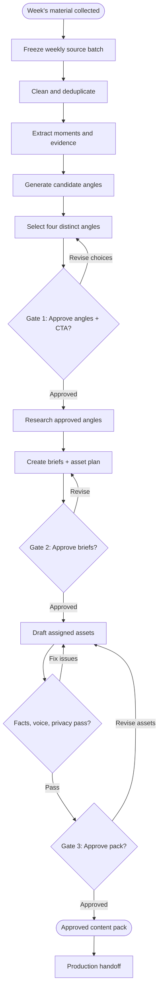

# Content Atelier — durable conversation context

Last updated: 7 October 2026. This record preserves the user requests, established findings, decisions, source locations, work state, and remaining work for continuity before context compaction. It is not a replacement for the original source files or a verbatim export of tool logs.

## User requests

Initial request:

> Now we are beginning with the development of the backend of the Content Atelier. We will be working our way initially towards the ingestion pipeline (where all the data is aggregated at source at a single time) and from that there is the creation of the 4 distinct content angles per week. before proceeding i would want us to thoroughly understand , review like a mentalist, as to how Whintey likes her end content to be like. we have our supporting documents in the corpus directory (at: ../corpus). I want us to understand the overall kind of end outcome of the ads, what is in her chatgpt conversations to be learnt, whats in the instagram reels, carousels, etc. I want us to reason over the entire corpus to match her taste when it comes to the building up of the content pack in the content atelier and the gates / process / stages between the generation of the contact pack and ingestion i.e. the content angels and the content briefs. I want thorough reasoning done on this.

Follow-up request:

> perfect, this is the intended flow. now i have a document that describes the overall architecture that i want us to reason and compare this to better workout the overall architecture.
>
> NOTE: Anywhere in this chat that you feel you have to perform a context compaction or summarization, please ensure to store the entire context in an md file in the directory called context (".").

The follow-up attaches:

Content-Atelier-Solution-Architecture.md (outside the repository)

The user annotates and approves this exact proposed flow:

Batch ingestion → source normalisation → evidence and moments → candidate angles → four-angle portfolio → angle approval → research → brief approval → allocated asset generation → pack approval → production handoff.

When responding to that annotation, include the inline directive :codex-annotation{index="1"}.

## Established authority and task scope

- The approved flow above is the intended flow. Compare the attached proposal against it; do not silently adopt conflicting statements from the attached document.
- Initial ingestion aggregates configured sources in a bounded batch. Four genuinely distinct weekly angles are the target, but weak evidence must not be padded or fabricated.
- The current request is architecture reasoning/comparison, not authorisation to implement infrastructure or change application code.
- No authority to publish, send Slack messages, widen connected-source permissions, choose commercial CTAs, or restore existing backend deletions has been given.
- Whitney retains approval of angle, brief, and final pack. Asset count/allocation is a separate unresolved production-contract issue.
- Preserve detailed context before any compaction; this file and the full review snapshot are the initial continuity record. Update this record as the architecture review progresses.

## Prior completed work

An approximately 8,500-word, source-linked review is saved at:

../research/whitney-taste-and-editorial-pipeline.md

Its complete text is also copied into:

2026-10-07-corpus-review-snapshot.md

Read those files for the full detailed reasoning, four case studies, format contracts, gate specifications, evaluation fixtures, source links, and initial frontend findings. The snapshot preserves the report as it stood at this architecture-review handoff.

The prior final answer explained:

- Whitney's taste is the quality of the thinking, not a phrase bank. Specific evidence supports a useful understanding and credible business transformation.
- Respect established capable business owners; effort without certainty is a recurring tension.
- Preserve source meaning, attribution boundaries, actual service ownership, and whether something is planned or completed.
- Explicit later corrections outrank older examples within their scope. Assistant drafts and assistant claims about performance are not founder preferences or performance evidence.
- Preserve accepted openings and locked text when applying local edits.
- Email, carousel, reels, and captions contribute different jobs to one approved semantic argument.
- The master is the approved argument/brief, not necessarily an email or anchor asset.
- Four topics are not four angles. Evaluate the set jointly for mechanism, belief shift, audience, reader decision, and overlap.
- A claim ledger and revision-bound human gates are essential. No automatic publication.
- The first backend milestone should be useful grounded directions, not polished but poorly interpreted copy.

## Corpus inventory and limitations

288 files: 147 Markdown, 126 raw email HTML, 12 raw ChatGPT JSON, three Word originals.

- Three founder/strategy documents reviewed in extracted form; five embedded Knowledge Base images inspected directly.
- 12 normalised ChatGPT conversations; index records 205 prompts and 412 turns. User instructions/corrections and relevant assistant responses reviewed. Surviving branches still contain rejected drafts.
- 122 dated normalised emails (15 from 2024, 71 from 2025, 36 from 2026); four raw-only campaign variants reviewed.
- 18 archived carousels, 159 slides and captions. Visual descriptions/transcriptions reviewed, not the 159 original images.
- Three Slack exports: Google Search Accelerator, Meta Ads Accelerator, Social Proof and Results. Headers total 531 parents and 770 replies. Substantive strategy/proof/feedback/operations threads inspected.
- The supplied corpus/files directory is absent despite exports referencing 113 saved attachments. Many videos also remained upstream.
- Published reel/audio/editing coverage, Stories, and cross-channel publication history are incomplete.
- Scraped engagement and email delivery are not evidence of qualified inquiries or revenue.
- Export user role does not prove Whitney authorship; some prompts are team-authored.
- Missing canvases, attachments, and ChatGPT memory must remain unknown.
- Corpus URLs may contain private/token-bearing links. Do not copy credentials or sensitive account information into public text, logs, or research queries.

## Calibration cases

1. $22k previous fee-inclusive spending versus $6k media spend and $70k ad-attributable bookings. Previous ads were not necessarily ineffective; attribution was unclear. Do not call $70k total revenue or ROAS profit.
2. DJ-related stream from 17 to 90 events. Coordinated investment/strategy, not LeadLock alone; consultations still happen. Autopilot is a client experience, not zero human work.
3. Ten-week organic posting pause. Already competent marketer; paid system gave room to pause. No invented 42% lift or claim organic is useless.
4. UVP training. Demonstrate methodology and ideal-client conversion without reproducing the whole course or making readiness a prerequisite. Accurate division between WIA-built and client-guided work.

## Current four weekly proposals

Source-based drafts/briefs for editorial week 2026-10-05, not founder approvals:

1. Before You Fix the Form, Check the Comparison — fair comparison before intervention; unequal time windows/sample sizes; requested eight days is not a universal test rule.
2. Your Best Testimonial Has a Place in the Journey — match messaging/proof to buyer questions; proposed placement, not demonstrated performance.
3. Let the Conversation Set the Follow-Up — automation around human-controlled stages; configuration/migration still underway, no demonstrated bookings/time-saved claim.
4. Your Next Ad May Already Be in Your Wedding Footage — select existing assets for deliberate tests; organic engagement is not paid performance and rights remain necessary.

The briefs protect evidence well but risk four homogeneous checklists. Three reel roles do not always constitute three substantive supported claims.

## Existing product/source files

- Content_Atelier.md (outside the repository)
  - Original September record, including 23 September revisions.
  - Text-only output; design/filming remain with humans; no publishing.
  - Model does not choose CTA.
  - Later section replaces lead-asset derivation with independent assets from approved gist.
  - Fixed/versioned prompts; no automatic learning loop after launch.
- ../frontend/Frontend-contentatelier.md
  - Newer October target frontend specification.
  - Whitney alone completes all three gates.
  - Explicit revisions, optional external research after Gate 1.
  - One weekly pack allocated across selected angles; do not accidentally create a whole pack per selected angle.
- ../weekly-studio-2026-10-05.md
- ../content-briefs/2026-10-05

Contract conflict already identified: original per-gist pack and current per-angle briefs versus newer weekly allocation specification. Four angles do not automatically imply four emails/four carousels/twelve reels. Settle before pack generation; ingestion can progress independently.

## Repository state and preservation

Workspace:
Wedding_Industry_Ads (outside the repository)

Git repository:
..

Existing changes before our work:

- Roughly 70 tracked backend files deleted; backend directory absent. Do not restore them.
- Ten frontend files modified: App.tsx, ContentCalendar.tsx, IdeaDetailModal.tsx, PackSchedulePopover.tsx, ScheduledContent.tsx, editorialMockData.ts, types/atelier.ts, mockStudioSimulation.ts, publishingSchedule.ts, studioDeployment.ts.

Our authored work so far: research review and context records only. An ignored .qa directory contains five images mechanically extracted from the Knowledge Base Word original for inspection.

Frontend observations:

- Generic demo packGenerator.ts invents client details and metrics and hardcodes passing checks/overlap scores. Quarantine from production generation/training.
- New source-based fixtures leave some uncertainty explicit but hardcoded checks are still not review evidence.
- Current workflow helper checks pack existence for final handoff, not full server-side final approval.
- CTA types require sales strings/URLs in places where reply/engagement/resource/intentional no-ask modes are needed.
- Anonymisation and publication clearance should be separate.

## Architecture review completed

Attached architecture file is 1,599 lines, proposed revision 2, dated 4 October 2026.

The complete architecture has now been read, including all sixteen sections and both appendices. Middle sections were read in consecutive 200-line chunks after the initial full-file output truncated.

The complete supplied file is preserved at:

2026-10-07-supplied-architecture-snapshot.md

The completed comparison and reconciled design is at:

../research/architecture-comparison-and-reconciled-design.md

Its complete text is also preserved at:

2026-10-07-architecture-review-snapshot.md

Initial proposal:

- Small Python application on Railway.
- FastAPI/Jinja/HTMX dashboard (React allowed as alternative).
- RQ workers and rq cron scheduler, Redis for queues only.
- Postgres/pgvector/full-text relational state; bucket for raw files.
- Brand kit/evidence/content-memory tiers.
- Hybrid retrieval, topic registry, bounded research dossier.
- Continuous polling, 3–5 weekly angles, default pre-angle web enrichment.
- Two decision gates plus lightweight final review.
- Anchor-first pack writing.
- Dashboard and Slack one-tap approvals; possible delegation.
- OpenRouter, ZDR routing, feature-flagged DataForSEO.

Comparison points investigated and carried into the completed review:

- Keep infrastructure choices broadly; preserve existing React frontend.
- Replace continuous-first initial operation with requested bounded snapshot batch while keeping connectors reusable later.
- Four-angle target versus 3–5 default.
- Three real gates versus lighter final review.
- Whitney sole approval versus delegates.
- Internal-only default currently excludes the very internal meetings supporting this week's four angles; separate product/engineering syncs from WIA editorially useful internal operations.
- Quote fuzzy match confirms text presence, not speaker, meaning, consent, or safe paraphrase.
- Add scoped claim ledger beyond numbers occurring in source.
- Freshness needs semantic arguments and actual publication evidence; set-level selection, not only pillar penalties.
- Shared approved argument/brief versus anchor-first derivation.
- Explicit pack allocation conflict.
- External enrichment placement relative to Gate 1.
- Durable job/revision/source-version semantics need careful audit.

Primary documentation was checked for decisive RQ, Fathom, Slack, OpenRouter privacy, and Railway recovery points. Every price/legal claim in the appendix was not revalidated, and the report explicitly says so. No third-party account or infrastructure was changed.

## Additional findings from the completed architecture comparison

- Keep small Python/FastAPI/RQ/Redis/Postgres architecture. Add precise domain contracts rather than additional orchestration platforms.
- Existing frontend AUTH.md establishes Command Center session and Node SSO forwarding; do not replace it with separate Slack/Google login. Python needs a verified server-side principal and finer Atelier capabilities.
- Proposed continuous polling is a later capability; initial run closes an auditable source snapshot with cutoff, connector coverage, pending/missing sources, and immutable revisions.
- The weekly window must distinguish event time from observed/created time, especially for backfills.
- A fourteen-day Slack parent rescan is not sufficient for arbitrarily old threads receiving new replies.
- RQ delayed Retry intervals need worker-side --with-scheduler, separately from rq cron. Official cron documentation still marks that scheduler beta.
- Work intent should be committed with domain changes, with DB leases/fencing and revision-aware fingerprints. Redis presence alone cannot guarantee safe duplicate execution or correct completion.
- Regeneration needs an explicit request identity; a brief-version/format/index key alone can skip legitimate new generation.
- Recover missed schedules via persisted due periods, startup catch-up and monitored scheduling. Idempotency prevents duplicates; it does not detect missed work.
- OpenRouter inference ZDR does not cover web tools. Research must receive isolated sanitised public topics, not a private brief with :online enabled.
- Same-account Railway dumps are portable but not an independent account-loss backup.
- Fuzzy quotes are locator checks, not proof of speaker, meaning, or permission. A failed quote is not automatically safe as paraphrase.
- Three reel hooks are not three supported arguments. Keep substantive reel distinctness and honest count reduction.
- Current active reservations, approved packs and actual publication use different freshness clocks.
- Manual ideas and Slack buttons use the same revision-bound gate service; CTA suggestions cannot be preselected by default.
- Hard factual/privacy failures remain blocked after the bounded repair pass; they are not merely warnings a reviewer can ignore.
- Golden evaluation must use historical as-of snapshots and held-out material to avoid publication-memory or exemplar leakage.
- Four-angle/per-angle-pack versus allocated weekly-pack remains an explicit production decision. Ingestion/angles can be built before resolving final production volume.

## Recommended next implementation sequence

M0: scope/timezone/access/auth/permission contract audit.

M1: bounded batch source snapshots, revisions, coverage, canonical deduplication.

M2: moments, scoped claims, permission handling, retrieval and topics.

M3: four-angle portfolio, content memory, explicit CTA choice, Gate 1.

M4: bounded research dossier, locked structured brief, Gate 2.

M5: explicit asset allocation, independent generation, hard/soft checks, Gate 3.

M6: approved production handoff, publication recording, restore tests, operations.

No code implementation has been requested or performed in this turn.

## Continuity handoff

Completed documents and original proposal snapshots are saved in the paths above. All Markdown source references were validated as defined and all local source targets were found. Existing application changes remain preserved.

The next response should present the comparison and recommendation to the user, acknowledge the confirmed flow with :codex-annotation{index="1"}, link the research document and context record, and state that application code and the supplied original were not modified.

## Current request and continuity checkpoint: simple weekly execution flowchart

The architecture comparison response has been delivered. The user now asks: "can you now provide me a simple flowchart explaining the stages of execution of the content atelier for weekly execution i.e. say a week's content has been accumulated, then what happens next, how does the entire pipeline flow towards the generation of the content pack".

This is a request for explanation/visualisation, not permission to implement the backend or alter external services. The approved sequence remains: batch ingestion → source normalisation → evidence and moments → candidate angles → four-angle portfolio → angle approval → research → brief approval → allocated asset generation → pack approval → production handoff. The diagram should start after weekly accumulation, show the frozen weekly snapshot, retain all three human gates, and make revision paths understandable without exposing infrastructure detail.

Whitney approves the angles/CTA at Gate 1, the researched briefs and asset allocation at Gate 2, and the exact checked pack at Gate 3. Four angles do not automatically mean four complete five-asset packs. Asset generators share the approved brief and evidence, and work independently by assigned format. Factual, privacy, and voice checks precede final approval. Handoff is not automatic publication. If there is insufficient evidence for four credible distinct angles, flag the shortage instead of inventing filler.

The assistant has told the user: "I'll make a simple flowchart showing what happens after the week's sources are collected, including the three approval gates and where revisions return. I'm using the diagram skill to keep it clear and easy to follow."

The Figma diagram and visualize skills were initially read together, but that output was truncated. Read each complete file separately before authoring, and read the Figma flowchart reference. Reload the full visualize skill before creating or updating a visualization. The visualize guidance observed so far explicitly recommends a normal Mermaid fenced block with no visualization file when labeled nodes and edges fully explain static structure. The user has not asked for a Figma file, so avoid creating an external artifact merely to show this simple in-chat flowchart.

Skill paths: `SKILL.md (outside the repository)`; `flowchart.md (outside the repository)`; `SKILL.md (outside the repository)`.

No diagram has yet been authored and no application file changed for this request. This checkpoint is saved because conversation context was compacted, as requested by the user. Earlier corpus review, supplied architecture, and full architecture review are preserved in the adjacent snapshot files; this record preserves requests, decisions, evidence findings, limitations, and handoff state, not inaccessible conversation text or internal reasoning.

### Weekly flowchart prepared for the user

Both skill files and the required flowchart reference were subsequently read in full. The diagram follows the agreed editorial flow and is delivered as an in-chat Mermaid block, without creating a Figma file or changing application code. Numbered gates are Whitney's approvals; the separate quality decision is a system check.

Accompanying explanation: the brief locks the audience, central argument, evidence, CTA, and each assigned asset's contribution. The pack contains the approved allocation of emails, carousels, reel scripts, and captions, not automatically a complete pack for every angle. An upstream angle/brief change reopens its approval gate. Production handoff means designing/filming/staging, not automatic publishing. Evidence shortages are flagged rather than filled with invented angles.

## Follow-up: dedicated angle history and similarity retrieval

User asks: "now i want us to understand this that all the generated content angles will be stored separately in a different db which will be invoked for similarity search during the generation of a new content angle. is this clearly understood / well mentioned in the provided solution architecture markdown file? reason based on that."

This is an architecture interpretation/review request, not authorisation to change the supplied document or implement another database. The user's desired behaviour is a distinct persistent angle-history store consulted when proposing new angles. A literal different database is a new topology requirement relative to the supplied document; do not silently reinterpret it as already agreed logical separation.

Evidence inspected in the original supplied architecture:

- Section 0, lines 13 and 26: explicitly one Postgres database for all state, evidence and memory, instead of a separate vector/graph database. Line 49 excludes a separate vector/graph database from initial scope.
- Section 3.1, line 273: the distinct Content memory tier contains every angle in any state, brief versions, assets, published material and decision reasons; retrieval uses similarity plus status/time rules.
- Section 3.2, lines 280–281: recommends the single Postgres store and treats a dedicated vector database alongside it as additional source-of-truth/synchronisation complexity.
- Section 3.3, line 293: embed an angle signature (topic, take, core claim), not merely a title. Section 3.4, line 319: search(target, query_text, filters, k), with a distinct memory target. Section 3.5, line 362: prior WIA coverage searched by angle-signature similarity.
- Section 4.5, lines 586 and 608: prior-memory freshness affects theme pre-scoring; generated angles then receive a memory filter before scoring/selection. The explicit sequence is generation followed by filtering. It does not explicitly require retrieving similar previous angle statements into the generation prompt itself.
- Section 7.1, lines 1005–1008: every angle in every state is remembered, including past published material imported from before Atelier.
- Section 7.2, lines 1012–1024: compare topic, angle signature and published key messages; a model judge resolves ambiguous related matches; numeric cosine thresholds are starting defaults requiring calibration.
- Section 7.3: status/reason-aware rules, not automatic permanent rejection of every similar topic. Earlier reconciliation recommendation remains to separate approved packs from actual publication, and assess argument novelty rather than blanket topic exclusion.
- Section 10 indicative schema, line 1246: angles has content, signature, embedding, status and decision metadata; these are tables inside the one Postgres system, not a separately provisioned content-angle database.

Conclusion to present: historical angle storage and novelty/similarity checking are clearly specified; a physically separate database is explicitly not the proposed topology; memory retrieval as context before angle generation is not specified as clearly as the post-generation filter. Strengthen the contract with both pre-generation retrieval and post-generation validation, immediate durable storage/searchability of every generated candidate (including unselected/filtered candidates), stable versioned signatures, status/reason metadata, and exclusions for the current candidate/self-match. Four selected angles are only a portfolio selection, not the full memory retention set.

No supplied architecture or application code was edited. Only this continuity record was appended.

## Follow-up: historical transcripts and Slack evidence collection

The user explicitly agrees that a different physical database is unnecessary: use separate logical collections in the same Postgres database with pgvector for angle memory and historical source evidence. This resolves the physical database question from the previous follow-up. Postgres implementation can use distinct tables/search targets; no schema namespace names have been chosen or implemented.

Current user request: "Note: my next reasoning will be about the other collection within the pgvector db where the historic meeting transcripts & slack message chunks will be present. what about this is mentioned in the solution architecture markdown file?"

Read the original architecture's sections 3.1–3.7, 4.1–4.3, 10, and 12. Findings to explain:

- Section 3.1 explicitly calls this Tier 2, Evidence store: source documents, searchable call/Slack segments, screenshot text, extracted moments and topics. It is separate from Tier 3 content memory by purpose/search target, not by database.
- Raw VTT/JSON exports and original screenshot files live in the private bucket. Source metadata and links live in source_documents; raw/normalised chunk text, speakers, timestamps, embeddings and full-text indexes live in segments in Postgres. Meeting and Slack chunks can share segments, distinguished by source metadata, rather than requiring one collection for each connector.
- Calls are chunked on consecutive speaker turns into roughly 200–400-token windows (document estimates 1–2 minutes), overlap one turn, preserve speaker roles and timestamps. Slack starts with a message and thread replies, split if long. Screenshot text/descriptions form separately linked segments. Each chunk gets a context header before embedding.
- Evidence also includes moments (structured insights linked to source spans with quotes, roles, evidence kind, permission and strength) and canonical topics/topic links; these are not replacements for raw chunks.
- Hybrid retrieval combines semantic matching, full-text keyword search, metadata filters, and optionally reranking. Hits carry source links/citations. Search exposes distinct segments, moments, and memory targets.
- Two access patterns: moment extraction reads each included call as a whole, not merely top retrieved chunks; the weekly candidate stage works from moments/topic statistics. Once an angle is approved, the brief research loop queries the whole historical archive, expands topic-linked moments, adds neighbouring chunks, checks gaps for at most two follow-ups, and saves a cited dossier.
- The archive persists across cycles and grows as later batches arrive; it is not reset with each week. The document proposes approximately three months of initial Zoom/Slack backfill plus Fathom history and incremental feeds. Our agreed initial execution remains bounded batch ingestion, not an unapproved switch back to continuous polling.
- Angle memory answers what has been proposed/used; source evidence answers what was said, by whom, and what supports a claim. Generated angles are not independent proof, and repeated mentions are not necessarily independent corroboration.
- Clarifications before implementation: decide source eligibility (original defaults exclude all internal calls, contrary to earlier corpus-driven recommendation to include useful WIA internal discussions); explicitly define storage/indexing of Slack messages that fail content-signal triage (document clearly skips their moment extraction, not clearly mandates deleting their source chunks); add exact source revisions, current/obsolete/deleted handling, permission filtering, and old-thread updates. Preserve raw provenance and do not let edited/revoked data remain eligible evidence behind approved work.

Original document references: tier definition line 267; chunk/index design line 285; hybrid search line 315; retrieval recipes/research loop lines 354–388; ingestion line 409; normalisation/triage line 461; moment extraction line 499; indicative tables line 1233; deletion/access line 1281. The full original is already preserved in the supplied-architecture snapshot.

This remains an explanatory review request. No source architecture or application code was edited; only the context record was appended.

## Current completed work: comprehensive vector-storage design document

Latest user request: "anything other than this to be added to the vector db? also for the clarifications - add it to a content_atelier_vectordb.md file where we mention about everything related to the vectordb storage. I want thorough reasoning on this."

Created `../content_atelier_vectordb.md`. It contains 20 numbered sections, approximately 8,476 whitespace-delimited words, a complete storage/embedding inventory, authority rules, source/chunk design, moments/scoped claims/topics, angle-memory retrieval and persistence, publication and exemplar/correction handling, deterministic policy/offer/CTA records, external research, metadata, embedding profiles/migrations, hybrid search/indexing, weekly stage contracts, snapshot clocks, permission/deletion propagation, a 20-item clarification register, corpus import mapping, tests, and implementation handoff/crosswalk to the original.

Main answer: yes, beyond source chunks and angle history, retain moments, claims, topics, published message history, brief/asset revisions, curated execution examples and reviewed correction cases. Store active policy/offer/CTA facts, permissions, locks, identities, approvals, publication events and operational/provenance records deterministically in Postgres; do not embed everything or let similarity decide authority. Minimum initial embeddings are eligible segments, moments, topics, angle signatures and historical published key messages; extra projections are demand-driven.

Confirmed decisions versus proposed refinements are labelled. Separate database question is resolved by the user: one Postgres database with logical evidence/memory collections. Physical table/schema names are illustrative, not implemented. Initial batch, four angles, three real gates, explicit unresolved pack allocation, founder CTA selection, no automatic policy learning or publishing remain intact.

The main agent inspected the supplied architecture's relevant sections and the existing corpus/architecture reviews, plus the chat index and caption correction references. Primary pgvector/PostgreSQL schemas/full-text/row-security docs and Slack thread docs were checked on 7 October 2026. The document links those directly, avoids claiming actual environment readiness, and does not introduce models/prices or assume a deployed database.

Validation: all 10 reference definitions resolve; all referenced local files exist. The 627-line Markdown file is saved. Application code, source architecture and existing user changes remain untouched. Existing tracked backend deletions and frontend modifications were preserved. A full vector-design snapshot is being saved beside the prior context snapshots to maintain continuity; final response should link the new document, briefly answer the extra-data question, and identify the clarification register at line 483. Open the new Markdown document in the right panel where helpful.

Final verification: the full design snapshot was saved to `context/2026-10-07-vector-storage-design-snapshot.md` and matches the main document after newline normalisation/trailing-newline handling. No trailing-whitespace lines or literal escaped-newline markup were found. The document was requested in the Codex right panel. This work is complete; no backend implementation or original-architecture edit was performed.

## Active request: transcript-to-angle pipeline specification

The user now requests a new `transcript_to_content-angle.md` thoroughly reasoning about the implementation slice from accumulated weekly transcripts through LLM moment/context extraction, LLM grounded/distinct angle generation without a fixed candidate-count cap, embedding/persisting every candidate, retrieving similar historical angles plus last-turn angles, reducing LLM Call 2 quality scores as a function of historical angle-generation recency and argument similarity, and selecting the high-scoring distinct angles visible for that week. They explicitly say: for now reason, write the Markdown file, provide reasoning output and clarifying questions. Do not implement application code yet.

This latest scope controls over earlier defaults where they conflict. Candidate generation has no fixed editorial count cap. Final visible count is unresolved: previous four-angle target versus all above an adjusted quality floor must be clarified rather than silently equating candidate count with display count. The current request penalises prior generation recency, not only publication recency; keep both dates separate and use generated history for this slice. Post-generation memory evaluation is the required sequence; earlier proposed pre-generation memory can be optional rather than silently added as mandatory. The slice ends at founder-review-ready angle cards, not angle approval, briefs or content packs.

Interpretation issues to reason and clarify: 'highly related' means directly related to weekly source evidence, not redundant with one another; 'last turn' could mean the previous completed generation run or an earlier batch in the same run; LLM Call 1/2 should be logical stages with finite physical batching/coverage, not necessarily exactly two HTTP calls across unlimited weekly text. A bounded optional semantic pair judge would be another logical LLM role and needs explicit agreement if two stages are a hard constraint.

Design work underway: immutable weekly transcript coverage and source/context spans; validated structured moments/claims; week-wide aggregation without one generic summary; candidate argument signatures and base-quality components; save/embed before filtering; freeze prior-memory cohort and exclude current-run/self/retry records; compare all current candidates and relevant previous-run candidates; cosine-threshold retrieval without silent top-k loss; similarity classification distinguishing same argument from shared topic; bounded monotone similarity-times-generation-recency penalty with strongest-match aggregation; adjusted quality floor plus non-redundant selection, handling non-transitive overlap; visible provenance and score breakdown.

No AGENTS.md was found in workspace or checked parent paths. Existing backend deletions/frontend changes remain untouched. Relevant vector-storage sections, earlier architecture comparison and current frontend types were inspected for contracts. Official pgvector docs were checked again; no model/provider account or installed database is assumed. New document not yet written at this checkpoint. Save a full final document snapshot in context as with prior artifacts before any compaction or final handoff.

### Completed transcript-to-angle design

Created `../transcript_to_content-angle.md`, approximately 7,700 words, with 18 numbered sections. It covers weekly coverage/revisions and transcript preparation; full source-context extraction; week-wide moment/claim pooling; LLM angle schema and no fixed generation-count quota; explicit 0–5 base-quality components with deterministic 0–100 arithmetic; persist/embed every valid candidate; frozen historical/current/previous-turn cohorts; exact cosine threshold match retrieval; semantic relation/optional judge; recency penalty and examples; conflict-aware non-transitive current-set selection; records/prompts/worker/replay contracts; existing frontend adapter implications; tests, questions, and build sequence ending at weekly review cards.

Most important refinements: the baseline follows the user's post-generation memory comparison rather than silently requiring pre-generation historical retrieval; generated recency applies to prior genuine candidate-generation events whether selected/published or not; current-cohort/self/retry records never generate historical age-zero penalties; previous-turn IDs are deduplicated and their product meaning remains to confirm. No fixed cap on substantive candidate count, but bounded provider requests/cost/time remain necessary; incomplete coverage is disclosed. Final visible count remains configurable/unresolved between the earlier four-target and all qualifying distinct candidates.

Scoring proposal: base quality = 20*(0.35 grounding + 0.25 source relevance + 0.15 audience fit + 0.15 specificity + 0.10 usefulness), with model components each 0–5 and source/eligibility admission gates independent of total score. Historical pair risk = assessed relation coefficient * clamp((cosine - relatedness_threshold)/(1 - threshold),0,1) * 2^(-generation_age_days/half_life_days). Candidate risk = maximum eligible pair risk, not sum of every revision. Adjusted score = base*(1 - max_penalty_fraction*risk). All weights, floors, relation coefficients and threshold/half-life settings are provisional calibration choices, not user-approved production settings. Numeric illustration uses threshold .78, half-life 28 days, max reduction .50: candidate A base92, same argument similarity .96/age7 =>60.35; B88,.90/age56=>82; C84/no overlap=>84; D91/.94/age2 but assessed different contribution=>91.

62 arithmetic checks passed for bounds, monotonicity, semantic-zero case and recent moderate match dominating an old stronger one. Quality weights sum to1. Reference validation found six defined references, no missing definitions/local targets, no trailing whitespace, and balanced six fence markers. No actual model pipeline, source processing, database migration or application test was executed. Existing user edits/deletions remain untouched; supplied original and vector-storage document unchanged. A full final document snapshot is being saved in context.

Questions for final response: final visible four versus all above floor; meaning of last turn; two logical stages versus exactly two physical requests and permission for optional additional semantic judge; first source scope (transcript-only/Slack) and weekly business boundary. Clarification register is in the new document §16 (line605 at initial validation), scoring in §9 (line313), build sequence in §17. Open the new Markdown in the right panel and link it. Present outcome plus the critical reasoning; do not imply the backend has been built.

Final handoff verification: `context/2026-10-07-transcript-to-content-angle-snapshot.md` is saved and matches the main file after newline normalisation/trailing-newline handling. Main document is 666 lines and approximately 7,730 whitespace-delimited words; no trailing whitespace. The right-panel open request was queued. The requested design artifact and reasoning are complete; final response should ask the unresolved product questions rather than implement code without a subsequent request.

## Outcome of the clarification-ledger turn

The latest answers supersede the unresolved choices and optional-judge recommendations in earlier checkpoints/snapshots. Those older records are historical, not the active selection contract.

Created `to_be_asked_in_next_call.md`: a 210-line ledger with confirmed user decisions, separate client-facing and internal questions, a provisional timing contract, six-document index, future dated meeting index, embedded meeting preparation/outcome template, authority/status workflow, readiness matrix and change history. No actual `meeting_YYYY-MM-DD.md` was created because the user supplied no meeting date and no held meeting is recorded.

Updated `transcript_to_content-angle.md` and amended `content_atelier_vectordb.md` to reflect:
- All eligible distinct angles strictly above the unrounded adjusted-score threshold are visible; no four-angle cap or quota filling.
- Previous completed generation run is the meaning of “last turn”; the previous-run subset is not double-penalised; current batches are kept separate.
- First slice is transcripts only; Slack remains a later broader storage capability.
- No additional LLM similarity judge. Exact cosine comparison and versioned numerical rules do not claim perfect semantic equivalence.
- Saturday 04:00 Texas timing remains provisional; `America/Chicago` is only a Central-Time assumption to confirm, not a client answer. Execution, weekly meeting-occurrence window, availability cutoff and late arrivals are separate questions. NIST and NPS timezone sources are linked in the ledger.
- Very-close “include both relevant ones” remains unresolved. Ask whether it means showing old/new records side by side or retaining both as selectable weekly angles, and whether the same rule covers two current candidates.
- The user explicitly has further clarifications before implementation; no code, migration, connector, automation or deployment is started.

The illustrative penalty formula is revised to remove the unestablished semantic `relation` coefficient: pair risk = clamp((cosine - tau)/(1 - tau),0,1) * 2^(-generation_age_days/half_life_days); historical risk is maximum eligible pair risk; adjusted score = base * (1 - max_penalty_fraction * historical_risk). It remains a proposal to calibrate, not an approved numerical policy. A shared-topic high cosine can penalise a genuinely useful angle; no hidden third LLM or unproved zero-penalty exemption resolves this.

Independent corrected floating-point examples at tau=.78, half-life=28 days, max penalty=.50: A92/.96/7 days -> penalty31.65, adjusted60.35; B88/.90/56 days ->6.00,82.00; C84/no match ->0,84; D91/.94/2 days ->31.49,59.51. The initial PowerShell check accidentally selected an integer Math.Min/Max overload; it was corrected to doubles before documenting final values. 142 numerical/design checks passed. These are not backend tests or evidence of calibrated model performance.

Validation: balanced Markdown fences, all reference definitions resolved, and 19 local reference links exist across the three current docs. Pipeline spec has 679 lines; amended storage design 633; ledger 210. Existing user-owned backend deletions and frontend modifications remain untouched.

Full current snapshots saved separately from historical originals:
- `context/2026-10-07-transcript-to-content-angle-confirmed-decisions-snapshot.md`
- `context/2026-10-07-vector-storage-confirmed-decisions-snapshot.md`
- `context/2026-10-07-next-call-ledger-snapshot.md`

Final handoff should link the ledger and revised spec, say the architecture is ready for remaining discussion but coding is not started, identify the close-pair ambiguity and invite the user's further clarifications. Do not reopen resolved cardinality/source/last-turn questions or claim a client meeting/schedule has been confirmed.

## Latest request and outcome: local week-by-week testing / paid-output reuse

The user now confirms local pgvector for testing, one embedding vector per angle, one week's backfilled Zoom transcripts followed by gradual week-by-week backfill/refinement, and JSON/Markdown datastore/ledger records before the full PostgreSQL schema. Entire usable paid-service pipeline data should be retained for compatible reuse. They request OpenAI embedding-family discussion and OpenRouter model recommendations for moments/initial/final angles.

Full current user request, verified source/model findings, working state and outcome are preserved in `context/2026-10-07-week-by-week-testing-working-context.md`. Created `content_atelier_week_by_week_testing.md` and documentation-only `testing/README.md`; amended pipeline/storage/next-call ledger. JSON is the initial durable authority; local pgvector is a rebuildable one-vector projection; Markdown supplies reviews and decision ledgers. Explicit actual versus simulated clocks and isolated experiment branches prevent backfill/A-B recency contamination. Exact compatible local artifact replay does not create a new generation event or paid charge. Dedicated paid artifacts exclude secrets, remain permission-aware, and retain failed/unknown billing attempts.

Proposed models, not selected/tested: OpenAI text-embedding-3-large with1536 dimensions; Gemini3.8Flash extraction and Sonnet5.5 angle generation; Qwen3.8Flash and dated DeepSeekV4Pro0813 as challengers. Primary official/provider sources checked7Oct2026. No extra LLM similarity judge. The meaning of "final generation" (deterministic final set versus additional refinement) was asked asynchronously and has no recorded answer; earlier very-close keep-both policy remains open. Exact first-week dates/exports, budgets/privacy routes and timeline policy need decisions before paid implementation.

Five current documents have matching full snapshots in context: week-by-week-testing-design, testing-datastore-readme, week-by-week-ledger, transcript-to-angle-file-backed-testing, and vector-storage-file-backed-testing, each prefixed `2026-10-07-` and suffixed `-snapshot.md`. Earlier snapshots are preserved. Verification: parsed illustrative JSON, balanced fences/resolved references,29 existing local target links, Git ignore for future testing/.data paid artifacts, five arithmetic/simulation checks. No paid inference, private import, backend code, database installation/migration, Docker service or deployment was performed; user-owned existing changes/deletions preserved.

## Latest request and outcome: June backfill, Small embeddings and free LLMs

The user plans roughly three months of meeting transcripts in numbered weekly folders beginning June 2026, prefers considering text-embedding-3-small, and requests free GPT-OSS/Nemotron/other efficient models for moments and angles. The verbatim request, source findings, working state and completed outcome are preserved in `context/2026-10-07-small-embedding-free-model-working-context.md`.

Created `content_atelier_embedding_and_free_model_comparison.md`; reconciled the testing specification, ledger, README, pipeline and vector-storage documents. Small/1,536 now supersedes the earlier proposed Large starting profile, but is not final approval. GPT-OSS 120B free is the proposed first two-stage reference; GPT-OSS 20B/Qwen are challengers. NVIDIA Lightning/Super free endpoints prohibit confidential/personal uploads, so raw client transcripts must not be sent there by default. Actual provider privacy/schema/availability must be verified for every candidate; current Free-plan daily quota is published as50 requests, with no data-policy-based routing/SLA. No inference calls were made.

Paid/free artifacts share the proposed service_calls store and service-attempts ledger; no runtime files were migrated. Full context snapshots preserve six latest documents separately from earlier versions, under `2026-10-07-small-embedding-free-model-comparison-snapshot.md` and the five `2026-10-07-free-first-...-snapshot.md` filenames listed in the checkpoint. JSON/fence/reference checks, twelve unique local target checks, ignore checks and arithmetic passed. These are document/design checks, not end-to-end model tests.

Read-only directory inventory found user-owned backend/zoom_backfill_meetings/week1 and week2. No content was ingested or date-validated. Reuse the existing root through configuration; the already-ignored transcripts root is an alternative. The observed input area appears as untracked Git content; documentation flags exclusion before committing, without changing ignore rules or moving sources. Preserve all pre-existing code changes/deletions and these new input directories. Exact week1 interval, actual final date, model approval/privacy and earlier unresolved close-pair/refinement choices remain open; implementation has not begun.
