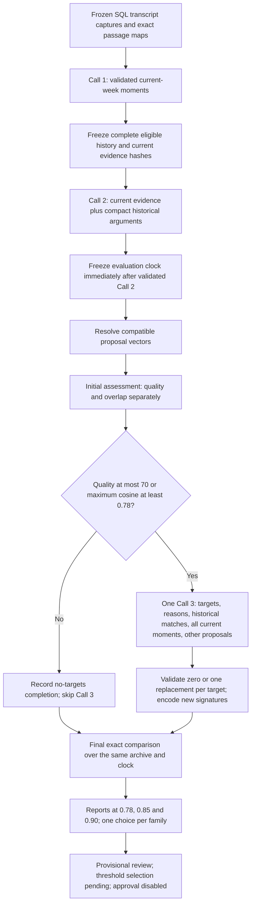

# Historical comparison workflow — implementation and reasoning

<!-- governing-plan-note -->
> **Historical (marked 18 October 2026, plan item S.B9).** This document is kept for traceability. The one governing plan is [the implementation plan](backend/docs/Content-Atelier-Implementation-Plan-Brief-Generation.md) (revision 6.1 or later); where they differ, the plan wins. Do not plan from this document.

Implemented 12 October 2026. The accepted contract is `historical_comparison_v1`.
It runs alongside `two_call_v1`; persisted legacy runs retain their original stages,
prompts, scoring and approval behavior. The weekly comparison UI explicitly submits
the new contract. Real inference, choosing an authoritative cutoff, Gate 1 selection
and briefing remain outside this release. All external capabilities stay false.

## Execution and data supplied

Missing or incompatible vectors pause the pipeline. Operational validation failures
fail a stage; they do not semantically reject its originals. No stage silently drops
historical arguments or evidence to fit a prompt. Existing configured request preflight
and provider limits remain in effect. The complete historical archive is compacted
to actual IDs, audience, tension, argument, take, mechanism, reader decision and
qualifications. Shared exact evidence passages are delivered once and remain resolvable
through each moment's ordered passage IDs, source revisions and context references.

## Why quality, history and freshness are separate

For each cutoff `t`, eligibility requires valid current grounding/references, complete
matching, `baseline_quality > 70`, and `maximum_historical_cosine < t`. Values equal
to either boundary fail. Calculations use unrounded values. No-history maximum is
`-1` only after the complete frozen archive has been checked and found empty.

The unchanged rubric measures grounding, source relevance, audience fit, specificity
and editorial usefulness. A low-quality original is a recovery target even when it
has little historical overlap. A replacement with lower overlap but quality at or
below 70 still fails. Model quality ratings remain estimates requiring editorial review.

The established 28-day freshness half-life and maximum 50% repetition penalty remain
ranking/explanation metrics. An old repeated argument cannot qualify merely because
its penalty decayed. Conversely, an angle with baseline quality above 70 and acceptable
historical separation does not fail because its adjusted ranking score is lower.
All three scenarios consume identical bodies, scores and vectors; switching a displayed
cutoff performs no inference or encoding. Qualified counts demonstrate pipeline outcomes,
not semantic calibration of the experimental cutoffs.

## Refinement, fallback and lineage

Call 3 receives targeted originals and separate diagnoses, raw historical comparisons,
substantive prior arguments, every validated current moment including unused moments,
and other proposals. Historical arguments provide overlap context, never evidence for
current assertions. Reconstruction can use different moments from the same week.
The prompt asks for supported changes to an argument, mechanism or reader decision,
not title rewriting, score inflation or optimization of a numerical cosine.

The strict response covers each target exactly once with `replacement` plus an
`AngleDraft`, or `no_supported_alternative` with a null replacement and explanation.
It acknowledges delivered moments and coverage notes. Unknown/historical moment IDs,
duplicate targets, inconsistent dispositions, duplicate arguments and invalid assertions
fail validation. The existing source qualifications and sensitivity handling are retained.
Replacement scores are computed from their own rubric ratings.

Originals retain their body and evidence. A replacement is a separate `content_angles`
row with `supersedes_id` and its own `angle_moments` links. It preserves its parent's
first generation time; the third-call artifact records actual refinement time. Each
scenario selects a qualifying replacement first, a qualifying original otherwise, or
no candidate. It counts one family and uses that member's complete assessment. An
unsuccessful recovery cannot evict an original which qualifies under that scenario.

Current-batch cosine at least 0.90 is recalculated within each scenario's selected
cohort and exposed separately. It flags review work without choosing winners or merging
angles. There is no required weekly count and no additional semantic refinement loop.
Explicit operational retries can reuse validated cached output after a SQL failure.

## Persistence, admission and safeguards

No schema expansion: 13 tables, two vector columns, unchanged baseline/catalog.
`matching_result` stores candidate metrics; existing job `result_refs` stores history,
targets, dispositions, family membership, selected IDs and scenario aggregates.
Provider requests, raw responses, validated cache, preflight and billing stay in the
operational artifact store. Pure eligibility/family selection lives in
[angle_workflow.py](backend/backend_pipeline/angle_workflow.py); SQL assessment is in
[comparison.py](backend/backend_pipeline/comparison.py). Legacy selection wraps the
shared pure numerical assessment in [matching.py](backend/backend_pipeline/matching.py).

History retains valid earlier arguments, including valid suppressed arguments and
the six accepted partial Luna candidates. A completed new workflow admits one latest
source-valid family representative, independently of which experimental cutoff would
select it. Unfinished new workflows are excluded. Current source cohorts, replacement
families, replay copies and synthetic/real mixtures are excluded. Complete comparisons
are exact scans; five displayed matches are never the decision universe.

Snapshots pin content/signature/quality hashes, original dates, compatible vector
digests, encoding contract and current evidence/source views. History freezes before
Call 2; its evaluation clock freezes just after Call 2 and survives SQL retries.
Changed frozen inputs require a new assessment intent. Missing coverage produces no
qualified counts. Generation/refinement artifacts retain original cache origin and cost
records; leases and raw-response-before-SQL recovery remain in use.

The backend guards comparison ownership through immutable run/family lineage. Editing,
rescoring and reassessment cannot convert it into legacy approval. Saved-angle comparison
reassessment creates a new history/clock intent and runs encoding/assessment only, without
another model call. Original fallback records remain reviewable even when they have a
child; review uses explicit run/family membership rather than a leaf-only query.

## Interfaces and verification

Run submission and the CLI accept `workflow=historical_comparison_v1`. Protected JSON
and CSV exports are `/storage/runs/{id}/comparison` and `/comparison.csv`, proxied through
the existing team-session BFF. Browser identities are never trusted. CSV export shares
authorization, includes assessments/counts, and escapes spreadsheet formula prefixes.
The UI shows three summaries, per-family eligibility, recovery reasons and original/refined
evidence. No production threshold is selected.

Offline PostgreSQL fixtures cover eight proposals, six targets, two unchanged candidates
and exactly one refinement request; final qualified counts are 4/5/7 in the main synthetic
fixture. They cover strict boundaries, low-quality recovery, original fallback, no supported
alternative, zero results, complete archive checking, source qualifications, cache lineage,
changed frozen inputs, operational response/SQL failures and approval denial after edits.
An automatic test guard rejects outbound HTTP transports. The real database is fingerprinted
read-only before and after verification. See [the runbook](backend/STORAGE.md) for commands,
current verification results and remaining real embedding/editorial work.

Final readiness evidence: a full 151-test backend run passed, followed by all 40 affected
cases after one additional legacy edge-case regression (152 distinct cases verified).
Four storage/comparison UI tests, 12 auth/proxy tests, TypeScript checking and the production
build passed. Every real SQL row/catalog fingerprint matched before/after. All three external
switches remain false; no real corpus execution occurred. The saved synthetic JSON/CSV
and readiness metadata are under `backend/.storage-artifacts/verification/`.

## Authorized Week 1 history preparation

After offline implementation verification, the user approved the six Week 1 signatures
being sent to OpenRouter's embedding endpoint. Six real Small embeddings at 1,536
dimensions were generated and verified on the existing `content_angles` rows, with
compatible signature hashes, float32 vector digests, model responses and completed-job
provenance. Original content, scores, first generation time, evidence and partial status
were preserved. Week 1 is now `awaiting_matching`; all six can supply Week 2 history.
Week 2 remains prepared with no angle generation or refinement. The encoding permission
was local to that bounded operation; all persistent external switches remain false.
See `backend/.storage-artifacts/verification/week1-embedding-readiness.json`.

## First authorized live Week 2 test

The same-day live run `run_f92042c802f84d8a9a1401a460cb0f55` completed all eight
stages: six source-valid moments, six generated/encoded angles, and six qualified
families at each cutoff. No historical cosine reached 0.78 (range about 0.560-0.636),
and there were no current-batch flags. There were zero refinement targets, so Call 3
was recorded as skipped. Actual dispatches were one extraction, one generation and
six embeddings. Live refinement itself remains unexercised by this corpus.

Call 2 initially used explicit original passage citations without moment prefixes.
All 18 references resolved to exactly one declared current moment. A SQL-only citation
adapter preserved the source assertion text and added that known prefix; raw responses,
scores and qualifiers were not rewritten. Unknown, historical or ambiguous evidence is
rejected. The received response was validated and reused on an operational retry without
another generation call. Forty-seven affected regression cases passed. The protected
API denies comparison approval; sources, Week 1 and downstream records stayed intact.

The reports are under `backend/.storage-artifacts/experiments/sql/runs/` in this run's
directory: `review.md`, `comparison.json`, `comparison.csv`, `live-summary.json` and
`verification.json`. Source acknowledgment and model ratings are not editorial proof;
the thresholds still need human evaluation. All saved external switches remain false,
and briefing is pending.
