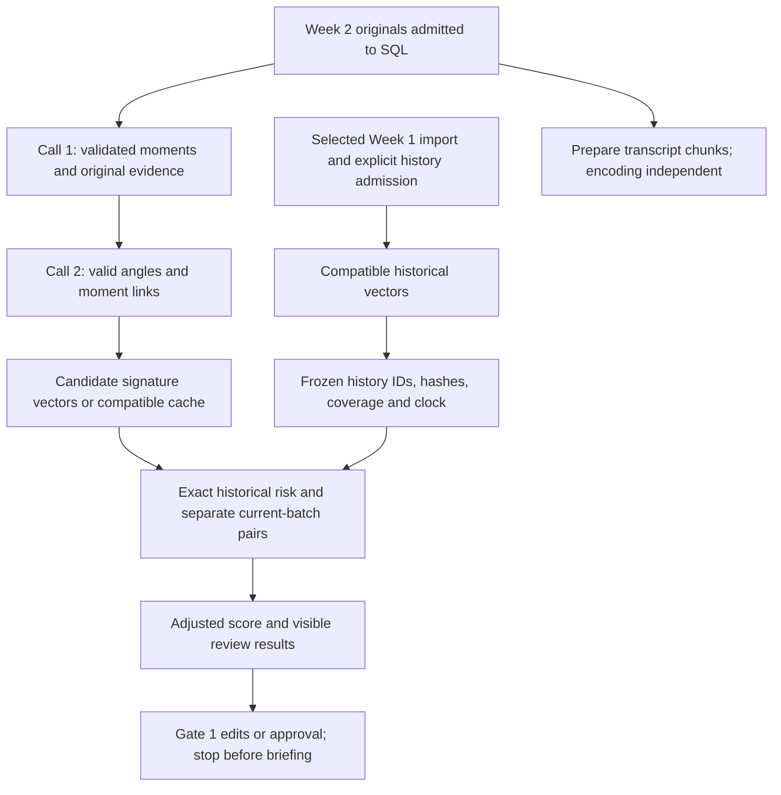

# Implementation plan — weekly angles, PostgreSQL and pgvector

<!-- governing-plan-note -->
> **Historical (marked 18 October 2026, plan item S.B9).** This document is kept for traceability. The one governing plan is [the implementation plan](backend/docs/Content-Atelier-Implementation-Plan-Brief-Generation.md) (revision 6.1 or later); where they differ, the plan wins. Do not plan from this document.

Prepared 9 October 2026 · **Plan first, then implementation**, as confirmed by the user.

Original target: storage through the legacy two-call weekly angle workflow. The current extension is **moment extraction → frozen history → historically aware Call 2 → one optional Call 3 → three-cutoff provisional comparison review**. See the [implemented comparison plan and reasoning](implementation-plan-historical-comparison.md). No authoritative threshold or comparison approval is activated; briefing follows later.

**Implementation status, 12 October 2026:** the approved 13-table/two-vector baseline and real corpus are preserved. Pure assessment is separated from legacy selection; historical context, strict one-pass refinement, original fallback, three scenario reports, protected JSON/CSV exports, UI summaries and comparison approval guards are implemented. Legacy two-call regression remains covered. See [STORAGE.md](backend/STORAGE.md) for verification and commands. No OpenRouter or external embedding requests were made; all three external capabilities remain false. The original plan below remains the legacy storage reference; the comparison extension governs new weekly UI submissions.

Related contracts: [approved DBML](content-atelier-compact.dbml), [column contracts](database-schema-compact.md), [pipeline map](data-storage-schema.md), [storage/retrieval rationale](content_atelier_vectordb.md), [matching specification](research/pgvector-creation-and-angle-matching-spec.md).

## 1. What “ready” means

The implementation should deliver:

- Repeatable local PostgreSQL/pgvector setup and reviewed SQL matching the approved thirteen-table schema.
- PostgreSQL authority for admitted sources, moments, angles, relationships and process state.
- Deterministic import of accepted Week 1 records, preserving IDs, evidence, generation age and partial-coverage facts.
- Week 2 preparation using the supplied corpus, with no automatic inference.
- Reusable Call 1/Call 2 adapters and validators, wired to SQL transactions and resumable processing.
- Separate embedding and matching operations that consume saved candidates without repeating generation.
- Exact historical matching, freshness adjustment, current-batch flags and explainable review results.
- Read APIs and a minimal real-data angle/process UI; Gate 1 decisions must not automatically start briefing.
- Offline integration evidence using synthetic provider outputs and a real isolated test database.

Keep external inference disabled during implementation. Real Week 2 generation and real embedding execution are later independently controlled operations. Synthetic vector tests verify mechanics, not actual semantic distinctness.

The target dependency flow is below. During offline verification, synthetic or compatible cached outputs stand in for external generation/encoding; this graph does not enable calls.



SQL runs/jobs/events record actual progress across these dependencies. The required matching branch depends on angle vectors, while the chunk branch prepares future evidence research.

Brief research/fuzzy retrieval, brief generation, packs, publication and new source-provider connectors are outside this phase.

## 2. Verified starting point

### Corpus

The audit read every supplied transcript using the current compact meeting/turn reference format:

| Corpus | Files | Turns | Original bytes | Compact packet UTF-8 bytes | Parse failures |
|---|---:|---:|---:|---:|---:|
| Week 1 | 9 | 3,238 | 415,662 | 358,002 | 0 |
| Week 2 | 11 | 5,218 | 609,332 | 516,999 | 0 |

These are source-packet measurements, excluding prompts/response schemas. They are **not native token counts or proof that a provider request will fit**. Week 2's compact source packet is approximately 44% larger.

Files are under [the supplied corpus](backend/zoom_backfill_meetings/). The user selected June 1–7 and June 8–14, interpreted as 2026, and the six Luna candidates. Those assignments are admitted. Neither folder supplies verified meeting dates; meeting `occurred_at` stays null when unknown.

### Saved Week 1

The latest Luna diagnostic, `week1-gpt6-luna-partial-angle-diagnostic-20261008-a4`, has seven individually source-valid moments and six validated angle candidates. Its original angle generation time is `2026-10-08T11:28:56.043339Z`. Status remains `partial` because the upstream complete extraction failed two quotation checks. There are no vectors, adjusted scores, final visible selection or human approvals.

The Luna replay contains the **same six IDs and generation times**; it is not another six arguments. Older Apodex diagnostics contain five additional candidates, also partial and unembedded. See the [Week 1 review](research/week1-gpt6-luna-content-angle-review.md).

The user considers Week 1's content work done. Preserve those saved outputs without claiming complete extraction or completed similarity verification.

### Backend/UI gaps

| Component | Starting behavior when the plan was prepared | Planned change, now implemented through Gate 1 |
|---|---|---|
| [store.py](backend/backend_pipeline/store.py) | Single-writer JSON business/artifact storage | Separate SQL repository from operational artifacts/cache |
| [db.py](backend/backend_pipeline/db.py) | Creates/project-writes `angle_vectors` only | Approved inline-vector schema/repository |
| [pipeline.py](backend/backend_pipeline/pipeline.py) | Generation-only returns before encoding; full branch embeds/ranks | Explicit stages, SQL writes and independent execution permissions |
| History loader | Completed `angles.json` only; excludes partial candidate-only runs and drops missing vectors | SQL admission, frozen history and incomplete-coverage errors |
| [scoring.py](backend/backend_pipeline/scoring.py) | Existing recency rule; missing vectors can become zero risk; `max_similarity` is weighted risk | Structured results, fixed clock and separate current-batch analysis |
| [api.py](backend/backend_pipeline/api.py) | Synchronous runs; JSON review | Short submission/read requests and durable worker |
| [worker.py](backend/backend_pipeline/worker.py) | RQ wrapper without SQL stage tracking | Claims, leases, retries and events |
| [App.tsx](frontend/src/App.tsx) | Mock/localStorage content and downstream-shaped objects | Narrow real weekly-angle DTO |
| [editorialWeeks.ts](frontend/src/utils/editorialWeeks.ts) | Four-concept cap | Remove cap from real angle workflow |

Dependencies already include Psycopg 3, pgvector Python and SQLAlchemy. Compose proposes PostgreSQL 17/pgvector and Redis. Local `psql` reports 17.11; Docker is installed. Server reachability, extension availability and Docker daemon health have not been established. No database was started or migrated.

## 3. Architecture decisions

### SQL content authority; operational artifacts remain separate

Introduce a typed `ContentRepository` for the SQL pipeline. Retain `JsonStore` for exact provider requests/responses, validated cache, original-byte archives, billing and historical experiments.

A SQL run reads business inputs/outputs from SQL; optional reports are exports. Keep the legacy testing runner as an explicit separate mode while the other chat continues prompt work. It must not become a second writer of the same SQL records.

Preserve compatible fingerprints, validators and reuse. A schema change alone must not require inference. Save/validate provider output before committing business rows, enabling recovery after a database failure.

### Complete approved schema; nine populated tables

Create all thirteen tables so optional future job FKs have destinations and the implementation matches the approved DBML. Populate only:

```text
weeks, transcripts, transcript_chunks, key_moments,
content_angles, angle_moments,
pipeline_runs, pipeline_jobs, pipeline_events
```

Keep `content_briefs`, `content_packs`, `content_assets` and `calendar_entries` empty. No placeholder content or additional configuration/profile/vector-side tables.

### Existing driver and durable queue

Use parameterized Psycopg queries and explicit transactions. Register pgvector types on each connection. [pgvector Python documentation](https://github.com/pgvector/pgvector-python)

An ORM is optional. Avoid another independently maintained schema definition beside DBML and reviewed SQL; use typed JSON contracts and catalog assertions.

The approved jobs already hold intent, target, status, attempts and lease. Use them as the initial durable queue rather than giving Redis/RQ a second workflow authority. Retain RQ only if needed as transport.

Start with one external-provider worker. Multiple provider workers require per-request cache coordination; SQL job claims alone do not prevent duplicate identical fingerprints across runs.

## 4. Package A — database setup and reviewed SQL

**Deliverables:** explicit configuration, baseline SQL, guarded apply/check commands and isolated test configuration.

1. Choose a dedicated development database. Prefer PostgreSQL 17/pgvector consistent with Compose, using an isolated loopback port such as 15432 if 5432 is occupied.
2. Inspect existing containers/volumes and resolve/pin the tested image. Do not reset unknown databases or remove existing volumes.
3. Configure a database URL locally; keep credentials out of code, logs and health responses. Separate schema-setup and application privileges where practical.
4. Generate/review baseline SQL from DBML. Enable `vector`, create tables and then add cyclic dependencies such as `weeks.active_run_id` ↔ `pipeline_runs.week_id`.
5. Preserve 13 tables, 30 FK relationships, 18 approved checks and two `vector(1536)` columns. Add necessary reverse indexes, including `angle_moments(moment_id)`.
6. Build guarded application: explicit target, transaction, migration lock and expected catalog checks. An already matching baseline is a no-op; mismatched/legacy schemas fail visibly rather than being hidden by `IF NOT EXISTS`.
7. Keep ordered SQL/checksums in repository/deployment records. No extra product/configuration-version table for this baseline. Agree applied-state bookkeeping before future incremental releases.
8. Create an isolated integration-test database; fixtures may reset only that confirmed target.

Ordinary runtime requests never execute DDL. Retire the old projection from the SQL path without dropping an existing `angle_vectors` table/database.

Use exact vector operations initially. pgvector provides cosine distance with `<=>` and exact search by default; approximate indexes trade recall for speed. This small archive does not justify incomplete scoring. [pgvector documentation](https://github.com/pgvector/pgvector)

Chunk HNSW/full-text/fuzzy retrieval follows when briefing research consumes it.

**Acceptance:** catalog matches; 1,536-dimensional parameterized round-trip/cosine succeeds; rerun is safe; drift fails clearly; the application role cannot implicitly create schema.

## 5. Package B — evidence and JSON contracts

**Deliverables:** SQL DTOs/validators, source identity, passage mapping, hashes and deterministic chunks.

### Weeks and originals

Map corpus labels to user-supplied seven-day ranges, with stable `week_id` and unique `week_start`. Labels belong in intake configuration. Do not infer occurrence dates from folder order, modification time or import time.

Preserve exact decoded original text under a documented encoding/newline convention. Use stable local passage IDs and half-open character ranges. Python characters, bytes and SQL substring positions are different units.

The current reader maps lines/turns, not SQL original character ranges. Add a reversible map and prove every slice matches original wording, including Unicode, CRLF, speakers and untimed/header text.

Current source IDs depend on absolute paths; span IDs omit revision. Preserve aliases for import/cache compatibility without presenting them as upstream meeting IDs. Durable transcript identity includes source identity and captured-input hash; evidence includes the exact `transcript_id` and passage ID.

Define a capture hash over original input and processing-relevant known facts. Retain the original raw-byte hash in metadata for replay verification. Changed captured input gets a new row; a stable alias must never redirect a citation to the latest revision.

### Moments and angles

Map validated models into `moment_body`/`content_body` and reference structures. Preserve compatible original IDs, assertions, qualifications, handling labels and exact quotation checks.

The schema supports multi-transcript moment references; the current generator validates one conversation per moment. Keep that stricter contract. Do not weaken it simply because the schema is flexible.

Validate admission, passage ownership/ranges, uniqueness, required contiguous context, run/week consistency and supersedes cycles. Separate approval-content hashes from semantic-input hashes.

### Chunks

Create coherent chunks with original references. Hash contextual text plus locations so identical words at different positions do not falsely deduplicate.

Persist chunk rows now with nullable vectors. Chunk encoding is separate, nonblocking research preparation; extraction and angle matching do not require it.

**Acceptance:** all 20 files admit without text loss; range round-trips and idempotent import pass; changed input preserves originals; missing metadata stays unknown; inference remains disabled.

## 6. Package C — repositories and Week 1 bootstrap

**Deliverables:** transactional repositories and explicit repeatable import/eligibility report.

Proposed initial history is the six Luna candidates and seven accepted moments. The user has been asked whether to use that set or all eleven Luna/Apodex candidates; require an explicit source-run selection before final import.

Verify archived source snapshots and artifact/output hashes. Import original executions, valid moments, angles and moment links. Deduplicate replay by original IDs/fingerprints.

Preserve failed extraction and partial diagnostic states. A moment from failed A3 retains that actual source origin; later individual validation is a distinct processing fact. Map angle `generated_at` to `first_generated_at` without replacing it with import time.

| Saved fact | SQL meaning |
|---|---|
| Failed complete extraction | Failed run and actual error/coverage |
| Partial diagnostic | `partially_completed` and partial coverage |
| Valid angle candidate | Candidate selection and pending approval |
| Null vector / unrun matching | Null vector/hash pair; null adjusted score |
| Replay | Reuse references, no duplicate generation |

The ordinary complete-generation eligibility rule excludes these partial diagnostics. Bootstrap therefore needs explicit **accepted-partial-baseline admission**, recorded via an actual job/result/event and disclosed in coverage. Do not promote original runs to full success.

Do not automatically admit earlier diagnostics, invalid proposals, mock UI ideas or replay duplicates.

Related outputs commit atomically. On compatible reuse, preserve original moment/angle generation `run_id` and age; record consumed IDs and per-run reassessment on the new job rather than overwriting lineage.

**Acceptance:** chosen count is reproducible; Luna-only import has six unique angles; replay adds no content rows; evidence resolves; failed/partial facts remain; no LLM request.

## 7. Package D — durable execution

**Deliverables:** run/job/event repositories, worker claims, dependencies and recovery tests.

Use `weekly_angles` for generation through matching/selection. Scope completion does not require briefing or automatic human approval.

Validate/freeze admitted transcript IDs/hashes before generation. Commit source/run/job intent before dispatch. Later input snapshots belong on actual stage jobs/results; do not repeatedly copy source text.

| Stage | Inputs | Saved output |
|---|---|---|
| `source_admission` | Prepared corpus/date mapping and restrictions | Originals/week, frozen run references and coverage |
| `chunk_preparation` | Originals/maps | Chunk text/references; optional independent encoding |
| `moment_extraction` | Complete admitted originals, unchanged prompt | Validated moments; rejects remain operational artifacts |
| `angle_generation` | Validated moments and original context | All valid angles and links |
| `angle_embedding` | Signatures or compatible saved vectors | Vectors/input hashes and encoding provenance |
| `history_snapshot` | Accepted history, current cohort and clock | Frozen IDs/hashes/ages/coverage |
| `angle_matching` | Complete vectors and frozen snapshot | Historical risk, current pairs and explanations |
| `angle_selection` | Complete matching/unrounded scores | Visibility and review-ready result |

Functions may group stages if dependencies/atomicity stay explicit. Chunk encoding never blocks the required angle path.

Claim work atomically with row locks and lease token/expiry. Only the current unexpired lease may refresh/finish. Retry the same job/intent, increment attempt and append meaningful milestones; heartbeats update the job. [PostgreSQL 17 locking](https://www.postgresql.org/docs/17/explicit-locking.html)

Keep HTTP outside long SQL transactions. Use explicit commit/rollback boundaries. [Psycopg transactions](https://www.psycopg.org/psycopg3/docs/basic/transactions.html)

Reuse known provider output after a downstream SQL failure. Unknown provider outcome does not automatically authorize another paid request. Leases/idempotency cannot guarantee exactly-once charges.

Test the sequence with a nonempty synthetic provider; the current empty fake cannot prove actual content writes/matching. Genuine completed extraction with no relevant moments should yield an explained empty result without fabricated content.

**Acceptance:** stages survive restart; stale workers cannot commit; intent is not queued twice; completed upstream work is reused; dependencies are visible; percentages use measured units only.


## 8. Package E — independent generation, encoding and matching

**Deliverables:** explicit capabilities, reusable adapters and provider-free default operation.

The current `embeddings_enabled` flag also controls ranking/final visibility. Separate these concerns:

| Capability | During implementation | Later intended operation |
|---|---|---|
| Generation dispatch | External services disabled | Explicitly enabled Call 1/Call 2 |
| Angle encoding | Fixtures/cache only | Independently enabled OpenAI adapter |
| Chunk encoding | Disabled and nonblocking | Later research preparation |
| Numerical matching | Compatible saved/test vectors | No OpenRouter call required |
| Brief dispatch | Unavailable | Added after this phase |

Support generation-only, match-existing-candidates and offline fixture/replay modes independently. Matching saved candidates must not require new OpenRouter work.

Preserve the canonical signature builder and compatible fingerprints. Do not alter prompts, envelopes, reader semantics, selected model or uncapped settings being evaluated in the other chat.

Retain baseline `text-embedding-3-small`/1,536 dimensions in configuration; the plan does not enable it. Validate dimensions, finite numeric values, nonzero norm, exact input hash and compatible contract.

The compact schema has no per-vector model/profile column. Enforce one pinned active contract, validate cached/imported artifacts, and record actual encoding result provenance (IDs/input hashes and contract digest) on existing jobs. Missing compatible provenance leaves evaluation incomplete. A contract change needs explicit maintenance invalidation/rebuilding; equal dimensions are insufficient.

Week 1 currently has no vectors. Genuine historical matching cannot finish until the selected baseline is encoded. Store candidates and report `awaiting_embeddings` without declaring them novel.

Render/measure the full future Week 2 request offline. The larger packet needs readiness review against documented/cached provider limits. Preserve current uncapped settings; do not silently cap, truncate, summarize, batch, switch models or dispatch a trial.

**Acceptance:** matching-only never calls generation; defaults reject external dispatch; replay misses stop; synthetic vectors never enter the real archive/database.

## 9. Package F — exact SQL matching and selection

**Deliverables:** history admission, frozen evaluation, structured comparisons and numerical parity tests.

### Population and completeness

Use all admitted prior valid arguments under the selected archive policy, including valid suppressed candidates. Exclude fake data, current cohort and candidate self-family/replays. Resolve one representative per supersedes family; semantic similarity alone does not establish a family.

Preserve the explicit partial-baseline exception and coverage warning. The old completed-run-only loader cannot remain unchanged.

Freeze evaluation time and eligible IDs/content hashes/vector input hashes. Preserve original `first_generated_at`. Read consistently and reject/retry if an input changed before commit. Later admissions cannot change a saved evaluation.

Compare PostgreSQL cosine against **all** eligible representatives; no nearest-five limit or ANN prefilter. Check expected membership against returned compatible vectors. Missing/invalid vectors or provenance prevent final selection.

```text
s = 1 - cosine_distance(candidate, historical_angle)
overlap = clamp((s - 0.78) / 0.22, 0, 1)
recency = 2 ^ (-age_days / 28)
pair_risk = overlap * recency
historical_risk = max(pair_risk)
adjusted_score = base_score * (1 - 0.50 * historical_risk)
visible = matching_complete AND adjusted_score > 70
```

Use the existing weighted base quality rule and unrounded adjusted score, with no fixed angle-count cap. These are accepted starting defaults, not calibrated new thresholds.

Choose the suggested five reviewer matches **after scoring**, ordered by pair risk with stable ties and expansion. A recent moderate overlap can matter more than an old strong overlap.

### Current batch

Compute each pair once and independently of insertion order. Flag cosine ≥0.90 separately from historical penalty. Do not invent an automatic winner/merge/penalty or a third LLM judge.

Proposed initial disposition: keep numerical visibility with close-overlap warnings and require an explicit human treatment decision before approving a flagged argument. Automatic close-pair policy remains separately agreed.

### Results, reuse and clocks

Persist raw cosine, original age, overlap, recency, pair risk, aggregate risk, current flags, parameters, time and coverage in `matching_result`. Reassessment of preserved existing content belongs on its current job result; do not overwrite an old approved/consumed record.

Age means actual elapsed time from generation to evaluation, not week index, meeting date or import time. Week 1's candidates were generated on 8 October; evaluating on 9 October does not make them seven days old. Simulated clocks are explicitly labelled tests.

**Acceptance:** SQL/pure-score parity within numeric test tolerance; raw similarity and weighted risk separated; missing history cannot become zero risk; selection order-independent; reuse preserves age.

## 10. Package G — review/process API and minimal UI

**Deliverables:** real weekly-angle DTOs, process reads, evidence inspection and protected Gate 1 editing.

Proposed operations:

| Operation | Contract |
|---|---|
| Admit week | Explicit dates/source manifest, no generation side effect |
| Submit weekly execution | Idempotent intent; returns run ID without waiting for inference |
| Read week/run | Active run, scope, state, coverage and errors |
| Read jobs/events | Actual steps/units/attempts and paginated history |
| Read moments/evidence | Validated records/references and authorised originals |
| Read angle review | Body/quality, historical/current matches, coverage, visibility and approval |
| Edit angle | Expected hash, validated changes and invalidation/replacement |
| Save Gate 1 decision | Current hash, CTA, trusted actor/time and overlap acknowledgement |

A completed `weekly_angles` run can still have pending content approval. A scope deliberately including review may wait; do not conflate those meanings.

For real SQL content, remove the four-concept cap and mock/localStorage merge fallback. Use a narrow `WeeklyAngle` type instead of fake brief/research/pack values required by `ContentIdea`. Preserve unrelated demo screens until their backend exists.

Draft edits update hashes and invalidate affected quality/matching/approval. Semantic changes clear vector/input hash pending encoding. Approved/consumed content uses `supersedes_id` replacements. Gate 1 approval never queues a brief in this release.

At planning time the Python API had no visible session enforcement. The implementation now reuses Command Center's existing server/auth boundary with a protected backend/proxy path. React login state or a caller-supplied actor ID is insufficient. Identity remains external with no authentication tables.

**Acceptance:** SQL-derived counts and no synthetic fallback; protected evidence; stale edit/approval rejection; process refresh shows actual state; no brief job.

## 11. Package H — proof without inference

| Test group | Required evidence |
|---|---|
| Schema | 13 tables, 30 approved FKs, 18 checks, two vectors; guarded rerun/drift failure |
| Source integrity | File/turn counts, hashes, Unicode/newline range round-trips, unknown metadata and changed captures |
| Import | Original IDs/age, partial status, replay deduplication, resolved references and exclusion of rejects/mocks |
| Transactions | Failure between angle/links rolls back; completed output survives downstream failure |
| Vectors | 1,536-dimensional round-trip, finite/nonzero checks, cosine parity and compatibility failure |
| Matching | Below/at/above 0.78; score at/above 70; recency examples; recent moderate vs old strong risk; uncapped history |
| Population | Same-week reruns, cohort/self-family exclusion, missing vectors/history and partial admission |
| Current batch | 0.90 boundary, pair symmetry and order independence |
| Recovery | Idempotency, stale lease, restart, events/attempts and unknown provider outcome |
| API/UI | Real read states/counts, protected evidence, expected-hash edits and no brief side effect |
| No external calls | Network/provider spies reject dispatch; replay never falls through to live |

Use synthetic **nonempty** two-week generation fixtures and analytical 1,536-dimensional vectors in an isolated database. Keep real source parsing separate from invented semantic outcomes; no fake Week 2 angles in genuine content rows.

The supplied Week 2 corpus proves integrity/request preparation now, not actual angle quality or historical semantic matches before real generation/encoding is authorised.

Re-run relevant existing offline contract/cache/generation-only tests and add SQL/worker/scoring/API integration coverage. No live smoke test is an acceptance requirement for this stage.

## 12. Implementation sequence and affected files

| Order | Work | Reason |
|---:|---|---|
| 1 | Configuration, SQL and catalog checks | Physical contract before orchestration |
| 2 | Evidence DTOs/maps/hashes/repository | Reliable proof before outputs |
| 3 | Week 1 import/admission | Week 2 needs real history membership |
| 4 | Run/job/event worker/recovery | Durable state before services |
| 5 | Generation/cache adapters and independent capabilities | Preserve reuse and prevent unintended calls |
| 6 | SQL history/current matching/selection | Explainable numerical decisions |
| 7 | Review/process API and narrow Gate 1 UI | Actual pipeline replaces mocks |
| 8 | Two-week tests, corpus preparation and runbook | Readiness without inference |

Proposed file changes (not created/changed by this plan):

| File/module | Intended change |
|---|---|
| `backend/backend_pipeline/config.py` | DB configuration and independent dispatch/scope controls |
| `backend/backend_pipeline/db.py` | Connection/type registration and guarded schema tooling; no runtime projection DDL |
| `backend/migrations/001_approved_schema.sql` | Reviewed baseline matching approved DBML |
| `backend/backend_pipeline/repository.py` | Typed transactional content/run/job/event methods |
| `backend/backend_pipeline/storage_contracts.py` | Approved JSON DTOs, hashes and reference validation |
| `backend/backend_pipeline/weekly.py` / `ingest.py` | SQL admission and reversible offsets while preserving packet/quote behavior |
| `backend/backend_pipeline/chunking.py` | Deterministic source chunks/references |
| `backend/backend_pipeline/import_history.py` | Explicit validated Week 1 backfill/admission |
| `backend/backend_pipeline/pipeline.py` | Stage boundaries and SQL repository use |
| `backend/backend_pipeline/scoring.py` / new `matching.py` | Complete/frozen SQL comparison and structured pair results |
| `backend/backend_pipeline/provider.py` | Independently usable adapters without enabling external calls |
| `backend/backend_pipeline/store.py` | Retained operational artifacts/cache and concurrency boundary |
| `backend/backend_pipeline/worker.py` | SQL claims/leases/events and recovery |
| `backend/backend_pipeline/api.py` / `cli.py` | Nonblocking submission, reads, import and match-only tooling |
| Frontend weekly DTO/API/angle/process views | Real SQL data, uncapped cards and protected Gate 1 actions |
| Compose/config templates/docs and tests | Reproducible isolated setup, offline verification and runbook |

The first checkpoint is **schema + repositories + Week 1 import + Week 2 admission**. The second is the complete synthetic two-week run against real pgvector. Real semantic evaluation remains a later explicitly enabled checkpoint.

## 13. Pending inputs and decisions

1. **Calendar assignment:** actual Week 1 and Week 2 ranges; meeting occurrence remains unknown unless separately supplied.
2. **Bootstrap membership:** six Luna or all eleven Luna/Apodex valid candidates, with partial coverage retained. User answer is pending.
3. **Database target:** dedicated development/test targets and credentials at implementation time; do not guess/reuse another server.
4. **Close-current policy:** warnings/manual treatment initially; automatic merge/suppression needs a concrete rule.
5. **Later external execution:** selected new generation stages and independent real embedding/OpenRouter enablement. Neither is enabled by this plan.

These do not block schema/repository/test design. Dates/membership are needed before final real import; missing vectors block genuine novelty verification, not offline preparation.

## 14. Later briefing hand-off

When this release is established, a selected angle has stable original evidence/moment links, a compatible vector, explainable matching, execution lineage and Gate 1 authority. Chunks already preserve original locations.

Briefing can then add exact grounding, hybrid supplemental retrieval and prior-angle/SQL history without remodeling the database. Downstream tables remain empty until their consuming functionality exists.

The immediate deliverable is this reviewed plan. Backend/schema implementation and external inference are subsequent actions.

