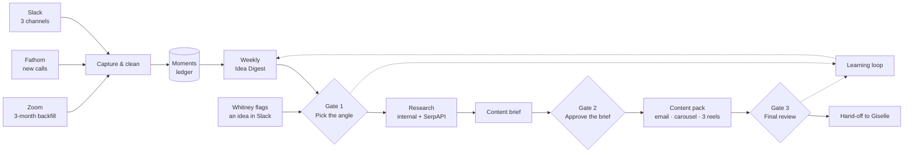

# The Content Atelier
### Feasibility study and recommended approach

**For:** Wedding Industry Ads · **Prepared by:** E2M Solutions · **Status:** Draft for review · 29 September 2026

---

## The short version

**The Content Atelier is feasible, and most of the current workflow hypothesis holds up.** Each of the three inputs checked out: Zoom for the backfill, Fathom for new calls, and Slack for team-shared wins. Their APIs give us what we need on WIA's current plans. SerpAPI covers the external research. The volume of material is small enough that no specialist infrastructure is needed.

The difficult part is not writing the content. It is **judgement** (deciding which ideas are worth Whitney's time) and **voice** (drafts that don't read as AI-written). The design below is built around those two problems.

We recommend six changes to the current hypothesis:

| # | Current hypothesis | Recommendation | Why |
|---|---|---|---|
| 1 | After each call, an LLM decides whether it contains a content idea | **Record every call's useful moments in a structured ledger, then rank the best ones weekly** | Yes/no calls on single transcripts are inconsistent and over-eager. Ranking across calls finds patterns no single call shows, such as the same question from four members. |
| 2 | External search/SEO research runs during idea detection | **Run a light demand check on the shortlist only, and do full research after an idea is approved** | Search data is weak evidence for a niche B2B audience. It works better as hook material in the brief than as a gate. |
| 3 | A vector database for internal knowledge | **One Postgres database with keyword + semantic search, plus a structured "moments" table** | Three months of calls is roughly a million tokens, which is small. Filters (date, client, call type) and exact phrases matter more than similarity search. |
| 4 | Two approval steps (angle, brief) | **Three short gates: angle, brief, and final pack. Each is designed to fit a founder's schedule** | Nothing is posted by the system, but a person must sign off the finished pack. Each gate has a time budget and a delegate. |
| 5 | The system finds ideas on its own | **Whitney can also start an idea herself by flagging it in Slack** | This is how ideas start today: "I have a client call that sparks an idea… I'm really flagging it for Giselle." |
| 6 | Not specified | **A learning loop: reasons for passing on an idea and edits to drafts feed back into scoring and voice notes that a person reviews** | This is how the output gets closer to Whitney's standard each month instead of plateauing. |

---

## 1. The problem we're solving

Whitney already turns client conversations into marketing, and it works. Her carousel, reel and email about a planner who "hadn't posted anything organically on Instagram in like 10 weeks… and leads didn't stop" came from a single call. The bottleneck is **starting the work**:

> "A lot of the times, like, I just don't have the bandwidth. It's not happening because it would be up to me to get the ball rolling." (Whitney, Sep 16 call, 19:00)

The call is where an idea starts. The finished content is built up from there:

> "The transcript normally, like, sparks the idea, but then we're, like, taking that and running with it." (10:55)

**The Content Atelier's job is to do that first lift.** It notices the moment, develops it into an angle with evidence, and has a complete draft pack ready when Whitney says yes.

**Each approved idea becomes one content pack** (21:39):

- **1 marketing email.** Weekly, low-lift repurposing, and it sometimes asks readers to reply.
- **1 carousel.** 7–10 slides of "high value" copy that follows *hook → problem → solution → transformation → how we help → CTA* (26:22).
- **3 reel scripts**, each with a distinct angle.
- **Captions** for the carousel and reels. They are long-form, in first person when the story is Whitney's and "we" when it's general (27:09).

The pieces should "somewhat… say the same things" without anyone who sees all of them "feeling like it's super redundant" (24:45).

**Not in scope:** publishing, scheduling, design, and video. The Atelier produces approved copy. Giselle takes it into Canva, Descript and the email tool, as she does today.

---

## 2. The workflow at a glance

| Stage | What happens | Who / what does it | Cadence |
|---|---|---|---|
| **0 · Brand kit** | Founder voice doc, content strategy doc and a few past content suites are loaded once | WIA supplies; E2M structures | One-time, refreshed as needed |
| **1 · Capture** | Transcripts and Slack posts are collected, cleaned, classified and de-duplicated | Automated | Continuous |
| **2 · Extract** | Each source is mined for *moments*: results, praise, soundbites, questions, objections, stories, teaching points | LLM | Per call or post |
| **3 · Shortlist** | Moments are scored against WIA's criteria, grouped across calls, checked against past content, and given a light demand check | LLM + rules + SerpAPI | Weekly digest |
| **Gate 1** | Whitney picks angles, passes on others (with a reason), steers, and confirms the CTA | Whitney (or delegate) in Slack | ~2 min / week |
| **4 · Research** | Evidence from WIA's own calls and Slack, plus external search signals | LLM + search + SerpAPI | Per approved angle |
| **5 · Brief** | A one-page brief: core insight, proof, message spine, per-format split, CTA, open questions | LLM | Per approved angle |
| **Gate 2** | Brief approved, edited or sent back; open questions answered | Whitney (or Giselle) | ~5 min |
| **6 · Produce** | The full pack is drafted and then automatically checked | LLM + rule checks | Per approved brief |
| **Gate 3** | Final read and edits; approved copy is handed to Giselle | Whitney / Giselle | ~15–30 min |

---

## 3. Stage by stage

### Stage 0: The brand kit (the foundation)

The documents Whitney described are the core reference for every output:

- **Founder voice document.** How WIA sounds, and the hook-problem-solution-transformation framework.
- **Content strategy document** from WIA's marketing consultant. Topics and "hot button items".
- **3–5 past content suites**, supplied once as documents, not through an integration. The "10 weeks" suite is the obvious first example. Whitney noted these show "what the source call was and… how you took that and transformed it into content" (10:55), which is exactly what the system needs to learn.

**Design choice:** these documents are **loaded in full on every run**, never chunked and searched. They are short, and every rule in them applies every time. Leaving them to search results is how systems lose a brand voice.

### Stage 1: Capture

| Source | Role | What we confirmed |
|---|---|---|
| **Zoom** | **One-time backfill** of the last ~3 months | The API lists cloud recordings and returns each transcript as a timestamped VTT file with speaker names. It needs a paid plan, **cloud recording**, and the *Create audio transcript* setting. **Local recordings have no transcript and aren't reachable by the API.** Each listing request covers up to one month, so a 3-month backfill is a few requests per host. Access is through a Server-to-Server OAuth app that a Zoom admin creates once. |
| **Fathom** | **Every client-facing call from now on** | Public API with **per-user API keys, available on all plans including Free**. Transcripts include speaker names, calendar-matched emails and timestamps. Webhooks announce new meetings, but they fire only once and only when a summary is generated, so we add a scheduled check as a backstop. A key sees its owner's calls plus calls shared with them, and **private calls are visible only to the host's own key**. Each recording host (Whitney, Jacqueline, Carmen) creates a key once. Rate limits are far above what we need. |
| **Slack** | Team-shared wins and client feedback | We read **Google Search Accelerator, Meta Ads Accelerator, and Social Proof & Results**, including screenshots, which a vision-capable model reads. Slack's 2025 rate limits (15 messages per request, 1 request per minute) apply only to commercially distributed apps. **Internal apps built by the customer keep full limits.** We will create the app inside WIA's own workspace so it clearly counts as internal. |

**Cleaning happens before any AI judgement:**

- **Call classification.** Client-facing calls are kept. Internal and vendor calls, including our own weekly syncs, are excluded. Rules come first (attendee email domains, meeting titles, recurring series); the LLM only handles leftovers.
- **Glossary correction.** The sample transcript shows why this is needed: "ChatGPT" appears as *GPD* and *JADGPD*, OpenRouter as *OpenRodder*, GHL as *RGHL*, and "campaigns" as *campus*. A WIA glossary (LeadLock, Elevate, the Vault, Accelerators, team and client names) fixes these before extraction.
- **De-duplication at the cutover.** The same meeting can exist in both Zoom and Fathom around the switch-over. We match on the Zoom meeting number in Fathom's meeting URL plus overlapping start times.

### Stage 2: Extract moments, not verdicts

Instead of asking "is this call content-worthy?", the LLM reads each transcript and records **every moment that could feed content**, each as a structured record:

| Moment type | Example from WIA's own words |
|---|---|
| **Result** | "Their business has doubled… their best month ever" (7:30) |
| **Soundbite / praise** | "I haven't posted anything organically on Instagram in like 10 weeks… leads didn't stop" (7:30) |
| **Teaching point** | Monthly Vault workshop topic, e.g. defining a unique value proposition (9:00) |
| **Question / struggle** | Recurring member questions from office hours |
| **Story / objection** | A client's before-and-after, a hesitation a prospect raised |

Each record keeps the **verbatim quote, timestamp, speaker, client, source link, and a "can we use this publicly?" status**.

This stage aims to capture everything. Ranking happens in Stage 3. The ledger becomes WIA's **searchable archive of proof**, and it is useful even beyond this workflow.

### Stage 3: The weekly Idea Digest

Once a week, the Atelier ranks the ledger and sends Whitney a **short digest of 3–5 angles at most**. "Nothing strong this week" is an acceptable outcome, and better than padding the list.

**How an idea earns its place:**

| Criterion | What it asks | Type |
|---|---|---|
| **Real proof** | Is there a specific, quotable moment behind it? | Gate |
| **Cleared to use** | Can it be used publicly, or anonymised safely? | Gate |
| **Audience pain** | Does it hit something wedding pros feel? Does it map to a strategy-doc pillar or hot-button topic? | Weighted |
| **Offer fit** | Is there a natural route to an Accelerator or Elevate CTA? | Weighted |
| **Recurrence** | Has it come up across several calls, members or Slack posts? | Weighted |
| **Novelty** | Have we already made this? Is it too close to recent packs? | Weighted |
| **Demand & timing** | Do search questions and trend direction support it? | Weighted, light |

For each criterion the LLM gives a score, a one-line reason and the supporting quote. **The weighting and ranking are plain arithmetic**, which keeps the digest consistent week to week and lets us tune it.

The final criteria come from the voice and strategy documents. The table above is the starting point from Whitney's description on the call.

**Calibration before launch:** Whitney labels around 30 backfilled moments as *would make content* or *wouldn't*. We tune the scoring until it agrees with her, and we keep those labels as a regression test.

### Gate 1: Pick the angle (Slack, about 2 minutes)

Each digest item shows the angle, the proof quote with a link to the moment in the recording, the suggested CTA, and why it ranked. Whitney can:

- **Approve.**
- **Pass**, choosing a reason such as *off-brand*, *done before*, *weak proof* or *not now*. These reasons teach the scoring.
- **Steer**, adding a line of direction.

Whitney can also **flag her own idea in Slack at any time**, which skips straight to this gate.

**The CTA is confirmed here, not guessed.** The system suggests a default from the source: workshop and Accelerator topics point to the **Accelerators**, and one-on-one client results point to **Elevate** (29:11). Whitney confirms or changes it, as she asked: "at least in the beginning, it doesn't have to come up with what the CTA is going to be… it can ask me" (30:36).

### Stage 4: Research the approved angle

**Internal knowledge** is where the Atelier outperforms a blank chat. For each approved angle it searches the ledger and transcripts for:

- **Corroboration.** Other clients with similar results, so the claim is "this isn't a one-off".
- **The problem side.** What members struggle with around this topic, in their own words.
- **Visual proof.** Screenshots and wins shared in Social Proof & Results.
- **Whitney's own explanations** of the topic from workshops and calls, which are the best raw material for her voice.
- **Prior coverage.** What WIA has already said on the topic, so the new pack adds something.

Every finding comes back with its source and clearance status.

**External research (SerpAPI)** adds the market's side:

- People Also Ask and related questions
- Autocomplete
- Google Trends interest and rising queries
- Forum threads, such as Reddit and Quora results surfaced by Google

This is **hook and framing material** ("wedding pros are literally asking Google whether Meta ads are worth it"), not a verdict on the idea.

### Stage 5: The brief

The brief is a single page:

- Core insight
- Proof points with links
- Audience pain
- **Message spine**: the 3–4 lines every piece shares
- **Format split**: what the email, the carousel and each of the three reels uniquely do
- CTA
- Claims that need client permission
- **Open questions for Whitney**

The message spine is how the pack keeps "common threads" without repeating itself. It also matches how Whitney works today: "what's one thing is approved… should be being used… as part of the knowledge of what else is created" (23:25).

### Gate 2: Approve the brief (about 5 minutes)

It is cheaper to fix direction in one page than across five drafts. Whitney approves the brief, edits it, or sends it back, and answers any open questions. This gate can be **delegated to Giselle**, and once trust is established it could become optional.

### Stage 6: Produce the pack

The drafts are written **in sequence from the approved brief**. An anchor piece comes first, then derivatives that reference it, the way Whitney builds pieces in one conversation today. Each draft then goes through an **automatic check before any person sees it**:

- **Rule checks:** carousel is 7–10 slides; framework beats are present; CTA matches the chosen track; first person vs "we" is correct; captions are present; overlap between pieces stays under a set limit.
- **LLM critic:** voice consistency with the founder doc and exemplars, phrasing that sounds AI-written, and every claim traced to a source in the brief.

### Gate 3: Final review and hand-off

Whitney or Giselle reads the full pack on a simple review page (Slack carries the notification), edits in place, and approves. Approved copy is handed to Giselle ready to paste. **The system never posts or sends anything.**

### The learning loop

Two things are captured: **why ideas were passed on** (Gate 1) and **what changed between draft and approved copy** (Gate 3). Every few weeks these are summarised into proposed updates to the scoring weights and a "voice notes" addendum.

**A person approves those updates.** Nothing retrains itself silently. A one-off factual correction ("it was 12 weeks, not 10") must not become a style rule.

---

## 4. The knowledge strategy: do we need a vector database?

**No dedicated vector database is needed.** Our sizing:

- The one call transcript we hold runs **43 minutes and ~7,000 words (~9,000 tokens)**.
- Three months of client-facing calls is likely **50–150 recordings, or roughly 0.5–1.5 million tokens**. The recording count is an assumption to confirm with WIA.

That is small. **One Postgres database** handles all of it. It is available on Railway, where the solution will be hosted, through a pgvector template. It holds three layers:

| Layer | Contents | How it's used |
|---|---|---|
| **Brand kit** | Voice doc, strategy doc, exemplars | Loaded in full on every run |
| **Moments ledger** | Structured moments with quotes, speakers, dates, clearance | Primary search target for scoring and research |
| **Source archive** | Full transcripts and Slack posts, chunked, with metadata | Deep search that combines keyword and semantic matching, always returning source links and timestamps |

**Why this beats a separate vector database:**

- Filters like *office hours only*, *last 30 days* or *this client* matter more than raw similarity.
- Exact phrases like "Elevate" or "10 weeks" are found better by keyword search.
- One database is one thing to back up, secure and pay for.

Embeddings are available through OpenRouter, which WIA has already set up for model access.

There is also a clue in Whitney's own experience: she gets **better results from a fresh ChatGPT chat than from a project** with accumulated history (12:07). The design follows that lesson. Each step gets a **fresh, purpose-built set of context** (brand kit plus the relevant moments) rather than one ever-growing memory.

---

## 5. How historical and future calls fit together

**The 3-month Zoom backfill does four jobs at once:**

1. **Launch backlog.** The ledger starts full, so the first digest has real candidates on day one.
2. **Calibration set.** Whitney's yes/no labels on backfilled moments tune the scoring.
3. **Research depth.** Every future angle can draw on three months of corroborating evidence.
4. **Golden test.** The "10 weeks" call is almost certainly inside the window, and WIA has already published the content it inspired. We check that the Atelier finds that moment, ranks it highly, and produces a pack Whitney rates as close to what she actually shipped. It is a real acceptance test with a known answer.

**Going forward, Fathom is the single source for calls.** One requirement follows from that: **every client-facing call must be recorded in Fathom** by a host who has provided a key. That includes Whitney's calls, which today are recorded in Zoom. Calls not recorded in Fathom are invisible to the Atelier.

---

## 6. External research: what SerpAPI can and can't do

We checked SerpAPI against current documentation.

| | Finding |
|---|---|
| **Useful here** | People Also Ask and related questions, related searches, Autocomplete, Google Trends (interest over time, related and rising queries), Google Forums (Reddit/Quora threads surfaced by Google), News, YouTube |
| **Not provided** | **Absolute search volume or keyword difficulty.** Trends values are relative (0–100). DataForSEO does provide Google Ads search volume, at about $0.06 per batch of up to 1,000 keywords, pay-as-you-go. |
| **MCP** | An official SerpAPI MCP server exists, hosted or self-run, with one general `search` tool that reaches every engine |
| **Cost** | Free tier: 250 searches/month. Starter: $25 for 1,000. Developer: $75 for 5,000. Identical searches repeated within an hour are free. |
| **Supplier risk** | Google sued SerpAPI in December 2025. The court dismissed that complaint on 20 July 2026, but allowed Google to amend part of it. Google refiled in August, and SerpAPI's second motion to dismiss is pending. A separate Reddit suit (October 2025) is also pending. The service is currently unaffected. SerpAPI's "U.S. Legal Shield" is included only from the $150 plan upward. |

**Our recommendation:**

- **Keep SerpAPI as the preferred source.** For WIA, the valuable signals are the *questions people ask* and the *direction of interest*, and SerpAPI covers both. Absolute volume matters little for a niche B2B audience whose content lives on social platforms.
- **Use it where it earns its cost.** That means about 5 searches per shortlisted idea and 10–20 per approved angle. At WIA's likely pace this stays within the **Free or $25 Starter tier**.
- **Treat it as supporting evidence, never a veto.** A strong client result with no search demand can still be excellent Instagram content.
- **Isolate it.** The pipeline must work if SerpAPI is unavailable, and research sits behind a thin adapter so DataForSEO could replace it without redesign.
- **MCP is optional plumbing.** It suits the research step if an agent chooses its own queries. For the scheduled demand check, fixed query recipes called directly are simpler to log, test and cost-cap.

---

## 7. Where AI is the right tool, and where it isn't

| Task | Best approach | Why |
|---|---|---|
| Pulling recordings, de-duplication, scheduling | **Deterministic code** | Exact answers, no judgement needed |
| Internal vs client-facing call | **Rules first**, LLM for leftovers | Attendee domains and meeting titles are reliable signals |
| Extracting moments from conversation | **LLM** | Reading messy human conversation is what LLMs do best |
| Scoring against criteria | **LLM per criterion** with a quote as evidence; **arithmetic** for ranking | Consistent and tunable |
| "Have we made this before?" | **Semantic similarity**, confirmed by LLM | Catches rephrased repeats |
| Search research | **API calls from fixed recipes**; LLM summarises | Predictable cost, clear audit trail |
| Brief and drafting | **LLM**, anchored by the brand kit and exemplars | Its core strength |
| Slide counts, CTA present, format rules | **Rule checks** | Never leave a countable rule to an AI |
| Voice fidelity | **LLM critic plus human review** | Whitney is the final judge |
| Publishing | **A person, outside the system** | Out of scope by design |

---

## 8. Risks, edge cases and how we handle them

| Risk | Evidence / likelihood | Mitigation |
|---|---|---|
| **Wrong speaker on a quote** | **At least 12 of the 103 turns in our 43-minute sample are credited to the wrong person.** Whitney's lines are often labelled as Minu's (e.g. 4:08, 8:51, 23:20, 37:24), and Asha's and Whitney's lines are swapped at 31:45 and 32:52. Fathom's docs note that attribution fails in shared rooms and some browser setups. | The LLM checks speaker plausibility (praise *of* WIA *from* WIA staff isn't a testimonial). Every quote links to its timestamp. **Quotes are confirmed against the recording before use.** |
| **Garbled names and terms** | 14 garbled terms in the sample (e.g. *GPD*, *OpenRodder*, *RGHL*) | WIA glossary pass before extraction |
| **Client confidentiality and consent** | Calls include revenue figures and client names | "Cleared to use" is a hard gate. Anonymisation is the default. Named claims are flagged in the brief. Zero-data-retention model routing through OpenRouter. |
| **Missing history** | Local Zoom recordings, or recordings made with the transcript setting off, have no transcript | Confirm settings before the backfill. If cloud audio exists, we transcribe it ourselves. Otherwise the gap is accepted and recorded. |
| **Missed new calls** | Fathom webhooks fire once; private calls need the host's key | Scheduled catch-up check; a key from every recording host; a coverage report showing which hosts' calls arrived this week |
| **Internal calls mined for content** | Our own sync call would score as "full of ideas" | Call-type classification before extraction |
| **Sounds AI-written** | Whitney: "I can kind of tell when stuff like that has been AI generated. And I know… our clients can, too" (37:24, about AI design) | Brand kit loaded in full, exemplars, a critic pass, and human edits feeding voice notes |
| **Repetition across weeks** | The same strong story is tempting to reuse | Novelty scoring against a record of everything already produced |
| **Quiet weeks** | Seasonal lulls, few calls | Digest may say "nothing strong". Recurring questions from the backlog fill genuine gaps. |
| **Approval fatigue** | A founder with little bandwidth | 3–5 items a week at most, one tap in Slack, delegation to Giselle, reminders, and auto-expiry of stale items |
| **SerpAPI disruption** | Two active lawsuits | Research is optional and replaceable; nothing depends on it |
| **Brand documents not yet supplied** | We hold only the call transcript so far | The scoring criteria above are provisional until the voice and strategy docs arrive |

---

## 9. Alternatives we considered

| Option | Verdict |
|---|---|
| **A · The hypothesis as written:** judge each call → approve → vector search → brief → approve → generate | Sound bones. Weakest in its per-call yes/no judgement, in putting search research up front, and in having no learning loop. |
| **B · Recommended:** moments ledger → weekly ranked digest → three short gates → pack, with a learning loop | Keeps everything that works in A. It is more reliable at judging ideas, cheaper to run, and improves over time. |
| **C · Minimal:** a better ChatGPT project with the brand docs uploaded | Cheapest, but it doesn't solve the actual problem: someone still has to notice the moment and start the work. |

---

## 10. Suggested phasing

| Phase | Delivers | Proves |
|---|---|---|
| **1 · Find the ideas** | Brand kit, capture (backfill + live), moments ledger, weekly digest, Gate 1 in Slack | The Atelier notices what Whitney would notice. **Useful on its own**, since starting the work is the bottleneck. |
| **2 · Write the pack** | Research, brief, Gate 2, pack generation with checks, review page, Gate 3 | Drafts that need light editing, not rewrites |
| **3 · Sharpen** | Learning loop, scoring recalibration, deeper research recipes | Improvement month over month |

**How we'll know it's working:**

- The share of digest ideas Whitney approves
- Minutes from notification to approved pack
- How much of each draft survives her edits
- Packs shipped per month versus today

---

## 11. Running costs (order of magnitude)

| Item | Estimate |
|---|---|
| AI models | About $0.05 to extract one call. Roughly **$1–3 per finished content pack** at a Sonnet-class model's current OpenRouter rate of $2 input / $10 output per million tokens. The full backfill costs a few dollars. |
| SerpAPI | Free–$25/month at expected volume. $150/month if the Legal Shield is wanted. |
| Fathom API | Included on all plans |
| Hosting and database | Railway, alongside the rest of the solution |

**AI running cost is negligible next to the time it saves.** The real investment is the build, the calibration, and Whitney's first few weeks of feedback.

---

## 12. What we need from WIA

1. **The founder voice document and the content strategy document.** These define "content-worthy" and are needed before scoring can be finalised.
2. **3–5 past content suites** (email + carousel + reels + captions), including the "10 weeks" suite.
3. **Confirmation that all client-facing calls will be recorded in Fathom from now on**, and an API key from each recording host.
4. **A Zoom admin** to create the backfill app, and confirmation that the last 3 months were cloud-recorded with transcripts on.
5. **The Slack app installed in WIA's workspace** and added to the three channels.
6. **An approval owner and a delegate** for each gate.
7. **A client-consent rule**: when can a client be named or quoted publicly?

---

## Appendix A: Verification log

We checked these facts against official documentation on 29 September 2026. The WIA-specific statements come from the 16 September call transcript.

| Claim | Status | Source |
|---|---|---|
| Zoom API returns cloud-recording transcripts (VTT, speaker names, timestamps) | Confirmed | [Zoom Meetings API](https://developers.zoom.us/api-hub/meetings/methods/endpoints.json) · [Zoom KB: audio transcripts](https://support.zoom.com/hc/en/article?id=zm_kb&sysparm_article=KB0064927) |
| Transcripts require a paid plan, cloud recording and "Create audio transcript"; not available for local recordings | Confirmed | [Zoom KB](https://support.zoom.com/hc/en/article?id=zm_kb&sysparm_article=KB0065911) |
| Recording listings cover up to one month per request | Confirmed | [Zoom Meetings API](https://developers.zoom.us/api-hub/meetings/methods/endpoints.json) |
| Server-to-Server OAuth for a single-company internal app | Confirmed | [Zoom internal apps](https://developers.zoom.us/docs/internal-apps/create/) |
| Fathom public API with per-user keys; visibility follows the key owner's access | Confirmed | [Fathom API FAQ](https://developers.fathom.ai/faq) |
| Fathom API available on all plans, including Free | Confirmed | [Fathom pricing](https://www.fathom.ai/pricing) |
| Fathom transcripts include speaker, matched email and timestamp; history can be listed by date | Confirmed | [Fathom: list meetings](https://developers.fathom.ai/api-reference/meetings/list-meetings) |
| Fathom webhooks fire once and only when a summary is generated; 60 requests/min overall | Confirmed | [Fathom API overview](https://developers.fathom.ai/api-overview) |
| Fathom speaker attribution fails in shared rooms and some browser setups | Confirmed | [Fathom help](https://help.fathom.video/en/articles/5500225) |
| Slack's 2025 history rate limits don't apply to internal customer-built apps | Confirmed (Slack doesn't define "internal" exactly, hence installing in WIA's workspace) | [Slack changelog](https://docs.slack.dev/changelog/2025/05/29/rate-limit-changes-for-non-marketplace-apps) · [Clarification](https://docs.slack.dev/changelog/2025/06/03/rate-limits-clarity/) |
| SerpAPI engines: Trends, Autocomplete, related questions, Forums | Confirmed | [SerpAPI](https://serpapi.com/) · [Trends API](https://serpapi.com/google-trends-api) · [Forums API](https://serpapi.com/google-forums-api) |
| SerpAPI provides no absolute search volume | Confirmed | [SerpAPI on Trends values](https://serpapi.com/blog/google-trends-numbers-from-0-to-100-what-is-it/) |
| Official SerpAPI MCP server | Confirmed | [GitHub: serpapi-mcp](https://github.com/serpapi/serpapi-mcp) |
| SerpAPI pricing and 1-hour free cache | Confirmed | [SerpAPI pricing](https://serpapi.com/pricing) |
| Google v. SerpAPI: dismissed 20 Jul 2026 with leave to amend; amended in August; second motion pending | Confirmed (hearing date reported inconsistently) | [SerpAPI blog](https://serpapi.com/blog/google-v-serpapi-the-court-granted-our-motion-to-dismiss/) · [SE Roundtable](https://www.seroundtable.com/google-amends-lawsuit-against-serpapi-41860.html) |
| DataForSEO search-volume pricing and official MCP | Confirmed | [DataForSEO pricing](https://dataforseo.com/pricing/keywords-data/google-ads) · [DataForSEO MCP](https://dataforseo.com/help-center/setting-up-the-official-dataforseo-mcp-server-simple-guide) |
| Official Google Trends API is still an application-only alpha | Confirmed | [Google Trends API](https://developers.google.com/search/apis/trends) |
| OpenRouter offers embeddings and zero-data-retention routing | Confirmed | [Embeddings](https://openrouter.ai/docs/api_reference/embeddings) · [ZDR](https://openrouter.ai/docs/features/zdr) |
| Railway Postgres supports pgvector via template | Confirmed | [Railway Postgres](https://docs.railway.com/guides/postgresql) · [pgvector template](https://railway.com/deploy/pgvector-pg18) |
| **Not yet confirmed** | Whether Zoom can create transcripts after the fact for older recordings; the number of recordings in the backfill window; the contents of WIA's brand documents | To confirm with WIA |

---

## Appendix B: Notes for the visual pitch

The HTML pitch can tell the story in five scenes:

1. **The spark.** A single real quote ("10 weeks… leads didn't stop") lifting out of a transcript.
2. **The atelier at work.** Three sources flowing into the ledger, and moments settling into place.
3. **The digest.** A short, ranked list arriving in Slack, with Whitney tapping *approve*.
4. **The pack takes shape.** One brief fanning out into email, carousel and three reels that share a thread.
5. **The gates.** Three calm checkpoints that make it clear a person decides and the system prepares.

The workflow diagram in Section 2 is the spine of the page. Motion should show material flowing between stages, not decorate.
