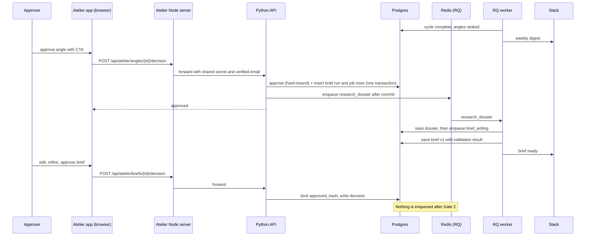
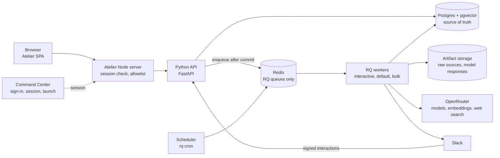
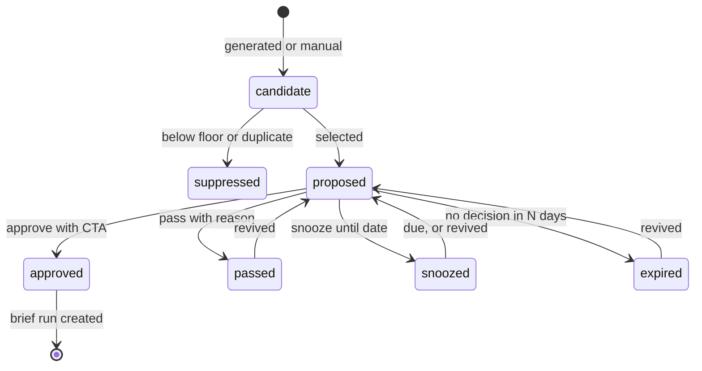
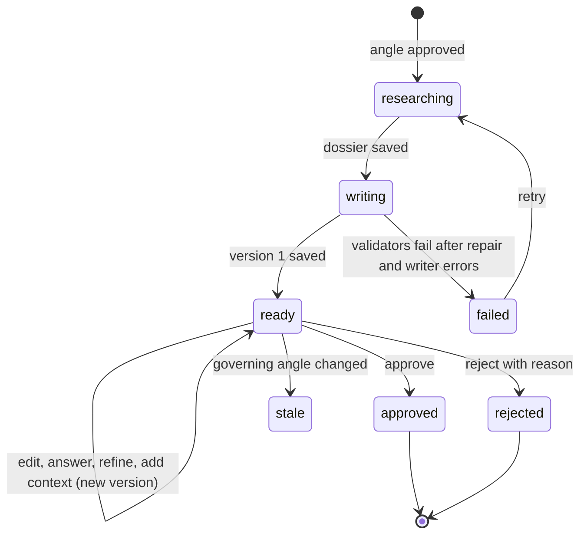
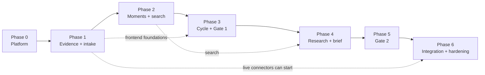

# Content Atelier: Developer Implementation Plan Through Brief Generation

**Date:** 12 October 2026 (first issued 10 October) · **Status:** Execution plan for engineering · **Target state defined by:** `Content-Atelier-Implementation-Roadmap-Brief-Generation.md` (same folder), with the three decisions of 10 October and the frontend decision of 11 October applied

**Revision:** 4 (12 October 2026). Adds the status review of the other developer's branch `feat/content_brief`: a new "Status at 12 October 2026" section, a dated status note in every phase, rulings R24 to R30, open decisions O16 to O20 and risks K19 to K23. Revision 3 (11 October 2026) applied decision 4. Revision 2 was the verified and repaired plan of 10 October; revision 3 applies decision 4, that the Atelier frontend lives only in the Content Atelier repository and Command Center links to it by URL

**Basis:** a read of both repositories and all documents in this folder, followed by a second pass that re-checked each current-state claim against the code. No tests, database, deployment or model call was run. Every statement about current behaviour names the file it comes from so it can be re-checked.

---

## Status at 12 October 2026

This section is the current picture. Sections 3 and the "Current state" heading of each phase describe `main` as it stood on 10 October; where they disagree with this section, this section is right.

### What was reviewed and how

| Repository | What changed since 10 October | Where |
| --- | --- | --- |
| `WIA-Content-Atelier` | One commit, "Feat: Content Brief_V0" (`46615c0`, 12 October, 72 files, about 7,700 added lines). | Branch `origin/feat/content_brief`, one commit ahead of `main`. **Not merged.** No pull request was checked. |
| `WIA-Content-Atelier` `main` | Only the documentation commit `e3ab4cd` (this plan and the roadmap). No code change. | `main` |
| `WIA-Command-Center` | Nothing. Last commit is 6 October. | All branches |

How this was checked:

- **Read:** every new and changed backend module on the branch, the Node server diff, the new brief screen, and the developer's own notes (`backend/STORAGE.md` and `backend/docs/Content-Atelier-Documentation-Implementation-Review-2026-10-12.md`).
- **Run:** the branch's backend tests that need no database. 119 passed.
- **Not run:** the 57 database-backed tests (briefs 18, SQL storage 18, comparison 14, chunk encoding 7). They need Postgres with pgvector and a database named `atelier_test`, which this machine does not have. The developer's notes report 190 backend tests passing; that figure is theirs.
- **Not checked:** the developer's local database. Every count of rows below (transcripts, chunks, moments, angles, vectors) comes from the developer's notes, because that database and its artifact folder exist only on their machine (`.storage-artifacts/` is git-ignored).
- **Missing from the commit:** `STORAGE.md` links to `implementation-status-content-briefs.md`, `implementation-plan-historical-comparison.md` and a `research/` reconciliation note. None of them is in the repository.

### Headline

**The brief pipeline and Gate 2 now exist as code, on an unmerged branch, and have never produced a brief from real data.** The developer built Phases 4 and 5 directly on top of the existing week-based Gate 1 slice and skipped Phases 0 to 3. So the middle of the system is far ahead of plan and the foundations under it are where they were.

- **Built:** chunk embeddings, hybrid search over transcript chunks, a five-stage research and brief pipeline, deterministic validators with a reviewer model and one repair, brief versions, a full Gate 2 service, Markdown and JSON export, a working brief review screen, and a second angle workflow that compares candidates against earlier angles.
- **Not exercised:** every brief switch is off. No angle is approved, no brief row exists, the brand bundle is an unfilled template, and no web research adapter is configured.
- **Not started:** deployment, RQ, scheduling, Slack, the migration runner, per-document extraction, classification, speaker roles, consent, occurrence dates, topics, the wider backfill (20 of 150 transcripts are in), live connectors, and everything in Command Center.
- **Built against two recorded decisions.** The branch keeps the Postgres lease worker and states that Redis and RQ are unnecessary (decision 1 says RQ). It also holds to "13 tables, no new tables", which the plan's migrations contradict. Both need an explicit ruling from you (O16, O18).
- **One process point needs attention.** The developer's notes record live model calls on real client transcripts on 12 October (Week 2 extraction and angle generation, and embedding of all 329 transcript chunks, through OpenRouter). Item 0.B2, confirming zero data retention before real transcripts go to a model, has no recorded result (risk K1).

### Status by pipeline stage

The stage-by-stage view (intended behaviour, status, done, left, for backend and frontend) is in the roadmap, section 0, "Intended flow against what is implemented, stage by stage". The tables below give the same position by phase and by work item.

### Status by phase

| Phase | Status | What exists now | What is still open |
| --- | --- | --- | --- |
| 0 Platform baseline | **Not started** (2 items partly done) | Approver and editor allowlists from environment variables; one path fix in the schema exporter. | Privacy confirmation, migration runner, `llm` module, RQ and sweep, container and staging, settings table, users and `/me`, CI, local environment, team-only bundle. |
| 1 Evidence model and intake | **Not started** (1 item partly done) | The Node server now allows a whitelisted query string on one route. | Everything else: unbound documents, classification, roles, consent data, occurrence dates, glossary, the 150-transcript backfill, Slack import, frontend foundations. |
| 2 Moments ledger and retrieval | **Partly built, differently** | All 329 existing chunks embedded (developer's count). Hybrid search over chunks: exact cosine plus full-text, fused by rank. | Per-document extraction, extended taxonomy, role and number checks, moment embeddings, search filters, topics, Moments API and screen. |
| 3 Weekly cycle and Gate 1 | **Partly built, differently** | An eight-stage comparison workflow with one refinement call; real Week 2 run completed (developer's report); Gate 1 approve and reject with CTA; comparison view in the review screen. | Cycle by date window, per-theme generation, rubric scoring, an authoritative similarity cutoff, duplicate collapse, pass reasons, snooze, revive, manual ideas, decisions log, schedule, Slack. Angles from the new workflow cannot be approved until a cutoff is chosen. |
| 4 Research and brief generation | **Built on the branch; verified offline only** | Enqueue on approval, research loop, dossier, brief contract, writer, validators, repair, persistence, API, export, retry. | A real run. Topic expansion, a web research adapter, SQL storage for the dossier, the brand kit store, Slack message, retrieval evaluation set. Approval queues the brief in replay mode, so a manual command is still needed to make it run live. |
| 5 Gate 2 and brief lifecycle | **Built on the branch; verified offline only** | Edit, answers, approve, reject, versions, locked fields, revise with instructions, add evidence, permission clearance, a working screen. | A real run. Explicit stale state and regenerate, free-text added context, Slack approve, reminders, a designed editor. |
| 6 Integration, live intake and hardening | **Not started** | Per-run cost files for brief runs. | Everything, including all Command Center removal and the deep-link fix. |

### Status by work item

Items not listed are not started. "Branch" means present on `feat/content_brief` and not on `main`.

| Item | Status | What the branch does | What remains |
| --- | --- | --- | --- |
| 0.B3 Migration runner | Not started; worked around | `002_brief_retrieval_index.sql` is applied by a one-off command (`storage_cli brief-indexes`) that moves between two exact catalog files. | The runner. A third schema change has no path today. |
| 0.B4 `llm` module | Not started; now more needed | `briefs/runtime.py` is a second, separate implementation of request building, cache, recovery and cost capture, beside the one inside `Pipeline`. | Extract one shared module and move both callers onto it. |
| 0.B5, 0.B6 RQ, sweep, cron | Not started; contradicted | Five brief stages were added to the Postgres lease worker. An expired lease marks the job failed and waits for a manual retry. | Unchanged, subject to O16. The brief stages are job rows with idempotency keys, so they port as handlers. |
| 0.B8 Settings | Not started; moved further away | Ten new `ATELIER_*` environment variables (switches, models, cutoff, allowlists, bundle path). | Unchanged. |
| 0.B9 Roles | Partly done, differently | `ATELIER_BRIEF_APPROVERS` and `ATELIER_BRIEF_EDITORS` gate every Gate 2 action. Each brief returns `can_approve`, `can_edit`, `can_review`. | Users table, `GET /me`, admin role. Gate 1 only checks the approver list when briefs are enabled or the angle came from the comparison workflow; otherwise any team user can still approve. |
| 0.B11 Housekeeping | Partly done | Exporter path fixed. | `.env.example` still sets `json_object`; the rest of the list. |
| 0.F1, 0.F2 | Not started | The server still serves the app bundle to `client` sessions. | Unchanged. 0.F2 matters more now that a real brief screen is in the bundle. |
| 1.F5 Node server | Partly done | Allowlist extended for brief, comparison and transcript routes. Query strings allowed on `GET /briefs` only, against a whitelist. Markdown and CSV responses relayed. | Generalise per new list route. The 64 KB body limit and 10 second timeout remain. |
| 2.B5 Embeddings | Partly done | `chunk_encoding.py`: batched chunk embedding with provenance and recovery. | Moment embeddings. Re-embedding after segmentation v2 (1.B6), since chunk IDs change. |
| 2.B6 Hybrid search | Partly done | `retrieval.py`: exact cosine top-k, `websearch_to_tsquery` top-k, rank fusion, neighbour-passage expansion, over chunks. A GIN index on chunk text. | Search over moments. Filters for date, client, call type, role and consent. An index strategy once the corpus is 150 documents (the scan is exact today). |
| 2.B2 Extraction | Not started | Still one request per week. `citation_adapter.py` repairs one class of citation error. | Unchanged. |
| 3.B3 Angle generation | Built differently | One request per week plus one optional refinement request for weak or overlapping candidates. | Per theme; the extended angle fields (pillar, hooks, why-now, differentiation, suggested CTA). |
| 3.B5 Memory | Partly done | Frozen history of earlier angles, exact cosine, 28-day decay measured from generation time. | Published content, topics, status cooldowns, age from source date. |
| 3.B6 Selection | Built differently | No cap. A candidate qualifies when its self-scored quality is above 70 and its closest earlier angle is below a cutoff. Three cutoffs (0.78, 0.85, 0.90) are reported side by side; none is authoritative. Same-batch near-duplicates are flagged, not collapsed. | Choose the cutoff (O17). Collapse duplicates. Replace the self-score with the rubric (3.B4). |
| 3.B7 Gate 1 service | Partly done | Approve with CTA, overlap acknowledgement and note; reject; hash-bound; edit and rescore. | Pass reason codes, snooze, steer as its own field, revive, decisions log. |
| 3.B13 Web research provider | Partly done | A `WebResearchProvider` interface, a sanitiser, URL, domain and 90-day rules, caching and a one-dispatch limit. | An actual adapter. None is configured, so external context is always "unavailable". |
| 3.F1, 3.F2 | Partly done, on the screen the plan retires | `SQLWeeklyAngles.tsx` gained the comparison view and cutoff switch. | The Weekly Studio on the API. |
| 4.B1 Enqueue on approval | **Done** (behind `ATELIER_BRIEFS_ENABLED`) | Approval and the brief run commit in one transaction. The run ID derives from the angle and its approved hash, so a repeat is a no-op. | The run is queued in `replay` mode. Going live needs `storage_cli activate-brief` and three switches. Decide whether approval should start a live run (O19). |
| 4.B2 Migration 006 | Not done, by design | No new tables. The dossier is a hashed JSON file; the brief row holds the selected evidence and prior context. | See R25 and K19. |
| 4.B3 Brand kit store | Built differently | One JSON bundle on disk with `status: approved` and an approver; its hash is frozen into the run. | A reviewed bundle does not exist yet (O9). Versioned store and the Brand Kit screen. |
| 4.B4 Research loop | **Done**, without topic expansion | Up to three rounds and 12 queries; search; expansion to neighbouring passages and linked moments; grading; gaps drive the next round; prior-coverage lookup. | Topic expansion (needs 2.B7). Retrieval is unmeasured (4.B15). |
| 4.B5 Dossier persistence | Partly done | Every query, hit, grade and omission is in the dossier file's audit trail. | Durable shared storage (K19). |
| 4.B6 Brief contract | **Done**, different shape | `BriefDocument`, schema version `brief_document_v1`, served at `GET /briefs/contract`. | Differences from section 4.4 are listed in R26. |
| 4.B7 Brief writer | **Done** | One writing call with the bundle, the approved angle and the compact dossier. | Exemplar briefs only if the bundle carries them. Model choice (O10). |
| 4.B8 Validators and repair | **Done** | Deterministic checks for CTA, approved direction, evidence IDs, quotes, numbers, qualifications, speaker names and external framing; a reviewer-model pass; one repair; remaining findings stored and shown. | Consent uses per-transcript `use_restrictions`, because per-client consent data (1.B2) does not exist. |
| 4.B9 Persist | **Done** | A `content_briefs` row with content hash, evidence, prior context and gaps. | No version number or author column; the chain is `supersedes_id`. |
| 4.B10 APIs | **Done** | List, detail, versions, `export.json`, `export.md`, research status, contract, cache-only transcript search. | Routes sit under `/storage`, not `/v1`. |
| 4.B11 External research | Partly done | See 3.B13. Topic and questions come only from a reviewed "public research" block in the brand bundle. | Adapter; questions from the dossier. |
| 4.B12 Failure and retry | **Done** | A failed stage keeps the angle approved and retries from saved responses. | Retry is manual by design. |
| 4.F1 Live generation state | Partly done | Stage progress is shown inside an open brief, polled every 8 seconds. | Nothing shows progress before the first brief row exists, which is exactly when a user is waiting. |
| 4.F2, 4.F3, 4.F4, 4.F6 | Partly done | One component, `SQLBriefs.tsx`: list with week and status filters, reader, evidence list, retry button. | Unstyled and outside the Weekly Studio. No routing, so a brief has no URL. |
| 5.B1 to 5.B4 | **Done** | Edit with locked fields, approve and reject, answers, version chain. All hash-bound. Gate 2 approval records the decision and queues nothing. | Tests not run here. |
| 5.B5 Staleness | Done differently | Computed on read: a changed angle, evidence or prior-coverage state appears as a blocker that prevents approval. | No stored stale flag and no regenerate action. |
| 5.B6 Refine | **Done** | `POST /briefs/{id}/revise`; locked fields survive unless the instruction names them. | Queued in replay mode, as 4.B1. |
| 5.B7 Add context | Partly done | Evidence IDs chosen from the current dossier. | Free text; picking from archive search (search only answers from cached query vectors). |
| 5.B10 Regenerate research | Not possible as built | The run ID is fixed by angle and approved hash, so a second research run for the same approval returns the first. | Needed for the pilot's second attempt. |
| 5.F1 to 5.F7 | Partly done | Plain forms for every Gate 2 action in `SQLBriefs.tsx`. | Design, conflict handling, routing, the end-state wording. |
| 6.B7 Cost summary | Partly done | Per-call and per-run cost files for brief runs. | In SQL and on the Sources API. |

Two things the branch added that the plan did not ask for:

- **A mandatory "scoped review" before approval.** The approver must confirm that every claim was reviewed and acknowledge that the history of published content is incomplete, as a separate saved step, before "Approve" is enabled. See O20.
- **Per-passage permission clearance.** An approver can record a permission and attribution reference for a passage, which unlocks a public quote. This fits the consent rule (O3) and is kept.

### Rulings on the differences

These join the rulings in section 1.

| # | Topic | Plan | Branch | Ruling |
| --- | --- | --- | --- | --- |
| R24 | Job execution | RQ on Redis (decision 1). | Postgres leases kept; notes say RQ is unnecessary. | Decision 1 stands until you change it (O16). It no longer has to come first: the brief stages are idempotent job rows, so the pilot runs on the lease worker and the port follows. Scheduling and unattended recovery still need 0.B5 and 0.B6 or an equivalent. |
| R25 | Schema policy | Numbered migrations, new tables per phase. | Exactly 13 tables. Dossier, brand bundle, roles and settings live outside SQL. | The migration runner (0.B3) is still required. Keep the branch's `002_brief_retrieval_index.sql` as migration 002; the migrations this document calls 002 to 006 become 003 to 007 when written. File-backed dossier and bundle are accepted for the pilot and must move to shared durable storage before staging (K19). The "no new tables" rule is not adopted (O18). |
| R26 | Brief contract | Section 4.4, the union of the architecture and the mock. | `BriefDocument` v1. | The built contract is the contract of record for the pilot. Against section 4.4 it lacks funnel stage, pillar and belief shift; splits nothing inside `why_now`, `narrative`, `evidence_boundaries` or `voice` (each is one text or a flat list); carries the CTA as the angle's free-form object; and fixes the format plan at one email, eight slides and three reels. It adds structured claims with numeric facts, per-prior-angle differences, creative direction, accessibility, distribution, evaluation signals and a handoff checklist. Decide the gaps after WIA has read a real brief, then issue v2 as a versioned schema change. |
| R27 | Angle selection | Proof gate, quality floor, duplicate check, no cap (decision 3). | No cap; quality above 70 and similarity below a cutoff that nobody has chosen. | Consistent with decision 3. The cutoff becomes a setting (0.B8) with one authoritative value chosen from labelled pairs (O17, 3.B16). Same-batch duplicates must collapse to the stronger angle (3.B6). |
| R28 | Roles | Users table, roles resolved per request. | Two environment allowlists. | Accepted for the pilot. 0.B9 remains, because Slack approvals and admin screens need a user record. Fix now: Gate 1 approval must require the approver list in every mode. |
| R29 | Which angle workflow is the product | One cycle. | Two: the legacy four-stage run and the eight-stage comparison run. | The comparison workflow is the base for Phase 3. The legacy workflow stays only until existing Week 1 data is re-run or retired. |
| R30 | Unit of work | Documents independent of weeks (R2, R3). | Everything, including briefs, is keyed to a week. | R2 and R3 stand. The brief code reads angles, moments and passages by ID, so it survives the change; `week_id` on brief rows and runs becomes optional with migration 003. |

### Shortest path to the first real brief

Nothing in Phases 0 to 3 has to be finished to produce one real brief from the data already loaded. This pilot is the cheapest way to learn whether the brief is good, and it should happen before more is built on top.

| Step | Work | Owner | Blocks |
| --- | --- | --- | --- |
| P1 | Confirm zero data retention on the OpenRouter account and pin the models (0.B2). | You, with the developer | Every live call. |
| P2 | Open a pull request for `feat/content_brief`; run the 57 database-backed tests on a second machine or in CI; merge. | Developer | Everyone else's work. |
| P3 | Make the three linked documents and a redacted sample of the verification artifacts available, or remove the links. | Developer | Review. |
| P4 | Produce a reviewed brand bundle: one voice guide, the strategy, CTA rules, and the approver's name (O9). | WIA, with you | The writer refuses to run without it. |
| P5 | Choose the similarity cutoff for the pilot (O17). All six Week 2 candidates pass at all three values per the developer's report, so any of the three unblocks the pilot. | You | Approval of any Week 2 angle. |
| P6 | Set the approver and editor lists; enable briefs; approve one Week 2 angle with a CTA. | Approver | The brief run. |
| P7 | Activate the run for live calls; run the worker; watch the five stages. | Developer | The brief. |
| P8 | Review the brief at Gate 2 in the app. Compare it with the four hand-written briefs. Record what is wrong. | You and WIA | R26, O10, O20. |

Fix before P6, small: the Gate 1 approver check (R28) and team-only access to the bundle (0.F2).

### Order of work after the pilot

The phase order in section 5 still holds, with these changes:

1. **Pilot (P1 to P8) first.**
2. **Phase 0 next, reduced to what deployment needs:** container and staging with shared artifact storage (0.B7, K19), the migration runner (0.B3), CI (0.B10), the `llm` module (0.B4), then RQ, sweep and cron (0.B5, 0.B6) if O16 confirms them.
3. **Phases 1 and 2 as written.** They are the largest remaining block and nothing on the branch shortens them, except that chunk embedding and chunk search exist and need extending, not building.
4. **Phase 3 rebuilt on the comparison workflow** (R29).
5. **Phases 4 and 5 become "reconcile and finish".** Their remaining work is the open column of the item table above plus whatever the pilot finds.
6. **Phase 6 unchanged.** The Command Center removal (6.C1, 6.C2) can still be done at any time and has not been started.

### Statements elsewhere in this document that the branch has overtaken

| Where | Statement | Now |
| --- | --- | --- |
| Section 3, risk K6 | No embedding has ever been generated. | 12 angle vectors and 329 chunk vectors exist in the developer's database. Thresholds are still uncalibrated. |
| Verification summary; section 3 | The Node server relays only JSON and rejects every query string. | On the branch it also relays Markdown and CSV for three routes and accepts a whitelisted query on `GET /briefs`. The body limit and timeout are unchanged. |
| Section 3 | Four job stages; 11 SQL tests with no recorded result. | The legacy four, an eight-stage comparison workflow, five brief stages and a chunk-encoding run; 57 database-backed test functions, reported passing by the developer. |
| Section 3 | No brief generation, research, Gate 2 or brief API exists. | All exist on the branch, switched off. |
| Section 3 | `content_briefs` is empty by construction. | Still empty in practice, but the code that fills it exists. |
| Audit, as quoted in section 3 | `source_type` allows only three values. | The column is unrestricted text; the three values are a comment. Correction from the developer's review. |
| Section 3 | No evaluation set exists. | `evaluation_cases.json` holds synthetic diagnostic cases. A founder-labelled set is still missing. |

---

## Verification summary

Revision 1 of this plan was checked claim by claim against the two repositories, the architecture, the feasibility study, the audit and the mock. Significant issues were found and are corrected in place below.

**Main corrections**

| Category | What changed |
| --- | --- |
| Wrong current-state claims | The Moments, Research, Inbox and Ideas views are unreachable in the running app (the sidebar links six views; none of these). They are prototype code, not live mock screens. The claim that the extraction prompt deliberately keeps internal meetings could not be found in the current prompt files and is removed; the real gap is that no classification exists. The Node server already forwards an email as the actor, because Command Center's session has no `id` field. |
| Missing prerequisite | Backfilled transcripts have no occurrence date (`occurred_at` is null; the handoff note says dates are unknown). Cycle windows, freshness and "why now" all need one. Added as blocking work in Phase 1, with defined behaviour for undated documents. |
| Missing requirements | Glossary handling (architecture §4.2), a golden acceptance fixture, calibration labels, topic and settings admin views, deletion on a client's request, and a local development environment for RQ were absent. Added at the appropriate priority. |
| Reuse that was overlooked | Command Center's corpus tooling already classifies the 150 transcripts and derives a staff roster (`corpus/index-zoom.mjs`). Phase 1 now seeds from it instead of starting from nothing. |
| Integration gaps | The Atelier Node server only relays JSON, caps request bodies at 64 KB, times out at 10 seconds and rejects query strings. Brief export, brief edits and list filters all hit these. Command Center's fixture data is imported by two other Ops Hub modules, so it cannot simply be deleted. Both are now explicit work. |
| Sequencing and priority | Topic linking and segment headers were marked P1 but block P0 work in the next phase; raised. Restricting the app bundle to team users moved from Phase 6 to Phase 0, because the bundle holds meeting-derived fixtures today. Parallel tracks are now stated. |
| Acceptance criteria | Phase 0's staging check assumed synthetic data, which the code refuses outside a database whose name ends in `_test`. "Recording link" criteria assumed URLs the backfill does not have. Both rewritten. |
| Failure behaviour | A per-stage failure table was added (section 4.8). |

**Material uncertainties that the evidence cannot resolve**

1. **Occurrence dates for the 150 backfilled transcripts.** Neither the files nor the corpus index carries them as far as the tooling shows. Whether they can be recovered from Zoom is unknown (open decision O13).
2. **Privacy of past model calls.** The backend README shows a free model route configured for a real run. The account's retention setting cannot be checked from the repositories (risk K1).
3. **Client attribution in Zoom transcripts is inferred from display names.** The corpus notes say so explicitly. Any per-client consent decision rests on that inference (risk K4).
4. **Which RQ release carries the cron scheduler.** The architecture states 2.4 to 2.5; this was not verified against RQ itself. Confirm when pinning.
5. **Whether the "10 weeks" call is in the corpus.** The architecture assumes it for the golden test. The corpus notes instead identify the Funktastic chain as the only one with both source transcripts and published output. This plan uses Funktastic (ruling R21).

**Change in revision 3 (11 October)**

The frontend decision (decision 4) was applied after the verification pass. It removes every Atelier screen, proxy route and data file from Command Center and leaves one link. The link and the sign-in hand-off behind it already exist, so the Command Center work shrinks to removal. Keeping a brief's URL across sign-in moved from Command Center to the Atelier's Node server (6.F8), where the validated `returnTo` handling already lives. Affected: ruling R15, new ruling R23, section 3.3, items 6.C1 to 6.C3 and 6.F8, and two lines of the definition of done.

---

## 0. How to use this document

- **Status at 12 October 2026** is the current picture: what is done, in progress and pending, and the shortest path to a first real brief. Read it first.
- The **Verification summary** records what the second pass corrected and what remains uncertain.
- **Section 1** records where the sources disagree and which reading this plan follows.
- **Section 2** is the end-to-end workflow. Use it as the consistency check for every phase.
- **Section 3** is the current-state analysis that drives the phases.
- **Section 4** covers the architecture and data-model direction that all phases share.
- **Section 5** is the phase overview. **Sections 6 to 12** are the phases; each has the same eight headings.
- **Section 13** lists risks and open decisions. **Section 14** is the final acceptance checklist.
- **Appendices** hold the traceability matrix, the job catalogue, the API surface and the settings keys.

### Priority labels

| Label | Meaning |
| --- | --- |
| **P0 Critical** | The core workflow cannot function without it. Blocks later phases. |
| **P1 Required** | Needed for the scoped system to be complete and reliable. Does not block the next phase from starting. |
| **P2 Hardening** | Makes the implementation robust enough for intended use. |
| **P3 Deferred** | Useful, not needed for the target state. Listed so nobody builds it by accident. |

Work items carry an ID such as `2.B4` (phase 2, backend item 4). `F` items are the Atelier frontend, `C` items are Command Center, `X` items are cross-system.

### Where the frontend lives

The request describes Command Center as the frontend through which the Atelier is managed. The code says otherwise, and decision 4 below settles it:

- **The Atelier app** (`WIA-Content-Atelier/frontend`) is the only Atelier UI: a React SPA plus a small Node server that proxies to the Python backend. Every screen in this plan is built there.
- **Command Center** (`WIA-Command-Center`), the central dashboard, holds a link to the Atelier's URL and nothing else of the Atelier: no screen, no proxy route, no Atelier data. It remains the place users sign in, because the Atelier has no user store of its own and validates Command Center's session.

Each phase keeps a "Command Center" line so the boundary stays visible. It reads "no change" in every phase except Phase 6, where the work is removal.

### Decisions already taken

Decisions 1 to 3 date from 10 October 2026; decision 4 from 11 October 2026.

1. **Job execution moves to RQ on Redis**, with RQ cron and a reconciliation sweep. Postgres stays the source of truth.
2. **Slack carries approvals**, not only notifications. Buttons call the same approval service as the dashboard.
3. **No cap on angles.** Every angle that clears the proof gate, the quality floor and the duplicate check is proposed, ranked.
4. **The frontend lives only in the Content Atelier repository.** Command Center links to it by URL. Nothing of the Atelier is embedded, proxied or summarised inside Command Center.

---

## 1. Source reconciliation

Seven sources describe this system. They disagree in the places below. The right-hand column is what this plan implements.

| # | Topic | What the sources say | Ruling for this plan | Evidence |
| --- | --- | --- | --- | --- |
| R1 | Governing spec | Three specs conflict: the solution architecture (4 Oct), Command Center's `Content_Atelier.md` (16 to 28 Sep), and the Atelier repo's `implementation-plan-weekly-angles-postgres.md`. | Solution architecture, amended by the roadmap and the four decisions in section 0. The other two are historical. | Audit D6 |
| R2 | Unit of intake | Architecture: source documents independent of any week. Code: every transcript requires a `week_id`. Frontend spec: a weekly "bucket". | Documents stand alone. A cycle selects moments by date window. The "bucket" is a view over that window. | `001_approved_schema.sql`; architecture §10 |
| R3 | Extraction | Architecture: one document per request. Code and backend README: one request per week, batching forbidden. | Per document. | `sql_pipeline.py` `execute`; audit D1 |
| R4 | Job queue | Architecture: RQ on Redis. Code: Postgres lease table, polled. Earlier roadmap draft: keep Postgres. | RQ on Redis (decision 1). `pipeline_jobs` remains as the durable record. | `repository.py` `claim`; architecture §9 |
| R5 | Angle count | Architecture: 3 to 5. Mock: hard cap of 4 (`WEEKLY_CONCEPT_LIMIT`). Code: no cap above a score of 70. | No cap (decision 3). Floor and de-duplication only. | `editorialWeeks.ts`; `matching.py` |
| R6 | Angle score | Architecture: 7-criterion rubric, weights in settings. Code: 5 self-scored criteria, weights hard-coded. Mock: 6 parts with different weights. | Architecture rubric. The UI renders whatever criteria the API returns. | `models.py` `Quality.score`; `AGENDA_AND_VIEW_ARCHITECTURE.md` |
| R7 | Gates | Architecture: 2 gates plus a light final review. Mock and frontend spec: 3 gates. Code: Gate 1 only. | Gates 1 and 2. Nothing after Gate 2. | `gate_one.py`; architecture §6.1 |
| R8 | Who approves | Architecture: an approver role, delegate allowed. Frontend spec: Whitney only. Code: any `team` user. | An approver allowlist stored in the Atelier database. | `storage_api.py` `actor`; `frontend/server/app.mjs` |
| R9 | Slack | Architecture §6.3: digest with one-tap actions. Frontend spec §22.2: notification only, no buttons. | Approvals in Slack (decision 2). | Both documents |
| R10 | CTA | Architecture: Accelerators and Elevate. Mock: Elevate, Accelerators, LeadLock, preselected. Frontend spec §11.6: never preselected. Code: free-text CTA object, required. | A CTA catalogue stored as data with three tracks seeded. The system suggests; the approver must choose. | `FlagIdeaModal.tsx`; `gate_one.decide` |
| R11 | Brief shape | Architecture §4.6: 14 sections. Mock: the richer `ProductionBrief` type and four hand-written briefs. Schema: `content_briefs.content_body` JSON. | The union of both (section 4.4). | `types/atelier.ts`; `content-briefs/2026-10-05/` |
| R12 | External research | Feasibility study and mock: SerpAPI, Google Trends score. Architecture: OpenRouter web search, DataForSEO behind a flag. | Architecture. No Trends score is shown unless measured. | Architecture §1.4, §5 |
| R13 | Moment types | Architecture: 10 types. Code: 7 different types. Mock: 5 labels. | Extend the code's enum with the missing architecture types. | `contracts.py` `MomentDraft` |
| R14 | Timezone and run time | Architecture: Monday 06:00 WIA time. Mock: Saturday 04:00 `America/Chicago`. Mock weeks: `Asia/Calcutta`. Backend: UTC. | One `cycle.timezone` and `cycle.schedule` setting, served by the API. Values are an open decision (section 13). | `nextRun.ts`; `editorialWeeks.ts` |
| R15 | Product UI | Architecture: FastAPI with HTMX, React permitted. Code: React SPA with a Node server. Command Center has a second fixture screen. | Keep React and the Node server in the Atelier repo as the only UI (decision 4). Remove the Command Center screen. | Audit D12, D10 |
| R16 | Response format | `config.py` defaults to `json_schema`. `.env.example` sets `json_object`. `provider.py` supports both. | `json_schema` everywhere. Remove the override. | `provider.py` `chat_body` |
| R17 | Embedding endpoint | `config.py` defaults to `https://api.openai.com/v1`. `.env.example` points at OpenRouter. | OpenRouter by default. | `config.py` |
| R18 | Calendar and scheduling | Architecture: later. Schema: `calendar_entries` exists. Mock: built. | Out of scope. Hidden in the UI. Tables left empty. | Audit D3, D11 |
| R19 | Backend deployment | `DEPLOYMENT.md` describes a Dockerfile, `ATELIER_API_TOKEN`, a Whitney email variable and an in-process scheduler. None exists. | Rewrite that section to match what Phase 0 builds. | `DEPLOYMENT.md`; audit D10 |
| R20 | Occurrence dates | Architecture: cycles window moments by date and freshness is measured in time. Code: `transcripts.occurred_at` is nullable and null for admitted files; `admit` records `meeting_dates_unknown`. Handoff note: do not invent dates. | Dates are established where evidence exists (Phase 1). Undated documents are allowed, are never given a guessed date, and have defined behaviour in cycles and freshness. | `repository.admit`; `BUILD_HANDOFF.md` |
| R21 | Golden acceptance fixture | Architecture and feasibility study: the "10 weeks without posting" call. Corpus notes: the Funktastic chain (13 transcripts plus a Slack channel) is the only one where source and published output both survive. | Funktastic, because it is verifiably in the corpus. Add the "10 weeks" call if it is found. | `CC/wia_resource_mapping.md` §2.1; audit decision 6 |
| R22 | Internal calls | Audit D4 quotes a prompt instruction to keep team meetings in scope. No such line exists in the current `prompt_templates/`. Corpus notes say internal calls were triaged out by the Node index, which the pipeline does not use. | Treat as "no classification exists in the pipeline". Exclusion is built in Phase 1. | `prompt_templates/*.md`; `CC/corpus/index-zoom.mjs` |
| R24 to R30 | Differences introduced by branch `feat/content_brief` (12 October) | Execution, schema policy, brief contract, selection, roles, the second angle workflow and week-bound storage. | See "Rulings on the differences" in the status section. | Branch commit `46615c0` |
| R23 | Command Center's part | Request: Command Center is the frontend that manages the Atelier. Code: Command Center has a fixture screen in the Ops Hub, a proxy to routes that do not exist, and a "View Here" link on its dashboard that signs the user in to the Atelier. Revision 2 of this plan: optional launch card and status count fed from the Atelier API. | A link only (decision 4). The existing link and sign-in hand-off are kept unchanged. The screen, the proxy, the fixture data and any status count are removed. Command Center stays the identity provider. | `CC/src/components/v1/ExploreSection.tsx`; `CC/server/atelier-sso.mjs`; `frontend/server/sso.mjs` |

---

## 2. End-to-end workflow through Brief Generation

This is the behaviour the phases must add up to. Each step names what is persisted, so a developer can trace state through the database.

### 2.1 The trace

| # | Step | Trigger | Processing | Persisted state | What the user sees |
| --- | --- | --- | --- | --- | --- |
| 1 | Intake | RQ cron poll (Fathom, Slack), or a file import command, or a manual idea | Fetch since cursor. Store raw bytes. Upsert by source and external ID. | `transcripts` row (the source document), raw artifact, `connections.cursor` | Sources view: last sync, items received, errors |
| 2 | Normalise | A new or changed document | Establish the occurrence date where evidence exists. Classify call type. Decide inclusion. Resolve speakers to people and roles. Apply glossary hints. Segment with a context header. | `occurred_at` and its source, `call_type`, `included`, `client_id`, `participants`; `transcript_chunks` rows | Document status: received, classifying, skipped (with reason), ready; undated documents are marked |
| 3 | Index | A normalised, included document | Embed segments. The text-search column is generated by Postgres. | `transcript_chunks.embedding`, `embedding_model` | Nothing new |
| 4 | Extract moments | An included document with no extraction at the current extractor version | One model request for the document. Validate each moment on its own. One repair attempt. | `key_moments` rows with type, strength, role, consent status, `quote_verified`; `llm_runs` | Moments ledger shows new moments |
| 5 | Link topics | New moments | Embed the moment. Fetch nearest topics. A fast model picks or proposes one. | `key_moments.embedding`, `topics`, `moment_topics` | Topic on each moment |
| 6 | Weekly cycle | RQ cron on the cycle schedule, or "Run cycle" in the UI | Window the ledger by moment occurrence date, or by an explicit document set for undated backfill. Build candidate themes. Pre-score. Enrich. Generate angles. Embed. Match against memory. Score against the rubric. Keep everything above the floor after de-duplication. | `weeks` (the cycle) with a settings snapshot; `candidates`; `content_angles`; `angle_moments`; `pipeline_runs`, `pipeline_jobs`, `pipeline_events` | Named stages with real counts, then ranked angle cards |
| 7 | Digest | The cycle reaches review | Post the Slack digest: a parent message and one threaded message per angle | A notification record keyed by cycle | Slack digest; a banner in the app |
| 8 | Gate 1 | An approver acts in the dashboard or in Slack | Edit, pass with reason, snooze, steer, approve with CTA. Hash-bound. | `content_angles` status fields; `decisions` row with the surface | Updated card; updated Slack message |
| 9 | Enqueue brief | Approval commits | In the same transaction, insert the brief run and its job rows. After commit, enqueue on RQ. | `pipeline_runs` (scope `brief_generation`), `pipeline_jobs` for `research_dossier` and `brief_writing` | "Researching" state on the angle |
| 10 | Research | The `research_dossier` job | Topic expansion. Query planning. Hybrid searches. Merge and grade. At most 2 gap rounds. Memory search. External research, sanitised. | `research_dossiers` with queries, hits, grades and external results; `external_calls` | Staged progress; findings appear as they are saved |
| 11 | Write brief | The `brief_writing` job, after research | Brand kit loaded whole. Structured output. Validators. One repair. | `content_briefs` version 1 with `angle_input_hash`, `dossier_id`, `validation_result` | "Brief ready"; Slack brief-ready message |
| 12 | Gate 2 | An approver acts in the dashboard, or "Approve as-is" in Slack | Edit, answer questions, refine, add context, approve, reject | New `content_briefs` rows linked by `supersedes_id`; `decisions` | Version history; final status |
| 13 | End of scope | Brief approved or rejected | Nothing is enqueued | `approval_status`, `approved_hash` | An immutable brief, exportable as Markdown, with a note that pack generation is not yet available |

### 2.2 What counts as a successfully generated brief

A brief is successful when all of the following hold. These are also the writer's validators (Phase 4).

1. It exists as a `content_briefs` row whose `angle_input_hash` equals the angle's current `approved_hash`.
2. Every section of the brief contract (section 4.4) is present.
3. Every proof point cites at least one evidence ID that exists in the linked dossier.
4. Every quoted passage is a moment quote with `quote_verified = true`.
5. Every number in the brief appears in the dossier.
6. No external research item is cited as proof of a WIA or client result.
7. No client is named unless that client's consent level allows it.
8. The CTA equals the CTA chosen at Gate 1.
9. The similarity review lists the overlapping published or prior pieces, or states that none were found and how complete the comparison set was.
10. Any validator that still fails after one repair is recorded in `validation_result` and shown to the reviewer.

### 2.3 What the system exposes at the end of the scoped workflow

- The approved brief at a stable URL, read-only at its approved version, with Markdown export and copy.
- Its lineage: the angle, the moments behind it with a source reference (document, speaker, timestamp, and a recording link where the document has a URL), and the dossier with every query and source.
- Its version history and every decision, with actor, time and surface.
- An explicit statement that no pack is generated.

---

## 3. Current-state analysis

> **Dated 10 October, `main` only.** This section does not include the branch `feat/content_brief`. The status section at the top lists what that branch adds and which statements here it overtakes.

Classified as the request asks. File paths are relative to `WIA-Content-Atelier/` unless prefixed with `CC/` for Command Center.

### 3.1 Exists and appears usable

| Capability | Where | Note |
| --- | --- | --- |
| Immutable source capture with exact passage offsets | `backend/backend_pipeline/storage_sources.py` `capture` | Offsets are round-trip checked at admission. |
| Quote binding to source passages | `repository.py` `evidence`, `save_moments` | A quote must be a literal substring of its anchor passage. |
| Request fingerprinting, artifact cache, replay | `pipeline.py` `_call_json`, `_request_key`, `_reuse`; `store.py` | Identical requests are never re-billed. |
| Hash-bound approval and superseding edits for angles | `gate_one.py`; constraint `angle_approval_is_bound` | The same constraint already exists on `content_briefs`. |
| Similarity and recency arithmetic | `matching.py` `risk`, `freeze`, `match` | Exact scan over a frozen history. |
| Model provider with schema-enforced output | `provider.py` `chat_body` | Sends `json_schema` with `require_parameters: true` when configured to. |
| Fake provider for tests | `provider.py` `FakeProvider` | Lets the whole pipeline run without spend. |
| BFF security boundary | `frontend/server/app.mjs` | Server-held secret, closed allowlist, CSRF checks, per-request session validation. |
| Sign-in hand-off | `CC/server/atelier-sso.mjs`, `frontend/server/sso.mjs` | PKCE, one-time code, validated `returnTo` on the Atelier side. |
| Dashboard link to the Atelier | `CC/src/components/v1/ExploreSection.tsx` | The "View Here" link on the Content Atelier card points at `/api/auth/content-atelier/launch` and is enabled when `VITE_CONTENT_ATELIER_URL` is set. This is the link decision 4 asks for. |
| Prompt templates and editorial policy | `backend/backend_pipeline/prompt_templates/` | Reusable per document. |
| Brief rendering and Markdown export for the mock brief shape | `frontend/src/utils/productionBriefMarkdown.ts`, `components/MarkdownDocument.tsx`, `stages/ideaStages.ts` | Typed against `ContentIdea`; needs retargeting, not rewriting. |
| Offline test suite | `backend/backend_pipeline/tests/` | 97 test functions across 12 files; the audit ran 112 passing cases. |
| Frontend container and Railway config | `frontend/Dockerfile`, `frontend/railway.json` | The Atelier app already deploys as one Node service with a `/health` check. Only the backend lacks deployment. |
| Local Postgres and Redis for development | `backend/compose.storage.yml`, `backend/docker-compose.pipeline.yml` | The second file already defines Redis. Reusable for the RQ move. |
| Corpus classification and staff roster | `CC/corpus/index-zoom.mjs` writing `corpus/zoom/transcripts.json` | Classifies 150 transcripts (78 client, 4 workshop, 61 internal, 7 fragments) and derives a team roster. Output is git-ignored client data. Not used by the pipeline. |

### 3.2 Exists but incomplete

| Capability | Where | What is missing |
| --- | --- | --- |
| Segmentation | `storage_sources.py` `chunks` | Header is only `Source: <filename>`. No overlap. Never embedded. No text-search column. |
| Gate 1 | `gate_one.py` | No pass reason codes, snooze, steer, manual ideas or decisions log. Approval creates no job. |
| Job progress reporting | `pipeline_jobs.current_step`, `completed_units`, `total_units` | Columns exist; only encoding reports units. |
| Weekly review screen | `frontend/src/components/SQLWeeklyAngles.tsx` | Real, but a developer-facing layout with a fixed 8 second poll and no routing. |
| Brief, pack, asset and calendar tables | `001_approved_schema.sql` | Present and empty. No code reads or writes them. |
| `transcripts.use_restrictions` | Schema | Column exists; nothing reads or writes it. |
| SQL integration tests | `tests/test_sql_storage.py` | 11 tests that need a dedicated database. Not verified by the audit or by this review. |

### 3.3 Exists but does not conform to the intended architecture

| Item | Where | Conflict |
| --- | --- | --- |
| Week-bound documents, moments and angles | `week_id NOT NULL` on `transcripts`, `key_moments`, `content_angles` | Architecture §10 has documents independent of cycles. |
| Whole-week extraction with all-or-nothing validation | `sql_pipeline.py` `execute` | Architecture §4.3. Cause of both failed real runs. |
| Source type hard-coded to `zoom` | `storage_sources.py` `capture` | Slack and Fathom cannot be represented. |
| Moments as an opaque JSON body | `key_moments.moment_body` | Cannot be filtered or searched as architecture §3.4 requires. |
| Self-scored angles with hard-coded weights and thresholds | `models.py` `Quality.score`; literals `70.`, `.50`, `.78` in `matching.py` | Architecture §4.5 and §A.3 put these in settings. |
| Freshness measured from generation time | `matching.py` `risk` uses `first_generated_at` | Penalises backfilled weeks generated days apart. Audit D9. |
| Internal calls are not excluded | No classification step exists anywhere in `backend_pipeline`; whatever files are admitted are extracted | Architecture §4.2 excludes internal and vendor calls. Audit D4 (see ruling R22 for the part of that finding that could not be confirmed). |
| Any signed-in user can load the app | `frontend/server/app.mjs` serves the bundle to `team` and `client` roles; `frontend/src/auth/AuthGate.tsx` checks only that a session exists | The bundle contains meeting-derived fixtures. Data routes are team-only; the bundle is not. Audit D12. |
| Postgres lease queue, no scheduler, no sweep | `repository.py` `claim`, `heartbeat`, `retry` | Architecture §9. Decision 1. |
| Single model for both stages; no repair attempt | `config.py`; backend README | Architecture §8. Audit D7. |
| SQL worker calls private methods of the legacy runner | `sql_pipeline.py` `adapter` uses `Pipeline._call_json`, `_parse_moments`, `_parse_angles`, `_select_provider` | Audit D15. Blocks clean reuse by new stages. |
| Strict schema check with no migration path | `database.py` `check`, `initialize` | Any schema change currently makes the service refuse to start. |

### 3.4 Exists in one repository but is not integrated with the other

| Item | State |
| --- | --- |
| `CC/server/content-atelier-proxy.mjs` | Allows `/calls`, `/verdicts/*`, `/moments/*/labels`, `/ideas/*/gate-1`, `/source-health`. The backend exposes none of them. No Command Center frontend code calls the proxy. Under decision 4 it has no purpose. |
| `CC/src/components/opshub/screens/ContentAtelierScreen.tsx` and `CC/src/data/contentAtelier.ts` | A fixture screen for a different workflow (candidates, steer, lead asset, pack). Reached from the Ops Hub navigation in `OpsHubShell.tsx` (two entries) and a button in `HomeScreen.tsx`. Under decision 4 it is removed, not replaced. |
| `CC/corpus/*.mjs` | Node scripts that pulled Slack, emails, Instagram and indexed Zoom files. Their logic, their classification output and their findings are not in the Python pipeline. Their output directory is git-ignored in Command Center, so the data must be transferred privately. |
| Fixture data shared inside Command Center | `CC/src/data/contentAtelier.ts` is imported by `HomeScreen.tsx` (`MOMENTS`, `UNREADABLE`) and `useOpsHub.ts` (`OPEN_SIGNALS`, shown as a sidebar count), not only by the Atelier screen. Removing it affects all three. |
| Node server relay limits | `frontend/server/app.mjs` relays only JSON responses (anything else becomes a 502), limits request bodies to 64 KB, times out upstream calls at 10 seconds, rejects any URL containing `?`, and calls Command Center's session endpoint on every API request. |
| Roles | Command Center has `team` and `client` only (`CC/server/auth-core.mjs`). The Atelier needs approver and admin. Nothing maps between them. |
| Deep links across sign-in | The Atelier's own `/api/auth/sso/start` accepts a validated relative `returnTo` (`frontend/server/sso.mjs` `localReturnTo`). Nothing uses it for deep links: `frontend/server/app.mjs` redirects a request without a session to `/login` and drops the requested path, and Command Center's `/launch` always sends the configured landing path. A link to a specific brief does not survive sign-in. |
| Collected corpus | 150 transcripts, 6 Slack channels, 126 emails, 18 carousels and 3 brand documents exist on disk per `CC/wia_resource_mapping.md`. 20 transcripts are in the database. |

### 3.5 Mocked, hard-coded, simulated or stubbed

| Item | Where | Nature |
| --- | --- | --- |
| The idea library | `frontend/src/App.tsx` `loadEditorialLibrary`; key `wia-editorial-library-v1` | `localStorage`, seeded from `data/mockData.ts` and `data/editorialMockData.ts` |
| Brief generation | `components/IdeaDetailModal.tsx` `handleApproveAngleWithAiBrief` | A 1.3 second `setTimeout`, then a saved fixture |
| The four briefs and packs | `data/fathomContentBriefs.ts`, `data/fathomContentPacks.ts`, `content-briefs/2026-10-05/` | Hand-written |
| Pack generation | `utils/packGenerator.ts`, `utils/editorialWorkflow.ts` | Template functions run in the browser |
| Promote and flag | `App.tsx` `handlePromoteMomentToIdea`, `handleFlagNewIdea` | Invent scores of 93 and 95 and placeholder research |
| Brand kit, client intelligence | `BrandKitModal.tsx`, `ClientIntelligenceView.tsx` | Static data in the component. Both are reachable. |
| Prototype views that are not reachable | `MomentsLedgerView.tsx`, `ResearchView.tsx`, `InboxApprovalsView.tsx`, and the ideas grid in `App.tsx` | Rendered only for `currentView` values that nothing sets: the sidebar offers Home, Weekly Angle Review, Client Intelligence, Weekly Studio, Previous Concepts and Content Packs. They are design references, not live screens. The Moments view includes a simulated four-step "sync". |
| Calendar and scheduling | `ContentCalendar.tsx`, `data/calendarMockData.ts`, `utils/publishingSchedule.ts` | Demo data |
| Next-run countdown | `utils/nextRun.ts` | Computed in the browser from a constant |
| Deployment reset | `utils/studioDeployment.ts`; `/api/studio/deployment` | Resets mock progress on each deploy |
| Catch-all API response | `frontend/server/app.mjs` | "This UI uses the saved mock workflow." |

### 3.6 Missing entirely

Connectors (Fathom, Slack, file backfill as documents); classification; speaker roles; clients, people and consent; topics; segment and moment embeddings; hybrid search; candidate themes; rubric scoring; published-content memory; brand kit storage; external research providers; research loop and dossier; brief writer and validators; Gate 2; decisions log; Slack app; scheduler; sweep; run and cost logging to tables; budget caps; role enforcement; a backend container; any Railway configuration for the backend; CI in either repository (neither has a `.github` directory).

### 3.7 Structural issues that would prevent the scoped workflow from working reliably

| # | Issue | Why it blocks | Fixed in |
| --- | --- | --- | --- |
| S1 | No migration path | The schema cannot gain a single column without the service refusing to start. | Phase 0 |
| S2 | Whole-week extraction | The backfill cannot be ingested; one bad quote fails a week. | Phase 2 |
| S3 | Week-bound data | Brief research across the archive has nothing to search. | Phase 1 |
| S4 | Nothing is embedded or indexed | The research loop has no retrieval primitive. | Phase 2 |
| S5 | No classification or consent | Internal calls and uncleared names would flow into briefs. | Phase 1 |
| S6 | Legacy runner coupling | New stages would have to reach into private methods of a class built around week indexes. | Phase 0 |
| S7 | No backend deployment | Nothing can run outside a developer machine. | Phase 0 |
| S8 | No role enforcement | Any team user can approve. | Phase 0 (skeleton), Phase 3 (applied) |
| S9 | Client state as source of truth | The UI's gate state lives in `localStorage`; it cannot represent server jobs. | Phases 1 to 5 |
| S10 | Unconfirmed privacy posture | Real transcripts were sent to a free route with unknown retention (backend README shows the route configured; audit D7). | Phase 0 |
| S11 | Documents have no occurrence date | Cycle windows, freshness age and "why now" cannot be computed. | Phase 1 |
| S12 | RQ does not run natively on Windows | The development machines in evidence are Windows (paths in `.env.example`, PowerShell in the handoff). Workers need Linux. | Phase 0 |
| S13 | The Node server cannot relay what briefs need | Non-JSON export, bodies over 64 KB, and filtered lists all fail at the relay today. | Phases 1, 4, 5 |

### 3.8 Requirements that appear only in the mock frontend

| Mock behaviour | Where | Plan |
| --- | --- | --- |
| Previous Concepts with "revive into this week" | `EditorialHub.tsx` `mode='previous'`, `RevivalApproval.tsx`, `reviveEditorialItem` | Phase 3: list undecided, snoozed, expired and passed angles; revive returns one to the current cycle. |
| Topic and editorial rationale block (funnel stage, pillar, audience, belief shift) | `AngleRationale.tsx` | Phase 3: fields on the angle contract. |
| Source passages with role labels (primary, supporting, counterpoint) and interpretation | `AngleEvidence.tsx` | Phase 3: `angle_moments.evidence_role` already exists; extend its values. |
| "What we will generate" overview per brief | `BriefingOverview.tsx` | Phase 4: the brief's format plan. |
| Past four months similarity review, with "how this version differs" | `BriefingOverview.tsx`, `briefingSimilarity` | Phase 4: computed against `published_content` and prior briefs. |
| Evidence boundaries (established, hypotheses, excluded claims) | `ProductionBrief.evidencePolicy` | Phase 4: brief contract. |
| Founder documents informing the angle | `AngleResearch` "brand references" | Phase 4: dossier lists the brand kit sections used. |
| Add angle modal with capture source and client reference | `FlagIdeaModal.tsx` | Phase 3: manual idea endpoint. |
| Promote a moment to an angle | `MomentsLedgerView.tsx` (unreachable prototype) | Phase 3: same endpoint. The Moments view itself is built in Phase 2 using this component as the design reference. |
| Inbox and approvals desk | `InboxApprovalsView.tsx` (unreachable prototype) | Not built as a separate view. Its purpose, one place showing what awaits a decision, is met by the Weekly Studio tabs and the home summary (6.F2). |
| Founder and industry context per angle | `AngleResearch` in `AngleEvidence.tsx`, reached from the Weekly Studio | Phase 4: the Research tab on the dossier. |
| Next-run countdown | `NextRun.tsx` | Phase 3: served by the API from the real schedule. |
| Copy brief to clipboard | `IdeaDetailModal.tsx` `handleCopy` | Phase 5: kept, fed by the stored brief. |
| Weekly capacity of four | `editorialWeeks.ts` | Dropped (decision 3). |
| Packs, scheduling, calendar, Client Intelligence | Several components | Out of scope. Hidden in Phase 6. |

### 3.9 Conformance audit findings still relevant

All 16 deviations in the audit were checked against the code. Fifteen are confirmed as written; one detail of D4 could not be confirmed. Their handling:

| Audit ID | Still true? | Addressed in |
| --- | --- | --- |
| D1 whole-week extraction | Yes | Phase 2 |
| D2 week-centric model | Yes | Phase 1 |
| D3 half the schema | Yes | Phases 0 to 5, per migration |
| D4 no consent, roles, classification | Yes for the absence of all three. The quoted prompt instruction was not found (R22). | Phases 1 and 2 |
| D5 scoring and selection | Yes | Phase 3 |
| D6 three specs | Yes | Section 1; Phase 0 |
| D7 LLM usage | Yes, except that `provider.py` already supports `json_schema` | Phase 0 |
| D8 Postgres queue | Yes | Phase 0 (reversed by decision 1) |
| D9 freshness | Yes | Phase 3 |
| D10 cross-repo drift | Yes | Phase 6 |
| D11 mock beyond the architecture | Yes | Section 3.8; Phase 6 |
| D12 roles; client access to the bundle | Yes | Phases 0, 3, 6 |
| D13 taxonomy | Yes | Phase 2 |
| D14 segmentation | Yes | Phase 1 |
| D15 maintainability | Yes | Phase 0 |
| D16 portability | Yes | Phase 0 |

---

## 4. Architecture and data considerations

### 4.1 Runtime shape

Three backend processes come from one image: API, worker and scheduler. Redis and Postgres are managed services. The Node server is unchanged in role. Command Center's role is sign-in and one link to the Atelier's URL.

### 4.2 Package layout

Stay inside `backend/backend_pipeline`. Do not rename the package or move to the architecture's `atelier/` layout; that is churn with no functional gain. Add sub-packages as stages arrive:

| Sub-package | Holds | First phase |
| --- | --- | --- |
| `llm/` | Request build, fingerprint, call, save, validate, repair, run logging | 0 |
| `jobs/` | RQ job functions, enqueue helpers, cron config, sweep | 0 |
| `intake/` | File import, Fathom, Slack | 1 |
| `normalise/` | Classification, speakers, segmentation | 1 |
| `moments/` | Extraction, checks, topic linking | 2 |
| `search/` | Hybrid search SQL and its Python wrapper | 2 |
| `cycle/` | Candidates, generation, scoring, memory, selection | 3 |
| `gates/` | Gate 1 and Gate 2 services, decisions log, roles | 3, 5 |
| `research/` | Providers, loop, dossier | 4 |
| `briefs/` | Contract, writer, validators | 4 |
| `slack/` | Bolt app, message builders, interaction handlers | 3 |

The legacy file-backed runner (`pipeline.py`, `calibration.py`, `prepare.py`, `weekly.py`, `cli.py`, `api.py` legacy routes) stays for replaying saved artifacts. New code must not import from it once Phase 0 extracts the shared `llm` module.

### 4.3 Data model direction

> **12 October:** the branch added `002_brief_retrieval_index.sql` (a full-text index on chunk text) and no tables. Under R25 that file keeps the number 002 and the migrations below move up by one when written.

Extend in place with numbered SQL migrations. Do not introduce an ORM; the code uses psycopg with hand-written SQL throughout and that is fine.

| Migration | Change | Phase |
| --- | --- | --- |
| 002 | `schema_migrations`; `settings`; `users` (email, role, Slack user ID); `decisions`; `llm_runs`; `external_calls`. Drop lease columns from `pipeline_jobs` once RQ is live; add `queue`, `rq_job_id`, `priority`. | 0 |
| 003 | `clients`, `people`, `slack_channels`, `connections`. `glossary_terms`. `transcripts`: `week_id` nullable; add `occurred_at_source` (how the existing `occurred_at` was established, or `unknown`), `call_type`, `included`, `exclusion_reason`, `client_id`, `participants`, `canonical_document_id`, `raw_object_key`; allow `slack` and `manual` source types. `transcript_chunks`: add `header`, `occurred_at`, `speaker_roles`, `embedding_model`, generated `tsv` with a GIN index. | 1 |
| 004 | `key_moments`: `week_id`, `run_id` nullable; add `document_id`, `moment_type`, `strength`, `speaker_id`, `speaker_role`, `evidence_kind`, `client_id`, `consent_status`, `quote_verified`, `occurred_at`, `extractor_version`, `embedding`, `embedding_model`, generated `tsv`. `topics`, `moment_topics`. | 2 |
| 005 | `weeks`: add `settings_snapshot`, `stats`, `window_start`, `window_end`. `candidates`. `content_angles`: add `origin`, `topic_id`, `pillar`, `rubric_scores`, `decision_reason`, `steer`, `snooze_until`, `suggested_cta`, `source_occurred_at`. `published_content`. `cta_catalogue`. | 3 |
| 006 | `research_dossiers`. `brand_kit_docs`. `content_briefs`: add `version`, `dossier_id`, `author`, `instructions`, `added_context`, `locked_fields`, `answers`, `validation_result`, `rejection_reason`, `stale`. | 4, 5 |

Rules for every migration:

- Additive wherever possible. Backfill promoted columns from existing JSON in the same migration.
- Regenerate `backend/migrations/schema-catalog.json` in the same commit. CI fails if a migrated database and the catalog differ.
- Keep the table name `transcripts`. Renaming to `source_documents` touches every query for no behavioural gain. Treat it as "the source document table" in code and comments.
- `content_packs`, `content_assets` and `calendar_entries` are not touched.

### 4.4 The brief contract

> **12 October:** a contract has been built on the branch (`briefs/contracts.py` `BriefDocument`, schema version `brief_document_v1`). Ruling R26 makes it the contract of record for the pilot and lists how it differs from the table below. The table remains the target for v2.

One Pydantic model, `Brief`, in `briefs/contract.py`. Its JSON schema goes to the model and to the OpenAPI document, so the frontend's generated types and the writer's output are the same shape.

| Block | Fields | Origin |
| --- | --- | --- |
| `assignment` | working title, angle statement, audience, funnel stage, pillar, belief shift, reader promise | Architecture and mock |
| `why_now` | internal recency, dated external context | Architecture |
| `core_insight`, `message_spine` | one idea; 3 to 4 lines | Both |
| `narrative` | hook, problem, main point, transformation, CTA directions | Mock |
| `evidence_boundaries` | established, hypotheses, excluded claims | Mock |
| `proof_points[]` | text, evidence IDs, timestamp link, consent status, verification flag | Architecture |
| `differentiation` | common framing, this take | Architecture |
| `voice` | perspective, tone, rules, avoid | Mock, from the brand kit |
| `format_plan` | email, carousel, three reels: role and direction of each; anchor piece | Both |
| `cta` | track, action, offer bridge | Both |
| `similarity_review` | compared period, completeness, matches with how this differs | Mock |
| `claims_requiring_consent[]` | claim, reason | Both |
| `open_questions[]` | text, required flag, answer | Both |
| `sources[]` | evidence ID or URL, kind (verified internal proof, internal context, external framing) | Architecture |

### 4.5 Job model with RQ

> **12 October:** not started. The branch added five brief stages to the Postgres lease worker instead (R24, O16). They already follow the first, third, fourth and fifth rules below, so they port without redesign.

- **`pipeline_jobs` is the record; RQ is the transport.** Every unit of work has a row with an idempotency key before it is enqueued. The RQ job ID is that key.
- **Enqueue after commit.** A failed enqueue never fails the user's action. The sweep finds the orphaned row.
- **Idempotent handlers.** Each job reads its row, returns if already completed, and writes results inside a transaction that also marks the row complete.
- **Progress.** Handlers update `current_step`, `completed_units` and `total_units`. The UI reads only these.
- **Runs group jobs.** `pipeline_runs` keeps its meaning: one requested piece of work (a cycle, a brief, a backfill batch).

The full job catalogue is Appendix B.

### 4.6 State machines

Angle (`content_angles.approval_status` plus `selection_status`):

Brief (`content_briefs.approval_status`, per version):

`researching`, `writing` and `failed` are derived from the brief run's job rows, not stored on a brief row that does not exist yet. The API returns one combined status per approved angle.

### 4.7 Configuration

- **Secrets and endpoints** stay in environment variables.
- **Behavioural settings** move to the `settings` table, versioned, with defaults in code: models per stage, rubric weights, thresholds, floor, cooldowns, schedules, timezone, budgets, feature flags, digest size.
- **A cycle snapshots the settings it ran with** into `weeks.settings_snapshot`, so a past ranking can be explained.
- **The two parallel env files** (`backend/.env` for the legacy runner, `.env.storage.local` for the SQL path) are merged into one loader. The separate "allow generation" and "allow encoding" switches are kept; they are a useful safety.

### 4.8 Failure behaviour by stage

Each stage must fail in a way a person can see and recover from. This table is the reference for the phases' error handling.

| Stage | Failure | System behaviour | What the user sees | Recovery |
| --- | --- | --- | --- | --- |
| Intake | Connector error or rate limit | Cursor is not advanced; job retried with backoff; alert after repeated failure | Sources view: last error and last successful sync | Automatic; manual re-run |
| Normalise | Unreadable file, no passages | Document marked failed with a reason; nothing downstream is created | Document row with the reason | Fix the source and re-import |
| Normalise | Date or client cannot be established | Document proceeds as undated or unassigned; flagged | A marker on the document | A person supplies the value |
| Extraction | Response fails the schema | One repair call; then the document's job fails. Other documents are unaffected | Document: extraction failed, with retry | Retry reuses any saved response |
| Extraction | One moment fails quote binding | That moment is stored unverified; the others are saved | Moment marked unverified | None needed |
| Embedding | Provider error or budget cap | Job waits; search over affected rows is incomplete and says so | Waiting state with the reason | Automatic when the cap or provider clears |
| Cycle | One theme's generation fails | The cycle completes with the themes that succeeded and records the failure; no digest is posted for a cycle with zero completed stages | Run status lists the failed theme | Retry that theme |
| Cycle | Matching lacks vectors | Matching is marked incomplete; nothing is shown as "no duplication risk" (existing behaviour, kept) | "Awaiting embeddings" | Automatic after embedding |
| Gate 1 or 2 | Stale hash | 409; nothing changes | Conflict message; unsaved input kept | Reload and reapply |
| Gate 1 or 2 | Enqueue to Redis fails after commit | Decision stands; the sweep enqueues the job | "Queued" | Automatic within one sweep interval |
| Research | Web provider fails | One retry; dossier completes labelled "external check unavailable" | Label on dossier and brief | Optional re-run |
| Research | Too little internal evidence | Dossier completes and records the gaps; the brief states them in its evidence boundaries and open questions | Thin-evidence warning on the brief | Add context, or reject |
| Brief writing | Validators fail after one repair | Brief is saved with `validation_result`; blocking failures prevent approval | Findings shown on the brief | Edit, refine, or regenerate |
| Brief writing | Model error or timeout | Job fails; the angle stays approved | "Brief generation failed" with the reason and retry | Retry |
| Slack | Message post fails | Retried; the decision or brief is unaffected | Nothing in Slack; state is correct in the app | Automatic |
| Any | Worker killed, Redis flushed | Job row still shows work due | Progress pauses | Sweep re-enqueues; handlers are idempotent |

---

## 5. Phase overview

| Phase | Name | Outcome | Critical-path item |
| --- | --- | --- | --- |
| 0 | Platform baseline | The existing Gate 1 slice runs on staging, on RQ, with migrations, CI and a confirmed privacy position | Migration runner; RQ port; `llm` module |
| 1 | Evidence model and intake | The collected corpus is in the database as classified, role-resolved, segmented documents | Unbound documents; classification; occurrence dates; consent data |
| 2 | Moments ledger and retrieval | Every included document has verified moments; the archive is searchable | Per-document extraction; hybrid search |
| 3 | Weekly cycle and Gate 1 | A scheduled cycle proposes ranked angles; an approver decides in the app or in Slack | Rubric scoring; Gate 1 service; brief enqueue |
| 4 | Research and brief generation | An approved angle becomes a validated brief with no manual step | Research loop; brief writer |
| 5 | Gate 2 and brief lifecycle | A brief can be edited, refined, approved or rejected, with versions | Gate 2 service; brief editor |
| 6 | Integration, live intake and hardening | Live connectors, Command Center reduced to a link, budgets, alerts, end-to-end tests, mocks removed | Definition of done passes |

Frontend work trails the backend by one contract: each phase agrees its API shapes first, the frontend builds against generated types and recorded fixtures, then switches to the live API.

> **12 October:** Phases 4 and 5 are largely built on an unmerged branch and unexercised; Phases 0, 1 and 6 are not started; Phases 2 and 3 are partly built in a different shape. See "Status by phase" at the top. A pilot (steps P1 to P8) now precedes Phase 0.

### What can run in parallel

The critical path is the backend column of Phases 0 to 5. These tracks do not need to wait for it:

| Track | Can start | Must finish by |
| --- | --- | --- |
| First real brief pilot (P1 to P8) | Now | Before Phase 4 and 5 finishing work |
| Frontend foundations (1.F1, 1.F2) | During Phase 0 | Start of Phase 2 frontend work |
| Reference data review: clients, staff, consent defaults (1.B2) | During Phase 0 | Phase 1 classification |
| Occurrence-date recovery (1.B11) | During Phase 0 | Phase 3 dry runs |
| Published-content import preparation (3.B10) | After Phase 0 | First real cycle |
| Brand kit reconciliation and import (4.B3) | After Phase 0 | Phase 4 writer |
| Slack app installation and scopes (3.B12, 6.B2) | Any time; needs WIA | Phase 3 exit |
| Live connectors (6.B1, 6.B2) | After Phase 1 | Phase 6 |
| Command Center reduced to a link (6.C1, 6.C2) | Any time; touches no Atelier code | Phase 6 |

---

## 6. Phase 0. Platform baseline

### Purpose

Make the system changeable and deployable before anything is added to it. Today the schema cannot evolve, nothing runs outside a laptop, new stages would have to reach into a legacy class, and the privacy position for real transcripts is unconfirmed. Every later phase depends on these four things. The queue move to RQ belongs here too: porting four existing stages is far cheaper than porting fifteen later.

### Current state

**Status at 12 October: not started.** Two items are partly done on the branch: roles as environment allowlists (0.B9) and one exporter path fix (0.B11). The branch moved away from three items: a one-off command stands in for the migration runner (0.B3), a second model-call implementation was added (0.B4), and ten settings went into environment variables (0.B8). 0.B2 is now urgent, because live calls on real transcripts were made on 12 October. 0.F2 is still open.

As of 10 October, on `main`:

- **Schema:** `backend/migrations/001_approved_schema.sql` plus `schema-catalog.json`. `database.py` `initialize` refuses a non-empty database that differs; `check` refuses any drift. An earlier Alembic setup was deleted (`BUILD_HANDOFF.md`).
- **Execution:** `storage_cli worker --watch` loops on `repository.claim`, a `FOR UPDATE SKIP LOCKED` lease with a heartbeat thread in `sql_pipeline.SQLWorker.once`. An expired lease is marked failed and waits for `retry`. `rq==1.16.2` and `redis` are pinned in `requirements.txt` and imported nowhere. `worker.py` holds one unused RQ-style entry point for the legacy runner.
- **LLM calls:** `Pipeline._call_json` (about 130 lines in `pipeline.py`) builds, fingerprints, dispatches, saves and validates. `SQLWorker.adapter` constructs a `Pipeline`, swaps its store, and calls its private methods.
- **Configuration:** two loaders. `config.Settings.from_env` reads `backend/.env`; `storage_config.StorageSettings.from_env` reads `.env.storage.local`. Thresholds are literals in `matching.py`.
- **Auth:** `storage_api.actor` checks a bearer secret and requires a non-empty `x-atelier-actor`. No role concept. The BFF sends `user.id` when present, else the email.
- **Deployment and CI:** none for the backend. The Atelier frontend already has a Dockerfile and Railway config. Neither repository has CI.
- **Synthetic-data guard:** `ContentRepository.connection` refuses synthetic operation unless the database name ends in `_test`, and `SQLWorker` refuses an injected provider outside a synthetic database. The SQL tests refuse any database not named `atelier_test`. This is deliberate and should stay.
- **Development platform:** the committed `.env.example` and the handoff note show Windows development. RQ workers require a Unix process model.

### Required changes

| Kind | Item |
| --- | --- |
| Reuse | Fingerprinting, artifact store, replay mode, `FakeProvider`, the job and event tables, the strict catalog check |
| Correct or extend | Schema guard (allow versioned migrations); provider configuration (R16, R17); BFF actor header |
| Build | Migration runner; `llm` module; RQ job layer, cron config and sweep; container and staging environment; CI; settings table; roles skeleton |
| Mock to real | None in this phase |
| Inconsistency resolved | R1, R4, R16, R17, R19; audit D6, D7, D8, D15, D16 |

### Backend work

| ID | Priority | Work | Notes for the developer |
| --- | --- | --- | --- |
| 0.B1 | P0 | **Publish the rulings in section 1** as an addendum next to the architecture. Mark `CC/Content_Atelier.md` and `implementation-plan-weekly-angles-postgres.md` as superseded at the top of each file. | No code. Stops further work against the wrong spec. |
| 0.B2 | P0 | **Confirm the privacy position.** Verify zero data retention on the OpenRouter account. Pin a ZDR-compatible model per stage. Remove the `json_object` override from `.env.example`. Default `embedding_base_url` to OpenRouter. | Until this is done, keep `ATELIER_ALLOW_GENERATION` and `ATELIER_ALLOW_ENCODING` false for real data. Record the outcome in the addendum. |
| 0.B3 | P0 | **Migration runner.** `storage_cli migrate` applies numbered files in order inside a transaction and records them in `schema_migrations`. `check` compares against a catalog regenerated for the latest migration. Ship migration 002 (section 4.3). | Keep `initialize` for empty databases. `export-schema.cjs` has another developer's absolute paths; replace it with a Python command that dumps the catalog from a migrated database. |
| 0.B4 | P0 | **Extract the `llm` module.** Move request building, fingerprinting, cache lookup, dispatch, raw-response save, cost capture and validation out of `Pipeline` into functions that take a stage name, a prompt, a Pydantic model and a validator. Add one repair attempt and an `llm_runs` row per call. | Preserve the existing fingerprint inputs so saved Week 1 artifacts still replay. Have the legacy `Pipeline` call the new module so there is one implementation. The parse functions (`_parse_moments`, `_parse_angles`) move with their stages in Phases 2 and 3. |
| 0.B5 | P0 | **Port execution to RQ.** Add `jobs/` with an enqueue helper (job row first, enqueue after commit, RQ job ID equal to the idempotency key), one handler per existing stage, and successor enqueue on completion. Three queues. Explicit `job_timeout` per stage. Upgrade and pin `rq` to a release that includes the cron scheduler. Remove `claim`, `heartbeat`, `guard` and the lease columns once the SQL tests pass on RQ. | The current dependency model is `progress_details.dependencies`. Whether successors are enqueued by the finishing handler or by RQ's `depends_on` is the developer's call; the row-first rule is not. `test_lease_recovery_requires_explicit_retry` must be rewritten for the new recovery rule. The architecture states the cron scheduler arrived in RQ 2.4 to 2.5; confirm against RQ's own release notes when pinning. |
| 0.B6 | P0 | **Sweep and cron.** `jobs/cron_config.py` registers the sweep every 10 minutes. The sweep re-enqueues job rows that are queued or running in Postgres with no live RQ job. | Paid generation stages: retry automatically at most once. The fingerprint cache means a response that was saved is reused, not re-billed. |
| 0.B7 | P0 | **Container and staging.** `backend/Dockerfile`. Railway staging services: API, worker, scheduler, Redis, Postgres with pgvector. Put the artifact store (`store.JsonStore`) behind an interface with a local and an S3-compatible implementation. | Confirm `CREATE EXTENSION vector` works on the chosen image on day one (architecture §2.3). The API keeps private networking for now; Phase 3 adds the public Slack route. Several callers use `JsonStore.path(...)` as a filesystem path directly (`sql_pipeline.encode`, `import_history`, `costs`, the legacy runner); the SQL-path callers must move to the interface, the legacy runner may stay on local disk. |
| 0.B8 | P1 | **Settings.** A `settings` table with typed defaults in code. Move the literals in `matching.py` (`70.`, `.50`, `.78`, `.90`, 28 days) and `Quality.score` weights behind it. Merge the two env loaders. | No behaviour change yet. The existing tests should pass unchanged. |
| 0.B9 | P1 | **Roles skeleton.** `users` table seeded from `ATELIER_APPROVER_EMAILS` and `ATELIER_ADMIN_EMAILS`. A dependency that resolves the actor email to a role. `GET /me`. Apply approver to the existing `decision` route. | A `team` session with no row is a viewer. |
| 0.B10 | P1 | **CI.** Backend: lint, offline tests, and the SQL suite against a Postgres service container. Catalog drift check. Frontend: type check, tests, build. | This is the first time the 11 SQL tests have a recorded result. |
| 0.B11 | P2 | **Housekeeping.** Remove the absolute paths in `.env.example` and `export-schema.cjs`, and the unused `sqlalchemy` and `openai` pins. Keep `tiktoken` and `tokenizers`: `prepare.py` and `token_budget.py` in the legacy runner import them. Fix README links. Rename the route prefix to `/v1` with `/storage` as an alias. | Audit D16. |
| 0.B12 | P0 | **Local development environment.** One compose file that runs Postgres, Redis, the API, a worker and the scheduler in Linux containers, so the RQ path can be developed and tested from Windows. | Extend `docker-compose.pipeline.yml`, which already defines Postgres and Redis. Without this the team cannot run what 0.B5 builds. |

### Command Center and frontend work

| ID | Priority | Where | Work |
| --- | --- | --- | --- |
| 0.F1 | P1 | Atelier Node server (`frontend/server/app.mjs`) | Add `GET /me` to the allowlist. Remove the `user.id` branch when building `x-atelier-actor`: Command Center's session returns `email`, `name` and `role` only, so the email is what is sent today, and roles will key on it. |
| 0.F2 | P1 | Atelier Node server and app | **Restrict the application to `team` users now.** The server currently serves the bundle to `client` sessions and `AuthGate.tsx` checks only for a session, while the bundle contains meeting-derived fixtures. |
| 0.F3 | P2 | Atelier app | Rename the package from `react-example`; remove `@google/genai`. |
| 0.C1 | — | Command Center | No change in this phase. |

### Cross-system integration

- The contract between the Node server and the API is unchanged in shape: shared secret plus actor header. The actor value is the session email, which is what roles key on.
- Staging needs three origins configured consistently: `COMMAND_CENTER_AUTH_ORIGIN` and `ATELIER_BACKEND_ORIGIN` on the Node server, and `VITE_CONTENT_ATELIER_URL` on Command Center. That last variable is the whole of the link between the two systems: it enables the dashboard link and is the only destination the sign-in hand-off will redirect to. Automatic sign-in from the Atelier side also needs `COMMAND_CENTER_PUBLIC_ORIGIN` on the Node server; without it `/api/auth/sso/start` answers 503 and only the `/login` page works.

### Dependencies

- Access to the OpenRouter account settings (0.B2) and to a Railway project (0.B7).
- No dependency on WIA.
- 0.B3 and 0.B4 block every later phase. 0.B5 blocks nothing functionally but gets more expensive with every stage added before it.

### Validation and completion criteria

| Workstream | Complete when |
| --- | --- |
| Migrations | A fresh database reaches the latest version with one command; an existing 001 database upgrades in place; a deliberately altered column makes `check` fail. |
| `llm` module | The saved Week 1 artifacts replay with zero provider calls and identical output hashes. A forced schema failure triggers exactly one repair call, then a failed job with a readable error. Each call has an `llm_runs` row. |
| RQ | A synthetic two-week run completes through all four stages on RQ. Flushing Redis mid-run and waiting one sweep interval completes the run with no duplicate rows. Killing a worker mid-job does the same. |
| Staging | The Weekly Angle Review screen works on staging through the real Node server and sign-in. Because synthetic runs are refused outside a `_test` database, use either a staging database whose name ends in `_test` with the fake provider, or replay mode over the saved Week 1 artifacts. Do not relax the guard. |
| Local development | A developer on Windows can bring up the stack with one command and watch a job run through a worker. |
| Access | A `client` role session receives no application bundle and no API data. |
| Roles | A non-approver receives 403 on the decision route; an approver succeeds. |
| CI | Both pipelines run on every push and the SQL suite's result is visible. |
| Privacy | The addendum states the account's retention setting and the models pinned. |

---

## 7. Phase 1. Evidence model and intake

### Purpose

Get the real corpus into the database in the shape the rest of the pipeline needs: documents that are not tied to a week, classified, with speakers resolved to roles, and segmented with useful headers. This comes before extraction because classification and consent must exist before any model reads a call; otherwise internal calls and uncleared names enter the ledger and every later stage inherits them.

### Current state

**Status at 12 October: not started.** The database still holds 20 of the 150 transcripts, all week-bound, undated, unclassified and without resolved roles (developer's notes). The only movement is 1.F5: the Node server accepts a whitelisted query string on `GET /briefs` and relays Markdown and CSV.

As of 10 October, on `main`:

- **Intake:** `repository.admit` reads `.txt`, `.vtt` and `.webvtt` files from a directory, requires `--start` and `--week-index`, hard-codes `source_type` to `zoom` (`storage_sources.capture`), and refuses a file already admitted to another week.
- **Parsing:** `prepare.read_source` turns a file into turns with line offsets, speakers and millisecond times. This is solid and reusable.
- **Chunking:** `storage_sources.chunks` groups whole turns up to 2,400 characters with a 90 second gap rule. The header is `Source: <filename>`.
- **Reference data:** none. No clients, people, channels or consent.
- **Corpus on disk** (`CC/wia_resource_mapping.md`): 150 Zoom transcripts; a Slack export of 6 channels as raw API JSON plus one Markdown file per channel; none of it in the database beyond 20 files. The corpus directory is git-ignored.
- **Existing classification:** `CC/corpus/index-zoom.mjs` already labels the 150 transcripts (78 client, 4 workshop, 61 internal, 7 fragments under 50 words) and derives a staff roster from speaker frequency, seeded with known staff. Its notes record that attribution is by display name only.
- **Dates:** `transcripts.occurred_at` exists and is null for admitted files. The corpus index records title, duration and speakers but no meeting date.
- **Frontend:** `App.tsx` switches views on a `currentView` state variable. There is no router and no data layer. `utils/weeklyStorage.ts` is a 10-line fetch wrapper.

### Required changes

| Kind | Item |
| --- | --- |
| Reuse | `prepare.read_source`, passage maps, the content-hash identity, raw-original archiving; the corpus index's classification and staff roster as seed data and as a check on the Python rules |
| Correct or extend | `admit` (no week, any source type); `chunks` (header, overlap); `transcripts` and `transcript_chunks` columns |
| Build | Reference data and its seed; occurrence-date recovery; classification; speaker resolution; glossary; Slack export import; Sources API; frontend foundations |
| Mock to real | The prototype Moments view's simulated sync is superseded by a real Sources view |
| Inconsistency resolved | R2, R15, R20, R22; audit D2, D4 (classification and roles), D14 |

### Backend work

| ID | Priority | Work | Notes for the developer |
| --- | --- | --- | --- |
| 1.B1 | P0 | **Migration 003** (section 4.3). | Existing rows keep their `week_id`. New documents have none. |
| 1.B2 | P0 | **Reference data.** `clients`, `people`, consent levels. A `seed` command loads them from a reviewed YAML or CSV kept outside the repository. WIA staff come from configuration. Every client defaults to `anonymise_only`. | Client and contact names can be drafted from transcript titles and the resource mapping, then reviewed by a person. Do not commit client data. |
| 1.B3 | P0 | **File intake as documents.** `intake/files.py` imports a directory with an explicit source type and optional metadata (date, title). Idempotent on source plus content hash. Raw bytes go to the artifact store. Emits a `document_normalise` job per new document on the `bulk` queue. | Keep `admit` working for the two legacy weeks by delegating to the new function. The transcripts must be transferred privately; they are not in git (`BUILD_HANDOFF.md`). |
| 1.B4 | P0 | **Classification.** `normalise/classify.py`: rules on title patterns, speaker sets and length set `call_type`; a fast model handles the remainder. Types: client 1:1, office hours, workshop, prospect, internal, vendor, fragment, other. Settings decide which are included. Internal, vendor and fragment are excluded by default, with `exclusion_reason` recorded. | The Zoom files carry no participant emails, so title and speaker rules matter most. Compare the Python result with the corpus index's labels for all 150 files and resolve every disagreement by hand; that comparison is the test set. |
| 1.B5 | P0 | **Speaker resolution.** `normalise/speakers.py` maps passage speaker labels to `people` and writes a role per passage: staff, client, prospect, unknown. | Store roles alongside the passage map without rewriting it; passages are cited by offset and must stay immutable. Seed staff from the corpus index's reviewed roster. Zoom gives a display name only, so "client" is an inference from who else is present; record it as inferred and keep `unknown` as a real outcome. Slack roles come from real user IDs and are reliable. |
| 1.B6 | P0 | **Segmentation v2.** Extend `chunks` with a header carrying date, call type, client and speakers with roles, and a one-turn overlap. | Chunk IDs derive from content, so new chunks are new rows. No existing chunk is cited by anything yet, so the old ones can be dropped for documents that are re-segmented. Blocking because Phase 2 embeds segments; embedding the old chunks first would be paid for twice. |
| 1.B7 | P1 | **Slack export import.** `intake/slack.py` reads the raw per-channel API payloads written by `CC/corpus/fetch-slack.mjs` (`corpus/slack/raw/{channel}.json`), registers channels in `slack_channels` with a kind and a client, and creates one document per thread with a passage per message, a permalink as `source_url`, and the message time as `occurred_at`. Attachments are recorded and flagged, not read. | 78% of this export is older than Slack's retention window and cannot be fetched again. Use the raw JSON, not the rendered Markdown. Exclude the scratch channel `#wia-ai-team-testing`: it contains an invented success story written to test the pipeline. |
| 1.B8 | P1 | **Sources and documents API.** `GET /sources` (connections, last sync, counts, failed jobs); `GET /documents` with filters for source, call type, inclusion and status, paginated. | First API consumed by the new frontend foundations. |
| 1.B9 | P1 | **Run the backfill.** Import, classify and segment the 150 transcripts on staging. Review the classification of a sample by hand. | No model spend beyond leftover classification. |
| 1.B10 | P2 | **Duplicate documents.** Link a document to a canonical one when content hashes match or a Fathom meeting URL matches a Zoom meeting number. | Only matters once Fathom is live. |
| 1.B11 | P0 | **Occurrence dates.** For each backfilled transcript, establish `occurred_at` from evidence: a date in the filename or title, Zoom's own listing, or a calendar export. Record how in `occurred_at_source`. Where nothing supports a date, leave it null. | Do not infer a date from content or from the week a file was admitted under. An undated document is still extracted and searchable; section 9 defines how cycles and freshness treat it. How many of the 150 can be dated is unknown until this is attempted (O13). |
| 1.B12 | P1 | **Glossary.** A `glossary_terms` table of known terms and common mis-transcriptions (product names, staff and client names). Supplied to the extraction and research prompts as hints, and applied to a normalised copy of segment text used for the text-search column. | Never alter `original_text`: quotes are bound to exact source offsets, and a "corrected" quote would no longer verify. Architecture §4.2 step 5 and the feasibility study both ask for this. |

### Command Center and frontend work

| ID | Priority | Where | Work |
| --- | --- | --- | --- |
| 1.F1 | P0 | Atelier app | **Foundations.** Add routing so every view and entity has a URL. Add a server-state layer with polling and invalidation. Generate TypeScript types from the API's OpenAPI document and commit them. Read identity and role from `GET /me`. |
| 1.F2 | P0 | Atelier app | **Shared patterns.** One staged-progress component driven by job rows. One conflict handler for 409 that preserves unsaved input. Loading, empty and error states. |
| 1.F3 | P1 | Atelier app | **Sources view.** Connections with last sync and errors; the document list with status and skip reasons. Replaces the simulated sync control in `MomentsLedgerView.tsx`. |
| 1.F4 | P1 | Atelier app | **Label mock views.** Until each is replaced, every fixture-backed view shows a visible "sample data" marker. Audit recommendation 6. |
| 1.F5 | P1 | Atelier Node server | Extend the allowlist for the new routes. Allow query strings on list routes against a parameter whitelist; the current server rejects any `?`. |
| 1.C1 | — | Command Center | No change. |

### Cross-system integration

- **Type generation is the contract.** The backend publishes OpenAPI; the frontend commits generated types; CI fails on drift. Agree each phase's response shapes before either side builds.
- **Job rows are the progress contract.** The frontend reads `stage`, `status`, `current_step`, unit counts and `updated_at`. It never infers progress from elapsed time.

### Dependencies

- Phase 0 complete (migrations, RQ, staging).
- The transcript files and the Slack export, transferred privately.
- A reviewed client and staff list. Not blocked on WIA's consent rule, because the default is anonymise.
- For 1.B11, whatever dated listing of the meetings can be obtained from Zoom or a calendar. This may need WIA.

### Validation and completion criteria

| Workstream | Complete when |
| --- | --- |
| Intake | Importing the same directory twice creates no new rows. A document has no `week_id` and still appears in the documents API. |
| Classification | The Python classification agrees with the reviewed corpus labels on all 150 transcripts, or each disagreement has been resolved by a person. No internal, vendor or fragment document is marked included. Every excluded document shows its reason. |
| Dates | Every document has either a date with a recorded source or an explicit `unknown`. The count of undated documents is reported. No date was derived from an admission week. |
| Glossary | A search for a product name finds a segment where the transcript spelled it wrongly, and the stored original text of that segment is unchanged. |
| Speakers | Each passage of a sampled client call has a role; staff are recognised by name. |
| Segmentation | A chunk's header names the date, call type, client and speakers. |
| Slack | Each imported thread is a document whose passages resolve to the original message text. |
| Frontend | The Sources view shows the real backfill and survives a refresh on its own URL. A non-team session cannot load it. Types are generated, not hand-written. |

---

## 8. Phase 2. Moments ledger and retrieval

### Purpose

Turn documents into the two things brief generation consumes: a ledger of verified, classified, consent-tagged moments, and a search primitive over the whole archive. This is the phase that removes the system's hardest ceiling, whole-week extraction.

### Current state

**Status at 12 October: partly built, on the branch.** `chunk_encoding.py` embeds chunks in batches with provenance and recovery, and all 329 existing chunks are reported embedded (2.B5, chunks only). `retrieval.py` provides hybrid search over chunks with rank fusion and neighbour expansion, and migration 002 adds the full-text index (2.B6, chunks only, no filters). Extraction is still one request per week (2.B2 open); `citation_adapter.py` repairs one class of citation error after the fact. Moment embeddings, topics, the taxonomy, the role and number checks and the Moments screen are not started. When 1.B6 changes segmentation, chunks must be embedded again.

As of 10 October, on `main`:

- **Extraction:** `SQLWorker.execute` rebuilds a whole-week packet with `storage_sources.reconstruct`, calls `weekly_moment_prompt`, and validates the full response with `Pipeline._parse_moments`. Any failure fails the stage. Week 1 was 116,370 input tokens for 9 calls (audit D1).
- **Contract:** `contracts.CompactMomentDraft` with seven moment types, a claim status and a three-value sensitivity.
- **Storage:** `repository.save_moments` writes `moment_body` JSON and `evidence_refs` with exact offsets, and refuses a changed moment under the same ID.
- **Search:** none. `transcript_chunks.embedding` is always null; there is no text index.
- **Saved real output:** 7 validated Week 1 moments and 6 angle candidates, held as artifacts; `import_history.import_luna` imports them.
- **Frontend:** `MomentsLedgerView.tsx` renders `INITIAL_MOMENTS` from `mockData.ts`, but no navigation reaches it; it is a design reference. The real evidence drill-down exists only inside `SQLWeeklyAngles.tsx`, which calls `GET /moments/{id}` once per linked moment.

### Required changes

| Kind | Item |
| --- | --- |
| Reuse | The compact prompt and reference-resolution scheme (`weekly.resolve_moment_references`); the quote-binding check; moment identity rules; `moment_context` |
| Correct or extend | Extraction unit and validation granularity; the moment contract (types); `key_moments` columns |
| Build | Deterministic checks; consent status; Slack triage; embedding jobs; hybrid search; topic registry; moments API |
| Mock to real | The Moments ledger: a new reachable view, built from the unreachable prototype's layout |
| Inconsistency resolved | R3, R13; audit D1, D3 (moments), D4 (consent), D13 |

### Backend work

| ID | Priority | Work | Notes for the developer |
| --- | --- | --- | --- |
| 2.B1 | P0 | **Migration 004**, with a backfill that fills the new `key_moments` columns from `moment_body` and `evidence_refs` for existing rows. | |
| 2.B2 | P0 | **Per-document extraction.** One `moment_extraction` job per included document. The packet holds one meeting. Each returned moment is validated alone; a moment that fails quote binding is stored with `quote_verified = false` and cannot be used as proof. Schema-level failure gets one repair attempt. | The current prompt (`moment_extraction.weekly_v3.md`) is written for a whole week ("Work across all supplied meetings"). Add a per-document prompt version rather than editing v3, so saved Week 1 artifacts still match their prompt. The coverage acknowledgement (`processed_meetings`) reduces to one meeting. The job key is document plus extractor version, so a prompt change can re-run cleanly. Pass glossary hints and the document's call type and speaker roles in the packet. |
| 2.B3 | P0 | **Extend the taxonomy.** Add testimonial, question, teaching, soundbite and data point to the existing seven. | These are the types the brief's proof and pain sections filter on. Update the prompt and the Pydantic enum together. |
| 2.B4 | P0 | **Deterministic checks.** Role plausibility: a result or testimonial needs a client speaker, otherwise `evidence_kind = team_report`. Numbers: every figure in the proposition or quote must appear in the anchor passages. Consent status: derived from the client's consent level and the sensitivity flag. | Pure code, unit-tested with fixtures. Keep the checks separate from parsing so they can run again when consent data changes. |
| 2.B5 | P0 | **Embeddings.** `segment_embedding` and `moment_embedding` jobs, batched, with the model recorded per row. | Uses the existing cache-by-input-hash pattern from `SQLWorker.encode`. Needs explicit approval to spend, as the handoff note requires. |
| 2.B6 | P0 | **Hybrid search.** One function over segments, moments and, later, memory: cosine top 50, `websearch_to_tsquery` top 50, Reciprocal Rank Fusion, with filters for date, client, source type, call type, speaker role, moment type, consent and topic. Every hit returns a citation. `POST /search`. | Hand-written SQL, as architecture §3.4 sketches. An exact scan is fine at this volume. Define one `Citation` shape here and reuse it for moments, angles and dossiers. |
| 2.B7 | P0 | **Topic registry.** `topic_linking` job: nearest five topics by embedding, a fast model picks one or two or proposes a new one. Admin routes to rename, merge and block. | Showing the model the nearest candidates is what prevents near-duplicate topics. Blocking: Phase 3 groups candidates by topic and Phase 4 expands research by topic. Topics also carry one or more content pillars; the pillar list comes from the strategy document and is an input still to be agreed (O14). |
| 2.B8 | P1 | **Moments API.** `GET /moments` with search, filters and pagination; extend `GET /moments/{id}` with type, role, consent, topic and usage. | |
| 2.B9 | P1 | **Slack triage.** A fast model marks threads with a content signal; only those are extracted. `social_proof` channels skip triage. | Text only. Screenshot reading is deferred (P3). |
| 2.B10 | P1 | **Import the saved Week 1 moments** as ledger rows with their original provenance. Adapt `import_luna`. | Do not regenerate them. |
| 2.B11 | P1 | **Run extraction over the included backfill** on the `bulk` queue under a budget cap. Report the share of verified quotes and the role and consent distribution. | The first large real spend. Run a 10-document pilot first and read the output. |
| 2.B12 | P2 | **Extraction health** on the Sources API: verified share, failures by reason, per-document status. | |
| 2.B13 | P3 | Screenshot text extraction with a vision model. | Deferred. |

### Command Center and frontend work

| ID | Priority | Where | Work |
| --- | --- | --- | --- |
| 2.F1 | P1 | Atelier app | **Moments ledger on the API**, added to navigation. Search and filters for date, source, type, proof state, consent and topic. Paginated. Uses `MomentsLedgerView.tsx` as the layout reference and drops its fixture data and simulated sync. Not on the critical path for a brief, but required for the scoped product. |
| 2.F2 | P1 | Atelier app | **Moment detail.** Quote, surrounding passages, speaker and role, timestamp, a link to the recording where the document has a URL, consent status, topic. Reuse the evidence rendering already in `SQLWeeklyAngles.tsx`. |
| 2.F3 | P2 | Atelier app | Extraction health on the Sources view. |
| 2.C1 | — | Command Center | No change. |

"Promote to angle" stays disabled with an explanation until Phase 3 provides the endpoint.

### Cross-system integration

- The citation shape (document, passage, offsets, timestamp, speaker, role, client, consent) is shared by three later consumers. Changing it after Phase 4 is expensive; settle it here.
- Consent status is computed by the backend and only displayed by the frontend. The browser never decides whether a quote is usable.

### Dependencies

- Phase 1 complete: documents classified and role-resolved.
- 0.B2 complete before any real transcript is sent to a model.
- Explicit approval for generation and embedding spend.

### Validation and completion criteria

| Workstream | Complete when |
| --- | --- |
| Extraction | Each included document has its own job. A document whose response contains one unbindable quote yields its other moments. A failing document does not affect any other. Re-running a completed document makes no provider call. |
| Checks | A praise line spoken by staff is not stored as a testimonial. A moment from a client with `no_use` consent carries `do_not_use`. A figure absent from the source fails the number check. |
| Backfill | The verified-quote share for the backfill is measured and recorded. No moment exists for an excluded document. |
| Search | A known moment is returned in the top 5 by an exact phrase and by a paraphrase. A client filter returns only that client's hits. Every hit carries a complete citation. |
| Topics | Two moments about the same subject in different words share a topic. A blocked topic receives no new links. |
| Frontend | The ledger is reachable from navigation, shows real moments, filters against the API, and a moment's URL opens its detail after a refresh. |
| Golden fixture | For the Funktastic chain, a person lists the moments that the published content was built on. Extraction finds each of them with a verified quote, and search returns each by paraphrase. Record the result; it is reused in Phases 3 and 4. |

---

## 9. Phase 3. Weekly cycle and Gate 1

### Purpose

Produce angles the way the architecture specifies and let an approver decide on them in the app and in Slack. This phase ends with the first real evidence about the thing the architecture says decides the project: judgement. It must come before brief generation because the brief consumes the approved angle, its CTA, its steer and its topic.

### Current state

**Status at 12 October: partly built in a different shape, on the branch.** A second workflow, `historical_comparison_v1`, runs eight stages: extraction, history snapshot, generation, embedding, assessment, one refinement call, re-embedding and final assessment (`angle_workflow.py`, `comparison.py`, `refinement.py`, `sql_pipeline.py`). The developer reports a real Week 2 run: 11 transcripts, six moments, six angles, no refinement needed, so the refinement call has never run live. It reports results at three similarity cutoffs and marks none authoritative, so its angles cannot be approved (O17). There is no cap, which matches decision 3; same-batch duplicates are flagged, not collapsed. Gate 1 has approve and reject only. Cycle windows, themes, the rubric, topics, published-content memory, manual ideas, schedule and Slack are not started. Under R29 this workflow is the base for the rest of the phase.

As of 10 October, on `main`:

- **Generation:** `SQLWorker.execute` builds one packet of all the week's moments and calls `angle_prompt` once. `AngleDraft` carries title, argument, audience, tension, take, mechanism, reader decision, assertions, qualifiers, risks, and a self-assessed `QualityDraft`.
- **Scoring:** `Quality.score` weights five self-scored criteria. `matching.match` applies `adjusted = base × (1 − 0.5 × risk)` and shows anything above 70.
- **Memory:** cosine against every prior angle regardless of status, decayed from `first_generated_at`.
- **Gate 1:** `gate_one.edit`, `rescore`, `decide` (approved or rejected), `reassess`. Approval requires complete matching, a visible score and a CTA with text. Rejection takes a free-text note.
- **Trigger:** `POST /weeks/{id}/runs` or the CLI. No schedule.
- **Frontend:** real behaviour in `SQLWeeklyAngles.tsx`; the designed experience in `EditorialHub.tsx`, `IdeaDetailModal.tsx`, `AngleRationale.tsx`, `AngleEvidence.tsx`, `FlagIdeaModal.tsx` and `RevivalApproval.tsx`, all on fixtures.
- **Published content:** 126 emails and 18 carousels on disk, not imported.

### Required changes

| Kind | Item |
| --- | --- |
| Reuse | The angle prompt's core fields; signature and embedding (`contracts.signature_from_fields`); `freeze` and the exact-scan matching; edit-as-supersede; hash-bound approval; the mock's card and inspector layout |
| Correct or extend | Angle contract; scoring; freshness clock and policy; `decide`; the review payload (`repository.review`) |
| Build | Candidate themes; rubric scoring call; published-content memory; uncapped selection; pass, snooze, steer, revive, manual ideas; decisions log; cycle schedule; expiry; Slack app; web research provider |
| Mock to real | Weekly Studio angles tab, inspector, Previous Concepts, Add angle, promote, sidebar counts, next run |
| Inconsistency resolved | R5, R6, R8, R9, R10, R14; audit D5, D9, D12 (roles) |

### Backend work

| ID | Priority | Work | Notes for the developer |
| --- | --- | --- | --- |
| 3.B1 | P0 | **Migration 005** (section 4.3). | |
| 3.B2 | P0 | **Cycle definition.** A cycle is a `weeks` row with a moment window. `cycle_candidates` groups window moments by topic and adds due snoozes, manual ideas and, when candidates are few, strong unused backlog topics. Pre-score in code from moment strength, verified quotes, distinct clients and recency. Keep every theme above the pre-score floor. | The cycle reads only the ledger. It never touches documents. The window is by moment occurrence date. A live cycle also takes moments from documents ingested since the last cycle whose date is unknown. A backfill dry run may instead be given an explicit set of documents, because many backfilled files may be undated (R20). Record which rule a cycle used in its snapshot. |
| 3.B3 | P0 | **Angle generation per theme.** One request per theme. Extend `AngleDraft` with pillar, hooks, why-now, differentiation, suggested CTA with reason, and what-is-new for a topic covered before. Remove the self-assessed quality block. | Fan out with a bounded pool inside one job. The suggested CTA is a suggestion; nothing preselects it. |
| 3.B4 | P0 | **Rubric scoring.** A separate analysis call returns a 1 to 5 score, a one-line reason and the evidence relied on, per criterion: proof, audience pain, timeliness, offer fit, recurrence, differentiation, search demand. Proof and usability are gates. The total is arithmetic with weights from settings, rescaled when a criterion is unavailable. | Scoring by a different call than generation removes the "model grades its own work" problem. Keep `rescore` as the human override. |
| 3.B5 | P0 | **Memory.** Measure age from `source_occurred_at` for angles and from publication date for published content. Apply status-based cooldowns from settings. Compare against `published_content` as well as prior angles. In the 0.78 to 0.90 band, a fast judge model decides same angle, same topic with a new angle, or different. | The existing `freeze` and `match` structure stays; the history query and the risk inputs change. `source_occurred_at` is the latest occurrence date among the angle's moments. When it is unknown, apply no recency decay in either direction and show "date unknown" in the prior-coverage note; do not fall back to generation time, which is the flaw being fixed. |
| 3.B6 | P0 | **Selection without a cap.** Apply the proof gate and the quality floor. Of any two angles above the related threshold, keep the higher-scoring one and record the other as a duplicate. Rank the rest. | No per-topic or per-pillar limit. The floor is a setting and the only volume control. |
| 3.B7 | P0 | **Gate 1 service.** Add pass with a reason code, snooze with a date, steer text on approval, and revive. Every action requires the approver role, takes `expected_hash`, and writes a `decisions` row with the surface. Reason codes: off brand, done before, weak proof, wrong audience, not now, consent concern, other. | Reason codes feed the freshness policy, so they are an enum, not free text. |
| 3.B8 | P0 | **Manual ideas.** `POST /angles` with a title, optional quote, optional linked moment IDs, client and suggested CTA. `POST /moments/{id}/promote` is the same call with one moment linked. The idea is embedded, matched and scored like any other. | An idea with no linked moment fails the proof gate by default. Whether an approver can override that is an open decision (section 13). |
| 3.B9 | P0 | **API.** `GET /cycles`, `GET /cycles/current`, `GET /cycles/{id}`, `POST /cycles/{id}/run`, `GET /angles` with cycle and status filters, `GET /angles/{id}`, the decision route, `POST /angles/{id}/revive`, `GET /summary` (pending counts, next run, current cycle). | `GET /angles/{id}` returns moments with citations so the card needs no second call per moment. |
| 3.B10 | P1 | **Published-content import.** A command loads the emails and carousels into `published_content` with a key message and its embedding. | Needed from the first real cycle; without it the system re-proposes what WIA already posted. |
| 3.B11 | P1 | **Schedule and expiry.** Cron entries for `cycle.run`, `expire.stale` and `remind.pending`. The cycle job is keyed by ISO week; the sweep starts an overdue cycle. | Timezone and time come from settings. |
| 3.B12 | P1 | **Slack app, Gate 1.** Bolt for Python in HTTP mode on the API. Weekly digest: a parent message and one threaded message per angle, top N by rank with a link to the rest. Actions: approve with a CTA select, pass (modal), snooze, steer (modal), open in dashboard. Handlers verify the signature, acknowledge within 3 seconds, map the Slack user to an approver, call the Gate 1 service, and update the message. | The API needs a public route for `/slack/*` only. Buttons carry an angle ID and content hash. One anonymised proof quote per angle unless the client is cleared. The Slack user ID on a `users` row is entered by an admin or looked up by email, which needs the `users:read.email` scope; choose one and record it. Store each posted message's channel and timestamp so it can be updated later. |
| 3.B13 | P1 | **Web research provider.** The `WebResearchProvider` interface with an OpenRouter web-search implementation: cache by request hash, per-cycle and monthly budget, one retry, a sanitiser that strips client and person names, and a dated-source filter. Used here for light enrichment of shortlisted themes. | If it is unavailable the cycle continues and angles are labelled. Phase 4 reuses it for brief research. |
| 3.B14 | P2 | **Pillar balance** multiplier and the **new-evidence rule** that lifts a cooldown. | |
| 3.B16 | P2 | **Calibration labels.** Let an approver mark a moment or angle "would make content" or "would not", stored with the decisions log, and a command that reports how the ranking agrees with those labels. | Architecture §4.5 and §11 ask for 30 to 50 labels before launch. Gate 1 decisions from the dry runs count toward them. |
| 3.B15 | P3 | DataForSEO adapter. | Scheduled in Phase 4 behind a flag. |

### Command Center and frontend work

| ID | Priority | Where | Work |
| --- | --- | --- | --- |
| 3.F1 | P0 | Atelier app | **Weekly Studio, Angles tab on the API.** Ranked list with filters for pillar, topic and CTA track. Card: rationale (topic, audience, pillar, belief shift), proof passages with role labels and source references, rubric breakdown with reasons, prior-coverage notes, warnings. |
| 3.F2 | P0 | Atelier app | **Gate 1 actions.** Approve with an explicit CTA choice and optional steer; edit; pass with a reason; snooze. Controls disabled with an explanation for non-approvers. No optimistic approval. |
| 3.F3 | P0 | Atelier app | **Run status.** The cycle's stages with real counts, using the shared progress component, plus what the cycle drew on: documents and moments in its window, and how many were skipped or undated. Retry for failed jobs. A visible label says whether cycles run on a schedule or only on demand. Replaces the process panel in `SQLWeeklyAngles.tsx`. |
| 3.F4 | P1 | Atelier app | **Angle inspector.** `IdeaDetailModal.tsx` retargeted to the API angle, route-addressable. Angle tab only for now. |
| 3.F5 | P1 | Atelier app | **Previous Concepts.** Undecided, snoozed, expired and passed angles by cycle, with revive. |
| 3.F6 | P1 | Atelier app | **Add angle and promote.** `FlagIdeaModal.tsx` posts a manual idea; the Moments ledger's promote action is enabled. |
| 3.F7 | P1 | Atelier app | **Shell.** Sidebar and header counts and the next-run time from `GET /summary`. Remove the IST and Central constants. |
| 3.F8 | P1 | Atelier app | **Retire `SQLWeeklyAngles.tsx`** once the Weekly Studio passes the same cases. Remove `ContentIdea` from the angle path. |
| 3.F9 | P2 | Atelier app | **Topics list** for admins: mentions, last covered, rename, merge, block. Architecture §6.2 lists it as a v1 screen. |
| 3.C1 | — | Command Center | No change. |

### Cross-system integration

- **Two surfaces, one service.** A decision taken in Slack must appear in the app on its next poll with the actor's name, and the Slack message must update when a decision is taken in the app. Both go through the same function and the same `decisions` table.
- **Stale actions.** A click in either surface against an outdated hash returns a conflict and changes nothing. Slack shows a private note; the app shows the conflict handler.
- **The approved angle is the brief's input contract.** Phase 4 reads: content body, linked moments, topic, CTA, steer, approved hash. Freeze these names now.

### Dependencies

- Phase 2 complete: moments with topics and embeddings.
- From WIA: the approver list, the cycle timezone and time, the CTA catalogue including whether LeadLock is a track, and the content pillars from the strategy document.
- Occurrence dates from 1.B11 for dated windows; undated backfill uses explicit document sets.
- A Slack app installation with `chat:write` and an interactivity URL. The token held today is read-only per the resource mapping.
- The published-content export.

### Validation and completion criteria

| Workstream | Complete when |
| --- | --- |
| Cycle | A dry run on a backfilled week completes unattended. Every proposed angle has at least one verified moment. A week with no strong material proposes nothing and says so. |
| Scoring | Each angle shows a per-criterion score and reason. Changing a weight in settings changes the ranking on the next run and the cycle's snapshot shows which weights were used. |
| Memory | An angle that restates an imported email is flagged with that email shown. Two backfilled weeks generated on the same day are not penalised as if published days apart. An angle whose moments are undated shows "date unknown" and receives no recency adjustment. |
| Golden fixture | In a dry-run cycle over the Funktastic documents, the angle built on the golden moments is proposed and ranks in the top three. If it does not, record why before tuning. |
| Selection | With the floor lowered, more angles appear; with it raised, fewer. No setting caps the count. Near-duplicates collapse to one with the other recorded. |
| Gate 1 | Each of approve, pass, snooze, edit, revive and manual add works and writes a decision. A non-approver is refused by the API. A stale hash returns 409. |
| Slack | The digest arrives after a cycle. Approving in Slack updates the app; approving in the app updates Slack. An unmapped Slack user is refused privately. |
| Frontend | The Weekly Studio shows real angles; no gate state is read from `localStorage`; every angle has a URL. |
| **Milestone** | **An approver at WIA has reviewed the output of two real dry-run cycles.** Their decisions are the first calibration data. Do not start tuning Phase 4 prompts before this. |

---

## 10. Phase 4. Research and brief generation

### Purpose

Close the gap the system stops at today: an approved angle must produce a researched, validated brief with no manual step. Everything before this phase exists to make this one reliable. It is separate from Gate 2 so that brief quality can be judged on read-only output before editing is built on top.

### Current state

**Status at 12 October: largely built on the branch, verified offline only, never run on real data.** Present: enqueue inside the approval transaction (4.B1), a research loop of up to three rounds and 12 queries with grading (4.B4), a dossier with full audit trail (4.B5, as a file), the `BriefDocument` contract (4.B6), the writer (4.B7), deterministic validators plus a reviewer-model pass and one repair (4.B8), persistence (4.B9), list, detail, export and research routes (4.B10), and retry from saved responses (4.B12). Different from this section: no new tables (4.B2), a JSON brand bundle on disk instead of a store (4.B3), no topic expansion, and no web adapter (4.B11). Not started: Slack message, DataForSEO, retrieval evaluation set. Blocking a real run: switches off, no approved angle, no reviewed brand bundle, and approval queues the run in replay mode (O19). The item table in the status section has the detail.

As of 10 October, on `main`:

- **Trigger:** none. `gate_one.decide` ends with the comment `# No brief job is created by this release`. The SQL test `test_gate_edit_stale_hash_overlap_cta_and_no_brief` asserts that no brief is created.
- **Storage:** `content_briefs` exists with `angle_input_hash`, `content_body`, `selected_evidence`, `prior_content_context`, `research_gaps`, hash-bound approval columns and `supersedes_id`. It has never held a row.
- **Research:** no provider, no loop, no dossier table.
- **Brand kit:** `prompt_templates/editorial_policy.md` stands in. Three voice and strategy documents exist on disk and are not stored.
- **What the client has seen:** four hand-written briefs (`content-briefs/2026-10-05/*.md`, `frontend/src/data/fathomContentBriefs.ts`) following the `ProductionBrief` type. They are the best available reference for the target quality and shape.
- **Frontend:** the inspector's brief and research tabs render fixtures through `composeContentBriefMarkdown` and `AngleResearch`. Generation is a timer.

### Required changes

| Kind | Item |
| --- | --- |
| Reuse | `content_briefs` and its approval constraint; the `llm` module; hybrid search; the web research provider from 3.B13; `MarkdownDocument.tsx` and the Markdown composer; the hand-written briefs as exemplars |
| Correct or extend | `gate_one.decide` (enqueue); `content_briefs` columns; the test that asserts no brief |
| Build | Brand kit store; research loop; dossier; brief contract, writer, validators; brief and research APIs; DataForSEO adapter behind a flag |
| Mock to real | The inspector's research and brief tabs; "Approve & create brief"; the similarity review; the Briefs tab list |
| Inconsistency resolved | R11, R12; audit decisions 2 (brand kit tier) and 4 (research loop) |

### Backend work

| ID | Priority | Work | Notes for the developer |
| --- | --- | --- | --- |
| 4.B1 | P0 | **Enqueue on approval.** In the approval transaction, insert a `brief_generation` run and job rows for `research_dossier` and `brief_writing`, keyed by angle ID and approved hash. Enqueue the first after commit on the `interactive` queue. | The key means a double click, a Slack retry and a sweep all converge on one brief. Update the SQL test to assert the opposite of what it asserts today. |
| 4.B2 | P0 | **Migration 006**: `research_dossiers`, `brand_kit_docs`, and the `content_briefs` additions. | |
| 4.B3 | P0 | **Brand kit store.** Versioned documents by kind (voice, strategy, CTA rules, banned phrases, exemplars), with an active flag and an approver. An import command loads the three documents and selected past suites. `GET /brand-kit`. | The writer loads active documents whole, as a stable prompt prefix so provider caching applies. Do not chunk or retrieve the brand kit. |
| 4.B4 | P0 | **Research loop.** (1) Topic expansion: all moments on the angle's topic and its nearest topics. (2) A fast model plans 6 to 10 queries across proof, pain, objections, explanations, numbers and prior coverage. (3) One hybrid search per query with role and type filters. (4) Merge, de-duplicate, add neighbouring segments. (5) Grade each item for relevance, role, verified quote and consent. (6) If graded coverage has gaps, at most 2 further rounds and about 12 queries in total. (7) Search `published_content` and prior briefs for the similarity review. Pass about 40 graded items forward. | Limits are settings. The loop is a plain function with a bounded number of steps, not an agent. Report each numbered step through `current_step` so the UI can show it. |
| 4.B5 | P0 | **Dossier persistence.** Save every query, every hit with its score, every grading decision, the memory matches, and external results. Give each evidence item a stable ID within the dossier. | A weak brief must be traceable to a retrieval miss or a writing problem. Evidence IDs are what the writer cites and the validators check. |
| 4.B6 | P0 | **Brief contract.** The `Brief` Pydantic model of section 4.4, exposed in OpenAPI. | Start from the mock's `ProductionBrief` field names where they exist, so the frontend's renderer needs retargeting rather than redesign. |
| 4.B7 | P0 | **Brief writer.** One writing-tier call: brand kit prefix, approved angle with CTA and steer, graded dossier with evidence IDs, and two or three exemplar briefs. Structured output. | A fresh context per call; no conversation. Record model, prompt version and input IDs in `llm_runs`. |
| 4.B8 | P0 | **Validators and repair.** The ten conditions in section 2.2, in code. On failure, one repair call with the specific failures. Whatever still fails is stored in `validation_result` with a severity and shown on the brief. | Blocking severities: uncited proof, unverified quote presented as verbatim, number not in dossier, uncleared client name, CTA mismatch. Others warn. |
| 4.B9 | P0 | **Persist version 1.** A `content_briefs` row with `version = 1`, `author = system`, `angle_input_hash`, `dossier_id`, `selected_evidence`, `prior_content_context`, `validation_result`, and a content hash. | Reuse the canonical hashing in `store.canonical_hash`. |
| 4.B10 | P0 | **APIs.** `GET /angles/{id}/research` (dossier plus job progress); `GET /briefs` with cycle and status filters; `GET /briefs/{id}`; `GET /briefs/{id}/export` returning JSON with a `markdown` field. | One combined status per approved angle: researching, writing, ready, failed. The export is JSON because the Node server relays JSON only; the browser turns it into a download or a clipboard copy. |
| 4.B11 | P1 | **External research at brief depth.** Call the web provider with the dossier's open questions. Label every external item as external framing. If the provider fails after one retry, continue and mark the dossier "external check unavailable". | External items never satisfy a proof validator. |
| 4.B12 | P1 | **Failure and retry.** A failed research or writing job leaves the angle approved, shows a failed state with the reason, and offers retry. Retry reuses saved model responses. | |
| 4.B13 | P1 | **Slack brief-ready message** with the angle title, a short summary, the count of open required questions, and "Open brief". | "Approve as-is" is added in Phase 5 with Gate 2. |
| 4.B14 | P2 | **DataForSEO adapter** behind a flag, off by default: keyword metrics and People Also Ask, direct REST, cached, budgeted. | The system must behave identically with it off. |
| 4.B15 | P2 | **Retrieval evaluation set.** 10 to 15 topics with relevant moments marked by hand; a command that reports recall in the top 20. | Build before tuning prompts. |
| 4.B16 | P3 | Reranking through OpenRouter's rerank endpoint. | Only if 4.B15 shows misses. |

### Command Center and frontend work

| ID | Priority | Where | Work |
| --- | --- | --- | --- |
| 4.F1 | P0 | Atelier app | **Live generation state.** After approval the angle shows research and writing stages from job rows, with "you can leave this page". Replaces the timer in `IdeaDetailModal.tsx`. |
| 4.F2 | P0 | Atelier app | **Brief reader.** Render the stored brief by section, read-only, with each proof point linked to its moment and source reference (a recording link where the document has a URL), validation findings shown inline, and Markdown copy and export. Retarget `MarkdownDocument.tsx`, `productionBriefMarkdown.ts` and `BriefingOverview.tsx` from `ContentIdea` to the generated `Brief` type. |
| 4.F3 | P0 | Atelier app | **Briefs tab.** The cycle's briefs with status, version, open required questions and validation flags. |
| 4.F4 | P1 | Atelier app | **Research tab.** The dossier: queries run, graded internal evidence, founder documents used, external context, memory matches. Each item labelled verified internal proof, internal context, external framing or question. Remove SerpAPI and Google Trends wording from `ResearchView.tsx`. |
| 4.F5 | P1 | Atelier app | **Brand Kit view.** `BrandKitModal.tsx` reads active documents and the CTA catalogue from the API. |
| 4.F6 | P1 | Atelier app | **Failure states.** Failed research or writing shows the reason and a retry control; a budget stop shows a distinct waiting message. |
| 4.C1 | — | Command Center | No change. |

### Cross-system integration

- **The `Brief` schema is shared three ways:** model output, database JSON and frontend types. Changing a field is a coordinated change with a schema version on the row.
- **Progress contract.** The research job's named steps are the same strings the UI displays. Keep them in one place in the backend and expose them through the job row.
- **Deep links from Slack** go to the Atelier's own URL. They never point at Command Center. They work for a user with an Atelier session; 6.F8 makes them survive sign-in.
- **Relay limits.** A dossier with about 40 graded items and a full brief are large JSON responses. Confirm they pass the Node server within its 10 second timeout; paginate or trim the dossier's hit list in the API if not. No request waits on a model: generation is always a job.

### Dependencies

- Phase 3 complete, including the approved-angle contract and the web research provider (3.B13).
- Phase 2 search and topics.
- 3.B10 published-content import, for the similarity review.
- The brand kit documents and a decision on which versions are of record.
- A chosen writing model. The architecture asks for a blind side-by-side on WIA's exemplars; at minimum, pin one and record why.

### Validation and completion criteria

| Workstream | Complete when |
| --- | --- |
| Trigger | Approving an angle in the app or in Slack produces exactly one brief run. Approving twice, or flushing Redis right after approval, still produces exactly one brief. |
| Research | The dossier for a topic discussed in several calls cites more than one document. Every query, hit and grade is stored. With the web provider disabled, the dossier completes and is labelled. No outgoing external query contains a client name. |
| Writer | For a real approved angle, a brief is saved with every contract section present. |
| Validators | A brief with a fabricated number is repaired or flagged, never passed clean. A brief naming an uncleared client is blocked. A test fixture with an uncited proof point fails validation. |
| Similarity | A brief on a topic covered by an imported email lists that email and states how the new version differs. |
| Frontend | The brief tab shows the stored brief; no fixture brief is reachable from a real angle. Refreshing during research resumes the same progress state. |
| Thin evidence | For an angle with a single supporting moment, the brief is still produced, says so in its evidence boundaries, and raises an open question instead of inventing support. |
| Golden fixture | The brief generated for the Funktastic golden angle is compared by a person with what WIA actually published from that material. Gaps are recorded. |
| Quality check | A person compares three generated briefs with the hand-written ones in `content-briefs/2026-10-05/` for structure and depth, and records the gaps. This is a review, not an automated gate. |

---

## 11. Phase 5. Gate 2 and brief lifecycle

### Purpose

Let a person shape and decide on the brief. Without this the brief is a report; with it, it is the approved plan the later pack stage will consume. It follows Phase 4 so that editing behaviour is built on a stable brief shape.

### Current state

**Status at 12 October: largely built on the branch, verified offline only.** `briefs/gate_two.py` implements edit with locked fields (5.B1), approve and reject bound to the content hash (5.B2), answers (5.B3), the version chain (5.B4), revise with instructions (5.B6) and adding evidence from the dossier (5.B7, partly). Staleness is computed on read as an approval blocker; there is no stored flag and no regenerate (5.B5, 5.B10). The branch adds a mandatory scoped-review step and per-passage permission clearance (O20). `SQLBriefs.tsx` exposes every action as plain forms; it is not routed, not designed, and sits beside the mock views. Slack approve and reminders are not started. Gate 2 approval queues nothing, as required.

As of 10 October, on `main`:

- **Backend:** nothing for briefs. The pattern to copy is complete for angles in `gate_one.py`: lock by expected hash, refuse if a replacement exists, insert a superseding row, write an event.
- **Schema:** `content_briefs.supersedes_id`, `approval_status`, `approved_hash`, `review_note`, and the constraint `brief_approval_is_bound` already exist.
- **Frontend:** `EditorialHub.tsx` has a Briefs tab with "Read full brief" and "Approve & generate pack". Approval advances local state and runs `packGenerator` in the browser.

### Required changes

| Kind | Item |
| --- | --- |
| Reuse | The Gate 1 service pattern; hash-bound approval; the decisions log; the Slack app; the brief reader from Phase 4 |
| Correct or extend | The brief reader becomes an editor; the Slack brief-ready message gains an action |
| Build | Gate 2 service and routes; versions and locked fields; refine and add-context jobs; staleness |
| Mock to real | The Briefs tab actions. "Approve & generate pack" becomes "Approve brief" and generates nothing. |
| Inconsistency resolved | R7; architecture §6.1 states for briefs |

### Backend work

| ID | Priority | Work | Notes for the developer |
| --- | --- | --- | --- |
| 5.B1 | P0 | **Edit.** `PATCH /briefs/{id}` with `expected_hash` and a set of field changes. Creates a superseding version with `author` set to the user, adds edited fields to `locked_fields`, re-runs validators. | Editable fields are an allowlist, as `gate_one.edit` does. Proof points keep their evidence links. |
| 5.B2 | P0 | **Approve and reject.** `POST /briefs/{id}/decision`. Approve requires the approver role, the current hash, no unanswered required question, no blocking validation failure, and a non-stale brief. Reject requires a reason code. Both write a decision. Approval enqueues nothing. | Reject reasons reuse the Gate 1 codes so the freshness policy treats them the same way. |
| 5.B3 | P0 | **Answers.** `POST /briefs/{id}/answers` stores an answer to an open question and creates a new version. | Whether an editor may answer a required question is an open decision (section 13). Default: approver only. |
| 5.B4 | P0 | **Versions.** `GET /briefs/{id}/versions` returns the chain. The latest non-superseded version is current. An approved version is immutable; a change after approval creates a new unapproved version. | |
| 5.B5 | P0 | **Staleness.** When an approved angle is edited, re-approved with a different CTA, or its approval is withdrawn, mark its briefs stale. A stale brief cannot be approved; it offers "regenerate". | `angle_input_hash` already exists for exactly this comparison. |
| 5.B6 | P1 | **Refine with instructions.** `POST /briefs/{id}/refine` enqueues `brief_revise`: the writer receives the current brief, the instruction and the locked fields, and rewrites around them unless the instruction names a locked field. Saves a new version. | Same validators and single repair as version 1. |
| 5.B7 | P1 | **Add context.** `POST /briefs/{id}/context` accepts free text or evidence chosen through `POST /search`, appends it to the dossier as user-added items, then runs `brief_revise`. | User-added text is context, not verified proof, unless it is a selected verified moment. |
| 5.B8 | P1 | **Slack "Approve as-is"** on the brief-ready message, calling the same decision function. Refused, with a link, while a required question is open or a blocking validation stands. | |
| 5.B9 | P1 | **Reminders.** A brief awaiting a decision for longer than the setting triggers one Slack reminder. | |
| 5.B10 | P2 | **Regenerate research** for the same approved angle: a new dossier and a new version 1 chain, keeping the old chain readable. | |

### Command Center and frontend work

| ID | Priority | Where | Work |
| --- | --- | --- | --- |
| 5.F1 | P0 | Atelier app | **Brief editor.** Section-level editing over the brief contract, with saving state shown honestly, locked-field markers, and the conflict handler on 409. |
| 5.F2 | P0 | Atelier app | **Gate 2 controls.** Approve and reject with a reason. Approval disabled with an exact explanation when a required question is open, a blocking validation stands, the brief is stale, or the user is not an approver. |
| 5.F3 | P0 | Atelier app | **Required questions.** Answer inline; the count of unanswered required questions is visible on the list and the editor. |
| 5.F4 | P1 | Atelier app | **Version history.** Read any earlier version; see who changed what and when. |
| 5.F5 | P1 | Atelier app | **Refine and add context.** An instruction box that starts a revision with staged progress; an archive search panel to pick evidence. |
| 5.F6 | P1 | Atelier app | **End state.** An approved brief is read-only, exportable, and states that pack generation is not yet available. Remove `packGenerator` from the brief approval path. |
| 5.F7 | P1 | Atelier app | **Stale state.** A banner explaining which upstream change made the brief stale, with regenerate. |
| 5.C1 | — | Command Center | No change. |

### Cross-system integration

- A brief version is identified by ID and content hash everywhere: API, Slack buttons, deep links and the decisions log.
- The frontend never computes approval readiness. The API returns a `can_approve` flag with the list of blockers, and the UI displays them.
- **Request size.** A brief edit must send only the changed fields, not the whole brief. If a legitimate edit can still exceed the Node server's 64 KB body limit, raise that limit for the brief routes only.

### Dependencies

- Phase 4 complete.
- The answer to who may answer required questions, if different from the default.

### Validation and completion criteria

| Workstream | Complete when |
| --- | --- |
| Edit | Editing a field creates version 2 with that field locked; version 1 is still readable. An edit against an old hash returns 409 and loses nothing in the browser. |
| Refine | An instruction produces a new version that keeps a previously edited field unchanged. |
| Add context | A moment picked from search appears in the dossier and can be cited by the revised brief. |
| Approve | Approval is refused while a required question is open and succeeds once answered. After approval the version is immutable and no job is created. |
| Reject | Rejection requires a reason and is reflected in the topic's freshness state on the next cycle. |
| Stale | Editing the approved angle marks its brief stale and blocks approval. |
| Slack | "Approve as-is" approves a clean brief and is refused, with a link, for one with an open required question. |
| Roles | A viewer can read; an editor can edit but not approve; only an approver can decide. All three are enforced by the API. |

---

## 12. Phase 6. Integration, live intake and hardening

### Purpose

Bring the system from "works when driven by hand on staging" to "runs unattended on production", remove what still pretends, and fix the boundary between the two repositories. Live connectors sit here because the backfill covers earlier phases and the Fathom keys are still pending; their build can start any time after Phase 1.

### Current state

**Status at 12 October: not started.** Command Center has no commits since 6 October: the proxy, the fixture screen and its data are all still there. The Atelier still redirects a signed-out deep link to `/login`. The mock views remain in navigation next to the two real screens. No connector, budget, alert, backup, production environment or end-to-end test exists. Brief runs do write per-call cost files, which is a start on 6.B7.

As of 10 October, on `main`:

- **Command Center:** stale proxy mounted at `/api/content-atelier` (`CC/server/index.mjs`); fixture screen in the Ops Hub, with fixture data also feeding the Ops Hub home screen and a sidebar count; a working "View Here" link on the dashboard (`ExploreSection.tsx`); `CONTENT_ATELIER_URL` and `CONTENT_ATELIER_API_TOKEN` documented in `CC/.env.example` for the stale proxy.
- **Atelier app:** fixture-backed views remain for packs, calendar, scheduling and Client Intelligence. `server/app.mjs` redirects a request without a session to `/login` and drops the requested path. The home view is a publishing calendar.
- **Connectors:** `CC/corpus/probe-fathom.mjs`, `fetch-slack.mjs` and `webhook-receiver.mjs` prove access. Fathom is proven on a test account only; WIA keys are in progress. The Zoom API app is blocked on a WIA permission.
- **Operations:** cost is written to per-run JSON files (`costs.py`). No caps, alerts, backups or production environment.

### Required changes

| Kind | Item |
| --- | --- |
| Reuse | The corpus scripts' findings (rate limits, retention cliff, Fathom test-event flag); `costs.py` usage parsing |
| Reuse unchanged | The dashboard link and the sign-in hand-off (`ExploreSection.tsx`, `atelier-sso.mjs`, `sso.mjs`) |
| Correct or extend | The Atelier server's sign-in redirect; `DEPLOYMENT.md`; the home view |
| Remove | Command Center's Atelier screen, proxy and fixture data (decision 4) |
| Build | Fathom and Slack polling; budgets and alerts; backups; production environment; end-to-end tests; runbook |
| Mock to real | Home becomes a cycle summary. Remaining fixture views are removed from navigation. |
| Inconsistency resolved | R15, R18, R19, R23; audit D10, D11, D12 (bundle access) |

### Backend work

| ID | Priority | Work | Notes for the developer |
| --- | --- | --- | --- |
| 6.B1 | P1 | **Fathom polling.** `intake/fathom.py`: list meetings created since the cursor with transcripts, one host key at a time, throttled, honouring `Retry-After`. Advance the cursor only after a successful batch. Keys stored encrypted in `connections`. | Port what `probe-fathom.mjs` learned. Ship behind a flag until WIA keys exist; test against the proven test account. |
| 6.B2 | P1 | **Slack polling.** Per-channel cursor through `conversations.history` and `conversations.replies`, plus a nightly re-scan of the last 14 days for edits and deletions. A deleted message removes its moments and flags anything that cited them. | Create the app inside WIA's workspace so internal rate limits apply (architecture §4.1). |
| 6.B3 | P1 | **Budgets.** Per-run and monthly caps per provider from settings. Reaching a cap puts further paid jobs in a waiting state with a clear message and alerts the operations channel. | Uncapped angles make this more important than the architecture assumed. |
| 6.B4 | P1 | **Alerts.** Job failures, connector errors, coverage gaps and budget stops post to a separate operations Slack channel. | |
| 6.B5 | P1 | **Production environment.** A second Railway environment with its own database, Redis, storage and Slack channel. Migrations on deploy. | |
| 6.B6 | P1 | **Backups.** Nightly `pg_dump` to storage. One restore drill before launch. | Redis needs none. |
| 6.B7 | P2 | **Cost summary** per stage and provider on the Sources API, from `llm_runs` and `external_calls`. | |
| 6.B8 | P2 | **Retire legacy routes.** Remove the `/runs` experiment routes from `api.py` and the `/storage` alias once the frontend has moved. | |
| 6.B9 | P2 | **Runbook.** How to re-run a document, a cycle and a brief; how to rotate keys; how to restore. | |
| 6.B12 | P2 | **Removal on request.** A command that deletes one client's documents, segments and moments, and marks every angle and brief that cited them. | Architecture §12. The nightly Slack re-scan in 6.B2 uses the same marking path for deleted messages. |
| 6.B10 | P3 | Zoom API connector. | Only if WIA grants the app and Zoom-only calls continue. |
| 6.B11 | P3 | Fathom and Slack webhooks. | Polling is enough for a weekly cycle. |

### Command Center and frontend work

| ID | Priority | Where | Work |
| --- | --- | --- | --- |
| 6.C1 | P1 | Command Center | **Remove the proxy**: `server/content-atelier-proxy.mjs`, its test, its mount at `/api/content-atelier` in `server/index.mjs`, and `CONTENT_ATELIER_URL`, `CONTENT_ATELIER_API_TOKEN` and `CONTENT_ATELIER_TIMEOUT_MS` in `.env.example`. Nothing replaces it: Command Center makes no call to the Atelier API. |
| 6.C2 | P1 | Command Center | **Remove the Atelier screen and its data.** Delete `ContentAtelierScreen.tsx`, its render in `OpsHubPage.tsx` and the `content` screen id. Point the two "Atelier" navigation entries in `OpsHubShell.tsx` and the button in `HomeScreen.tsx` at the same link the dashboard uses (`/api/auth/content-atelier/launch`). Delete `src/data/contentAtelier.ts` together with its other two uses: `MOMENTS` and `UNREADABLE` in `HomeScreen.tsx`, and `OPEN_SIGNALS` in `useOpsHub.ts`, which feeds the "content signals" sidebar count. The count goes; it is not re-fed from the Atelier. |
| 6.C3 | P1 | Command Center | **Keep the link and the sign-in hand-off as they are.** `ExploreSection.tsx` and `server/atelier-sso.mjs` need no code change. Set `VITE_CONTENT_ATELIER_URL` to the Atelier's public URL in each environment (it is a build-time variable for the dashboard and a run-time one for the server). Update the card's "In development" status text when the Atelier goes live. |
| 6.C4 | P2 | Command Center | Mark or remove `Content_Atelier.md`. Archive `corpus/*.mjs` once the Python connectors are verified against the same data. Update `DEPLOY.md`. |
| 6.F8 | P1 | Atelier Node server | **A deep link survives sign-in.** When a page request arrives without a valid session, redirect to `/api/auth/sso/start?returnTo=<requested path>` instead of `/login`. `localReturnTo` in `sso.mjs` already validates the value and the callback already redirects to it. Fall back to `/login` when `COMMAND_CENTER_PUBLIC_ORIGIN` is unset. Extend `sso.test.mjs`. This replaces the Command Center `/launch` change in revision 2: Slack links point at the Atelier, so the Atelier owns the round trip. |
| 6.F1 | P1 | Atelier app | **Remove out-of-scope views from navigation**: Content Packs, calendar, scheduling, Client Intelligence, and the pack and schedule tabs of the inspector. Keep the code behind a flag or delete it; do not ship it reachable. |
| 6.F2 | P1 | Atelier app | **Home becomes a cycle summary**: what is waiting for whom, the latest run, source health. Replaces `ContentCalendar.tsx` on the home route. |
| 6.F3 | P1 | Atelier app | **Delete the mock state**: the `localStorage` library, `mockStudioSimulation`, `studioDeployment`, `/api/studio/deployment`, and fixture data files not used by tests. |
| 6.F4 | P1 | Atelier Node server | Remove the "saved mock workflow" catch-all response. (Team-only access was done in 0.F2.) |
| 6.F7 | P2 | Atelier app | **Minimal settings view** for admins: read the active settings, and edit the quality floor, rubric weights, schedule and digest size. Until it exists, settings change through a command. Architecture §6.2 lists Settings as a v1 screen; the full version is not needed for this scope. |
| 6.F5 | P2 | Atelier app | Sources view shows live connector health and the cost summary. |
| 6.F6 | P2 | Atelier app | Accessibility pass on both gates: keyboard-only completion, focus handling, status not by colour alone. |

### Cross-system integration

| ID | Priority | Work |
| --- | --- | --- |
| 6.X1 | P1 | **Browser end-to-end test** of the acceptance path in section 14, against synthetic providers, through the real Node server and a stubbed Command Center session. |
| 6.X2 | P1 | **Role matrix test**: viewer, editor, approver and client against every mutating route, through the Node server. |
| 6.X3 | P1 | **Rewrite `DEPLOYMENT.md`** to the services, variables and commands that now exist. |
| 6.X4 | P2 | **Failure drills** on staging: flush Redis, kill a worker mid-brief, disable the web provider, hit a budget cap. |
| 6.X5 | P2 | **Session check load.** The Node server calls Command Center's session endpoint on every API request, and the new app polls. Measure it; if it matters, cache a validated session in the Node server for a few seconds. Do not move session validation into the browser. |

### Dependencies

- Phases 0 to 5 complete for the end-to-end test and mock removal.
- 6.B1 needs WIA's Fathom keys for production use.
- 6.B2 needs the Slack app installed with history scopes on the registered channels.
- 6.C1 and 6.C2 need a deploy of Command Center and depend on nothing in the Atelier. 6.F8 needs `COMMAND_CENTER_PUBLIC_ORIGIN` set on the Atelier's Node server.

### Validation and completion criteria

| Workstream | Complete when |
| --- | --- |
| Connectors | A new Fathom call and a new Slack thread appear as documents within one poll interval with no command run by hand. Re-polling creates no duplicates. A simulated rate limit does not advance the cursor. |
| Budgets and alerts | Lowering a cap below current spend puts the next paid job in waiting and posts an alert. |
| Command Center | A search of Command Center for `contentAtelier` and `content-atelier` returns only the dashboard link, the sign-in hand-off and their tests. Its build and tests pass. The dashboard link and the Ops Hub entries open the Atelier signed in. |
| Deep links | A signed-out user who opens a brief URL from Slack lands on that brief after signing in. A `returnTo` pointing off the Atelier host is ignored. |
| Mock removal | No view in navigation reads fixture data. Clearing `localStorage` changes nothing a user can see. |
| Access | A `client` role session cannot load the application bundle or any API route. |
| Production | The first scheduled cycle runs unattended on production and its digest lands in Slack. |
| Recovery | Each failure drill ends with correct state and no duplicate brief or duplicate paid call. A restore from the nightly dump brings up a working system. |
| Definition of done | Every item in section 14 passes on production. |

---

## 13. Risks and open decisions

Only items that materially affect architecture, behaviour, sequencing or reliability.

### 13.1 Open decisions

| # | Decision | Why it matters | Affects | Blocks? | Considerations |
| --- | --- | --- | --- | --- | --- |
| O1 | Cycle timezone and run time | The mock, the architecture and the backend each assume something different (R14). It fixes which moments fall in a cycle and when the digest arrives. | 3.B2, 3.B11, 3.F7 | No. Build as settings; Phase 3 exit needs the values. | WIA's working timezone, not the developers'. |
| O2 | Approver list and delegation | Determines who can decide either gate in the app and in Slack. | 0.B9, 3.B7, 5.B2, Slack user mapping | Blocks Phase 3 exit, not development. | Start with one approver and one delegate. |
| O3 | Consent rule for naming or quoting a client | Drives consent status on every moment and a blocking brief validator. | 1.B2, 2.B4, 4.B8 | No. Default is anonymise everything. | Until WIA rules, no brief names a client. |
| O4 | Quality floor value | With no cap it is the only control on how many angles are proposed and how many brief runs can follow. | 3.B6, 6.B3 | No. Calibrate after the Phase 3 dry runs. | Start conservative. Review the count after each of the first cycles. |
| O5 | Manual idea with no internal evidence | The architecture's default is that every angle needs internal proof. The mock lets a founder flag any idea. | 3.B8, 4.B8 | No. | Suggested: allowed to reach Gate 1 flagged "no internal proof"; an approver may still approve, and the brief then states the absence in its evidence boundaries. |
| O6 | Who may answer a required open question | The frontend spec implies the approver; editors prepare work. | 5.B3 | No. Default approver only. | |
| O7 | Slack digest size | Uncapped angles could mean a long thread. | 3.B12 | No. | Default top 10 by rank with a link to the rest. This number is this plan's assumption. |
| O8 | Is LeadLock a CTA track | The mock offers three tracks; the architecture names two. | 3.B1 `cta_catalogue`, 3.B3 | No. The catalogue is data. | |
| O9 | Brand kit of record | Three documents exist. The corpus notes say the overlap between the two voice documents has never been reconciled, and nobody is named as approver of a new version. | 4.B3 | Blocks 4.B7 quality, not its build. | Loading two overlapping voice guides whole gives the writer conflicting rules. Reconcile first, or pick one as primary. |
| O10 | Writing model | The architecture asks for a blind comparison on WIA's exemplars and a different family for the later critic. | 4.B7 | No. | Must be available under zero data retention. |
| O11 | Prospect calls | Whether they are included for questions and objections, anonymised. | 1.B4 | No. Default excluded. | |
| O13 | Occurrence dates for backfilled transcripts | Cycle windows, freshness and "why now" depend on them, and the handoff note forbids inventing them. | 1.B11, 3.B2, 3.B5 | Does not block Phases 1 and 2. Limits how realistic Phase 3 dry runs are. | Ask whether Zoom's recording list or a calendar export can supply dates. Undated documents remain usable through explicit document sets. |
| O14 | Content pillar list | Topics, angles and the brief each carry a pillar; pillar balance uses it. The list is said to be in the strategy document but is not written down as data anywhere. | 2.B7, 3.B3, 3.B14 | No. Store pillars as a settings list; start with a draft reviewed by WIA. | |
| O15 | Slack user to approver mapping | Slack approvals need to know which Slack user is which approver. | 3.B12, 5.B8 | No. | Admin entry is simplest; email lookup needs an extra scope. |
| O16 | Is RQ on Redis still wanted | Decision 1 says yes. The developer built the brief pipeline on the Postgres lease worker and wrote that RQ is unnecessary. The lease worker has no schedule, no automatic retry and no recovery without a person. | 0.B5, 0.B6, 3.B11, every job | No for the pilot. Yes before unattended running. | Keeping the decision costs a port of about 18 stage handlers behind an unchanged job table. Reversing it means building scheduling and a sweep on Postgres instead. Either way one person must own it. |
| O17 | The authoritative similarity cutoff | Angles from the comparison workflow cannot be approved until one of 0.78, 0.85 or 0.90 is set. No approval means no brief. | 3.B6, P5, 4.B1 | Yes, for approving any Week 2 angle. | Any value unblocks the pilot. The real value needs labelled pairs (3.B16), which do not exist yet. |
| O18 | The "13 tables, no new tables" rule | The branch treats the approved schema as fixed and stores the dossier, brand bundle, roles and settings in files and environment variables. Phases 1 to 3 cannot be built without new tables. | 0.B3, every migration, K19 | Yes, for Phase 1. | R25 does not adopt the rule. Confirm with the developer so that work stops being shaped around it. |
| O19 | Should approving an angle start a live brief run | Today approval queues a run that can only replay saved responses; a developer must run a command to make it live. That protects spend and blocks the plan's "no manual step" criterion. | 4.B1, 5.B6, 6.B3 | No for the pilot. Yes for Phase 4 exit. | Suggested: live by default once budgets (6.B3) exist; replay stays as a test mode. |
| O20 | Keep the separate "scoped review" step at Gate 2 | The branch requires the approver to record a review of every claim and acknowledge incomplete publication history before approving. It is safer and it is a second click and a second saved version on every brief. | 5.B2, 5.F2, 5.B8 | No. | Decide after the pilot. Slack "approve as-is" (5.B8) cannot satisfy it as built. |
| O12 | What was promised from the mock | If packs, scheduling or Client Intelligence were shown to WIA as coming, hiding them needs a conversation. | 6.F1 | No. | Audit decision 8. |

### 13.2 Technical risks

| # | Risk | Why it matters | Affects | Blocks? | Mitigation |
| --- | --- | --- | --- | --- | --- |
| K1 | Privacy of past and future model calls | A real week of transcripts went to a free route with unknown retention. Client confidentiality is a stated project risk. | 0.B2; all generation | Yes, for real data, until confirmed. | Confirm zero data retention; pin models; keep the generation switches off for real data until then. |
| K2 | Replacing a working, tested queue | The lease worker is the most exercised part of the backend, and one SQL test encodes its recovery rule. Since 12 October the brief pipeline's five stages run on it too. | 0.B5, 0.B6 | No. | Port stage by stage behind the same job table; keep the SQL suite green; run the Redis-flush drill before moving on. |
| K3 | RQ's cron scheduler is marked beta | A missed tick could skip a cycle. | 0.B6, 3.B11 | No. | Pin the version. Jobs are keyed by period and the sweep starts an overdue cycle. `rq-scheduler` is the fallback. |
| K4 | Speaker and client attribution in Zoom transcripts is inferred | A quote attributed to the wrong person could be used as a testimonial, and consent is applied per client. Zoom gives a display name only; the feasibility study measured about 12 of 103 turns wrong in one sample. | 1.B5, 2.B4, 4.B8 | No. | Role plausibility rule; `unknown` as a first-class role; attribution marked as inferred; anonymise by default; a "verify against recording" list on every brief. Backfilled documents have no recording URL, so verification means a person finding the recording by title and timestamp. |
| K5 | Retrieval quality is unmeasured | A brief built on thin or wrong evidence fails silently. | 2.B6, 4.B4 | No. | Build the retrieval set (4.B15) before prompt tuning. The dossier records every query and grade. |
| K6 | Similarity thresholds never calibrated on real vectors | Duplicates pass, or fresh angles are suppressed. Real vectors now exist for 12 angles; the branch reports three candidate cutoffs and none is chosen (O17). | 3.B5, 3.B6 | No. | Thresholds are settings. Label pairs from the first real cycles and adjust. |
| K7 | Uncapped angles raise review load and cost | The architecture capped at 5 to prevent approval fatigue. Generation, scoring and brief runs all scale with the count. | 3.B3 to 3.B6, 6.B3 | No. | Rank everything; budget caps; watch the count in the first cycles (O4). |
| K8 | Slack as a second approval surface | The API gains a public endpoint and some evidence leaves the dashboard. | 3.B12, 5.B8 | No. | Signature verification; role mapping; hash-bound buttons; one anonymised quote per angle; no brief text in Slack. |
| K9 | Schema changes over saved Week 1 data | Provenance of the only real output could be lost. | 2.B1, 2.B10 | No. | Additive migrations; backfill from JSON; import artifacts, never regenerate. |
| K10 | The strict catalog check blocks deploys | A migration merged without its catalog stops the service starting. | 0.B3, every migration | No. | Generate the catalog in CI from a migrated database and fail on diff. |
| K11 | Frontend rework breaks the one real screen | Gate 1 is the only working product behaviour. | 3.F1 to 3.F8 | No. | Keep `SQLWeeklyAngles.tsx` routed until the Weekly Studio passes the same cases. |
| K12 | The mock's types shape the brief | Retargeting from `ContentIdea` could drift from what the client saw. | 4.B6, 4.F2 | No. | Derive the contract from `ProductionBrief` field names; render the four hand-written briefs through the new reader as a visual regression. |
| K13 | Long model calls under RQ's default 180 second timeout | A brief or a cycle would be killed mid-call. | 0.B5 | No. | Explicit `job_timeout` per stage. |
| K14 | External inputs arrive late | Fathom keys, Slack install, published-content export and the brand kit all come from WIA. | 6.B1, 6.B2, 3.B10, 4.B3 | Each blocks only its own item. | The backfill on disk carries Phases 1 to 5. |
| K15 | Slack history past the retention window | It cannot be fetched again. | 1.B7 | No. | Import the export collected on 25 September once and keep the raw files. |
| K16 | RQ on Windows development machines | RQ workers need a Unix process model. A developer who cannot run a worker cannot develop any job. | 0.B5, 0.B12 | Yes for 0.B5, until 0.B12 exists. | Run workers in Linux containers locally. Keep the fake provider usable so most logic is testable without a worker at all. |
| K17 | Undated backfill weakens dry runs | If few of the 150 transcripts can be dated, Phase 3 dry runs cannot exercise real date windows or freshness. | 3.B2, 3.B5 | No. | Use explicit document sets for backfill cycles; validate date logic with the Slack export, whose messages are all dated. |
| K18 | The Node relay becomes a bottleneck | It was built for ten small routes. Larger payloads, filters and polling all pass through it. | 1.F5, 4.B10, 5.B1, 6.X5 | No. | Extend it deliberately per phase; keep its closed allowlist and server-held secret. |

| K19 | The API and the worker share a local folder | The dossier, response caches, cost files and the brand bundle are files under `.storage-artifacts/`. The API reads the dossier from disk to serve the research view and to accept a revision. On Railway the API and worker are separate containers. | 0.B7, 4.B5, 4.B10, 5.B6 | Yes, for staging. | Put the artifact store behind object storage (already in 0.B7) or move the dossier into SQL (a `research_dossiers` migration). |
| K20 | Two model-call implementations | `briefs/runtime.py` repeats request building, caching, recovery and cost capture that also live in `Pipeline`. Fixes and privacy settings must now be made twice. | 0.B4, 0.B2 | No. | Do 0.B4 before adding any further model stage. |
| K21 | The work lives on one branch and one machine | The code is one unmerged 7,700-line commit. The database with the only real run, the embeddings and all verification artifacts is on the developer's computer. Three documents the notes rely on are not in the repository. | P2, P3, everything after | Yes, for anyone else to continue. | Merge through a reviewed pull request; run the database tests elsewhere; back up the database and artifacts. |
| K22 | The brief is built on unprepared evidence | Research searches every loaded transcript with no call classification, no resolved speaker roles and no per-client consent. An internal call can supply "proof", and a staff remark can read as a client result. | 4.B4, 4.B8, 1.B4, 1.B5, 1.B2 | No for the pilot. Yes for real use. | Review pilot briefs for this specifically. The validators block private names and unsupported numbers, not wrong roles. |
| K23 | Search is an exact scan | Chunk search computes cosine over every permitted chunk and builds an archive snapshot per run. Fine at 329 chunks; the full corpus is several times larger and each run repeats it. | 2.B6, 4.B4 | No. | Measure at 150 documents before choosing an index. |

---

## 14. Definition of done

> **12 October:** no item below is met on real data. The groups "Research and brief" and "Gate 2" have code on the branch that passes the developer's offline tests; they are met only when a real brief has gone through them (pilot step P8) and the remaining differences in the status section are closed.

The system is fully functional through Brief Generation when every statement below is true on the production environment. Use this as the final acceptance checklist.

### Intake and evidence

- [ ] A new Fathom call and a new Slack thread become source documents without anyone running a command.
- [ ] A directory of transcript files can be imported repeatedly with no duplicates.
- [ ] Every document is classified; internal and vendor calls are excluded and shown as skipped with a reason.
- [ ] Every passage of an included call has a speaker role.
- [ ] The Sources view shows, per connector, the last successful sync, what arrived, and current errors.

### Moments and retrieval

- [ ] Each included document is extracted on its own; one failed moment does not fail its document, and one failed document does not fail anything else.
- [ ] Every moment has a type, a strength, a speaker role, a consent status and a verified-quote flag, and resolves to exact offsets in a preserved, unaltered source.
- [ ] The golden fixture passes: the Funktastic moments are extracted with verified quotes, their angle is proposed in the top three of its cycle, and its brief has been compared with what WIA published.
- [ ] No moment exists for an excluded document.
- [ ] Archive search returns a known moment by exact phrase and by paraphrase, with a complete citation.
- [ ] The Moments ledger in the app shows real moments with working filters.

### Weekly cycle and Gate 1

- [ ] The cycle runs on its schedule and can be run on demand; the app shows named stages with real counts.
- [ ] Every proposed angle carries at least one verified moment with a source reference, a per-criterion score with reasons, and prior-coverage notes.
- [ ] Every document has an occurrence date with a recorded source, or is explicitly undated; undated material never receives a guessed date or a recency adjustment.
- [ ] The number of proposed angles is not capped; angles below the floor and near-duplicates are excluded and recorded.
- [ ] An angle that repeats imported published content is flagged with the matching piece shown.
- [ ] An approver can approve with an explicit CTA and steer, edit, pass with a reason, snooze, revive, and add a manual angle.
- [ ] The same decisions can be taken from the Slack digest, and each surface reflects decisions taken in the other, with the actor's name.
- [ ] A non-approver cannot decide, enforced by the API. A stale action changes nothing.

### Research and brief

- [ ] Approving an angle starts research automatically and produces exactly one brief, even if the approval is repeated or Redis is flushed.
- [ ] The dossier stores every query, hit, grade and external result, and no outgoing external query contains a client name.
- [ ] With external research disabled, a brief is still produced and labelled.
- [ ] The brief contains every section of the contract in section 4.4.
- [ ] Every proof point cites a dossier item; every quote is a verified moment quote; every number appears in the dossier; no external item is cited as proof.
- [ ] No uncleared client name appears in any brief.
- [ ] The brief's CTA equals the CTA chosen at Gate 1.
- [ ] The similarity review compares against imported published content and prior briefs.
- [ ] Validator failures that survive one repair are visible on the brief.

### Gate 2

- [ ] A brief can be edited, with each edit creating a new version and the edited field preserved through later refinements.
- [ ] Required questions block approval until answered, and the app says exactly what is blocking.
- [ ] Refine with instructions and add context each produce a new validated version.
- [ ] An approver can approve or reject with a reason, in the app, and approve a clean brief from Slack.
- [ ] An approved brief is immutable at that version, exportable as Markdown from the app, and reachable at a stable URL.
- [ ] Editing the approved angle marks its brief stale.
- [ ] Approving a brief starts no further job, and the app states that pack generation is not yet available.

### Product and integration

- [ ] No count, status, approval or brief shown in the app comes from fixtures or `localStorage`.
- [ ] No pack, calendar, scheduling or Client Intelligence view is reachable.
- [ ] Every angle and brief has a URL that survives refresh and sign-in.
- [ ] All Atelier UI is served from the Content Atelier repository. Command Center contains a link to it and the sign-in hand-off, and no Atelier screen, proxy route or data.
- [ ] A `client` role session can reach neither the application bundle nor any API route.

### Operations

- [ ] Every model call has a run record with model, prompt version, tokens and cost; a cost summary is visible.
- [ ] A budget cap stops paid work with a clear waiting state and an alert.
- [ ] Killing a worker or flushing Redis mid-job ends in correct state after one sweep interval, with no duplicate brief and no duplicate paid call.
- [ ] Migrations run on deploy; the schema check passes; a nightly dump exists and has been restored once.
- [ ] Zero data retention is confirmed and recorded.
- [ ] CI runs backend unit and database tests, frontend tests, and one browser end-to-end test of this checklist's main path.

### Explicitly not required

Pack generation, the critic, final review, mark-as-published, calendar and scheduling, the Zoom API connector, webhooks, screenshot text extraction, reranking, DataForSEO turned on, and the learning loop.

---

## Appendix A. Traceability

Every major item traces to the architecture, an audit finding, the mock, a reconciliation ruling, or a prerequisite.

| Work | Architecture | Audit | Mock | Ruling or prerequisite |
| --- | --- | --- | --- | --- |
| Migration runner (0.B3) | §3.7 "everything derived can be rebuilt" | D2, rec. 3 | | S1 |
| `llm` module, repair, run log (0.B4) | §8.3, §8.4, §9.4 | D7, D15 | | S6 |
| RQ, cron, sweep (0.B5, 0.B6) | §9.1, §9.2 | D8 | | Decision 1, R4 |
| Container, staging (0.B7) | §2.3 | Essential 1 | | S7 |
| Roles (0.B9, 3.B7, 5.B2) | §2.4 auth, §6.4 | D12 | Frontend spec §4 | R8 |
| Unbound documents (1.B1, 1.B3) | §10 `source_documents` | D2 | Weekly bucket | R2, S3 |
| Classification, roles (1.B4, 1.B5) | §4.2 | D4 | Moments "speaker verified" | S5 |
| Segmentation v2 (1.B6) | §3.3 | D14 | | |
| Occurrence dates (1.B11) | §4.5 window, §7 freshness | D9 | "Days ago" labels | R20, S11 |
| Glossary (1.B12) | §4.2 step 5 | Essential 3 | | Feasibility stage 1 |
| Team-only access (0.F2) | §12 access | D12 | | |
| Local RQ environment (0.B12) | | | | S12 |
| Golden fixture (Phases 2 to 4) | §11 | Essential 13, decision 6 | | R21 |
| Calibration labels (3.B16) | §4.5, §11 | Essential 13 | | |
| Removal on request (6.B12) | §12 deletion | | | |
| Slack import and polling (1.B7, 6.B2) | §4.1 | Essential 2 | Slack source badges | K15 |
| Per-document extraction (2.B2) | §4.3 | D1 | | R3, S2 |
| Taxonomy (2.B3) | §4.3 | D13 | Moment type labels | R13 |
| Checks and consent (2.B4) | §4.3, §12 | D4 | Clearance status | |
| Embeddings, hybrid search (2.B5, 2.B6) | §3.3, §3.4 | Essential 3 | Search box | S4 |
| Topic registry (2.B7) | §4.4 | Essential 5 | Rationale "topic" | |
| Candidates, generation, rubric (3.B2 to 3.B4) | §4.5 | D5 | Score breakdown | R6 |
| Memory (3.B5, 3.B10) | §7 | D9 | Similarity review | |
| Uncapped selection (3.B6) | §4.5 step 8, amended | D5 | Cap of 4, dropped | Decision 3, R5 |
| Gate 1 actions, manual ideas (3.B7, 3.B8) | §6.1, §6.4 | Essential 7 | Add angle, promote, revive | R10 |
| Slack approvals (3.B12, 5.B8) | §6.3 | Essential 7 | | Decision 2, R9 |
| Web research provider (3.B13, 4.B11) | §5.2, §5.3 | Decision 8 | Research tab | R12 |
| Brief enqueue (4.B1) | §6.1, §9.2 | Essential 8 | "Approve & create brief" | The missing link |
| Brand kit (4.B3) | §3.1 tier 1 | Decision 2 | Brand Kit modal | |
| Research loop, dossier (4.B4, 4.B5) | §3.6 | Decision 4 | Research tab | |
| Brief contract, writer, validators (4.B6 to 4.B9) | §4.6 | Essential 8 | `ProductionBrief`, hand-written briefs | R11 |
| Gate 2 (5.B1 to 5.B7) | §6.1, §6.2, §10 locked fields | Essential 8 | Briefs tab | R7 |
| Fathom polling (6.B1) | §4.1 | Essential 2 | Fathom source badges | |
| Budgets, alerts, backups (6.B3 to 6.B6) | §9.4, §9.5 | Essential 12 | | K7 |
| Command Center reduced to a link (6.C1 to 6.C4), deep links (6.F8) | | D10 | | R15, R23 |
| Mock removal (6.F1 to 6.F4) | §13.2 calendar is later | D11, D12 | | R18 |

## Appendix B. Job catalogue

| Stage | Queue | Trigger | Idempotency key | Phase |
| --- | --- | --- | --- | --- |
| `document_intake` | default, bulk for backfill | Cron poll or import command | Source + external ID + content hash | 1 |
| `document_normalise` | default, bulk | New or changed document | Document + normaliser version | 1 |
| `segment_embedding` | default, bulk | Normalised, included document | Document + embedding model | 2 |
| `moment_extraction` | default, bulk | Included document without extraction | Document + extractor version | 2 |
| `moment_embedding` | default | New moments | Moment + embedding model | 2 |
| `topic_linking` | default | Embedded moments | Moment | 2 |
| `cycle_candidates` | default | Cron or manual run | Cycle | 3 |
| `cycle_enrichment` | default | After candidates | Cycle | 3 |
| `angle_generation` | default | After candidates | Cycle | Exists; reworked in 3 |
| `angle_embedding` | default | After generation | Run | Exists |
| `angle_matching` | default | After embedding | Run | Exists; reworked in 3 |
| `angle_scoring` | default | After matching | Cycle | 3 |
| `angle_selection` | default | After scoring | Cycle | 3 |
| `research_dossier` | interactive | Gate 1 approval | Angle + approved hash | 4 |
| `brief_writing` | interactive | Dossier saved | Angle + approved hash | 4 |
| `brief_revise` | interactive | Refine or add context | Brief version + instruction hash | 5 |
| `notify_slack` | interactive | State change | Event ID | 3 |
| `slack_interaction` | interactive | Slack action | Slack action ID | 3 |
| `sweep_reconcile` | interactive | Cron, every 10 minutes | Time slot | 0 |
| `expire_stale`, `remind_pending` | default | Cron, daily | Date | 3, 5 |
| `backup_export` | bulk | Cron, nightly | Date | 6 |

## Appendix C. API surface at the end of scope

Prefix `/v1`. All routes require the shared secret and an actor email except the two Slack routes.

| Group | Routes | Phase |
| --- | --- | --- |
| Session | `GET /me`, `GET /summary` | 0, 3 |
| Sources | `GET /sources`, `GET /documents`, `POST /jobs/{id}/retry` | 1 |
| Moments | `GET /moments`, `GET /moments/{id}`, `POST /moments/{id}/promote` | 2, 3 |
| Search | `POST /search` | 2 |
| Topics | `GET /topics`, `PATCH /topics/{id}` | 2 |
| Cycles | `GET /cycles`, `GET /cycles/current`, `GET /cycles/{id}`, `POST /cycles/{id}/run` | 3 |
| Angles | `GET /angles`, `GET /angles/{id}`, `POST /angles`, `PATCH /angles/{id}`, `POST /angles/{id}/quality`, `POST /angles/{id}/decision`, `POST /angles/{id}/revive` | 3 |
| Research | `GET /angles/{id}/research` | 4 |
| Briefs | `GET /briefs`, `GET /briefs/{id}`, `GET /briefs/{id}/versions`, `GET /briefs/{id}/export`, `PATCH /briefs/{id}`, `POST /briefs/{id}/answers`, `POST /briefs/{id}/refine`, `POST /briefs/{id}/context`, `POST /briefs/{id}/decision` | 4, 5 |
| Library | `GET /brand-kit`, `POST /brand-kit`, `GET /cta-catalogue` | 3, 4 |
| Slack | `POST /slack/interactions`, `POST /slack/events` (Slack signature, public) | 3 |

Existing routes kept: `GET /weeks`, `GET /weeks/{id}`, `POST /weeks/{id}/runs`, `POST /weeks/{id}/reassess`, `POST /runs/{id}/encode`. They become aliases of the cycle routes and are removed in 6.B8.

Conventions: every mutation carries `expected_hash` and returns 409 on conflict; mutating routes accept an idempotency key; list routes paginate; errors use one envelope; every response is JSON, because the Node server relays nothing else.

## Appendix D. Settings keys introduced

| Key | Purpose | First used |
| --- | --- | --- |
| `models.{fast,analysis,writing,embedding}` | Pinned model IDs per tier | 0 |
| `matching.{related,duplicate,half_life_days,max_penalty}` | Replaces literals in `matching.py` | 0 |
| `intake.included_call_types` | Which call types are extracted | 1 |
| `extraction.version`, `extraction.moment_types` | Extractor version and taxonomy | 2 |
| `cycle.{schedule,timezone,pre_score_floor,quality_floor}` | When the cycle runs and what it keeps | 3 |
| `scoring.weights.*` | Rubric weights, rescaled when a criterion is unavailable | 3 |
| `memory.cooldowns.*`, `memory.new_evidence.*` | Freshness policy | 3 |
| `approvals.{angle_expiry_days,reminder_after_hours}` | Expiry and reminders | 3 |
| `slack.{channel,ops_channel,digest_size}` | Where and how much to post | 3 |
| `research.{max_queries,max_rounds,max_items}` | Research loop limits | 4 |
| `providers.web_research.*`, `providers.dataforseo.*` | Flags, recency, budgets | 3, 4 |
| `budgets.{per_run_usd,monthly_usd}` | Spend caps | 6 |
| `features.{packs,calendar}` | Keep out-of-scope views off | 6 |
