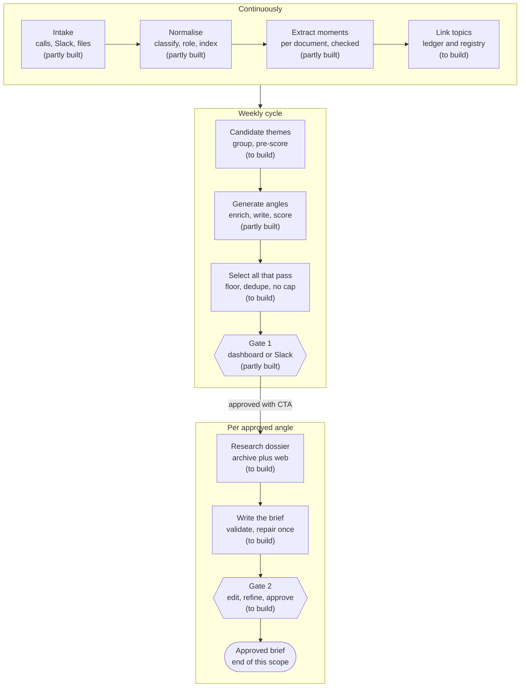

# Content Atelier: Implementation Roadmap Through Brief Generation

**Date:** 12 October 2026 (first issued 10 October) · **Prepared for:** Kenil Shah · **Scope:** Content Atelier and Command Center, through brief generation · **Basis:** code and document review; no tests, database or model calls were run

## 0. Status update, 12 October 2026

This section is current. Everything from section 1 onward was written on 10 October against `main` and is kept as the target description; where its statements about the present disagree with this section, this section is right. The item-level detail is in `Content-Atelier-Implementation-Plan-Brief-Generation.md`, section "Status at 12 October 2026".

### What changed

- **Content Atelier:** one commit, "Feat: Content Brief_V0" (`46615c0`, 12 October, 72 files, about 7,700 added lines), on branch `origin/feat/content_brief`. It is not merged. `main` has only the documentation commit.
- **Command Center:** no commits since 6 October.
- **Decision 4 (11 October):** the Atelier frontend lives only in the Content Atelier repository; Command Center links to it by URL. Section 8.2 is rewritten below to match.

**Basis for this update.** I read the branch's code and the developer's notes, and ran the 119 backend tests that need no database; all passed. I could not run the 57 database-backed tests or look at the developer's database, so row counts and "real run" results below are the developer's report.

### Where the system stands

**A brief can now be researched, written, validated, edited and approved in code, but only on an unmerged branch, and no real brief has been produced.** The developer built the brief and Gate 2 directly on the week-based Gate 1 slice. The foundations this roadmap puts first (deployment, per-document evidence, classification, topics, the cycle) are unchanged.

| Workstream | Status | Done | In progress or built differently | Pending |
| --- | --- | --- | --- | --- |
| A. Decisions and baseline | Not started | Decisions 1 to 4 recorded. | Approver and editor lists as environment variables. | Privacy confirmation, migration runner, deployable backend, RQ, CI. |
| B. Evidence foundation | Partly built | Chunk embeddings for the 20 loaded transcripts; hybrid search over chunks. | Extraction still one request per week, with a citation repair added. | Unbound documents, per-document extraction, roles, consent, dates, moment embeddings, topics. |
| C. Intake | Not started | | | The other 130 transcripts, Slack, Fathom, Sources view. |
| D. Weekly cycle and Gate 1 | Partly built, differently | A real Week 2 run of a new eight-stage comparison workflow (developer's report). No cap on angles. | Three candidate similarity cutoffs, none chosen, so the new angles cannot be approved. Gate 1 has approve and reject only. | Date-window cycles, themes, rubric, duplicate collapse, memory of published content, pass, snooze, revive, manual ideas, schedule. |
| E. Research, brief and Gate 2 | Built on the branch, offline only | Research loop, dossier, brief contract, writer, validators and repair, versions, every Gate 2 action, exports. | Dossier and brand bundle are files, not tables. Web research is an interface with no adapter. Approval queues a replay-only run. | A real run. A reviewed brand bundle. Topic expansion, web adapter, retrieval evaluation. |
| F. Product UI and integration | Barely started | A working brief review screen; the angle review screen shows the comparison. | Both real screens are plain and sit beside the mock views. | Routing, the Weekly Studio on real data, mock removal, roles, Slack approvals, all Command Center removal, deep links. |

### Intended flow against what is implemented, stage by stage

This is the pipeline from source to approved brief, with the state of each stage on 12 October. It counts all code that exists, including the unmerged branch.

**Status key**

| Status | Meaning |
| --- | --- |
| Not started | No working code for the intended behaviour. |
| Partial | Some of the intended behaviour works. |
| Built, unproven | The code exists and passes fixture tests. It has never run on real data. |
| Done | Matches the intended behaviour and has run on real data. |

**How a request travels.** Browser, then the Atelier's Node server (checks the Command Center session and attaches the user's identity), then the Python API, then Postgres. A separate worker process does long work from job rows; the frontend reads those rows to show progress. This path is the same in the intended design and today.

#### Backend

| # | Stage | Intended | Status | Done | Left |
| --- | --- | --- | --- | --- | --- |
| 1 | Intake | Fathom and Slack polled continuously; the 150 collected transcripts backfilled; each a standalone document. | **Partial** | File loading from a folder; exact passage maps; raw files archived; 20 transcripts loaded. | Standalone documents not tied to a week; the other 130 transcripts; Slack import; Fathom and Slack polling; duplicate detection. |
| 2 | Preparation | Classify calls, resolve speakers to staff or client, attach consent, record meeting dates, exclude internal calls. | **Not started** | Nothing. | Classification; speaker roles; client and people records; consent levels; meeting dates; glossary. |
| 3 | Moment extraction | One job per document; each moment validated alone for quote, speaker role and numbers. | **Partial** | Extraction works; quotes checked against the source; a repair for one type of citation error. | Per-document jobs; per-moment pass or fail; role and number checks; five more moment types. |
| 4 | Search index | Segments and moments embedded and indexed, with filters; moments linked to topics. | **Partial** | Chunk embeddings; search by meaning and keyword combined; a full-text index. | Moment embeddings and search; filters by date, client and call type; topics; re-embedding once chunks gain headers. |
| 5 | Weekly cycle | Scheduled; date window; themes by topic; angles per theme. | **Partial** | A manual run produces angles for a week; an optional refinement pass; a history snapshot. | Schedule; date windows; themes; per-theme generation; the extra angle fields (pillar, hooks, why-now, suggested CTA). |
| 6 | Scoring and selection | Separate seven-criterion scoring; comparison with earlier angles and published content; proof check, quality floor, duplicate removal; no cap. | **Partial** | No cap; comparison against earlier angles; freshness decay; near-duplicates flagged. | Separate rubric scoring; a chosen similarity cutoff; duplicate removal; published-content comparison; cooldowns; settings in place of fixed numbers. |
| 7 | Gate 1 | Approve with CTA and steer, pass with a reason, snooze, revive, manual ideas; approver role; in the app and in Slack. | **Partial** | Approve and reject with CTA; bound to the exact content; edit and rescore; an approver list. | Pass reasons; snooze; revive; steer field; manual ideas; decisions log; Slack; the approver check in every mode; a cutoff, without which current angles cannot be approved at all. |
| 8 | Research | Starts on approval; topic expansion; planned searches; grading; earlier coverage; external web context; dossier saved. | **Built, unproven** | Queued on approval; search rounds; grading; earlier-coverage lookup; dossier with a full audit trail; retry from saved responses. | A real run; automatic live start (a developer must activate it today); topic expansion; a web research provider; dossier in shared storage; a retrieval quality test. |
| 9 | Brief writing | One writing call with the brand kit; code checks; one repair; leftover problems shown to the reviewer. | **Built, unproven** | Brief contract; writer; checks for quotes, numbers, names, CTA and evidence; reviewer pass; one repair; saved with its evidence. | A real run; a reviewed brand kit (the file is an empty template, so the writer refuses to run); a brand kit store; reconciling the brief's shape with section 2.2; the writing-model choice. |
| 10 | Gate 2 | Read, edit, answer, revise, approve or reject; versions; nothing started after approval; Slack approve. | **Built, unproven** | Edit with locked fields; answers; approve and reject; version chain; revise; add evidence; permission clearance; Markdown and JSON export. | A real run; stale flag and regenerate; free-text added context; Slack approve and reminders; a decision on the extra required review step. |
| | Running it | Deployed, scheduled, RQ workers, automatic retry, budgets, alerts, backups. | **Not started** | A local Postgres job queue with manual retry; cost files per brief run. | Container and staging; migration runner; RQ and scheduler; settings table; CI; budgets; alerts; backups; production; privacy confirmation. |

#### Frontend

| Area | Intended | Status | Done | Left |
| --- | --- | --- | --- | --- |
| Sign-in | Command Center login through a dashboard link; team users only. | **Partial** | Login and link work. | Block client accounts; keep the requested page through sign-in. |
| Sources | Connection health and the document list. | **Not started** | Nothing. | The whole screen. |
| Moments ledger | Search, filter and open any moment. | **Not started** | A mock layout that navigation does not reach. | Real data, search, detail view, a navigation entry. |
| Angles (Weekly Studio) | Ranked angles, proof, scores, run progress, all Gate 1 actions. | **Partial** | A plain real screen with angles, evidence, run status, approve and reject. | Move it into the designed Weekly Studio; pass, snooze and steer; filters. |
| Research view | The full dossier: searches, graded evidence, earlier coverage, external context. | **Partial** | An evidence list inside the brief screen. | A proper view with queries, grades and labels. |
| Brief reader and editor | Read, edit by section, questions, versions, revise, approve or reject. | **Built, unproven** | Every action exists as basic forms. | Design; conflict handling; use on a real brief. |
| Progress after approval | Research and writing stages shown live. | **Partial** | A stage list once a brief exists. | Progress before the first brief exists. |
| Previous Concepts, Brand Kit, Add Angle | Real data. | **Not started** | Mock screens. | Real data behind each. |
| Home | A summary of what is waiting for whom. | **Not started** | A mock calendar. | Replace it with the summary. |
| Out-of-scope screens | Packs, calendar, scheduling and Client Intelligence hidden. | **Not started** | Still in the navigation. | Remove them from navigation. |
| Links and routing | Every angle and brief has a URL. | **Not started** | Nothing. | Add routing. |
| Slack | Digest and brief-ready messages with approve buttons. | **Not started** | Nothing. | The Slack app. |
| Command Center | A link only; the old Atelier screen, proxy and data removed. | **Partial** | The link exists. | Remove the old screen, proxy and data. |

#### Overall

- **Not started:** stage 2, running the system, and seven of the 13 frontend areas.
- **Partial:** stages 1 and 3 to 7.
- **Built, unproven:** stages 8 to 10 and the brief screen.
- **Done:** nothing, measured against the intended flow.

The furthest real data has travelled is stage 6: two weeks of transcripts produced 12 candidate angles (the developer's count), and none is approved.

### Against the four decisions

| Decision | Status |
| --- | --- |
| 1. RQ on Redis | **Not followed.** The branch added the brief stages to the Postgres lease worker and states RQ is unnecessary. Needs your ruling (plan O16). |
| 2. Slack approvals | Not started. |
| 3. No cap on angles | Followed in code. Selection still rests on a self-scored quality number and an unchosen cutoff. |
| 4. Frontend only in the Atelier repository | Followed for new screens. Command Center's old screen, proxy and data are untouched. |

### What to do next

1. **Run one real brief (the pilot).** It needs no foundation work: confirm zero data retention, merge the branch after its database tests run somewhere else, supply a reviewed brand bundle, choose a cutoff, approve one Week 2 angle, activate the run, review the result with WIA. Steps P1 to P8 in the plan.
2. **Rule on the two places the branch departs from the plan:** RQ (O16) and the "no new tables" rule (O18).
3. **Then resume the order in section 9:** baseline, evidence, cycle. Phase 3 there becomes "reconcile and finish" instead of "build".

### Points that need your attention

- **Live model calls on real transcripts were made on 12 October** before the privacy position was confirmed. The Phase 0 task for that has no recorded result.
- **Everything real is on one machine.** The database, embeddings and verification artifacts are local to the developer and git-ignored, and three documents their notes link to are not in the repository.
- **The brief is built on unprepared evidence.** Research searches all loaded transcripts with no call classification, speaker roles or client consent. That is acceptable for a pilot and not for use.
- **The API and worker share a local folder** for the dossier and caches, which does not survive deployment as separate services.

### Statements below that are now out of date

| Section | Statement | Now |
| --- | --- | --- |
| 1 | The system stops at Gate 1; no brief has ever been generated by code. | Code to generate one exists on the branch. None has been generated from real data. |
| 1, 3.1 | Four job stages exist. | The branch adds an eight-stage comparison workflow, five brief stages and a chunk-encoding run. |
| 1 | Chunks are never embedded; no full-text index; nothing is searchable. | 329 chunks embedded, a full-text index added, hybrid chunk search built (branch). Moments are still unsearchable. |
| 1 | One screen is real. | Two on the branch: angle review and brief review. |
| 3, 5 | `source_type` allows only three values. | It is unrestricted text; the three values are a comment. |
| 3 | No evaluation set exists. | A file of synthetic diagnostic cases exists. A founder-labelled set does not. |

---

## 1. Summary

> Written 10 October against `main`. See section 0 for the position on 12 October.

The system today stops at Gate 1: an approved angle starts nothing, and no brief has ever been generated by code. Reaching "fully functional through brief generation" needs six workstreams, and roughly half of the work is upstream of the brief itself.

**Scope of this roadmap.** Everything from source intake to a researched, validated, human-approved brief: ingest, moments, the weekly angle cycle, Gate 1, the research dossier, the brief, and Gate 2. Pack generation, final review, scheduling and publishing are out. A brief approval is recorded and starts nothing downstream, the same pattern Gate 1 uses today.

**What I validated.** I read both repositories' code, the solution architecture (rev. 2, 4 Oct 2026), the feasibility study, the conformance audit (10 Oct 2026), the frontend product spec and the mock UI. The audit's findings hold against the code. I did not run tests, a database or any model call.

**Headline findings**

- **The backend is a Gate 1 slice.** Four job stages exist (`moment_extraction`, `angle_generation`, `angle_embedding`, `angle_matching`). `gate_one.decide` ends with the comment "No brief job is created by this release". `content_briefs` is an empty table.
- **The brief the client has seen is hand-written.** The four briefs in `content-briefs/2026-10-05/` and `frontend/src/data/fathomContentBriefs.ts` are fixtures. In the mock, "Approve & create brief" is a 1.3 second `setTimeout`.
- **The mock brief is richer than the architecture's brief.** It adds a per-format production plan, evidence boundaries, a four-month similarity review and a review checklist. This roadmap treats that as the target brief contract.
- **Brief research has no foundation yet.** Chunks are never embedded, there is no full-text index, moments are JSON blobs, and nothing is searchable across weeks. The research loop cannot be built until this exists.
- **Extraction cannot scale as built.** One LLM request per whole week, with all-or-nothing validation, failed both real runs. Per-document extraction is a prerequisite, not an optimisation.
- **The repositories are joined only by sign-in.** Command Center's Atelier proxy targets routes that no longer exist. The real product UI is `WIA-Content-Atelier/frontend`, not Command Center.
- **One screen is real.** `SQLWeeklyAngles.tsx` is API-backed. The Weekly Studio, Moments, Research, Brand Kit, Add Angle and Previous Concepts views run on fixtures and `localStorage`.

**Shape of the work**

| Workstream | What it delivers | Depends on |
| --- | --- | --- |
| A. Decisions and baseline | One governing spec, privacy position, a migration tool, a deployable backend | Nothing |
| B. Evidence foundation | Source documents, per-document extraction, roles and consent, embeddings, hybrid search | A |
| C. Intake | Backfill import of the 150 collected transcripts, Fathom polling, Slack intake, Sources view | A, B (schema) |
| D. Weekly cycle and Gate 1 | Topics, candidate themes, rubric scoring, uncapped selection, memory, manual ideas, full Gate 1 actions | B |
| E. Research, brief and Gate 2 | Providers, research loop, dossier, brief writer, validators, versions, Gate 2 | B, D |
| F. Product UI and integration | Mock views wired to real APIs, routing, roles, Command Center cleanup, Slack approvals | API contracts from B to E |

The critical path is A, B, D, E. C and F run in parallel once the schema and API contracts are fixed.

## 2. Target system behavior through brief generation

The target is one weekly loop: evidence accumulates continuously, a weekly cycle proposes every angle that clears the quality bar, a person chooses, and each approved angle becomes a researched brief a person can edit and approve.

Shaded steps have some code today. The three steps after Gate 1, and the scope's end state, are entirely new.

### 2.1 Behavior by stage

| Stage | Target behavior | Source of requirement |
| --- | --- | --- |
| Intake | Calls and Slack threads arrive as source documents, independent of any week. Raw bytes are preserved. Re-running an import changes nothing. | Architecture §4.1; mock Moments "sync" control |
| Normalise | Each document is classified (client 1:1, office hours, workshop, prospect, internal, vendor). Internal and vendor calls are excluded. Speakers get a role. Text is segmented, embedded and full-text indexed. | Architecture §4.2, §3.3 |
| Moments | Each included document is read once, alone. Each moment is validated on its own: quote match, role plausibility, numbers in source, consent status. One bad moment costs one moment. | Architecture §4.3; audit D1 |
| Moments ledger | A searchable list of moments with source, speaker, timestamp, type and clearance. "Make this an angle" promotes a moment to a manual idea. | Architecture §6.2; mock `MomentsLedgerView` |
| Weekly cycle | Runs on a schedule or on demand. Groups new moments into candidate themes, scores them, generates angles, applies memory, and keeps every angle that clears the proof gate, the quality floor and the duplicate check. There is no upper cap. Zero is a valid result. | Architecture §4.5; frontend spec §10 |
| Angle review (Gate 1) | Each card shows the rationale, proof passages with a link to the recording, score breakdown and prior-coverage notes. Actions: approve with CTA and optional steer, edit, pass with reason, snooze, revive from a previous week. Approve, pass and snooze can also be taken from Slack. | Architecture §6.1, §6.2; mock Weekly Studio and Previous Concepts |
| Manual ideas | "Add angle" takes a title, an optional quote, a source, a client and a CTA. It enters Gate 1 like any other angle, or goes straight to a brief when an approver adds it. | Architecture §6.4; mock `FlagIdeaModal` |
| Research | Approval enqueues research. A bounded loop runs 6 to 10 hybrid searches plus topic expansion, at most 2 follow-up rounds, then optional external research. The result is a saved, cited dossier. | Architecture §3.6, §5 |
| Brief | A structured brief is written from the dossier and the brand kit, validated, repaired once if needed, and saved as version 1. | Architecture §4.6; mock `ProductionBrief` |
| Brief review (Gate 2) | Read, edit fields, answer open questions, refine with instructions, add context, approve, or reject with a reason. Every change is a new version. Approval binds to the exact version. | Architecture §6.1; frontend spec §13 |
| End state | The brief is `approved` or `rejected`. Nothing is generated downstream. The UI says pack generation is not yet available. | Scope of this roadmap |

### 2.2 The brief contract

The target brief is the union of the architecture's brief (§4.6) and the mock's `ProductionBrief` type. It is stored as structured JSON and rendered for editing and Markdown export.

| Block | Fields | Origin |
| --- | --- | --- |
| Strategic assignment | Working title, angle statement, audience, funnel stage, pillar, belief shift, reader promise | Both |
| Why now | Internal recency plus dated external context | Architecture |
| Core insight and message spine | One core idea; 3 to 4 shared lines | Both |
| Narrative | Hook, problem, main point, transformation, CTA directions | Mock |
| Evidence boundaries | What the sources establish; hypotheses; claims the brief does not support | Mock |
| Proof points | Verified quotes and results, each with evidence ID, timestamp link and consent status | Architecture |
| Differentiation | What is commonly said, and how this take differs | Architecture |
| Voice | Perspective (I or we), tone, writing rules, phrases to avoid | Mock, from the brand kit |
| Format plan | What the email, the carousel and each of three reels uniquely does; which is the anchor | Both |
| CTA | Track and action as confirmed at Gate 1; offer bridge | Both |
| Similarity review | Published and prior Atelier pieces from the last four months that overlap, and how this version differs | Mock |
| Claims requiring consent | Every claim that needs permission or recording verification | Both |
| Open questions | Required and optional questions for the approver. A required question blocks approval. | Both |
| Sources | Every evidence item used, internal and external, labelled by kind | Architecture |

### 2.3 Rules that hold everywhere

- **Gates are database states.** Nothing waits in memory. A human action commits a status change and a job record in one transaction; the job is then enqueued on RQ.
- **Approvals bind to content.** The existing hash-bound approval constraint is kept for angles and extended to briefs.
- **External research is context, never proof.** A WIA or client result can only be substantiated by an internal evidence item.
- **Consent is a gate.** Anonymise by default. A named client appears in a brief only when that client is cleared.
- **Progress is truthful.** The UI shows named stages and real unit counts from the job table, never an invented percentage.
- **The browser holds no authority.** Role, actor and approval state come from the server on every request.

## 3. Current state, validated against the code

Three codebases matter: the Python backend, the Atelier frontend with its Node server, and Command Center. Only the first two carry product behavior.

### 3.1 Backend (`WIA-Content-Atelier/backend/backend_pipeline`)

| Area | What the code does | Evidence |
| --- | --- | --- |
| Schema | 13 tables. `transcripts`, `key_moments` and `content_angles` all carry a required `week_id`. `content_briefs`, `content_packs`, `content_assets` and `calendar_entries` exist but no code writes them. | `migrations/001_approved_schema.sql` |
| Schema guard | Startup compares the live catalog to `schema-catalog.json` and refuses any difference. There is no migration tool. | `database.py` `check`, `initialize` |
| Intake | Manual only. `admit` reads `.txt` and `.vtt` files from a directory and binds them to a week given on the command line. | `repository.py` `admit`, `storage_cli.py` |
| Segmentation | Chunks are written at admission. `embedding` is always null. No text-search column. | `storage_sources.py`, `transcript_chunks` |
| Extraction | One request for the whole week. Any validation failure fails the stage. | `sql_pipeline.py` `execute` |
| Moments | Stored as `moment_body` JSON with evidence offsets. No embedding, client, speaker role or consent column. Seven types: result, objection, decision, tension, mechanism, observation, story. | `contracts.py`, `key_moments` |
| Angles | One prompt, no cap. The model scores its own output on five criteria with weights hard-coded in `Quality.score`. Visible above 70. | `models.py`, `config.py` |
| Memory | Angle-to-angle cosine with a 28-day half-life from generation time. Thresholds 0.78 and 0.90. | `matching.py` `risk` |
| Jobs | Postgres lease queue with dependencies, heartbeat and idempotency keys. An expired lease is marked failed and waits for a manual retry. No scheduler, no sweep. | `repository.py` `claim`, `retry` |
| Gate 1 | Edit (new superseding row), rescore, approve with CTA, reject. No pass reasons, snooze, steer or manual ideas. Approval creates no job. | `gate_one.py` |
| API | 10 routes under `/storage`, guarded by a shared bearer secret and an `x-atelier-actor` header. No role check. | `storage_api.py` |
| LLM layer | One model (`openai/gpt-6-luna`) for both stages. `json_object` output in the env example. No repair attempt. Embedding base URL defaults to OpenAI direct. | `config.py`, `provider.py`, `.env.example` |
| Legacy runner | The file-backed `Pipeline` class is still load-bearing. The SQL worker calls its private methods (`_call_json`, `_parse_moments`, `_parse_angles`). | `sql_pipeline.py` `adapter` |
| Deployment | No Dockerfile, no Railway config. `rq`, `redis`, `sqlalchemy` and `openai` are pinned but unused. | `requirements.txt` |

Not present at all: connectors, classification, speaker roles, consent, clients, topics, search, external research, brand kit storage, dossier, brief generation, Gate 2, notifications, cost caps.

### 3.2 Atelier frontend (`WIA-Content-Atelier/frontend`)

| Part | State | Evidence |
| --- | --- | --- |
| Node server (BFF) | Real. Session check against Command Center, PKCE sign-in, CSRF checks, closed allowlist from `/api/atelier/*` to `/storage/*`, team role required for data routes. | `server/app.mjs`, `server/sso.mjs` |
| Weekly Angle Review | Real. Weeks, runs, jobs, events, angles, evidence drill-down, edit, rescore, approve, reject. | `SQLWeeklyAngles.tsx`, `utils/weeklyStorage.ts` |
| Weekly Studio, Previous Concepts | Mock. Angles, briefs, packs and scheduled tabs over `localStorage`. Gate transitions are local state changes. | `EditorialHub.tsx`, `App.tsx`, `utils/editorialWorkflow.ts` |
| Inspector modal | Mock. Tabs for gates, brief, research, pack and schedule. Brief "generation" is a timer. | `IdeaDetailModal.tsx` |
| Moments, Research, Brand Kit, Add Angle | Mock. Hard-coded data. Promotion and flagging invent scores (93 and 95). | `MomentsLedgerView.tsx`, `ResearchView.tsx`, `BrandKitModal.tsx`, `FlagIdeaModal.tsx` |
| Home calendar, Content Packs, Client Intelligence | Mock, and beyond this roadmap's scope. | `ContentCalendar.tsx`, `ContentPacksView.tsx`, `ClientIntelligenceView.tsx` |
| App structure | No router. One `currentView` state variable. No data-fetching library. Static assets are served to `client` role users too. | `App.tsx`, `server/app.mjs` |
| Timezones | Editorial weeks use `Asia/Calcutta`. The next-run countdown uses `America/Chicago`, Saturday 04:00. | `utils/editorialWeeks.ts`, `utils/nextRun.ts` |

### 3.3 Command Center (`WIA-Command-Center`)

| Part | State | Evidence |
| --- | --- | --- |
| Sign-in and launch | Real. The "View Here" link calls `/api/auth/content-atelier/launch`, which hands off to the Atelier app with a one-time code. | `server/atelier-sso.mjs`, `ExploreSection.tsx` |
| Roles | Two roles only: `team` and `client`. | `server/auth-core.mjs` |
| Atelier proxy | Stale. It allows `/calls`, `/verdicts/*`, `/moments/*/labels`, `/ideas/*/gate-1` and `/source-health`. None exists in the backend. No frontend code calls it. | `server/content-atelier-proxy.mjs` |
| Ops Hub Atelier screen | Fixture only, and a different workflow. | `ContentAtelierScreen.tsx`, `src/data/contentAtelier.ts` |
| Corpus scripts | One-off Node scripts that proved access. Useful as reference for the Python connectors. | `corpus/*.mjs` |

### 3.4 Data and access

Figures below come from `wia_resource_mapping.md`; I did not inspect the data itself.

| Asset | Held | Pipeline status |
| --- | --- | --- |
| Zoom transcripts | 150 files pulled by hand (78 client calls, 61 internal per the audit) | 20 admitted across two hand-built weeks |
| Slack | 6 channels, 1,070 messages; bot token live | Not in the pipeline; schema has no Slack source type |
| Published content | 126 marketing emails, 18 carousels | Not imported |
| Voice and strategy documents | 3 documents | A prompt file stands in |
| Fathom | Own test account proven; WIA keys in progress | Not in the pipeline |
| Zoom API | Blocked on a WIA permission | Not needed for the backfill already on disk |
| Real model runs | Week 1 only: 7 of 9 moments validated, 6 angle candidates, no embeddings | No real angle has been matched or reviewed by WIA |

## 4. Gap analysis

Most of what exists can be kept. The two things that must change shape are the week-bound data model and whole-week extraction; everything else is extension or new build.

### 4.1 Reuse as is

| Asset | Why it stays |
| --- | --- |
| Evidence integrity: immutable originals, passage maps, exact-offset quote binding | Stricter than the architecture asks. The brief's proof points depend on it. |
| Request fingerprinting, artifact store, replay mode | Identical work is never billed twice. Extend it to the new stages. |
| Hash-bound approvals and superseding edits | Already the right model for brief versions. `content_briefs` has the same constraint. |
| Job and event tables with idempotency keys and progress fields | Kept as the durable job record and the UI's progress source. Execution moves to RQ. `pipeline_jobs` already has `angle_id` and `brief_id` targets. |
| Cosine and recency arithmetic, thresholds 0.78 and 0.90 | Matches the architecture. Becomes one input to the wider memory policy. |
| BFF security boundary: server-held secret, closed allowlist, CSRF checks, PKCE hand-off | Extend the allowlist; do not redesign. |
| Prompt templates and editorial policy | Corpus-informed. Reused per document. |
| Mock UI components and visual design | The layout, cards and inspector are the agreed experience. Rewire their data, keep their markup. |
| `productionBriefMarkdown.ts`, `MarkdownDocument.tsx` | Already renders the target brief shape for reading and export. |

### 4.2 Modify

| Asset | Change | Reason |
| --- | --- | --- |
| `transcripts` table | Generalise to source documents. Make `week_id` optional, add `slack` and `manual_idea` source types, add call type, inclusion flag, client and participants. | Audit D2. Slack has no home; whole-archive research has no home. |
| `transcript_chunks` | Add a context header, a generated `tsvector`, an embedding model column. Populate embeddings. | Audit D14. Search needs it. |
| `key_moments` | Promote type, strength, speaker role, client, consent status, document ID and occurrence date to columns. Add embedding and `tsvector`. Keep `moment_body`. | Audit D3. Moments must be filterable and searchable. |
| Extraction stage | One job per document, per-moment validation, one repair attempt. | Audit D1. |
| Moment taxonomy | Add testimonial, question, teaching, soundbite, data point. Keep the existing seven where they do not overlap. | Audit D13. The brief's proof and pain sections filter by these. |
| `content_angles` | Add origin, topic, pillar, hooks, why-now, suggested CTA, steer, decision reason code, snooze date. | Audit D5. Gate 1 actions and the brief writer need them. |
| Angle scoring | Replace self-scoring with the architecture's rubric, weights in settings, a quality floor and duplicate removal, with no cap on count. | Audit D5. |
| Freshness | Measure age from source or publication date, not generation time. Add status-based cooldowns and published-content comparison. | Audit D9. |
| `gate_one.decide` | Add pass with reason, snooze, steer. On approval, insert the brief run and jobs in the same transaction. | The missing link to brief generation. |
| `provider.py`, `config.py` | Schema-enforced output, model per stage, embeddings through OpenRouter, one repair, run logging, zero data retention. | Audit D7. |
| Schema guard | Keep the catalog check; regenerate the catalog per migration. | Needed to evolve the schema at all. |
| `SQLWeeklyAngles.tsx` | Fold its API wiring into the Weekly Studio layout, then remove it as a separate view. | Two UIs for one gate. |
| BFF allowlist and actor | Add the new routes. Always forward the verified email, not `user.id`. | Role checks need a stable identity. |

### 4.3 Build

| Capability | Notes |
| --- | --- |
| Migration runner | Numbered SQL migrations with a recorded version. |
| Reference data: clients, people, consent levels, Slack channel registry | Seeded from configuration and the collected corpus. |
| Document classification and speaker roles | Rules first, a fast model for leftovers. |
| Hybrid search function | One SQL function over segments, moments and memory, fused with Reciprocal Rank Fusion. |
| Topic registry | Assignment at extraction time; rename, merge, block. |
| Candidate themes, pre-scoring, selection | Deterministic code. |
| Published-content memory | Import of the 126 emails and 18 carousels; similarity at brief time. |
| Brand kit store | Versioned documents loaded whole into writing prompts. |
| External research providers | Web research through OpenRouter; DataForSEO adapter behind a flag. Cache, budget, sanitiser. |
| Research loop and dossier | Query planning, retrieval, grading, gap rounds, persistence. |
| Brief writer, validators, repair | Structured output against the brief contract. |
| Gate 2 service and API | Versions, locked fields, refine, add context, approve, reject. |
| Decisions log | Every human action with reason, actor and surface. |
| Scheduler and sweep | Weekly cycle trigger, polling triggers, recovery of stalled work. |
| Python intake: file backfill, Fathom, Slack | Ported from `corpus/*.mjs`. |
| Run and cost logging, budget caps | `llm_runs`, `external_calls`. |
| Backend container and Railway services | API, worker, scheduler, Postgres, artifact storage. |
| Roles | Approver allowlist enforced by the backend. |
| Evaluation sets | Retrieval set and brief acceptance checks. |

Added by the 10 October decisions: the RQ execution layer (queues, enqueue after commit, cron configuration, sweep) and the interactive Slack app described in section 8.5.

### 4.4 Prototype functionality to connect to real behavior

| Mock feature | Today | Becomes |
| --- | --- | --- |
| Weekly Studio, Angles tab | `localStorage` library of `ContentIdea` | Angles for the current cycle from the API |
| "Approve & create brief" | Timer, then a saved fixture | Gate 1 decision, then a live research and brief job with staged progress |
| Weekly Studio, Briefs tab and "Read full brief" | Four hand-written briefs | Brief versions from `content_briefs` |
| Inspector, Research tab | Fixture sources and "audience questions" | The dossier: internal evidence, founder references, external context, labelled by kind |
| "Past four months similarity review" | Fixture field | Computed against published content and prior Atelier briefs |
| Topic and editorial rationale | Fixture, labelled mock | Angle rationale fields from generation and scoring |
| Score out of 100 with a six-part breakdown | Invented numbers | The rubric breakdown with one-line reasons |
| Previous Concepts and "revive" | Local week stamping | Undecided, snoozed and expired angles; revive re-enters the current cycle |
| Weekly capacity of four concepts | Constant in `editorialWeeks.ts` | Removed. Every qualifying angle is shown, ranked |
| Add angle modal | Creates a local idea scored 95 | Manual idea endpoint; scored like any other angle |
| Moments ledger, promote to angle | Fixture moments | Moments API and the same manual idea endpoint |
| Brand Kit modal | Static text | Read view of active brand kit documents; admin upload |
| Next-run countdown | Client-side Saturday 04:00 Central | The scheduler's actual next run from the API |
| Pending counts in sidebar and header | Derived from local state | A counts endpoint |
| Copy brief | Clipboard from fixture Markdown | Same, from the stored brief |

### 4.5 Where frontend, backend and architecture diverge

| Topic | Architecture | Backend | Mock UI | Resolution in this roadmap |
| --- | --- | --- | --- | --- |
| Unit of intake | Source document, any time | Transcript bound to a week | Weekly bucket | Source document; a cycle selects by date window |
| Extraction | Per document | Per week | Not shown | Per document |
| Angles per week | 3 to 5, floor applied | Uncapped above 70 | Hard cap of 4 | No cap: every angle that clears the floor, ranked, never padded |
| Score | 7-criterion rubric, weights in settings | 5 self-scored criteria | 6 parts, different weights | Architecture rubric; UI renders whatever criteria the API returns |
| Gates | 2 plus light final review | Gate 1 only | 3 | Gates 1 and 2 in scope |
| Approver | Approver role, delegate allowed | Any team user | Whitney-only in the spec | Approver allowlist in backend settings |
| CTA tracks | Accelerators, Elevate | Free-text CTA object | Elevate, Accelerators, LeadLock | CTA catalogue as data, three tracks seeded |
| CTA default | Preset to the suggestion in Slack | Required, no suggestion | Preselected | Suggested, never preselected (frontend spec §11.6) |
| Brief shape | 14 sections | Table with `content_body` JSON | `ProductionBrief`, richer | Union, section 2.2 |
| External research | OpenRouter web search, DataForSEO flag | None | SerpAPI, Google Trends score | Architecture providers; no Trends score shown unless measured |
| Slack at gates | Digest with one-tap actions | None | Notification only (frontend spec §22.2) | Digest with approve, pass and snooze actions that call the dashboard's approval service |
| Queue | RQ on Redis | Postgres lease table | Not shown | RQ on Redis with RQ cron and a sweep; Postgres stays the record |
| UI stack | FastAPI with HTMX, or React in front | n/a | React with a Node BFF | Keep React and the BFF |
| Timezone | WIA's timezone | UTC | IST weeks, Central run time | One `cycle.timezone` setting served by the API |
| Calendar and scheduling | Later | Empty tables | Built as mock | Hidden in this scope |
| Product UI location | One dashboard | n/a | Atelier app; Command Center has a second fixture screen | Atelier app is the product; Command Center launches it |

## 5. Conformance audit findings and how they are addressed

Of the audit's 16 deviations, 14 are reversed or fixed by this roadmap, 1 is accepted with conditions (D12), and 1 is split between scope and deferral (D11). Workstream letters refer to section 9.

### 5.1 Deviation register

| ID | Finding | Disposition | Where |
| --- | --- | --- | --- |
| D1 | Whole-week batch extraction | **Reverse.** Per-document jobs, per-moment validation, one repair attempt. Existing prompts and validators are reused. | B |
| D2 | Week-centric data model | **Reverse.** Documents stand alone; a cycle references moments by date window. `weeks` stays as the cycle table. | B |
| D3 | Schema covers half the model | **Extend** with the tables the brief path needs (section 6.1). Pack and asset version tables are not added now. | A, B, D, E |
| D4 | No consent, roles or classification; internal calls included | **Fix.** Classification and role resolution run before extraction. Internal and vendor calls are excluded by default. Consent status is a column on every moment. | B |
| D5 | Scoring and selection off-spec | **Fix.** Architecture rubric, weights in settings, quality floor, duplicate removal, no cap on count. | D |
| D6 | Three conflicting specifications | **Decide first.** Section 10 lists the rulings this roadmap assumes. Issue them as an addendum before workstream B starts. | A |
| D7 | LLM usage off-strategy | **Fix.** Model per stage, schema-enforced output, one repair, embeddings through OpenRouter, budgets, zero data retention confirmed before any further real transcript is sent. | A, B |
| D8 | Postgres queue instead of RQ | **Reverse.** Execution moves to RQ on Redis with RQ cron and a reconciliation sweep, as the architecture specifies. Upgrade the pinned `rq==1.16.2`, which predates the cron scheduler. | A, D |
| D9 | Freshness is recency-decayed similarity only | **Fix** for the angle and published-content levels and for status-based cooldowns. The ambiguous-band LLM judge is included; pillar balance is included. | D |
| D10 | Cross-repo drift | **Fix.** Delete the stale proxy allowlist, rewrite the backend section of `DEPLOYMENT.md`, retire the fixture screen. | F |
| D11 | Mock shows a product the architecture does not describe | **Split.** Mock features up to the brief become requirements (section 4.4). Scheduling, the publishing tracker and Client Intelligence are hidden. | F |
| D12 | Stack and auth; no role model; client role can load the bundle | **Accept** React and Command Center sign-in. **Fix** roles with an approver allowlist, and restrict the static bundle to team users. | F |
| D13 | Moment taxonomy differs | **Fix** by extending the enum. | B |
| D14 | Segmentation differs | **Fix** the header and add one-turn overlap. Keep the existing size cap unless the retrieval set shows misses. | B |
| D15 | Maintainability | **Fix on contact.** New modules follow the lint limit. The SQL worker stops calling private methods of `Pipeline`; the shared call, parse and validate code moves into a small `llm` module. | B |
| D16 | Portability and housekeeping | **Fix.** Remove absolute paths, the unused `@google/genai` dependency and broken README links. Rename the package. | A |

### 5.2 The 13 v1 essentials, against this scope

| # | Essential | In this roadmap |
| --- | --- | --- |
| 1 | Railway setup | Yes. API, RQ workers, scheduler, Redis, Postgres, artifact storage, staging and production. |
| 2 | Connectors | Yes: file backfill, Fathom polling, Slack intake. Zoom API sync deferred while the backfill on disk covers it. |
| 3 | Normalisation | Yes. Cross-source de-duplication is limited to content-hash and meeting-URL matching. |
| 4 | Moment extraction with checks | Yes. |
| 5 | Topic registry | Yes: assignment, rename, merge, block. |
| 6 | Weekly cycle with web research and DataForSEO flag | Yes. DataForSEO is built behind a flag and shipped off. |
| 7 | Gate 1 in dashboard and Slack, manual ideas | Yes, both. |
| 8 | Dossier, brief, Gate 2 | Yes. This is the end of scope. |
| 9 | Packs, validators, critic, final review | No. |
| 10 | Content memory | Yes for angles, topics and imported published content. Asset-level memory waits for packs. |
| 11 | Dashboard screens | This Week, Briefs, Moments, Sources and a minimal Settings. Packs out. Topics as a basic admin list. |
| 12 | Run logs, sweep, caps, alerts, backups | Yes, except the restore drill, which belongs to launch hardening. |
| 13 | Evaluation | Retrieval set and brief checks yes. The golden pack test waits for packs. |

### 5.3 Audit recommendations already assumed

The audit's recommendations 1 to 6 are the content of workstream A and the first half of B. Recommendation 4, one real cycle in front of the client, is kept as an explicit early milestone because no WIA reviewer has yet judged a real system-generated angle.

## 6. Backend work required

The backend needs a schema extension, a reshaped extraction stage, a retrieval layer, a reworked weekly cycle, and three new stages: research, brief writing and Gate 2. All of it stays in the `backend_pipeline` package with RQ on Redis carrying the work.

### 6.1 Data model and migrations

Adopt numbered SQL migrations (`002_...sql` onward) applied by `storage_cli migrate`, with a `schema_migrations` table. Regenerate `schema-catalog.json` in the same commit as each migration so the strict check keeps working. Alembic is not needed: there is no ORM in use.

| Migration | Tables and columns | Status |
| --- | --- | --- |
| 002 Reference | `clients` (name, aliases, email domains, programme, consent level), `people` (name, emails, Slack ID, role, client), `slack_channels` (ID, kind, client, mode, cursor), `settings` (key, JSON value, version), `users` (email, role, Slack user ID) | New |
| 003 Documents | `transcripts`: `week_id` nullable; add `call_type`, `included`, `exclusion_reason`, `client_id`, `participants`, `canonical_document_id`, `raw_object_key`. Widen `source_type` to include `slack` and `manual`. Add `connections` (connector, owner, cursor, last sync, status, last error). | Modify, new |
| 004 Segments | `transcript_chunks`: add `header`, `occurred_at`, `speaker_roles`, `embedding_model`, generated `tsv` with a GIN index. | Modify |
| 005 Moments | `key_moments`: `week_id` and `run_id` nullable; add `document_id`, `moment_type`, `strength`, `speaker_id`, `speaker_role`, `evidence_kind`, `client_id`, `consent_status`, `quote_verified`, `occurred_at`, `extractor_version`, `embedding`, `embedding_model`, generated `tsv`. Backfill from `moment_body`. | Modify |
| 006 Topics | `topics` (name, description, pillars, embedding, status, merged_into), `moment_topics` (confidence) | New |
| 007 Cycle | `weeks`: add `settings_snapshot`, `stats`. `candidates` (cycle, topic, moment IDs, pre-score, external findings). `content_angles`: add `origin`, `topic_id`, `pillar`, `decision_reason`, `steer`, `snooze_until`, `suggested_cta`; move hooks, why-now and differentiation into `content_body`. | Modify, new |
| 008 Memory | `published_content` (date, channel, title, text, key message, embedding, topic), `decisions` (object, action, reason code, note, actor, surface, timestamp) | New |
| 009 Brief | `research_dossiers` (angle, angle hash, queries, hits, graded evidence, external results, status). `content_briefs`: add `version`, `dossier_id`, `author`, `instructions`, `added_context`, `locked_fields`, `validation_result`, `rejection_reason`. `brand_kit_docs` (kind, version, content, active, approved_by). | New, modify |
| 010 Operations | `llm_runs` (stage, model, prompt version, input IDs, tokens, cost, latency, status), `external_calls` (provider, request hash, cost, cache hit, response) | New |

`content_packs`, `content_assets` and `calendar_entries` are left untouched and empty.

### 6.2 LLM and provider layer

- **Extract a small `llm` module** from `Pipeline`: build request, fingerprint, call, save raw response, validate, repair once, log to `llm_runs`. Both runners call it. The SQL worker stops reaching into private methods.
- **Model per stage** in `settings`: fast, analysis, writing, embedding. The critic tier is not needed before packs.
- **Schema-enforced output.** Send `response_format` as `json_schema` with `provider.require_parameters: true`. Keep local Pydantic validation.
- **One repair attempt** with the validation errors appended, then a visible failed state with a retry button.
- **Embeddings through OpenRouter.** Change the default `embedding_base_url`; record the model on every embedded row.
- **Budgets.** A per-run and a monthly cap in settings. Reaching a cap sets the job to `waiting` with a clear message, the same state used today for missing embeddings.
- **Privacy.** Confirm zero data retention on the account and pin compatible models before any real run.

### 6.3 Intake and normalisation

| Component | Behavior |
| --- | --- |
| `intake/files.py` | Replaces `admit`. Imports a directory of VTT or text files as source documents with no week. Idempotent on content hash. Used for the 150 collected transcripts. |
| `intake/fathom.py` | Polls `GET /external/v1/meetings` with `created_after` and `include_transcript=true`, one host key at a time, honouring `Retry-After`. Cursor in `connections`. Ships disabled until WIA keys arrive. |
| `intake/slack.py` | Reads registered channels with a per-channel cursor, plus thread replies. Also imports the existing on-disk export once, because most of it is past Slack's retention window. Screenshot text extraction is deferred; attachments are stored and flagged. |
| `normalise/classify.py` | Rules on title patterns, participant domains and Fathom fields; a fast model for leftovers. Sets `call_type` and `included`. |
| `normalise/speakers.py` | Maps speaker labels to `people`; assigns `staff`, `client`, `prospect` or `unknown` per passage. |
| `normalise/segment.py` | Extends the existing chunker: adds the context header (date, call type, client, speakers with roles) and one-turn overlap. |
| Slack triage | A fast model marks threads with a content signal. Only those proceed to extraction. `social_proof` channels skip triage. |

Job stages added: `document_intake`, `document_normalise`, `segment_embedding`.

### 6.4 Moment extraction

- One `moment_extraction` job per included document, targeting `transcript_id`.
- The existing compact prompt and `CompactMomentResponse` contract are reused with one document in the packet.
- Validation moves from the response to the moment. A moment that fails quote binding is stored as `quote_verified = false` and excluded from proof use, not discarded with its siblings.
- New deterministic checks: role plausibility (a testimonial or result needs a client speaker, otherwise `evidence_kind = team_report`), numbers present in the source, consent status derived from the client's consent level and the sensitivity flag.
- Follow-on jobs per document: `moment_embedding`, then `topic_linking`.
- The Week 1 saved artifacts stay valid as history. They are imported once as moments with their original provenance; nothing is regenerated.

### 6.5 Retrieval

One function, `search(target, text, filters, k)`, in `db/search.py`, implemented as hand-written SQL: cosine top 50, `websearch_to_tsquery` top 50, fused by Reciprocal Rank Fusion. Targets are segments, moments and memory. Filters are date range, client, source type, call type, speaker role, moment type, consent status and topic. Every hit returns a citation: document, passage, timestamp, speaker, role, client, consent. An exact scan is enough at this volume; no HNSW index yet.

### 6.6 Topics and the weekly cycle

The `weekly_angles` run is rebuilt as a single resumable job chain that reads the ledger.

1. `cycle_candidates`: group moments in the window by topic; add rising topics, due snoozes, manual ideas and backlog. Pre-score in code. Keep every theme above the pre-score floor.
2. `cycle_enrichment`: light web research per shortlisted theme, cached, non-blocking.
3. `angle_generation`: one request per theme, reusing the current angle prompt extended with hooks, pillar, why-now, differentiation, suggested CTA and what-is-new.
4. `angle_embedding`: unchanged.
5. `angle_matching`: unchanged arithmetic, plus topic-level and published-content comparison and status-based cooldowns.
6. `angle_scoring`: a separate analysis call returns a 1 to 5 score and one-line reason per rubric criterion. The total is arithmetic with weights from settings.
7. `angle_selection`: proof gate and quality floor, then duplicate removal: of two angles above the related-similarity threshold, the higher-scoring one is kept. No cap on count and no per-topic or per-pillar limit. Results are ranked by score.

### 6.7 Content memory

- Import the 126 emails and 18 carousels into `published_content` with a key-message embedding. A one-off CLI command.
- Freshness age is measured from the source moment date for angles and from the publication date for published content.
- The policy table from architecture §7.3 is implemented as data in `settings`. Rows that depend on pack approval or publication apply to imported content only for now.
- The ambiguous similarity band (0.78 to 0.90) calls a fast judge model.

### 6.8 Gate 1 service

`gate_one.py` gains `pass_`, `snooze`, `revive` and `create_manual`, and `decide` changes as follows.

- Decisions require the approver role, checked in the backend against `users`.
- Every action writes a `decisions` row.
- On approval, the same transaction inserts `the brief run and its research and writing job rows, keyed by angle and approved hash. After the commit, the jobs are enqueued on RQ with that key as the job ID`.
- A manual idea added by an approver may be created already approved, which enqueues the same jobs.

### 6.9 Research and dossier

Stage `research_dossier`, module `research/loop.py`.

1. **Topic expansion.** All moments linked to the angle's topic and its nearest topics.
2. **Plan.** A fast model proposes 6 to 10 queries across proof, pain, objections, explanations, numbers and prior coverage.
3. **Search.** One hybrid search per query with role and type filters.
4. **Merge and grade.** De-duplicate, add neighbouring segments, grade each item for relevance, role, verified quote and consent.
5. **Gaps.** At most 2 follow-up rounds and about 12 queries in total. About 40 graded items go forward.
6. **Memory.** Search `published_content` and prior briefs for the similarity review.
7. **External.** `WebResearchProvider.research()` through OpenRouter web search. `SeoDataProvider` is called only when its flag is on. Outgoing queries pass a sanitiser that strips client names. Failure labels the dossier "external check unavailable" and continues.
8. **Persist.** Queries, hits with scores, grading decisions and external results go to `research_dossiers`. Progress is reported per step through `current_step` and unit counts.

### 6.10 Brief writing and validation

Stage `brief_writing`, module `briefs/writer.py`.

- **Input:** the approved angle with CTA and steer, the graded dossier with evidence IDs, and the active brand kit documents loaded whole as a stable prompt prefix.
- **Output:** the brief contract in section 2.2 as a Pydantic model, `Brief`, whose JSON schema is sent to the model.
- **Validators, in code:** every proof point cites an evidence ID present in the dossier; every quote is a verified moment quote; every number appears in the dossier; named clients are cleared; external items are never cited as proof; the CTA equals the Gate 1 CTA; required sections are present.
- **Repair:** one automatic attempt. Remaining failures are stored in `validation_result` and shown on the brief.
- **Persist:** `content_briefs` row with `version = 1`, `angle_input_hash` set to the approved angle hash, `selected_evidence` and `prior_content_context` filled from the dossier.

### 6.11 Gate 2 service

New module `gate_two.py`, mirroring `gate_one.py`.

| Action | Behavior |
| --- | --- |
| Edit | Field-level change creates a superseding version. Edited fields are added to `locked_fields`. Validators re-run. |
| Answer question | Stored on the brief; clears the approval blocker for required questions. |
| Refine | Instructions enqueue `brief_revise`, which rewrites around locked fields and saves a new version. |
| Add context | Free text or evidence picked from search is appended to the dossier, then `brief_revise` runs. |
| Regenerate research | Re-runs the dossier and brief for the same approved angle. |
| Approve | Requires approver role, current `expected_hash`, no unanswered required question and no blocking validation failure. Binds `approved_hash`. Starts nothing. |
| Reject | Requires a reason code. Feeds the freshness policy. |
| Staleness | If the angle's approved hash no longer equals `angle_input_hash`, the brief is marked stale and cannot be approved. |

### 6.12 Jobs, scheduler and recovery

- **Record and transport.** `pipeline_jobs` stays the durable record: idempotency key, status, progress and result references. RQ carries execution, with the idempotency key as the RQ job ID. The lease columns and the polling `claim` loop are retired.
- **Queues.** Three, listened to in priority order: `interactive` (briefs, revisions, Slack updates), `default` (syncs, normalisation, extraction, the weekly cycle) and `bulk` (backfill, re-embedding).
- **Enqueue after commit.** The API and the jobs commit the state change and the job row first, then enqueue. A failed enqueue is logged and left to the sweep; it never fails the user's action.
- **Handlers.** `SQLWorker.execute` is split into one RQ job function per stage. Each checks Postgres before doing work, so running twice does no harm.
- **Scheduler.** `rq cron` with `TZ` set to WIA's timezone runs the weekly cycle, the Fathom and Slack polls, the sweep every 10 minutes, and daily reminders and expiry. Upgrade from the pinned `rq==1.16.2` to a release with the cron scheduler and pin it; `rq-scheduler` is the fallback.
- **Sweep.** Finds job rows that are queued or running in Postgres with no live RQ job, approved angles with no brief run, included documents with no extraction, and an overdue cycle. Re-enqueues by key.
- **Timeouts and retries.** An explicit `job_timeout` per stage: 30 minutes for the cycle, 15 for a brief, 10 for extraction. `Retry(max=3, interval=[30, 120, 600])` for intake, embedding, search and Slack calls. Paid generation stages retry automatically once at most; the request fingerprint cache prevents re-billing when a response was already saved.
- **Fan-out.** The weekly cycle fans out over themes with a bounded thread pool inside one job, not as many small RQ jobs.

### 6.13 API surface

Rename the router prefix from `/storage` to `/v1`, keeping `/storage` as an alias until the frontend moves. Publish the OpenAPI document; the frontend generates types from it.

| Group | Routes |
| --- | --- |
| Session | `GET /me` (role, permissions), `GET /summary` (pending counts, next run, current cycle) |
| Cycles | `GET /cycles`, `GET /cycles/current`, `GET /cycles/{id}`, `POST /cycles/{id}/run` |
| Angles | `GET /angles?cycle=&status=`, `GET /angles/{id}`, `PATCH /angles/{id}`, `POST /angles/{id}/decision` (approve, pass, snooze), `POST /angles/{id}/revive`, `POST /angles` (manual idea) |
| Moments | `GET /moments` (search and filters, paginated), `GET /moments/{id}`, `POST /moments/{id}/promote` |
| Research | `GET /angles/{id}/research` (dossier with progress) |
| Briefs | `GET /briefs?cycle=&status=`, `GET /briefs/{id}`, `GET /briefs/{id}/versions`, `PATCH /briefs/{id}`, `POST /briefs/{id}/answers`, `POST /briefs/{id}/refine`, `POST /briefs/{id}/context`, `POST /briefs/{id}/decision`, `GET /briefs/{id}/export.md` |
| Library | `GET /brand-kit`, `POST /brand-kit` (admin), `GET /cta-catalogue`, `GET /topics`, `PATCH /topics/{id}` |
| Sources | `GET /sources` (connections, last sync, coverage, failed jobs), `POST /jobs/{id}/retry` |
| Search | `POST /search` (archive search for "add context") |

Every mutation takes `expected_hash` and returns 409 on conflict, as the angle routes do today. Mutating routes accept an idempotency key.

Two further routes are public and are authenticated by Slack's signing secret instead of the shared secret: `POST /slack/interactions` and `POST /slack/events`.

### 6.14 Deployment and operations

- `backend/Dockerfile`, one image with three start commands: `uvicorn backend_pipeline.api:app`, `rq worker interactive default bulk`, and `rq cron cron_config.py`.
- Railway services: `api`, `worker`, `scheduler`, Redis (private, append-only persistence) and Postgres with pgvector. Staging and production.
- The `api` service needs a public domain for Slack. Only `/slack/*` and `/health` are reachable without the shared secret; `/slack/*` requires a valid Slack signature.
- Artifact storage: `ATELIER_ARTIFACT_ROOT` currently points at local disk. Move the artifact store behind a small interface with an S3-compatible implementation for the Railway bucket.
- Migrations run on deploy through `storage_cli migrate`.
- Nightly `pg_dump` to the bucket. Redis needs no backup; the sweep rebuilds its contents from Postgres.
- Errors and budget stops post to an operations Slack channel.

## 7. Frontend work required

The product UI is the Atelier app in `WIA-Content-Atelier/frontend`. The work is to keep its design, replace its fixture data with server state, and remove or hide what lies beyond the brief. Command Center's own frontend changes are small and listed in section 8.

### 7.1 Application foundations

| Item | Work |
| --- | --- |
| Routing | Add a router. Replace the `currentView` state in `App.tsx` with routes: `/week/:cycleId?`, `/angles/:id`, `/briefs/:id`, `/moments`, `/previous`, `/sources`, `/library`. Every angle and brief gets a refresh-safe deep link that survives sign-in. |
| Server state | Add a query library (TanStack Query). Poll every few seconds while a run is active, slowly when idle, and invalidate after each mutation. |
| API client | Generate TypeScript types from the backend OpenAPI document and commit them. Replace `types/weeklyStorage.ts` and the hand-written DTOs. Fail CI on drift. |
| Identity and roles | Read role and permissions from `GET /me`. Approval controls are disabled with an explanation for non-approvers. The server remains the authority. |
| Fixture removal | Delete the `localStorage` library (`wia-editorial-library-v1`), `resetStudioForDeployment`, `mockStudioSimulation`, and the `/api/studio/deployment` endpoint. Keep fixtures only as test data. |
| Type model | Retire `ContentIdea` as the application model. Views consume API types; `ProductionBrief` is replaced by the generated `Brief` type. |
| Timezone | Remove `Asia/Calcutta` and `America/Chicago` constants. Format dates in the cycle timezone returned by the API. |
| Conflict handling | On 409, keep the user's unsaved text, show that a newer version exists, and offer to load it. Never resubmit automatically. |
| Housekeeping | Rename the package from `react-example`; drop `@google/genai`, and `three` and `gsap` if unused after cleanup. |

### 7.2 Views

| View | Component today | Work | Scope |
| --- | --- | --- | --- |
| Weekly Studio, Angles | `EditorialHub.tsx`, `SQLWeeklyAngles.tsx` | Render API angles in the existing card layout. Card shows rationale, proof passages with recording links, rubric breakdown with reasons, prior-coverage notes, warnings. Actions: approve with CTA and steer, edit, pass with reason, snooze. Rank by score and add filters for pillar, topic and CTA track, since the count is uncapped. Move run status, jobs and events from `SQLWeeklyAngles` into a collapsible process panel. | In |
| Processing states | Timer in `IdeaDetailModal.tsx` | One shared staged-progress component fed by job `current_step`, unit counts and `heartbeat_at`. Used for the weekly run, research and brief writing. States: processing, stalled, waiting on budget, failed with retry. | In |
| Weekly Studio, Briefs | `EditorialHub.tsx`, `BriefingOverview.tsx` | List briefs for the cycle with status, version, open required questions and validation flags. | In |
| Brief reader and editor | `IdeaDetailModal.tsx` brief tab, `MarkdownDocument.tsx` | Structured editor over the brief contract: per-section editing, locked-field markers, required questions, validation findings, version history, refine with instructions, add context from archive search, approve, reject with reason, copy and Markdown export. | In |
| Research | Inspector research tab, `ResearchView.tsx`, `AngleEvidence.tsx` | Render the dossier per angle. Label every item: verified internal proof, internal context, external framing, or question. Show the queries run and "external check unavailable" when it applies. Remove SerpAPI and Google Trends wording. | In |
| Inspector | `IdeaDetailModal.tsx` | Keep as the angle and brief workbench with tabs: angle, research, brief. Remove the pack and schedule tabs. Becomes route-addressable. | In |
| Previous Concepts | `EditorialHub.tsx` in `previous` mode, `RevivalApproval.tsx` | List undecided, snoozed, expired and passed angles by cycle. "Revive" calls the API and returns the angle to the current cycle. | In |
| Add angle | `FlagIdeaModal.tsx` | Post a manual idea. Optional link to moments chosen from search. No client-side score. | In |
| Moments ledger | `MomentsLedgerView.tsx` | Paginated API list with search and filters for date, source, type, proof state, consent and used or unused. Detail panel with quote, context, source link and lineage. "Promote" calls the API. Remove the simulated sync button. | In |
| Sources | None | New view: each connection's last sync, items received this week, errors, failed jobs with retry. | In |
| Brand Kit | `BrandKitModal.tsx` | Read view of active documents, banned phrases and CTA catalogue. Upload a new version for admins. | In |
| Sidebar and header | `Sidebar.tsx`, `TopHeader.tsx`, `NextRun.tsx` | Counts and the next-run time from `GET /summary`. Remove the "Weekly Angle Review" entry once merged. | In |
| Home | `ContentCalendar.tsx` | Replace the publishing calendar with a cycle summary: what is waiting for whom, latest run status, source health. | In, reduced |
| Content Packs, scheduling, calendar | `ContentPacksView.tsx`, `PackSchedulePopover.tsx`, `ScheduledContent.tsx`, `CalendarDayModal.tsx` | Remove from navigation behind a feature flag. Brief approval shows "Pack generation is not yet available". | Out |
| Client Intelligence | `ClientIntelligenceView.tsx` | Remove from the Atelier app. It is an Ops Hub concept with no backend here. | Out |

### 7.3 Node server (BFF)

- Extend the `/api/atelier` allowlist to the routes in section 6.13`, keeping the verbs to GET, POST and PATCH, and allow` query strings on list and search routes with a strict parameter whitelist.
- Forward the verified session email as `x-atelier-actor` in all cases.
- Restrict the static bundle to `team` users, or confirm the bundle holds no meeting-derived fixtures once the mock data is removed.
- Raise the upstream timeout for search; keep generation asynchronous so no request waits on a model.
- Remove the catch-all message "This UI uses the saved mock workflow".

### 7.4 Frontend tests

The existing 31 test files mostly assert mock behavior. Keep the utility and component tests that still apply, delete the simulation and deployment-reset tests, and add: contract tests against generated types, a role matrix for gate controls, conflict handling, and one browser end-to-end run of the path in section 11.

## 8. Integration between the two repositories

Command Center should own identity and launch, and nothing else of the Atelier. The brief asks for Command Center to be the interface through which the Atelier is triggered and managed; in the code it is the launcher and the identity provider, and the management UI lives in the Atelier repository. This roadmap keeps that split and makes it deliberate.

### 8.1 Request path

1. The user signs in to Command Center and opens the Atelier from the "View Here" link.
2. Command Center issues a one-time code bound to a PKCE challenge (`server/atelier-sso.mjs`).
3. The Atelier Node server exchanges the code and sets a host-only session cookie (`frontend/server/sso.mjs`).
4. The browser calls same-origin `/api/atelier/*`.
5. The Atelier Node server validates the session against Command Center's `/api/auth/session` on every request, then forwards to the Python API with the shared secret and the verified email.
6. The Python API checks the secret, resolves the email to a role, and authorises the action.

Steps 1 to 5 work today. Step 6 has no role resolution yet.

### 8.2 Work in Command Center

Revised 11 October for decision 4: Command Center holds a link to the Atelier and the sign-in behind it, and nothing else of the Atelier. The earlier options of a status tile, a launch card and a change to `/launch` are withdrawn. As of 12 October none of this has been started.

| Item | Change | File |
| --- | --- | --- |
| Proxy | Delete `content-atelier-proxy.mjs`, its test and its mount. Nothing replaces it; Command Center makes no call to the Atelier API. | `server/content-atelier-proxy.mjs`, `server/index.mjs` |
| Ops Hub Atelier screen | Delete the fixture screen and `src/data/contentAtelier.ts`, including its uses in `HomeScreen.tsx` and `useOpsHub.ts`. Point the Ops Hub "Atelier" entries at the same link the dashboard uses. | `ContentAtelierScreen.tsx`, `OpsHubShell.tsx`, `HomeScreen.tsx`, `useOpsHub.ts` |
| Link and sign-in | Keep unchanged. The dashboard's "View Here" link and the sign-in hand-off already work. Set `VITE_CONTENT_ATELIER_URL` per environment. | `ExploreSection.tsx`, `server/atelier-sso.mjs` |
| Deep links | No Command Center change. The Atelier's own Node server carries the requested path through sign-in (`frontend/server/app.mjs`, `sso.mjs`). | Atelier repository |
| Session payload | Confirm `/api/auth/session` always returns a stable `email` and `role`. No new roles are added here. | `server/auth-core.mjs` |
| Environment | Remove `CONTENT_ATELIER_API_TOKEN`, `CONTENT_ATELIER_URL` and `CONTENT_ATELIER_TIMEOUT_MS`. Keep `VITE_CONTENT_ATELIER_URL`. | `.env.example`, `DEPLOY.md` |
| `Content_Atelier.md` | Mark as superseded by the architecture and this roadmap, or delete. | Repository root |
| Corpus scripts | Keep as reference until the Python intake modules are verified against the same data, then archive. | `corpus/` |

### 8.3 Roles

Command Center knows `team` and `client`. The Atelier needs `approver`, `editor`, `viewer` and `admin`. Keep Command Center unchanged and store Atelier roles in the Atelier's `users` table, keyed by email.

- A `team` session with no `users` row is a viewer.
- A `client` session is refused at the BFF, as today.
- Approver and admin rows are seeded from configuration (`ATELIER_APPROVER_EMAILS`, `ATELIER_ADMIN_EMAILS`) and editable in settings later.

### 8.4 Contracts and shared configuration

| Contract | Owner | Consumer | Mechanism |
| --- | --- | --- | --- |
| Session and identity | Command Center | Atelier Node server | `/api/auth/session`, existing |
| Sign-in hand-off | Command Center | Atelier Node server | PKCE code exchange, existing |
| Atelier API | Python backend | Atelier Node server | OpenAPI document; shared secret `ATELIER_API_SECRET` |
| Browser API | Atelier Node server | Atelier SPA | Closed allowlist; generated types |
| Deep links | Atelier | Slack notifications, Command Center | `ATELIER_PUBLIC_URL` plus route |

### 8.5 Slack app

One Slack app, built with Bolt for Python in HTTP mode and served by the Python API, carries both gates into a private channel. This follows architecture section 6.3 and supersedes the notification-only rule in the frontend spec.

| Message | Content | Actions |
| --- | --- | --- |
| Weekly digest | A parent message with counts, then one threaded message per angle in rank order: title, one-line take, top proof quote, one line on why now | Approve with a CTA select, Pass (modal with reason code), Snooze, Steer (modal with text), Open in dashboard |
| Brief ready | Angle title, a short summary, the count of open required questions | Approve as-is, Open brief |
| Decision recorded | The original message is updated with the decision and who made it | None |
| Reminder | Undecided angles after 48 hours; briefs after 3 days | Open in dashboard |
| Failure or budget stop | Posted to a separate operations channel | Open Sources |

- **One approval service.** Buttons carry an object ID and its content hash only. They call the same `gate_one` and `gate_two` functions as the dashboard, and the `decisions` row records the surface as Slack.
- **Mechanics.** Verify Slack's signing secret, acknowledge within 3 seconds, and do the work in an `interactive` queue job.
- **Identity.** The Slack user must map to a `users` row with the approver role. Anyone else gets a private refusal.
- **Stale clicks.** A hash mismatch or an already-decided object returns a private note naming who decided and when.
- **Approve as-is** is refused while a required question is open or a blocking validation has failed, with a link to the brief.
- **CTA.** The select shows the suggested track but requires an explicit choice.
- **Volume.** Angles are uncapped, so the digest threads the top 10 by score and links to the dashboard for the rest. The number is a setting and my assumption, not a stated requirement.
- **Consent in Slack.** One proof quote per angle, anonymised unless the client is cleared. Brief text is never posted.
- **Scopes.** The resource ledger lists the held bot token as read-only. The app needs `chat:write` and an interactivity request URL, which means a reinstall in WIA's workspace.

### 8.6 Deployment documentation

Rewrite the final section of `WIA-Content-Atelier/DEPLOYMENT.md`. It describes a Dockerfile, `ATELIER_API_TOKEN`, `ATELIER_WHITNEY_EMAIL`, Fathom webhook secrets and an in-process scheduler that do not exist. Replace it with the three-service layout in section 6.14 and the real variable names.

## 9. Implementation plan

> **12 October:** a pilot now comes before Phase 0 (one real brief from the data already loaded; plan steps P1 to P8). Phase 0 and Phase 1 are not started. Phase 2 has a comparison workflow built in a different shape. Phase 3 is largely built on an unmerged branch and has never run on real data, so its remaining work is to reconcile and finish. Phase 4 is not started.

Five phases. The backend critical path is strictly ordered; intake and frontend work run alongside it from Phase 1. No durations are given because team size is not stated in the material.

| Lane | Phase 0. Baseline | Phase 1. Evidence | Phase 2. Cycle, Gate 1 | Phase 3. Brief, Gate 2 | Phase 4. Hardening |
| --- | --- | --- | --- | --- | --- |
| **Backend (critical path)** | RQ, migrations; privacy, decisions | Per-document extraction; hybrid search | Topics, scoring; memory, Slack app | Dossier, writer; Gate 2 service | Budgets, alerts; backups |
| Intake | | 150 transcripts; clients, consent | Slack, Fathom; Sources API | Brand kit; web research | |
| Frontend | | Router, types; Moments ledger | Weekly Studio; add, revive | Research tab; brief editor | Command Center; end-to-end test |
| **Exit gate** | Gate 1 slice runs on staging | Backfill in, search verified | Two dry runs, WIA reviews one | A real angle makes a valid brief | Section 11 criteria pass |

Each phase closes on its exit gate. The highlighted backend row is the critical path; the other two rows can slip a phase without blocking it.

### Phase 0. Decisions and baseline

| Task | Output |
| --- | --- |
| Rule on the decisions in section 10.1 and publish them as an addendum to the architecture | One governing specification |
| Confirm zero data retention on the OpenRouter account; pin a compatible model per stage | Clearance to send real transcripts |
| Add the migration runner and regenerate-catalog step | `storage_cli migrate` |
| Add `backend/Dockerfile`; stand up staging API, RQ worker, scheduler, Redis and Postgres on Railway; move the worker from the lease loop to RQ | A deployed backend the BFF can reach |
| Run the 11 PostgreSQL integration tests and record the result | A verified baseline |
| Housekeeping from audit D16 | Portable repository |

**Exit:** the existing Gate 1 slice runs on staging end to end with synthetic data, through the real BFF.

### Phase 1. Evidence foundation

| Track | Tasks |
| --- | --- |
| Backend | Migrations 002 to 005 and 010. `llm` module extraction with schema-enforced output, repair and run logging. Classification and speaker roles. Segment headers and embeddings. Per-document extraction with per-moment checks. Moment embeddings. Hybrid search. Import of saved Week 1 artifacts. |
| Intake | File backfill of the 150 transcripts as unbound documents. Seed `clients`, `people` and consent levels. |
| Frontend | Router, query layer, generated types, `GET /me`, shared progress component. Moments ledger on the real API. |

**Exit:** the full backfill is ingested with internal calls excluded; the share of verified quotes is measured; archive search returns a known moment by keyword and by paraphrase.

### Phase 2. Weekly cycle and Gate 1

| Track | Tasks |
| --- | --- |
| Backend | Migrations 006 to 008. Topic registry and linking. Candidate themes and pre-scoring. Angle generation per theme with the extended contract. Rubric scoring and selection. Published-content import and the freshness policy. Gate 1 actions, manual ideas, decisions log, approver role. RQ cron schedules and the sweep. Slack app with the weekly digest and Gate 1 actions. |
| Intake | Slack import and polling with triage. Fathom polling, enabled when keys arrive. Sources API. |
| Frontend | Weekly Studio angles on the real API with all Gate 1 actions. Previous Concepts and revive. Add angle. Sources view. Sidebar counts and next run. |

**Exit:** two dry-run cycles on backfilled weeks each produce a ranked set of angles that all carry verified proof, and an approver at WIA has reviewed one of them. This is the first point at which real judgement data exists.

### Phase 3. Research, brief and Gate 2

| Track | Tasks |
| --- | --- |
| Backend | Migration 009. Brand kit import. Web research provider with cache, budget and sanitiser. DataForSEO adapter behind its flag. Research loop and dossier. Brief contract, writer, validators and repair. Brief jobs enqueued from Gate 1. Gate 2 service and routes. Markdown export. Slack brief-ready message with approve as-is. |
| Frontend | Research tab on the dossier. Briefs list. Brief reader and editor with versions, questions, refine, add context, approve and reject. |
| Evaluation | A retrieval set of 10 to 15 topics with relevant moments marked by hand. Brief checks against the four hand-written briefs as reference. |

**Exit:** approving a real angle produces a validated brief without manual steps, and every Gate 2 action works, including versioning and staleness.

### Phase 4. Integration and hardening

| Track | Tasks |
| --- | --- |
| Integration | Command Center proxy, fixture screen and data removed (section 8.2). Deep links carried through sign-in by the Atelier's Node server. Slack reminders and failure alerts. Deployment documentation. |
| Operations | Budget caps and alerts. Nightly dump. Production environment. Runbook. |
| Quality | Role matrix tests, browser end-to-end test of the acceptance path, accessibility pass on both gates, removal of remaining fixtures and flags. |

**Exit:** the criteria in section 11 pass on production.

### Dependencies that constrain the order

- **Search before research.** The dossier cannot be built until segments and moments are embedded and indexed.
- **Per-document extraction before backfill.** Ingesting 150 transcripts through the whole-week stage is not possible.
- **Classification and consent before extraction.** Otherwise internal calls and uncleared names enter the ledger and every later stage inherits them.
- **Topics before the cycle and before research.** Candidate themes group by topic; topic expansion seeds the dossier.
- **Published-content import before the brief.** The similarity review has nothing to compare against without it.
- **Brand kit before the brief writer.** The voice section and banned phrases come from it.
- **API contract before each frontend view.** Agree the OpenAPI shape for a stage at the start of its phase so the frontend builds against generated types with recorded fixtures.
- **External inputs.** Fathom keys gate live Fathom intake only. The consent rule and the approver list gate Phase 2 exit. Neither blocks Phase 1.

## 10. Risks, decisions and open questions

Ten decisions shape the build. Three were ruled on 10 October (rows 3, 7 and 8) and are built into this roadmap; the other seven carry a recommendation the roadmap assumes until ruled on in Phase 0.

### 10.1 Architectural decisions to confirm

| # | Decision | Recommendation | Why |
| --- | --- | --- | --- |
| 1 | Governing specification | The solution architecture, amended by this roadmap. Retire `Content_Atelier.md` and the Atelier implementation plan as specifications. | Three documents contradict each other on cadence, gates and data model. |
| 2 | Extraction unit | Per document. | Whole-week extraction failed both real runs and cannot ingest the backfill. |
| 3 | Job queue | Decided 10 Oct: RQ on Redis, with RQ cron and a reconciliation sweep. As of 12 Oct the branch keeps the Postgres lease worker and argues RQ is unnecessary; the decision stands until you change it. | Matches architecture decision 5. Postgres job rows stay the source of truth, so a job lost by Redis is re-queued by the sweep. |
| 4 | Product UI | Decided 11 Oct: the Atelier React app, only in the Content Atelier repository. Command Center is identity and a link. | It is where the real screen and the agreed design live. |
| 5 | Schema strategy | Extend in place with numbered migrations. No rewrite. As of 12 Oct the branch holds to the original 13 tables and adds none; that rule is not adopted here and needs confirming with the developer. | The existing tables fit once `week_id` is optional and moments gain columns. |
| 6 | Brief contract | The union in section 2.2. As of 12 Oct a narrower contract is built on the branch; use it for the pilot and decide the differences after WIA has read a real brief. | The client has seen the richer mock brief. |
| 7 | Slack at the gates | Decided 10 Oct: digest and brief-ready messages carry approve, pass and snooze actions. | Follows architecture section 6.3 and overrides frontend spec section 22.2. Buttons carry object IDs only and call the same approval service as the dashboard. |
| 8 | Angle cap | Decided 10 Oct: no cap. Every angle that clears the proof gate, the quality floor and the duplicate check is proposed, ranked. | Overrides the mock's 4 and the architecture's 5. The quality floor becomes the only control on volume, so calibrating it matters more. |
| 9 | Approver model | An approver allowlist, initially Whitney plus a named delegate. | The frontend spec says Whitney only; the architecture allows delegation. A list covers both. |
| 10 | DataForSEO | Build the adapter behind a flag, ship it off. | Keeps the provider optional by construction and avoids a paid dependency before WIA decides. |

### 10.2 Technical risks

| Risk | Effect | Mitigation |
| --- | --- | --- |
| The audit reports a real week of client transcripts sent to a free model route; the backend README shows that route configured, and its retention policy is unknown | Privacy exposure; possible client-contract issue | Establish the account setting and that route's policy in Phase 0. No further real runs until confirmed. |
| Speaker labels in Zoom VTT are unreliable | A quote is attributed to the wrong person and used as a testimonial | Role resolution, plausibility rule, timestamp link on every proof point, a "needs recording verification" list on the brief. |
| Consent rule is not yet defined by WIA | Briefs cannot safely name clients | Default every client to anonymise. Named use only for explicitly cleared clients. |
| Retrieval quality is unmeasured | Briefs cite thin or wrong evidence | Build the retrieval set in Phase 3 before tuning prompts. The dossier records every query and grade, so a weak brief is traceable. |
| Similarity thresholds were never calibrated on real vectors | Duplicate angles pass, or fresh ones are suppressed | Calibrate on labelled pairs after the first real cycles. Keep thresholds in settings. |
| Schema changes to tables with saved Week 1 data | Loss of provenance | Additive migrations only; backfill columns from JSON; import artifacts rather than regenerate. |
| The mock set expectations beyond this scope | The client expects packs and scheduling | Hide those views and state the end state plainly in the UI. |
| The strict schema check blocks deploys | A migration and a stale catalog disagree | Generate the catalog in CI from a migrated database and fail on diff. |
| Slack history older than 90 days is unrecoverable from the API | Backfill gaps | Import the on-disk export collected on 25 September once. |
| Fathom keys are per person and still pending | Live intake is incomplete | Build and test against the proven test account; show per-host coverage in Sources. |
| Long model calls against RQ's 180 second default job timeout | Jobs killed mid-call | Set an explicit job timeout per stage and verify under a slow provider. |
| Web-search results lack reliable dates | "Why now" cites stale material | Require dated sources and drop undated results in post-processing. |
| Frontend rework breaks the one real screen | Regression at Gate 1 | Keep `SQLWeeklyAngles` routed until the Weekly Studio angles tab passes the same test cases. |

Four further risks follow from the decisions taken on 10 October.

- **Uncapped angles raise review load and cost.** The architecture capped at 5 to prevent approval fatigue. With no cap, the quality floor and the duplicate threshold decide the volume, and generation cost scales with the number of themes. Calibrate the floor on the first two dry runs, rank everything, and keep the per-cycle budget cap.
- **Replacing a working queue.** The lease worker is the most tested part of the backend. Port stage by stage behind the same job table, and keep the existing SQL integration tests passing throughout.
- **RQ's cron scheduler is marked beta.** Pin the version. Scheduled jobs are keyed by period and the sweep starts an overdue cycle, so a missed tick is recovered.
- **Slack becomes a second approval surface.** The API gains a public endpoint, and evidence leaves the dashboard. Signature checks, role mapping, hash-bound buttons and the one-anonymised-quote rule are the controls.

### 10.3 Open questions

- [ ] What is WIA's timezone, and when should the weekly cycle run? The mock says Saturday 04:00 Central; the architecture says Monday 06:00.
- [ ] Who are the approvers at Gate 1 and Gate 2?
- [ ] What is the consent rule for naming or quoting a client, and for redacted screenshots?
- [ ] Was the mock shown to WIA, and was anything promised from the packs, calendar or Client Intelligence views?
- [ ] Are prospect calls in scope for questions and objections, anonymised?
- [ ] Is LeadLock a third CTA track alongside Accelerators and Elevate?
- [ ] May a required open question be answered by an editor, or only by an approver?
- [ ] Should a manual idea with no internal evidence be allowed to reach a brief? The architecture's default is no.
- [ ] Which three documents form the brand kit of record, and who approves a new version?
- [ ] Is zero data retention enabled on the OpenRouter account today?

## 11. Acceptance criteria

The system is fully functional through brief generation when one person can take a real week from source material to an approved brief using only the product UI, and every criterion below holds on the production environment.

### 11.1 The acceptance path

1. A new transcript file and a Slack thread are imported. Both appear in Sources and in the Moments ledger without a developer running a command by hand.
2. An internal call in the same batch is classified, excluded and visible as skipped.
3. The weekly cycle runs from the schedule, or from the "run" action, and shows named stages with real counts.
4. Every angle that clears the quality floor appears, ranked, each with at least one verified proof passage linked to its recording.
5. An approver edits one angle, passes one with a reason, snoozes one, and approves one with a CTA and a steer note. At least one of these decisions is taken from Slack, and both Slack and the dashboard then show it with the approver's name.
6. A manual angle is added from a promoted moment and approved.
7. Research starts within one sweep interval for each approved angle, with no further action.
8. A dossier is saved with its queries, graded evidence and external results, or with an "external check unavailable" label.
9. A brief appears with every section of the contract filled, every proof point citing a dossier item, and a similarity review against imported published content.
10. The approver edits a field, answers a required question, refines with an instruction, and sees a new version each time with the edited field preserved.
11. The approver approves the brief. The brief is immutable at that version, exportable as Markdown, and nothing else is generated.
12. A second brief is rejected with a reason, and its topic's freshness state reflects it.

### 11.2 Criteria by area

| Area | Criterion |
| --- | --- |
| Evidence | Every quote in a brief resolves to exact offsets in a preserved source. No unverified quote appears as a proof point. |
| Consent | No uncleared client name appears in any generated brief. Moments from excluded call types never reach an angle. |
| Grounding | No number appears in a brief that is absent from its dossier. External items are never cited as proof. |
| Extraction | A failed moment does not fail its document. A failed document does not fail the cycle. |
| Retrieval | The research loop finds the hand-marked moments for the retrieval set at the agreed recall in the top 20. |
| Memory | An angle that duplicates imported published content is flagged or suppressed, with the matching piece shown. |
| Approvals | Only an approver can decide either gate, enforced by the backend. A stale approval attempt returns a conflict and changes nothing. |
| Versions | Every brief edit is a new version. Editing an approved angle marks its brief stale. |
| Recovery | Flushing Redis or killing the worker mid-research leaves the angle approved and the brief produced after restart, with no duplicate brief and no duplicate paid call. |
| Degradation | With web research disabled, briefs are still produced and labelled. With a budget cap reached, jobs wait with a clear message. |
| Server state | No count, status or approval shown in the UI comes from fixtures or `localStorage`. Refreshing any page restores the same state. |
| Deep links | A link to a specific brief survives sign-in through Command Center. |
| Integration | Command Center contains no route or screen that targets a non-existent Atelier API. |
| Scope honesty | No pack, schedule or publishing control is reachable. Brief approval states that pack generation is not yet available. |
| Operations | Every model call has an `llm_runs` row with model, prompt version, tokens and cost. A weekly cost summary is visible. |
| Privacy | Zero data retention is confirmed, and outgoing research queries contain no client names. |
| Tests | Backend unit and PostgreSQL integration suites pass in CI. One browser end-to-end test covers the acceptance path against synthetic providers. |

### 11.3 What is deliberately not required

Pack generation, the critic, final review, mark-as-published, the calendar, scheduling, the Zoom API connector, screenshot text extraction, and the learning loop.
