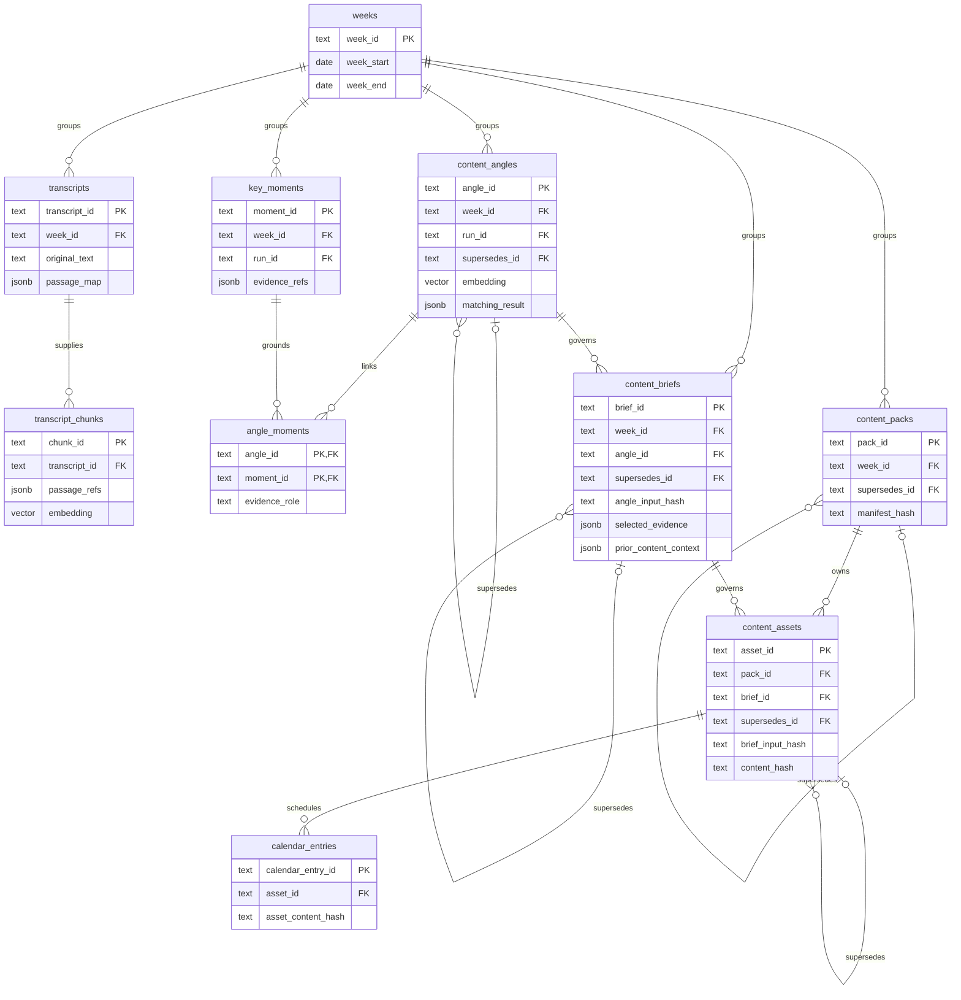
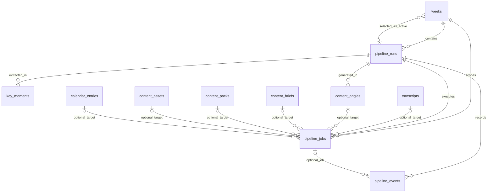
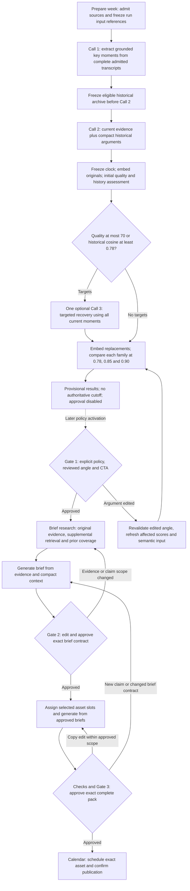

# Content Atelier — approved schema and pipeline data flow

Approved design · 9 October 2026 · [Complete DBML](content-atelier-compact.dbml) · [Execution diagram](data-flow.html)

This document maps the approved **13-table schema** to the execution pipeline. The baseline is applied locally. The new weekly workflow implements historical comparison and one optional refinement pass through provisional review, while legacy two-call behavior is preserved. Three cutoffs are reported without selecting an authoritative one; comparison Gate 1 approval is disabled. External execution remains disabled. Brief research, structured writing/validation and Gate 2 are implemented and verified offline; production and calendar execution remain later stages. The authoritative comparison policy is still unset. See [brief implementation status](implementation-status-content-briefs.md). See the [runbook](backend/STORAGE.md), [comparison reasoning](implementation-plan-historical-comparison.md) and [storage/retrieval reasoning](content_atelier_vectordb.md).

## 1. One database, two vector columns

All thirteen tables belong to one PostgreSQL database. pgvector adds a searchable vector column to two existing content tables; it does not create a second database or an independent copy of content.

| Table | Actual data retained | Pipeline or UI consumer |
|---|---|---|
| `weeks` | Seven inclusive calendar dates, active run, overall state and coverage notes | Weekly workspace and source grouping |
| `transcripts` | Original text, source link, stable passage map, known metadata and use restrictions | Complete weekly extraction and original evidence inspection |
| `transcript_chunks` | Contextual search text, original passage references and **embedding** | Supplemental evidence discovery during brief research |
| `key_moments` | Validated Call 1 moments and supporting/context/qualification references | Call 2, angle evidence inspection and brief grounding |
| `content_angles` | Validated arguments, scores, matching results, **embedding**, CTA, edits and approval | Historical novelty evaluation, angle cards and Gate 1 |
| `angle_moments` | Angle-to-moment relationship with evidence role | Exact grounding and reverse content lineage |
| `content_briefs` | Consumed angle hash, generated/edited contract, selected evidence, prior context, gaps and approval | Gate 2 and production instructions |
| `content_packs` | Production grouping, manifest hash, checks and approval | Pack workspace and Gate 3 |
| `content_assets` | Assigned deliverables, governing brief/hash, actual copy and checks | Parallel production, editing and scheduling |
| `calendar_entries` | Exact asset/hash, channel, planned time and confirmed publication | Calendar and actual prior publication context |
| `pipeline_runs` | Requested execution scope, frozen input references, trigger and overall state | Run selector and overall progress/failure summary |
| `pipeline_jobs` | Actual stage/target, running step, measured progress, attempts, lease and output references | Live processing updates, retries and recovery |
| `pipeline_events` | Meaningful timestamped milestones, warnings and failures | Process history |

The only persistent vectors are `content_angles.embedding` and `transcript_chunks.embedding`, both `vector(1536)`. Model selection, retrieval defaults, timezone, credentials and prompt/configuration versions remain in application configuration. Provider identity on a transcript records its actual source, which is needed for evidence resolution.

## 2. SQL relationships

These diagrams split the **30 foreign-key relationships** into content relationships and execution relationships. Their entity names correspond to the approved DBML. The DBML remains the complete column/check specification.

### Content and evidence relationships



### Execution and visibility relationships



A job may have at most one target; a week-level job has none. Run/week consistency, a selected active run's week, and an event's job/run agreement require application validation or later SQL enforcement beyond these individual foreign keys.

## 3. Execution and gates



The graph shows dependencies. The current comparison run completes at provisional review with a threshold-pending message. Legacy runs retain their existing selection/Gate 1 contract. Chunk preparation/encoding is independent of extraction; all 329 existing Week 1/2 chunks have compatible vectors after the separately authorized encoding operation. Hybrid brief retrieval and Gate 2 are implemented offline behind disabled switches; no real brief or approval has been generated. Missing angle/history vectors pause comparison and produce no qualified counts.

## 4. Data supplied and stored at each phase

| Phase | Supplied data | Persistent output | Vector role |
|---|---|---|---|
| Prepare week | Authorised source input, date grouping and existing source identity | `weeks`, `transcripts`, `pipeline_runs.input_refs`; chunks when prepared | Build chunk embeddings for later search |
| Call 1: moments | Complete admitted original transcripts, known passage locations and restrictions | `key_moments.moment_body/evidence_refs` | None; nearest passages are not a replacement for whole-week extraction |
| History context | Complete eligible earlier arguments; current moment/evidence hashes | Frozen IDs/hashes/signatures/qualifications in job `result_refs` | No embedding call to retrieve generation hints |
| Call 2: angles | All validated current moments, deduplicated exact passages, complete compact history | Every valid `content_angles` original, `angle_moments`, fixed post-Call-2 evaluation clock | Build/resolve canonical signature vectors after generation |
| Initial assessment | Original vectors, independent baseline quality, entire frozen history | Candidate metrics, separate quality/overlap diagnoses and target IDs | Exact scan; no permanent suppression |
| Call 3: refinement | Targets/reasons, historical arguments/raw similarities, all current moments including unused ones, other proposals | Zero/one replacement per target; own rows/links; `supersedes_id`; dispositions/artifacts | Encode only replacement signatures; same angle model, separate disabled capability |
| Final comparison | Originals/replacements with their own quality/evidence/vector and the same archive/clock | Three scenario selections/counts in `result_refs`; provisional `matching_result` | Full archive maximum cosine; scenario-specific current-batch flags |
| Gate 1 | Comparison snapshots and original/refined evidence; later policy/CTA | Edits and comparison reassessment; approval disabled until later activation | Compatible cache reuse; editing cannot bypass comparison ownership |
| Brief research | Exact approved angle/hash and its original moments; allowed supplemental sources and relevant prior coverage | Prepared packet; optional compact job checkpoint; selected packet saved with a real brief draft | Hybrid chunk discovery plus a separate prior-angle semantic search |
| Brief draft / Gate 2 | Selected original evidence, compact prior coverage, known gaps, editorial rules and CTA | `content_briefs` body, `selected_evidence`, `prior_content_context`, `research_gaps` and approval | Retrieval has already supplied the packet; the brief itself has no embedding |
| Assign / produce assets | Approved brief/hash, selected slots, evidence contract and format rules | `content_packs` and `content_assets` bodies/hashes/checks | No routine fresh retrieval; new claims return to briefing |
| Checks / Gate 3 | All assigned assets, governing current brief hashes and validation findings | Asset checks, pack manifest/checks and hash-bound pack approval | None |
| Calendar / publication | Approved pack, exact asset/hash, channel and chosen time | `calendar_entries` and actual publication confirmation | No immediate vector search; SQL publication facts enrich future retrieved angle context |

Every phase updates its actual `pipeline_jobs` row. `pipeline_runs` supplies overall scope/state, and `pipeline_events` records meaningful milestones. Independent brief/asset jobs can run concurrently without overwriting a single shared “current stage.”

Research is not a fabricated empty brief. Because `content_briefs.content_body` is required, prepare the evidence packet in the research job and save it with a valid generated draft. If restartable research needs a checkpoint, `pipeline_jobs.result_refs` can hold the selected IDs and compact summaries actually produced; it must not duplicate entire transcripts or provider responses.

## 5. Exact evidence and reverse history

The SQL/JSON chain for the chosen angle is:

```text
content_angles.angle_id
  -> angle_moments
  -> key_moments.evidence_refs
  -> transcripts.transcript_id + passage_map
  -> exact original_text ranges, speakers and available timestamps
```

The first two relationships are SQL foreign keys. Transcript/passage references inside JSON are compact application-validated references, not automatic foreign keys. Evidence resolution must verify that the transcript exists, the passage/range belongs to its stable map, and the source is allowed for this use.

Supplemental search returns `transcript_chunks`. Its `passage_refs` identify original passages, then overlapping `key_moments.evidence_refs` identify moments associated with that particular evidence. Follow `angle_moments` into prior angles, briefs, assets and confirmed calendar records. Sharing a meeting ID alone does not make every moment from that meeting relevant.

This reverse route is complemented by an independent semantic search of prior angle signatures. Earlier coverage can express the same argument using entirely different transcripts. Both routes contribute compact prior argument/use/difference summaries to `content_briefs.prior_content_context`, with real IDs and known publication state.

The brief retains selected evidence and relevant prior context, not every search hit. Preserve qualifications and conflicts alongside supporting excerpts. Missing or inaccessible history and material budget omissions remain explicit gaps rather than an inferred “no previous content.”

## 6. Edits, hashes and visibility

Draft editing uses the content row's body and edit columns. An approval is bound to the approved content hash, authenticated actor and time. Hashes cover all approval-relevant content, including the selected CTA/evidence/assignments, not merely visible text.

Approved or already consumed records stay stable. Save an edited replacement in the same content table using `supersedes_id`, and clear the new record's approval until reviewed. This keeps actual content lineage without a separate version registry. Edited copies of the same angle preserve `first_generated_at`; a newly generated similar argument is not automatically a superseding copy.

An angle edit can invalidate its evaluation and approval. A brief pins `angle_input_hash`; each asset pins `brief_input_hash`; the pack pins ordered exact asset IDs/hashes and governing brief references; calendar entries pin `asset_content_hash`. Consumers must check these dependencies before work or approval. An old approved result does not authorise a changed input.

Assets have one owning pack. If a consumed pack must change, create a replacement pack and corresponding asset records. This is the compact schema's explicit trade-off instead of another pack-membership table.

## 7. Scope and implementation boundaries

No policy-version, embedding-profile, editorial-cycle, topic-vector, moment-vector, retrieval-session, evidence-packet or review-history table is required by this approved scope. Configuration stays outside the content database. Sources, evidence, user edits, decisions and execution facts remain because a pipeline/UI consumer actually uses them.

The compact design does require careful JSON validation and protection of cited originals. Source updates create new transcript records with changed hashes; parser/chunk changes must preserve already cited passage locations/chunks. A later privacy/withdrawal capability must enforce use restrictions and retention explicitly; this schema does not invent a withdrawal history.

The thirteen tables also do not define a global import catalogue for externally published legacy content. Authorised legacy examples may be included as labelled URL/excerpt context in a brief; do not fabricate internal angle/brief lineage to force them into `content_assets`. Missing legacy coverage must be disclosed.

Embedding dimensions, cosine thresholds, freshness weights and research budgets still need corpus evaluation. The baseline, durable angle worker, comparison reports and approval guards are implemented locally. Production retrieval and semantic calibration remain unimplemented/unverified. See the [current comparison contract](implementation-plan-historical-comparison.md) and [briefing provenance design](research/briefing-provenance-and-prior-content-context.md).


## Brief implementation checkpoint — 12 October 2026

The five per-angle jobs are `brief_prepare`, `brief_research`, `brief_context`, `brief_writing` and `brief_validation`. Their scopes do not replace the weekly active run or weekly review state. Approval queues the first intent atomically when briefing is enabled. The request freezes approved angle/CTA/steer, brand, original source ranges, allowed archive, query/argument vector contracts and prior-use records. Missing/incompatible vectors fail visibly; cosine and full-text rank are discovery signals, not factual confidence.

The writer receives mandatory inherited grounding, selected supplemental passages with restored qualifications, compact actual prior arguments/briefs/calendar facts and explicit gaps. A scoped support/differentiation review plus deterministic source/quote/number/status checks permits one repair. Gate 2 creates superseding edits, answers, human review and permission records, and binds approval to the exact brief hash. No pack or calendar work is queued. Full execution details and verification are in [brief implementation status](implementation-status-content-briefs.md).
