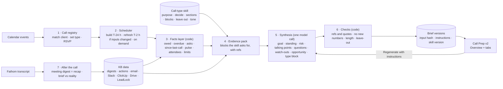

# Call Preparation: architecture

**Date:** 12 November 2026
**Status:** Proposed. Nothing here is implemented beyond what §10 lists as built.
**Inputs:**
- `kb_tab_scope/05-call-preparation.md` (decisions C1–C7)
- the v2 mock (`frontend/src/views/CallPrepV2.tsx`, `#calls-v2`)
- `docs/SOLUTION_ARCHITECTURE.md` §8.6, §9.2 and B.4
- 13 real call-prep briefs posted by Viktor in client Slack channels (Aug–Oct), read for what WIA expects. **They are not used as data.**
- the KB's real data (calendar, Fathom, Gmail, Slack, ClickUp, Drive, LeadLock)

---

## 1. What the component must do

For every scheduled client call, give the host a **short brief shaped by the type of call**. After the call, close the loop.

The brief answers one question: *what do I need to know, ask and settle on this call?* It replaces Viktor's morning call prep, which WIA values but finds too long and unaware of call type.

**Not in scope:**
- Sales calls. A prospect is not yet a client.
- Viktor's posts as an input. This was decided for this design.
- Live ad-platform numbers, until a source is approved (§4.3).

---

## 2. What "good" looks like: lessons from Viktor's briefs

Viktor posted 13 call-prep briefs between Aug 19 and Oct 28. Each was posted at 7:30–7:45 CT on the day of the call, in the client's Slack channel. Each had two parts:
1. a **headline post**: about 1,000 characters, exactly three numbered points, @-mentioning the host;
2. a **full brief in the thread**: 700–1,300 words in numbered sections.

The usual sections were:
- what this call has to decide;
- performance for the last 30 days against the 30 before, per channel;
- CRM/LeadLock pipeline;
- tracking and configuration flags;
- open items and owners;
- a suggested talk track;
- what it could not verify.

Follow-up calls got a "what changed since the last brief" version instead of a repeat.

| Keep (what WIA valued) | Fix (what the host complained about, 22 Sep) |
|---|---|
| A **"what this call has to decide / is actually for"** line up front | **Too long:** "a lot of reading to sift through". The KB gives a 30-second overview, with detail in tabs |
| **Three-point headline**: the job of the call, the key facts, the main risk | **Suggests needless work:** "tells me things I need to do that really don't need to be done". Each call type has a *Leave out* list |
| **Relationship context**: "read the room first", reacting to the client's last email | **Not aware of call type:** a strategy call differs from an onboarding call. Each type has its own skill |
| **Internal flags marked "not for the client"** | **No memory of calls:** Viktor can't read transcripts. The KB can: Fathom transcripts become meeting digests (Call 1) |
| **Who is attending** and whether the client accepted the invite | **Its own errors** (four public corrections). The KB writes no number it can't trace (§6.5) |
| **Open items with owners** from ClickUp | Only the main host's calendar is covered. The KB covers every host's calls |
| **Suggested talk track**, 5–6 steps, each with a why | |
| **"What I could not verify"** stated plainly | |
| **Delta mode** for a follow-up call | |

About 60% of each Viktor brief is live Google Ads and Meta metrics. The KB has no ad-platform source (§4.3). Its strategy briefs must say so, rather than leave a silent hole.

---

## 3. Shape of the component



There are two rules, taken from the architecture document and kept here:
- **Code computes, the model synthesises.** Lists, counts, dates and who owes what come from queries. The model chooses what matters, says why, and writes the few sentences a person reads first.
- **One model call per automatic brief**, over a pack that code assembles. Its cost and content are predictable. Only a user's "regenerate with instructions" may let the model fetch more, in a bounded loop.

---

## 4. Data intakes

### 4.1 Intakes and how each is prepared

| # | Intake | Where it comes from | Prepared by code into | Call types that use it | Available today |
|---|---|---|---|---|---|
| 1 | **The call** | Calendar event: title, start and end, organiser, attendees **with RSVP** (`accepted`, `declined`, `needsAction`), recurrence, conference link, description | Call record: client, type (rule or proposed), host, attendees split into WIA and client, "client hasn't accepted" flag, previous call of the same type | All | Yes: 72 client events, 14 upcoming. RSVP is stored per attendee |
| 2 | **Previous meeting digests** (Call 1 output) | Fathom transcripts → `meeting_digest` | Decisions, commitments with owner and date, open client asks, topics covered or left open, all cited to transcript segments | All, and *Last call* | Built, AI off. **Only 5 Fathom recordings so far**; Zoom transcripts aren't connected |
| 3 | **Open actions** | ClickUp tasks for the client, plus KB proposals (`action_candidates`) | We owe and they owe, overdue, blocked, due before the call, and anything promised on the last call that is still open | All | Yes: ClickUp is live. Proposals need the AI on |
| 4 | **Unanswered client asks** | Digest `open_asks`, email `open_asks` | Quoted asks with who, when and source, plus how long they've waited | All | Needs the AI on (email extraction) |
| 5 | **Client email since the last call** | Gmail pointers; bodies read live when the brief is built | Thread subjects, who wrote, and whether we replied (the "awaiting our reply" check, done in code), plus authored text for the model | All | Yes, as pointers. Bodies are read on demand and never stored |
| 6 | **Internal Slack since the last call** | The client's Slack channel(s), team messages only | Team updates, decisions and blockers, labelled internal | Strategy, creative, LeadLock | Yes |
| 7 | **History since the last call** | The merged History events (one per conversation, meeting or task change) | A dated timeline split into client and internal: the *What changed* tab | All (strategy, check-in, creative) | Yes, built 6 Nov |
| 8 | **Client profile** | The 16 fixed Profile fields (questionnaire answers until the AI fills them) | Fields named by the skill: voice and words to avoid for creative, offer and ideal client for messaging | Messaging, creative, kickoff | Partly: filled from questionnaires by rule |
| 9 | **Questionnaire answers** | Drive questionnaire documents | Questions and answers by topic; unanswered questions | Ads kickoff, messaging interview | Yes, for Sheets and Docs questionnaires |
| 10 | **Onboarding progress** | ClickUp onboarding lists (Phase fields, `Role` = Client) | Phase, steps done and left, what's waiting on the client, access checklist items | Ads kickoff, LeadLock kickoff, onboarding | Yes |
| 11 | **Lead outcomes** | LeadLock read model | Inquiries, tours and won for the last 30 days against the 30 before; awaiting reply; pipeline stages. Aggregates only, never couples' details | Strategy, LeadLock check-in | Yes, for linked sub-accounts |
| 12 | **Account team and people** | Roster, account teams, approved contacts | Who's who on both sides; who decides; preferences (KB reading, later) | All | Yes, partly confirmed |
| 13 | **Support issues** | Support tab (AI from email and Slack) | Open issues, repeats, waiting on client | Strategy, LeadLock, check-in | Not yet (AI) |
| 14 | **Coverage** | Source states and last-sync times | "What this brief couldn't see": no transcript of the last call, LeadLock not linked, email not read since… | All | Yes |
| — | Ad-platform performance | Google Ads and Meta | — | Strategy | **No source** (§4.3) |
| — | Viktor's posts | Slack | — | — | **Excluded by decision** |

### 4.2 What "since the last call" means

The window starts at the **previous held meeting with this client**. That is a past calendar event or a Fathom recording, whichever is later. If there is none, it starts 30 days back.

Follow-up calls inside 10 days use **delta mode**: the brief covers only what changed since the previous brief and links to it, as Viktor's follow-up briefs did.

### 4.3 The ad-performance gap

WIA's strategy calls revolve around spend, leads and cost per lead. The KB can't read Google Ads or Meta: paid media is not an approved source, and Viktor is excluded. The options are:

| Option | What the strategy brief shows | Cost |
|---|---|---|
| **A. Leave it out** (recommended for v1) | The pulse shows "Ads: not connected"; the brief uses LeadLock lead outcomes; the talk track asks the account manager to bring the ads numbers | None |
| B. Connect Google Ads (MCC) and the Meta Marketing API, read-only, as new sources | The full performance tab: per-channel spend, leads, cost per lead, 30 against 30 days | WIA's approval of a new source. Two connectors |
| C. Paste or upload the monthly report | Numbers from the monthly report the account manager already prepares | A manual step per client per month |

The design keeps a `performance` block in the skill format, so B or C fills it later without changing the skills.

**Update, 12 Nov: option B is built** as read-only scripts (`backend/services/ads/`, `kb ads ...`), not an MCP. It waits for WIA's credentials and the mapping of each ad account to a client. Until then the pulse says "Not connected".

---

## 5. Call-type skills

A **skill** is one file per call type. It tells the facts layer which blocks to load, and tells the model what this call is for, what to say and what to leave out. Skills are what make briefs type-aware, which Viktor's weren't.

### 5.1 Where they live

- **Seeded** from `backend/services/callprep/skills/*.md`, in the repo and versioned.
- **Editable** in the app: the mock already has a "Call-type skills" dialog. Edits are saved as new versions in a `call_skills` table, with who changed them and when. With three or four trusted users, version history is enough; there is no approval flow (architecture §9.2).
- **Every brief records the skill and the version it used**, so a changed skill marks the affected upcoming briefs *Changed since built*.

### 5.2 The format

```markdown
---
key: strategy
name: Monthly strategy
detect: ["monthly strategy", "strategy call", "strategy meeting", "monthly meeting"]
not_if: ["consultation", "demo", "coffee chat"]   # sales or intro calls: out of scope
sections: [standing, settle, changed, last_call, owed, asks, performance, points, questions, watch, opportunity, limits]
blocks:
  last_call_of_type: true
  since_last_call: { lanes: [Communication, Meetings, Commitments, Work delivered], max: 25 }
  owed: true
  asks: true
  email_since: { max_threads: 12 }
  internal_slack: { max: 30 }
  leads: { period_days: 30 }
  support: true
  profile: [What success means, How WIA will judge it]
  performance: optional        # filled when an ads source exists (§4.3)
length: { thirty: 3, points: 5, questions: 3, watch: 2 }
model: { reasoning: low }
---
## Purpose
Review the month with the client and agree what happens next.

## This call must decide
Whether the plan for next month changes (budget, focus, creative), based on how inquiries
are converting into tours and bookings.

## Agenda skeleton
1. The client's open questions first
2. What we delivered and what's next
3. Results and what they mean
4. Decisions needed

## Leave out
Onboarding detail. Tasks the client doesn't need to hear about. Internal tooling issues unless
they affect results (mark these internal).

## Guidance
Start with the client's open questions. Explain results in plain language against the playbook
thresholds and label interpretations. If the client's last email signals stress or bad news,
say so first and suggest a lighter call ("read the room"). One opportunity at most, only if a
stated client need supports it.

## Type-specific block: Results & lead outcomes
- Inquiries, tours, won: last 30 days against the 30 before (from the leads block)
- Ads: "not connected" unless the performance block is filled
```

### 5.3 The seed skills

Each starts from the call-type table in the scope document, §4.

| Skill | Detect (title contains) | This call must… | Key blocks | Type-specific block | Leave out |
|---|---|---|---|---|---|
| **Ads kickoff** | ads kickoff | Get access, owners and dates; set expectations | onboarding, questionnaire status, people, owed | Access checklist (ads accounts connected?), what was sold | Performance, strategy opinions, price |
| **Onboarding kickoff** | onboarding, kickoff, welcome | Agree who does what and the first milestones | onboarding, people, owed, questionnaire | Onboarding steps waiting on the client | Results |
| **Messaging & positioning interview** | messaging, positioning | Fill the gaps in the client's story, couples, offer and voice | questionnaire, profile (all), asks | Questionnaire answers by topic; unanswered questions | Ads, unrelated actions |
| **LeadLock kickoff** | leadlock kickoff | Plan the LeadLock build | onboarding (LeadLock), people, digests mentioning CRM, support | CRM and setup facts: current CRM, who answers inquiries, forms and calendar | Ads strategy |
| **Monthly strategy** | strategy, monthly meeting | See §5.2 | See §5.2 | Results & lead outcomes | Onboarding detail |
| **Creative review** | creative | Approve what's ready; set the next delivery date | owed (creative tasks), profile (voice, words to avoid), digests | Pending approvals and voice notes | Lead numbers |
| **Check-in** | check-in, check in | Find what's blocking them; one concrete next step | asks, owed, since-last-call, support | What's waiting on whom | Programme-wide news |
| **Office hours (group)** | office hours | One line per expected member | per-member asks and commitments (members' own parts only) | Members expected | One member's details shown to another |
| **Default / other** | (fallback) | Summarise context and what's owed; ask for a type | since-last-call, owed, asks | — | — |

Real calendar titles mostly match these. Two patterns need care:
- **Sales calls.** "Ads Consultation", "LeadLock Demo", "Coffee Chat" and a bare "Strategy Call with <person>" before any engagement are excluded by `not_if`, or by "no engagement started yet" in code.
- **Ambiguous titles** get *Needs type*. The model proposes a type from the title, description and attendees; the host confirms it in one click. The confirmed type is stored in `call_overrides`.

---

## 6. Processing

### 6.1 Call registry (code)
1. **Match the event to a client.** First by an attendee being an approved contact, then by a client alias in the title. Several matches make a group call; no match goes to *Unmatched*, assignable by a person.
2. **Set the type.** By the skill's `detect` and `not_if` patterns, a stored override, or the proposal model. An unconfirmed proposal is labelled *proposed*.
3. **Read the attendees.** WIA and client attendees, RSVP state, and whether the host is the viewer.
4. **Link the previous held meeting** (any type, and the same type) and its digest.

### 6.2 Scheduler
Triggers are taken from the scope document §6 and the architecture document §8.6:

| Trigger | Action |
|---|---|
| A call starts within 24 h and has no brief | Build v1 with its skill |
| 2 h before the call | Rebuild **only if the pack's input hash changed**: a new email, an action change, a new digest |
| A new client email, an action change, the call moved, or the skill edited | Mark *Changed since built*. The previous version stays visible |
| Call cancelled | Mark the brief *not applicable*; delete nothing |
| A user clicks *Regenerate with instructions* | Build a new version now. Later automatic rebuilds keep those instructions |
| Morning, 7:00 in WIA time | Digest of today's calls, one line each from the briefs' 30-second section (in app; Slack DM later) |
| The Fathom transcript arrives | After-the-call (§6.7) |

### 6.3 Facts layer (code, no model)

These parts of the brief are **computed and inserted by code**, never written by the model:

| Brief part | How it's computed |
|---|---|
| Header | Call record (§6.1) |
| Account pulse | Leads: LeadLock 30-day inquiries and tours. Delivery: our overdue count. Client: unanswered asks, last contact, awaiting our reply. Ads: "not connected" (§4.3) |
| Settle on this call | Overdue items we owe; quoted unanswered asks; items they owe due before the call; anything blocked. Ranked: late, then asks, then waiting |
| We owe / they owe | Open actions, overdue first |
| Promised on the last call, and where it stands | Last digest's commitments joined to the actions they became |
| What changed | History events since the last call, split into client and internal |
| Attendance risk | "Client hasn't accepted the invite" or "declined" |
| Sources & limits | Coverage: no transcript, LeadLock not linked, email not read since… |

### 6.4 Evidence pack
- Code loads only the blocks the skill asks for, each with a character budget. Every line carries a ref (`[T12]` transcript, `[E3]` email, `[S5]` Slack, `[A4]` action, `[H7]` history, `[D2]` digest, `[C1]` calendar), as the built AI layer already does.
- **Facts are given to the model as facts, already computed**: the owed list, the counts and the pulse. The model can select from them and cite them, but cannot change them.
- The pack's **input hash** covers the skill version, the instructions and every block. It decides whether a rebuild is needed and stops a call ever being paid for twice.

### 6.5 Synthesis (the one model call)

The model writes only what needs judgement:

| Field | What the model decides |
|---|---|
| `goal` | "This call must…": the skill's *this call must decide*, made specific to this client now |
| `standing` | Where things stand, in one sentence |
| `risk` | The main risk for this call, or none |
| `talking_points` | Up to N, in order, each with **why** it's there and its refs; the client's open asks first |
| `questions` | Only where the pack shows a real gap (a missing profile field, unclear ownership, an unanswered questionnaire item) |
| `watch_outs` | Sensitive topics, promises not to make, things to acknowledge; each marked **internal** or **ok to say** |
| `opportunity` | At most one, only when a stated client need supports it, with refs |
| `type_block` | The skill's type-specific facts, selected from the pack |
| `changed_highlights` | The 3–5 changes worth reading first, chosen from the History timeline |

**Model:** Claude Sonnet 5.5 with low reasoning. The task combines facts that are already structured, and the quality of the writing matters. The pack is about 8–20k tokens.

**Prompt:** the shared evidence rules, then the skill file (purpose, decide, agenda skeleton, leave out, guidance, length), then any user instructions, then the pack.

### 6.6 Checks (code, before anything is stored)
- **Refs and quotes.** Every line cites refs that were in the pack. A quoted ask matches its source word for word (the built `validate.py` already does this).
- **No new numbers.** Every figure in the model's text must appear in the pack. This reuses the idea of Content Atelier's `digits_in` / `figures_in` check (`cycle/verification.py`). It is the safeguard against the kind of error Viktor had to correct four times.
- **Length.** The caps from the skill: 3 lines for the 30-second view, the cap on talking points, and so on.
- **Leave out.** A line matching the skill's leave-out topics is dropped and logged.
- A failed check drops the line, or rejects the whole brief if the 30-second view fails. One repair call is allowed.

### 6.7 After the call
When the Fathom recording is matched to the call (same time window and attendees), the existing **`meeting_digest`** (Call 1) is the recap: decisions, commitments, open asks and a recap email draft. Code adds **brief vs reality**: which talking points were covered, which asks were answered, and what the call changed in the open actions. The digest becomes the next brief's *Last call*. **No transcript** is stated as such; it never reads as "nothing was agreed".

### 6.8 Regenerate with instructions
The user's text ("focus on why leads dropped", "bullets only", "the LeadLock specialist is joining, add the LeadLock setup") goes to the same call with a **bounded tool loop**: at most 4 calls to `get_email(thread)`, `get_slack(since, until)`, `get_transcript(meeting, minutes)` and `get_history(lane, since)`. Semantic search is added when the search index exists.

The instructions are stored with the version, shown at its top, and reused by automatic rebuilds. They can **narrow or refocus**, never widen past approved sources: "check their website" is refused with the reason, as in the mock.

---

## 7. Output

### 7.1 The brief, mapped to the v2 screen

| v2 screen | Part | Written by |
|---|---|---|
| Overview: hero | *This call must*, *Where things stand*, *Main risk* | Model (`goal`, `standing`, `risk`) |
| Overview: pulse chips | Ads, Leads, Delivery, Client | Code |
| Overview: Settle on this call | Late items, unanswered asks, waiting items | Code |
| Overview: What changed | The top changes | Model selects, code supplies the facts |
| Overview: Talking points, Watch-out | First 3, and the top 1 | Model |
| Tab: Last call | Decisions, promised and where it stands now, left open | Digest + code |
| Tab: What's changed | The full timeline, client and internal | Code |
| Tab: Performance | Lead outcomes; ads when a source exists | Code |
| Tab: Asks & owed | We owe, they owe, quoted asks | Code |
| Tab: Talking points | All points, questions, watch-outs, opportunity, type block | Model |
| Tab: Sources | Every cited source; what the brief couldn't see | Code |

### 7.2 Stored record

`call_briefs`:
- **Identity:** call id, version number, *current* flag.
- **What built it:** skill key and version, instructions, input hash.
- **Content:** the model's output, the code-computed facts, refs.
- **Run:** checks, built at, built by (auto or a person), state (*Ready*, *Changed since built*, *Not applicable*).

The run cost goes in `ai_runs`, as today.

### 7.3 Delivery
- **In the app:** the Call Prep queue and the brief. The client record's Meetings tab links to them.
- **Morning digest:** in the app first. A Slack DM to the host goes through the outbound guard later.
- **Send agenda to client:** a draft only; a person sends it (decision C4).

---

## 8. Cost

These are planning figures that assume the per-call caps already set in the code (Sonnet about $3 in and $15 out per million tokens). OpenRouter's live prices were not checked.

| Item | Tokens | Cost per brief |
|---|---|---|
| Automatic brief | ~15k in, ~2k out | ~$0.08 |
| One rebuild at T-2 h (only when inputs changed) | Same | ~$0.08 |
| Regenerate with instructions (up to 4 tool calls) | ~30k in, ~3k out | ~$0.15 |

At about 15 client calls a week, that is **about $3–5 a week**. Viktor's call prep cost about 1,800 credits (~$4.57) **per brief**.

---

## 9. Where this follows or departs from `SOLUTION_ARCHITECTURE.md`

| Topic | Architecture | This design |
|---|---|---|
| One model call over a code-built pack; templates with context blocks; counts by code | §8.6, B.4 | **Followed** |
| Build 24 h ahead, rebuild at 2 h only if the hash changed; versions; instructions kept | §8.6 | **Followed**. The built sweep uses 36 h; this changes it to 24 h |
| Regenerate with a bounded tool loop | §8.6 (search tool) | Followed, with fetch tools until search exists |
| `brief_templates` editable in Settings, no approval | §8.6, §9.2 | Followed, named **call-type skills** (the mock's term), seeded from repo files |
| `classify_call` when no pattern matches; `call_overrides` | §7.4, A.3 | Followed. Adds `not_if` patterns for sales calls |
| Recap = `write_recap` from meeting notes | §8.6 | Uses the built **`meeting_digest`** as the recap; brief vs reality is computed by code |
| Brief sections: "In 30 seconds" + template sections + "not seen" | B.4 | Same content, laid out as the v2 Overview + tabs |
| `search:<query>` context blocks | §8.6 | Later, when the search index exists |
| Viktor run in parallel for two weeks, then switched off | §9.2 | Kept as the exit test. Viktor's briefs are compared, never used as input |
| Ads performance | Not addressed | Called out as a gap with options (§4.3) |

---

## 10. What exists today and what is needed

| Piece | State |
|---|---|
| Calendar intake with RSVP; client matching via contacts | Built |
| Call type by title regex (`services/ai/call_types.py`) | Built. Needs `not_if`, overrides and the proposal model |
| `call_brief` skill: one prompt for all types; Brief contract shaped like the mock | Built, AI off. Needs per-type skill files and the facts/model split |
| Context blocks (transcript digests, actions, email, Slack, leads) with refs and quote checks | Built in `services/ai/context.py` and `validate.py` |
| Sweep: T-36 h, rebuild at T-2 h if stale | Built. Move to T-24 h and hash-based rebuilds |
| `meeting_digest` as the recap | Built, AI off. Only 5 transcripts so far |
| History timeline for *What changed* | Built 6 Nov |
| Facts layer computed by code (§6.3) | **To build.** The mock computes these in the browser today |
| Skill files, `call_skills` versions, the skills editor saving to the backend | **To build.** The editor is a mock that saves to the browser |
| `call_briefs` versions, instructions, *Changed since built* state | **To build** |
| Number check (§6.6) | **To build**, reusing the Content Atelier approach |
| Regenerate tool loop | **To build** |
| Call Prep v2 reading real briefs | **To build.** The live portfolio already carries the `callMeta` brief fields |
| Ads performance source | **Decision needed** (§4.3) |

**Suggested order:**
1. Facts layer and the call registry with no AI. That alone makes the queue, pulse, settle, owed, what-changed and sources tabs real.
2. Skill files and the synthesis call, with the checks.
3. Versions, regenerate and the morning digest.
4. After the call and brief vs reality.

---

## 11. Decisions needed

| # | Question | Recommended |
|---|---|---|
| 1 | Ads numbers in strategy briefs (§4.3) | A for v1; decide B |
| 2 | When briefs are built: 24 h ahead or the morning of the call (Viktor posted at 7:30 the same day) | Build 24 h ahead; morning digest at 7:00 |
| 3 | Who can edit skills | Any of the 3–4 users, with version history |
| 4 | Whether to post the brief to the client's Slack channel, as Viktor did | Not in v1 (read-only rule); in the app plus the morning digest |
| 5 | Sales-call detection: titles such as "Strategy Call with <person>" before an engagement starts | Exclude by `not_if` plus "no engagement yet"; the host can override |
| 6 | Connecting Zoom transcripts (most past calls are Zoom) | Needed for good *Last call* coverage; Zoom admin app blocker |
