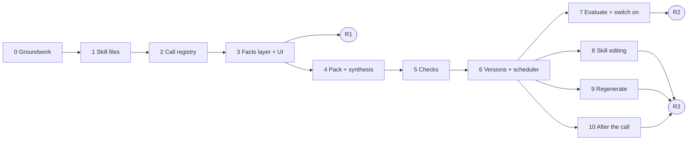

# Call Preparation: implementation plan

**Date:** 12 Nov 2026
**Builds:** the design in [`CALL_PREPARATION_ARCHITECTURE.md`](CALL_PREPARATION_ARCHITECTURE.md). Section references written as "arch §6.3" point there.
**Status:** built on 12 Nov (see §7), AI still off. Ad platforms were added as Stage A.

---

## 0. How to read this plan

The work is split into **11 stages (0–10)** that ship in **three releases**. Each stage can be merged and deployed by itself, and each one leaves the app working.

| Release | Stages | What a person sees | Model calls |
|---|---|---|---|
| **R1: Real call prep, no AI** | 0–3 | The real call queue, with type, host and RSVP. Pulse, *Settle on this call*, *Asks & owed*, *What changed*, *Last call* (from existing digests) and *Sources & limits*, all from live data | None |
| **R2: AI briefs** | 4–7 | The hero (*This call must*, *Where things stand*, *Main risk*), talking points, questions, watch-outs, the type block. Versions, *Changed since built*, today's calls | One call per brief |
| **R3: Control and the loop** | 8–10 | Skills edited in the app, *Regenerate with instructions*, and the recap with *brief vs reality* | Plus regenerate and the recap additions |

**Why this order.** About two thirds of the v2 screen is computed by code (arch §7.1). Building that first has three effects:
- People get a useful screen before any model spend.
- The facts the model needs are tested on their own.
- When the model arrives it only adds judgement on top of facts already shown to be right. The main failure in Viktor's briefs was wrong numbers. Under this plan a number can never come from the model unchecked: Stage 3 makes the numbers and Stage 5 enforces that rule.



Stages 8, 9 and 10 depend only on Stage 6. They can be built in any order, or at the same time on separate files.

---

## 1. Principles the plan holds to

1. **Code computes, the model synthesises** (arch §3). A count, date, owner or status in the brief comes from a query. The model selects, orders, explains and phrases.
2. **One model call per automatic brief**, over a pack built by code. A tool loop is allowed only when a person regenerates with instructions (Stage 9).
3. **Facts are live; prose is versioned.** Code-computed facts are recomputed at every portfolio refresh, so *Asks & owed* is always current. The model's text is stored as versions, and each version keeps a copy of the facts it was written from. When the current facts differ from those, the brief shows *Changed since built* and says why.
4. **Degrade, never blank.** With the AI off, over budget, failing checks or without a provider, the call shows a **facts-only brief**. That is the R1 screen, labelled as such.
5. **Reuse before building.** Most of the AI plumbing already exists in `services/ai/` (OpenRouter client with ZDR, one schema repair, budget cap, `ai_runs`, refs, quote checks, sweep, worker lane). Call prep plugs into it rather than creating a second AI path.
6. **No Viktor data as input.** Viktor's briefs are used only in Stage 7, as a comparison for people to read.
7. **Privacy rules carry over unchanged:**
   - lead outcomes as aggregates only;
   - Gmail bodies read live and never stored;
   - nothing posted to Slack or ClickUp (the outbound guard stays as it is);
   - no client or staff names in the repo (test fixtures use invented names).

---

## 2. What exists and what each stage touches

### 2.1 Reused as is

| Piece | Where | Used by stage |
|---|---|---|
| Calendar intake with attendees and RSVP; calendar events associated to clients | intake, `record_associations` | 2 |
| Context blocks with refs (`open_actions`, `client_emails`, `slack_posts`, `previous_digest`, `activity`, `meeting_decisions`, `leads_summary`, `calendar_event`, `last_meeting_before`) | `services/ai/context.py` | 3, 4 |
| `Refs`, `Block`, `People` | `services/ai/context.py` | 4 |
| OpenRouter call: strict schema, one repair, ZDR, no fallbacks | `services/ai/openrouter.py` | 4 |
| `prepare` / `run` / `_store`, budget refusal, `AiRefused` | `services/ai/runner.py` | 4 |
| Quote and ref checks (`Checker`, `exact_quote`, `MIN_WORDS`) | `services/ai/validate.py` | 5 |
| AI sweep in the worker (`analysis` lane) | `services/ai/sweep.py`, `workers/runner.py` | 6 |
| `meeting_digest` (recap) | `services/ai/skills.py` + prompts | 10 |
| History events (`activity`) | `services/read_models/portfolio.py` | 3 |
| Portfolio read model, `request_refresh`, ETag route | `services/read_models/portfolio.py`, `routes/portfolio.py` | 3, 6 |
| Team gate and `actor()` | `routes/access.py` | 2, 8, 9 |
| Call Prep v2 screen, Regenerate and Skills dialogs (mock) | `frontend/src/views/CallPrepV2.tsx` | 3, 6, 8, 9 |

### 2.2 Replaced

| Today | Replaced by | Stage |
|---|---|---|
| `services/ai/call_types.py` (types as Python constants, title regex only) | Skill files and a loader | 1 |
| `CallBrief` contract (`thirty`, `since`, `asks`, `agenda`…, all written by the model) | `CallBriefV2`. Asks, owed and since become code facts; the model writes only judgement fields | 4 |
| `call_brief.system.md` / `.user.md` (one prompt for every type) | Shared rules plus the skill body | 4 |
| Call part of `sweep.due()` (T-36 h; rebuild if any record changed) | `callprep.schedule.due()` (T-24 h; rebuild only when the fingerprint changed) | 6 |
| Pulse, settle and owed computed in the browser from sample modules | Server facts in the portfolio payload (live build); the sample build keeps its sample computation | 3 |
| Skills dialog saving to localStorage | `call_skills` API (live build) | 8 |

### 2.3 New package layout

```
backend/services/callprep/
  skills/              *.md seed skill files (Stage 1)
  skill_files.py       parse, validate and load skills (Stage 1; DB versions in Stage 8)
  registry.py          calendar event → Call (Stage 2)
  facts.py             facts layer (Stage 3)
  pack.py              evidence pack + input fingerprint (Stage 4)
  checks.py            numbers, length, leave-out (Stage 5)
  briefs.py            versions, state, Changed since built (Stage 6)
  schedule.py          what should be built now (Stage 6)
  regenerate.py        instructions + bounded tool loop (Stage 9)
  after.py             recording ↔ call match, brief vs reality (Stage 10)
  present.py           shapes for the portfolio payload and the API
backend/routes/callprep.py    override, versions, regenerate, skills (Stages 2, 6, 8, 9)
```

The model call stays in the existing runner. Call prep supplies the `call_brief` prepare step and the post-checks. That keeps the budget, `ai_runs`, worker lane and failure handling in one place.

### 2.4 Database changes

Each change is a separate migration, owned by the stage that needs it. Today's head is **c10** (`meeting_links`). The numbers below assume no other migration lands first; take the next free revision when the stage starts.

| Migration | Table | Stage |
|---|---|---|
| c11 | `call_overrides` | 2 |
| c12 | `call_briefs` | 6 |
| c13 | `call_skills` | 8 |

The column lists are given in each stage.

---

## Stage 0: Groundwork

**Goal:** start on a clean, committed base with the open decisions settled, so the call-prep diff can be reviewed by itself.

**Work:**
1. **Commit the 5–12 Nov work first.** It is uncommitted on `mvp` today. Leave out the real-name files listed in the session notes:
   - the exported HTML;
   - `kb_tab_scope/tobeaskedinnextcall.md` and `Action_Register_analysis.md`;
   - the one line in `implementation-stages-status.md`;
   - the `mvp/real_index.html` changes.

   Call prep changes `portfolio.py`, `runner.py`, `sweep.py`, `contracts.py` and `CallPrepV2.tsx`, all of which already carry uncommitted changes. Mixing the two makes both unreviewable.
2. **Confirm the decisions this plan depends on** (arch §11). The plan uses the recommended defaults, so none of them blocks Stage 1:

   | # | Decision | Default this plan uses | Blocks |
   |---|---|---|---|
   | D1 | Ads numbers | A: "Ads: not connected"; a `performance` block reserved | Nothing |
   | D2 | Build time | T-24 h, rebuild at T-2 h if the fingerprint changed | Stage 6 setting only |
   | D3 | Who edits skills | Any team user, with version history | Stage 8 |
   | D4 | Post to the client's Slack | No, in v1 | Nothing |
   | D5 | Sales calls | `not_if` patterns plus "no engagement started yet"; overridable | Stage 2 |
   | D6 | Zoom transcripts | Not in v1; *Sources & limits* says "no transcript" | Nothing |
   | D7 | Named sign-in | Not in v1: `built_by` / `edited_by` record the shared actor plus the self-chosen "viewing as" name, labelled as such | Stages 8, 9 |
   | D8 | WIA's time zone for "today" and the morning list | **Needs an answer.** Stored as a setting, `WIA_TIMEZONE` | Stage 6 |

3. **Coordinate the "awaiting our reply" rule** with the session that owns the deferred portfolio fixes. Call prep needs the same rule (pulse and settle). Whoever builds it first puts it in one shared function (proposed: `services/read_models/replies.py: awaiting_reply(s, business) -> list[Thread]`), and the other reuses it.
4. **Test fixtures.** Add a fixture builder for a client with an engagement, approved contacts, calendar events (accepted, declined and needsAction attendees, one cancelled), ClickUp tasks, Gmail pointers, Slack posts, a Fathom recording with a digest `ai_run`, and LeadLock aggregates. All names are invented. Every later stage tests against it.

**Done when:** `mvp` has the earlier work committed, D8 is answered, and the fixture builder exists with one smoke test.
**Size:** about half a day.

---

## Stage 1: Skill files and loader

**Goal:** call types become files a person can read and edit, and the single source for detection, blocks, lengths and guidance.

**Why before the registry:** the registry's type detection uses each skill's `detect` and `not_if`. With the loader in place first, the registry is written once against the final format.

**Build:**
- `services/callprep/skills/*.md`: the 9 seed skills from arch §5.3, in the format of arch §5.2:
  - `ads_kickoff`, `onboarding_kickoff`, `messaging_interview`, `leadlock_kickoff`, `strategy`, `creative_review`, `check_in`, `office_hours`, `default`.
  - Content is carried over from `call_types.py` (purpose, agenda, leave out, guidance, type block) and the scope document §4.
- One addition to the arch §5.2 format, **`leave_out_terms`**: a short list of words and phrases for the code check in Stage 5. The prose *Leave out* section is for the model; a code check needs explicit terms.
- `skill_files.py`:
  - `SkillSpec` (pydantic). Fields:
    - `key`, `name`, `detect`, `not_if`, `sections`, `blocks`, `length`, `leave_out_terms`;
    - `model` (`reasoning`, optional `id`);
    - `body`, and `sections_md`: a dict of the `##` headings.
  - `parse(text) -> SkillSpec`: frontmatter with PyYAML (already installed), body split on `##` headings. A clear error names the field.
  - `load_all() -> dict[key, SkillSpec]`, cached. Each spec carries `ref` = `"file:" + sha256(text)[:12]`. Stage 8 changes this to a DB version without changing callers.
  - `detect(title) -> SkillSpec | None` and `excluded(title) -> bool`:
    - first `not_if` match → excluded;
    - otherwise the first `detect` match, in a fixed order with the most specific first (the file's `order:` field);
    - otherwise `default`.
- **Replace `call_types.py`.** It has three users: `portfolio.py` (`detect(title).key`), `context.call_type(ct)` and the runner. `context.call_type` takes the spec instead. Delete `call_types.py` once nothing imports it.
- **Allowed block names**, so a typo in a skill is an error rather than a silently missing block:
  - `last_call_of_type`, `since_last_call`, `owed`, `asks`, `email_since`, `internal_slack`, `leads`, `support`;
  - `profile`, `questionnaire`, `onboarding`, `people`, `performance`.

**Tests** (`tests/services/test_callprep_skills.py`):
- Every seed file parses.
- Unknown block, missing key and duplicate key each give a named error.
- Detection table, with the real title shapes using invented names:
  - "Monthly Strategy Call" → strategy;
  - "Ads Consultation", "LeadLock Demo", "Coffee Chat" → excluded;
  - "Creative Review" → creative;
  - "Check in" → check-in;
  - "Something else" → default.
- `ref` changes when the file text changes.

**Done when:** the portfolio still builds with the same `type` keys for today's 14 upcoming calls, now from the files, and `call_types.py` is gone.
**Size:** 1.5 days (most of it writing the 9 skills well).
**Risk:** title patterns are tuned on today's 72 events only. Stage 2's override covers misses; Stage 7 measures the miss rate.

---

## Stage 2: Call registry

**Goal:** turn a calendar event into a **Call** with the client, type, host, attendees and RSVP, the previous meeting, and whether call prep applies at all. A person can correct each of these.

**Data, c11 `call_overrides`.** One row per calendar event a person corrected:

| Column | Type | Notes |
|---|---|---|
| `record_id` | uuid PK, FK `source_records` | The calendar event |
| `call_type` | text null | A skill key |
| `business_id` | uuid null, FK `businesses` | Client for an unmatched event |
| `host_person_id` | uuid null, FK `people` | |
| `excluded` | bool null | true = not a client call (sales, internal); false = include despite `not_if` |
| `set_by`, `set_at`, `note` | | Who set it, when, and why |

**Build** (`registry.py`):

`Call` (dataclass) has the following fields:
- `record_id`, `call_id`, `title`, `starts_at`, `ends_at`, `cancelled`, `conference_url`
- `business` (or `None`), `match` (`contact`, `alias` or `override`), `group_members` (several clients)
- `skill` and `type_source` (`title`, `override` or `default`)
- `host` and `host_source` (`organiser`, `first WIA attendee` or `override`)
- `wia_attendees` and `client_attendees`, each with `response`
- `attendance_risk` (`client_not_accepted` or `client_declined`)
- `excluded` and `excluded_reason`
- `previous_meeting` and `previous_same_type`: record ids with dates

Rules:
1. **Client.**
   - Use the existing `record_associations` first; that is the contact-based match the intake already made.
   - Then a client alias in the title.
   - Then the override.
   - Several clients make a group call (office hours). None puts the call under **Unmatched**.
2. **Type.** Override → `skill_files.detect(title)` → `default`. The type source is shown in the UI ("Calendar title", "Set by a person", "Needs type").
3. **Excluded** (D5). Override, or `excluded(title)`, or **no engagement started on or before the call date**. Sales calls with prospects have no engagement, which catches the bare "Strategy Call with <person>". Excluded calls are listed under a collapsed *Not client calls* with a one-click "this is a client call".
4. **Host.**
   - The organiser, if they are WIA staff (roster).
   - Otherwise the first WIA attendee who accepted.
   - Otherwise "Not set".
   - The override wins over both.
   - Today `portfolio.py` hard-codes "Not set", which breaks the *My calls* filter.
5. **Attendees.** Staff are those in the roster or on WIA's domains; everyone else is the client side. Fixes for the RSVP check:
   - A client attendee with `declined` sets attendance risk "declined".
   - All client attendees on `needsAction`, within 24 h of the call, set it to "not accepted".
6. **Previous meetings.**
   - Whichever is later: the last past calendar event of this client that was not cancelled, or the last Fathom recording. `context.last_meeting_before` already does this; reuse it and return the record as well.
   - The same again for the same type, where one exists.
7. **Call id.** Change `cal-<hex[:12]>` to `cal-<full uuid hex>` so the write routes can resolve it. The frontend uses the id only as a key and in the URL hash. Check `kbLive.ts` and the hash router.

**API** (`routes/callprep.py`, behind `require_team`):
- `PUT /api/v1/calls/{call_id}/override` with body `{call_type?, client_slug?, host_person_id?, excluded?, note?}`. It validates the skill key, client and person, then upserts, then calls `portfolio.request_refresh`.
- `DELETE /api/v1/calls/{call_id}/override`.

**Portfolio:** `calls` / `callMeta` come from `registry.upcoming(s, now, days=14)` instead of the inline loop at `portfolio.py` around lines 870–905. Unmatched and excluded calls are added as separate lists.

**Frontend** (`CallPrepV2.tsx`, `kbLive.ts`, `types.ts`):
- The type chip shows its source. *Needs type* opens a picker that saves through the override route.
- A *Host* picker.
- An *Unmatched* group with a client picker.
- *Not client calls* (collapsed).
- RSVP dots per attendee.
- *My calls* works now that host is real.
- The sample build keeps its sample data. Add the new fields to `calls.ts` samples so the mock still renders.

**Tests:**
- Registry over the fixture:
  - contact match; alias match; unmatched; group call;
  - cancelled call kept but flagged;
  - each exclusion path (title, no engagement, override both ways);
  - host order; RSVP risk;
  - previous meeting by calendar and by recording.
- Route tests: validation, refresh requested, and 404 for an unknown call.

**Done when:** on the local copy of the real data, every one of the 14 upcoming calls has a client or is under Unmatched; sales titles are under *Not client calls*; host is set where the organiser is staff; and a type correction made in the UI survives a portfolio refresh.
**Size:** 2 days.
**Risks:**
- **Calendar coverage.** Only connected calendars are seen (today the hello@ account). A call booked only on a staff member's own calendar doesn't exist for call prep. *Sources & limits* says which calendars are read.
- **Recurring events.** Check in this stage whether each instance is its own `source_record`. If an override has to apply to a series, add `series_id` then, not before.

---

## Stage 3: Facts layer and the real screen (Release 1)

**Goal:** everything in arch §6.3 is computed by code and shown in Call Prep v2, with no model calls. This is Release 1.

**Build** (`facts.py`). `facts(s, call: Call, now) -> CallFacts`. Each item carries refs to the records behind it, so the Sources tab and later the model can cite them:

| Part | Computed from | Notes |
|---|---|---|
| `window` | `previous_meeting.date` or 30 days back (arch §4.2) | "Since the last call" everywhere |
| `pulse.leads` | LeadLock read model: inquiries and tours, 30 days against the 30 before | Aggregates only. "Not linked" when there's no sub-account |
| `pulse.delivery` | Open actions we own: overdue count, due before the call | From ClickUp tasks (`open_actions` query, without the text budget) |
| `pulse.client` | Unanswered asks (digests and email candidates), days since last client contact, awaiting our reply | Awaiting-reply rule from Stage 0, item 3 |
| `pulse.ads` | Always "Not connected" (D1) | The `performance` block stays empty |
| `settle` | Overdue items we owe → quoted unanswered asks → items they owe due before the call → blocked items. Ranked in that order, capped at 6 | arch §6.3 |
| `owed.we` / `owed.they` | Open actions split by owner side, overdue first | Owner side from the ClickUp assignee (staff or not) and `Role` = Client |
| `promised_last_call` | The last digest's `commitments`, each joined to the action it became (`action_candidates` → task) with its current state | "No transcript of the last call" when there isn't one, never "nothing promised" |
| `changed` | History events in the window, split into client and internal lanes | The existing `activity` events, filtered by date |
| `attendance` | From the registry | |
| `limits` | Coverage: last sync per source; no transcript of the last call; LeadLock not linked; email last read; calendars read; "Ads: not connected" | Shown in the Sources tab and as the hero's footnote |

Rules:
- **Facts are pure reads.** No writes, no network. Email bodies are not read here; the pointers are enough for counts and the awaiting-reply rule.
- **One function per part**, each tested alone. A failure in one part makes that part "unavailable", never the whole call.

**Portfolio:**
- `callMeta[call_id].facts = present.facts(...)`, built in `portfolio.build`.
- Cost: a handful of queries per upcoming call. With 14 calls that is fine. If refresh time grows past a few seconds, batch the queries per client.

**Frontend:**
- In the live build, CallPrepV2 reads `facts` for the pulse chips, Settle, *Asks & owed*, *What changed*, *Last call* (`promised_last_call`, and the digest's decisions where present), and Sources.
- The browser computations stay for the sample build only. Wrap them as `sampleFacts(call)` so the two builds share one rendering path.
- With no brief text, the hero shows a **facts-only header**:
  - the call type's *This call must decide* from the skill, as written;
  - the settle count;
  - the attendance risk;
  - the label "Brief text not built: AI is off".

  The `Brief not built yet` note from `portfolio.py` is replaced by this.

**Tests** (`test_callprep_facts.py`):
- One test per part over the fixture: window with and without a previous meeting; leads with and without LeadLock; settle ranking and cap; owed split; promised joined to the action state; and no transcript.
- A portfolio test checks that `facts` is present for each upcoming call and that no couple fields appear in it. Reuse the existing privacy assertion style from `test_portfolio_story.py`.

**Done when** (Release 1):
- The deployed app shows real facts for every upcoming client call with `AI_MODE=off`.
- A person can check three calls by hand against ClickUp and Gmail and find the settle and owed lists right.

**Size:** 3–4 days (about 1.5 backend, 1.5 frontend, 0.5 checking against real data).
**Risks:**
- **Owner side of ClickUp tasks.** Tasks are mostly assigned to a shared support user (memory: ClickUp usage profile), so "they owe" depends on `Role` = Client. Where that is missing, the item is listed as "owner unclear" rather than guessed.
- **Asks** come only from digests and email candidates, which need the AI on. Under R1 the asks list is empty and says why ("Needs the AI layer").

---

## Stage 4: Evidence pack and synthesis

**Goal:** one model call per brief, driven by the call's skill, writing only the judgement fields over a pack that code builds.

**Build:**

`pack.py`:
- `build(s, call, facts, skill, instructions=None, fetch=None) -> Pack` with `system`, `user`, `refs`, `fingerprint`.
- **Blocks are loaded only if the skill lists them**, each with a character budget from the skill (`max`), using the existing context functions:

  | Skill block | Context function |
  |---|---|
  | `last_call_of_type` | `previous_digest` (same type first) |
  | `owed` | `open_actions` |
  | `email_since` | `client_emails` (bodies read live through `fetch`, never stored) |
  | `internal_slack` | `slack_posts` |
  | `since_last_call` | `activity` (filtered by the window and the skill's lanes) |
  | `leads` | `leads_summary` |
  | `profile` | Profile fields by name |
  | `questionnaire` / `onboarding` | Their read models |

  The two blocks that have no function yet (questionnaire status by topic, onboarding phase) are added here as small context functions.
- **Facts go first, labelled as computed.** The prompt says that settle, owed, counts and pulse are fixed; the model may select from them and cite them but not change them.
- **Fingerprint.** A canonical hash (`services/shared.canonical_hash`) of:
  - skill ref, instructions, and call start and end time;
  - the facts;
  - for every block, the record ids and version ids it used.

  It is computed from **pointers, not bodies**, so the scheduler can check it every sweep without reading Gmail. The components are kept alongside the hash, so Stage 6 can say *what* changed.

Contract (`contracts.py`): `CallBriefV2` replaces `CallBrief`. Every model-written field:

| Field | Shape | Rules |
|---|---|---|
| `goal` | str | "This call must…", specific to this client now |
| `standing` | str | One sentence |
| `risk` | str or null | Null when there is no real risk |
| `talking_points` | list of `{text, why, refs[]}` | Client's open asks first; capped by `length.points` |
| `questions` | list of `{text, gap, refs[]}` | Only from a real gap in the pack |
| `watch_outs` | list of `{text, audience: internal or ok_to_say, refs[]}` | |
| `opportunity` | `{text, need_ref, refs[]}` or null | |
| `type_block` | list of `{label, value, ref}` | Only from the pack |
| `changed_highlights` | list of H refs, 3–5 | Code renders the events |
| `declined` | str or null | Used only by regenerate, to refuse instructions that widen sources (Stage 9) |

Asks, owed and since are no longer written by the model: they are facts. `present.brief` maps the new contract to the shape the screen reads, with `thirty` = [standing, goal, risk], so the frontend changes little.

Prompts:
- `prompts/call_brief.system.md`: the shared evidence rules (`_evidence_rules.md`) plus call-prep rules:
  - facts are fixed;
  - every line cites a ref;
  - no number that isn't in the pack;
  - mark internal-only items;
  - follow the skill's length;
  - if the last client email signals stress or bad news, say so in `risk` and suggest a lighter call.
- `prompts/call_brief.user.md`, assembled in this order:
  1. the skill (Purpose, This call must decide, Agenda skeleton, Leave out, Guidance, type block);
  2. instructions, if any;
  3. the call header;
  4. the facts;
  5. the blocks.

Runner:
- The `call_brief` branch of `runner.prepare` calls `callprep.pack.build`.
- The model comes from the skill (`model.id`, else `AI_MODELS["call_brief"]`, else Sonnet 5.5), with the skill's reasoning level.
- `max_tokens` stays capped (about 2.5k out).

**Tests:**
- A pack snapshot for a strategy and a creative call over the fixture: only the listed blocks, budgets respected, facts first, refs in reading order.
- The fingerprint is unchanged when a record outside the blocks changes, and changes when an email arrives in the window.
- The contract round-trips through `strict_schema`.
- A runner test with a fake client confirms that `ai_runs` is written and the skill ref is recorded in `checks`.
- No test calls OpenRouter.

**Done when:** for 3 real upcoming calls on the local copy, `kb ai run call_brief <record>` (an existing CLI path, or a small new one) produces a valid `CallBriefV2`, with the pack at or under about 20k tokens. A person reads the three packs and confirms nothing irrelevant or private is in them.
**Size:** 3 days.
**Risks:**
- **Pack size on busy clients.** The skill budgets cap it; the snapshot test catches a block that ignores its budget.
- **Contract change.** Old `call_brief` `ai_runs` won't match the new shape. `present.brief` reads by contract version and drops the old shape (they were never shown: the AI has been off).

---

## Stage 5: Checks

**Goal:** nothing the model wrote reaches a person unless it passes code checks. Wrong numbers, invented quotes, over-long output and leave-out topics are caught before storing.

**Build** (`checks.py`, called from `validate.check` for `call_brief`, after the schema check the OpenRouter call already does):

| Check | How | On failure |
|---|---|---|
| **Refs** | Every ref in a line exists in `pack.refs` (`Checker`, already built) | Drop the line |
| **Quotes** | Quoted text matches its source exactly, at least `MIN_WORDS` words (built) | Drop the line |
| **No new numbers** | Strip ref labels (`[E12]`). Every figure in a line (`figures_in`) must have its digits in the pack's digits (`digits_in` over facts and block texts). Copied from Content Atelier's `cycle/verification.py` with its source noted; about 20 lines, not imported across projects | Drop the line; log the figure |
| **Length** | The skill's `length` caps: talking points, questions, watch-outs, 3–5 highlights | Truncate to the cap (ordered by the model) |
| **Leave out** | A line containing any of the skill's `leave_out_terms` (case-insensitive, word boundary) | Drop the line and log it |
| **Highlights** | `changed_highlights` refs must be H refs in the window | Drop the bad ones |
| **Core** | `goal` and `standing` both survive. Applied to `goal`, `standing` and `risk`, a failed number or ref check is a core failure | **One repair call** listing the failures, then reject |

Outcome:
- **Passed:** stored with `checks.dropped = [...]`.
- **Rejected after repair:** the run is stored as failed with the reasons, and the call keeps showing the facts-only brief or the previous good version. A person can see why in the Sources tab ("Brief text failed checks: invented figure in *Where things stand*").

**Repair.** The existing `openrouter.call` repairs only schema errors. Add one content repair in the runner for core failures:
- the same messages, plus "These statements failed checks: … Rewrite only goal, standing and risk";
- counted in the same `ai_runs` row's cost.

**Tests** (`test_callprep_checks.py`) use hand-written outputs, no model:
- an invented "$1,200" when the pack has "$1,100" → dropped;
- a date-derived "3 weeks" not in the pack → dropped. This is deliberate: say it with dates from the pack instead;
- "30 days" present in the pack → kept;
- ref labels not mistaken for figures;
- a leave-out term in a talking point → dropped;
- over-long lists truncated;
- a core failure → repair requested, then reject.

**Done when:** across the Stage 4 sample runs, the drop log has been read, the number check caught nothing true (no false positives worth fixing), and any real invention was caught.
**Size:** 1.5 days.
**Risk:** the number check is strict, and may drop good lines that do simple arithmetic. That is accepted: the cost is a missing line, not a wrong one. The drop rate is watched in Stage 7, and the prompt is tuned if one kind of drop is common.

---

## Stage 6: Versions, scheduler and "today"

**Goal:** briefs are built at the right time, kept as versions, marked *Changed since built* with reasons, never paid for twice, and listed for the day.

**Data, c12 `call_briefs`:**

| Column | Type | Notes |
|---|---|---|
| `id` | uuid PK | |
| `record_id` | uuid FK `source_records` | The calendar event |
| `version` | int | 1, 2…; unique with `record_id` |
| `is_current` | bool | Partial unique index on `record_id` where true |
| `skill_key`, `skill_ref` | text | `file:<sha>` until Stage 8, then `db:<version>` |
| `instructions` | text null | Stage 9 |
| `fingerprint` | text | The hash |
| `inputs` | jsonb | The fingerprint components, used for the *what changed* reasons |
| `facts` | jsonb | The facts the model saw |
| `output` | jsonb null | `CallBriefV2` after checks; null when rejected |
| `refs` | jsonb | Ref → source, for the Sources tab |
| `checks` | jsonb | Dropped lines and repair state |
| `ai_run_id` | uuid FK `ai_runs` | Cost and model live there |
| `trigger` | text | `first`, `final`, `regenerate` or `skill_changed` |
| `built_by` | text | `auto`, or the actor plus the viewing-as name (D7) |
| `outcome` | text | `ready` or `rejected` |
| `built_at` | timestamptz | |

**Not stored, derived on read:**
- *Not applicable*: the call is cancelled or excluded.
- *Changed since built*: the current fingerprint differs from the version's.

Deriving these means a stale state column can never disagree with reality. Nothing is deleted when a call is cancelled.

**Build:**
- `briefs.py`:
  - `save(s, call, pack, run, output, checks, trigger, built_by)` inserts a version and moves `is_current`. Only a `ready` version becomes current; a rejected one is kept for its reasons.
  - `state(call, current, fingerprint_now)` returns `ready`, `changed` (with reasons) or `not_applicable`.
  - `reasons(old_inputs, new_inputs)` gives plain phrases: "2 new client emails", "1 action changed", "call moved to Thu 3pm", "skill edited", "new meeting digest".
- `schedule.py`. `due(s, now)` replaces the call part of `ai/sweep.due`:

  | Condition | Enqueue | Marker |
  |---|---|---|
  | Applies, starts within `AI_BRIEF_LEAD_HOURS` (default 24, was 36), no ready version | Build | `first` |
  | Starts within 2 h, current version built before T-2 h, **fingerprint differs** | Rebuild | `final` |
  | Skill file or skill version changed, call within the lead window | Rebuild | `skill_changed` |
  | Cancelled or excluded | Nothing | — |

  Fingerprints are computed by code only, at each AI sweep, for calls inside the lead window (about 14). The sweep enqueues on the existing `analysis` lane with a dedupe key `ai:call_brief:<record>:<fingerprint[:12]>`. The same inputs therefore never enqueue twice, which is the "never paid for twice" rule.
- **Job.** The runner's `call_brief` path ends with `briefs.save`, then `portfolio.request_refresh`.
- **Portfolio.** `callMeta[call_id]` carries:
  - `brief`: the current version, shaped;
  - `versions`: the number, built at, trigger, built by and instructions of each;
  - `state` and `changedReasons`.
- **Versions route.** `GET /api/v1/calls/{call_id}/briefs` lists versions, and `GET /api/v1/calls/{call_id}/briefs/{version}` returns one. The portfolio carries only the current version.
- **Today** (in app; the Slack DM waits for D4 and outbound). A *Today* strip at the top of the Call Prep queue: today's calls in `WIA_TIMEZONE`, one line each from `standing` (or the facts-only header), plus the settle count and attendance risk. No new job is needed: it is a view over the payload.

**Frontend:**
- A version picker in the brief header ("v2 · built 9:14 by auto · instructions: …").
- A *Changed since built* banner with the reasons, and a "Rebuild now" button. That button is regenerate without instructions, so it waits for Stage 9; until then it is hidden.
- *Not applicable* styling for cancelled calls.
- The Today strip.

**Tests:**
- `due()` over a fake clock:
  - T-30 h nothing;
  - T-23 h first;
  - T-90 min with an unchanged fingerprint nothing;
  - with a new email in the window, final;
  - cancelled nothing;
  - a skill change.
- Dedupe: two sweeps enqueue once.
- `save` moves `is_current`; a rejected version doesn't.
- `state` derives each case; reasons text for each component type.
- Settings: `AI_BRIEF_LEAD_HOURS` default 24.

**Done when:** on the local copy, with a fake model client, a day's calls get one build each, a simulated email arrival before T-2 h gives exactly one rebuild with the right reason, and cancelling an event shows *Not applicable* with the version still readable.
**Size:** 2.5 days.

---

## Stage 7: Evaluation, comparison and switch-on (Release 2)

**Goal:** show the briefs are right and useful on real calls before they're switched on in production, and set the spend limits.

**Work:**
1. **Back-test locally, on the local copy of the real data, with `AI_MODE=live` on the local machine only.**
   - Pick 10 past client calls that have a Fathom recording or an email follow-up, across at least 4 call types.
   - Build each brief **as of 24 h before the call**: `prepare` already takes `now`, so the pack and facts filter by `occurred_at <= as_of`.
   - **Known leak:** ClickUp task state and the Profile are current, not as of then. Mark these packs "partly current" and don't score items that depend on later task changes.
2. **Score each brief.** The account owner of that client, or Jainil, uses a short sheet:

   | Measure | Target for switch-on |
   |---|---|
   | Statements that are false | **0** in 10 briefs (any one is a stop) |
   | Invented numbers reaching the screen | **0** (should be impossible after Stage 5) |
   | Right client and type | 10/10 after overrides |
   | Settle list matches what mattered on the call (checked against the recording or follow-up) | ≥ 8/10 |
   | "Would use as is, or with light edits" | ≥ 7/10 |
   | Missed something critical the pack contained | ≤ 1/10 |

3. **Compare against Viktor**, for people only. For the calls where a Viktor brief exists (13 in the DB), put the two side by side in a local file outside the repo (it contains names). Note what Viktor had that the KB brief lacked, and why:
   - ads metrics (expected: D1);
   - missing data;
   - a skill gap.

   Fix skill gaps in the skill files. Viktor's text never enters a pack.
4. **Tune.** Change the skills and prompts from what the scoring finds. Re-run only the briefs affected (the fingerprint includes the skill ref, so they rebuild).
5. **Switch on in production:**
   - `AI_MODE=live` and `OPENROUTER_API_KEY`;
   - `AI_MONTHLY_BUDGET_USD`: planning figure about $5 a week for call prep (arch §8), so set $40 a month to cover the other skills as well;
   - a worker with `WORKER_LANES` including `analysis`;
   - `WIA_TIMEZONE`.

   Then follow the Railway runbook in the README. After a day, check `ai_runs` cost per brief and the drop log.
6. **Parallel run for two weeks** (arch §9): Viktor keeps posting, and the team uses the KB brief. At the end, the owner decides whether to switch Viktor's call prep off. That decision is outside this plan.

**Done when:** the targets are met on the back-test, production builds briefs for a full day with cost per brief recorded, and the owner has the comparison.
**Size:** 2–3 days of work, plus the two-week parallel run on the calendar.
**Risks:**
- **Only 5 Fathom recordings.** Few calls have a *Last call* digest, so the back-test leans on email, Slack and ClickUp. Scores on clients with transcripts and without should be reported separately, so the transcript gap is visible rather than averaged away (D6).
- **The model or provider may be unavailable under ZDR.** The runner fails closed and the screen falls back to facts-only, which Release 1 already proved.

---

## Stage 8: Skill editing in the app

**Goal:** the team edits a call type's skill in the app, with version history, and briefs record which version they used.

**Data, c13 `call_skills`:**

| Column | Type | Notes |
|---|---|---|
| `id` | uuid PK | |
| `key` | text | |
| `version` | int | Unique with `key` |
| `is_current` | bool | Partial unique index on `key` where true |
| `text` | text | The whole skill file |
| `source` | text | `seed` or `edit` |
| `seed_sha` | text null | For seed rows |
| `edited_by` | text | Actor plus viewing-as name |
| `note` | text null | |
| `created_at` | timestamptz | |

**Build:**
- **Seeding.** `kb callprep seed-skills`, also run at app start:
  - for a key with no rows, insert the repo file as v1 `seed`;
  - if the repo file changed and the current version is a `seed`, insert the new seed version;
  - if the current version is an `edit`, **do not overwrite**: log "repo skill changed but has edits in the app", and show it in the editor as "A newer default is available".
- `skill_files.load_all()` reads current DB versions, falling back to the files when the table is empty. `ref` becomes `db:<key>:<version>`.
- Routes:
  - `GET /api/v1/call-skills`: current versions;
  - `GET /api/v1/call-skills/{key}/versions`;
  - `POST /api/v1/call-skills/{key}` with `{text, note}`. It parses with `SkillSpec`; a bad file gets a 422 naming the field, so a broken skill is never saved.
  - `POST /api/v1/call-skills/{key}/revert/{version}`, which copies that version as a new one.
  - New call types: `POST` with a new key. The loader rejects a `detect` pattern that duplicates another skill's.
- A skill change makes upcoming briefs of that type rebuild through the Stage 6 `skill_changed` rule, within the lead window only.

**Frontend:**
- The Skills dialog in the live build loads and saves through the routes.
- It shows the version list with who and when, a diff against the previous version, and "Revert".
- Form fields: name, detect, not_if, sections, blocks and lengths. The prose sections are free text. The raw file is also editable for power users.
- The sample build keeps localStorage.

**Tests:**
- Seeding (new; repo change over a seed; repo change over an edit → no overwrite).
- Save with a bad block → 422. Revert.
- Duplicate detect → rejected.
- A brief built after an edit records `db:<key>:<n>`.
- The scheduler queues `skill_changed` for an upcoming call of that type only.

**Done when:** a person changes the strategy skill's guidance in the app, the next strategy brief records the new version, and reverting restores the old text as a new version.
**Size:** 2 days.
**Risk:** with no named sign-in (D7), `edited_by` is self-declared. That is acceptable for 3–4 trusted users and labelled as such in the UI.

---

## Stage 9: Regenerate with instructions

**Goal:** a person refocuses a brief in plain words, and the model may fetch a little more from approved sources in a bounded loop. The instructions stay with the version and are reused by later automatic rebuilds.

**Build:**
- **Spike first (half a day).** Confirm that Sonnet 5.5 through OpenRouter with ZDR and `allow_fallbacks=False` supports tool calls **and** a strict JSON final answer. If the ZDR providers don't support tools, fall back to a **two-pass** design that needs no tools:
  1. pass 1 (Haiku) reads the instructions and the pack's index of refs, and returns which extra items to fetch (max 4);
  2. code fetches them;
  3. pass 2 is the normal synthesis with those items added.

  The rest of this stage is the same either way.
- `openrouter.py`:
  - `call_with_tools(contract, tools, handlers, max_tool_calls=4, ...)`;
  - the existing `call` stays as it is;
  - tool messages and usage are added up across turns into one `Answer`.
- `regenerate.py`. The tools are scoped to the call's client and the window, and each returns refs. They all reuse context functions:

  | Tool | Returns |
  |---|---|
  | `get_email(thread_ref)` | The thread's authored text, read live |
  | `get_slack(since, until)` | Client channel posts |
  | `get_transcript(meeting_ref, from_min, to_min)` | Transcript segments |
  | `get_history(lane, since)` | History events |

  A tool asked for another client's data, or for a source outside the approved list, returns an error the model sees, and code logs it.
- **Instructions:**
  - stored on the version (`call_briefs.instructions`) and shown at its top;
  - later automatic rebuilds of the same call reuse the latest instructions unless the person clears them;
  - included in the fingerprint.
- **Widening refused.** The prompt lists the approved sources, and there is no tool for anything else (web, ads, other clients). The model fills `declined` with the reason ("The KB can't read websites; ask the account manager"). The dialog shows that reason, as the mock already does.
- **Route.** `POST /api/v1/calls/{call_id}/briefs` with `{instructions?}`:
  - enqueues `call_brief` with trigger `regenerate` on the `analysis` lane and returns `202 {work_id}`;
  - refuses with `409` when AI is off or the budget is reached, saying which.
- **Frontend:**
  - the Regenerate dialog posts, then polls `GET /calls/{id}/briefs` every 3 s for up to 2 minutes until a new version appears, and selects it;
  - "Rebuild now" in the *Changed since built* banner posts without instructions;
  - a "Clear instructions" link appears on versions that have them.

**Tests:**
- With a fake client scripted to call tools:
  - the tool limit is enforced (a 5th call is refused and the final answer is forced);
  - a cross-client ref is refused;
  - instructions are stored and reused by an automatic rebuild, then cleared;
  - `declined` comes through;
  - the route returns 409 with AI off.
- The Stage 5 checks still apply, and fetched items count as pack evidence.

**Done when:**
- "Focus on why inquiries dropped" on a real strategy call produces a version whose talking points lead with the leads facts, using at most 4 fetches.
- "Check their website" is declined with a reason.
- The next automatic rebuild keeps the focus.

**Size:** 2.5 days (including the spike).
**Cost:** about $0.15 per regenerate (arch §8). Counted against the same monthly budget.

---

## Stage 10: After the call

**Goal:** close the loop. The recording's digest becomes the recap and the next brief's *Last call*, and the brief is compared with what actually happened.

**Build** (`after.py`):
- **Match a recording to a call.** A Fathom recording matches a calendar event of the same client when:
  - the start times are within 30 minutes; and
  - at least one attendee email is shared.

  The match is stored, not recomputed each time. Reuse `meeting_links` if its meaning fits (check its use first). Otherwise add a nullable `calendar_record_id` on the digest's `ai_runs.checks`; no new table.
- **Recap:** the existing `meeting_digest`, with no change. Call Prep shows it on the held call, and the next call's *Last call* reads it (Stage 3 already does).
- **Brief vs reality**, computed by code at read time:

  | Item | How |
  |---|---|
  | Asks answered | Settle asks that the digest lists as answered, or that no longer appear as open asks |
  | Promises made on the call | Digest commitments, joined to the actions they became |
  | Actions changed since the call | ClickUp state changes after the call's end |
  | Talking points covered | Add the brief's talking points (text only) to the `meeting_digest` pack. Add one field to its contract: `brief_points_covered: [index]`. A small change to an existing call, not a new one |

- **No transcript:** the held call shows "No recording found for this call", never "nothing was agreed". The *Link recording* action (`meeting_links`) lets a person attach a Zoom link. It is not read (D6), but it records that one exists.

**Frontend:** on a held call, the Last call tab switches to *Recap*: decisions, promises, a recap email draft (copy only, nobody sends it from here), and brief vs reality as a short checklist.

**Tests:**
- Matching: same client, time and attendee → match; another client's call at the same time → no match.
- Each brief-vs-reality item over the fixture.
- The digest contract with the new field still validates against stored runs (field optional).

**Done when:** for the most recent call with a recording, the recap and brief vs reality show correctly, and the next upcoming call of that client lists the same items under *Last call*.
**Size:** 1.5 days.

---

## 3. Explicitly not in this plan

These are left out on purpose, with the condition that would bring each one back:

| Left out | Why | Add when |
|---|---|---|
| Ads performance (Google Ads, Meta) | No approved source (D1) | The owner chooses B or C; the skill's `performance` block is already reserved |
| Model-proposed type for ambiguous titles (`classify_call`) | About 14 calls a week; one-click *Needs type* is enough | Misses in Stage 7 exceed about 1 in 10 |
| Delta mode for follow-ups within 10 days | The window already starts at the previous meeting, which gives most of the effect | People ask for it after the parallel run |
| Group-call briefs written by the model (office hours) | Per-member privacy needs care; facts-only per member works in R1 | After R2, as its own skill with a per-member pack |
| Slack DM of today's calls, or posting briefs to client channels | Read-only rule; outbound is off (D4) | The owner approves and outbound goes live with an allowlist |
| Semantic search tool in regenerate | No search index yet | The index exists |
| Agenda email sent to the client | A person sends it (decision C4); a draft is enough | Never automatic |
| Zoom transcripts | Admin app blocker (D6) | The Zoom app is approved; they enter as another transcript source with no call-prep change |

---

## 4. Risks across the plan

| Risk | Effect | Mitigation | Stage |
|---|---|---|---|
| Uncommitted earlier work mixed into call-prep commits | Unreviewable diffs; real-name files committed | Commit first, excluding the listed files | 0 |
| Calendar coverage limited to connected calendars | Calls missing from the queue | Shown in *Sources & limits*; ask WIA which calendars hold client calls | 2 |
| ClickUp ownership mostly a shared user | Wrong "they owe" | Use `Role` = Client; otherwise "owner unclear", never guessed | 3 |
| Few transcripts | Thin *Last call* | Say "no transcript"; score with and without separately | 3, 7 |
| Model writes plausible but wrong text | Loss of trust (Viktor's failure) | Facts by code; ref, quote and number checks; core repair then reject; facts-only fallback | 4, 5 |
| Checks too strict | Missing lines | Watch the drop log; tune prompts, not the checks | 5, 7 |
| Tool calling unsupported under ZDR | Regenerate blocked | Two-pass fallback that needs no tools | 9 |
| Self-declared editor names | Weak audit trail | Labelled; replaced by named sign-in when D7 is decided | 8, 9 |
| Migration number clash with other sessions | Broken upgrade chain | Take the next free revision when the stage starts | 2, 6, 8 |
| Back-test leak (current task state) | Scores look better than they are | Mark "partly current"; don't score those items | 7 |

---

## 5. Effort and sequence

| Stage | Size (one developer) | Release |
|---|---|---|
| 0 Groundwork | 0.5 day | — |
| 1 Skill files and loader | 1.5 days | R1 |
| 2 Call registry | 2 days | R1 |
| 3 Facts layer and the real screen | 3–4 days | **R1** |
| 4 Evidence pack and synthesis | 3 days | R2 |
| 5 Checks | 1.5 days | R2 |
| 6 Versions, scheduler, today | 2.5 days | R2 |
| 7 Evaluate and switch on | 2–3 days, plus 2 weeks of parallel run | **R2** |
| 8 Skill editing | 2 days | R3 |
| 9 Regenerate | 2.5 days | R3 |
| 10 After the call | 1.5 days | **R3** |
| **Total** | **about 22–24 working days**, plus the parallel run | |

Stages 8, 9 and 10 can run during the Stage 7 parallel run, since they don't change how automatic briefs are built.

**Running cost after switch-on:** about $3–5 a week for automatic briefs at about 15 client calls a week, plus about $0.15 per regenerate (arch §8, planning figures; live OpenRouter prices not checked).

---

## 6. Definition of done for the whole component

- Every upcoming client call in a connected calendar appears with:
  - the right client, type, host and RSVP state;
  - excluded calls set aside;
  - corrections stored.
- Pulse, settle, owed, promised, changed and sources are computed by code, current at every refresh, and correct on hand-checked calls.
- A brief is built once at T-24 h, rebuilt at T-2 h only when its inputs changed, and kept as versions with the reasons for each change.
- No figure or quote reaches the screen unless it is in the evidence. Failed text falls back to facts, never to blank.
- Skills are editable in the app with history, and briefs record the version they used.
- *Regenerate with instructions* works within 4 fetches, refuses to widen sources, and its instructions persist.
- After a recorded call, the recap and brief vs reality appear, and feed the next brief.
- No Viktor data is used as input, nothing is posted outside the app, and no couple's details appear in any pack or payload.

---

## 7. Build status (12 Nov)

Everything below is built and tested locally (14 call prep tests; the full backend suite passes). Nothing is
deployed and `AI_MODE` is still off, so Stage 7's evaluation and switch-on remain.

| Stage | Built as | Where |
|---|---|---|
| 0 Groundwork | Baseline committed locally (real-name files left out); fixtures in the call prep tests | `tests/services/test_callprep.py` |
| 1 Skill files | 8 skills keeping the screen's keys; YAML frontmatter, validated; `call_types.py` removed | `services/callprep/skills/`, `skill_files.py` |
| 2 Registry | Client, type, host (organiser, then first accepted WIA attendee), RSVP risk, previous meeting, sales exclusion, overrides | `registry.py`, `call_overrides` |
| A Ad platforms | Google Ads through the MCC (GAQL search only) and Meta (insights GET only); discover, map, daily pull; per-platform 30-day summary | `services/ads/`, `ad_accounts`, `ad_daily`, `kb ads` |
| 3 Facts | Pulse, settle, owed, asks, awaiting our reply (auto-replies and calendar responses skipped), promised, changed (bot threads left out), leads, ads, limits; in every portfolio build | `facts.py`, `present.py` |
| 4 Pack + synthesis | Blocks per skill with budgets; new `CallBrief` contract (judgement only); one call through the existing runner | `pack.py`, `service.py`, `prompts/call_brief.*` |
| 5 Checks | Refs, no new figures (evidence and the skill's guidance only), caps, leave-out terms; one content repair, then reject | `checks.py` |
| 6 Versions + scheduler | `call_briefs` versions; T-24 h first build; T-2 h rebuild only on a fingerprint change; rebuild on skill edit; Stale with reasons | `briefs.py`, `schedule.py`, `ai/sweep.py` |
| 8 Skill editing | `call_skills` versions, seed that never overwrites edits, save / revert routes, the dialog saves to the KB | `routes/callprep.py`, `CallPrepV2.tsx` |
| 9 Regenerate | Two-pass, no tool calling: a Haiku pass picks up to 4 more of this client's items, then the brief; instructions persist | `call_focus` skill, `pack.fetch_extra` |
| 10 After the call | The last digest's decisions and promises with where each stands now, on the Last call tab | `facts.promised` |
| UI | Call Prep v2 reads live facts, versions and the Performance tab from the KB; un-gated in the live build | `frontend/src/views/CallPrepV2.tsx` |

**Departures from the plan:**
- One migration (`c11`) holds all five tables, since the stages were built together.
- Regenerate uses the plan's two-pass fallback from the start: it works on any provider under zero data retention.
- *Brief vs reality* is limited to promises and their current state. The talking-point coverage field on the
  meeting digest is not added yet.
- The Today strip and the Unmatched queue are not built: the queue's Today column covers the first, and only
  client-matched events become calls.

**Still to do:** WIA's ad credentials and account mapping; Stage 7 (back-test, scoring, switch-on, parallel run).

