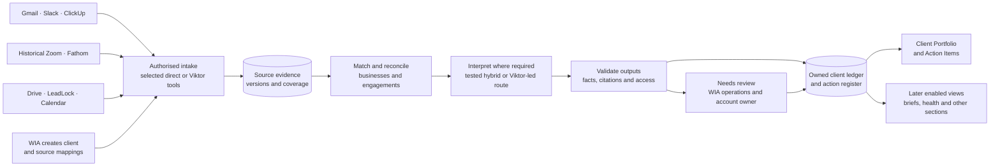

# The Maintained Client Knowledge Base

### Feasibility study and implementation candidates

**For:** Wedding Industry Ads · **Prepared by:** E2M Solutions · **Status:** Draft for review · **20 October 2026**

**Basis:** User decisions through KB-CH-69, including chatbot scoping/cost-QA and architecture choices for authentication/provisioning, dedicated infrastructure, retained facts/excerpts, reviewed corrections/per-user read state, deleted-source warnings, custom roles/scoped overrides, self-verification, KB-only revocation, recovery assessment, limited real-data staging, private chat/admin metadata access, category retention, full testing access, ten-user concurrency, reviewed AI releases and last-known-data behaviour; the existing frontend; source tests recorded on 19 October and corrected Fathom/LeadLock checks on 20 October; and current provider documentation. It is not a completed implementation, acceptance report or final Solution Architecture.

---

## The short version

**The Client Knowledge Base is technically feasible, with material coverage and delivery conditions still open.** It will maintain a business-level client record and an evidence-backed action register so WIA can understand an account, find what was agreed and follow through without repeatedly reconstructing its history across tools.

Real Slack, email, document, task and calendar samples support much of the intended experience. LeadLock account discovery works, but fresh client-outcome reads still return scope denials. **Fathom production samples are now verified:** the WIA key retrieves The Penny and Ridgefield strategy-call transcripts/summaries and a Carmen-recorded office-hour sample. The earlier limited result came from a duplicate environment entry overriding the WIA key with an E2M key; configuration is corrected, preserving both keys. Full meeting/archive coverage, historical Zoom access and incoming notification delivery remain unverified. The frontend contains fictional records; a successful source request does not make every mock field available.

**Two implementation candidates are retained:** selective hybrid, including specific skill-based Viktor work plus API LLM analysis with relevant business context; and Viktor-led skill orchestration. Test both for required output formation, source and field completeness, quality, access, freshness and actual costs before choosing. There is no selected winner. Both require WIA's owned record, validation, review workflow, access controls and UI.

| Topic | Agreed direction / recommendation | What must be demonstrated |
|---|---|---|
| First release | **Action Items and Client Portfolio**, together or in subsequent weeks as implementation/testing complete | Useful real-client records and actions, with evidence and explicit unknowns |
| History | **All obtainable approved-source history for every active WIA client before launch**, including data for later UI features | Reconciled inventory and WIA sign-off on source-by-source gaps |
| AI delivery | **Compare selective hybrid and Viktor-led** | Same required outputs and authorised evidence; measured quality, completeness, cost and latency |
| Authority | Existing tasks and clear current commitments; ambiguous/stale/proposed work goes to **Needs review** | No invented owner/deadline; separate reported completion from human verification |
| Freshness and access | Fifteen-minute updates once provider data is available; per-user client and section access | Working notifications/recovery, visible sync state and restrictions across derived outputs |
| Later features | Populate supported information; mark undelivered features **Coming soon**, without dates on labels | Delivery gates remain distinct from unavailable or unverified data |

Planning scale is approximately **15–20 active clients**, growing to **30–40 total**. Development target is **6 November 2026** and launch target **26 November 2026**. From this study date that leaves 17 calendar days to development completion, then 20 to launch. Staffing, complete source volumes and backfill throughput have not been established; these targets are not yet validated estimates.

Architecture Q18 adds approximately **ten WIA users, all potentially concurrent**, with the count able to increase/decrease. Test mixed UI/chat activity alongside ingestion/backfill; exact request rates and response-time thresholds remain to configure/measure.

The user recalls approximately **$1,000/month** of existing Viktor spending and reports excellent current call preparation and valuable Google/Meta anomaly detection. Optimisation should preserve those benefits. Neither the recalled bill nor published per-task pricing proves what this KB will save.

---

## 1. The problem we're solving

The information needed to serve a WIA client already exists, but it is distributed. A positioning answer may live in a Drive questionnaire, the actual deadline in a meeting, the task status in ClickUp and the latest concern in email. Related businesses can share a Slack channel or call while having separate engagements and LeadLock accounts. Reconstructing that context repeatedly takes time and makes requests easy to miss.

**The KB's job is to maintain continuity and accountable follow-through.** The team should be able to establish who the business is, what WIA is delivering, what changed, what each side owes, what remains uncertain and where each statement came from. It should support handovers and later call preparation without turning generated interpretation into an unsupported fact.

One **client** represents a business. Separate **service engagements** record its services and applicable history. Contacts, account IDs, folders, channels, task lists and calendars are linked identities, not interchangeable definitions of a client. A shared meeting can relate to multiple businesses; evidence must be scoped accordingly.

The initial users are WIA team members. WIA administrators configure access and client mappings; a designated WIA operations reviewer coordinates uncertain items; account owners resolve client-specific questions; E2M handles technical ingestion issues. Individual names remain to be supplied. No external client portal is established by these requirements.

**First-release deliverables:** an Action Items register, business-level Client Portfolio, existing-task links, required evidence/review/access mechanisms and complete obtainable in-scope historical backfill. Fill supported Portfolio information; do not substitute sample values where sources are missing.

**Overall product scope:** calendar-linked call preparation; client history and handover; commitments and acknowledgement; engagement health and LeadLock outcomes; support visibility; evidenced signing/payment history; and programme attendance where relevant. Their exact delivery depth is established during implementation planning. The approved tab activation sequence is Stage 1: Action Register + Client Portfolio; Stage 2: Call Preparation; Stage 3: Health & Sentiment + Invoices & Contracts + Overview. Chatbot and unlisted capabilities remain unsequenced. See [KB-CH-69](../../../knowledgebase_changes.md#kb-ch-69--three-stage-tab-activation-sequence).

**Subsequent chatbot scope, 20 October:** An in-platform assistant for questions about displayed records, client context, meetings, actions and their evidence is detailed in [chatbot_KB.md](../../../chatbot_KB.md). The user confirms scope now and delivery order during implementation planning; this does not automatically expand the first release. Test KB-only answering versus controlled live reads before choosing, alongside suitable API/Viktor query routing. Chat execution choices remain distinct from the two-candidate background implementation comparison, and the same source/access/authority boundaries apply.

Architecture Q15 subsequently selects private user threads and admin access to operational metadata only. Admin inspection of conversation content is excluded for now, including via logs/traces/error bodies. Current client/module restrictions apply to saved history and provider context. Q16 selects admin-configurable category retention; durations remain to configure. Q17 confirms full testing-data access for both E2M and WIA, closing the proposed support-access question as unnecessary; see the [privacy decision](Client-Knowledge-Base-Architecture-Discovery.md#59-private-chatbot-threads-and-admin-metadata-boundary).

The user additionally requests cached/repeated-query reuse, FAQ-style direct answers and token conservation while meeting QA. [Chatbot scope Section 13](../../../chatbot_KB.md#13-operational-behaviour-cost-and-performance) proposes versioned definitions/dynamic templates, dependency-aware caching and conservative semantic intent reuse; its QA section compares these against reviewed expected answers and cache-bypassed reference runs. Savings, TTLs and runtime correctness remain to be measured; no cost optimisation relaxes freshness, evidence or permissions.

**Current source boundary:** Gmail, Slack, ClickUp, historical Zoom, Fathom, Google Drive and its relevant Docs/Sheets, LeadLock/GHL, and Google Calendar. Dubsado notifications enter through Gmail. Existing Viktor posts enter as attributed Slack analysis; Viktor orchestration is a processing/access route, not blanket approval for additional sources.

Fresh Google/Meta analysis, website research, ChatGPT project/history imports and separate manual uploads remain outside new first-release intake. Shopify's business use and metrics remain ambiguous. Existing useful Viktor paid-media workflows can continue outside this KB release without a claim that this build replaces them. See [deferred work](../../../Canbebuilt.md) and [clarification register](../../../tobeclarified.md).

---

## 2. The workflow at a glance

The diagram shows the common product workflow. It does not propose running both candidate agents for every record. Provider tools, credentials and scope must work before their results enter the pipeline.

| Stage | What happens | Who / what does it | Cadence |
|---|---|---|---|
| **0 · Configure** | Confirm active businesses, engagements, source mappings, permissions and review ownership | WIA with E2M support | Initial setup; when clients or configuration change |
| **1 · Capture** | Inventory/backfill approved records and receive ongoing changes | Selected authorised intake route | Before launch and continuously thereafter |
| **2 · Reconcile** | Preserve provenance, deduplicate, resolve identities and distinguish current from historical evidence | Code; WIA reviews ambiguity | Per batch/change |
| **3 · Interpret** | Extract explicit asks/commitments and evidence-supported interpretations | Hybrid or Viktor-led skills under evaluation | Where content requires interpretation; reuse unchanged results |
| **4 · Validate** | Check required fields, sources, unknowns, lifecycle and permission boundaries | Backend validation and review rules | Before acceptance into the ledger |
| **5 · Review** | Resolve stale work, material conflicts and uncertain matches | WIA operations/account owner; E2M for technical failures | Queue-driven; review service level to be agreed |
| **6 · Maintain** | Serve updated Portfolio/actions, record acknowledgements and verification | KB plus authorised WIA users | Target fifteen-minute updates; supported on-demand refresh |
| **7 · Extend** | Enable later views using retained approved-source evidence | Implementation/testing and WIA acceptance | Stage 2 Call Preparation, then Stage 3 Health & Sentiment / Invoices & Contracts / Overview; chatbot and unlisted features remain unsequenced. Coming soon labels need no dates |

---

## 3. Stage by stage

### Stage 0: Establish the client and access registry

WIA manually creates each client and links its service engagements and sources. New contacts, folders, signing emails or LeadLock locations can be evidence candidates; none automatically activates a business profile.

The registry needs stable source identifiers, relevant contact identities, applicable date ranges, account timezone and reviewed relationships. For example, Funktastic Productions and DJ Hybrid have distinct LeadLock locations despite sharing a Slack channel. A programme-wide task or discussion is not automatically individual evidence for every member.

Admin controls cover **clients and whole modules/sections in the first release**. Individual-field controls are later. A custom standard team profile supplies new-user access, and admins can restrict or expand it; WIA has not supplied the actual default grant list. Configure and review that profile before activation. Architecture Q1 selects reuse of the existing Command Center email/password authentication system; Q4 additionally selects KB-admin provisioning of central login accounts through an API, alongside KB membership/grants. That supported API must be established or built; current inspection has not verified one. Q11 selects immediate KB-only revocation without disabling central login. Enforce active KB membership on requests and pending result delivery even when central sign-in remains valid; central disabling is separate. Trusted session integration, invitation/password setup and actual operation grants remain to specify; Q13 selects override precedence as described in Stage 6. Source-connector Google OAuth is separate from application login. See the [architecture discovery](Client-Knowledge-Base-Architecture-Discovery.md#51-existing-authentication-implementation-inspected).

Visibility must be enforced in backend queries, evidence, search, summaries, briefs and exports. A hidden section cannot remain readable through another route. A generated object mixing restricted and unrestricted content needs permission-safe generation or separately scoped results; merely hiding a UI tab is insufficient.

### Stage 1: Capture approved source material

These are results of the bounded source tests, including the corrective Fathom/LeadLock recheck on 20 October:

| Source | Required material and retrieval direction | Verified evidence | Remaining condition |
|---|---|---|---|
| **Slack** | Channel messages, threads, edits/reactions, authors and source links; history API plus selected change events/reconciliation | Six channels passed history/thread reads; 90 parent objects and 11 replies sampled. Saved archive audit contains 2,664 unique messages across those six channels | Full active-client/channel coverage, role mapping, lifecycle refresh and configured reaction semantics. Team DMs are not verified intake |
| **Gmail** | Relevant messages/threads, MIME bodies, sender/recipients, dates, links and approved document attachments; initial reads plus Pub/Sub-triggered history retrieval | 22 successful source GETs in the intended WIA mailbox; real Dubsado events, approval/support chains and a bounded PDF byte read | Complete mailbox/client boundaries, draft/quote handling, financial reconciliation, parsing and actual push delivery |
| **ClickUp** | Relevant task IDs, list relationships, status, assignees, dates, descriptions, nested/checklist work, comments and links | 50 successful GETs; 338 unique tasks across five lists | Complete scope/client mapping, workflow semantics, known populated comments and incremental lifecycle handling |
| **Historical Zoom** | Existing transcripts/summaries and recording references; authorised cloud access or readable exports in approved Drive folders | Discovery calls describe downloaded/archive material; current live Zoom API access has not been tested | Locate all obtainable in-scope archives and establish access/completeness. No new transcription is included |
| **Fathom** | Meeting identity/time, recorder, participant context, timestamped transcript, summaries and candidate actions; API backfill with webhook-led future intake | 20 October: WIA key lists 20 bounded meeting examples; The Penny/Ridgefield transcripts and summaries work, with 11 candidate actions combined. Carmen's Google Ads office-hour transcript/summary and sampled recorder filters work. Thirteen new GETs succeeded, including the E2M control | Basic production sample access is established. Full recorder/client/history coverage, semantic reconciliation, playback and webhook delivery remain open |
| **Google Drive** | Approved folders/files, questionnaires, text documents, Docs/Sheets, extractable PDF/DOCX text and existing meeting transcripts | 20 successful Drive/Docs/Sheets GETs; 86 metadata examples, four Docs and two attendance workbooks read | Full descendants/history, shortcuts/versions, PDF/DOCX parsing and change delivery. Metadata does not establish content extraction |
| **LeadLock / GHL** | Client account links/IDs; where authorised, inquiries, opportunities, mapped stages, appointment/outcome records and required activity history | Agency token discovers 59 distinct sub-accounts, selected metadata and user searches. On 20 October both configured tokens still read their tested account metadata | Fresh pipelines/opportunities fail with scope-denied 401s; opportunity checks using both the pinned and current v3 versions fail likewise. Outcome, support and survey readiness remain unverified |
| **Google Calendar** | Reviewed calendars/events, occurrence identities, participants, start/end/timezone, cancellation/recurrence and source URLs | 13 successful GETs after API enablement; nine calendars, 427 returned rows / 425 unique source records | Client/host matching, cross-calendar copies, complete history and tested incremental/watch lifecycle |

Full findings and reproduction evidence are in [Slack](../../../slack_scope.md), [Gmail](../../../gmail_scope.md), [ClickUp](../../../clickup_scope.md), [Fathom](../../../fathom_scope.md), [Drive](../../../google_drive_scope.md), [LeadLock](../../../leadlock_scope.md) and [Calendar](../../../google_calendar_scope.md). These sample counts cannot be added together as unique business events or treated as complete ingestion volumes.

Process readable text, native Docs/Sheets, existing transcripts and extractable PDF/DOCX text. Preserve citations down to a message, transcript timestamp, document section or sheet range where available. Scans, images and audio/video remain links, with unprocessed content listed in the gap report; no OCR or new transcription is included. A previously downloaded Slack PNG proves a download path, not permission to introduce image interpretation.

### Stage 2: Match, normalise and reconcile

Preserve the source account and record ID, business/engagement associations, author/actor, event time, provider-update time, intake time, original URL, processing status and content/version identity where available. Retain original time context while presenting user-appropriate times; mailbox, spreadsheet and client timezones are not necessarily the same.

Deduplicate records by provider identity and reconcile equivalent events across tools without discarding the supporting copies. A Dubsado email and a matching financial event are not two payments; a meeting recap and transcript are not two meetings; repeated calendar invitations are not separate calls. Similar text alone is insufficient to merge two obligations.

Identity uncertainty goes to review. Apply reviewed contact/account mappings and distinguish staff, clients, third parties and bots. Keep Viktor-authored analysis separate from human messages and primary provider records. A bot saying a client approved something is not the client's approval evidence.

Conflict rules depend on the field and evidence type. **A meeting commitment takes precedence over a conflicting ClickUp due date**, while preserving both and surfacing the discrepancy. A conversation does not automatically amend signed terms or payment state. Material ambiguity is routed to WIA; a newer timestamp is not a universal authority rule.

### Stage 3: Maintain Action Items

Include relevant existing ClickUp tasks and explicit client-related requests or commitments from Slack, Gmail and meetings. Keep AI-suggested improvements separately labelled as proposals.

| Condition | Required treatment |
|---|---|
| Existing active task or clear current commitment | Enter the active register with its evidence and mapped identity |
| Ambiguous, potentially stale or AI-suggested item | Needs review; preserve why it needs review |
| Missing owner or deadline | Keep unknown; do not assign a convenient team member or artificial date |
| Historical request without visible closure | Reconcile later evidence; absence of closure alone does not establish current open work |
| Explicit acceptance by the identified owner | Record acknowledgement with actor, evidence and time |
| Owner's manual KB Acknowledge action | Record the authenticated actor and action history |
| Reaction-based acceptance | Enable only after WIA configures emoji-to-meaning mappings; require the identified owner's relevant reaction |
| Completion reported by a mapped task or explicit delivery evidence | Done, retaining completion evidence |
| Named WIA reviewer records follow-up check and evidence | Verified, retaining reviewer, check and time separately |

Assignment is not acceptance. A reaction count does not identify the responsible actor, and ambiguous replies or reactions go to review. Reaction-based acknowledgement stays disabled until configuration; explicit-message and manual acknowledgement can work independently.

Source statuses need an agreed mapping for cancellation, recurrence and not-applicable work. Four sampled terminal ClickUp tasks still have unresolved checklist items. Likewise, all nine sampled Role=Client tasks lack both a named assignee and due date; role alone cannot fill those fields. Of 338 tasks, 151 have no due date and 76 no assignee, directly demonstrating why the frontend must represent unknowns.

The first release links existing ClickUp tasks. **ClickUp creation and external notifications are Coming soon.** WIA review remains required before those later writes. No outbound task or messaging capability is implied by detecting an action.

### Stage 4: Populate the Client Portfolio

The existing frontend defines the intended experience, subject to field-level evidence and explicit adjustments. Its current types require many strings and expose four action statuses; production contracts must support nullable/unknown values, Needs review, separate proposals, multiple engagements and richer provenance. This is a required design adjustment, not a frontend change already made. See [current types](../frontend/src/types.ts) and [client detail view](../frontend/src/views/ClientDetail.tsx).

| Frontend area | Evidence required | Feasibility treatment |
|---|---|---|
| **Client profile** | Business/contact mappings, service engagements and supported questionnaire/document answers | Real Docs support background/audience/positioning examples; validate date and authority for each fact |
| **LeadLock reference** | Reviewed location ID/account URL | Account discovery supports the reference; a link does not prove feature API access |
| **Now / commitments** | Current actions, agreed dates, relevant recent communication and visible source window | Direct task/communication facts are supported; counts depend on reconciled current state |
| **Engagement history** | Dated decisions, onboarding milestones, meetings and reported delivery with citations | Retain all obtainable approved-scope history; gaps remain visible |
| **Handover** | Permitted profile/history/current commitments and limitations | Assemble from supported records; exclude hidden client/section information |
| **Meetings** | Matched meeting/transcript IDs and timestamps; Calendar scheduling separately | Sample structures work; full WIA recording coverage remains open |
| **Support issues** | Actual request, owner/status where known, updates and resolution evidence | Gmail has a real support example; complete intake/resolution route remains unverified |
| **Lead outcomes** | Authorised account records, metric definitions and reporting boundaries | Agreed addition; live outcome population blocked pending feature access and reconciliation |
| **Invoices & terms** | Dubsado event evidence and underlying terms/invoice state where obtainable through approved scope | Show what is established; notification emails alone cannot populate a complete balance/overdue ledger |
| **Attendance** | Mapped member/session records and reconciled programme rules | Two readable sheets supply reported attendance; RSVP, transcript presence and task completion are insufficient |
| **Coverage / sources** | Inventory denominators, processing results, exceptions and successful-sync times | Show coverage by source/client and scope; the mock percentage is not a validated measure |

Preserve distinct user states: **Coming soon** for an undelivered feature; **not applicable** when established; **unavailable / access required** for missing access; **partial / processing** for incomplete coverage; and **needs review / unknown** for unresolved meaning. A successfully checked empty result can be shown as empty within that scope. Neither access failure nor incomplete history means zero actions, zero issues or good health.

### Stage 5: Health & Sentiment and later preparation

The approved health scope is an engagement assessment plus LeadLock tracking, with the following evidence-supported dimensions:

| Dimension | Relevant signals | Boundary |
|---|---|---|
| **Client feedback** | Explicit concerns, praise, unresolved questions and available relevant survey responses | Distinguish direct feedback from inferred sentiment; survey source still needs verification |
| **Delivery follow-through** | Open/overdue agreed commitments, blocked work and reported completion awaiting verification | Separate WIA obligations from client dependencies; unknown dates are not overdue |
| **Support/resolution** | Issue age, severity, repetition, ownership and evidenced resolution | Source coverage is not yet complete; lack of observed tickets is not proof of no problems |
| **Lead outcomes** | Inquiries, booked tours/consultations, won bookings and agreed stage conversions | Define stages, duplicate/cancellation treatment, timezone and period/cohort basis |
| **Lead handling** | First response, uncontacted inquiries, stale opportunities and follow-up gaps | Requires suitable activity history; a generic updated timestamp is not a response event |
| **Onboarding/programme context** | Blocked milestones, missing inputs and relevant reported attendance | Reconcile member/session and start/hold/reschedule rules; calendar RSVP is not attendance |

Use **separate engagement and outcome views**, with evidence-based drivers and visible source coverage/freshness. Commercial context and combined scoring remain for later review. No numerical score, weighting or threshold is approved. Strong bookings and unresolved delivery problems can coexist; preserve both rather than compressing them into an unsupported overall percentage.

Later call preparation links the correct calendar occurrence to business/engagement context, open commitments, client asks, an appropriate agenda and cited opportunities. Calendar establishes scheduling context; the substantive brief needs the other sources. Existing useful Viktor preparation should be retained and evaluated against any proposed replacement. A cancellation or stale brief must not continue to look like a current upcoming call.

### Stage 6: Keep the record current and reviewable

The target is **fifteen-minute updates once provider data becomes available**, visible last-sync times and on-demand refresh where supported. Measure availability/receipt, successful retrieval, processing and UI publication separately so provider delays and internal backlog remain distinguishable.

Receive changes, persist enough information for recovery, enqueue processing, retry with provider-aware backoff and reconcile missed events. Preserve failed work and coverage exceptions for operators. Backfill and routine refresh must coexist without allowing a large archive job to hide new commitments. Q12 selects assessment of one-hour maximum lost KB changes/four-hour restoration after serious database failure. Final service concurrency, retry limits, backup topology and measured recovery performance remain to establish.

Q20 confirms supported last-known data stays visible during source failure/lag, with an explicit **Last synced at [time, date, timezone]** message and stale/unavailable-source status. A failed attempt or cache hit does not advance that timestamp; chat must disclose gaps and avoid claiming current verification without fresh evidence.

The WIA operations reviewer coordinates Needs review, account owners supply business resolution and E2M handles ingestion failures. Architecture Q5 confirms that reviewed corrections persist and later conflicting source updates go to review. Keep the reviewed value, source observations and audit/evidence history distinct; reprocessing must not silently overwrite corrections or recreate rejected/resolved work. Q7 selects per-user read state: opening change details or Mark as read clears the viewed revision for that user; later changes become unread again. An unresolved-conflict status persists independently. Test multiple users and a newer revision arriving while details are open; reading is not review approval. See [reviewed values and visible changes](Client-Knowledge-Base-Architecture-Discovery.md#53-reviewed-values-source-observations-and-visible-changes).

Q8/Q10/Q13 select custom editing/review roles plus per-user Inherit/Allow/Deny overrides: user Deny wins over role grants, Allow is limited to existing permitted clients/sections and Inherit follows the configured role baseline. Actual role/default grants remain to configure. Q9 makes self-verification admin-configurable: an owner needs normal verification authority plus that permission and must still record the named WIA follow-up check/evidence. Assignment, module visibility and reported Done do not grant verification rights. Test role/override combinations, hidden scopes, permitted/denied self-verification and permission changes. See [custom operation rights](Client-Knowledge-Base-Architecture-Discovery.md#55-custom-operation-rights-and-configurable-self-verification).

---

Technical Q22 permits authorised resolvers to apply audited corrections directly; other editors submit proposals. Q23 is a specific lifecycle exception: a genuine mapped ClickUp reopening automatically reopens the KB action and supersedes prior verification while preserving its history. It does not overwrite reviewed owner/deadline or contractual facts. The [technical-depth audit](Client-Knowledge-Base-Architecture-Technical-Gap-Analysis.md) and expanded architecture supply concrete mechanisms and proposed operating/QA parameters; none is a completed runtime benchmark.

## 4. The knowledge strategy: do we need a vector database?

**Start by assessing one relational evidence store; a dedicated vector database is not yet justified.** Client mappings, engagements, action state, access rules, source versions and financial-event identity need structured relationships and exact filtering. Semantic retrieval can supplement those records if evaluation shows a benefit; it cannot replace them.

Q21 selects PostgreSQL with SQLAlchemy ORM, psycopg and Alembic. Architecture Q2 selects dedicated KB project/data services. Optional vector capability, exact tested pins, index configuration and sizing still require engineering validation; the expanded Solution Architecture specifies session/migration and retrieval starting mechanisms. Client count alone does not size the workload; inventory record counts, processed text, retained excerpts, versions, growth and search/concurrency needs first.

**Architecture Q3 selects retained facts/excerpts with full originals fetched when needed.** Process all obtainable approved history before launch, but persist the extracted records, supporting excerpts and necessary source/version/coverage metadata rather than a complete replayable text archive. Index those retained records; storing every original chunk would defeat this selection. Full originals are transient processing inputs under the admin-configurable category policy selected in Q16; actual cleanup durations and implementation remain to configure.

Detailed new questions, extensive quotations and reprocessing may need an authorised original fetch. A provider may return a current edited version or no longer expose the original; distinguish that from the earlier retained evidence, disclose unavailable context and preserve gaps. This tradeoff must be evaluated for retrieval quality, latency and repeat-fetch cost. It does not choose chatbot KB-only versus controlled live-read mode. Architecture Q6 selects keeping facts/excerpts after confirmed upstream deletion with a deleted-source warning, including in permitted search/chat/citations; update dependent caches so warnings are not lost. Such evidence can support historical statements without proving mutable state is still current. Temporary access loss and exact retention periods remain open in the [architecture discovery](Client-Knowledge-Base-Architecture-Discovery.md#54-confirmed-source-deletion-retain-evidence-with-warnings).

| Layer | Contents | Purpose |
|---|---|---|
| **Reviewed configuration** | Businesses, engagements, source mappings, role/access configuration, glossary and metric definitions | Prevent incorrect matches and supply relevant business context |
| **Source evidence** | Retained supporting excerpts, source references/locators, timestamps, version markers and extraction/coverage status | Trace facts and report gaps; further processing depends on original retrieval |
| **Client ledger** | Evidenced facts, events, reconciled actions, review decisions and defined outcome snapshots | Serve the maintained Portfolio and register |
| **Derived analysis** | Attributed Viktor reports and validated generated outputs, with provider/skill/context versions | Reuse interpretations without losing their origin or freshness |

Prepare a bounded context package for each semantic job: business/engagement identity, relevant source window, approved business definitions, current permitted facts and necessary linked evidence. Keep source dates and limitations. Supplying relevant business context is explicitly part of the hybrid candidate; a model name alone does not provide it.

Store accepted results and invalidate/reassess affected interpretations when supporting evidence changes. Avoid repeatedly sending the entire archive or invoking an agent when a page opens. Content hashes and source versions help reuse; permission changes also need to invalidate inappropriate cached outputs.

Both candidates follow the [FastAPI backend SOP](../../../backend_build.md): thin `routes/`, feature logic in `services/`, domain/database/transport structures in `models/`, SQL migrations in `sql/`, startup/database/configuration in their dedicated root files, and Docker setup. Durable asynchronous intake/backfill justifies the SOP's `workers/` and Redis/RQ pattern. The queue transports work; durable evidence, checkpoints and review state must survive independently. This study does not create the scaffold; Q21 selects the ORM/psycopg/Alembic path, with SQL migration assets kept under the team SOP.

---

## 5. How historical and future records fit together

**Full obtainable in-scope history is a launch requirement.** There is no approved ninety-day cutoff, convenience-client pilot replacing launch coverage, or later historical catch-up after launch. The roster is all currently active WIA clients across services; former-client archive scope is separate.

Backfill every approved source even if its UI feature is Coming soon. That includes available signing/payment, programme and outcome history within the agreed access/processing boundary. UI sequencing does not erase the data obligation.

For each business/engagement and source, inventory the expected accounts/containers, relevant date boundaries, pagination, obtained records and readable content. Record duplicates, missing permissions, unavailable older material, broken references and unprocessed files. Complete reviewed folder descendants and message/thread pages rather than equating a successful first page with completeness.

Reconcile old requests against later messages, task states and explicit closure. Historical evidence remains valuable even if it no longer describes open work. Meeting archives can appear in Zoom, Drive, Fathom and Slack; preserve provenance while avoiding duplicate meetings and commitments.

Future Fathom intake uses the agreed webhook direction, with API backfill/reconciliation. Gmail and Drive use the requested push-style setup; Calendar and other ongoing sources require tested change/reconciliation paths. Capture a recoverable boundary while backfill runs so records arriving during the initial load are not lost.

The gap report must distinguish **not inventoried**, **retrieval blocked**, **retrieved but unprocessed**, **partially reconciled**, **processed within scope**, and **explicitly accepted exception**. These are reporting requirements, not completed statuses. A source row should include expected scope, actual oldest/latest coverage, page/record reconciliation, exception reason and resolution/acceptance owner.

**WIA signs off source-by-source gaps before launch.** Missing/inaccessible items remain unresolved until recovered or explicitly accepted. No particular historical gap has been accepted so far. An accepted disclosed gap must not be represented as recovered or processed content. See [KB-V-08](../../../tobeverified_knowledgebase.md#kb-v-08--complete-available-historical-backfill-before-launch).

---

## 6. External research and integrations: what the current scope can and can't do

External market/website research is not required for this release. Assess external capabilities against supported evidence and keep unverified claims outside the product promise.

| Integration mechanism | Documented capability and proposed use | What is not established |
|---|---|---|
| **Gmail push** | Mailbox watch publishes through Cloud Pub/Sub; its push subscription POSTs to the backend. Retrieve actual changes using history, renew the watch and reconcile misses | Consent, token refresh or an empty history response is not webhook delivery. Watch renewal and genuine changed-message processing are untested |
| **Drive push** | Watch the changes resource and fetch the authorised change feed; track reviewed folder membership/content | Notifications do not contain the document content or automatically restrict intake to approved folders. Channel renewal and change/removal processing remain untested |
| **Calendar push** | Watch relevant calendar event collections and fetch changes; reconcile dropped notifications | The test did not register watches. Scheduling/RSVP does not prove meeting attendance |
| **Slack events/history** | Event subscriptions can trigger refresh; history/thread reads support reconciliation | Actual subscription scope, edit/delete/reaction lifecycle and complete coverage are not demonstrated by the six-channel sample |
| **ClickUp webhooks/reads** | Task events can trigger selected record refresh; webhook signatures and source-user lifecycle need handling | No deployed webhook or writeback has been tested; the current credential's successful reads do not establish permanent access |
| **Fathom webhooks/API** | Production client and office-hour sample reads now work; agreed future-meeting webhook plus API retrieval/backfill | Genuine reception, payload/signature validation, complete recorder/history reconciliation and recovery remain open |
| **LeadLock access** | Agency metadata discovery works. Investigate authorised agency OAuth/location access or a proven Viktor source tool | An agency PIT is not automatically a location token. No candidate can turn denied access into verified outcome records |
| **Viktor orchestration** | Public API documents structured outputs, skills and integration/script execution | WIA API access, source-tool coverage, private-connection reach, output completeness and account-specific cost remain untested |

Primary technical references: [Gmail push](https://developers.google.com/workspace/gmail/api/guides/push), [Drive push](https://developers.google.com/workspace/drive/api/guides/push), [Calendar push](https://developers.google.com/workspace/calendar/api/guides/push), [Slack Events API](https://docs.slack.dev/apis/events-api/), [ClickUp webhooks](https://developer.clickup.com/docs/webhooks), [Fathom API](https://developers.fathom.ai/api-overview), [HighLevel authorisation](https://marketplace.gohighlevel.com/docs/Authorization/OAuth2.0/) and [Viktor public API](https://viktor.com/docs/public-api).

Integration code or a fixed Viktor script may retrieve structured records without semantic judgement. Compare that retrieval separately from agent interpretation. Viktor's scheduled script tasks are documented as zero-credit; API-triggered script billing and WIA tool behaviour need verification before counting on the same economics. [Scheduled scripts](https://viktor.com/docs/scheduled-tasks).

New Viktor requests for this release remain within the approved eight sources. Existing ad-related reports can be retained as dated analysis; they do not establish a fresh Google/Meta feed. Skills may direct work, but provider permissions and backend validation enforce the boundary. Use actual source records to establish facts and completeness, not only a persuasive report.

---

## 7. Where AI is the right tool, and where it isn't

| Task | Appropriate approach | Reason / constraint |
|---|---|---|
| IDs, account URLs, task fields, pagination and timestamps | Deterministic code or fixed authorised integration script | Exact transport/mapping work; do not regenerate values |
| Client/engagement match | Reviewed registry and rules first; ambiguous cases to review | A familiar name is not enough to merge businesses |
| Explicit asks/commitments in conversation | Skill-directed interpretation with source evidence | Requires language understanding; missing owner/date remains unknown |
| Historical current-state reconciliation | Chronology/source-state rules plus bounded interpretation and review | An old unresolved-looking request is not necessarily active |
| Outcome counts/conversions and ageing | Code over reconciled records and agreed definitions | Reproducible arithmetic and denominators |
| Engagement and client-feedback interpretation | Context-supplied model/skill output with dated drivers | Separate direct feedback from inferred sentiment and source absence |
| Existing Viktor reports | Preserve attributed analysis; parse only as needed | Reuse useful work without inventing primary evidence |
| Proposed improvements and later briefs | Appropriate candidate's contextual analysis, cited and labelled | A suggestion is not a promise or verified result |
| Schema validation, access enforcement and duplicate writes | Backend code | Instructions and valid JSON do not enforce these guarantees |
| Owner acknowledgement / Verified | Agreed actor/evidence rules; named WIA reviewer for Verified | AI cannot replace acceptance by the owner or the human follow-up check |
| External ClickUp creation / notifications | Later capability after WIA review | Coming soon in the first release |

Viktor's configured business context, skills and tool access may provide a real advantage. The reviewed vendor material does not establish a separate wedding-industry-trained model. Evaluate its actual WIA results rather than assuming either domain superiority or API-model equivalence. [Viktor agency material](https://viktor.com/for/agencies).

---

Architecture Q19 keeps prompts, Viktor skills and query-routing behaviour version-controlled, evaluated before release. Admins retain the agreed business controls, including roles/mappings/emojis and category retention; direct admin AI activation is not selected. The [Solution Architecture draft](Client-Knowledge-Base-Solution-Architecture.md) supplies the engineering design, with untested selections/configuration distinguished from agreed requirements.

## 8. Risks, edge cases and how we handle them

| Risk / edge case | Current evidence | Required response |
|---|---|---|
| **Successful API access mistaken for complete feasibility** | Tests are bounded; several queries have more pages | Report access, content quality, coverage, semantics and deployed delivery separately |
| **Incomplete meeting coverage / wrong configured account** | A duplicate key caused the original E2M-only result. Corrected WIA key now retrieves both known client calls and an office-hour sample | Keep account keys unambiguous, verify expected owners/windows and finish pagination; samples do not establish full history |
| **Blocked client outcomes** | LeadLock feature reads are scope-denied despite valid agency discovery | Establish authorised source access; leave measures unavailable until reconciled |
| **Wrong business or shared evidence** | Funktastic/DJ Hybrid share channel context; programme lists contain group work | Business/engagement registry, multi-business evidence links and review |
| **Stale requests become active debt** | Full historical import spans old conversations | Reconcile later evidence; route ambiguous items to Needs review |
| **Fabricated owner/date or premature verification** | Many tasks lack owner/date; terminal tasks can retain checklist work | Preserve unknowns; enforce distinct acknowledgement, Done and named-reviewer Verified |
| **Unsourced or stale Viktor assertions** | Existing posts are analysis, not reconciled underlying records | Retain provenance/date; validate references and coverage before promoting facts |
| **Structured but incomplete output** | No WIA structured evaluation yet | Compare expected records/fields as well as JSON validity; require explicit missing-data reporting |
| **Payment event becomes a false balance** | Dubsado emails include signing/payment links and a reported payment | Model observed events separately; obtain full terms/state before debt, overdue or renewal claims |
| **Attendance inferred incorrectly** | Readable sheets have notes/counter ambiguity; Calendar has invite responses | Reconcile programme rules and sheet evidence; do not infer attendance from RSVP or missing transcript |
| **Restricted data leaks through derived outputs** | Current frontend has no implemented production access layer | Enforce client/section restrictions in retrieval, generation, evidence and exports; invalidate affected caches |
| **Edits, removals or lost access leave stale certainty** | No complete incremental lifecycle test; Q6 selects retaining excerpts with warnings after confirmed deletion | Preserve reviewed corrections, reconcile source observations and distinguish deleted/denied/temporary states. Keep deletion warnings in permitted results and dependent caches; disclose current-state limitations |
| **Duplicate/missed notification or worker failure** | Push/webhook delivery not deployed/tested | Durable checkpoints, idempotent processing, renewals, retry/reconciliation and operator-visible failures |
| **Unprocessed media mistaken for understood history** | Video/PDF metadata and links exist; binary parsers not fully tested | Apply agreed text-only processing boundary and list unprocessed content in gap report |
| **Provider results contain instructions unrelated to the task** | Documents/messages are source material | Treat their contents as evidence, not authority to change tools, permissions or output rules |
| **Cost reduction degrades useful work** | User reports effective preparation/anomaly detection | Benchmark required quality and retain valuable workflows; avoid reducing plans before throughput/cash checks |
| **Deadline slips because backfill is underestimated** | Full roster/volume and staffing unknown; 17 days to development target | Measure inventory/throughput early, expose unresolved conditions and obtain a revised decision if targets cannot be met |

Detailed deletion/retention periods, backup implementation/retention, provider data-routing settings and incident ownership remain to settle. Q12 selects assessing one-hour maximum KB data loss and four-hour restoration; neither target has been demonstrated. Source re-fetching cannot recreate reviewed corrections, access settings or excerpts of deleted originals. Validate an isolated restore, application cutover, checkpoint/cache recovery and current access/revocation reconciliation. Daily-only snapshots cannot meet the data-loss target; Railway documents PostgreSQL PITR as a candidate recovery method for the selected PostgreSQL store. [Railway PITR](https://docs.railway.com/volumes/point-in-time-recovery). See [recovery design dependencies](Client-Knowledge-Base-Architecture-Discovery.md#57-recovery-targets-and-evidence-that-they-can-be-met).

---

## 9. Alternatives we considered

### The two retained implementation candidates

| Candidate | What it does | What must pass before selection |
|---|---|---|
| **Selective hybrid** | Direct or fixed authorised source retrieval where appropriate; specific versioned Viktor skills for assigned work; OpenRouter LLM analysis with relevant business context; reuse existing reports | Accurate division of responsibilities, complete required outputs, evidence/access correctness, useful analysis, acceptable latency and measured total cost without duplicate routine work |
| **Viktor-led** | Skill-based Viktor orchestration performs the required retrieval/analysis and returns the specified structured records/results; the owned KB validates, stores and serves them | Actual authorised source reach, historical pagination/completeness, exact output formation, provenance, unknown/error handling, permission isolation, latency/recovery and measured credits/operating cost |
| **API-only — research comparator** | Direct connectors plus API LLM interpretation, with existing Viktor posts retained | Useful cost/control baseline from initial research; not retained as one of the user's two implementation candidates |
| **Existing individual chats alone** | Team continues reconstructing context through current conversations | Retains useful advice but does not itself provide the agreed owned ledger, cross-source evidence, access/review workflow or reliable action register |

The user explicitly retains **both hybrid and Viktor-led**, with neither chosen yet. A Viktor-led result still needs an owned backend, evidence store, deterministic validation/calculation and UI. The comparison should expose where any route cannot satisfy a requirement rather than masking the gap with a fluent summary. See [full comparison](../../../knowledge_base_viktor_llm_comparison.md) and [KB-CH-41](../../../knowledgebase_changes.md#kb-ch-41--retain-selective-hybrid-and-viktor-led-for-comparative-testing).

### Proposed comparative test design

Use a WIA-reviewed expected record/field set for the same clients, engagements, source permissions and historical/reporting windows. Record which inputs were actually available to each route; an access difference is a finding, not evidence of better reasoning. Version skills, business context, output contracts and provider/model settings. Include both ordinary and difficult cases; a few hand-picked successes cannot establish portfolio completeness.

Q14 selects isolated staging with a WIA-approved limited real-client dataset, separate test credentials/configuration and no source-system writes. Q17 confirms full testing-data access for E2M and WIA; no extra per-client access approval is required. Select representative samples/test identities and configure run budgets. Separate staging databases, queues/cache, source cursors and provider subscriptions from production; fixture replay must not affect production records or trigger notifications/tasks. Limited evaluation is not evidence that production's full historical backfill is complete. See [staging boundary](Client-Knowledge-Base-Architecture-Discovery.md#58-isolated-staging-and-bounded-real-client-evaluation).

| Criterion | What to measure | Selection consequence |
|---|---|---|
| **Required output formation** | Required/optional fields, types, enums, null/unknown handling, valid identifiers, semantic constraints and repair attempts | Reject invalid results before publication; schema success alone cannot pass the whole test |
| **Source and field completeness** | Expected versus obtained records, pagination/window coverage, required fields and honestly declared missing data | A correctly declared gap passes honesty checks but does not satisfy the missing business requirement |
| **Identity / provenance** | Correct business/engagement, source IDs, resolvable citations, timestamps and attribution | Wrong-client facts or fabricated support cannot be accepted |
| **Action behaviour** | Current versus stale work, unknown owners/dates, proposals, conflict precedence, acknowledgement and Done/Verified rules | Must preserve the agreed product semantics |
| **Interpretation usefulness** | WIA review of extracted commitments, engagement drivers and contextual analysis; corrections/time required | Cheaper output is insufficient if it loses required usefulness or accuracy |
| **Access / authority** | Restricted clients/sections, mixed-source outputs, permitted tools and absence of unintended external actions | Access leakage or unauthorised writes are disqualifying defects to resolve |
| **Freshness / reliability** | Data-available-to-UI latency, repeat/retry behaviour, cancellation/edit handling and recoverable failures | Demonstrate the fifteen-minute target under the agreed test conditions; expose provider limitations |
| **Cost / operations** | Credits, billable tokens, retries/repairs, connector resources, runtime and human maintenance/review | Compare cost per accepted useful result and full monthly workload, not only per initial request |

The proposed case set includes a direct field read, an explicit commitment, an old request later resolved, a shared-business meeting, missing owner/date, a meeting/task deadline conflict, completion without a follow-up check, permitted/denied self-verification, restricted-section evidence, an edited/cancelled source event, a duplicate delivery/retry, an unreadable document and a LeadLock snapshot once access is available. These are proposed evaluation fixtures, not claims that every real case has already been retrieved.

For output contracts, specify the client/engagement IDs, source record references, observation/reporting times, required result fields, unknowns, coverage and evidence. Action results additionally distinguish origin/proposal, request/owner/deadline evidence and lifecycle evidence. Numeric snapshots require a reproducible definition and period. Narrative health drivers must preserve whether they are direct feedback or interpretation. Exact JSON schemas belong in implementation preparation.

WIA/E2M must agree the sample size, measured pass thresholds, test ownership, cost ceiling and retry limits before paid execution. No numerical score/weight or new benchmark budget is assumed here. Candidate approval is not a completed test. If neither meets the required gates, record the failed criteria and revise the implementation plan; do not choose the cheaper failed route. Avoid dual production processing merely because both were compared during evaluation.

---

## 10. Suggested phasing

| Delivery group | Delivers | Proves / condition |
|---|---|---|
| **Foundation and comparative evaluation** | Reviewed roster/source registry; candidate skills/contracts/test cases; access closure; authentication/permissions; durable intake/evidence path | A candidate can meet required output, completeness, access, quality, cost and freshness criteria |
| **First-release priorities** | Action Items and Client Portfolio with existing-task links, evidence/unknown/review states and responsive UI; deliver together or across subsequent weeks as testing completes | WIA can understand accounts and follow current commitments using real records |
| **Launch readiness** | All obtainable approved-source history across active clients, reconciled gaps, WIA sign-off, recovery/access/refresh and device testing | First release satisfies agreed acceptance, including data for later UI features |
| **Stage 2 activation** | Call Preparation | After Stage 1 foundations; calendar mapping, cited briefs, current commitments and feature-specific acceptance pass |
| **Stage 3 activation** | Health & Sentiment + Invoices & Contracts + Overview | Relevant definitions, supported commercial/assessment states, projections and permission/QA gates pass |
| **Unsequenced capabilities** | Chatbot, remaining unlisted feature depth and later reviewed ClickUp creation/notifications | Placement remains open; Coming soon labels need no timelines |

These are delivery groups, not newly agreed week allocations. Target dates remain **6 November development / 26 November launch**. A validated estimate needs named capacity, dependency/access dates, complete volume inventory, candidate-evaluation results and observed backfill throughput. The required full prelaunch backfill cannot be silently exchanged for a narrower history window to meet the date.

### How we'll know it's working

The user accepted the suggested launch checks and added responsive UI. The checklist must demonstrate:

1. Correct business/engagement matching, including shared evidence and the WIA-confirmed active roster.
2. Complete obtainable approved-scope backfill, with reconciled processing results and WIA-signed source gaps.
3. Traceable facts/actions, source attribution and working evidence references; no invented owner/date or unsupported zero values.
4. Stale/ambiguous work and AI proposals routed to Needs review; configured acknowledgement and distinct Done/Verified evidence.
5. Client/section restrictions working across records, evidence, generated content, search and exports.
6. Fifteen-minute updates under agreed conditions, visible sync state, supported refresh and demonstrated failure/recovery handling.
7. Responsive operation on current phones, tablets, laptops, MacBooks and iMacs, using a representative viewport/device/browser matrix. Check navigation, action controls, evidence drawers, tables, long content and touch/keyboard use; a device name is not one fixed resolution.

Candidate-evaluation gates in Section 9 support technical selection; this checklist establishes product acceptance. Exact cases, numeric thresholds and the WIA sign-off owner remain to be supplied. Current GET tests do not pass this launch checklist.

Useful business measures to baseline with WIA are time spent establishing account status or preparing a handover, missed commitments, action-review effort and repeated factual queries to Viktor. No numeric improvement target is agreed. Measure before/after on comparable work rather than claim savings or productivity from model price alone.

---

## 11. Running costs (order of magnitude)

**There is no validated total monthly quote yet.** The monthly cap is unknown; optimise without losing required quality/performance. Separate one-time history processing, ongoing KB operation, retained Viktor work and team maintenance/review.

### What contributes to the bill

| Cost component | What to measure / budget |
|---|---|
| **Railway application and workers** | API/UI serving, background intake/parsing/analysis, scheduler and measured RAM/CPU; backfill can temporarily dominate |
| **Database and queue** | Database/index/version growth, Redis/RQ resources, connections and recovery requirements; both candidates still need these responsibilities |
| **Storage / recovery** | Retained facts/excerpts and provenance/version/coverage metadata, redacted logs and backups in dedicated KB services; assess archiving, restore drills and temporary recovery capacity against the one-hour/four-hour targets, plus transient original retrieval/extraction cleanup. No permanent full-source archive is selected |
| **OpenRouter in hybrid** | Actual input/output/reasoning tokens, caching, retries and validation repairs for the tasks assigned to it |
| **Viktor in either candidate** | Incremental skill/agent/script work, existing scheduled overlap, allowance/top-ups and any subscription change |
| **Provider delivery/access** | Google Pub/Sub usage and any required provider plan/access costs; a successful test does not prove permanent free access |
| **Human operation** | Review corrections, source mapping, exception resolution and connector/skill maintenance |

Railway's current container rates are **$10/GB-month RAM, $20/vCPU-month CPU, $0.15/GB-month volume storage and $0.05/GB egress**. Pro is **$20/month applied towards usage**; do not add it again on top of a usage total already exceeding that amount. Shared-account allocation needs actual bills. [Railway pricing](https://docs.railway.com/pricing/plans).

For sensitivity, a hypothetical combined average footprint across application, database, workers and queue of **2.5 GB RAM, 0.25 vCPU, 20 GB volume and 10 GB egress** prices at **$33.50/month**. Doubling RAM/CPU to **5 GB / 0.5 vCPU**, with **50 GB volume / 25 GB egress**, prices at **$68.75/month**. These are arithmetic examples, not tested capacity estimates for 20 or 40 clients, approved service sizing, or totals including backups/object storage/AI/provider costs. Inventory and load measurements must replace these assumptions.

### Interpretation and agent cost illustrations

Viktor's current plan documentation prices credits at **$25 per 10,000**. Published quick-task examples use **100–300 credits**, equivalent to **$0.25–$0.75** at that rate; this is not a fixed integration-read tariff. Scheduled scripts are documented separately as zero-credit; verify the API-script route. [Plan rates](https://viktor.com/docs/plans-and-credits), [credit examples](https://viktor.com/help/category/credits/how-credits-work), [scripts](https://viktor.com/docs/scheduled-tasks).

For a **component-cost illustration only**, assume one prepared analysis per client/day for 30 days with 10,000 input and 1,000 output tokens, using current listed text rates and allocating OpenRouter's Standard 5.5% credit-purchase fee:

| Clients | Analyses/month | Gemini 3.1 Flash Lite API component | Claude Sonnet 4.6 API component | Viktor quick-task credit equivalent |
|---:|---:|---:|---:|---:|
| 15 | 450 | $1.90 | $21.36 | $112.50–$337.50 |
| 20 | 600 | $2.53 | $28.49 | $150–$450 |
| 30 | 900 | $3.80 | $42.73 | $225–$675 |
| 40 | 1,200 | $5.06 | $56.97 | $300–$900 |

Sources: [Gemini rates](https://openrouter.ai/google/gemini-3.1-flash-lite), [Sonnet rates](https://openrouter.ai/anthropic/claude-sonnet-4.6), [OpenRouter pricing](https://openrouter.ai/pricing). Models are price examples, not selected production models. The API columns exclude retrieval preparation and Viktor work in the hybrid. Agent tasks can perform more steps than a prepared prompt, use different context and fall outside the example range. Equal quality/work is not established. Excluded costs include history processing, infrastructure, extra reasoning, retries, embeddings, purchase minimums and taxes. The [offline calculator](../verification/viktor/comparison_costs.py) and [results](../verification/viktor/comparison_costs.json) reproduce this arithmetic; they are not a benchmark.

**Hybrid total includes its Viktor jobs as well as API interpretation.** Viktor-led total includes its owned backend operation as well as measured agent/export work. Compare cost per accepted useful output, with latency, completeness and human corrections. Do not call the $2.53 API component a substitute for the recalled $1,000 whole-team workload.

### Optimising existing Viktor spending

Audit the reported approximate $1,000/month against invoices, plan/allowance, last-30-day usage and top-ups. Classify repeated factual lookups, unchanged re-analysis, effective call preparation, paid-media monitoring and deeper advisory work. Billing metadata is distinct from private DM content, which has not become an approved source.

Reuse current useful reports, serve reliable shared facts from the KB and trigger interpretation when needed. At 20 clients, unconditional per-client analysis every fifteen minutes would produce **57,600 runs per thirty-day month**; that is not the agreed refresh design. Preserve fresh data without paying repeatedly for unchanged reasoning.

Credit reduction is not automatically cash reduction: spare included credits may leave the invoice unchanged; top-ups or a later plan change affect cash. Check throughput/limits before a downgrade. Net savings are the measured reduction in Viktor cash spending minus incremental KB expenses. Ten, twenty-five and fifty percent of the recalled baseline are $100, $250 and $500 before new costs—sensitivities, not forecasts. Useful retained preparation and anomaly detection may justify a continuing Viktor bill.

Backfill cost and duration require actual extracted-token/record totals, per-source rate constraints, retry levels and processing throughput. No evidence yet supports a fixed backfill price or a complete monthly cap.

---

## 12. What we need from WIA

| Input / decision | Why it is needed | Present status |
|---|---|---|
| **Active business/engagement roster and source mappings** | Define launch completeness and avoid importing demo/internal accounts | Approximate count supplied; confirmed roster/mappings pending |
| **Production meeting/archive inventory** | Finish WIA recorder/client/history reconciliation and locate historical Zoom/Drive transcripts | WIA client/office-hour API samples now verified; full coverage and Zoom remain open |
| **Authorised LeadLock feature access** | Validate outcomes, activity, appointment/stage history and any support/survey sources | Agency discovery works; feature reads denied |
| **Business definitions** | Lead stages/outcomes, reporting windows, follow-up rules and programme attendance semantics | To reconcile with account/programme owners |
| **Named reviewers and sign-off owner** | Resolve queue items, record follow-up verification and accept historical gaps/release | Coordination roles agreed; custom operation grants, named people and exact acceptance cases pending. Self-verification is admin-configurable |
| **Configured access profile and emoji mappings** | Activate the custom team profile and reaction-based acknowledgement correctly | Configurable approach agreed; actual grants/mappings not supplied |
| **Viktor/API evaluation access and test limits** | Compare both retained candidates with expected outputs, cost ceiling and read-only tool boundaries | Candidate direction agreed; no paid evaluation performed |
| **Viktor billing/usage evidence** | Establish actual baseline, avoid overlapping work and measure invoice savings | Approximately $1,000/month recalled; bills/allowance/task usage unverified |
| **WIA-owned deployment/model accounts and operational configuration** | Railway/OpenRouter ownership, authorised E2M access and production delivery/recovery | Ownership direction agreed; deployment specifics remain to be configured |
| **Delivery capacity and acceptance scheduling** | Validate 6/26 November targets against build, evaluation, inventory, backfill and testing | Targets supplied; staffing/throughput and numeric thresholds unknown |

These are identified dependencies and configuration inputs, not a request to repeat settled product preferences. Exact business-improvement targets, candidate thresholds and final technical selections remain explicit rather than assumed.

---

## Appendix A: Verification log

**Evidence classification:** user-confirmed scope; live sampled source access; offline archive inspection; public documentation; proposed design; and unverified/deferred work are distinct. Initial live source tests were recorded on **19 October 2026**, with corrective Fathom/LeadLock GET-only checks on **20 October**. No remote records, Viktor jobs, webhooks or outgoing messages were created by those checks. The duplicate local Fathom configuration was corrected without changing either secret value.

| Claim | Status | Evidence |
|---|---|---|
| First release, active-client/history boundary, action rules, access, processing, freshness, later feature order, chatbot scope/cost-QA and architecture Q1–Q23 | User-confirmed requirements and scoping decisions, not implemented behaviour | [KB-CH-05 through KB-CH-67](../../../knowledgebase_changes.md) |
| Hybrid and Viktor-led retained; output completeness and cost validation required before selection | User-confirmed candidate decision; neither tested/selected | [KB-CH-41](../../../knowledgebase_changes.md#kb-ch-41--retain-selective-hybrid-and-viktor-led-for-comparative-testing) |
| Health additions and separate engagement/outcome presentation | Approved where supported by evidence; scoring/commercial context deferred | [KB-CH-42](../../../knowledgebase_changes.md#kb-ch-42--evidence-supported-health--sentiment-additions-approved) |
| Slack six-channel reads and saved 2,664-message archive consistency | Verified within bounded samples/archive; full portfolio scope open | [Scope](../../../slack_scope.md), [live report](../verification/slack/live_probe.json), [archive audit](../verification/slack/archive_audit.json) |
| ClickUp 338 tasks and missing owner/date/checklist examples | Verified sample; current/complete action semantics remain open | [Scope](../../../clickup_scope.md), [audit](../verification/clickup/local_audit.json) |
| Gmail/Drive intended account and real readable source examples | Verified bounded reads and refresh; complete history/push unverified | [Gmail audit](../verification/gmail/local_audit.json), [Drive audit](../verification/drive/local_audit.json), [refresh report](../verification/google/refresh_probe.json) |
| Calendar access after API activation; 425 distinct calendar-event source records | Verified sample, not 425 unique business meetings or attendance | [Scope](../../../google_calendar_scope.md), [audit](../verification/calendar/local_audit.json) |
| Fathom client/office-hour content and active key | Verified on 20 October: Ridgefield 251 transcript segments, The Penny 245, office hours 700; summaries present, 11 candidate actions across the two client calls. Full backfill/webhook unresolved | [Scope](../../../fathom_scope.md), [key diagnosis](../verification/fathom/access_recheck_2026-10-20.json), [active-key confirmation](../verification/fathom/active_key_confirmation_2026-10-20.json) |
| LeadLock agency discovery versus feature access | 59-location inventory verified; fresh scope denials on both configured tokens and v3 opportunity checks | [Scope](../../../leadlock_scope.md), [20 October recheck](../verification/leadlock/access_recheck_2026-10-20.json), [v3 comparison](../verification/leadlock/v3_access_recheck_2026-10-20.json) |
| Historical Zoom/archive completeness | Not verified live; archive-retrieval context established in discovery | [Architecture direction](../../../MAINTAINED_CLIENT_KNOWLEDGE_BASE_ARCHITECTURE.md), [22 September source](../../../WIA_Meeting_Analysis/meetings/2026-09-22_knowledge-base-scoping/source.md) |
| Survey/support routes, lead definitions, complete backfill, notification and parser readiness | Open factual checks | [Verification register](../../../tobeverified_knowledgebase.md), [financial pricing check](../../../tobeverified.md) |
| Nine text-bearing Viktor posts in preserved local Slack files | Offline existence/provenance check; neither complete history nor truth benchmark | [Offline inventory](../verification/viktor/comparison_costs.json) |
| Viktor structured APIs/skills and zero-credit scheduled scripts | Documented capability; WIA access/API-script billing/quality untested | [API](https://viktor.com/docs/public-api), [skills](https://viktor.com/docs/skills), [scheduled tasks](https://viktor.com/docs/scheduled-tasks) |
| Gmail, Drive and Calendar push mechanisms | Documented; actual deployment/recovery untested | [Gmail](https://developers.google.com/workspace/gmail/api/guides/push), [Drive](https://developers.google.com/workspace/drive/api/guides/push), [Calendar](https://developers.google.com/workspace/calendar/api/guides/push) |
| Railway and model/credit rates | Public rates checked for illustrations; no account-specific quote | [Railway](https://docs.railway.com/pricing/plans), [comparison and price sources](../../../knowledge_base_viktor_llm_comparison.md) |
| Responsive UI, custom access, fifteen-minute refresh and launch acceptance | Required; not passed by current mock/source probes | [Frontend](../frontend/README.md), Section 10 |

The [agreed changes](../../../knowledgebase_changes.md) record product decisions. The verification registers record unresolved factual checks; the [clarification register](../../../tobeclarified.md) preserves Shopify, pending candidate results and deferred scoring/commercial decisions. Promote a check to verified only when its stated evidence exists, not because the associated product scope is approved.

---

## Appendix B: Notes for the visual pitch

The following five scenarios explain the KB experience:

1. **The scattered account.** A questionnaire, Slack request, meeting commitment and ClickUp task describe one business from different tools.
2. **The maintained record.** Evidence links into a business profile with separate engagements, dated history and visible source coverage.
3. **The promise to keep.** A real request becomes a cited action; unknown owner/date and Needs review remain clear instead of being filled with guesses.
4. **The accountable follow-through.** Owner acknowledgement, reported Done and named-reviewer Verified appear as distinct evidence-backed events.
5. **The informed team.** Portfolio and Action Items work across phone, tablet and desktop; later engagement/outcome views explain their drivers and gaps.

Use the Section 2 workflow as the spine. Show the two implementation candidates as an evaluation decision behind the product, rather than forcing users to understand provider routing. Demonstrate unavailable and Coming soon states distinctly. Any pitch using current mock values must identify them as examples; it must not present them as measured WIA results or a completed live integration.
