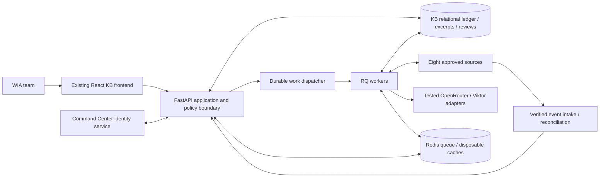
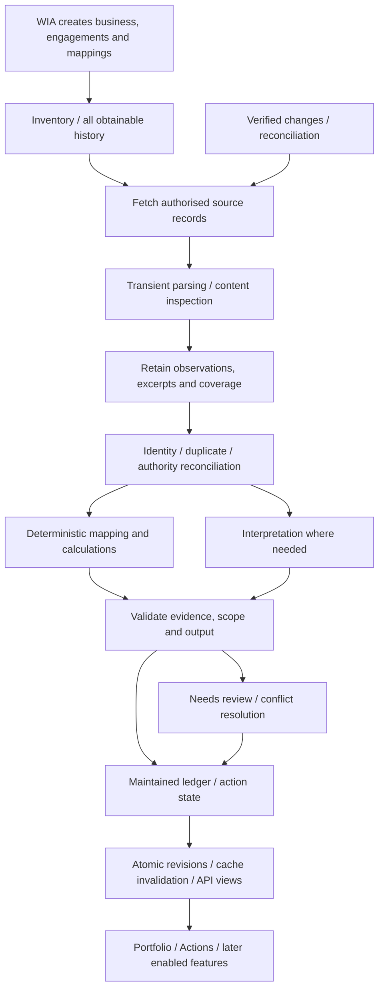
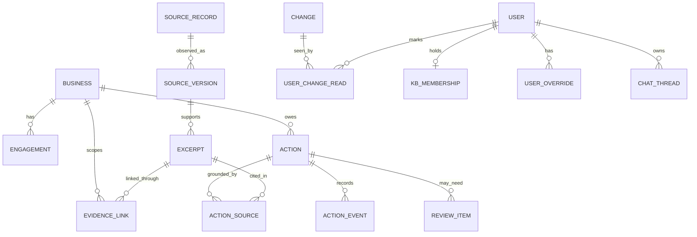

# Client Knowledge Base: Solution Architecture

**For:** Wedding Industry Ads · **Prepared by:** E2M Solutions  
**Date:** 20 October 2026 · **Status:** Expanded technical draft for review; proposed operating baselines require validation

**Revised:** 21 October 2026 — frontend component/data contracts, end-to-end RAG and selected hybrid chatbot cost-control specification.

This document defines the Maintained Client Knowledge Base architecture. It incorporates [decisions through KB-CH-69](../../../knowledgebase_changes.md), the [architecture discovery record](Client-Knowledge-Base-Architecture-Discovery.md), [Feasibility Study](Client-Knowledge-Base-Feasibility-Study.md), [chatbot scope](../../../chatbot_KB.md) and [FastAPI backend SOP](../../../backend_build.md).

**Technical-depth revision:** the [technical gap analysis](Client-Knowledge-Base-Architecture-Technical-Gap-Analysis.md) records the first draft's TG-01–TG-22 gaps and the coverage added in this revision. Q21–Q23 and concrete runtime, schema, API, extraction, reducer, cache, queue, auth, recovery and QA specifications are now included. Operational numbers are proposed engineering baselines; business configuration, provider tests and measured capacity remain explicit.

**Reading the decisions:** **Agreed** means confirmed by the user. **Recommended** identifies this draft's engineering proposal. **Test-dependent** requires comparative or runtime evidence. **Configuration required** identifies values to supply before the affected capability operates. An approved requirement is not proof of a working integration.

**Frontend/data implementation guide:** [RAG execution and evidence units](#39-end-to-end-rag-and-evidence-unit-lifecycle), [screen contract conventions](#412-frontend-inventory-and-screen-contract-conventions), [Overview](#413-overview), [Client Portfolio and all record sections](#414-client-portfolio-and-client-record-sections), [Call Preparation](#415-call-preparation), [Action Register](#416-action-register), [Health and Sentiment](#417-health-and-sentiment), [Invoices and Contracts](#418-invoices-and-contracts), [Chatbot](#419-chatbot), [supporting screens](#420-source-library-connections-and-shared-controls), [read-model APIs and commands](#421-tab-read-model-apis-and-command-contracts), [change propagation](#422-cross-tab-dependencies-and-worked-event-traces), [supporting domain schema](#103-additional-domain-records-required-by-the-screen-contracts) and [screen acceptance cases](#116-component-data-and-rag-acceptance-cases).

## 0. The short version

Build an owned, maintained client-intelligence system for WIA. Its primary record is a business with separate service engagements, linked people/accounts and traceable history. It should help the team understand an account, locate what was agreed and follow through on commitments without repeatedly reconstructing context across tools.

**Action Items and Client Portfolio are the first-release priorities.** All obtainable approved-source history for all active clients must be processed before launch, including data for features whose UI is Coming soon. Complete processing does not mean complete raw-text retention: persist extracted facts, supporting excerpts and provenance; fetch originals when more context is needed.

The recommended implementation is one modular FastAPI backend with separately deployed workers, a relational record/evidence store, Redis/RQ for background execution and cache, and the existing React frontend. Put these in a dedicated WIA-owned Railway project. The KB owns access, evidence, calculations, review and current-state logic whichever AI candidate wins.

### Key decisions

| Area | Direction | Status |
|---|---|---|
| Login | Reuse Command Center authentication; KB admin provisions central accounts through an API | Agreed; provisioning contract must be established/built |
| Access | Custom roles plus scoped per-user Inherit/Allow/Deny overrides; KB-only revocation | Agreed; role/default grants need configuration |
| Evidence | Retained facts/excerpts and source/version/coverage metadata; on-demand originals | Agreed; no permanent full-text mirror |
| Corrections | Authorised resolvers apply audited corrections; other editors propose. Preserve reviewed values and review later conflicts; per-user read indicators are separate | Agreed |
| Task reopening | A genuine mapped ClickUp reopening automatically reopens the KB action and supersedes prior verification, preserving history | Agreed; does not overwrite unrelated reviewed fields |
| Deletion/outage | Retain deleted-source excerpts with warnings; show last-known data during outages with last-sync date/time | Agreed |
| AI execution | Compare selective hybrid, including active Viktor skills, against Viktor-led structured orchestration | Test-dependent; neither selected |
| Chat | Private threads; admins see operational metadata only; direct queries, safe reuse and bounded generation | Scope agreed; delivery order and execution choices remain open |
| Freshness | Fifteen-minute updates once provider data is available; visible sync state and supported refresh | Agreed target; unverified end to end |
| Recovery | Assess at most one hour lost KB changes and restoration within four hours | Agreed assessment targets; restore testing/costs required |
| Scale | About ten team users, all potentially concurrent; 15–20 clients growing towards 30–40 | Planning inputs; not measured capacity |
| Delivery targets | Development 6 November 2026; launch 26 November 2026 | Targets; capacity/throughput do not yet validate the dates |

### Scope at a glance

The first release includes the Portfolio/action experience, membership/access controls, evidence, review, freshness/availability states and full obtainable historical processing. The agreed activation sequence is **Stage 1: Action Register + Client Portfolio; Stage 2: Call Preparation; Stage 3: Health & Sentiment + Invoices & Contracts + Overview**. Existing ClickUp links ship first; ClickUp creation and external notifications remain Coming soon. Chatbot's position and other unlisted capabilities remain open. Section 13.2 defines the activation gates; this sequence assigns no new dates.

New intake is restricted to Gmail, Slack, ClickUp, historical Zoom, Fathom, Drive and relevant Docs/Sheets, LeadLock/GHL and Google Calendar. Existing Viktor posts are attributed analysis. Fresh paid-media analysis, Shopify integration, website research, ChatGPT-history import and separate uploads are outside the current approved intake.

## 1. Requirements and context

### 1.1 What the system must do

| Requirement | Architecture response | Acceptance evidence |
|---|---|---|
| Maintain business-level continuity | Business/engagement registry, source mappings and chronological events | Correct shared-business and multiple-service examples |
| Track actual obligations | Existing task reconciliation and explicit conversation commitments; proposals separate | Current versus stale requests, unknown owner/date and closure fixtures |
| Explain claims | Retained excerpt/provenance registry and permissioned citation access | Cited evidence supports the associated field/action |
| Honour human decisions | Reviewed value separate from source observations; audited conflicts | Refresh cannot silently overwrite a reviewed correction |
| Show accountable follow-through | Owner acknowledgement, reported Done and named-reviewer Verified | Each transition has its own actor/evidence |
| Enforce custom access | Membership, client/module scope and effective operation checks | Denied reads/writes, private chat and revocation cases |
| Process available historical material | Source inventory, checkpoints, reconciliation and signed-off gaps | Every active client's approved-source coverage accounted for |
| Be usable and current | Responsive frontend, explicit missing states, last-sync date/time | Device checks and ten-user mixed-load/freshness tests |
| Control cost without losing QA | Exact queries, bounded context, change-driven analysis, safe caches | Accepted useful output cost with correctness and latency |

### 1.2 Context from the materials

The source tests establish useful real examples, not comprehensive production readiness. Slack threads, Dubsado emails, questionnaires, ClickUp tasks, attendance sheets and scheduled calls support much of the intended experience. Archives, event delivery, parser breadth and some business definitions remain incomplete. LeadLock agency discovery works while the tested client feature reads remain scope-denied.

The 20 October Fathom correction matters: a duplicate environment key had overridden the WIA key with the E2M key. Corrected WIA access retrieves known client calls and an office-hour sample. Complete recorder/history reconciliation and webhook reception are still unverified. Architecture must validate connector identity instead of accepting a successful request against the wrong account.

The current [frontend types](../frontend/src/types.ts) and [App](../frontend/src/App.tsx) are a mock experience: business fields are predominantly required strings, actions have one source and a required due string, and browser-local state can update sample actions. Replace that truth model with backend records. Real owners/dates can be unknown; evidence can be multiple and shared; financial emails may supply an event without a complete invoice.

### 1.3 Vocabulary

| Term | Meaning |
|---|---|
| Client/business | WIA client business, manually created and mapped; not a contact or every LeadLock sub-account |
| Service engagement | A particular service/programme relationship for that business |
| Source record/version | Provider identity and observed content/version metadata; not necessarily a retained original body |
| Evidence excerpt | Retained supporting passage/cell range with its provenance and access scope |
| Observation | What a source or authorised person asserted at a particular time |
| Reviewed fact/value | Maintained KB value with authority, evidence and human decisions preserved |
| Action | Relevant task or explicit request/commitment; an AI improvement remains a labelled proposal |
| Coverage | What sources/windows/items were obtained, processed or unavailable, not an invented completeness percentage |
| Last successful sync | Time a source scope was successfully reconciled/published; separate from attempts and cache age |
| Read marker | User-specific awareness of a change revision; not acceptance or conflict resolution |

### 1.4 Architecture scope and design boundaries

The architecture covers client evidence, retrieval, source intake, external providers, human review, memory, AI, operations, schema, QA, security, release scope, development, costs and risks. Use the existing React/Vite frontend and team FastAPI SOP, with business-level client records, action tracking, field authority and scoped access as the core design concerns.

There is no three-month history cutoff, full-transcript warehouse, vision/OCR pipeline, automatic task-writing assistant or production claim attached to the current mock screens. The earlier question about how client summary/background/focus narratives are maintained was explicitly deferred to implementation; this document does not settle that lifecycle.

## 2. Architecture at a glance

### 2.1 System context



The central identity service establishes identity; the KB decides membership and data/operation access. Source credentials authorise backend connector reads; they do not define every user's visibility. AI providers receive only the approved context/tool scope for the particular job.

### 2.2 Pipeline



All routes share one accepted evidence/current-state path. A live chatbot read or Viktor result cannot become an untracked parallel truth. Historical processing and current changes can coexist, with current commitments protected from archive backlog.

### 2.3 Railway topology

**Agreed isolation:** dedicated KB project/data services under WIA ownership. **Recommended deployment units:** frontend/API serving boundary, FastAPI API, worker process, scheduler/dispatcher, PostgreSQL and Redis. API and workers use the same versioned backend codebase; a modular application is sufficient before evidence justifies independent domain microservices.

Use isolated staging and production environments, data stores, queue/cache namespaces, credentials and provider watch/subscription configuration. E2M and WIA have full testing-data access; selecting bounded fixtures is a coverage/performance choice, not another access-approval gate. Never let staging replay advance production cursors or trigger source writes.

Serving the frontend and protected API through one application origin is recommended to simplify browser sessions and CORS. The exact public hostname/proxy and central sign-in handoff need implementation. Keep database/cache private to the deployment; only intended UI/API/webhook endpoints are public. App replicas and worker concurrency are measured choices, not fixed counts in this draft.

### 2.4 Recommended stack

| Component | Starting direction | Selection boundary |
|---|---|---|
| Frontend | Existing React, TypeScript, Vite application | Inspected local implementation; preserve responsive UX |
| API | Python 3.12/FastAPI, Pydantic v2; HTTPX for provider adapters | Proposed runtime baseline; pin/test compatible dependencies |
| Primary store / database access | PostgreSQL with SQLAlchemy ORM, psycopg and Alembic migrations | Selected in Q21; proposed schema/session policy below, with compatible package pins and migration tests still to validate |
| Optional semantic search | Evaluate vector support in the same store | Add only if retrieval QA improves; no fixed model/dimension |
| Jobs/cache | Redis/RQ plus database-backed work/checkpoints | SOP-aligned recommendation; queue is not the ledger |
| Packaging | Docker; local compose for API/worker/data services | Required SOP |
| AI | OpenRouter API adapters and versioned Viktor skills | WIA-owned accounts; hybrid versus Viktor-led evaluation |
| Recovery | Assess PITR/backup, restore drills and cutover | One-hour/four-hour targets; no proven setup |

SQLAlchemy ORM with psycopg and Alembic is selected. Use SQLAlchemy 2-style mappings, psycopg 3 and a compatible Alembic release; lock tested versions during scaffold. Session/transaction ownership, pools and migrations under backend/sql/migrations are specified below. Region, instance sizes and optional embedding/reranker selection remain engineering/test choices.

### 2.5 Proposed runtime and transaction baseline

The following is an engineering starting design, not a measured capacity allocation. Use one public FastAPI service serving `/api/v1` and the built React assets at one origin; use one Uvicorn process initially. Reserve a private `sync` worker process for transport/current reads, one `analysis` worker for current-record extraction/reconciliation, two `interactive` worker processes for user-awaited work, one `bulk` worker process for backfill/reprocessing, and one scheduler/dispatcher process. They use the same backend image with different entry points. An RQ worker executes one job at a time; reserve current-intake capacity rather than rely on chat-versus-sync queue priority alone.

Start with synchronous SQLAlchemy sessions and psycopg connections. Ordinary database routes are synchronous FastAPI handlers; blocking database/provider calls must not run on an asynchronous event loop. A chat SSE endpoint performs database commands through a bounded thread offload that creates/closes its own session in that thread. Workers use the synchronous service layer. This avoids introducing two database execution models for the initial team; revisit only for measured contention.

Session/transaction ownership belongs to the service command, not an ORM model or route decorator. A command opens one `SessionFactory.begin()` scope, loads its target with a row lock when required, checks effective policy inside the transaction, applies the change and appends outbox/audit rows. Return a detached response DTO; never serialize a live ORM relationship after the session closes. Read commands use a short-lived read session. Do not hold a transaction/connection open while downloading, parsing or calling an AI provider.

Proposed API pool: five connections, zero overflow, five-second checkout timeout. Each worker process starts with pool size one/zero overflow; scheduler uses one. Budget the total across every process plus migrations/operator connections against the actual database limit. Start with five-second ordinary statement timeout and two-second lock timeout; migrations/large maintenance have separate explicitly configured limits. These limits are proposed safeguards, not a claim that ten-user performance has been demonstrated.

Alembic is the sole production schema migration owner. Put `env.py` and revision files under `backend/sql/migrations/`, point `alembic.ini` to that location, and keep ORM metadata imports in the migration environment. Do not run `Base.metadata.create_all()` on production startup. Deploy migration once, then start compatible API/workers; refuse startup against an unsupported schema version. Seeds are idempotent configuration/reference data, not a second schema bootstrap.

Example entry points, with module names to create under the SOP layout:

```text
api:         uvicorn app:app --host 0.0.0.0 --port <PORT> --workers 1
sync:        rq worker sync
analysis:    rq worker analysis
interactive: rq worker interactive          # two process instances initially
bulk:        rq worker bulk
scheduler:   python -m workers.scheduler
migrate:     alembic -c alembic.ini upgrade head
```

The scheduler implements a database-backed due-work sweep; it may be driven by a pinned RQ scheduler, but schedule eligibility/checkpoints are persisted in PostgreSQL. Local compose starts separate API, worker, scheduler, PostgreSQL and Redis processes. `/health/live` checks process liveness; `/health/ready` checks required database/schema connectivity. Redis failure is reported as degraded execution/cache health rather than making every supported ledger read unavailable.

## 3. The knowledge and retrieval layer

### 3.1 Three tiers, each with its own access pattern

| Tier | Retained content | Access pattern |
|---|---|---|
| Structured ledger | Businesses, engagements, facts, actions, reviewed changes and metric definitions/snapshots | Exact relational queries and scoped aggregation |
| Supporting evidence | Selected excerpts, provenance, source identity/version, locators and coverage | Exact links, keyword search and optional semantic retrieval |
| Original content | Full document/transcript/message context fetched when needed | Authorised source read with transient processing and cleanup |

Process all available approved history, but do not retain every original chunk as an excerpt. A complete normalised text mirror, raw event-body archive or debug-log transcript would defeat the agreed retention choice. Store enough event/job metadata for recovery without quietly retaining full originals.

### 3.2 Options considered

Start with one relational store because identity, access, source versions, review and action lifecycle require exact relationships. A separate vector database adds synchronisation and access/expiry complexity without demonstrated need. Pure semantic search cannot reliably count actions, establish the latest completed call or resolve a reviewed deadline.

Facts/excerpts retention reduces permanent source copying, but constrains recall and reprocessing. New questions about unretained detail depend on original availability. A current fetched original may differ from the earlier version; retain that distinction. Neither locators nor hashes recreate missing text. This tradeoff is part of retrieval QA and cost evaluation.

### 3.3 What gets indexed

Index retained fact/excerpt text and necessary metadata: business/engagement, source/account/record ID, version or content marker, author/speaker, event/observation times, topic/tag, review/availability state and module scope. Record locator type such as transcript timestamp, message/thread ID, document heading/page or sheet/range.

Shared meetings and group programme material can map to several businesses. A user permitted to see one business must not receive unrelated passages from another. Return a reviewed/scoped excerpt or withhold inseparable mixed content. An LLM cannot enforce this after receiving forbidden text. Apply the boundary before retrieval context or source content is sent to any provider.

### 3.4 One authorised retrieval service

Expose a common service to Portfolio, search, citations, briefs and chat. It accepts a trusted actor/scope, typed intent/entity/time filters, required freshness and pagination. It performs access filtering before selection/ranking/counts, retrieves exact relations first and returns evidence/coverage/conflicts with the result.

For narrative recall, combine scoped keyword/metadata search with optional semantic candidates and evaluate relevance/completeness. Recheck returned records and citations before delivery. Search ranking cannot widen permissions; permission filtering only after top-k selection can also damage recall, so authorised candidate construction matters.

### 3.5 Retrieval recipes

| Question | Retrieval |
|---|---|
| What is the client's LeadLock link? | Business/account mapping; no generation needed |
| Who owns this action, and why? | Action/current owner, origin evidence, reviewed changes and conflicts |
| What happened on the last call? | Resolve completed substantive meeting, type/participants/timezone, transcript/excerpts and later amendments; do not use the next calendar invitation |
| What remains open? | Scoped action-state query, review status and known closures; missing due dates do not count as overdue |
| How are leads converting? | Defined period/cohort, mapped stages and adequate source events; unavailable until access/definitions support it |
| Why is this health assessment shown? | Published artifact, actual drivers, evidence, period and coverage |

### 3.6 Brief and chatbot context

Assemble bounded context: current business/engagement, permitted facts/actions, relevant evidence/window, metric/glossary definitions, conflicts and freshness. Private chat history is scoped to its user and current permissions. Never send the entire client archive by default.

Evaluate chatbot Mode A (retained KB evidence only) versus Mode B (KB first with controlled approved-source reads). Mode A can obtain additional context through separate permitted ingestion/refresh; Mode B may test eligible question-time reads. Storage policy does not select the mode. Live results enter normal validation/reconciliation, carry retrieval/version times and disclose any difference from the displayed page snapshot.

### 3.7 Scale and revisit triggers

Test ten simultaneous users and 15–20 then 30–40 client planning scenarios using observed source volumes. Revisit indexes, vector search, worker separation or an external search engine only for measured recall, latency, memory or contention problems. Headcount does not size transcript/history processing; inventory tokens, records, versions and change rates separately.

### 3.8 Search contract and proposed ranking algorithm

Use one typed `SearchRequest` with `query`, resolved `business_ids`, optional engagement/source/time filters, `intent`, `limit` and the caller's required freshness. Backend policy supplies the effective scope; a requested business filter can narrow it, never widen it. A hit contains `excerpt_id`, `source_version_id`, scoped business/engagement references, text, locator, observation/event times, availability/deletion warning, keyword/semantic ranks and citation ID. Private chat messages are not part of this shared evidence corpus.

Start with exact relationship queries and PostgreSQL full-text search. Persist a generated/indexed search vector for retained text; add a GIN index and B-tree indexes for business/scope/source/time filters. Use trigram indexes for reviewed aliases if ordinary alias lookup proves insufficient. Do not add an embedding column with an arbitrary fixed dimension before selecting/testing an embedding model.

For the optional semantic experiment, retrieve at most 40 permitted keyword candidates and 40 permitted semantic candidates. Deduplicate by excerpt and fuse with `RRF = sum(1 / (60 + rank))`; take at most 12 distinct useful excerpts into a synthesis context, bounded by the selected model's token budget. These are proposed initial tuning values. Assess reranking on the candidate set only if it improves the reviewed retrieval set. Exact SQL/action counts do not need this ranking path.

The scope predicate must exist inside every candidate query, conceptually:

```sql
SELECT e.id, e.source_version_id, e.text, e.occurred_at
FROM evidence_excerpts AS e
WHERE e.retention_state = 'retained'
  AND e.tsv @@ websearch_to_tsquery('english', :query)
  AND EXISTS (
      SELECT 1 FROM evidence_scope_links AS s
      JOIN effective_user_scopes(:actor_id) AS p
        ON p.business_id = s.business_id AND p.module_key = s.module_key
      WHERE s.excerpt_id = e.id
  )
  AND (:from_time IS NULL OR e.occurred_at >= :from_time)
ORDER BY ts_rank_cd(e.tsv, websearch_to_tsquery('english', :query)) DESC, e.id
LIMIT :candidate_limit;
```

This is a query sketch against the proposed schema, not an installed database function. `effective_user_scopes` must itself require active membership and current grants. A mixed excerpt is linked as deliverable only to scopes for which the complete excerpt is safe; attaching two business IDs is not a redaction mechanism. Until its safe content boundary is established, withhold it from restricted-user retrieval and route for review.

For original hydration, perform at most one follow-up round per question initially, at most three approved source records, and repeat span/scope checks before answering. Mode A does not use question-time source tools; Mode B can enable this bounded path only after its tests. Store additional approved facts/excerpts via normal ingestion, not every downloaded paragraph. If budget/coverage is insufficient, return a supported partial answer; do not truncate context then imply exhaustive recall.

### 3.9 End-to-end RAG and evidence-unit lifecycle

RAG is the evidence-selection and generation path within the owned KB, not a replacement for its structured ledger. Database queries answer exact fields, current states, lists and calculations. Retrieval supplies passages and context when interpretation or explanation is needed. The same permissioned services support page artifacts, briefs, search and chat; a new chat implementation must not create a second source of client truth.

| Stage | Input and operation | Output / failure boundary |
|---|---|---|
| Receive | Backfill pages or verified provider signals enter the durable intake path in Sections 4.1/4.9/9.6; fetch authoritative approved records | Source identity/version and processing work; receipt is not proof of business publication |
| Normalise/map | Parse approved readable content, retain event/observed times and locators, resolve business/engagement/person mappings | Typed source spans and identity candidates; ambiguous mapping enters review |
| Extract | Use deterministic fields where available and bounded extraction for conversational facts/requests/decisions | Validated observations and exact support spans; unknowns remain explicit |
| Reconcile | Apply field-authority, closure, correction and action-state rules | Current relational records, historical events, review items and dependency revisions |
| Index | Publish approved retained facts/excerpts and permitted metadata into search | Searchable evidence units; no permanent full-original chunk archive |
| Resolve question/artifact | Bind actor, client/engagement/entity, period, displayed revision and intent | Typed query plan and applicable freshness/coverage requirements |
| Retrieve | Exact relationships first; scoped keyword/optional semantic retrieval for necessary context | Evidence bundle with ordered spans, current facts, conflicts and gaps |
| Compose/validate | Direct response or bounded API/specialist output; validate identifiers, factual support and access | Answer/brief artifact or explicit partial/unavailable outcome |
| Publish | Recheck dependencies/permissions, store allowed artifact and emit response | Versioned page/chat result; caches use the same manifest and invalidation rules |

**Processing windows and retrieval units are different.** The proposed 6,000-token windows with 256-token overlap are transient extraction work units. Split on available message/paragraph/speaker boundaries, preserve a source-span locator map and deduplicate overlap observations. Oversize spans continue through bounded windows without dropping the remainder. Parent manifests record every window and reconciliation outcome.

A retained retrieval unit is a coherent supporting passage, field-support excerpt, transcript span or sheet range selected for an accepted fact/event or useful approved context. Keep `source_version_id`, typed locator, exact text/hash, business/engagement/module scope, actor/time metadata, topic and availability/retention state. Do not embed or persist every processing window under the name of an excerpt. A paragraph without necessary antecedents may require a larger permitted excerpt; inseparable mixed-client content is withheld from restricted users.

Keyword indexing uses retained evidence text; optional embeddings cover the same permitted evidence units. Embedding model, dimension and migration strategy remain test-dependent. Store model/index version if enabled; source edit, scope change or expiry removes/replaces affected searchable units. New indexing must not preserve expired text in an old vector namespace. Section 3.8 supplies the proposed 40 keyword/40 semantic candidates, RRF constant 60 and maximum 12 useful context excerpts. Those bounds are experiments, not exhaustive-recall guarantees.

The context builder assembles `resolved_scope`, exact current facts/query results, relevant historical spans, metric definitions, conflicts, coverage, source-as-of values and a backend-issued citation registry. Resolve dates and identities before retrieval. Order evidence by its role and chronology rather than silently interpreting ingestion order as event order. Reserve model context/output headroom; if relevant evidence cannot fit, narrow the question, use bounded additional work or return partial coverage. Do not silently drop evidence and claim an exhaustive result.

Original hydration, when permitted by the tested chat mode, accepts trusted source-record references rather than arbitrary model/browser URLs. Connector authority, approved resource scope, format/size limits and current-user content boundaries apply before text reaches a model. Match the retrieved version/hash to the requested historical context; a changed current original cannot substantiate an exact old quotation unless the retained excerpt supports it. Mode A uses retained evidence and separately authorised ingestion/refresh; Mode B may use the bounded question-time path in Section 3.8. Neither mode is selected by this revision.

### 3.10 Retrieval recipes and completeness across screens

| Need | Exact query / selection | Evidence or generation |
|---|---|---|
| Open/overdue counts | Full permitted action set with accepted progress, known deadline and clock boundary | No semantic top-k count or model arithmetic |
| Last call | Latest relevant completed meeting occurrence, distinct from future/cancelled invitations | Retrieve its readable evidence; disclose a later known meeting whose content is missing rather than relabel an older readable call as the latest |
| Action context | Current action, origin/support links, applied changes and relevant dependencies | Retrieve surrounding permitted conversation; distinguish original wording from current state |
| Client profile | Current reviewed field values and engagement selection | Explain supporting questionnaire/conversation spans; unknown field stays unknown |
| Brief | Calendar occurrence, current actions, recent events, questions and source coverage | Bounded synthesis tied to purpose and input revisions |
| Engagement assessment | Published assessment version and actual drivers/metric snapshots | Explain the assessment with its support, uncertainty and period |
| Commercial question | Accepted commercial events and supported invoice/agreement records | Explain provenance and missing balance/terms; never infer debt from a reminder alone |
| All changes/comparison | Complete scoped event/query set, defined time boundaries and consistent metric definitions | Paginate or disclose unprocessed scope; top-ranked passages cannot establish completeness |

Use answer/artifact dependencies for collection revisions as well as selected records: a new action or later meeting can invalidate an answer even when none of its existing citations changed. An empty permitted query result is zero only for the defined maintained dataset/period and declared coverage; it is not proof that inaccessible source records contain no relevant items. Source outages, unprocessed originals and deleted-source retained evidence remain different states.

## 4. The pipeline, stage by stage

### 4.1 Intake, history and coverage

WIA manually creates the business, engagements and reviewed source mappings. A LeadLock contact, Dubsado email or folder is a candidate, not automatic proof of a new active client. Track coverage by business, source account/scope and historical window: discovered, obtained, processed, unsupported, inaccessible or unresolved.

Backfill all obtainable approved history for every active client before launch, even for data behind Coming soon UI. Reconcile counts/pages/windows and expected archives; absence of another page or a successful small sample is insufficient. WIA signs the source-by-source gap report. Inaccessible items stay unresolved until accepted or recovered. Former-client archive scope is separate.

| Source | Intake and retained use | Current readiness boundary |
|---|---|---|
| Gmail | Dubsado signing/payment events, client requests, decisions and support email; Pub/Sub-triggered history reconciliation | Account/real samples verified; push reception/renewal/history recovery untested |
| Slack | Relevant channels/threads, messages, edits/reactions, actor/time and links | Six-channel samples/archive available; complete active-client coverage and event lifecycle open; private DMs not approved intake |
| ClickUp | Relevant tasks, assignees, due/state, list/programme fields, descriptions/comments and existing links | 338 sampled tasks; gaps in dates/owners and workflow semantics remain |
| Historical Zoom | Obtainable existing transcripts/summaries or exports in approved Drive archives | Live Zoom access and archive completeness unverified |
| Fathom | Future meeting webhook plus API transcript/summary/backfill/reconciliation | Correct WIA samples work; complete host/history and webhook lifecycle open |
| Drive | Approved folders, text/Docs/Sheets, extractable PDF/DOCX and existing transcript archives | Sample Docs/Sheets work; complete history and parser coverage open |
| LeadLock/GHL | Account references; defined inquiries, stages, bookings/activity/outcomes if accessible | 59 agency sub-accounts discovered; tested feature reads still denied |
| Calendar | Scheduling/occurrences/attendees, client matching and later call queues | Calendar/event reads work; watch and full reconciliation untested; RSVP is not attendance |

Push notifications are change signals, not necessarily complete documents. Authenticate/validate delivery using the provider's supported mechanism, persist a minimal receipt/work reference, acknowledge promptly, then retrieve current authorised records. Track subscriptions, expiration/renewal and missed-event reconciliation. A renewal/reconciliation job is required even where normal operation is webhook-led.

### 4.2 Normalisation and transient processing

Normalise provider/account/record identity, source/update/observation times, actor/speaker, version markers, relationships and extraction status. Preserve original timezone context and store machine-comparable timestamps; display the appropriate business/user timezone explicitly.

Process readable text, native Docs/Sheets, existing transcripts and extractable PDF/DOCX. Scans, images and audio/video remain links; no OCR/new transcription. A partly scanned PDF needs partial/unprocessed coverage, not an assertion that every page was understood. Cleanup transient downloads/extracted full text under category policy; do not log bodies.

**Proposed parser baseline:** use `pypdf` for existing PDF text and `python-docx` for DOCX paragraphs/tables, with page or document-block/table locators retained alongside quotes. Native Docs/Sheets use their approved API/export paths with document/tab/range provenance. Preserve reading-order uncertainty, unsupported structures and unextractable pages as coverage exceptions; parser success alone is not proof of complete or correctly ordered content. Enforce file/expanded-size limits before parsing and process memory/time ceilings during parsing; PDF content streams can require far more memory than file size suggests. Pin and test these libraries against the approved fixture set before treating format coverage as verified. [pypdf text extraction](https://pypdf.readthedocs.io/en/stable/user/extract-text.html), [python-docx documentation](https://python-docx.readthedocs.io/en/latest/).

Deduplicate by provider identities and reconcile equivalent cross-source events. A calendar copy, transcript, recap and task can support one meeting/obligation without being duplicates of every field. A signing notification and a payment event are not interchangeable; two references to one payment must not be summed twice.

### 4.3 Observation and action extraction

Use code for exact IDs/fields and tested interpretation for explicit conversation asks/commitments. Each extracted item identifies business/engagement candidates, source/excerpt, event time, origin kind, proposed owner/date with their evidence, unknowns, later closure and coverage. Preserve relative-date wording and timezone until resolvable; do not invent an owner or due date to satisfy a non-null frontend field.

Existing active tasks and clear current commitments can enter the active register. Ambiguous historical requests, potentially stale obligations and AI proposals enter Needs review; proposals retain a visible origin label. Reconcile later delivery/withdrawal evidence before treating historical requests as current debt. A repeated extraction must link the existing obligation rather than multiply it.

### 4.4 Business identity and field authority

Maintain reviewed links among businesses, service engagements, people, domains/emails, LeadLock accounts, channels, folders, lists and meetings. Resolve ambiguous matches through WIA review; names alone are insufficient for shared channels or similar venues. One shared meeting can have several business links without merging profiles.

Maintain source observations separately from the reviewed value. Meeting commitments take precedence over conflicting ClickUp due dates while preserving the discrepancy. Other fields follow evidence-specific authority: a conversation does not amend signed terms or payment state. A newer timestamp is not universal authority. Implement the reducer and authority table in Section 4.10; business-specific unmapped cases go to review rather than model improvisation.

### 4.5 Action lifecycle and review

Use separate dimensions for task progress, review/conflict state, origin, acknowledgement and verification. The frontend's Open/In progress/Done/Verified labels cannot express Needs review or a disputed deadline by themselves.

| Event | Required treatment |
|---|---|
| Relevant active task/current commitment | Link/create the KB action with provenance and known fields |
| Uncertain/stale/proposed item | Needs review; do not silently count as a current confirmed commitment |
| Owner acceptance | Explicit identified-owner message, owner's manual KB action, or configured owner reaction |
| Reaction acknowledgement | Admin-configured emoji/meaning allowlist required before enablement; ambiguous cases reviewed |
| Reported completion | Mapped task completion or explicit delivery evidence supports Done |
| Follow-up check | Named authorised WIA reviewer records check/evidence for Verified |
| Owner verifies own work | Requires normal verification rights plus the configured self-verification permission |
| Reviewed correction | Preserve accepted value and audit; later conflicting source updates go to review |
| Manual correction proposal/application | Editors submit proposals; authorised resolvers may apply audited corrections directly. Submission alone does not change maintained values |
| Mapped ClickUp task reopens after Verified | Automatically reopen the KB action and mark prior verification superseded, preserving its history; no review gate is required merely to reopen |

The WIA operations reviewer coordinates review, account owners resolve business issues and E2M handles technical intake issues. These responsibilities do not automatically grant operation rights. No fixed turnaround/escalation SLA is agreed. First-release operations change the KB; source-system writes and notifications remain Coming soon.

The reopening rule is specific to the genuinely reopened mapped task; validate source ordering/current state and deduplicate repeats. It does not overwrite reviewed owners/deadlines. Later completion supports Done, while the superseded verification stays historical until a new follow-up check establishes a new Verified state. Persist the source observation, lifecycle transition, verification supersession, change revision and dependent invalidation as one accepted state change.

### 4.6 Portfolio, outcomes and commercial events

Populate supported Profile, Now, History, Handover, Commitments, Meetings, finance/terms and Attendance data according to release availability. Use explicit unknown/unavailable states. A Coming soon gate describes delivery; it does not imply source data is absent or remove historical intake obligations.

Profile additions include the mapped LeadLock account link, support visibility and lead-outcome snapshots. Lead definitions must specify inquiries, booked tours/consultations, won clients, stage conversion, period/cohort, cancellation/duplicate treatment and source refresh. Lead handling needs appropriate activity history; generic updated timestamps do not prove response times. Do not compute ROAS/CPL without agreed attribution/spend sources.

Dubsado-through-Gmail supplies evidenced signing/payment events from subject/body/URLs. It does not automatically establish a full invoice ledger, balance, overdue state or signed terms. Access the underlying approved agreement for scope/terms when obtainable; meaning of GHL pricing remains unverified. Shopify has no approved detailed intake plan.

Health & Sentiment later includes engagement, feedback, delivery follow-through, support/resolution, lead handling/outcomes and relevant onboarding/programme context where evidenced. Show separate engagement/outcome views with drivers and coverage; commercial health context and combined numeric scoring remain deferred. Sheet attendance requires programme rules; Calendar RSVP does not prove attendance.

### 4.7 Publication and frontend adaptation

Publish accepted current state, evidence/collection revisions and durable invalidation work together. Responses include record version, allowed operations, evidence references, known conflicts and source freshness. Write endpoints use expected versions/idempotency keys; stale browser changes must not overwrite another review.

Replace mock-only assumptions: nullable owners/dates, multiple engagements/evidence references, separate review/acknowledgement/verification histories, availability states and metadata-backed coverage. Do not map unknown amounts to zero or missing task dates to today. Production mutations live in the backend, not preview localStorage.

Preserve responsive navigation, tables/cards, evidence drawers, review diffs, dates and action controls across current phones, tablets, laptops, MacBooks and iMacs. Test viewport/browser/input combinations instead of treating each product name as one resolution. Disabled/hidden sections must be enforced by the backend and excluded from search/chat as appropriate.

### 4.8 Canonical input/output contracts

The processing boundary is a typed observation, not an unrestricted raw provider dictionary. A proposed minimum contract is:

```python
from datetime import date, datetime
from typing import Literal
from uuid import UUID
from pydantic import BaseModel, ConfigDict, Field

class SourceRef(BaseModel):
    model_config = ConfigDict(extra='forbid')
    provider: Literal['gmail', 'slack', 'clickup', 'zoom', 'fathom', 'drive', 'calendar', 'leadlock']
    account_id: UUID
    external_id: str
    provider_version: str | None
    content_sha256: str
    occurred_at: datetime | None
    observed_at: datetime

class EvidenceSpan(BaseModel):
    source_version_id: UUID
    locator_kind: Literal['message', 'transcript', 'document', 'sheet', 'task']
    locator: dict                 # validated by a locator-specific tagged schema
    quote: str
    business_ids: list[UUID] = Field(min_length=1)
    module_key: str               # validated against the application module registry

class DeadlineCandidate(BaseModel):
    kind: Literal['unknown', 'date', 'instant']
    date_value: date | None = None
    instant_value: datetime | None = None
    timezone_name: str | None = None
    source_phrase: str | None = None
    evidence_ids: list[UUID] = Field(default_factory=list)

class ActionCandidate(BaseModel):
    business_id: UUID
    engagement_id: UUID | None
    title: str
    origin: Literal['mapped_task', 'explicit_request', 'explicit_commitment', 'ai_proposal']
    owner_person_id: UUID | None
    deadline: DeadlineCandidate
    evidence_ids: list[UUID] = Field(min_length=1)
    unknown_reasons: list[str] = Field(default_factory=list)
```

The implementation must add cross-field checks: an instant has timezone-aware `instant_value` only; a date retains its calendar date without invented time; unknown has neither; resolved owner/deadline need supporting evidence. `business_ids`, module names, source versions and people must resolve against the trusted registry. Additional typed outputs cover profile observations, decisions, support issues, signing/payment events and coverage. Confidence may help review prioritisation; it does not bypass evidence or rights.

Represent a page as `ChangeBatch(items, next_cursor, terminal, coverage, transient_errors)`. Persist a candidate cursor with durable receipt/work IDs after obtaining the page; advance the reconciliation checkpoint only when every item is durably accounted for as accepted work or an explicit gap. Do not require downstream AI completion before fetching another page, and do not advance past an unrecorded failure. Failed extraction remains visible even if transport pagination completed.

Full-original text is an ephemeral parser/extractor input. Proposed extraction windows are up to 6,000 tokens with up to 256 tokens of boundary overlap; preserve speaker/message boundaries where possible and process every window, not just the first. Merge candidates by source span/canonical obligation and reconcile cross-window references and later closures. A different model context limit can reduce windows; changing it versions the extractor.

Before retaining an excerpt, verify its quotation against the transient source with Unicode/whitespace normalisation and a valid locator. Do not label a fuzzy paraphrase as a verbatim quote. Validate numeric/currency tokens, speaker attribution, known person/account links, date derivation and per-business content boundary. On invalid schema allow one bounded repair attempt; unsupported claims are rejected, ambiguous identity/meaning goes to review and partial input remains partial coverage.

### 4.9 Provider-specific synchronisation procedures

These procedures specify the implementation path. Actual WIA subscriptions and all-account coverage remain to validate. Provider rate/page limits must be read from current supported capabilities and response headers.

| Source | Procedure and checkpoint | Verification/recovery |
|---|---|---|
| Gmail | Use `users.watch` to a Pub/Sub topic; receipt identifies mailbox/history signal, then `users.history.list` and required `messages.get` reads. Keep the mailbox checkpoint separately from notification IDs. Renew watch daily and also track returned expiration | Authenticate Pub/Sub push identity/audience/subscription; do not trust an email field alone. Periodically reconcile even without notifications; expired history starts an explicitly tracked resync |
| Drive | Start from an approved-folder inventory and account change token; watch `changes`, then page `changes.list`. Fetch/export only approved members/content formats; update membership when folders/files move | Match registered channel ID/resource/token and deduplicate notifications. Fetch authoritative metadata/content; removal can mean unsharing, so do not automatically mark confirmed deletion. Renew with new channel IDs before expiry |
| Calendar | Maintain separate calendar registry and `events.list` sync state; watch each selected events collection. Reconcile occurrences/cancellations, preserve recurrence/instance identity and business mapping | Use registered channel metadata/token and authoritative event reads. On invalid sync state perform a tracked full resync with compatible query parameters, not silent truncation |
| Slack | Use registered channel `conversations.history`, thread `conversations.replies`, event-triggered refetch and a bounded reconciliation overlap. Track channel/window/thread receipts and source version/hash | Validate Slack signatures/challenge handling. Map actor IDs before acknowledgements; process edits/deletes/reactions with deduplication and reconcile late deliveries |
| ClickUp | Inventory approved lists/tasks, retain task IDs/status mappings and refresh the current mapped task after relevant webhook events. Reconciliation catches missed changes | Verify the webhook's shared-secret signature. Reopen only from a genuine accepted source transition; old snapshots/retries cannot supersede a newer verification |
| Fathom | Page authorised meetings per configured WIA recorder/scope; fetch existing transcript/summary as available. Webhook triggers the same accepted-record path | Verify raw-body signature/ID/timestamp with the registered webhook secret. Deduplicate by delivery and recording identity; reconcile API history for missing/finalising records |
| Historical Zoom | Inventory obtainable recording instances/transcript exports or approved Drive archives. Treat direct and archived copies as linked representations | No new transcription. Preserve archive-access gaps; use meeting-instance/time identity rather than a recurring meeting number alone |
| LeadLock | Use reviewed business-to-location mapping and endpoint capability checks before feature jobs. Account discovery does not mark opportunities/calendars authorised | Permanent scope denial is `blocked_access`, not empty metrics. Enable source feature reads only after the supported authorisation path passes a real read test |

Gmail uses Pub/Sub and requires watch renewal; Drive/Calendar use notification channels rather than assuming every Google callback is an authenticated Pub/Sub message. Drive notification bodies do not supply the document. ClickUp uses webhook-specific signing; Fathom supplies signed raw-body verification headers. [Gmail](https://developers.google.com/workspace/gmail/api/guides/push), [Drive](https://developers.google.com/workspace/drive/api/guides/push), [Calendar](https://developers.google.com/workspace/calendar/api/guides/push), [Slack](https://docs.slack.dev/apis/events-api/), [ClickUp](https://developer.clickup.com/docs/webhooks), [Fathom](https://developers.fathom.ai/webhooks).

Implement `/hooks/{provider}/{registered_connection}` as provider-specific handlers: read bounded raw input, verify before parsing, persist minimal receipt/work, then acknowledge. Proposed internal acknowledgement target is two seconds without parsing/AI work. A database persistence failure returns a retryable failure; an already persisted duplicate returns success. Request logs never retain the full body. Map expiration, cursor reset and throttling to explicit recovery jobs.

### 4.10 Identity ladder, field reducer and completeness

Identity resolution order is reviewed explicit account/folder/channel/list mapping, verified provider-person/contact link, reviewed alias plus corroborating metadata, then Needs review. Similar name/domain/text is a candidate, not an automatic merge. Retain the matching rule/version and review outcome. Canonical meeting linking uses provider instance/link and overlapping occurrence metadata; canonical obligation linking uses mapped task identity or reviewed source-span links rather than text similarity alone.

Define `reduce(existing, observation, field_policy, review_state) -> current_value, history_events, reviews, invalidation_scopes`. Lock/check the entity revision only while applying that result. Proposed field policy implementation:

| Field/event | Accepted input | Automatic effect / review boundary |
|---|---|---|
| Account link | Reviewed explicit business/location mapping | Replace through mapping administration with audit, not inferred contact identity |
| Profile fact | Supported observation or authorised applied correction | Preserve reviewed correction; material disagreement creates a proposal/conflict |
| Owner | Mapped identity or explicit commitment evidence | Unknown person stays unknown; disagreement with reviewed owner goes to resolution |
| Deadline | Explicit date/instant with source context | Meeting commitment beats conflicting task due date; preserve both; ambiguous relative date goes to review |
| Done | Mapped task completion or explicit delivery evidence | Update reported progress; no automatic verification |
| Verified | Named authorised follow-up check/evidence | Require effective verify/self-verify permissions at mutation time |
| Mapped task reopens | Fresh accepted active-state transition | Reopen progress and supersede active verification atomically under Q23 |
| Contract/payment | Underlying agreement/evidenced commercial event | Conversation cannot amend signed terms or assert a new payment; conflicting claims remain distinct |

Observation time is when the KB learned something; event/effective time describes when it happened/applies. Store both. A newly discovered old email does not become the latest business decision merely because ingestion ran today. Source-deletion and availability signals update support metadata, not arbitrary business facts.

A backfill manifest records source/account/scope, window, inventory contract version, discovered/obtained/parsed/extracted/reconciled counts, duplicate links, unresolved gaps and final cursor. For a provider with no expected total, completion means enumerated pages/windows and accounted outcomes, explicitly stating that denominator limitation. UI coverage percentage is disabled until a denominator/definition is agreed.

Coming soon gates do not stop approved field extraction/backfill. If a required readable record or approved extraction field has not been processed, mark that as pending/gap rather than declaring history complete because its UI is later. Completion is against the versioned approved intake/extraction contract, not a promise that every possible future question can be answered from selected excerpts. WIA gap acceptance records scope, unavailable items, reason, signer and time.

### 4.11 Core HTTP and frontend contracts

All routes below are under `/api/v1`, except provider hooks and central handoff endpoints. Actor identity comes from trusted authentication. Mutations use `Idempotency-Key`; entity-changing commands carry `expected_revision`. Duplicate same-key/same-body commands return the stored receipt, while same-key/different-body is a conflict. Final permission/revision checks happen in the mutation transaction.

| Endpoint | Capability / result |
|---|---|
| `GET /session` | Current identity, active KB membership, allowed modules and effective rights |
| `GET /clients`, `GET /clients/{id}` | Scoped business projections with engagements, evidence/coverage/freshness |
| `POST /clients`, `POST /clients/{id}/engagements` | Authorised manual registry creation; cannot activate by a source event alone |
| `PUT /clients/{id}/source-mappings` | Mapping administration with revision/audit and reconciliation work |
| `GET /actions`, `GET /actions/{id}` | Scoped progress/review/acknowledgement/verification projections |
| `POST /corrections` | Typed proposed field change; resolver applies directly, other editors create a proposal |
| `POST /reviews/{id}/resolve` | Resolver decision with expected entity/review revision |
| `POST /actions/{id}/acknowledgements` | Identified owner's acceptance event |
| `POST /actions/{id}/completion-reports` | Permitted completion report with actual supporting delivery evidence |
| `POST /actions/{id}/verifications` | Named follow-up check; enforce normal/self-verification policy |
| `GET /changes`, `POST /changes/{id}/read` | Scoped changes and reading of a specific viewed revision |
| `POST /search`, `GET /citations/{id}` | Scoped retrieval and retained evidence with availability warnings |
| `GET /sources/coverage`, `POST /sources/{id}/refresh` | Health/coverage; refresh returns a tracked `202` work reference |
| `POST /chat/threads`, `POST /chat/threads/{id}/messages` | Private conversation and direct/async answer run when feature enabled |
| `GET /chat/runs/{id}`, `GET /chat/runs/{id}/events` | Owner-authorised state and progress/final SSE events |
| `GET/PUT /admin/roles`, `/admin/users/{id}/overrides` | Audited effective rights administration |
| `POST /admin/users`, `DELETE /admin/users/{id}/membership` | Central create/link provisioning and KB-only revocation |
| `GET/PUT /admin/retention` | Category policy administration without private content inspection |

Use keyset pagination with `(sort_time, id)` and an opaque scope-bound cursor; proposed default/max page sizes are 50/100. Validate enum/time filters server-side. Return `401` for missing/invalid authentication, `404` for an entity outside visible scope, `403` for a denied operation on a visible entity, `409` for a stale revision/idempotency mismatch, `422` for invalid typed input and `429` for application admission limits. Return `503` when required database/authentication validation is unavailable; source unavailability does not turn supported last-known client reads into false 404s or require all reads to fail.

Response envelope: `data`, `record_revision`, `as_of`, source-specific `freshness`, safe `warnings`, `allowed_actions` and pagination where relevant. Error envelope: stable `code`, safe `message`, `request_id`, optional retry hint/current revision; no SQL/provider prompt body. A view can be `current`, `stale`, `partial` or `unavailable`; hidden modules are not populated with leaked data.

| Existing frontend field | Production replacement |
|---|---|
| `Action.owner`, `due` | Nullable owner identity/display and typed date/instant/unknown deadline; no placeholder treated as a person/date |
| `Action.status`, `acknowledged` | Display projection from progress plus active verification; separate review and acknowledgement histories |
| `Action.sourceId` | Multiple scoped origin/support references and reviewed history |
| `Client.service`, `type` | Business with multiple engagements; programme-specific tabs use engagement eligibility |
| `Client.coverage`, `health` | Defined coverage metadata and later evidence-backed assessment; no invented percentage/score |
| `Invoice` sample object | Commercial events unless a full invoice/terms source actually supports the invoice fields |
| `Evidence.excerpt`, `locator` | Retained scoped quote with typed locator/version, observed time and deletion/expiry warning |

React replaces sample/localStorage truth with these projections and renders unknown, stale, review and Coming soon independently. No unrestricted generic `PATCH` may bypass correction/verification services. Regenerate frontend contract types or maintain tested schema parity; do not maintain divergent business rules inside components.

### 4.12 Frontend inventory and screen contract conventions

**Inspection basis, 21 October:** [navigation](../frontend/src/components/Sidebar.tsx), [routing/state](../frontend/src/App.tsx), [types](../frontend/src/types.ts), [sample data](../frontend/src/data.ts) and the view components linked below. Six primary tabs exist: Overview, Client Portfolio, Call Preparation, Action Register, Health & Sentiment and Invoices & Contracts. Source Library and Connections are supporting tabs. The client record has Now, Client profile, Engagement history, Handover brief, Commitments, Meetings, Invoices & terms and programme-eligible Attendance. Chatbot is a planned new tab; no chat route/component is currently implemented.

The seed data contains six fictional clients, 17 evidence excerpts, 11 actions, six scheduled calls and six invoices. Hardcoded text, arrays, charts, counters and browser-local action edits describe a mock experience. They do not establish real WIA values, actual integration access or adequate production field coverage. This documentation revision changes no frontend implementation or release sequencing.

Every component contract must resolve `component_key -> response field -> source fields -> canonical record -> transformation -> evidence/authority -> dependencies -> endpoint -> missing-state behaviour -> acceptance case`. The matrices below apply that chain. Field paths are proposed production DTOs, not claims that the existing TypeScript interfaces already contain them. Supporting domain records appear in Section 10.3.

| Field class | Backend treatment | Example |
|---|---|---|
| Direct/reviewed fact | Read accepted value with source/applied-decision provenance | Contact, reviewed owner, engagement goal |
| Calculated value | Execute versioned deterministic query over a defined scope/period | Open count, known overdue count, valid payment total |
| Interpretation/proposal | Versioned output with actual supporting facts/spans, input revisions and coverage | Call agenda, relationship explanation |
| Application metadata | Trusted session/configuration/processing records | User greeting, timezone, permissions, sync state |

Use Section 4.11's envelope plus field-level states where one card mixes available and unsupported values. A field carries a typed nullable `value`, `state` (`available`, `unknown`, `unavailable`, `not_applicable`), `basis`, supporting evidence/applied-decision references and safe missing reasons. Freshness (`current`, `stale`, `partial`, `unavailable`), review/conflict state and Coming soon are separate dimensions. A field can be available but stale or disputed; a hidden module is omitted, not reported as an empty visible module.

Typed measures carry value/unit/currency, period/as-of, definition version and coverage. Never use blank strings, zero, midnight or a fabricated percentage to satisfy required mock fields. Components receive server-authorised `allowed_actions`; server checks still apply to every command. Deduplicate shared meetings/events and business identities before aggregates; all tab counts and exports use the complete permitted query scope, not the current browser page.

### 4.13 Overview

Current implementation: [Dashboard.tsx](../frontend/src/views/Dashboard.tsx). Read model: `OverviewResponse` from `GET /overview` under Section 4.21. Overview composes maintained module records; it does not run a new independent account analysis on each page load.

| Component / response fields | Required records and source fields | Transformation, support and missing-state rule |
|---|---|---|
| Greeting/date: `viewer.display_name`, `local_date`, `timezone` | Trusted central identity/KB profile and timezone settings | Format actual local date; remove fixed Whitney/date text. No client-source ingestion required |
| Clients in care: `portfolio.active_business_count`, `engagement_breakdown` | Active `businesses`, eligible `service_engagements`, visibility grants | Count distinct permitted businesses. Service breakdown counts engagements with labelled denominator; multi-service totals need not sum to business count |
| Calendar count/next time: `calendar.today_count`, `next_occurrence` | Selected Calendar ID/event/instance, start/end, timezone, cancellation, client links | Query current date and earliest eligible future occurrence; no array-first assumption. No upcoming call is a normal empty state |
| Open commitments: `actions.open_count`, `known_overdue_count`, `unknown_deadline_count` | Accepted action progress, typed deadline, review inclusion rule and clock | Reuse action query definitions. Unknown deadline is not overdue; no AI arithmetic |
| Clients to check: `attention.business_count`, `drivers` | Latest usable engagement assessment per permitted business and period | Count distinct supported flags, with assessment coverage. Missing assessment is not healthy or an adverse finding |
| Next conversation: `next_brief` | Selected occurrence plus matching current brief artifact/input manifest | Context, suggested discussion, citations and actual ready/stale/processing state. If unavailable, show calendar facts and the reason rather than fixed 'Brief ready' |
| Portfolio preview: `portfolio_preview.items` | Business identity, engagements, current action counts, assessment and activity series | Same record IDs/revisions as Portfolio; explicit server sort/limit. Activity definition remains required |
| Loops: `follow_through.items` | Open actions, known due dates, owner acknowledgement and responsibility | Rank by versioned rule; label overdue/today/future correctly. Unacknowledged does not mean due today |
| Listening quotation: `client_signal` | Exact authorised excerpt, identified speaker/role, date and locator | Select actual client speech with context. No suitable signal means omit the quote; internal commentary is not relabelled client feedback |

Dependencies: roster/engagement, calendar collection, action collection, published brief/assessment, evidence scope and timezone/clock revisions. Proposed sorting/attention selection is engineering policy to version and evaluate; final assessment criteria are not invented by the component. Opening an item navigates by canonical client/action/occurrence/evidence ID.

### 4.14 Client Portfolio and client record sections

Current implementations: [Clients.tsx](../frontend/src/views/Clients.tsx) and [ClientDetail.tsx](../frontend/src/views/ClientDetail.tsx). Portfolio cards/list rows share `ClientListItem`; record sections share business identity and explicit selected engagement(s). A business is not duplicated merely because it uses multiple WIA services.

| Listing/header component | Required mapping and query | Output / limitations |
|---|---|---|
| Name, initials, contact, location, category, service, engagement start | Reviewed business/person/fact values and service engagements; supporting questionnaire, correspondence or agreement evidence | `identity`, `contacts`, `engagements`; generate initials as presentation only. Unknowns remain visible; source names alone do not activate clients |
| Search, service/attention filters, sorting, card/list layout | Search permitted registry fields; join eligible engagements/assessment and aggregate before pagination | `items`, scoped totals/facets and cursor; layout is a user preference, not a separate dataset |
| Focus/relationship badge | Published supported narrative/assessment reference | `focus`, `assessment`; label interpretation and disclose stale/missing support. Narrative maintenance policy remains deferred |
| Open actions | Shared action projection by business/engagement | `action_counts`; same state rules as Action Register |
| 12-week activity | Dated canonical events, deduplication and configured eligible event types/timezone/bucket boundaries | `activity_series` with definition/period; unavailable until definition is configured. It measures recorded activity, not campaign performance |
| Source coverage | Inventory/processing manifests, accessible windows and explicit denominator if approved | `coverage`; prefer counts/windows/gaps until a defensible percentage exists |
| Next scheduled call | Matched non-cancelled future occurrence | `next_occurrence`; distinguish none scheduled from Calendar unavailable |

**Record header:** separate `engagement_started_on`, `earliest_obtained_evidence_at` and `coverage_through`. The mock's `since` cannot stand for all three. A selected engagement controls programme eligibility, goals, commercial context and attendance; shared-business views state which engagements they include.

| Client section / read-model fields | Data requirements and source mapping | Assembly, evidence and unavailable behaviour |
|---|---|---|
| Now: `summary`, `focus`, `action_counts`, `client_dependencies`, `next_occurrence`, `assessment`, `coverage` | Maintained profile/actions, recent canonical events, Calendar, published narrative/assessment and manifests | Compose common records, not a second state store. Waiting-on-client counts use actual client-side dependencies, distinct from task owner identity |
| Profile background: `story`, `audience`, `differentiator`, `voice`, `goals` | Extractable questionnaire/Docs/Sheets fields and explicit client statements in Gmail/Slack/meetings | Store each field as a supported fact/interpretation with applicable engagement and evidence, rather than one profile source for all fields |
| Profile people/agreement: `contacts`, `location`, `engagements`, `engagement_started_on` | Reviewed identity links, WIA registry and supported engagement/contract events | An earliest questionnaire or payment notification alone does not prove the full engagement start/terms. Preserve different effective dates |
| Profile additions: `leadlock_account`, `support_issues`, `lead_outcomes` | Reviewed business/location URL/ID; actual issue/request plus resolution trail; supported LeadLock opportunities/stages/period | Agreed additions, not current dedicated UI components. Link can be available while outcomes are `blocked_access`; issues expose latest known state and coverage, not a falsely complete support inbox |
| History: `events`, `lanes`, `period`, `coverage` | Canonical onboarding, communication, meeting, commitment and delivery events with occurred/effective/observed times and many support links | Timeline/feed from one event dataset; group repeated representations and paginate. Source edit is not automatically a new delivery. Empty interval means no recorded entries within coverage |
| Handover: `background`, `current_position`, `open_actions`, `known_gaps`, `artifact_manifest` | Same profile/current-state/actions/coverage as other sections | Bounded supported assembly/copy with citations and snapshot time. Do not hardcode that history starts at engagement start or that every account lacks every source |
| Commitments: `actions`, `counts`, `responsibility_filter` | Same action entities/operations as global register | WIA/client-side views narrow the same query; editing/verification uses shared commands |
| Meetings: `occurrences`, `recordings`, `transcript_availability`, `decisions`, `next_occurrence` | Fathom meeting/recording IDs; historical Zoom instances or approved Drive archives; Calendar recurrence/instance and matching links | Preserve known meetings without readable transcripts. Read transcript opens permitted retained excerpts or authorised original path; list is not limited to existing excerpt objects |
| Invoices & terms: `commercial_events`, `invoices`, `agreements`, `coverage` | Client/engagement subset of Section 4.18 | Same finance authority and unavailable states as global tab; no fabricated invoice from a signing notification |
| Attendance: `programme_id`, `sessions`, `attendance_entries`, `exceptions` | Drive/Sheets programme/member/session rows with person/email, schedule, start/hold/reschedule and notes | Show sheet-reported attended/missed/unknown/conflict with support range/version. Invitation, absent recording or silence does not establish absence; preserve notes-versus-counter conflicts |

Narrative lifecycle for summary/background/focus remains intentionally deferred. The contracts identify its required inputs and support, but do not choose automatic replacement/review timing. Attendance streaks/escalations, health scoring and complete support-source coverage likewise require their own definitions/evidence. Manual client creation and mappings precede automated ingestion; a newly seen folder/contact is only a candidate.

### 4.15 Call Preparation

Current implementation: [CallPrep.tsx](../frontend/src/views/CallPrep.tsx). `CallListItem` is an exact calendar/meeting projection; `CallBriefResponse` is a separate versioned artifact. A future invitation is not evidence a call happened.

| Component / fields | Input mapping | Processing and support |
|---|---|---|
| Calendar list/date filters: `occurrence_id`, `client_refs`, `start_at`, `end_at`, `timezone`, `duration`, `host` | Calendar/account/event/recurring instance, status, attendees/organiser, reviewed client/host mapping | Compute duration and local dates; support all-day/unknown host appropriately. Organiser, recorder and host are distinct; next-week filter uses real period boundaries |
| Call type/purpose: `call_type`, `objective` | Explicit event purpose plus applicable engagement and relevant correspondence | Exact where provided; otherwise labelled classification/proposal with support and ambiguity state |
| Current position: `context` | Current reviewed facts, recent events, preceding meeting evidence, unresolved questions/issues | Retrieve within selected business/engagement/call purpose, respecting conflicts and chronology |
| Agenda: `agenda[]` | Purpose, client asks, deadlines, blockers and outstanding decisions | Versioned bounded recommendation; each factual premise retains supporting refs |
| Client inputs: `client_needs[]` | Explicit open requests/approvals and dependencies | Distinguish established ask from proposed question; link actual action/request and evidence |
| Opportunity: `opportunity` | Supported current context and eligible retained analysis | Label interpretation/proposal; new paid-media/website retrieval is outside scope |
| Commitments: `actions[]` | Current shared action projection | Display nullable owner/deadline, review state and multiple support links; no obsolete action snapshot treated as current |
| Sources/readiness/export: `evidence_refs`, `state`, `generated_at`, `input_manifest`, `coverage` | Known citations, accepted run result and dependency revisions | Deduplicate source count; ready only after validation. Copy/download rechecks scope and includes as-of, citations and gaps |

Proposed build job `brief.build(occurrence_id, input_signature, contract_version)` uses the analysis queue and the existing claim/fencing protocol. On occurrence match and relevant input change, create/coalesce work only if the feature is enabled. A calendar cancellation marks the scheduled brief inapplicable and prevents further scheduled preparation; it does not delete retained evidence. Action closure, edited client ask, meeting availability, applied correction or scope change invalidates dependent artifacts. A stale brief may remain visibly stale while rebuilding; no ready badge is fabricated.

The build context includes selected occurrence/type, business/engagement, permitted profile facts, relevant preceding meeting, current actions/dependencies, issue state, recent client asks and coverage. Use a typed contract for objective/context/agenda/needs/opportunity, citation registry and unknowns; preserve the proposed/generated label. Existing Viktor preparation posts can be reused as attributed analysis where pertinent and permitted; they do not bypass validation or imply every future call has a matching report. Generation timing/route remains implementation planning and candidate-evaluation work.

### 4.16 Action Register

Current implementation: [Actions.tsx](../frontend/src/views/Actions.tsx). Global register, client Commitments, Overview loops and brief commitments must query the same action IDs/state. The current preview permits direct browser edits, boolean acknowledgement and status selection; production uses authorised commands and audited lifecycle events.

| Component / proposed fields | Source/record requirements | Authority, calculation and UI rule |
|---|---|---|
| Summary/filter counts: `open`, `known_overdue`, `awaiting_verification`, `needs_review`, `unknown_deadline` | Full permitted action set, accepted progress/review, typed deadline and verification history | Shared deterministic predicates; Completed can group Done/Verified while preserving their distinction. Review inclusion is explicit, not an invented open debt |
| Identity/title/context: `id`, `business_id`, `engagement_id`, `title`, `context`, `origin` | Mapped ClickUp task or explicit Slack/Gmail/meeting request/commitment; separately labelled AI/manual proposals | Existing task identity or reconciled source links prevent duplicates. Current wording and original statement remain separately inspectable |
| Ownership/responsibility: `owner_person`, `responsibility`, `dependencies` | Verified provider/person links and explicit assignment/commitment | Nullable owner; WIA/client-side responsibility is not inferred from which application supplied it. Display client dependency independently of WIA assignee |
| Deadline: `deadline.kind`, `date`, `instant`, `timezone`, `source_phrase` | Task due field or explicit commitment and its time context; reviewed corrections | Typed date/instant/unknown, field-authority rules and visible conflicts. No arbitrary default today or false overdue for unknown dates |
| Progress/review: `progress`, `review`, `conflicts`, `display_status` | Accepted status mapping, explicit delivery/closure, stale-history review and applied decisions | Do not equate not-applicable/recurring statuses with delivery or lateness. Genuine mapped reopening supersedes prior verification under Q23 |
| Acknowledgement: `acknowledgements`, `current_owner_acknowledged` | Identified owner's source acceptance/manual KB event or configured emoji mapping | Record actor/time/source/version and applicable owner. Assignment or another person's reaction does not acknowledge responsibility |
| Verification: `active_verification`, `verification_history` | Named authorised follow-up check, evidence and effective self-verification permission | Done is not Verified. Reopening supersedes the active check; later Done requires a new check |
| Evidence/change drawer: `origin_refs`, `support_refs`, `changes`, `revision`, `allowed_actions` | Multiple evidence links, source/task permalink and correction/decision events | Explain current versus originally agreed owner/date; per-user read markers do not resolve conflicts |

Search/owner/responsibility/status filters and deadline ordering operate server-side before pagination. Define null-deadline ordering explicitly, proposed known dates first then unknown, with stable ID tie-break. Counts use the same filters/scope and a response snapshot; the page must not compute portfolio totals from one loaded page.

Map interactions to Section 4.21 commands: owner/deadline edits go through correction proposals/application, completion needs a report/evidence, verification needs a check, and acknowledgement binds the authenticated owner. A permitted manual KB entry records actor/input/time as origin, never an unrelated background excerpt as proof of agreement. Configure creation/review rights and expose a proposal until the applicable acceptance rule is satisfied. The preview's generic status dropdown and Undo acknowledgement cannot bypass lifecycle rules; supported reversal requires an audited permitted event, otherwise omit the control.

No register command in the first release writes a ClickUp task or sends a message. Existing task links are available where mapped; task creation and external notifications remain Coming soon.

### 4.17 Health and Sentiment

Current implementation: [Health.tsx](../frontend/src/views/Health.tsx). The screen has On track/Needs attention/Settling in counts and filters, client/service identity, sentiment/summary, quotation, suggested next step, open commitments and client navigation. Its counts/text are mock values; its fallback to any non-background excerpt is not sufficient assessment support.

| Component / fields | Required inputs | Computation / evidence requirement |
|---|---|---|
| Relationship categories: `assessment.category`, `category_counts` | Latest published assessment per eligible business/engagement, period and coverage | Distinct scoped counts; missing/unpublished assessment is unassessed, not On track. Service/onboarding stage is context, not an automatic negative signal |
| Engagement explanation: `assessment.summary`, `sentiment`, `drivers[]` | Attributed client statements, actual requests/concerns/praise, delivery follow-through, unresolved issues and relevant programme context | Bounded interpretation with supporting evidence for each material premise; distinguish client feedback from internal interpretation |
| Quotation: `drivers[].evidence_refs`, `client_quote` | Exact client speech, speaker identity, date, locator and context | Do not strip an arbitrary speaker prefix and present staff text as client feedback. Omit unsupported quotation |
| Suggested next step: `recommendations[]` | Supported drivers, open actions and current account context | Label proposal; link an existing obligation only when it is actually established. No automatic task creation or outreach |
| Delivery/support: `delivery`, `support` | Accepted action deadlines/completion/checks, issue state/resolution and source coverage | Code computes defined counts; analysis explains them. Unknown deadline, incomplete support inbox or stale checklist does not prove failure |
| Programme context: `programme_context` | Engagement stage, roster/start/hold/session data and supported attendance exceptions | Include only relevant reliable context; missing transcript is not absence or dissatisfaction |
| Lead outcomes: `lead_outcomes` | Reviewed LeadLock location; contact/opportunity identity, stage/status, create/update/transition times, relevant appointments and source where available | Define inquiry/tour/booked stages, reporting period/cohort, exclusions and denominator. Current stage snapshot cannot establish historical conversion or stage duration without adequate events |
| Coverage: `as_of`, `source_coverage`, `conflicts`, `limitations` | Input manifests, collection revisions and successful sync times | Visible source/period gaps; blocked feature access produces unavailable metrics, not zeros |

Keep engagement assessment and lead outcomes as separate explainable sections; no combined numerical score or direct ad-performance claim is introduced. Survey feedback is eligible only after its actual source/access is established. Attribution to advertising requires supported source/attribution definitions, not just the existence of an inquiry in LeadLock. Unanswered messages require period/coverage/context before any response-gap interpretation; absence of communication alone does not establish dissatisfaction.

Proposed `assessment.build(business_id, engagement_scope, period, input_signature, contract_version)` runs in the analysis lane only when that feature/contract is enabled. Output includes category/unknown, factual drivers, labelled interpretation, recommendations, evidence, outcome snapshot references and limitations. Category rules, thresholds and publication policy require definition/evaluation; this mapping does not settle the deferred general narrative-maintenance question or select an AI winner. Existing Viktor analysis remains attributed and scoped, not converted into direct client testimony.

### 4.18 Invoices and Contracts

Current implementation: [Money.tsx](../frontend/src/views/Money.tsx), reused by the client Invoices & terms section. Present components are collected/outstanding/agreement statistics; client/status filters; invoice ID, issue/due/paid dates, amount and standing; a terms drawer and reminder history. The mock sums face values of Paid invoices as collected and assumes one agreement per client. Neither assumption is a production financial rule.

| Component / fields | Necessary evidence and mapping | Calculation / unavailable rule |
|---|---|---|
| Commercial events: `events[]` | Trusted Dubsado notification in Gmail: message/thread ID, sender context, subject/body, classified invoice/contract URL/ID, project label, available amount/currency and notification time | Persist reported signing/payment/reminder event plus source support. Notification time is not automatically transaction/signing execution time |
| Client/engagement linkage: `business_id`, `engagement_id`, `project_ref` | Reviewed mapping from Dubsado project/document identity and corroborating business/contact | Similar name or internal/test recipient alone cannot associate money with an active client |
| Invoice ledger: `invoices[].external_id`, `issued_on`, `due`, `face_amount`, `balance`, `status` | Actual supported invoice identity/fields plus reconciled payments/allocations/credits and current as-of state | A signing email does not create a complete invoice. Unknown balance means no unsupported Paid/Open/Overdue assertion |
| Collected: `measures.payments_received` | Distinct supported payment transactions/events, transaction identity, amount/currency, period and known adjustments | Deduplicate reminder/receipt/reply representations of one payment. Do not sum invoice face amounts as cash or add currencies without an approved conversion policy |
| Outstanding: `measures.outstanding_balance` | Supported balances as of a stated time, allocations, partial payments, credits/refunds where present | Missing reconciliation prevents a reliable total; expose known records with incomplete coverage instead of a false complete balance |
| Agreement count/terms: `agreements[]`, `agreement_count` | Distinct agreement identity, accessible readable terms/version, parties/service and signing evidence where available | Count supported agreements, not clients. Several engagements/versions may differ; a URL alone does not supply scope, price, renewal or obligations |
| Payment dates/standing: `payments[]`, `status_basis` | Actual supported payment dates or explicitly labelled notification dates; due and balance records | Overdue requires supported outstanding obligation and applicable due date. Report source-as-of and stale state separately |
| Reminder drawer: `reminders[]` | Actual sent reminder messages/events linked to the same invoice, timestamps and evidence | Draft is not sent; reminder is not proof debt remains. No reminder automation is shipped by displaying history |

The approved route is Dubsado information through `hello@weddingindustryads.com`, plus linked readable agreement/invoice material available through approved authenticated access or approved Drive copies. Full linked documents and financial reconciliation are not yet verified. This design does not silently add a new Dubsado API integration. General meeting statements can contextualise commercial events but cannot amend signed terms or prove payment.

Use `CommercialResponse.mode = events_only | reconciled_ledger` with field-level coverage. Promote a record/measure to reconciled only when its required evidence passes the contract; this is per-record/per-measure, not a global switch that makes every invoice complete. Until then, display reported signing/payment/reminder events and available references, with unsupported balances/terms clearly unavailable. Keep fictional invoice values out of production.

Correct the future Connections descriptor accordingly: HighLevel/LeadLock is not the established financial authority. Its pricing attribute still needs clarification and must not populate WIA fees, payment or outstanding balance. No Shopify financial/order source is added. Payment collection, invoice sending and external financial writes remain outside these display/read contracts.

### 4.19 Chatbot

**Current versus planned:** no Chatbot entry exists in `ViewId`, sidebar navigation, route handling or rendered views. Add the new tab and contextual entry points during its separately planned delivery; this specification does not move it ahead of Action Items/Client Portfolio. Use the existing [chatbot scope](../../../chatbot_KB.md), Sections 3.9–3.10 and 8.5 for common retrieval/execution, rather than a second agent with independent client state.

| Chat use / proposed intent | Required records/context | Execution and response |
|---|---|---|
| Explain a field: `profile_lookup` | Client/engagement, field key, maintained fact, applied decisions and support | Direct current value; retrieve provenance/context only when useful |
| Who owns/what is due: `action_lookup`, `action_list`, `action_count` | Actual action IDs, progress/deadline, actor-person mapping, filters and clock | Exact query/template. Resolve 'my' to the authenticated person's mapping; clarify if not established |
| Last call: `meeting_recall` | Relevant latest completed occurrence, actual transcript/excerpts, coverage and later-known calls | Retrieve and explain what was said then, separately from current action state; missing latest content is disclosed |
| Why this action: `action_explanation` | Origin request, surrounding thread/span, later amendments, dependencies and current state | Structured lookup plus bounded evidence synthesis |
| What changed: `change_recall` | Explicit previous-call/date boundaries, event/effective times, corrections and source revisions | Query complete applicable change set; explain changes with support and pagination/coverage |
| Explain health/leads: `assessment_explanation`, `metric_explanation` | Published assessment/snapshot, definition/period, actual drivers and evidence | Explain existing supported record; do not manufacture a new metric from prose |
| Explain commercial record: `commercial_lookup` | Permitted reported events/reconciled records and actual terms support | State whether result is reported, reconciled, stale or unavailable; no invented balance |
| Cross-client/view question: `comparison`, `view_explanation` | Explicit permitted clients, engagement/time filters, consistent definitions and displayed snapshot | Full structured selection plus bounded synthesis; clarify incompatible metrics or incomplete evidence |
| Bounded recommendation: `analysis` | Sufficient permitted business context and eligible skill | Tested API/specialist route with proposal label, scope/cost/time bounds; existing source boundary remains |

**Context input:** `thread_id`, `question`, optional `context = {view_key, business_ids, engagement_ids, selected_entity_ids, filters, period, displayed_snapshot_token}`. The backend validates IDs/filter schemas and reconstructs authoritative permitted context. Browser-provided text, names and counters are not truth. New tab/global questions require explicit or resolved scope; navigation must not silently change a pinned thread's client. Version-sensitive questions identify displayed versus current state and explain intervening changes.

**Conversation result:** owner-private thread/messages, resolved scope, direct answer/blocks, factual-versus-analysis labels, backend-issued citations, source/record-as-of, material conflicts/gaps and permitted record links. Semantic outcomes such as answered, partial, clarification required, no evidence, unavailable or conflict are distinct from transport/run states. Generated work uses the protected run/progress/final protocol in Section 8.5; direct answers need not spend a model call. A no-evidence outcome states the checked scope, not that the underlying event never happened.

**Cost/QA path:** recognise definitions/exact intents; execute scoped ledger queries and dependency-valid reuse; use guarded semantic intent matching when deterministic recognition is insufficient; retrieve context for interpretation and use one eligible synthesis/specialist route. Similar wording alone does not establish equivalent client, owner, time period, polarity or snapshot. Resolve those parameters before answer-cache identity. Reuse never refreshes evidence timestamps. KB-CH-68 selects this cost-control methodology and versioned evidence/query embedding reuse, specified in Section 7.7 and the chatbot scope; semantic full-answer replay remains disabled initially. This is separate from the still test-dependent background hybrid-versus-Viktor-led, chat Mode A/B and specialist selections.

Chat remains read-oriented for the initial scoped design: links and labelled proposals do not create ClickUp work or notifications. Private conversations are not a shared evidence corpus. Admins see permitted operational metadata only, and the user's current client/module access is rechecked for historical messages, citations, exports and late results. Requested hidden financial/client data must stay out of retrieval, model context and answer caches.

### 4.20 Source Library, Connections and shared controls

These supporting surfaces are part of the data contract even though they are not among the seven business tabs.

| Surface | Required production mapping |
|---|---|
| Source Library | Search permitted retained excerpts by business/engagement/provider/date/topic with stable citation/source-version IDs. Calls filter includes Fathom, historical Zoom and approved archived meeting representations; a Zoom-only filter is incomplete. Library count means retained excerpts, not original files/meetings or total history coverage |
| Evidence drawer | Exact permitted text, locator, source/version, speaker/author, event/observed times, supporting claims and availability/deletion/expiry warnings. Original link/open action respects connector and user boundaries; a visible excerpt does not guarantee direct provider access |
| Connections | Real registered connector identity/scopes/capabilities, last successful sync date/time, lag, blocked/expired/retry state, coverage windows and supported refresh. Replace static fictional record counts and Preview ready badges; account discovery does not mean every feature is authorised |
| Workspace search | One scoped registry/action/evidence service, with paginated results and no hidden content in suggestions/counts. The current keyword modal is not a conversational answering service |
| Attention drawer/read indicators | Current permitted action/change records and user-specific viewed revision. The current overdue bell is an in-app surface, not an external-notification integration |
| Copy/download/navigation | Canonical IDs, current permissions and explicit snapshot/coverage. Server generation/export cannot leak a hidden module via a shared brief or stale frontend object |

Keep the requirement that substantive factual generated output has traceable support; a preview citation-visibility switch cannot disable backend evidence validation. Application preference changes do not authorise new connectors, wider source access or earlier feature delivery.

### 4.21 Tab read-model APIs and command contracts

The following routes extend Section 4.11 under `/api/v1`. They are proposed application contracts, not implemented endpoints or provider API claims. Thin routes call shared query/domain services and typed Pydantic DTOs; views must not fetch every client and calculate all aggregates in React. Feature flags/access apply before response assembly.

| Route / response | Query scope and contract |
|---|---|
| `GET /overview` -> `OverviewResponse` | Actor/timezone/as-of; permitted active roster, today's calendar, actions, attention, next brief and preview. Omit hidden section data |
| `GET /clients` -> `ClientPage` | Search, engagement/attention filters, sort and opaque cursor; totals/facets share the authorised query definition |
| `GET /clients/{id}` -> `ClientIdentityResponse` | Shared identity, contacts, engagements, section eligibility and permitted navigation |
| `GET /clients/{id}/now`, `/profile` -> `ClientNowResponse`, `ClientProfileResponse` | Validated engagement selection and current fact/action/artifact projections |
| `GET /clients/{id}/history` -> `HistoryPage` | Lane, period, direction, cursor and coverage; immutable event IDs with effective/observed times |
| `GET /clients/{id}/handover` -> `HandoverResponse` | Permitted current supported artifact and dependency manifest; optional tracked build/refresh when enabled |
| `GET /clients/{id}/meetings` -> `MeetingPage` | Occurrence/recording relationships, transcript availability and date/type filters |
| `GET /clients/{id}/attendance` -> `AttendancePage` | Required eligible programme/engagement and period; reported entries, schedule and exceptions |
| `GET /clients/{id}/outcomes` -> `OutcomeResponse` | Defined metric/cohort/period, mapped LeadLock capability and source coverage; explicit blocked/unavailable result |
| `GET /calls` -> `CallPage` | Selected calendars, occurrence/time window/client/host, timezone, cancellation and client mappings |
| `GET /calls/{occurrence_id}/brief` -> `CallBriefResponse` | Matching purpose/contract/input version and ready/stale/partial/processing state |
| `POST /calls/{occurrence_id}/brief-runs` -> `RunReceipt` | Permitted on-demand build/coalescing; `202` when accepted, no fabricated readiness |
| `GET /artifact-runs/{id}`, `GET /artifact-runs/{id}/events` | Scoped shared-artifact state/progress; current membership, target client/module and run-content rights required. Separate from owner-private chat history |
| `GET /actions` -> `ActionPage` | Shared progress/review/owner/responsibility/period/search predicates; filtered totals and pagination |
| `GET /health` -> `AssessmentPage` | Latest permitted assessments by engagement/period with category totals, evidence and source coverage |
| `GET /commercial` -> `CommercialResponse` | Client/engagement/status/period/currency filters, events versus reconciled measures and limitations; client record uses this same service |
| `GET /sources` -> `EvidencePage` | Permitted retained excerpt inventory; use `POST /search` for typed retrieval and existing citation endpoint for inspection |
| `GET /chat/threads`, `GET /chat/threads/{id}/messages` | Owner-private history with current-scope-safe content; existing message/run endpoints handle answering |

Optional `engagement_id` filters narrow a business response. Validate period/timezone/definition identifiers against a registry; the browser cannot submit arbitrary SQL predicates. Return stable ordering, safe pagination and collection/query revisions even for empty results. Typed error/missing-state rules remain those in Section 4.11; a source access denial is a capability state within an otherwise valid permitted response, not a false empty list.

**Read snapshot contract:** query dependent records in one consistent short database snapshot where practicable. An assembled result carries `snapshot_token`, `as_of`, `scope_revisions` and per-artifact input revisions. Cached/generated sub-artifacts may be older than live action counts; expose their actual versions instead of claiming a common fresh snapshot. An optional follow-up displayed snapshot token helps explain changes; it cannot resurrect revoked scope or require indefinite historical data retention. Close the read transaction before provider I/O. Prevent implicit lazy ORM loads after the service returns.

`RunReceipt` contains `run_id`, `kind`, accepted state and authorised status/events links. Shared brief/assessment runs use `generation_runs` and target-module policy; they do not become readable private `chat_runs`. Reuse the sequence/progress/final validation protocol from Section 8.5 while preserving these ownership differences. Feature Coming soon returns an explicit feature state and starts no paid work. Handover build/publication timing remains deferred with its narrative policy; the read contract can expose supported existing material and unavailable sections without inventing a build schedule.

| UI interaction | Backend command and essential validation |
|---|---|
| Add manual action | Proposed `POST /actions`: typed business/engagement/title, nullable owner/deadline, origin/intent and support. Check configured creation/approval rights; record manual provenance/review outcome; never borrow profile evidence to prove agreement |
| Edit owner/deadline/fact | `POST /corrections`: target, field, proposed typed value/support, reason and expected revision; resolver applies, other editor proposes |
| Report progress/completion | Proposed `POST /actions/{id}/progress-reports` for eligible progress; existing completion-report command requires applicable evidence. Typed transition policy, no generic status override |
| Reopen in KB | Proposed `POST /actions/{id}/reopen`: permitted reason/support and expected revision; append event and supersede active verification. Automatic ClickUp reopening uses the same domain transition with source authority |
| Acknowledge | Existing acknowledgement command binds actor to current owner or accepted source evidence; not a browser boolean |
| Verify | Existing verification command requires named check/evidence, progress preconditions and normal/self-verification rights |
| Resolve/read | Existing review/read commands keep resolution separate from awareness and require the viewed/target revision |
| Refresh/build | Existing source-refresh or typed artifact-run command returns tracked work with scope/feature checks; source success is distinct from later extraction/publication |
| Copy/download | Proposed typed export request or authorised current response; include actual citations/as-of/gaps and recheck private/financial scope |

All accepted mutations use expected revisions, idempotency receipts, audited transitions and atomic dependency/outbox updates. A source acknowledgement/verification accepted before an ownership/scope change must be checked for continuing applicability; a stale browser cannot override current state. Central/user administration uses its separate existing contracts. Implement frontend API types from validated schemas and add contract tests, not a second business-rule engine in React.

### 4.22 Cross-tab dependencies and worked event traces

| Accepted change | Affected records/projections | Required invalidation/publication |
|---|---|---|
| Roster/engagement/mapping | Portfolio, Overview, section eligibility and source association | Recalculate permitted business/engagement counts; reconcile scoped intake; mapping ambiguity does not silently merge clients |
| Calendar occurrence/cancellation | Overview queue, next-call links, calls/brief and meeting relationships | Invalidate occurrence/list/brief dependencies; preserve real historical recordings and distinguish cancelled invitation from completed meeting |
| New/changed client request | Evidence, issue/action observations, history, brief/context and eligible assessment | Reconcile before publishing obligations; replace affected supported artifacts or mark stale; avoid duplicate task/message representations |
| Action edit/completion/reopening | Register, client commitments/Now, Overview, briefs, handover and delivery drivers | One accepted transition and collection revision; exact counts update together, generated artifacts become stale/rebuild eligible |
| Payment/signing/reminder | Commercial event history and supported client/engagement references | Deduplicate and revise affected finance measures only; notification alone cannot confirm a full ledger or amend scope |
| Attendance/LeadLock update | Relevant programme/outcome snapshot and eligible assessment | Preserve definitions/period/source coverage; unresolved notes/access do not become negative findings |
| Permission/retention/deletion | Every dependent read/search/artifact/chat/citation/export | Immediate current policy checks and revision invalidation; retained deleted-source excerpts keep warnings under selected policy, while expired content is withdrawn |

**Trace A — client email to maintained request:** verified Gmail signal -> durable receipt -> history/message read -> source version/span mapping -> reviewed business/engagement association -> explicit request observation -> accepted action or Needs review -> action/history/revision/outbox commit. Action Register and client Commitments return the same ID; Overview uses the same open count. An eligible later brief includes the request with its source citation. Duplicate signal/reprocessing does not create a second obligation. A draft reply cannot close or acknowledge the request.

**Trace B — reopened verified task:** ClickUp signal -> current task refetch/order check -> accepted mapped reopening -> progress becomes Open and active verification becomes superseded in one transaction. Register, Now, Overview and future briefs use the reopened action. Chat saying 'is it verified?' receives current state plus preserved prior check/reopening history; an old cached Verified answer fails dependency validation. The corrected owner/deadline is not replaced by the reopening operation.

**Trace C — Dubsado receipt:** Gmail message -> classified payment notification -> reviewed project/invoice association -> deduplicated reported payment event. Finance can display that supported amount/currency/date basis. It cannot mark an invoice fully Paid or recalculate a complete outstanding balance without allocation/current-balance evidence. Client history may show a scoped commercial event where permitted; a user lacking financial visibility sees neither amount nor a leaked financial citation in chat/briefs.

**Trace D — Calendar changes after a brief:** occurrence revision invalidates the brief manifest and next-call projection; the calls list returns current time/status while the old brief is labelled stale/inapplicable. A question about the displayed brief can explain the old-versus-current version if retained and permitted. It must not treat the rescheduled invitation as a completed conversation.

These are proposed end-to-end implementation/acceptance traces, not claims that live subscriptions or the backend already perform them. Feature Coming soon affects display/build eligibility, not the agreed obtainable-history intake obligation.

## 5. External providers and integration boundaries

### 5.1 What providers are for

Direct connectors obtain exact approved records. OpenRouter provides model interpretation when language understanding is needed. Viktor can perform specific skill-directed work or lead structured orchestration if tests establish source reach, output completeness, isolation, latency and cost. Existing Viktor posts remain attributed analysis rather than becoming primary client statements.

### 5.2 Optional adapters, common contracts

Each connector declares account identity, permitted scopes, pagination/cursors, freshness/version semantics, deletion/access-loss signals, original-fetch capability and rate/retry behaviour. Return records/coverage/errors, not only a success flag. Never treat a denied endpoint as an empty result.

Both AI candidates return the same accepted output contract: client/engagement references, source record/excerpt IDs, event/observation/retrieval times, required fields, unknowns, completeness and conflicts. Numeric outputs require reproducible definitions; narrative judgments separate facts from interpretation. Backend validation rejects invented references and out-of-scope data.

### 5.3 Source authorisation and LeadLock

Google connector OAuth for mailbox/Drive/Calendar is separate from application login. Preserve required read scopes, refresh/watch lifecycle and approved folder/calendar/mailbox mappings. Credentials and source scopes remain server-side.

LeadLock requires proven authorised location feature access. An agency token that discovers sub-accounts is not automatically authorised for every location endpoint. Prefer assessing a centrally managed supported authorisation/location flow rather than assuming manually created credentials per client are necessary. This remains unverified; a Viktor route cannot be assumed to bypass the denial. Keep unsupported outcome fields unavailable.

### 5.4 Viktor skills and isolation

Version each skill's eligible task, input scope, permitted tools/connections, output schema, evidence rules, unknown handling and resource limits. Compare selective hybrid with active Viktor skills against Viktor-led orchestration on the same authorised material. API-only is a research comparator, not a retained delivery candidate.

A prompt saying “use only this client” does not prove access isolation. Verify the execution identity's tools, memory, inherited context and connections before enabling a route for restricted KB users. If it cannot satisfy the boundary, that route is ineligible for the affected job. Do not broaden user access to make a provider work. Handle asynchronous provider runs, cancellation, partial output and requests for further input without treating them as completed facts.

### 5.5 No new intake through a provider shortcut

First-release new retrieval remains inside the eight sources. Existing paid-media reports can be retained as dated attributed analysis; new Google/Meta analysis is separately scoped. Private Viktor DMs, arbitrary web URLs, website research and manual uploads are not implicitly approved by having a general agent tool. Provider/source content is evidence, not instructions to change permissions or execute unrelated actions.

## 6. Human review design

### 6.1 Gates are persisted states

Persist review objects linking the entity/field, incoming claim, reviewed value, source excerpts, reason, assigned business reviewer and outcome. Workers finish by recording Needs review rather than pausing an invisible in-memory agent. A later retry resumes from durable state and must not lose the human decision.

Review categories include uncertain business matches, potentially stale actions, missing owners/dates, conflicting observations, source/coverage failures and ambiguous acknowledgement. Distinguish a business reviewer decision from a connector error requiring technical work. AI proposals stay labelled even if their language sounds like a commitment.

Q22 separates correction proposal from application. An editor without resolution authority creates a proposal while the maintained value remains unchanged; a permitted resolver can apply directly or resolve an existing proposal with audit/evidence. Q23's mapped-task reopening is automatic and supersedes prior verification rather than waiting behind this correction queue.

### 6.2 Dashboard and change awareness

Show reviewed value versus source observations, actor/time, supporting excerpts, last sync and available permitted operations. Each change revision has per-user read state: opening details or Mark as read clears the viewed revision for that user; a later change becomes unread. Keep unresolved-conflict status until review is resolved. Reading, accepting ownership and verifying work are separate.

Marking revision A read cannot clear unseen revision B that arrived meanwhile. Scope unread counts/details before returning them. Personalised read overlays must not be copied from another user's cached response or treated as a fact change requiring LLM analysis.

### 6.3 Custom rights and verification

Roles provide the baseline; per-user Inherit/Allow/Deny determines each operation within already permitted client/module scope. Explicit user Deny wins over role grants; user Allow can add an operation only inside that scope. Membership revocation and unavailable features cannot be overridden. Role names/default grants and any multi-role combination rules remain configuration inputs.

Separate fact correction, action editing, conflict resolution, verification/self-verification, user/access administration and connector administration. Show effective permissions and their origin to admins; audit changes. A central team/client role or account-owner title is not a KB mutation grant.

Verified always records the named authorised WIA actor's follow-up check and evidence. If that actor owns the action, check both verification and self-verification permission. Neither Done nor a configured self-verification right supplies the missing follow-up evidence. Preserve verification events, actor, ownership at the check and evidence. A genuine mapped ClickUp reopening automatically supersedes the current verification and reopens progress under Q23; other material contradictions follow their field/review rules.

### 6.4 Timing, delegation and scope

Names, actual role grants, review service levels and acceptance sign-off owner remain configuration/operating inputs. Do not invent escalation schedules. Keep first-release business notifications and ClickUp writes Coming soon; operational health can be visible in the application without silently adding outbound channels.

### 6.5 Capture the decision without changing its source

Audited KB correction changes the maintained KB view, not the underlying provider record. Store source disagreement and revise dependent artifacts/caches. Later conflicting source observations create/update review rather than overwrite the correction. Reviewed resolutions must survive re-extraction; a model must not recreate rejected work solely because the old request remains in a transcript.

### 6.6 Mutation protocol and legal transitions

Use the same service command from every route/worker. A browser never decides whether its correction is applied by submitting an `apply` flag. Proposed command flow:

```text
authenticate outside the business transaction
validate typed command and allowed evidence references
BEGIN
  establish current membership/scope/operation policy
  lock target entity; compare expected_revision
  acquire or load (actor, command family, idempotency key) receipt
  same key/different command hash -> conflict
  same accepted key -> return its application receipt, rechecking current visibility
  editor only -> create correction proposal; current maintained value unchanged
  resolver -> apply permitted value, append observation/decision/audit history
  append change and increment affected entity/collection revisions
  insert deduplicated invalidation/derived-work outbox entries
  store accepted mutation receipt
COMMIT
return outcome, applied/current revision and safe references
```

Use a consistent lock order: global policy guard, membership, target action/fact, dependent review/verification, revision counters, outbox; order multiple entity locks by stable ID. Ordinary mutations take the policy guard shared; policy/grant/revocation commands take it exclusive from the outset, avoiding a shared-to-exclusive upgrade race. Recheck rights after taking the appropriate guard. If permission is removed after an already committed action, the historical action remains attributable; subsequent delivery/access is rechecked. Large downloads/AI interpretation occur before this short transaction and are never performed while holding these locks.

Represent progress as `unknown | open | in_progress | done`; origin is independent. Review disposition is `clear | needs_review`, with detailed reasons/outcomes in review records. A verification event has `active | superseded | revoked`; the display label is Verified only when progress is done and a valid active verification supports it. An action with unresolved intake ambiguity is not silently included among confirmed active commitments.

| Trigger | Guard | Atomic result |
|---|---|---|
| Editor correction | `propose_correction` within scope | Pending proposal; no replacement of current value |
| Resolver correction | `resolve_correction`, field authority and expected revision | Apply value, preserve old/source claims, record decision/change/invalidation |
| Owner acknowledges | Authenticated actor maps to current owner | Append acceptance evidence for that owner/obligation; retain old acceptance history |
| Source completion | Current mapped source supports delivery | Progress done; active verification is not manufactured |
| Human verifies | `verify` and, for owner, `self_verify`; follow-up evidence supplied | Progress/evidence checks pass; create active verification event |
| Mapped ClickUp reopening | Authoritative new active-state observation, not a stale/duplicate | Progress open/in-progress; current verification superseded; change/revisions published |
| Completion after reopening | New valid completion evidence | Progress done; superseded verification remains historical |

Current-source reconciliation refetches the mapped task when notifications arrive out of order, serialises updates for that task, and compares its accepted provider version/update metadata and canonical hash. Where ordering cannot be established, do not regress accepted state from a replayed payload; refetch/review the ambiguity. A reopening transaction conflicts with a verification command built against the old action revision, which must reload rather than reinstate old verification.

For owner reassignment, the new owner is not acknowledged by the old owner's acceptance. Keep acknowledgement events linked to the identity and obligation version they accepted. A materially changed commitment/deadline can require review of whether previous acceptance still applies; do not silently attribute assent to changed terms. Exact business rules beyond identified-owner acceptance remain explicit configuration/implementation review rather than an AI inference.

Read markers are separate commands against a viewed immutable change/revision. Upsert only that user's viewed revision, verify the change is in scope, and do not change entity/conflict/verification state. A new change revision remains unread even if an older detail panel is still open.

## 7. Knowledge memory and freshness

### 7.1 What is remembered

Retain current/reviewed facts, supporting excerpts and provenance, observation/review history, actions/lifecycle events, mapped outcomes and validated attributed artifacts. Retain coverage/checkpoints, policy revisions and permitted private chat history under their category policies. Full originals are temporary processing inputs, not permanent memory.

When a source is confirmed deleted, keep its facts/excerpts with a deleted-source warning. Cite the retained KB excerpt and explain that the original cannot be opened/fetched. It can support what was observed historically without proving a mutable fact remains current. Do not infer deletion from one denied request, missing result or ambiguous removal signal.

### 7.2 Reuse has several different meanings

| Mechanism | Safe use | Required check |
|---|---|---|
| Approved definition/FAQ | Stable business explanation such as Done versus Verified | Approved definition version and applicable policy |
| Dynamic query template | Current owner, task count or last-call lookup | Fresh authorised structured query, not static factual prose |
| Result cache | Reuse a scoped deterministic query result | Membership/scope, collection/record revisions, coverage and relevant clock |
| Answer/artifact cache | Reuse validated cited interpretation | All evidence/definition/prompt/skill dependencies and current access |
| Semantic intent reuse | Recognise paraphrases of an approved query | Same entities, dates, state, metric and privacy context; similarity alone is insufficient |
| Provider prompt cache | Reuse eligible repeated model input processing | Actual provider behaviour/cost; this still generates a new answer |

Do not use a cached claim of “no open items” unless collection dependencies prove no newly added action changed the answer. Counts, latest/last/next and overdue queries need collection and time dependencies beyond the records previously returned. A private-history answer is not eligible for cross-user reuse merely because evidence IDs overlap.

### 7.3 Freshness policy

Target publication within fifteen minutes once the provider makes relevant data available. Record source event/update time, delivery receipt, last successful retrieval/reconciliation and published version/as-of. Show users an explicit message such as **Last synced at [time, date, timezone]**, plus stale/source-unavailable status where relevant. For mixed-source views, expose source-specific ages rather than one misleading fresh timestamp.

A failed attempt, cache hit or page reload must not advance last successful sync. Keep supported last-known data visible during a temporary outage. Chat can answer historical questions with the limitation disclosed; a question needing current verification gets a partial/unavailable answer if the gap cannot be closed. No cache TTL adds another fifteen-minute delay on top of ingestion.

### 7.4 What changes invalidate results

Publish revisions for source/evidence changes, new/deleted collection members, client remapping, review/correction, action status/ownership/deadline, metric/FAQ definitions, feature availability and permissions. Confirmed deletion invalidates an unqualified old answer so it gains the warning; it does not automatically erase the retained excerpt.

An answer-cache manifest should include query/intent/entity/period, permission/privacy partition, source/record/collection revisions, coverage/as-of, relevant clock boundary, definitions and generation/validation versions. Recheck access and dependency state on every hit. Cache admission requires a valid supported answer; user repetition or a positive reaction is not QA approval.

Coalesce identical eligible in-flight work within the same authorised scope; use leases/fencing and bounded waiting so a dead job does not block later requests. Do not share private model context or accept a result published under superseded permissions. When revision state is uncertain, bypass/revalidate rather than guess. TTLs, matching thresholds and numerical savings remain test-dependent; see [chatbot cost/cache detail](../../../chatbot_KB.md#13-operational-behaviour-cost-and-performance).

### 7.5 Retention is configurable by category

Admins configure category policies for private chats, temporary originals, operational/audit records and former-client data. Durations remain required configuration before launch; no fixed period or infinite retention is approved. Keep policy versions/effective dates and change audit. Define treatment of existing records, previews of affected counts and scheduled cleanup of related search/cache/artifact references.

Retention management does not allow admins to inspect private chats. Expired support must be disclosed as unavailable; do not keep answers pretending the underlying text is still retained. Backup/provider expiry requires separate handling and documentation. Restore must reapply relevant expiry/deletion decisions before reopening. Former-client retention does not itself approve a former-client archive import.

### 7.6 Cache manifest and race-safe publication

Cache immutable supported data/artifacts separately from user-specific allowed-action/read-state overlays. The proposed manifest contains:

```json
{
  "schema_version": "answer-cache-v1",
  "intent": "list_open_actions",
  "resolved_parameters": {"business_id": "<id>", "owner_person_id": null},
  "scope_fingerprint": "<compiled permitted-scope hash>",
  "private_context_hash": null,
  "dependencies": {"action_collection:<id>": 42, "definition:open_action": 3},
  "coverage_revision": 8,
  "clock_boundary": "<next relevant business-time boundary or null>",
  "generation_version": "<template or prompt/skill/model contract>",
  "source_as_of": "<successful source time>",
  "created_at": "<cache creation time>",
  "expires_at": "<safety expiry>"
}
```

IDs/values are illustrative. Resolve “my tasks”, selected-page references and relative dates before hashing; the resolved owner/user and time window are part of the meaning. Use HMAC of canonical JSON as an opaque Redis key, never raw query/private text. Shared reuse is allowed only for an equivalent permitted scope and no private context; private-thread answers also bind the owner/context revision. Each requester still passes active membership checks on every hit.

Lookup algorithm: resolve actor/scope/intent; read current authoritative dependency/coverage revisions; locate entry; compare manifest and clock/safety expiry; recheck current access before returning. A missing revision is a miss, not revision zero. Empty-result answers depend on collection revisions, not merely the previously returned record IDs. Enrich a reusable base answer with the current user's read/operation overlays only after access checks.

Miss algorithm: acquire a bounded in-flight lease for the equivalent scope/key; others wait briefly or receive the same authorised run reference. Capture the input manifest, execute outside a database transaction, validate evidence and output, then compare current dependencies/policy again before publishing. If they changed, discard/recompute or return a clearly identified older snapshot only where that is an allowed answer; never label it current. A fencing token prevents an expired lease holder overwriting a newer result. Failure releases/expires the lease and does not admit unsupported output to the answer cache.

Fact/source/action changes increment database revisions and insert invalidation work in the same transaction. Redis eviction is a performance aid: even if delayed/lost, manifest comparison prevents a stale entry passing. Source deletion increments support/coverage revision so warning-free cached prose is rebuilt. Pure read markers do not invalidate factual analysis. Proposed safety TTLs are in Appendix A; correctness depends on revisions/time/access, not TTL alone.

Start semantic answer reuse disabled. Exact approved-query/result reuse works first; enable semantic reuse only after entity/time/negation/private-context equivalence tests pass. Prompt caching is separate and does not count as a complete-answer hit.

On category expiry, write a minimal permitted expiry/tombstone record, invalidate support/dependencies and remove eligible content/index/cache entries through retryable cleanup. Do not reset retention age simply by reprocessing an old record or silently reimport explicitly erased material. The admin policy must define the timestamp basis and existing-record effect. Recovery reconciles newer revocation/expiry decisions before reopening; provider/backup physical expiry remains separately documented.

### 7.7 Selected hybrid embedding and intent-reuse method

**Agreed, KB-CH-68:** combine deterministic query/template handling, dependency-valid results/artifacts, guarded semantic intent matching, incremental embedding reuse and bounded generation. Detailed contracts and activation gates are in [chatbot scope Sections 13.11–13.15](../../../chatbot_KB.md#1311-selected-hybrid-execution-method). This selects a methodology; it does not select an embedding model, threshold, new vector service, winner between background AI candidates or production activation date.

| Component | Implementation contract |
|---|---|
| Deterministic fast path | Context buttons and unambiguous approved aliases supply a typed intent/validated slots; exact data and definitions need no embedding or generation |
| Exact answer/result path | Locate an eligible manifest only after resolving context/access; validate record/collection/clock/policy dependencies before delivery |
| Semantic intent path | Embed unresolved wording only when eligible, shortlist approved intent IDs and apply calibrated per-intent acceptance/separation plus hard slot/meaning checks; strong match reuses a plan, not arbitrary answer text |
| Ambiguity path | Use the same single bounded planner allowance in Section 8.5 or clarify a material ambiguity; no extra routine LLM judge/planner pair |
| Evidence embedding reuse | Cache validated vectors by protected exact input hash, builder and embedding contract; re-encode changed/incompatible inputs. Metadata/scope changes still update index eligibility even when vectors can be reused |
| Query-vector reuse | Exact input/contract/purpose/privacy key; user-scoped private query cache initially, separate from shared approved catalogue vectors. Optional local plus Redis reuse is bounded by category policy and measured capacity |
| Fallback | Sufficient exact/keyword paths continue if embedding is unavailable; disclose coverage/semantic limitations, not a false no-evidence conclusion |

Embedding contracts include model endpoint/identifier/revision, dimension, input builder and normalisation version. Batch/deduplicate compatible pending inputs; validate response coverage/index/dimension/finite nonzero values and fence attachment to current eligible evidence. Retained evidence units, not full originals or transient processing windows, are the index corpus. Store protected derivatives with lifecycle handling; erased/expired content must not survive through vector-cache references. No raw private query text or vectors enter cache keys/logs.

The semantic router's example vectors and the evidence index serve different purposes. Reuse a query vector across them only for identical actual input/builder/contract within allowed privacy scope. Similarity is not confidence or authorisation. Preserve owner versus assigner, current versus historical, negation, responsibility, entity, period/timezone, status and completeness. A changed catalogue/model/calibration cannot silently reuse an old intent acceptance.

Evaluate R0 exact/template/dependency-valid reuse; R1 adds compatible evidence/query embedding reuse; R2 adds guarded semantic intent routing. Use held-out paraphrases/near-misses and state/permission changes against reviewed expected evidence. Include embeddings, routing, cache operations, invalidations, misses, repair and provider/specialist costs. Only qualifying per-intent semantic acceptance is enabled; failing classes retain the cheaper safe deterministic/keyword paths. Semantic full-answer reuse stays off initially, and no hit-rate/savings target is assumed.

## 8. Where AI belongs, and the model strategy

### 8.1 AI versus deterministic code

| Work | Default responsibility |
|---|---|
| Provider identity, pagination, IDs, timestamps and access | Connector/backend code |
| Account links, task fields, counts and defined conversions | Exact queries/calculations with known coverage |
| Explicit asks, implicit references and conversational context | Tested interpretation with cited excerpts and unknowns |
| Field authority, owner acknowledgement and verification | Backend rules and authorised human evidence |
| Narrative explanation and contextual recommendations | Bounded synthesis, visibly separated from facts |
| Client/module permissions, cache validity and deletion state | Backend policy/revision logic |
| Ambiguous/stale/conflicting business decisions | WIA review |

Do not run a model merely because a user opens a page or fifteen minutes elapsed. Trigger interpretation on materially changed inputs or a valid uncached question. Reuse approved interpretations without hiding changed evidence or access.

### 8.2 Two retained implementation candidates

**Selective hybrid:** direct/fixed approved retrieval where suitable, specific Viktor skills where valuable, and OpenRouter analysis supplied with relevant business context. It includes active skill work, not only passive Viktor-post reuse.

**Viktor-led:** skill-directed Viktor orchestration obtains/interprets the assigned material and produces the required structured outputs. The KB still owns storage, validation, calculations, permissions, review and UI.

Compare both on identical clients/windows/expected fields and actual accessible inputs. Score completeness as well as correctness, evidence, unknown handling, schema compliance, isolation, action semantics, latency/recovery, human correction effort and total cost. Valid JSON is necessary but insufficient. Missing source reach must remain a visible failure/gap, not a fluent substitute. Sample size, thresholds and paid run budgets need evaluation configuration; neither candidate is the declared winner.

### 8.3 API/model settings

Choose models/endpoints by measured task quality and supported tool/structured-output/privacy behaviour, not price alone. Pin provider/model and prompt/skill/schema/routing versions for reproducibility. Validate outputs in backend code; model self-reported confidence is not calibrated proof. Bound calls, tokens, retries and repair work, and record cost per accepted useful output.

Production models, fallback chains, context limits and embeddings are not selected here. A fallback must meet the same access/evidence contract; it cannot broaden tools or sources. Do not automatically send every request to both candidates or automatically retry a slow agent repeatedly.

### 8.4 Context, routing and change control

The proposed chatbot coordinator resolves permitted intent/entities, tries approved definitions/direct queries/cache, retrieves sufficient evidence, then selects eligible API synthesis or a tested Viktor specialist. Specialist escalation requires a demonstrated advantage, not merely a complex-sounding question. Record the route and supporting scope internally; keep product UI focused on answer, evidence, progress and freshness.

Chat mode and chat-specific routing remain separate from background candidate selection. For example, a selected background route does not prove its agent can safely serve every restricted user question. Source availability and required freshness may justify a partial answer instead of another model call.

**Agreed governance:** prompts, Viktor skills and query-routing behaviour are version-controlled engineering changes evaluated before release. Admins do not directly edit/activate them. Business settings such as roles, mappings, acknowledgement emojis and retention remain configurable; audit/validate those settings and invalidate dependencies. Do not turn a business text field into an arbitrary prompt/tool injection mechanism.

### 8.5 Query execution and provider output contracts

Use `QueryPlan(intent, business_ids, engagement_ids, entity_ids, period, actor_binding, required_freshness, permitted_tools, max_steps)`. The proposed initial intent catalogue is definitions, profile-field lookup, action lookup/list/count, meeting recall, evidence explanation, comparison and bounded analysis. Recognise registered exact/template intents without a model; an ambiguous free-language question may use one schema-validated planner call. Unknown business/person references produce clarification rather than a wider search.

Execution order is approved deterministic definition/query and eligible exact reuse, followed where needed by Section 7.7's guarded intent matching, scoped evidence synthesis and an explicitly eligible specialist. Router ambiguity uses this same single planner allowance. Existing cache checks can run before expensive retrieval when dependencies are known; they never run before policy resolution. Plan outputs select typed tools such as `get_action`, `list_actions`, `get_meeting`, `search_evidence` and `run_skill`; the backend enforces parameter/scope limits. A planning model cannot supply its own SQL or choose arbitrary providers/connections.

Every `AnalysisResult` carries contract/skill version, resolved scope, primary evidence references, facts, labelled interpretations/proposals, missing fields, coverage, conflicts, source-as-of and provider run/cost metadata. The same schema is required from hybrid and Viktor-led adapters. New span references must come from backend-issued source-span IDs; validate/register retained excerpts before creating accepted domain IDs. Invalid/invented citations fail validation even if the JSON schema passes.

Proposed bounds: one planner call, at most four typed tool steps, one bounded evidence-hydration round where the selected mode permits it, and one output repair attempt. Configure a context ceiling from the selected model limit minus instructions/output headroom; send at most the useful retained evidence, not a full private thread or archive. Model output may suggest a query plan but cannot waive any bound. These are initial engineering limits to evaluate, not established quality guarantees.

Direct/template answers can finish synchronously. For generation/specialist work create a private `chat_run` and return `202` with run/event URLs. Persist events with sequence IDs: `queued`, `retrieving`, `analysing`, `validating`, then one terminal `completed`, `partial`, `unavailable`, `failed` or `cancelled`. SSE resumes after the last authorised event ID; `GET /chat/runs/{id}` supplies a polling fallback. Publish progress metadata first and the supported factual answer only after validation; do not leak unvalidated factual token fragments through streaming.

Before every protected event/final delivery, recheck thread ownership, membership and relevant scope. Cancellation stops further delivery/work where supported and marks late callbacks ineligible; it is not a promise the upstream provider stops billing. Provider work remains outside DB locks, with explicit connection/read/wall-clock limits, bounded retry/repair and recorded uncertain outcomes.

For OpenRouter, request the versioned JSON schema on a compatible endpoint and require supported parameters; validate the response locally. Configure fallbacks only among endpoints that meet the same schema/privacy/tool boundary. For Viktor, store the opaque upstream run ID under its owning KB run and use the supported asynchronous interface; no arbitrary continuation/approval is auto-authorised. Capability tests must establish actual source reach, output formation and restricted-user isolation before routing is enabled. Actual model IDs, privacy endpoints and winner remain test-dependent.

OpenRouter request construction uses `response_format` with the stage's JSON schema and `provider.require_parameters: true`; local Pydantic validation remains mandatory. Fail endpoint eligibility rather than silently dropping the requested format. Keep prompt/schema names and hashes, model endpoint, permitted input IDs, usage/cost and safe error codes with the run. [Structured outputs](https://openrouter.ai/docs/guides/features/structured-outputs).

Viktor's documented asynchronous path is `POST https://api.viktor.com/api/public/v1/threads`, followed by `GET /runs/{run_id}` and `GET /runs/{run_id}/result` under the same base. Send a stable idempotency key and retain the returned thread/run IDs. `requires_action` is a terminal request for input/approval, not successful completed KB analysis. Continuation requires the permitted KB interaction, not automatic approval. [Public API](https://viktor.com/docs/public-api).

Store skill files under `services/intelligence/skills/` with a manifest containing task key, version/hash, input/output schema, permitted evidence/tool capabilities and limits. Initial task keys are `extract_observations`, `reconcile_commitment_context`, `plan_kb_question` and `answer_with_evidence`. Pass reviewed instructions inline or invoke a registered workspace skill only after verifying its deployed version; do not invent a provider `skill_id` parameter or assume a name ensures the right file is used. Model-created client claims still pass the same evidence/reducer checks.

When the corresponding features are enabled, add versioned `build_call_brief` and `assess_engagement` contracts using the fields, authority and evidence requirements in Sections 4.15/4.17. Both implementation candidates return the same validated artifact DTO and dependency manifest. This specifies contract boundaries, not selected prompts/models or permission for autonomous publication under an undefined business policy.

## 9. Orchestration, reliability and operations

### 9.1 Options considered

A single-process request-only application is insufficient for archive processing, webhook recovery and slow agent runs. A large distributed workflow platform or many domain microservices is not yet justified. Use the SOP's modular backend and separate workers, with durable domain/work state in the database and Redis/RQ as execution transport.

At-least-once work/retry is the design assumption. Achieve idempotent effects through provider identities, version keys, unique constraints, accepted-state checks and transactional work publication; do not promise exactly-once provider delivery.

### 9.2 Durable work and job catalogue

In the same database transaction, persist the accepted state/revision and an outbox/work entry. A dispatcher enqueues eligible work and records dispatch attempts. A job claims a durable work/version token, fetches/parses/interprets as needed and commits only if the source/review/policy versions still permit that result. A crash before commit is retried; a crash after commit is a harmless repeated claim. Avoid a queue-only receipt that disappears on Redis loss.

| Job family | Durable inputs/checkpoint | Main failure treatment |
|---|---|---|
| Source inventory/backfill | Source scope, page/window and coverage | Save progress; rate-aware retry; record inaccessible items |
| Event/change reconciliation | Minimal receipt/provider cursor and record/version identity | Deduplicate, fetch current state and reconcile missed changes |
| Watch/subscription maintenance | Channel/subscription identity, expiry and last renewal | Renew early enough; surface failure and reconcile gaps |
| Parsing/extraction | Source/content version, parser/skill/schema version | Mark unsupported/partial content and cleanup transient originals |
| Identity/action reconciliation | Observation/entity revisions and reviewed decisions | Preserve human corrections; Needs review for ambiguity |
| Derived artifact/brief/health | Dependency manifest and feature/scope | Discard obsolete results; publish cited valid artifacts |
| Chat/specialist execution | Owner/thread, permitted scope, versions and budget | Async progress, cancellation and recheck before delivery |
| Retention/cache maintenance | Policy/dependency revision and affected categories | Audited expiry and stale-result invalidation |
| Coverage/health audit | Expected source scopes, cursors and last success | Report gaps instead of treating missing data as no activity |

Use bounded attempts/backoff, provider rate information, leases and dead-letter/failed-work views. Classify invalid credentials, scope denial, throttling, transient outage and malformed/unsupported content separately. A repeated permanent denial needs intervention, not unlimited retries or empty success.

Separate or prioritise current intake, interactive jobs and historical backfill so one cannot starve another. Scheduler/renewal ownership must be deduplicated across replicas. Expensive work needs resource admission, not one unrestricted agent per browser request. Exact queue counts/concurrency are load-test outcomes.

### 9.3 Graceful degradation

Serve supported last-known records with last successful sync time/date and a source warning. Return unknown/unavailable outcomes when evidence is missing, not healthy/zero. With Redis unavailable, reconstruct work from durable state and bypass affected caches; do not discard accepted human decisions. If an AI route fails, exact supported facts can still be shown; interpretations remain pending/unavailable.

Confirmed upstream deletion retains excerpts with warnings. Temporary access failure preserves last-known data with availability/freshness warnings. Explicit user permission revocation blocks further access. These three events have different consequences and cannot share a generic delete flag.

### 9.4 Observability and cost control

Track per-source lag, successful retrieval/publication, coverage, renewals, retries/denials, queue age, stale jobs and parser failures. Track review/conflict age and unprocessed coverage separately from model success. For AI/cache, track eligibility, hits/misses/rejections, calls, tokens/credits, latency, validated results, unsupported claims and cost per accepted useful answer/artifact.

Application admin telemetry contains operational metadata and sanitised errors, not private chat prompts/answers or full provider bodies. E2M/WIA have full data access for testing; the user closed the proposed support-access split as unnecessary. Do not infer a new routine production chat-inspection entitlement from testing access.

No monthly cap is supplied. Configure resource/rate/budget controls and visible degraded progress without sacrificing QA or silently changing to a less suitable provider. Alerts visible in operational UI are within the design; outbound notification channels are not added to the first-release promise.

### 9.5 Deployment and backups

Deploy versioned images; run a documented single-owner migration process, smoke checks and compatible API/worker rollout. Use expand/migrate/contract changes where concurrent old/new processes need compatibility. Rollback application code only when schema/data compatibility permits; destructive migrations require a tested recovery path.

Assess recovery point at most one hour and restoration within four hours after serious database failure. Protect facts/excerpts, reviewed decisions, lifecycle events, grants/roles/overrides, mappings, configuration and work/checkpoints. Original re-fetching cannot restore all of these, especially deleted-source evidence. Daily-only snapshots are too coarse for the target; assess Railway PostgreSQL PITR for the selected store, including archive health, recovery point and measured restore duration. [Railway backups](https://docs.railway.com/volumes/backups), [PITR](https://docs.railway.com/volumes/point-in-time-recovery).

Restore to an isolated service, verify known records/recovery point, start the app, reconcile checkpoints and duplicate work, invalidate old caches/use a recovery namespace, and reconcile current revocations/expiry before reopening. An older role table must not reactivate a removed user. Measure recovery, validation and cutover; define the incident clock, operator coverage and recovery owner before claiming the target.

Backup retention/protected-copy placement, secret recovery and total project/provider-loss coverage remain design/runbook items. Backup of the retained KB state does not authorise permanent original-text retention. No setup or drill is claimed complete by this document.

### 9.6 Durable work protocol, job keys and proposed schedules

Use `work_items(id, kind, scope_id, input_signature, state, next_run_at, attempt, lease_token, lease_until, owner_user_id, policy_revision)` and an outbox keyed uniquely by accepted event/work identity. Work states are pending, claimed, retry_wait, succeeded, blocked, failed or cancelled. Preserve output references in PostgreSQL; Redis receives only identifiers/safe minimal metadata. User-owned jobs retain their private/scope binding; background intake uses its explicit service authority, not a revoked user's session.

The dispatcher selects due outbox rows with `FOR UPDATE SKIP LOCKED`, leases dispatch, records an attempt and enqueues the immutable work ID after commit. Mark the dispatch receipt after enqueue; a crash between these steps may enqueue twice. A database sweep rediscovers due work after lost dispatch/Redis state. Starting execution is a separate atomic work-row claim: a worker locks eligible pending/retry work, assigns a fresh execution token/lease and commits before external I/O. Duplicate queue deliveries cannot obtain the same live claim. Execution leases start when the worker begins, not while a job waits behind other queued work.

Workers verify the immutable input signature and renew their execution lease during long work using a separate short-lived session, never sharing an ORM session across heartbeat threads. Final commit locks work/target and requires the same live token, current input/entity/policy versions and accepted state. A stale worker cannot publish simply because it eventually got a provider response. Reconcile an expired claim according to provider-outcome safety; do not launch a second uncertain paid call merely because a lease expired.

Business state and new outbox/revision rows commit together. A Redis acknowledgement is not proof the business transaction committed. A timeout after a provider accepted a request is an uncertain outcome: reconcile through a stored provider request/run reference when possible rather than blindly launching another paid run. Exactly-once database effects do not imply exactly-once provider billing.

| Job | Queue | Idempotency identity | Proposed timeout / recovery |
|---|---|---|---|
| `sync.scope` | sync | connector + scope + current cursor/generation | 60 s bounded page; persist continuation; transient retry |
| `source.fetch` | sync | source record + requested version/signal generation | 60 s; throttle/defer rather than hold a worker sleeping |
| `record.extract` | analysis | source version + parser/extractor/schema versions | 240 s; one output repair, then visible failure/review |
| `record.reconcile` | analysis | observation set + reducer/entity revision | 60 s; retry optimistic conflict from current input |
| `brief.build` / `assessment.build` | analysis, admitted below current-source reconciliation | target/engagement/period + input signature + contract version | Proposed 240 s bounded API work; async specialist start/poll continuations up to the eligible 600 s run deadline, with no idle polling loop occupying the intake worker |
| `chat.answer` | interactive | private/equivalent scope + query manifest | 120 s API path; supported async specialist deadline up to 600 s initially |
| `history.page` | bulk | backfill run + scope + window + page cursor | 120 s page; resume rather than restart archive |
| `subscriptions.maintain` | sync | registered subscription + renewal generation | 60 s; reconcile after renewal failure |
| `work.sweep` | sync | sweep time slot | 30 s; claim once using DB state |
| `retention.expire` | bulk | policy version + category + bounded key range | 120 s batch; retry each incomplete batch |

The reserved `analysis` process in Section 2.5 prevents a slow extraction monopolising the transport worker or a chat burst starving current-record interpretation. Test and consolidate only if freshness/latency remain satisfied. `record.extract` handles one bounded window per claim; its key additionally includes the source-window locator. A parent processing manifest tracks all windows and cross-window reconciliation. Retries fetch/verify the same source content hash/version; changed or unobtainable originals start a new generation or explicit gap, never a silently mixed transcript. Full originals do not enter permanent job payloads.

Artifact generation must not consume the freshness budget unnoticed. Give due current-record extraction/reconciliation precedence in admission; test the non-preemptive in-flight artifact cost and add capacity/isolation only when needed. For asynchronous specialists, each bounded start/poll step persists the upstream run reference and schedules a deduplicated continuation; do not hold a worker sleeping for the full provider run. Final artifact publication still checks its original input/policy manifest. Undefined publication policy disables the affected artifact build, not approved source intake.

Proposed control loop: dispatcher/sweep every 30 seconds; missed-change reconciliation every five minutes per eligible source scope; subscription health/renewal eligibility every five minutes; hourly expired-temp cleanup scan and daily retention sweep. Returned provider expirations drive renewal eligibility; Gmail watch renewal is daily. Backfill is manual/continuation-driven, not a repeated full archive every interval. No business notification jobs are introduced.

Initial transient retry delays are 10, 30 and 120 seconds with jitter, capped at three retries; honour provider retry timing by updating `next_run_at`. Invalid scopes/credentials or unsupported formats become blocked/unsupported, not endless retries. Set leases longer than a heartbeat interval, renew during long work and never use a static lease timeout as permission for both workers to commit. Proposed heartbeat is 15 seconds with a 90-second lease; token checks still gate final commit.

The durable job owns retries; disable hidden SDK/HTTP automatic retries or explicitly count them in the same attempt budget. Retry safe reads on eligible transient failures. Retry paid or state-creating requests only when the documented idempotency/reconciliation contract makes repetition safe. An uncertain accepted outcome becomes a reconciliation task or a blocked item; the three-retry policy does not authorise repeated paid submissions. Output repair is separately bounded and metered, not a transport retry.

Budget freshness as detection/reconciliation wait, fetch, extraction/reconciliation and publication; proposed internal allocations are five, two, six and one minutes respectively, leaving one minute of margin against the fifteen-minute target. Measure each and surface overruns; provider delay and human approval waiting are separately visible. Publishing a Needs review item within target does not mean the business reviewer resolved it within fifteen minutes.

| Crash/failure boundary | Recovery |
|---|---|
| Before business commit | Roll back; no accepted mutation/outbox receipt |
| After commit before enqueue | Sweep sees durable due work and enqueues |
| After enqueue before dispatcher bookkeeping | Duplicate job is fenced/deduplicated by database work state |
| After upstream acceptance before recorded result | Reconcile known upstream request; mark uncertain outcome if not recoverable |
| After accepted result before RQ acknowledgement | Re-run observes succeeded/current input and has no duplicate effect |
| Lease lost or source/user policy changed | Late result cannot publish; retry/review current state |

The scheduler scans indexed due state and only enqueues identifiers; workers execute. Use one elected scheduler/DB lease, but keep dispatcher claims safe against accidental multiple instances. Exact cron library/version and cloud resource sizing are pinned after compatibility/load checks; durable schedule state is not dependent on an in-memory timer alone.

### 9.7 Operator deployment and recovery procedure

Deployment sequence: build one tested image and React assets; apply Alembic upgrade once with the migration role; verify schema compatibility; start API readiness checks; roll compatible workers/scheduler; run scoped smoke commands and inspect queue/source freshness. A failed migration keeps the previous application serving only if its schema remains compatible; otherwise keep the protected service unavailable and follow the tested rollback/restore plan. Do not auto-downgrade a destructive schema change.

Recovery drill/runbook:

1. Record the earliest confirmed loss of usable database service and latest acknowledged business commits. Include diagnosis, restore validation and cutover in the proposed restoration clock; record detection delay separately.
2. Pause dispatch/worker publication and protected application writes. Preserve current incident/revocation/expiry information outside the failing restored copy where obtainable.
3. Identify the freshest verified restorable backup/archive point. Restore an isolated sibling database; never rehearse by overwriting production.
4. Check Alembic revision, registry/source identities, source-window coverage and selected known facts/actions/corrections/verification/audit records. Compare acknowledged/restored commit times to assess data loss.
5. Reconcile current revocations/expiry and invalidate all pre-restore cache namespaces. If current permissions cannot be safely reconstructed, keep access closed pending explicit reapproval rather than silently revive old grants.
6. Start API read validation against the restored service with workers held. Check scoped user/citation/private-chat behaviour and the deleted-source excerpt case.
7. Cut over the configured database connection, recheck readiness, then resume dispatcher/renewals and replay missed intake idempotently from durable checkpoints. Source recovery must not reactivate superseded verification or duplicate payments.
8. Record restored point, missing changes/gaps, component timings, accepted permissions and measured cutover; continue source-freshness monitoring after reopening.

Monitor archive/backup age and recoverability rather than only “backup job succeeded”. Proposed operational triggers: due sync/analysis work waiting over two minutes, failed subscription renewal, source publication over fifteen minutes, repeated permanent scope denial, archive freshness approaching the one-hour assessment target, or failed readiness. Keep alerts in the agreed operational surface; external channels remain separately scoped. Propose a monthly isolated restore drill after launch; actual staffing/on-call coverage and protected-copy retention remain to agree/configure.

## 10. Data model: key tables and relationships

The following is a proposed logical model, not an applied SQL schema. Split physical tables only where integrity, history, access or operational queries justify it.

| Group | Proposed records | Essential constraints/relationships |
|---|---|---|
| Client registry | businesses, service_engagements, contacts, identity_links | Engagement belongs to business; provider/account links retain scope and reviewed status |
| Source registry | connector_accounts, source_scopes, source_records, source_versions | Provider/account/record/version identity unique where available; metadata is not full content |
| Coverage/intake | coverage_windows, source_cursors, event_receipts, subscriptions | Track obtained/processed/unavailable ranges and renewal/checkpoint state independently |
| Evidence | evidence_excerpts, evidence_scope_links, citations | Locator/version/observation/availability retained; many business/engagement links possible |
| Facts/current view | observations, fact_values, fact_support | Source claims separate from reviewed current value; support can be many-to-many |
| Actions | actions, action_sources, action_events, acknowledgements, verifications | Nullable owner/date; origin and review state separate; actor/evidence on lifecycle events |
| Reviews/awareness | review_items, review_decisions, changes, user_change_reads | Idempotent review/change identity; read key includes user/change/revision |
| Identity/access | users, kb_memberships, roles, role_permissions, user_overrides, client_module_grants | Stable trusted identity mapping; current membership required; scoped deny/allow precedence |
| Business views | meetings, meeting_links, commercial_events, metric_definitions, metric_snapshots | Shared meetings; commercial event identity; metrics have period/definition/coverage |
| Derived work | artifacts, artifact_dependencies, generation_runs, skill_versions | Cite support and retain policy/model/context/definition versions and costs |
| Chat | chat_threads, chat_messages, chat_evidence_links, chat_runs | Private owner/current access; content separated from metadata-only admin records |
| Operations | work_items, outbox, processing_attempts, retention_policies, audit_events | Retry-safe dispatch; policy version, effective time and actor; sanitised metadata |



ER cardinalities are illustrative; they do not settle single versus multiple custom roles. Model shared meetings/evidence with link tables rather than one immutable client_id everywhere. Use foreign keys, unique source/work identities and optimistic entity versions to prevent duplicate publication and lost reviews. Store structured currency/period/timezone data rather than formatted display strings.

Proposed transport metadata includes value/status, observation time, evidence references, known conflicts, last successful sync and freshness/availability state. Distinguish unknown, unsupported, stale, partial, feature Coming soon and access-denied. Backend decisions must not be inferred from a display string such as Unassigned or Paid.

### 10.1 Physical schema starting point

Use UUID primary keys, timezone-aware `timestamptz` for instants, ISO dates for date-only obligations, integer revisions and structured currency/amount fields. Proposed core columns/constraints below are sufficient to start ORM/migration design; exact migration files remain to implement and test.

| Table | Core columns and integrity rules |
|---|---|
| `businesses` | `id`, `name`, `status`, `revision`; status controls client activation, not automatic import from provider accounts |
| `service_engagements` | `id`, `business_id FK`, service/programme, start/end/hold dates, status, revision; preserve multiple engagements |
| `people`, `identity_links` | Stable person, verified provider/account/external ID and role; unique provider/account/external-person identity, reviewed matching status |
| `source_records` | Provider/account/external ID unique together; latest accepted metadata/hash, availability, last successful fetch, revision; current deletion state is separate from historical content version |
| `source_versions` | `source_record_id FK`, stable version key, canonical content/metadata hash, provider update/event/observation times, parser contract; unique record/version key |
| `evidence_excerpts` | Source version FK, retained quote, typed locator JSON, locator/quote hashes, retention state, observation/event times, revision; no cascade deletion merely because the original disappeared |
| `evidence_scope_links` | Excerpt/business/engagement/module linkage and safe-content review; duplicates prohibited; no assumption that linked businesses imply redacted text |
| `observations`, `fact_values` | Field key/value JSON validated by field schema, source/support links, event/effective/observed times; current value references applied decision and revision |
| `actions` | Business/engagement FK, nullable owner-person FK, typed deadline columns, progress, origin, review disposition, revision; current verification projected from verification history |
| `action_sources`, `action_events` | Many supporting source/excerpt links; actor/event identity, old/new state and evidence; source transition IDs unique where possible |
| `verifications` | Action FK, reviewer FK, evidence/check note, checked_at, state, superseded_at/reason; at most one active verification per action |
| `correction_proposals`, `review_decisions` | Target/field, proposed value/support, expected target revision, proposed/applied/rejected status, actor/time and resolver decision |
| `changes`, `user_change_reads` | Immutable change ID/entity revision, scope/kind; user/change/viewed-revision key, read time; no global read flag |
| `kb_memberships` | User FK, active/revoked status, revision; central identity does not recreate a revoked row |
| `roles`, `role_permissions`, `user_overrides`, `client_module_grants` | Versioned role/operation baseline, per-user Inherit/Allow/Deny, explicit business/module visibility; unique assignment/operation keys |
| `policy_epoch` | Single WIA policy revision/guard row for short authorisation/mutation coordination; not a role or blanket grant |
| `chat_threads`, `chat_messages`, `chat_runs` | Private owner FK, current evidence/scope refs, run state/event sequence and protected content; operational metadata stored separately |
| `mutation_receipts` | Unique actor/command-family/idempotency key, command hash, applied revision, safe result reference; no unrestricted raw prompt/API-body archive |
| `work_items`, `outbox`, `scope_revisions` | Unique work signature/event key, due/lease/attempt state, output refs; monotonic revisions keyed by dependency scope |
| `coverage_windows`, `source_cursors`, `subscriptions` | Account/scope/window/contract, enumerated outcomes, transport and processing checkpoints, expiry/renewal state |
| `retention_policies`, `audit_events` | Category/duration/basis/effective version and actor; content-sensitive decision history keeps the same module scope as its subject |

For current field values use two unique indexes: `(business_id, field_key)` where engagement is null, and `(business_id, engagement_id, field_key)` where engagement is present. This prevents duplicate business-level facts without treating SQL NULL as an ordinary equal value. Provider version tokens are used only if meaningful; otherwise derive a version key from canonical relevant content/metadata, not request time.

Illustrative constraints/indexes:

```sql
CREATE UNIQUE INDEX uq_source_identity
  ON source_records(provider, account_id, external_id);
CREATE UNIQUE INDEX uq_source_version
  ON source_versions(source_record_id, version_key);
CREATE UNIQUE INDEX uq_active_verification
  ON verifications(action_id) WHERE state = 'active';
CREATE UNIQUE INDEX uq_command_receipt
  ON mutation_receipts(actor_id, command_family, idempotency_key);
CREATE INDEX ix_due_work
  ON work_items(next_run_at, id)
  WHERE state IN ('pending', 'retry_wait');
CREATE INDEX ix_scoped_action_list
  ON actions(business_id, progress, due_date, id);
CREATE INDEX ix_excerpt_text ON evidence_excerpts USING GIN(tsv);
```

The ORM migration must add state/check constraints, supporting foreign keys and columns before these indexes. A date-only deadline populates `due_date`, an instant populates `due_at`, and unknown populates neither. No default midnight or viewer-timezone conversion fabricates a due instant. Relative dates require source/business time context; unresolved context is reviewed and excluded from false-overdue calculations.

**Proposed role assignment baseline:** one configured primary role per membership initially, plus per-user overrides and per-user client/module grants. This is an engineering simplification, not a supplied WIA role matrix; allowing several simultaneous roles would require a documented aggregation rule before enablement. New users receive the configured standard profile. No grants are implied by a blank configuration or a central team/client label.

Migration order: identity/configuration and business registry; source/coverage/evidence; observations/current facts and action/review/lifecycle; durable work/receipt/revision indexes; private chat/artifacts and later views. Maintain backward-compatible additions until old workers drain. A foreign key must not cascade-erode retained deletion-warning evidence or verification history; explicit expiry/erasure runs through the retention service.

### 10.2 Representative ORM mapping and schema ownership

This is a mapping sketch for the chosen stack, not an executed model/migration. Extend it with the full origin/deadline/review fields and constraints in Section 10.1.

```python
from uuid import UUID, uuid4
from sqlalchemy import CheckConstraint, ForeignKey, Integer, String, Uuid
from sqlalchemy.orm import DeclarativeBase, Mapped, mapped_column

class Base(DeclarativeBase):
    pass

class ActionRow(Base):
    __tablename__ = 'actions'
    id: Mapped[UUID] = mapped_column(Uuid, primary_key=True, default=uuid4)
    business_id: Mapped[UUID] = mapped_column(ForeignKey('businesses.id'), index=True)
    owner_person_id: Mapped[UUID | None] = mapped_column(ForeignKey('people.id'))
    progress: Mapped[str] = mapped_column(String(20), default='unknown')
    revision: Mapped[int] = mapped_column(Integer, default=1, nullable=False)
    __table_args__ = (
        CheckConstraint("progress IN ('unknown','open','in_progress','done')"),
    )
    __mapper_args__ = {'version_id_col': revision}
```

Mapper version checking complements explicit `expected_revision`/row-lock commands; bulk SQL/ORM updates must include their own version predicate and affected-row check rather than assume mapper checks apply. Define domain DTOs separately from these rows; do not return arbitrary ORM columns/relationships as API JSON.

In `sql/migrations/env.py`, import the project's `Base.metadata` as Alembic target metadata and obtain the connection URL from central `config.py`/deployment secrets. Review generated migrations, including custom SQL/functions/partial indexes not safely inferred by autogeneration. Keep `sql/schema` as documented schema/query assets and `sql/seeds` as explicit idempotent reference/configuration seeds; neither silently creates a competing production schema.

Bootstrap requires an explicitly configured trusted central admin subject and one-time audited membership/administration setup after migrations. It must not derive admin rights from an email domain or make every central team account an admin. The initial admin then configures the real standard profile, client/module grants and required business policies; disable the bootstrap path after successful setup. Production client data access still follows explicit grants.

### 10.3 Additional domain records required by the screen contracts

These are proposed physical refinements of Section 10's logical groups. They extend Section 10.1 rather than creating separate stores for each tab. All business records require revision, effective/observed timestamps as applicable, scope/support links and retention handling. JSON payloads use versioned Pydantic schemas; a JSON column is not permission to persist unvalidated provider dictionaries.

| Record/table | Core fields / integrity and use |
|---|---|
| `business_account_links` | Business/optional engagement, connector account, provider location/external account ID, reviewed URL, mapping status/reviewer/revision. Unique accepted business/provider/account mapping under its defined scope; powers the LeadLock link without implying feature access |
| `calendar_occurrences` | Connector/calendar/event/recurring-instance identity, original occurrence start, current start/end/timezone, cancellation/status, organiser and participant identity refs, version. Unique provider occurrence identity; moving it must not create a second meeting by date alone |
| `meetings`, `meeting_links` | Canonical occurrence/completed-state identity, title/type, actual known time, completion basis, optional calendar link; many business/engagement/source links with match/review status. Shared meetings preserve independent business scope |
| `meeting_recordings` | Meeting FK, source record/recording identity, transcript/summary availability and source-version references. Unique provider recording identity; multiple recordings/Drive archive copies can support one meeting without duplicate meeting counts |
| `business_events`, `event_support` | Business/engagement, lane/type, occurred/effective/observed times, domain entity/transition reference, title/detail and many evidence refs. Unique accepted domain transition where available; narrative descriptions do not create a second action/payment |
| `support_issues`, `issue_events` | Business/engagement, origin/support refs, affected deliverable, nullable responsible person, typed latest-known state, resolution evidence and revision. Preserve merged request/source associations and missing coverage; no claim of complete external ticket inventory |
| `programme_memberships`, `programme_sessions`, `attendance_entries` | Person/engagement/programme, eligibility/start/hold/end; stable session/date/time/status; membership/session pair, reported attendance, source range/version and exception/review state. Unique accepted entry per member/session; source notes/conflicts remain support, not silently discarded |
| `commercial_events` | Business/engagement/project refs, provider/account/external event key, kind, reported-versus-reconciled basis, nullable amount/currency, actual event time or notification-time basis, source support. Same receipt repeated across threads must reconcile to one event |
| `agreements`, `agreement_versions` | External agreement identity, business/engagement links, source version, supported terms fields, signing-event refs and availability. Link-only record is distinguishable from parsed terms; preserve amendments/versions rather than one assumed agreement per client |
| `invoices`, `payment_records`, `payment_allocations` | Provider/account/external identities, supported issue/due dates, face amount/balance/as-of, payment amount/currency/date/basis and known allocation. Nullable unknown fields; allocations require same-currency consistency or explicit supported conversion. Claims do not become reconciled balances without evidence |
| `metric_definitions`, `metric_snapshots` | Versioned metric, population/cohort/stages/exclusions, period/timezone, numerator/denominator/units, source/input revisions, nullable result, coverage and limitations. Snapshots are immutable by definition/input identity; a changed definition creates a new result version |
| `artifacts`, `artifact_dependencies` | Kind (`call_brief`, `handover`, `engagement_assessment`, eligible chat answer), target scope, typed payload/schema, generation/contract/skill versions, generated/source-as-of times, lifecycle and input manifest. Unique target/kind/input signature as applicable; dependencies include record, collection, policy and clock scopes |

Use exact decimal monetary storage, proposed PostgreSQL `numeric(20,6)` plus currency, with currency-specific display/validation rules; no binary floats or unconditional USD. Validate allocation totals and support before accepted financial state. The presence of payment/adjustment table capacity is not an assertion that refund/credit data is available from the approved sources. Keep unknown adjustment coverage explicit.

Attendance/lead/activity measures use versioned definitions rather than a precomputed arbitrary percentage on `businesses`. Engagement assessment can be a typed artifact referencing its driver evidence and metric snapshots; do not create an independent mutable health string in each frontend view. Profile facts keep the shared field/support model. Storing one underlying record does not grant every section permission to expose all of it.

Generate read DTOs by joining these records through scoped query services. Cache/materialise expensive projections only after measurement, using the same collection/dependency revisions; a materialised Overview must not become a competing editable ledger. Migrate related identity/FK/check/index structures before enabling the associated feature. Existing unavailable sources and deferred UI features do not justify seeding fictional live records.

## 11. Quality, evaluation and calibration

### 11.1 Source and retrieval tests

For each source verify correct account/scope, pagination/history coverage, representative payloads, incremental edits/removals, delivery/renewal/recovery and permitted original fetching. Test extractable and partially unsupported PDFs/DOCX. Record provider source differences when comparing routes. Do not promote a whole source to verified because one GET or a mock UI worked.

Use WIA-reviewed expected facts/actions/evidence for representative clients, including shared businesses, multiple engagements, missing dates/owners and old requests with later closure. Evaluate retrieval precision, required-fact completeness, correct last-call resolution, citation support, unknown handling and freshness. Test deleted-source historical recall without inventing missing original text.

### 11.2 Lifecycle, permissions and failure tests

| Case | Required result |
|---|---|
| Duplicate event/job or restart after commit | One accepted semantic effect; work recoverable |
| Reviewed correction versus conflicting refresh | Reviewed value preserved; conflict/source difference visible |
| Two users read the same change | Independent markers; no conflict resolution merely from reading |
| New revision arrives during detail viewing | Older read event does not clear the unseen revision |
| Owner/reaction ambiguity | Needs review; no fabricated acknowledgement |
| Done without follow-up evidence | No automatic Verified |
| Mapped ClickUp task reopens a Verified action | Reopen automatically; preserve and supersede verification history; duplicate/stale snapshots do not repeat it and later completion does not restore old verification |
| Editor proposes versus resolver applies a correction | Proposal leaves maintained value intact; application requires resolution authority and an audited versioned change |
| Self-verification allowed/denied | Check both normal and self-verification rights plus evidence |
| Role grant/user Deny, hidden section/user Allow | Deny effective; hidden scope never revealed |
| Central login remains active after KB removal | KB access remains blocked, including pending jobs/streams/exports |
| Mixed-business source or private chat | No forbidden fragments reach user/model/admin metadata surface |
| Source outage, deletion and explicit KB expiry | Distinct warnings/effects; sync time does not advance on failure |
| Restored older database with newer surviving cache | Revalidate/flush namespace; do not revive old grants or false freshness |

### 11.3 AI, routing and cache evaluation

Run both retained background candidates against common source windows and expected outputs. Separately evaluate chatbot routing and Mode A/Mode B. Record schema failures, source reach, field completeness, supported claims, conflicts, unknowns, access, latency, recovery, human correction effort and all credits/tokens/operating cost. A cheaper but incomplete result does not pass.

Compare direct/FAQ/cache paths against reviewed expected answers and a genuinely cache-bypassed reference path. Include new collection members, date rollover, edited/deleted evidence, corrections, definition/skill changes and permission revocation. Semantic similarity must not reuse answers for different clients, periods, owners, negation or private context. Measure useful validated reuse rather than forcing a hit-rate target.

### 11.4 Product acceptance and capacity

Launch requires correct client matching, all obtainable in-scope active-client history processed with WIA-signed gaps, supported cited actions/facts, no invented owners/dates, stale-request review, distinct Done/Verified, configured acknowledgement/access, responsive UI and tested freshness/recovery handling. No particular unavailable archive has already been accepted as a gap.

Use about ten concurrent users initially, with mixed UI and chat requests while intake/backfill is active. Measure latency by class, queue age, source publication lag, provider admission, cost and private-context isolation. Do not equate ten sessions with a chosen number of parallel paid-agent runs. User counts can change; avoid a hard ten-user membership limit.

Section 11.5 supplies proposed retrieval/latency gates and a starting evaluation set; their business acceptance, final workload rates, evaluation budget and sign-off person remain test-plan inputs. Access leakage, fabricated evidence and silent replacement of reviewed values require correction before release. There is no completed benchmark or acceptance result attached to this architecture.

### 11.5 Proposed initial evaluation and performance gates

These are engineering proposals to make the evaluation executable, not user-approved measured thresholds. Start with 50 reviewed business questions/cases: 20 exact profile/action/count/date lookups, 15 commitment/lifecycle cases, ten meeting/history questions and five ambiguity/unavailable cases. Add a separate adversarial set for permissions, shared-business text, private chats, stale caches, expiry, reordered events and restore. Fixtures must identify available inputs and expected support; inaccessible Zoom/LeadLock coverage is reported as a gap rather than fabricated fixtures passing a live-source test.

| Measure | Proposed gate / definition |
|---|---|
| Exact/template correctness | All labelled exact fields/counts match reviewed expected values; unknowns are preserved |
| Lifecycle/authority | All mandatory correction, reopening/supersession, acknowledgement and self-verification transitions pass |
| Evidence/permission defects | Any observed fabricated citation/owner/date or forbidden-content exposure blocks release until corrected |
| Retrieval recall | Initial target at least 90% of labelled necessary evidence within the bounded top-12 result/context set; inspect misses and partial-answer correctness |
| Citation support | Every factual claim in evaluated generated answers has actual supporting permitted evidence or is explicitly unknown/interpretation |
| Direct UI/API latency | Proposed warm-read p95 under one second at the defined ten-user test load, excluding provider outages |
| Direct-answer chat latency | Proposed p95 under two seconds for recognised exact/template/cache paths |
| Generated work UX | Proposed acknowledgement/progress within two seconds; record completion separately by API versus specialist class |
| Freshness | End-to-end publication within the fifteen-minute target once input is provider-available under the tested workload; report each overrun and stage |
| Recovery | Restore drill demonstrates the assessed one-hour loss/four-hour restoration targets for the explicitly tested failure scenario |

Replay a ten-user workload with normal navigation/actions and simultaneous question bursts while transport and extraction/backfill are active. Use recorded provider fixtures to test application concurrency without multiplying paid agent calls; measure real provider latency/cost separately under an agreed evaluation budget. Test cold/warm caches, rate-limited providers and long requests rather than only an idle database.

Keep provider/model/prompt/schema/settings versions and raw metric summaries with the evaluation report. A failing gate requires a corrected design/model/fixture interpretation and targeted rerun; it does not justify silently widening permissions or inventing data. Report sample size and observed error/abstention rates alongside any proposed success percentage.

### 11.6 Component-data and RAG acceptance cases

Use the actual components in Sections 4.13–4.20 as the acceptance inventory. For each field, the fixture specifies permitted source records, source fields/locators, mapping/authority, expected canonical state, query/transform, response path, visible state and applicable user scope. Contract tests compare schema-valid API results with rendered state; domain tests verify meaningful calculations/transitions, rather than snapshotting fictional text.

| Case | Required observable result |
|---|---|
| Overview with no calls | Date/user/counts render safely; next-call/brief state is empty or unavailable as appropriate, with no fixed time or missing-array dereference |
| Business with multiple services | Portfolio counts one business; engagement breakdown/eligibility is explicit; filters/counts and client section selection agree |
| Unconfigured activity/coverage definition | Chart/percentage is unavailable with a meaningful explanation; no mock numbers or invented denominator appear |
| New mapped email commitment | Exactly one supported action/review outcome and history association; Overview/client/register share IDs/counts; repeated delivery has no duplicate effect |
| Unknown owner/date | No invented person/today date; known-overdue count excludes unknowns; filters/sort and chat preserve unknown state |
| Corrected deadline | Resolver-applied value remains across source refresh; later disagreement is visible review; proposal-only editor cannot apply it |
| Owner acknowledgement | Correct owner/source/manual event is required; assignment, another person's reaction or unconfigured emoji does not count |
| Done/Verified/reopened | Named follow-up check is separate from completion; genuine ClickUp reopening supersedes check and updates all exact projections; stale replay cannot falsely reopen again |
| Calendar reschedule/cancellation | Current occurrence/list changes, old brief becomes stale/inapplicable, shared recording/history persists; 'last call' never chooses a future invite |
| Latest meeting lacks content | Meetings shows the known occurrence with missing transcript; chat identifies the gap and labels any older readable discussion correctly |
| Attendance exception | No transcript/absent invitee is not Missed; source notes/hold conflict is retained and no unsupported streak/health finding is produced |
| LeadLock denied or incomplete history | Link/identity may remain available; leads/conversion/stage durations remain blocked/partial, never false zero; snapshot-versus-history limits are visible |
| Dubsado signing/payment/reminder | Distinct deduplicated reported events and correct mapping; no fabricated full terms, complete invoice Paid status or outstanding total |
| Partial payment/currency | Collected uses supported payment amount rather than invoice face value; unsupported allocation/adjustment yields incomplete balance; currencies are not silently summed |
| Health explanation | Every material factual driver has actual permitted support; staff fallback text is not client testimony; missing evidence does not produce healthy/negative score |
| Same question, changed client/clock/state | Cache key/dependencies distinguish scope/owner/period/version; new empty-to-nonempty collection or later meeting invalidates old answer |
| Shared meeting/restricted finance | Forbidden passages/amounts stay out of counts, search context, generated artifacts, cached answers, citations and exports; mixed content is safely scoped or withheld |
| Private thread/revocation/deleted original | Owner privacy and current rights apply to old turns/late results; retained deleted-source excerpt carries warning; expired content is not resurrected |
| 'All'/'how many' | Complete defined structured query/pagination supplies the result; bounded top-k hits never masquerade as exhaustive count/history |
| Brief copy/download and mobile chat | Same permitted evidence/as-of/gaps as the screen; usable keyboard/touch/citations and responsive layout across the agreed device classes |

Include a trace report for each accepted fixture: provider event/record/version -> mapping -> observation/support -> applied state/review -> projection fields -> citation/artifact manifest -> expected invalidation. Record which steps are simulated and which use a real tested source; a fixture replay does not verify live webhook delivery or unavailable LeadLock/Zoom access. Compare generated claims with the reviewed support set and test appropriate partial/clarification outcomes, not fluency alone.

Cross-tab consistency is checked at a defined response/revision boundary. Exact action/count state must agree across the register, client and Overview; an older generated artifact must identify its older input rather than silently appear current. Test navigation or refresh during an in-flight run, concurrent source edits and scope revocation. These cases extend Section 11.5's evaluation gates and do not claim any benchmark or UI implementation has passed.

## 12. Security, privacy and consent

### 12.1 Authentication and central provisioning

Integrate Command Center email/password sessions through a supported cross-application sign-in handoff. The inspected registry is configuration-managed; a supported central provisioning API is not yet established. Implement or integrate create/link-account operations with authenticated server-to-server administration, idempotent requests and audited outcomes. Central success and KB membership/grant activation are separate failure boundaries; show pending/failed setup instead of falsely reporting full activation.

Do not copy passwords into the KB or reset an existing password merely to link an account. Do not grant other applications' entitlements from a KB Add user action. Establish stable identity mapping, exact callback/transport validation, invitation/password setup and trusted central disabled-account/session handling. A dedicated Railway hostname cannot simply assume another app's cookie works across domains. Auth code reuse is a reference, not a new security audit or live test.

### 12.2 Authorisation and immediate KB-only revocation

Every protected backend operation needs trusted identity, active KB membership, permitted client/module scope, available feature and effective operation permission. Filter retrieval/counts/derived context and citation/download access; enforce before provider context or user output. Do not rely on hiding frontend controls.

KB removal takes effect without disabling central login. Recheck membership/permission revisions on requests and pending response/stream/job delivery. Central disabling is separately authorised and must also be honoured through the trusted identity contract. Role/override changes cannot reveal hidden sections, enable unavailable features or turn deferred admin chat inspection on. Already received downloads cannot be recalled; subsequent access is blocked.

### 12.3 Private threads and test access

Threads are private to their user and constrained by current client/module access. Admin application views expose usage/cost/status/sanitised error metadata only. Conversation-content inspection and shared threads are excluded for now; own-thread export remains an implementation policy input. Avoid logging content in traces, validation errors, provider exceptions or cache tools. Admin retention controls operate on policies/metadata without content inspection.

Both E2M and WIA have full data access for testing; the user closed the support-access ownership question as unnecessary. Keep isolated, bounded real-client fixtures and explicit test identities to exercise restrictions. This does not replace the production role/private-chat model or prove that inaccessible provider endpoints work.

### 12.4 Connector secrets, source content and retention

Keep tokens/secrets server-side in WIA-owned deployment configuration; expose health/account identity rather than secret values. Scope original reads by approved connector account/record identity, not arbitrary model-supplied URLs. Treat documents/messages/tool results as evidence, not executable instructions. Validate webhook authentication using the provider's actual method and prevent replayed delivery from causing duplicate effects.

Apply category retention, sanitised telemetry and provider data-routing settings consistently. Numerical app/backup/provider retention periods and approved model endpoints remain to configure; do not assert unsupported retention guarantees. Make source expiry/deletion and permission withdrawal visible through dependent evidence/cache state. Production source writes/notifications remain gated to later scope and human review.

### 12.5 Exact policy boundary and proposed central service contract

Use the application policy service and scoped query helpers for all repositories; do not scatter ad hoc grant checks in route files. Proposed evaluation order is trusted active identity, active KB membership, client/module visibility, feature availability, then required operation. `Inherit` uses the primary role baseline, `Deny` blocks the operation despite role grant, and `Allow` adds it only inside the established visible scope. Missing grant denies the mutation. Self-verification additionally compares the reviewer's mapped person ID with the current action owner.

Every access-changing command increments `policy_epoch` and affected membership revisions. Content mutation transactions take a shared policy guard and relevant membership/entity locks before the final permission check; policy changes take the corresponding exclusive guard. Do not hold the guard during external I/O. Ordinary reads return a policy-checked snapshot; pending chat/download delivery rechecks current membership/scope. Database-level row policies are recommended defence in depth for private chat tables, with a separate migration role and a runtime role that cannot bypass them. Set actor context transaction-locally, never as a persistent connection-pool setting. This is not protection against an infrastructure administrator with unrestricted database credentials.

The following central routes are **proposed required interfaces**, not observed existing endpoints:

| Central interface | Required contract |
|---|---|
| App registration / authorise / exchange | Register KB client ID and exact callback; use short-lived one-time code, state/challenge binding and server-side exchange; no wildcard return URL |
| `POST /internal/identity/users:resolve` | Service-authenticated lookup/link by validated identity; returns stable subject, normalised email/display and active state, never password hashes |
| `POST /internal/identity/users` | Idempotent authorised create/link; duplicate identity is linked, not password-reset; returns provisioning/enrolment status |
| `POST /internal/identity/sessions:introspect` | Trusted session/identity validation including disabled state; return only necessary identity/session metadata |

Central account storage/provisioning must be implemented against its authoritative registry; the existing configuration-managed user list is not a working mutable user API. The central service must authenticate the calling application, validate its provisioning capability and preserve unrelated applications' entitlements. An email in a browser request is not proof of identity or admin authority. Central integration needs coordinated tests with Command Center; KB changes cannot silently break existing shared sessions.

KB `POST /admin/users` resolves/creates central identity outside the KB membership transaction, then records pending/active KB membership and the configured grants. If central creation succeeds but KB configuration fails, keep a retryable provisioning receipt; do not delete/reset a possibly shared central account as compensation. Initial credential/enrolment is handled by central authentication, not stored in KB; this design does not add unsolicited business notifications. Invitation/reset delivery details follow that central implementation contract.

The browser uses a KB-origin HttpOnly session cookie, Secure in production, an explicit SameSite policy and CSRF protection for cookie-authenticated mutations. A central session/handoff is validated by the backend; it is not read by React or assumed to work across arbitrary Railway domains. Baseline identity introspection is not positively cached until disabled-state propagation is tested. If identity/membership cannot be validated, fail closed for protected access; an auth outage is different from a source outage where supported data can remain visible.

KB logout/revocation clears local access without disabling central identity. Central global disabling is separately authorised. Private chat inspection is not a role override available in this release; metadata-only admin routes query separate safe projections and suppress prompts/answers/tool bodies in errors and tracing.

## 13. Scope: essential for v1, later, and not now

### 13.1 Essential for the first production version

- Action Items and Client Portfolio with supported real data, unknowns, evidence, review and existing-task links.
- Business/engagement/source mapping and manual client addition.
- Full obtainable history from all eight approved sources for all active clients before launch, with WIA gap sign-off, including data for later UI features.
- Shared authentication/provisioning integration, membership, client/module visibility, roles/overrides and audit.
- Preserved corrections, per-user read indicators, separate conflicts, acknowledgement and Done/Verified/self-verification rules.
- Last-sync time/date, outage/deleted-source warnings, supported refresh, retention configuration and operational recovery/freshness validation.
- Responsive UX and representative permission, source, ten-user and restore tests.

### 13.2 Later capabilities and sequencing

**Agreed activation sequence, 21 October, KB-CH-69:**

| Stage | Tabs activated | Activation condition |
|---|---|---|
| **1 — First release** | **Action Register + Client Portfolio** | Shared foundations, supported real records, evidence/review/access controls and first-release acceptance pass |
| **2** | **Call Preparation** | Stage 1 foundation is available; calendar mapping, cited briefs, current commitments, freshness and feature-specific tests pass |
| **3** | **Health & Sentiment + Invoices & Contracts + Overview** | Relevant assessments/definitions, commercial evidence states and Overview projections are implemented and pass their source/access/QA gates |

This supersedes the earlier open ordering for these named tabs. It defines activation order, not fixed week allocations or new release dates; a stage's inclusion does not waive evidence or testing requirements. Chatbot's placement remains undecided. Attendance/outcome view depth, opportunities and other unlisted capabilities still need implementation planning.

Fill supported available Portfolio information under the existing policy; full later modules remain gated rather than being implied complete by the Portfolio's activation. The Overview tab activates in Stage 3 even if its reusable queries/counts are built earlier. Until then, choose an already activated permitted module as the application landing page. Show Coming soon without timelines for gated features. Source unavailability remains separate, and all obtainable approved-source history must still be processed before first launch even for later-stage UI features.

ClickUp creation and external notifications are Coming soon and require review when delivered. Admin chat-content inspection/shared conversations, individual-field visibility controls, fresh paid-media intake, Shopify and other additional intake mechanisms remain later/ambiguous proposals as recorded. Retaining an existing Viktor ad report does not promise replacement of current ad monitoring.

### 13.3 Unnecessary complexity at this stage

Avoid a separate service per source/domain, a separate vector platform without retrieval evidence, routine dual-agent calls, a permanent full-source warehouse, speculative health scores and unrestricted autonomous tools. Exact dependency choices should support the team SOP and measured requirements rather than introduce a new orchestration framework solely for a chat box.

## 14. Build plan

| Step | Concrete work | Exit condition |
|---|---|---|
| 1. Contracts and fixtures | Confirm roster/mappings, nullable API fields, source coverage model, role/default configuration and expected evaluation records | Business identity and test expectations are reviewable |
| 2. Foundation | SOP scaffold, migrations, dedicated environments, trusted auth/provisioning, memberships/roles/overrides and evidence access | Real scoped backend path works; revoked access and denied operations tested |
| 3. Durable intake | Connector identity, inventory/backfill, minimal event receipts, work/outbox, pagination/checkpoints and transient cleanup | Restart/retry/duplicate/reconciliation behaviour demonstrated |
| 4. Evidence and review | Retained excerpts, observations/current facts, reviewed correction/conflict/read-state and action lifecycle | Required owner/date/Done/Verified fixtures pass |
| 5. Candidate evaluation | Common skills/output/coverage contracts; measured hybrid versus Viktor-led runs | Evidence-backed route decision or clearly recorded limitation |
| 6. Portfolio/Actions | Replace mock data/mutations, unknown/Coming soon states, citations, permissions and responsive views | End-to-end first-release user journeys pass |
| 7. History and launch readiness | All-source active-client backfill/gap reconciliation, push lifecycle, capacity, expiry and restore drills | WIA accepts gaps and release criteria; targets demonstrated |
| 8. Stage 2 activation | Call Preparation, calendar/client matching, cited brief generation/reuse and current commitment context | Stage 1 foundations and call-specific evidence/access/freshness/QA gates pass |
| 9. Stage 3 activation | Health & Sentiment, Invoices & Contracts and Overview projections | Each named module's definitions, supported data states, permissions and end-to-end acceptance pass |
| 10. Unsequenced capabilities | Chatbot delivery/routing/freshness qualification and other unlisted features | Placement decided during planning; relevant feature-specific gates pass |

These are dependency steps, not a promise of one week each. Development target is 6 November and launch target 26 November 2026. Staffing, complete history volumes, provider access and measured throughput must establish a feasible schedule. Backfill can run alongside build after stable contracts, but completion cannot be replaced by a recent-window-only launch without an explicit scope change.

Acceptance of this draft does not declare runtime QA complete. Record implementation decisions, measured results and outstanding inputs in the KB project documents.

## 15. Running costs and optimisation

### 15.1 Cost model

Separate one-time history processing, steady KB operation, retained Viktor workflows and human maintenance. Monthly cap is unknown. Client/user counts alone do not establish a quote.

| Component | Required measurement |
|---|---|
| API/UI/worker/scheduler | Actual RAM/CPU, workload peaks and backfill duration |
| PostgreSQL/search/cache | Retained facts/excerpt/index growth, connections and queue/cache memory |
| Original retrieval/temporary processing | Repeat fetches, provider limits, cleanup and transfer overhead |
| Backup/recovery | Archive storage/transfer, retained copies, drill and temporary restored-service resources |
| OpenRouter | Actual prompt/output/reasoning tokens, cache writes/reads, retries, repairs and fees |
| Viktor | Agent/skill/script credits, included allowance/top-ups, duplicate schedules and plan/cash consequences |
| Google/provider delivery | Pub/Sub and any required integration/plan usage |
| Human operation | Mapping, source failures, reviews, corrections and model/skill maintenance |

Use the [Feasibility Study cost section](Client-Knowledge-Base-Feasibility-Study.md#11-running-costs-order-of-magnitude) and [offline calculation](../verification/viktor/comparison_costs.json) for dated illustrations, not a tested bill or selected model. Recheck actual provider prices/account terms before committing a production budget. Hybrid cost includes its Viktor work as well as API analysis; Viktor-led still incurs KB infrastructure.

### 15.2 Avoid unnecessary work

The fifteen-minute sync target is not an instruction to re-analyse every client every fifteen minutes. At twenty clients that would be 57,600 runs per thirty-day month. Use incremental intake, hashes/versions, changed dependencies and approved reuse. Exact fields and FAQs should not invoke a model when a query/template satisfies the answer contract.

Measure direct-answer coverage, valid cache reuse, duplicated jobs avoided, cost per accepted useful result, latency and correctness. Count recognition/embedding/reranker/validation costs, misses, retries and operations; a cache hit is not free if expensive work was performed to decide it. Prompt caching and complete-answer caching are different mechanisms.

### 15.3 Viktor savings require a real baseline

The user recalls about $1,000/month and reports valuable preparation/ad anomaly work. Verify invoices, allowance, top-ups and task-level use before claiming savings or changing plans. Reusing shared facts and avoiding repeat analysis may reduce consumption; spare included credits may not reduce cash. Net saving is avoided cash spending minus incremental KB costs, while preserving required quality and valuable workflows. Private DM content is not added as intake by a billing audit.

### 15.4 Workload-based calculation to implement

Use an explicit input sheet/calculator rather than pricing by client count alone:

```text
monthly_questions = active_users * questions_per_user_per_workday * workdays
new_api_answers  = monthly_questions * measured_api_generation_fraction
new_viktor_runs  = monthly_questions * measured_specialist_fraction

api_cost = sum(input_tokens * input_rate + output_tokens * output_rate
               + reported_reasoning/cache/repair/retry charges)
viktor_increment = actual charged credits/topups/plan impact attributable to KB work
steady_total = infrastructure + storage/backup/transfer + delivery/provider charges
               + api_cost + viktor_increment + operational maintenance
backfill_total = per-source retrieval/parsing + accepted extraction/agent runs
                 + temporary worker/storage uplift + retries/review effort
```

Normalise rates to the same token/time/currency units and include purchase fees/taxes only when applicable. As a workload sensitivity, ten users at an **assumed**, not observed, ten questions per workday for 22 workdays means 2,200 questions/month. A measured route distribution is needed before converting that into API/agent calls or a saving; repeated questions do not guarantee a valid cache hit. Evaluate cold/warm/changed-data scenarios separately.

Sum resource footprints across the actual proposed processes, including the reserved analysis worker and all database pools. Replace idle/peak RAM/CPU assumptions with Railway measurements before a monthly quote. Add restoration drill resources and original refetch volume; minimal permanent retention can trade storage savings for retrieval/model work later. Model/agent unit prices and the actual recalled Viktor bill are verified inputs, not constants inferred from this architecture.

Each evaluation result should record accepted useful outputs, total upstream calls/tokens/credits, repairs/failures, elapsed time and human correction effort. Compare end-to-end hybrid and Viktor-led totals at equal coverage/quality; a prepared prompt component price is not the cost of replacing Viktor's full existing workload.

## 16. Risks, open questions and assumptions

### 16.1 Main risks and controls

| Risk | Control / remaining condition |
|---|---|
| Historical gaps or wrong connector account | Identity checks, complete inventory/pagination, expected roster and WIA gap sign-off |
| LeadLock outcomes cannot be read | Establish authorised feature access; keep metrics unavailable, not zero |
| Facts/excerpts omit detail later needed | Scoped original fetch, version distinction and honest partial answers |
| Shared business/section content leaks | Permissioned excerpt/context construction before model/user delivery |
| Reviewed state overwritten or stale requests reactivated | Separate observations/current values, durable decisions and regression cases |
| Read marker mistaken for acceptance | Independent user/revision awareness and conflict/lifecycle state |
| Cache serves stale/forbidden output | Dependency/collection/clock/permission validation and restore namespace handling |
| Agent route cannot satisfy output/isolation/cost | Common evaluation contracts and route eligibility gates |
| Staging/production interference | Isolated services/configuration/cursors/subscriptions and no source writes |
| Recovery target not met or restores old grants | Tested backup freshness/cutover plus revocation/expiry reconciliation |
| Deadlines exceed capacity | Inventory/throughput/staffing evidence and transparent unresolved launch conditions |

### 16.2 Open selections and required configuration

**Test-dependent selections:** hybrid versus Viktor-led; chatbot Mode A versus Mode B and specialist eligibility; production models and optional semantic search; final resource sizing. Source samples/public docs are insufficient to select these empirically.

**Configuration inputs:** actual active roster/mappings, role/default grants, emoji mappings, retention durations/effective rules, metric/programme definitions, named reviewers/sign-off, evaluation sample sizes/budgets/thresholds, workload rates and response-time objectives. Approximately ten concurrent users and thirty–forty future clients are already supplied; do not ask for them again as unknowns.

**Engineering/runbook validation:** implement and test the specified session/migration, subscription, work, screen/read-model and retrieval contracts; establish the supported central provisioning/session-disable API, hostname/proxy, backup topology/protected copy, recovery ownership and category cleanup/export configuration. SQLAlchemy/psycopg/Alembic selection, resolver/editor correction handling and automatic reopening are settled in Q21–Q23. The [technical gap analysis](Client-Knowledge-Base-Architecture-Technical-Gap-Analysis.md) records the original gaps and revision coverage. Sections 3.9–3.10, 4.12–4.22, 10.3 and 11.6 now specify the component/data/RAG path; actual metric/publication policies and measured provider/runtime results remain explicit dependencies.

The user closed the connector/support-access question: E2M/WIA have full testing-data access. It is not an unresolved approval gate. The narrative-summary lifecycle remains intentionally deferred; production admin chat inspection, former-client archive intake and additional sources are not silently introduced.

### 16.3 Assumptions and evidence limits

This is a single WIA-operated internal product with no agreed external client portal. Existing frontend and source tests are the starting point. The selected PostgreSQL/SQLAlchemy/psycopg/Alembic database path is not implemented; recommended topology and retrieval/cache mechanisms require technical elaboration and validation. Full obtainable-history launch obligations, agreed access rules and source boundaries are requirements, not assumptions to relax for convenience.

## Appendix A. Starting point for the engineering team

### A.1 Repository layout

Recommended location alongside the existing KB frontend; directories below are proposed, not created by this document. Follow the [team SOP](../../../backend_build.md) and expand only where the domain warrants it.

```text
knowledge_base/wia-knowledge-base/
  frontend/                         # existing React/Vite application
  backend/
    routes/                         # thin auth/users/clients/actions/reviews/evidence/chat/intake routes
    services/
      auth/                         # central identity and KB membership/access policies
      users/                        # provisioning, roles/overrides and effective permissions
      clients/                      # business, engagements and reviewed source mappings
      intake/                       # provider adapters, cursors, transient parsing and coverage
      evidence/                     # retained excerpts, scope, original retrieval and search
      actions/                      # reconciliation, acknowledgement and verification
      reviews/                      # corrections/conflicts/change awareness
      intelligence/                 # versioned AI adapters and artifact validation
        skills/                     # reviewed prompt/skill files shipped with the release
      chat/                         # scoped query plan, direct answers and cache orchestration
      retention/                    # category policies and expiry
      shared/
    models/
      domain/
      db/
      schemas/
    utils/
    sql/
      schema/
      migrations/
        env.py
        versions/                   # Alembic is the schema owner
      seeds/
      README.md
    workers/
      queue.py
      jobs/
      README.md
    logging/
      config.py
      README.md
    tests/
      fixtures/
      routes/
      services/
      integration/
      smoke/
    scripts/
      bootstrap/
      maintenance/
      data/
    alembic.ini
    app.py
    db.py
    config.py
    .env.example
    Dockerfile
    docker-compose.yml
    .dockerignore
    requirements.txt
    README.md
```

Register routes/startup in app.py, connections in db.py and all configuration loading in config.py. Keep SQL change history under sql/migrations, transport schemas separate from database/domain structures, feature helpers in services and general helpers in utils. The SOP logging directory must be imported/package-run so it does not accidentally shadow Python's standard logging module. Do not build a deep generic framework or a service folder for every tiny helper.

### A.2 Key interfaces and API contracts

Illustrative service interfaces for the selected SQLAlchemy/psycopg/Alembic stack. Sections 4.8, 4.11, 6.6 and 8.5 define the proposed data, error and transaction boundaries; these sketches still require complete Python models and implementation:

```python
from typing import Iterator, Protocol
from uuid import UUID
# Named models below belong in models/domain and models/schemas;
# their fields/authority are specified in Sections 4.8, 8.5 and 10.

class SourceAdapter(Protocol):
    def identify_account(self) -> 'ConnectorIdentity': ...
    def inventory(self, scope: 'SourceScope', checkpoint: str | None) -> Iterator['ChangeBatch']: ...
    def read_changes(self, scope: 'SourceScope', cursor: str | None) -> 'ChangeBatch': ...
    def fetch_original(self, source_ref: 'SourceRef', version_hint: str | None) -> 'OriginalFetchResult': ...

class EvidenceService(Protocol):
    def retrieve(self, actor: 'ActorContext', plan: 'QueryPlan') -> 'EvidenceResult': ...
    def open_citation(self, actor: 'ActorContext', citation_id: UUID) -> 'CitationResponse': ...

class ReviewService(Protocol):
    def apply_resolution(self, actor: 'ActorContext', command: 'ResolutionCommand') -> 'MutationReceipt': ...
    def mark_read(self, actor: 'ActorContext', change_id: UUID, viewed_revision: int) -> 'ReadReceipt': ...

class ActionService(Protocol):
    def acknowledge(self, actor: 'ActorContext', command: 'AcknowledgeCommand') -> 'MutationReceipt': ...
    def verify(self, actor: 'ActorContext', command: 'VerifyCommand') -> 'MutationReceipt': ...

class AnalysisAdapter(Protocol):
    def start(self, context: 'PermittedContext', contract: 'SkillContract', limits: 'RunLimits') -> 'AnalysisRun': ...
    def poll(self, run: 'AnalysisRun') -> 'AnalysisRun': ...
    def result(self, run: 'AnalysisRun') -> 'AnalysisResult': ...
```

The caller's scope is constructed/validated by backend policy, not accepted as authority from browser/model arguments. Separate adapter capabilities where a provider lacks changes/versioned original reads; an unsupported method must return an explicit capability/result state.

Proposed API groups are auth/session, admin users/access/retention, clients/engagements/mappings, actions/lifecycle, reviews/changes/read state, evidence/search/citations, source health/coverage/refresh and later chat/threads/runs. Webhook endpoints use provider authentication rather than a user's browser session. Use typed allowlisted parameters, pagination and expected versions; do not expose arbitrary SQL/tools/URLs.

An illustrative action response carries action ID, business/engagement refs, nullable owner/due, progress/origin/review states, acknowledgement/verification events, multiple evidence refs, record version, allowed operations and source freshness. A citation response carries the permitted excerpt/locator/version/observation time plus deletion/unavailability status. Never expose connector secrets or raw full-body debug payloads.

### A.3 Settings and starting values

| Setting | Starting value / requirement |
|---|---|
| application environment / service origins | Explicit per environment; production hostname not yet selected |
| central auth/provisioning integration | Supported trusted endpoints/callbacks/service credentials to implement/configure |
| database and Redis connections | Separate staging/production KB services; PostgreSQL with SQLAlchemy/psycopg/Alembic selected; proposed engine/session settings in Sections 2.5/A.4, final resource sizing requires measurement |
| freshness target | Fifteen minutes once relevant provider data is available |
| planning users | About ten, all potentially concurrent; configurable headcount |
| planning clients | 15–20 active now, 30–40 future total |
| recovery targets | Assess one-hour lost changes/four-hour restoration; validate runbook |
| source account/scope registry | Eight approved sources and reviewed business mappings; no automatic all-account import |
| owner reaction acknowledgement | Disabled until WIA configures the emoji/meaning allowlist |
| role/default grants and overrides | Required reviewed business configuration; Inherit/Allow/Deny within permitted scope |
| self-verification | Explicit configured operation permission; not implied by normal visibility |
| category retention durations | Required admin configuration; no invented values |
| provider/model/skill/routing versions | Version-controlled tested selections; neither candidate declared winner |
| chat freshness mode | Test-dependent; do not silently default the product decision |
| cache TTLs/semantic thresholds | Set from QA and dependency behaviour; none approved numerically |
| worker limits/retries/budgets | Configure from rate/load/cost evidence; finite attempts and recoverable failures |
| source writes/external notifications | Coming soon in the first release |
| admin chat-content inspection/shared threads | Excluded for now |

Document names in .env.example without secrets. Store editable business settings in audited application configuration rather than scattering them through environment variables. Secrets/runtime infrastructure and version-controlled AI behaviour have different change paths from admin business settings.

### A.4 Proposed executable configuration shape

This is an engineering starting configuration. Numeric operational limits below are proposed/calibratable; they are not measured performance or new WIA retention/budget decisions. Fields marked REQUIRED must be supplied before enabling the relevant production capability.

```yaml
runtime:
  api_processes: 1
  worker_processes: {sync: 1, analysis: 1, interactive: 2, bulk: 1}
  scheduler_processes: 1
database:
  dialect: postgresql+psycopg
  orm: sqlalchemy
  migrations: alembic
  migration_path: sql/migrations
  api_pool: {size: 5, max_overflow: 0, timeout_seconds: 5}
  worker_pool_per_process: {size: 1, max_overflow: 0}
  statement_timeout_ms: 5000
  lock_timeout_ms: 2000
freshness:
  target_seconds: 900
  reconcile_interval_seconds: 300
  show_last_success_date_time: true
work:
  dispatcher_interval_seconds: 30
  heartbeat_seconds: 15
  lease_seconds: 90
  retry_delays_seconds: [10, 30, 120]
  max_retries: 3
  timeout_seconds: {sync_page: 60, extraction_window: 240, chat_api: 120, specialist: 600}
retrieval:
  keyword_candidates: 40
  semantic_candidates: 40
  rrf_constant: 60
  max_context_excerpts: 12
  original_fetch_max_records: 3
  original_fetch_max_rounds: 1
  extraction_window_tokens: 6000
  extraction_overlap_tokens: 256
transport_limits:
  webhook_max_bytes: 8388608
  source_file_max_bytes: 26214400
  expanded_document_max_bytes: 78643200
chat:
  private_threads: true
  admin_content_inspection: false
  max_planner_calls: 1
  max_tool_steps: 4
  max_output_repairs: 1
  mode: REQUIRED_AFTER_EVALUATION
cache:
  dependency_check_on_hit: true
  result_safety_ttl_seconds: 60
  answer_safety_ttl_seconds: 300
  inflight_lease_seconds: 30
  semantic_answer_reuse_enabled: false
embedding_reuse:
  validated_evidence_vectors_when_enabled: true
  validated_query_vectors_when_enabled: true
  private_query_partition: user
  model_contract_batch_cache_limits_and_retention: REQUIRED_BEFORE_ACTIVATION
semantic_intent_router:
  enabled: false
  activation: AFTER_HELD_OUT_QA_AND_COST_EVALUATION
  candidate_intents: 5
  per_intent_acceptance_and_separation: REQUIRED_BEFORE_ACTIVATION
  hard_slot_and_permission_checks: true
ai:
  background_candidate: REQUIRED_AFTER_EVALUATION
  models_and_privacy_endpoints: REQUIRED_AFTER_EVALUATION
  prompt_skill_routing_changes: reviewed_versioned_release
business_configuration:
  primary_roles_and_grants: REQUIRED
  standard_team_profile: REQUIRED
  acknowledgement_emoji_map: REQUIRED_BEFORE_REACTION_ACK
  category_retention_durations_and_bases: REQUIRED
  clickup_status_and_reopening_map: REQUIRED
  lead_stage_programme_definitions: REQUIRED_FOR_RELATED_METRICS
evaluation:
  baseline_concurrent_users: 10
  sample_roster_expected_answers_and_run_budget: REQUIRED
recovery:
  target_data_loss_seconds: 3600
  target_restore_seconds: 14400
  tested_backup_runbook_and_clock: REQUIRED
```

Proposed webhook/file/expanded-document limits are eight, 25 and 75 MiB respectively. Reject oversize/unsupported content as an explicit coverage exception rather than silently truncating it, and bound parser execution. These operational limits are configurable engineering safeguards, not an expansion into OCR/media processing.

Validate positive bounds, model context compatibility, lease-heartbeat relationship, aggregate database connections and workload admission at startup/config publication. Do not treat REQUIRED as a literal runtime credential/value or silently pick a provider mode. Run workers in Linux Docker locally to match the deployed worker environment. API/provider secrets, callback origins and source scope IDs go in documented deployment configuration, never in committed example values.

The answer safety TTL is not a second freshness allowance: revision/clock/permission changes invalidate before expiry. Long in-flight work renews leases with fencing; a 30-second cache lease must not start a second paid job simply because an eligible specialist takes minutes. Applied admin business settings create a version/audit and invalidate dependencies; this YAML does not expose prompt editing in the admin UI.

## Appendix B. Verification log and references

**Evidence date:** source tests on 19 October, corrective Fathom/LeadLock checks and discovery decisions on 20 October, and local frontend component/data inspection on 21 October 2026. These references distinguish sampled access, local inspection, provider documentation and proposals. This document creates no backend, provider subscriptions, accounts or runtime benchmark.

| Evidence | What it establishes | What it does not establish |
|---|---|---|
| [Decision register](../../../knowledgebase_changes.md), KB-CH-01–69 | Product and architecture directions, including closed Q17, Q21–Q23 technical choices, hybrid chatbot cost control and the three-stage tab activation sequence | Implemented behaviour or completed acceptance |
| [Architecture discovery](Client-Knowledge-Base-Architecture-Discovery.md) | Q1–Q20 answers, rationale and consequences | A deployed service topology |
| [Frontend types](../frontend/src/types.ts) / [App](../frontend/src/App.tsx) / [package](../frontend/package.json) | Existing React/TypeScript mock contracts and browser-local preview state | Real evidence, nullable production contracts or completed auth |
| [Frontend views](../frontend/src/views), [navigation](../frontend/src/components/Sidebar.tsx), [sample data](../frontend/src/data.ts) | 21 October inventory of six primary tabs, supporting screens, eight possible client sections and fictional data; no Chatbot screen/route | Implemented read-model APIs, complete field feasibility or runtime/component acceptance |
| [Command Center auth](../../../frontend/server/auth-core.mjs), [auth client](../../../frontend/src/services/api/auth.ts) | Local email/password/session patterns | Supported admin provisioning API, complete handoff contract or security/revocation audit |
| [Slack](../../../slack_scope.md), [ClickUp](../../../clickup_scope.md) | Real sampled conversation/task access and known gaps | Complete channel/history/lifecycle coverage |
| [Gmail](../../../gmail_scope.md), [Drive](../../../google_drive_scope.md), [Calendar](../../../google_calendar_scope.md) | Account/sample reads, Docs/Sheets and scheduling evidence | Production push/renewal/recovery or universal parser coverage |
| [Fathom](../../../fathom_scope.md) | Corrected WIA client/office-hour samples | Complete recorders/history or webhook reception |
| [LeadLock](../../../leadlock_scope.md) | Agency account discovery and documented feature denials | Working client-outcome pipelines/metrics |
| [Verification register](../../../tobeverified_knowledgebase.md), [finance check](../../../tobeverified.md), [clarifications](../../../tobeclarified.md) | Unresolved factual checks and deferred/ambiguous scope | Automatic approval of unavailable fields |
| [Viktor comparison](../../../knowledge_base_viktor_llm_comparison.md) / [chatbot scope](../../../chatbot_KB.md) | Candidate/routing/cache rationale and proposed evaluations | A winner, paid benchmark, measured savings or selected chat mode |

Primary provider references for implementation verification: [Gmail push](https://developers.google.com/workspace/gmail/api/guides/push), [Drive push](https://developers.google.com/workspace/drive/api/guides/push), [Calendar push](https://developers.google.com/workspace/calendar/api/guides/push), [Slack Events](https://docs.slack.dev/apis/events-api/), [ClickUp webhooks](https://developer.clickup.com/docs/webhooks), [Fathom API](https://developers.fathom.ai/api-overview), [HighLevel OAuth](https://marketplace.gohighlevel.com/docs/Authorization/OAuth2.0/), [Viktor API](https://viktor.com/docs/public-api), [skills](https://viktor.com/docs/skills), [integration permissions](https://viktor.com/docs/integration-permissions), [OpenRouter tool calling](https://openrouter.ai/docs/guides/features/tool-calling), [structured outputs](https://openrouter.ai/docs/guides/features/structured-outputs), [prompt caching](https://openrouter.ai/docs/guides/best-practices/prompt-caching), [RQ](https://python-rq.org/docs/), [Railway environments](https://docs.railway.com/environments) and [PostgreSQL](https://docs.railway.com/databases/postgresql).

Provider documentation supports capability assessment; the relevant WIA account, permissions, paid execution, performance and lifecycle still need verification. Record future tests and changed decisions against their date and affected contract rather than silently upgrading this draft's proposals to verified facts.

The [technical-depth audit](Client-Knowledge-Base-Architecture-Technical-Gap-Analysis.md) records the gaps found in the first draft and the coverage of this expanded revision. SQL/schema/HTTP/configuration examples here are specification sketches and proposed baselines; no runnable backend or migration is claimed tested by adding them to Markdown.
