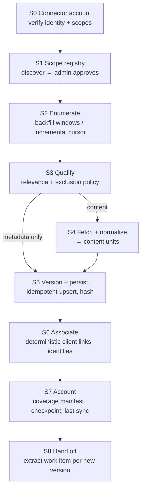

# Client Knowledge Base: Ingestion Pipeline Design

**Date:** 26 October 2026 · **Status:** Proposed design for build. Decisions still needed are listed in §13.
**Builds on:** [Solution Architecture](Client-Knowledge-Base-Solution-Architecture.md) (SA), [Architecture Review](Client-Knowledge-Base-Architecture-Review.md) (AR), [Functional Requirements](functional_requirements.md) (FR), the per-source scope reviews (`slack_scope.md`, `clickup_scope.md`, `gmail_scope.md`, `google_drive_scope.md`, `google_calendar_scope.md`, `fathom_scope.md`, `leadlock_scope.md`) and the team FastAPI SOP (`backend_build.md`).

This document covers the first backend slice: getting data **from the approved sources into the KB** in a form the rest of the system can trust. It stops before AI extraction (§2). It doesn't change any agreed decision. Where SA and AR disagree, it picks one and says why.

---

## 1. What ingestion is for

### 1.1 The agenda it serves

WIA is not buying a search box. It's buying an **owned, durable memory** of each client relationship that survives staff turnover and tool limits. Today that memory lives in people's heads and in eight tools, each with its own retention, permissions and gaps. Ingestion is the part of the system that makes the memory *owned*. Until a record is inside the KB, with its provenance, the KB can't cite it, count it or keep it.

That gives ingestion three jobs:

1. **Get everything that's obtainable and approved, once, with proof of what was and wasn't obtained.** All history for all active clients before launch is a launch gate, with a WIA-signed gap report (FR-INT-02, FR-INT-12; SA §4.1).
2. **Keep it current.** Publish within 15 minutes of the provider having the data (SA §7.3). Never claim to be fresher than it is.
3. **Hand downstream stages material they can trust.** That means stable identity, versions, locators, timestamps and data domain. Extraction, citations, the reducer and permissions all depend on these. They can't be repaired later if ingestion drops them.

### 1.2 Requirements this slice must satisfy

| Requirement | What it means for ingestion |
|---|---|
| FR-INT-01 Initialise a mapped client | Ingestion is driven by an **approved scope registry**, not by "everything the token can see" |
| FR-INT-02 Backfill history | Windowed historical enumeration per scope, resumable, with a manifest |
| FR-INT-03 Receive ongoing changes | Incremental sync on provider cursors (polling first, §7.2) |
| FR-INT-04 Map identities | Record provider identities. Make only the **deterministic** client associations here; ambiguous ones are left unresolved for the review stage |
| FR-INT-05 Process approved content | Readable text, Docs/Sheets, extractable PDF/DOCX and existing transcripts. Images, audio and video are kept as references with a coverage state |
| FR-INT-06 Maintain provenance | Source identity, version, locator, plus event, effective and observed times on every unit |
| FR-INT-09 Reconcile duplicates | Idempotent upserts on provider identity. Cross-calendar copies and Zoom/Fathom/Drive overlaps are linked, not duplicated |
| FR-INT-10 Resume interrupted processing | Durable work items, leases, checkpoints. Retryable, blocked and unsupported are distinct outcomes |
| FR-INT-12 Account for gaps | Coverage manifests per scope and window. Inaccessible is not empty |
| FR-EVI-05/06 Originals, changed and deleted sources | Keep versions. Deletion and access loss are availability states, never row deletes (ARCH-Q06) |
| FR-OPS-01/02/03 Monitor, recover, reprocess | Run and coverage views. Reprocessing must not depend on re-fetching all history (§2.2) |

### 1.3 Invariants ingestion must never break

These come from the decision register and the source reviews. Each one is a test case.

1. **An API failure is never an empty result.** A 401, 403, 429 or timeout produces a gap or a retry, never "0 messages".
2. **The last successful sync never advances on a failed or partial run** (SA §7.3).
3. **A cursor advances only after every item in the page is durably recorded** as stored or as an explicit gap (SA §4.8).
4. **Connector identity is verified on every run.** The Fathom duplicate-key incident (a WIA key silently replaced by an E2M key) must be impossible to repeat silently.
5. **Discovery never opts a resource in.** A newly reachable channel, folder or calendar is a candidate until an admin approves it.
6. **Provider deletion, access loss and KB expiry are three different states** with different consequences (SA §9.3).
7. **No raw provider JSON is retained.** Normalised fields and text only (DR §5.2). Request bodies are never logged.
8. **Every stored unit carries its data domain**, so the finance restriction (TS-03 F2) can be enforced downstream without re-reading content (AR-07).
9. **Times are kept as given and as instants.** Source timezone context is kept. A date-only value never becomes midnight.
10. **Nothing writes to a provider.** All connectors are read-only (SA §2.3). Staging never shares cursors with production.

---

## 2. Where ingestion stops, and why there

### 2.1 The boundary

```text
 Sources ──► [ INGESTION: this slice ] ──► extract work items (queued, not executed in this slice)
             connector → scope → enumerate → qualify → fetch → normalise
             → version → associate (deterministic) → account → hand off
```

Ingestion ends when, for a source record:

- its current version is stored as **normalised content units**, each with a stable span ID, a locator and a hash;
- its provider identities (authors, speakers, assignees, invitees) are recorded;
- deterministic client associations are made, and the rest are marked unresolved;
- the scope's coverage manifest and checkpoint reflect it;
- an `extract` work item exists for the new version.

Extraction, the reducer, actions, review, search and the UI read from this boundary. None of them call providers directly, except for the bounded original fetch SA §3.8 allows for chat Mode B.

### 2.2 The retention problem this boundary has to solve

ARCH-Q03 says to keep facts and excerpts, not originals; originals are "temporary processing inputs". Taken literally, ingestion would have to run extraction while it still has the original, then throw the original away. That fails here for three reasons:

1. **Extraction doesn't exist yet**, and the backfill has to start now (AR-12 says throughput and review volume are the real launch constraints).
2. **Prompts and extraction contracts will change.** Stage 2 and 3 definitions aren't agreed (FR §18). With no stored text, each change means re-fetching all history from eight providers, and some of it will have been deleted or aged out by then (AR-10).
3. **Some sources may lose history on their own.** The Slack plan's retention is unverified (`slack_scope.md` §5). If it's limited, the KB would be the only surviving copy. That is exactly the turnover-proofing WIA is paying for.

**Resolution within the agreed decisions:** SA §7.5 already lists **"temporary originals"** as an admin-configured retention category (ARCH-Q16). Ingestion stores normalised content units under that category:

- While a version is waiting for extraction, it's held regardless of policy, because extraction needs it.
- After extraction, the category duration applies: delete after N days, or keep.
- **N = 0 behaves exactly like ARCH-Q03 as agreed.** A long N is AR's option B.

This lets the pipeline be built and the backfill run without pre-empting WIA's answer to Q-4. The answer becomes a configuration value, not a schema change. It still needs WIA to set the duration (§13, D-1).

What is **never** stored: raw API responses, binary files (images, video, audio), and content from unapproved scopes.

---

## 3. The pipeline at a glance



| Stage | Input → output | Key rule |
|---|---|---|
| **S0 Connector account** | Credential → verified `connector_account` (provider account ID, display identity, granted scopes, credential owner, expiry) | Each run starts by calling the provider's "who am I" and comparing with the registered identity. A mismatch blocks the account; it doesn't fail open |
| **S1 Scope registry** | Discovery listing → `source_scopes` in `candidate`, `approved`, `excluded` or `retired` | Only approved scopes are enumerated. Each scope carries a default data domain, a default client association (if dedicated) and a content policy |
| **S2 Enumerate** | Scope + window or cursor → `ChangeBatch(items, next_cursor, terminal, transient_errors)` | Same batch shape for backfill and incremental. Each page is one work item |
| **S3 Qualify** | Item header → `content` / `metadata_only` / `excluded` | A deterministic, versioned policy per source (§4). Excluded items are still counted |
| **S4 Fetch + normalise** | Provider record → typed `NormalisedRecord` + ordered `content_units` | Parsers are deterministic code. Unsupported parts become a coverage exception, not dropped silently |
| **S5 Version + persist** | Normalised record → `source_records` / `source_versions` / `content_units` | A new version only if the canonical hash changes. Old versions keep their units, so existing citations still resolve |
| **S6 Associate** | Version → `record_associations`, `provider_identities` | Only rungs 1–2 of the SA §4.10 identity ladder (explicit scope mapping, exact verified contact). Everything else is `unresolved` |
| **S7 Account** | Page outcome → `coverage_windows`, `sync_cursors`, `last_successful_sync_at` | Checkpoint only after all items in the page reach a terminal outcome |
| **S8 Hand off** | New version → `work_items(kind='record.extract')` | Queued with the extractor contract version. Not executed in this slice |

---

## 4. Per-source design

These are concrete enough to build from. "Verified" means read-tested in the dated source reviews. Anything not verified is labelled.

### 4.1 Summary

| Source | Scope unit | Incremental cursor | Content units | Build order | Status |
|---|---|---|---|---|---|
| ClickUp | Space / folder / list | `GET /team/{id}/task?date_updated_gt=` incl. closed + subtasks | Task snapshot (title, description, status, assignees, dates, custom fields, checklist); each comment | 1 | Read verified (338 tasks, 5 lists). Comments seen empty; incremental unverified |
| Slack | Channel | Per channel: last `ts`, plus a rolling re-scan for edits, deletes and replies | Each message and each reply | 1 | 6 channels verified; archive of 2,664 messages on disk |
| Gmail | Mailbox (hello@) | `users.history.list` from `historyId`; full resync if expired | Each message: authored body + quoted body (separate units), headers | 2 | Read verified; push untested (not needed, §7.2) |
| Fathom | Recorder / key | `GET /meetings` newest-first until known; re-poll until transcript ready | Each transcript segment (speaker, timestamp); summary as a separate provider-generated unit; provider action items | 2 | WIA key verified; full recorder coverage open |
| Drive | Approved folder (recursive) | `changes.list` page token, filtered by folder-membership map | Doc blocks (heading/paragraph/table cell); sheet rows; PDF/DOCX pages/paragraphs | 3 | Docs/Sheets verified; PDF/DOCX parsing untested |
| Calendar | Calendar | `events.list` `syncToken` per calendar (masters + exceptions) | Event snapshot (time, attendees, status, description) | 3 | Read verified (9 calendars); sync token untested |
| Historical Zoom | Drive archive folders | Through Drive | Transcript files (VTT/TXT/Docs) as segments; MP4 = reference only | 3 (through Drive) | Archive folders exist; direct Zoom API untested, not in this slice |
| LeadLock client sub-accounts | Location | — | — | Capability probe only | Feature reads 401. Record `blocked_access` coverage, never zero |
| WIA billing (GHL, own location) | WIA location | `updated since` per object | Invoice, schedule, transaction, subscription, order snapshots | 4 (Stage 3; needs the F1 ADR) | Read verified 26 Oct with `GHL_FINANCE_PIT`. Domain = finance |

The build order reflects Stage 1 needs. ClickUp and Slack are the largest action sources (AR §8 Phase 1). Gmail and Fathom come next for commitments. Drive and Calendar feed Portfolio and the next call. Billing is Stage 3.

### 4.2 Source specifics that change the design

**ClickUp**
- Scope = list. One task can be in several lists, so dedupe on `(workspace, task_id)` and keep every list membership.
- Workflow statuses are workspace-specific (`n/a` has type `done`). Store the raw status ID, name and type. Mapping to KB progress happens downstream (`clickup_status_and_reopening_map`, SA A.4).
- Unverified: whether a new comment bumps `date_updated`. Until it's tested, re-read comments for tasks updated in the last 14 days on each incremental pass. Comments use `start` + `start_id` paging.
- Templates, WIA Internal and archived spaces are `excluded` scopes by default. "ARCHIVES" containers can come back under `archived=false`, so classify by admin review, not by name.
- Shared programme lists (Google/Meta Accelerator) are approved scopes with **no default client**. Each task is `unresolved` unless a deterministic rule links it (§5).

**Slack**
- Identity key = `(workspace_id, channel_id, ts)`, stored as a string, never a float.
- Thread replies need `conversations.replies` per root. On incremental passes, re-fetch a root when its `latest_reply` changed. Re-scan a rolling 7-day window for edits and deletions (`slack_scope.md` §5: new-message-only polling misses them).
- **Import the preserved archive first** (`frontend/corpus/slack/raw/*.json`, read-only) as `provenance = archive`, deduped against live reads. If live history is limited by plan, the archive is the only copy of older messages.
- `wia-ai-team-testing` is `excluded`. Bot and attachment-only posts are kept: Viktor posts are attributed analysis, and image-only posts are references.
- Rate limits: create (or confirm) the KB app as an **internal** app and verify its tier before relying on bulk history (AR-15).

**Gmail**
- The mailbox has about 33,800 messages, most of them unrelated to clients. **Qualification policy (§13, D-2):**
  - *metadata for every message*: headers, thread, labels, participants, time, hash;
  - *body content only for qualified messages*: a participant matches a known client contact or domain, or the sender is on the approved list (`noreply@dubsado.com`, `support@leadlockpro.com`).
- Metadata-for-all is what "waiting on us" and last-contact need (AR-10 option C). It also allows **re-qualification**: when a new client contact is mapped, earlier metadata rows for that contact become eligible and their bodies get fetched. No re-enumeration of the mailbox is needed.
- Don't filter on `INBOX`. Dubsado notifications were found without that label (`gmail_scope.md` §5).
- Drafts are stored with `state = draft`. Downstream must never treat them as sent.
- Quoted and forwarded text goes in separate units with `is_quoted = true`, so a quoted client sentence isn't counted twice.
- Dubsado sender ⇒ unit domain `finance` (§6.3).

**Fathom**
- Keys are per user. Each connector account is one recorder key and must verify its identity (the duplicate-key incident).
- Meetings whose participants are all WIA or E2M domains are classified `internal` (metadata only, no transcript). WIA–E2M syncs and demos are never client records.
- A transcript can appear minutes after the meeting is listed. Mark the record `content_pending` and re-poll with backoff.
- 60 requests/minute globally, with stricter limits on heavy content. The bulk lane must respect this.
- The Fathom summary and action items are stored as **provider-generated** units, never as client speech.

**Drive**
- Scope = approved folder. Keep a folder-membership map so `changes.list` results can be filtered to approved descendants. A move out of scope means the record is no longer in scope; it is not a deletion.
- Shortcuts are resolved to their target and both are recorded.
- Docs use `documents.get(includeTabsContent=true)`, unitised by structural element with heading-path locators.
- Sheets are unitised by row, with typed cells. The string `FALSE` must not become truthy.
- PDF/DOCX use `pypdf` / `python-docx` with size limits (25 MiB file / 75 MiB expanded, SA A.4). Scanned pages become `unsupported` coverage exceptions.
- MP4 and images are references only: no OCR, no transcription (SA §4.2).

**Calendar**
- `syncToken` can't be combined with `timeMin`/`orderBy`. So: sync masters and exceptions incrementally, then materialise occurrences for a rolling horizon (−90 to +120 days) with a windowed `singleEvents=true` read when a series changes, and once a day.
- Identity = `(calendar_id, event_id)` per copy. Cross-calendar copies are linked by `iCalUID` plus original start time. They are never merged into one row and never counted twice.
- On HTTP 410, run a tracked full resync of that calendar.
- `hello@leadlockpro.com` is free/busy only: `excluded`. Holidays and personal blocks: `excluded`.

---

## 5. Client association at ingestion time

FR-INT-04 is split. Ingestion makes only the associations a reviewer would never dispute. Everything else waits for the review stage.

| Rung (SA §4.10) | Example | At ingestion |
|---|---|---|
| 1. Explicit scope mapping | `c_dogwoodreserve` channel → Dogwood Reserve; Dogwood Drive folder; Ridgefield ClickUp list | **Associate**, `basis = scope_mapping` |
| 2. Verified contact identity | Gmail participant `events@thepennyslo.com` is a reviewed contact of The Penny | **Associate**, `basis = verified_contact` |
| 3. Reviewed alias + corroborating metadata | "Meriwether Manor" in a title | Candidate only → `unresolved` |
| 4. Anything else | Programme channel post naming a client; shared office-hour transcript | `unresolved`; mixed-client content is flagged `multi_client` |

**Mixed scopes** (programme channels, shared lists, office hours, the shared mailbox) carry `association_mode = per_record`. Their unresolved records are withheld from restricted users until reviewed (SA §3.3). Ingestion only sets the flag; enforcement belongs to the policy layer.

This needs a minimal **client registry** in this slice: businesses, engagements, contacts and scope mappings, entered manually by WIA (FR-INT-01). It's the one piece of the domain model ingestion can't start without, and it doesn't depend on any open decision.

---

## 6. Data model for this slice

### 6.1 Tables

| Table | Purpose / key columns | Integrity |
|---|---|---|
| `businesses`, `service_engagements`, `contacts` | Minimal client registry (§5) | Manual creation only. `lifecycle_stage` nullable until AR-22 is decided |
| `connector_accounts` | provider, provider account ID, display identity, credential reference (env var name, never the value), owner person, granted scopes, expires_at, last_verified_at, state | Unique (provider, provider_account_id) |
| `source_scopes` | connector account, kind (channel/list/folder/mailbox/calendar/recorder/location), external ID, name, state (`candidate/approved/excluded/retired`), default_domain, default_business_id, association_mode, content_policy, approved_by/at | Unique (account, kind, external_id) |
| `scope_memberships` | Folder-membership map; list memberships of ClickUp tasks | Time-bounded rows (valid_from/valid_to) |
| `source_records` | scope, provider record kind, external ID, availability (`available/deleted_upstream/access_lost/out_of_scope`), qualification, latest version, first_seen/last_seen | Unique (connector_account, kind, external_id) |
| `source_versions` | record, version key, canonical sha256, provider updated/event times, observed_at, parser contract version, content_state (`metadata_only/content/content_pending/unsupported`) | Unique (record, version_key) |
| `content_units` | version, ordinal, unit_kind, locator (typed JSON), author_identity_id, occurred_at, text, text_sha256, is_quoted, provider_generated, domain, retention_state | Unique (version, ordinal). GIN full-text index added later (search slice) |
| `provider_identities` | provider, account, external person key (Slack user ID / email / ClickUp user ID / speaker email), display name, `person_id` nullable | Unique (provider, account, external_key) |
| `record_associations` | record, business, engagement (nullable), basis, status (`associated/unresolved/rejected`), multi_client flag | Unique (record, business) |
| `sync_cursors` | scope, mode (`incremental/backfill`), cursor value, generation, updated_at | One live cursor per scope and mode |
| `coverage_windows` | scope, window [from, to), contract version, counts: discovered / fetched / normalised / metadata_only / excluded / unsupported / inaccessible / failed, state, last_successful_sync_at | A window is `complete` only when every discovered item has a terminal outcome |
| `sync_runs` | scope, mode, started/finished, pages, outcome, error class, provider request count | Run-level audit for the ops view |
| `work_items` | kind, scope/record ref, input signature, state, next_run_at, attempt, lease token, lease_until, lane, last_error_class | Unique (kind, input signature). Partial index on due work |
| `audit_events` | Scope approvals, connector changes, policy versions | Append-only |

### 6.2 Versioning rule

`version_key` = the provider's version token when it means something (Drive `version`, Calendar `etag`, Slack `edited.ts`). Otherwise it's the sha256 of the canonical normalised content plus the fields that matter. Request time is never part of it. Re-ingesting an unchanged record updates `last_seen` only. An edit creates a new version and leaves the old version's units in place, which is what lets an old citation still resolve (SA §3.9, §4.8).

### 6.3 Data domain at ingestion

Per AR-07 / AR §5.5, each content unit carries `domain`. At ingestion it comes from deterministic rules, in this order:

1. a source-specific rule (Dubsado sender → `finance`; GHL billing → `finance`; Fathom summary → `meetings`);
2. otherwise the scope's `default_domain` (`communications` for Slack and Gmail, `meetings` for Fathom and Zoom, `actions` for ClickUp, `profile` for questionnaire folders, `programme` for roll-call sheets).

Downstream stages can split a domain further, but can't make finance visible.

---

## 7. Execution

### 7.1 Work items and lanes

All work is durable rows in `work_items` (SA §9.6). Lanes keep backfill from starving freshness:

| Lane | Jobs | Initial concurrency |
|---|---|---|
| `sync` | `connector.verify`, `scope.discover`, `scope.sync` (incremental page), `record.fetch` for incremental items | 1 process, 2–4 threads |
| `bulk` | `scope.backfill` (one window page), `record.fetch` for backfill, `qualify.recheck` | 1–2 processes, sized per provider limit |
| `maintenance` | `coverage.audit`, `retention.expire`, `cursor.reset` | 1 thread |

The claim protocol: `SELECT … FOR UPDATE SKIP LOCKED` on due rows → set lease token and `lease_until` → commit → run outside the transaction → the final commit checks the token and input signature. Heartbeat 15 s, lease 90 s, retries at 10 / 30 / 120 s with jitter, at most 3 attempts. Provider `Retry-After` overrides these (SA §9.6, A.4).

**Error classes** decide what happens next:

| Class | Example | Outcome |
|---|---|---|
| `transient` | 5xx, timeout, connection reset | Retry with backoff |
| `throttled` | 429 | Reschedule at `Retry-After`; not counted as an attempt |
| `auth_invalid` | 401 on an endpoint that worked before, token revoked | Block the connector account and surface it in ops; no retries |
| `scope_denied` | 401/403 on a feature never granted (LeadLock) | Record `inaccessible` coverage; block that capability |
| `not_found` | 404 on a known record | Re-check, then availability `deleted_upstream` or `access_lost` (§8) |
| `unsupported` | Scanned PDF, oversize file | Coverage exception on the version; no retry |
| `bug` | Parser exception | `failed` with sanitised error; never silently skipped |

### 7.2 Polling, not webhooks, for this slice

AR-15 is adopted. A 5-minute incremental poll fits within the 15-minute freshness budget (SA §9.6 allocates 5 minutes to detection). Webhooks would add a Pub/Sub project, channel renewals, five signature schemes and public endpoints. None of that is needed to meet the target, and none of it is verified. The `SourceAdapter` keeps a `read_changes(cursor)` method, so a webhook can later just trigger an immediate poll. Candidates later: Fathom (after-call loop), Slack Events (near-real-time reactions).

Proposed intervals: ClickUp, Slack, Gmail, Calendar, Drive every 5 minutes; Fathom every 5–10 minutes; a coverage audit hourly.

### 7.3 Queue transport (needs your decision, §13 D-4)

The SOP says to use Redis/RQ for workers. AR-16 recommends PostgreSQL-only, because correctness already lives in `work_items` and RQ adds a second failure domain plus a dispatcher and sweep. RQ also doesn't run natively on Windows. **Recommendation:** start PostgreSQL-only, with a small `workers/runner.py` claim loop per lane. The job functions in `workers/jobs/` are plain functions, so moving them to RQ later is a change to the runner only. If the SOP is treated as binding, use RQ as transport only, with the PostgreSQL rows staying authoritative.

---

## 8. Backfill, incremental and the Phase 0 inventory

### 8.1 One path, two modes

Backfill and incremental produce the same `ChangeBatch` and go through S3–S8 unchanged. The only differences are where the cursor comes from and which lane runs it. Backfill windows run newest to oldest, so the current months are usable first. Each window has its own coverage row, so an interrupted backfill resumes from the last complete page.

A scope switches to incremental once its backfill has caught up to the incremental cursor's start point. Both modes can overlap: idempotent upserts make the overlap harmless.

### 8.2 The Phase 0 inventory is just a metadata-only backfill

AR-12 / AR §5.10 asks for a no-LLM inventory before dates are re-baselined. That's not a separate script. It's this pipeline run with qualification forced to `metadata_only`: enumerate every approved scope, count records, date ranges and estimated content size, and write the coverage rows. Its output is the **first gap report** (FR-INT-12). The same rows then drive the content backfill.

### 8.3 Rough ingestion throughput (estimates to measure, not promises)

| Source | Rough volume | Limit to respect | Order of time |
|---|---|---|---|
| Gmail metadata | ~33,800 messages | Per-user quota units per second (verify) | Under an hour |
| Slack | Thousands of messages across approved channels + one replies call per thread | Internal-app tier for `conversations.*` (verify) | Under an hour for 6 channels; scales with channel count |
| ClickUp | Low thousands of tasks + comment reads | Per-token requests per minute (plan-dependent; verify) | About an hour |
| Fathom | Hundreds to ~1,000 meetings | 60 requests/min, stricter on transcripts | 1–3 hours |
| Drive / Calendar | Hundreds of files / ~1,000 events | Drive and Calendar quotas | Under an hour each |

The conclusion matches AR-12: **ingestion is hours, not days.** The real launch constraints sit downstream (extraction throughput and human review). That's a reason to finish ingestion early and measure.

---

## 9. Change, deletion and access-loss semantics

| Signal | What ingestion records | What it must not do |
|---|---|---|
| Content edited | New version; old units kept | Overwrite the old version |
| Provider says deleted (Slack `message_deleted`, Gmail `messageDeleted`, Drive trashed/removed, Calendar `status=cancelled`) | `availability = deleted_upstream` with detection time; units kept with a warning (ARCH-Q06) | Delete rows or units |
| 404 / 403 on one known record | Re-check once. If it persists: `access_lost` (Drive unshare, channel leave) | Assume deletion (SA §7.1) |
| Moved out of an approved scope | `out_of_scope`; no further fetches | Treat as deleted |
| Scope retired by an admin | Stop enumeration; keep data | Purge (purge belongs to retention) |
| Connector token revoked / wrong account | Block the connector account; mark all its scopes `stale` | Advance any cursor or last-sync time |
| Calendar event cancelled | Keep it as a cancelled occurrence | Show it as a held meeting |
| Retention expiry | `retention_state = expired`; text removed, tombstone kept | Re-import the expired text on the next sync (SA §7.6) |

---

## 10. Security and privacy for this slice

**Preconditions before any connector secret is configured (AR-13):**
- add a root `.gitignore` (`.env*`, `.data/`, raw probe output, `dist*`);
- decide what to do with the probe JSON already in git history. That's the repo owner's call.

**Secrets**
- Secrets live in deployment environment variables only. `connector_accounts` stores the variable name, never the value.
- Google OAuth refresh tokens move from the probes' `frontend/.data/` store into backend-only secret storage.

**Credential ownership (AR-21)**

| Credential | Belongs to | Concern |
|---|---|---|
| ClickUp | "E2M AI" user | Not a WIA service user |
| Google OAuth | Consented on hello@ | Shared mailbox, consented by a person |
| Fathom | Per-recorder keys | Breaks if that person leaves |
| Slack | Bot token | WIA workspace install |

These are recorded with an owner and expiry and shown in ops. Moving them to service identities is tracked, not blocking.

**Logging**
- Structured logs carry IDs, counts and error classes only. No message bodies, transcript text or email addresses, and no request or response bodies (SA §9.4).

**LLM providers**
- Nothing in this slice sends content to an LLM. The provider data policy (AR-23, Q-16) is needed before the extraction slice, not this one.

**Access to the ingestion API**
- Until the Command Center hand-off is built (AR-04), ingestion is operated through CLI commands (`scripts/`) and an ops-only API behind a service token, not exposed to WIA users.
- This keeps ingestion off the identity critical path.

**Staging**
- Staging uses its own database and cursors. It can read the same sources, which is read-only and covered by ARCH-Q14. It never shares cursor state with production.

---

## 11. Code layout (SOP)

```text
backend/
  app.py  db.py  config.py  alembic.ini  .env.example  Dockerfile  docker-compose.yml  requirements.txt  README.md
  routes/
    ops_sources.py            # connector accounts, scopes (approve/exclude), runs, coverage — ops token
    clients.py                # minimal registry: businesses, engagements, contacts, scope mappings
  services/
    intake/
      adapters/               # one module per provider: identify, discover, enumerate, read_changes, fetch
        base.py               # SourceAdapter protocol, ChangeBatch, NormalisedRecord, ContentUnit
        clickup.py  slack.py  slack_archive.py  gmail.py  fathom.py  drive.py  calendar.py  ghl_billing.py
      normalise/              # deterministic parsers: email MIME/quotes, docs, sheets, pdf, docx, transcripts
      qualify.py              # per-source qualification policies (versioned)
      persist.py              # idempotent record/version/unit upsert
      associate.py            # rung 1–2 associations, provider identities
      coverage.py             # windows, cursors, last-successful-sync
      pipeline.py             # S2–S8 orchestration for one page
    clients/                  # registry service
    shared/                   # error taxonomy, http client with retry-after, clock
  models/
    db/                       # SQLAlchemy 2 mappings
    schemas/                  # Pydantic DTOs (API)
    domain/                   # ChangeBatch, NormalisedRecord, ContentUnit, enums
  sql/migrations/             # Alembic (sole schema owner)
  workers/
    runner.py                 # lane claim loop (or RQ shim, §7.3)
    jobs/intake.py            # job functions
    README.md
  scripts/
    bootstrap/                # register connector accounts, import Slack archive
    maintenance/              # inventory run, cursor reset, re-qualify
  tests/
    fixtures/                 # recorded, redacted provider responses
    services/                 # normalisers, versioning, coverage, qualification
    integration/              # pipeline against PostgreSQL with fixture adapters
```

Adapters are the only code that knows a provider's API. Everything after `NormalisedRecord` is provider-neutral, which is what makes the invariants testable once rather than eight times.

---

## 12. Build order and exit criteria

| # | Milestone | Exit criterion |
|---|---|---|
| 0 | Repo hygiene + scaffold: root `.gitignore`, SOP layout, compose (API + PostgreSQL + worker), Alembic, health checks, logging | `docker compose up` runs; migrations apply; no secrets tracked |
| 1 | Core schema (§6) + client registry + connector accounts + scope registry | Scope approve/exclude flow works by CLI/API; identity verification blocks a wrong key (test reproduces the Fathom mismatch) |
| 2 | Work runner, lanes, leases, error taxonomy, coverage + cursor accounting | Kill-the-worker test: no lost or duplicated page; failed page doesn't advance cursor or last sync |
| 3 | ClickUp adapter (backfill + incremental + comments) | The 5 verified lists ingest fully; re-run creates zero new versions; status/assignee/custom fields preserved raw |
| 4 | Slack archive import + Slack live adapter (history, replies, edit/delete re-scan) | 2,664 archive messages imported and deduped against live; edit creates a version; delete sets availability |
| 5 | **Phase 0 inventory run** across all connected sources (metadata-only) | Gap report per scope: counts, date ranges, inaccessible items. Feeds date re-baselining (AR-02) |
| 6 | Gmail (metadata-all + qualified content, quotes split, Dubsado → finance) and Fathom (segments, pending transcripts, internal exclusion) | Ridgefield and The Penny threads and calls ingested with correct units; re-qualification fetches bodies after a contact is mapped |
| 7 | Drive (folders, Docs, Sheets, PDF/DOCX, shortcuts) and Calendar (masters, occurrences horizon, copies linked) | Questionnaires and roll-call sheets unitised with locators; DST and cross-calendar copy cases pass |
| 8 | Ops views: runs, coverage, blocked connectors, last sync per source | An operator can tell, per client and source, what's in, what's missing and why |

Milestones 3 and 4 can run in parallel once 2 is done. GHL billing (finance) follows after the F1 ADR, using the same adapter contract.

---

## 13. Decisions needed

| # | Decision | Blocks | Proposed default if not answered |
|---|---|---|---|
| D-1 | Duration of the "temporary originals" category after extraction (§2.2; answers Q-4) | Retention job only, not the build | Hold until WIA sets it. Nothing is purged before extraction exists |
| D-2 | Gmail qualification: metadata for all messages, body only for qualified ones (§4.2) | Milestone 6 | As proposed |
| D-3 | Approved scope list: which channels, lists, folders, calendars and recorders are in. Needs the active roster | Content backfill (not the inventory) | Start with the verified scopes; the inventory proposes the rest as candidates |
| D-4 | Queue transport: PostgreSQL-only vs SOP Redis/RQ (§7.3) | Milestone 2 | PostgreSQL-only, RQ-swappable |
| D-5 | Slack app: keep the current bot token or install a dedicated internal KB app (rate tier) | Bulk Slack history | Current token for the archive import and small channels; confirm tier before a full backfill |
| D-6 | Probe data in git history (AR-13) | Adding any `.env` to the backend | Root `.gitignore` now; history purge is the repo owner's decision |
| D-7 | GHL billing as an approved source (F1 ADR) | Billing adapter only | Build last, behind a disabled scope |

---

## 14. What this slice deliberately does not do

- No LLM calls, extraction, actions, reducer, review queue or citations UI. These consume the hand-off in S8.
- No webhooks, Pub/Sub, or public provider endpoints.
- No Command Center sign-in. That's an ops token until the auth slice.
- No OCR, transcription, video or image processing.
- No writes to any provider.
- No search index tuning beyond storing units. Full-text search arrives with the evidence slice.
- No LeadLock client-outcome ingestion while feature reads are scope-denied. Only the capability state is recorded.
