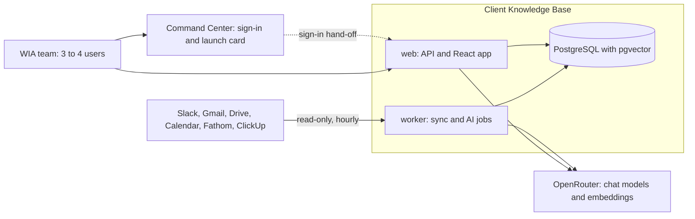
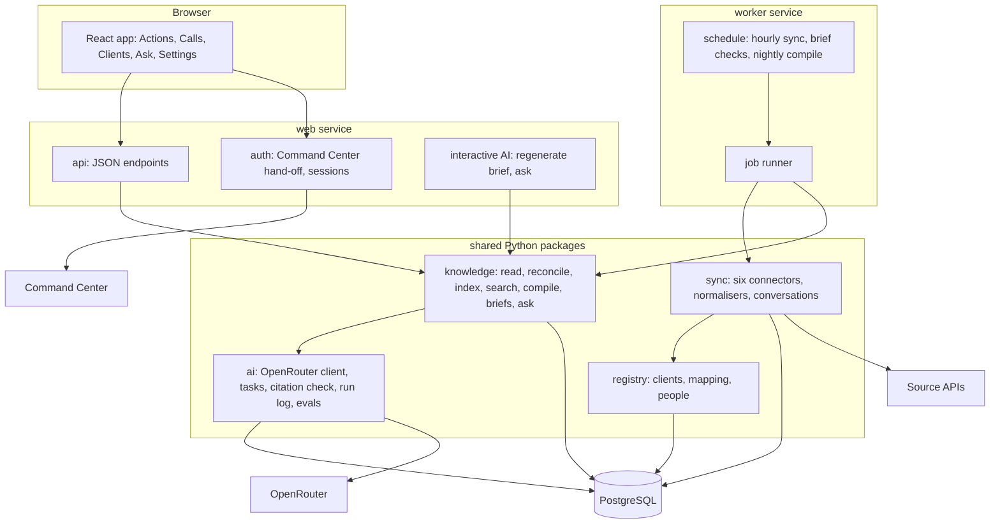
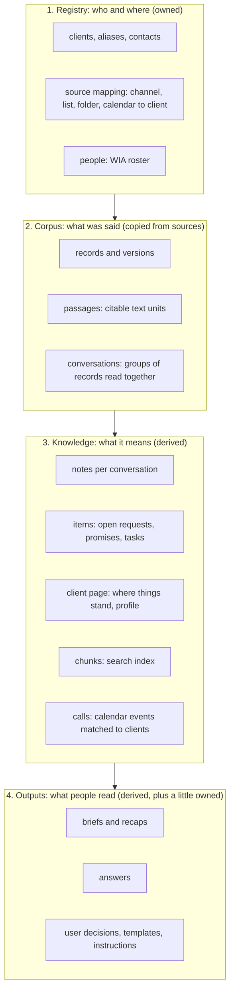
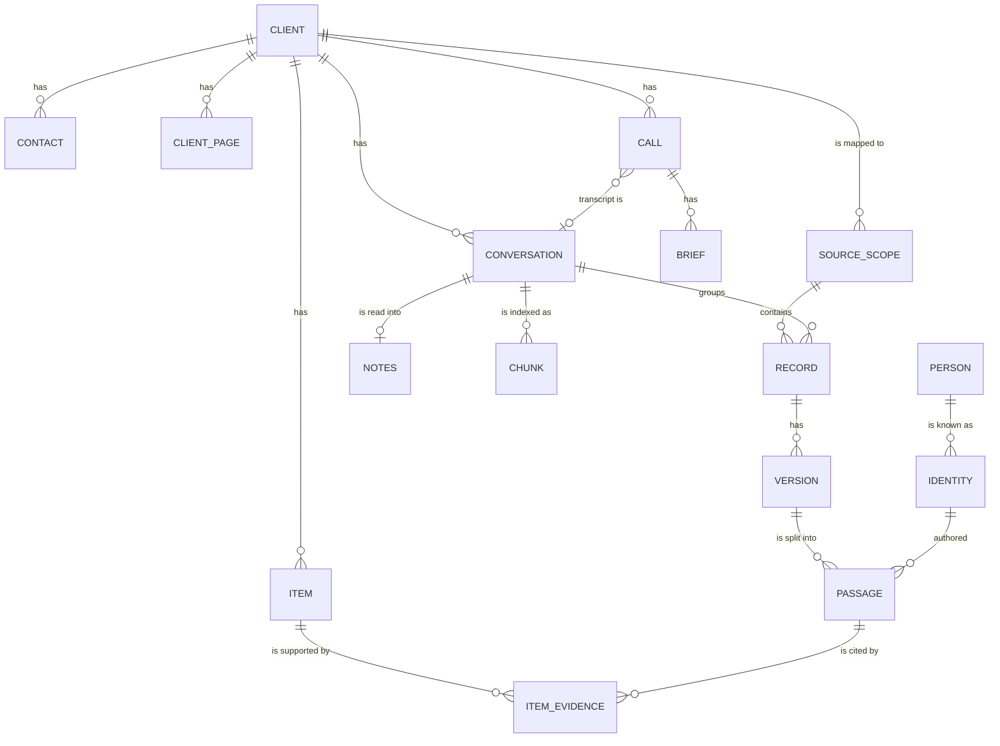
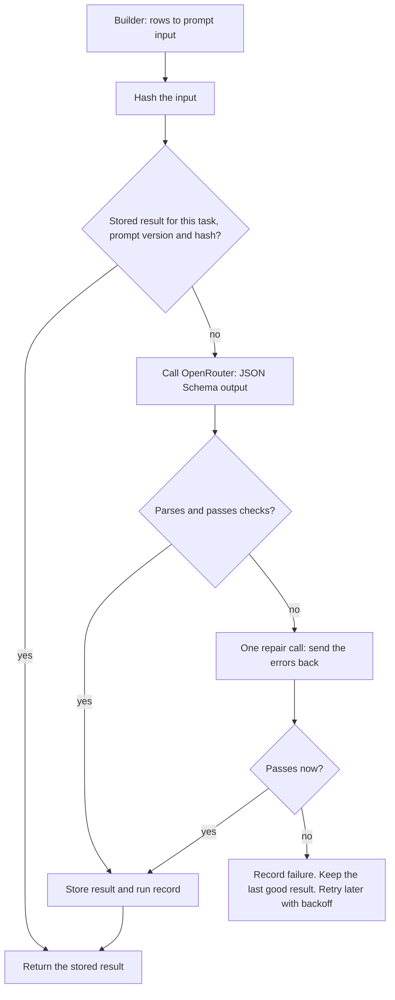
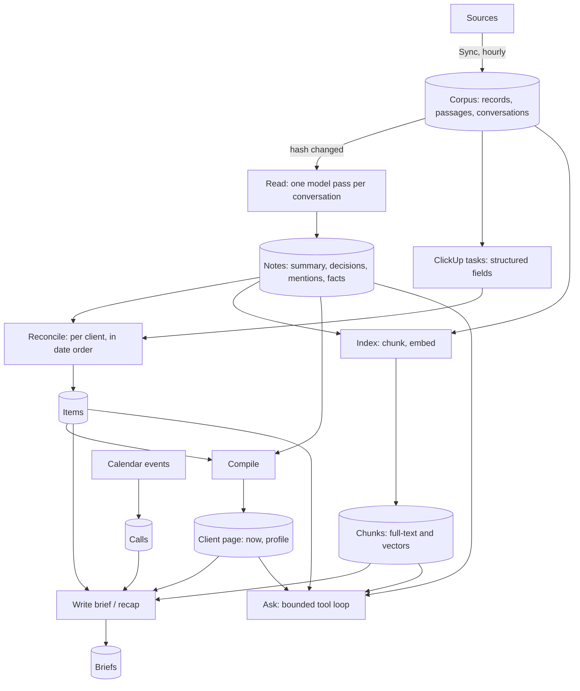
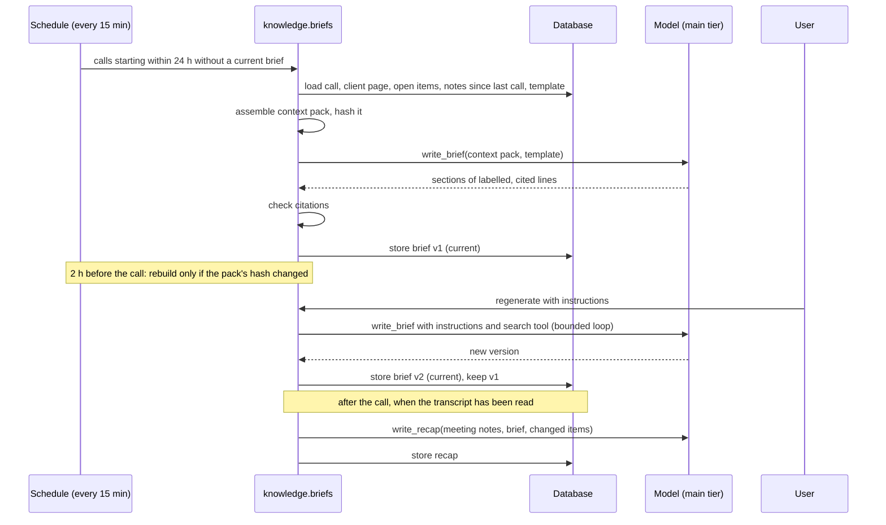
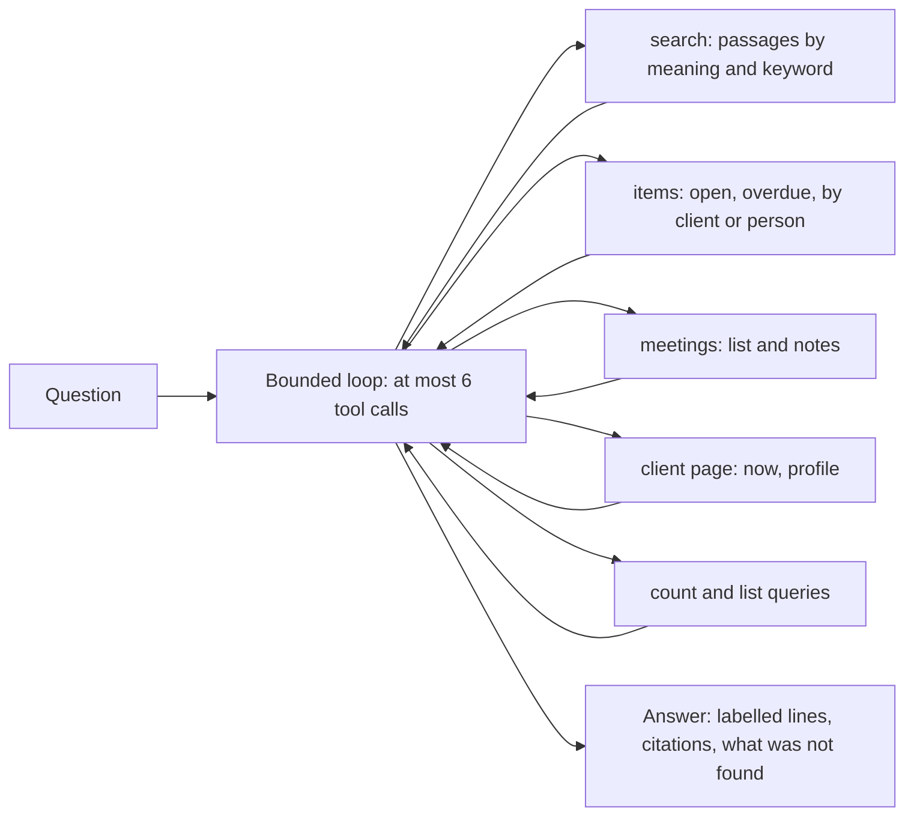
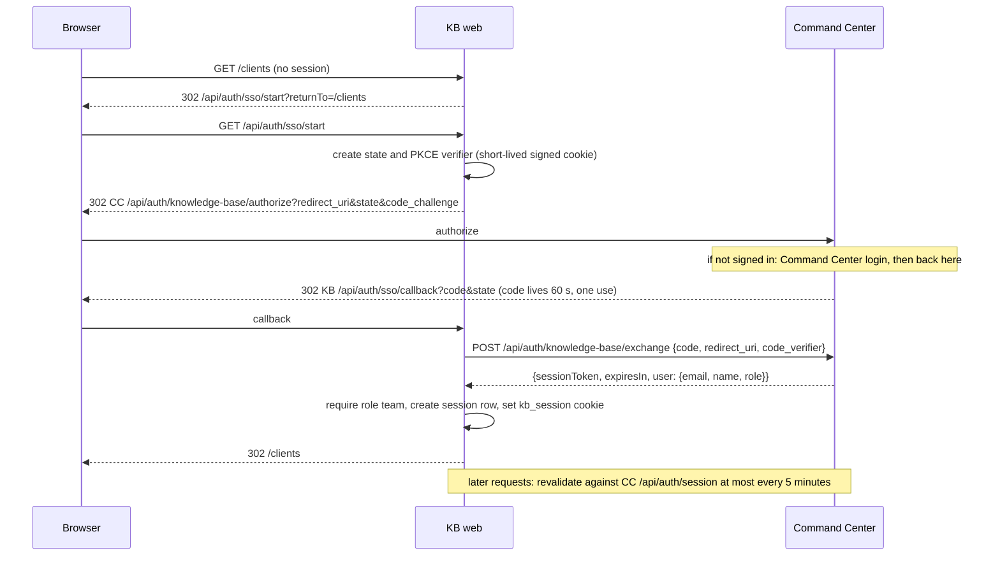
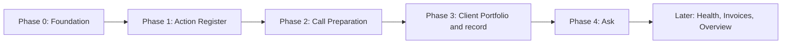

# WIA Client Knowledge Base: Solution Architecture

**Date:** 12 November 2026
**Status:** Proposed blueprint for implementation. Nothing in this document has been built as part of writing it.
**Replaces:** `docs/Client-Knowledge-Base-Solution-Architecture.md` (21 October), and the architecture content of the Feasibility Study, `docs/chatbot_KB.md` and `docs/Ingestion-Pipeline-Design.md`. The six tab scopes in `kb_tab_scope/` remain the product research; where they conflict with this document, this document wins.

**Inputs**

| Input | Use |
|---|---|
| `docs/SYSTEM_AUDIT_AND_GAP_ANALYSIS.md` (12 November) | Findings on the current direction, the as-built code and the constraints |
| The owner's decisions of 12 November (§2.3) | Binding product and policy decisions |
| `kb_tab_scope/01`, `02`, `05`, `06` | Product behaviour for the Action Register, Client Portfolio, Call Preparation and the chatbot |
| Backend on `origin/mvp`; `WIA-Command-Center`; `WIA-Content-Atelier/backend/backend_pipeline/llm` | What can be reused |
| Technical research of 12 November (Appendix C) | Model access, retrieval, extraction, evaluation and job-queue choices |

**Labels used for decisions**

| Label | Meaning |
|---|---|
| **Decided** | Set by the owner. Not reopened here |
| **Chosen** | Decided by this document, with the reason and the alternatives in §15 |
| **Assumed** | A planning figure that has not been measured. To be replaced by a measurement in the phase named |
| **Later** | Not part of the first three phases. The design leaves room for it and says how |

---

## Contents

1. [The architecture in one page](#1-the-architecture-in-one-page)
2. [Product basis](#2-product-basis)
3. [Approach](#3-approach)
4. [System overview](#4-system-overview)
5. [Knowledge model](#5-knowledge-model)
6. [Ingestion](#6-ingestion)
7. [The AI layer](#7-the-ai-layer)
8. [Knowledge workflows](#8-knowledge-workflows)
9. [Product modules](#9-product-modules)
10. [Application design](#10-application-design)
11. [Integrations: Command Center, Content Atelier, Viktor](#11-integrations-command-center-content-atelier-viktor)
12. [Data, security, reliability and operations](#12-data-security-reliability-and-operations)
13. [Feasibility: cost, effort and risks](#13-feasibility-cost-effort-and-risks)
14. [Implementation plan](#14-implementation-plan)
15. [Decision log](#15-decision-log)
16. [Assumptions to verify](#16-assumptions-to-verify)
- [Appendix A: Database schema](#appendix-a-database-schema)
- [Appendix B: AI task contracts](#appendix-b-ai-task-contracts)
- [Appendix C: Research notes and sources](#appendix-c-research-notes-and-sources)
- [Appendix D: What happens to the earlier requirements](#appendix-d-what-happens-to-the-earlier-requirements)

---

## 1. The architecture in one page

**What the system is.** An internal web application that reads what WIA already has about each client (Slack, email, call transcripts, tasks, documents, calendar) and gives the team cited answers to four questions: where does this client stand, what is outstanding, what was agreed, and how do I prepare for the next call.

**Its shape.** One web service, one worker, one PostgreSQL database. Model calls go to OpenRouter from one owned module. Sign-in comes from Command Center. There is no other infrastructure.



**How knowledge is produced.** Five steps, each a plain function with a stored result:

| Step | What it does | Uses a model |
|---|---|---|
| 1. **Sync** | Connectors read the sources every hour and store full text as citable passages | No |
| 2. **Read** | Each conversation (a Slack day, an email thread, a meeting, a document) is read once by a model, which writes structured notes: summary, decisions, requests and promises, profile facts. Every note points at the passage it came from | Yes, low-cost model |
| 3. **Reconcile** | New requests and promises are matched against the client's open items and ClickUp tasks: new, same as an existing one, or evidence that one is finished | Yes |
| 4. **Compile** | Per client, the notes and open items are compiled into a short "where things stand" page and a profile | Yes |
| 5. **Write and Ask** | Call briefs and recaps are written from the compiled page, the open items and a search of the passages. Free questions are answered the same way | Yes |

Counts, dates, task fields and calendar matching are ordinary queries. A model never produces a number that a query can produce.

**What the first three phases deliver**, in the owner's order: the Action Register, Call Preparation, then the Client Portfolio and client record. The chatbot, Health, Invoices and Overview follow on the same foundation without new infrastructure.

**What changed from the 21 October design**

| Topic | 21 October design | This design |
|---|---|---|
| Centre of the system | An evidence ledger with review queues; AI as one bounded step | The AI steps above are the system; everything else feeds or displays them |
| State the KB owns | Action lifecycle, acknowledgements, verification, corrections, review decisions, read state | A client-to-source mapping, a handful of user decisions ("done", "not an action", call type), brief instructions and templates |
| Action Register | A task tracker parallel to ClickUp | A reading list: ClickUp tasks as they are, plus the asks and promises ClickUp does not contain |
| Retained text | Excerpts only | Full text, kept indefinitely **(Decided)** |
| AI execution | Two untested candidates, one of them Viktor | One owned module calling OpenRouter **(Decided)**. Viktor has no role |
| Retrieval | Full-text over excerpts | Full-text plus embeddings over all passages, in PostgreSQL |
| Access control | Custom roles, per-user overrides, module grants, policy lock | Any signed-in team member sees everything **(Decided)**. One place in the code to add rules later |
| Processes | API, five workers, scheduler, Redis, PostgreSQL | Web, worker, PostgreSQL |
| Freshness | 15 minutes, webhooks | Hourly polling **(Decided)**, plus a "sync now" button |
| Human review | Queues that gate what is shown | Uncertain items are shown as uncertain, in their own group |
| Command Center | Identity, provisioning API, shared policy | Sign-in hand-off and a launch card **(Decided)** |

---

## 2. Product basis

### 2.1 Purpose

**Decided (owner, 12 November):** the core concept is "an internal tool that reads what WIA already has about each client and gives the team cited answers on where the client stands, what is outstanding, what was agreed and how to prepare for the next call". Several product areas are acceptable as long as they serve that concept.

It replaces three things WIA does today: per-client ChatGPT projects, reconstructing context by hand across tools, and asking Viktor in Slack.

### 2.2 Users and scale

| Item | Value | Label |
|---|---|---|
| Users | 3 to 4 WIA team members, all with full access | Decided |
| Clients | 24 active, planning for 30 to 40 | Documented in the audit |
| Sources readable today | Slack, Gmail, Drive, Calendar, Fathom, ClickUp | Verified in the audit |
| Text volume | About 50 million tokens across all clients and all history; about 60,000 conversations | **Assumed.** Measured in Phase 0 once the full backfill has run |
| Growth | 2 to 4 million tokens a month | **Assumed** |

The design is sized for this. §12.5 states what would have to change at ten times the volume.

### 2.3 The owner's decisions

These were given on 12 November in answer to the audit's open questions. They are constraints on everything below.

| # | Decision | Effect on the design |
|---|---|---|
| O-1 | The core concept is as stated in §2.1 | Every component traces to one of the four questions |
| O-2 | Call Preparation and the Action Register come first, then Client Portfolio | Sets the phase order (§14) |
| O-3 | The Action Register must not be ClickUp-style task management. It is to be redesigned | §9.1 |
| O-4 | Keep full text, with no exclusions, indefinitely, for now | Full text is the base layer (§5). No redaction step, no expiry jobs |
| O-5 | Models are reached through OpenRouter. Any data may be sent. Provider settings are managed by the team | One model gateway (§7.3). No content filter before a model call |
| O-6 | A history backfill is required | All obtainable history is ingested and processed (§6.5) |
| O-7 | At most 3 to 4 users, all with full access. Role-based access can be configured later | No permission model now; one hook for later (§12.2) |
| O-8 | WIA will probably keep Viktor for ad monitoring. What the KB does about it is left to this document | §11.3 |
| O-9 | The Action Register layout is left to this document. Simple, with as much information as can be digested | §9.1 |
| O-10 | No external backend standard applies. Use the best standard | §4.3, §10 |
| O-11 | Hourly freshness is enough | Polling; no webhooks (§6.5) |
| O-12 | Plan the retirement of Command Center's mock Client Hub | §11.1 |
| O-13 | Leave the currently exposed client data as it is | No action is planned on the static MVP page or on data already in git history. New work does not add to it (§12.1) |
| O-14 | The missing documents (`knowledgebase_changes.md`, `backend_build.md`, `viktor_at_wia.md`) are not to be considered | Decisions known only through those files carry no weight here |
| O-15 | Command Center integration is its sign-in plus a launch card, as for Content Atelier (given earlier on 12 November) | §11.1 |

### 2.4 Scope and order

| Order | Module | The question it answers | Phase |
|---|---|---|---|
| 1 | **Action Register** | What is outstanding with each client, in both directions, and where was it said? | 1 |
| 2 | **Call Preparation** | What do I need to know, ask and settle on this call? What came out of it? | 2 |
| 3 | **Client Portfolio and client record** | Which clients do we have, and where does each one stand? | 3 |
| 4 | **Ask** (the chatbot, called "Client 360" in the mock) | Anything about a client, answered with sources | 4 |
| 5 | Health & Sentiment, Invoices & Contracts, Overview | Which clients need care; what commercial records exist; what to look at today | Later |

The Action Register is built first because Call Preparation consumes it: a brief lists what each side owes.

### 2.5 Rules every output follows

Carried from the audit (§2.5 there), with two changes that follow from the owner's decisions.

1. **Every factual statement shows its source.** A citation opens the exact passage and links to the original.
2. **Unknown is shown as unknown.** No invented owner, date, amount or zero.
3. **Facts, interpretations and suggestions are labelled differently.**
4. **Counts and dates come from queries, never from a model.**
5. **A bot's or staff member's words are never presented as the client's words.**
6. **Content from another client never appears in a client's outputs.**
7. **The KB is read-only towards source tools.** It drafts; people send.
8. **Freshness is visible.** Each view shows when its sources were last read.
9. **WIA owns it.** Prompts, data, evaluation cases and outputs live in WIA's repository and database.

Changed: "finance is visible to admins only" is suspended by O-7; every passage keeps its domain tag so the rule can be restored with one check (§12.2). "No full-text retention" is reversed by O-4.

### 2.6 Not in scope

| Item | Reason |
|---|---|
| Assigning, acknowledging, verifying, snoozing or prioritising work | That is task management. It stays in ClickUp (O-3) |
| Sending Slack messages or emails | Read-only rule. Drafts are copied by the user. Can be added later as a separate decision |
| A client-facing portal | Internal tool |
| Paid-media monitoring and ad anomaly alerts | Not a KB source. Separate initiatives on WIA's roadmap (PM-01, PM-02) |
| Sales-call preparation | Not a client yet |
| GoHighLevel client data (leads, pipelines) | Blocked at the provider until a private OAuth app exists. A connector can be added later without design change |
| Per-user or per-client permissions | O-7 |

---

## 3. Approach

### 3.1 Reasoning from the product

The audit's central finding was that the earlier design answered "what if it is wrong?" with mechanisms before anything could show whether the output was useful. This design starts from what the four questions need and adds a mechanism only where one of them fails without it.

| The product needs | What follows |
|---|---|
| Answers that cite the exact message or transcript line | The KB must hold the text in citable units with stable identifiers. This exists: `content_units` on `origin/mvp` |
| "What is outstanding?" across Slack, email and calls | Something must read every conversation, because an open request cannot be found by searching for it. Search finds what you ask for; it does not enumerate what you did not know to ask |
| The same answer each time a screen is opened, at no cost per view | Outputs are produced when content arrives and stored. Screens read stored rows |
| Briefs that are short and shaped by call type | A writer step working from a compact, already-digested picture of the client, with a template per call type |
| Free questions ("what did she say about pricing in August?") | Search over all passages, by meaning and by keyword, filtered to one client |
| Trust | Citations that are checked by code, uncertainty that is displayed, and an evaluation set that shows whether a prompt change helped |
| Ownership | Prompts, schemas, context assembly and evaluation in the repository. The model behind them replaceable by changing one line of configuration |

Two things do **not** follow, and are therefore absent: a system of record for tasks, and a permission system.

### 3.2 Approaches evaluated

| Approach | How it would work here | Assessment |
|---|---|---|
| **A. Search-then-answer only** (classic retrieval-augmented generation) | Index all passages. For every screen and question, retrieve the top passages and ask a model | Good for free questions. Cannot produce the Action Register: listing every open request needs a pass over all content, not a top-12 retrieval. Every page view would cost a model call and could differ from the last one |
| **B. Put everything in the context window** | Send a client's whole history to a model with a 1-million-token window on each request | A client's history is likely to exceed one window (**Assumed** 1 to 8 million tokens per client). Research reports that accuracy drops as input length grows, most on fragmented dialogue such as chat (Appendix C, item 3). Cost per request would be dollars, not cents. Useful only for a bounded slice, which is what step 5 does |
| **C. Knowledge graph or memory layer** (GraphRAG, Graphiti, mem0 and similar) | Extract entities and relations into a graph; answer by traversing it | The entities here are already known and few: client, person, meeting, item. They fit relational tables. These tools add a graph database, several model stages per document and a dependency whose benchmarks are disputed between vendors (Appendix C, item 4). No requirement needs graph traversal |
| **D. Agent platform does the work** (Viktor, or a general agent framework with tools) | An agent with source access retrieves, interprets and answers on demand | This is the dependency the owner wants removed. The KB could not verify citations, control cost or reproduce results. A different vendor in the same role would recreate the problem |
| **E. Read once, keep structured notes, compile views, search for the rest** | Steps 1 to 5 in §1 | **Chosen.** It is the only option that produces the Action Register, costs nothing per page view, keeps every output traceable to passages, and needs no infrastructure beyond PostgreSQL |

Approach E uses A inside it: the search index from A serves step 5. It uses B in a bounded form: a meeting transcript or a month of a client's notes fits in one call. It takes one idea from C: notes are structured records with source identifiers, because research on incremental summaries found that free-text summaries rewritten over time lose information and structured records do not (Appendix C, item 5).

### 3.3 Design principles

1. **Sources stay authoritative.** ClickUp for tasks, the calendar for meetings, the mailbox for email. The KB reads and derives.
2. **Derived data is disposable.** Notes, items, pages and briefs can all be rebuilt from stored text and the prompts in the repository. Only the small set of rows in §5.3 cannot.
3. **A model reads; code counts, checks and decides what is shown.**
4. **One way to do each thing.** One model gateway, one job queue, one search function, one citation check.
5. **Show uncertainty; do not queue it for a person.**
6. **Every AI step has an evaluation set before it is called done.**
7. **Prove each module on the four pilot clients, then run it across all clients.**

### 3.4 Complexity budget

Everything the running system consists of:

| Kind | Count | What |
|---|---|---|
| Deployed services | 2 | `web`, `worker` (one container image, two start commands) |
| Data stores | 1 | PostgreSQL 17 with the `vector` extension |
| External services called | 7 | Six source APIs, OpenRouter |
| External service depended on for sign-in | 1 | Command Center |
| Background job kinds | 7 | sync, read, reconcile, index, compile, brief, rebuild |
| AI tasks (prompt plus schema) | 8 | §7.4 |
| Tables | About 34 | 16 kept from the current backend, 18 new (Appendix A) |

A proposal that adds to the first three rows needs a requirement that fails without it.

---

## 4. System overview

### 4.1 Components



### 4.2 Deployed services

| Service | Start command | Responsibility | Scaling |
|---|---|---|---|
| `web` | `uvicorn backend.app:app` | Serves the built React app and the JSON API on one origin. Handles sign-in. Runs the two interactive AI calls (regenerate a brief, answer a question) and streams their output | One instance |
| `worker` | `python -m backend.jobs.worker` | Runs the schedule and every background job. Several jobs run at once on threads, because the work is waiting on APIs | One instance. A second can be started during the backfill; the queue already supports it |
| PostgreSQL | Railway's pgvector template | The only store: corpus, knowledge, queue, sessions, run log | One instance, daily backups |

Both services run from one image and one codebase. Hosting is Railway, where Command Center and Content Atelier already run (**Chosen**; nothing in the design depends on Railway beyond a container host and PostgreSQL).

### 4.3 Technology choices

| Layer | Choice | Why | Alternatives rejected |
|---|---|---|---|
| Backend language and framework | Python 3.12, FastAPI, Pydantic 2 | Already used by the existing backend and by Content Atelier. Pydantic models double as the schemas for model output | Node (would discard the working connectors) |
| Database | PostgreSQL 17, SQLAlchemy 2, psycopg 3, Alembic | Already in use. Holds relational data, full-text search, vectors and the job queue | A separate vector database, a search engine, Redis: each solves a scale problem this system does not have |
| Vector search | `pgvector`, exact search filtered by client | A client has on the order of 10,000 chunks. An exact scan over that is milliseconds and has perfect recall. Approximate indexes filter after the scan and can lose results under a client filter (Appendix C, item 1) | HNSW index: add only if a measured query is slow |
| Keyword search | PostgreSQL `tsvector` with `websearch_to_tsquery` | Built in. Names, product terms and exact phrases matter in client conversations | BM25 extensions: need a custom database image; gain unproven at this size |
| Model access | OpenRouter, called directly over HTTPS with `httpx` | O-5. One key, one bill, model swap by configuration. Content Atelier already calls OpenRouter this way | Provider SDKs (lock to one provider); LangChain, LlamaIndex and similar (hide prompts, add a dependency that changes often; Appendix C, item 9) |
| Structured output | JSON Schema response format, generated from Pydantic models, validated in code, one repair attempt | Supported on OpenRouter for the models considered (Appendix C). Validation in code means a provider's partial support cannot let a bad record through | Free-text output parsed with regular expressions |
| Embeddings | `openai/text-embedding-3-small` through OpenRouter's embeddings endpoint, 1,536 dimensions | $0.02 per million tokens; already used by Content Atelier through the same gateway | Larger embedding models: no evidence they are needed; changing later means re-embedding for about $1 |
| Background jobs | The existing `work_items` queue in PostgreSQL (`SELECT … FOR UPDATE SKIP LOCKED`) | Built and tested. Peak load is a few thousand jobs a day, far below what this pattern handles | Redis/RQ, Celery (extra store); Procrastinate, PGQueuer (fine libraries, but replacing working code buys nothing) |
| Scheduling | A loop in the worker that enqueues due jobs each minute; job signatures prevent duplicates | No extra component | APScheduler (version 4 still alpha; version 3 duplicates runs across processes) |
| Frontend | React 19, TypeScript, Vite, TanStack Query, React Router | The mock is React 19 and Vite, so its visual design and components carry over. TanStack Query supplies the data layer the mock lacks | A rewrite in another framework |
| API style | REST with JSON; server-sent events for the two streaming responses | Simple, cacheable, debuggable with a browser | GraphQL, WebSockets |
| Sign-in | Command Center's PKCE hand-off; opaque session cookie on the KB | O-15 | Own user store; an identity provider |
| Hosting | Railway: two services and PostgreSQL | Same platform as the sibling applications | — |
| Quality tooling | `pytest`, `ruff`, a pinned lock file, one CI workflow that runs both | The current backend has no linter, lock file or CI (audit, handoff notes) | — |

"Best standard" (O-10) is read as: typed code, small modules with one job each, migrations for every schema change, tests on everything deterministic, evaluation sets on everything a model does, secrets only in environment variables, and no real client data in the repository.

---

## 5. Knowledge model

### 5.1 Four layers



| Layer | Contents | Where it comes from | If lost |
|---|---|---|---|
| Registry | Clients, their source mapping, the staff roster | People, through Settings or the operator CLI | Must be restored from backup |
| Corpus | Full text of every in-scope message, email, transcript, task, document and event | The sources | Re-ingest from the sources |
| Knowledge | Notes, items, client pages, search chunks, calls | AI steps and queries over the corpus | Regenerate (hours, and the cost in §13.1) |
| Outputs | Briefs, recaps, answers; plus user decisions, templates and instructions | AI steps; users | Regenerate the derived part; restore the owned part from backup |

### 5.2 Entities



| Entity | Table | Meaning |
|---|---|---|
| Client | `businesses` (existing) | One client business |
| Source scope | `source_scopes` (existing) | One Slack channel, ClickUp list, Drive folder, calendar or mailbox query, mapped to a client |
| Record | `source_records` (existing) | One provider object: a Slack message, an email, a recording, a task, a file, a calendar event |
| Version | `source_versions` (existing) | The content of a record at one point in time. Old versions are kept so old citations still open |
| **Passage** | `content_units` (existing) | The smallest citable unit: a message, an email body, a transcript turn, a document paragraph, a task comment. Has text, author identity, time, and a locator into the original |
| Identity | `provider_identities` (existing) | An author as the provider knows them, resolved to a party: `wia`, `client`, `bot`, `third_party` or `unknown` |
| **Conversation** | `conversations` (new) | A group of records that is read as one unit (§6.4) |
| **Notes** | `conversation_notes` (new) | The stored result of the Read step for one conversation |
| **Item** | `items`, `item_evidence` (new) | One outstanding request, promise or ClickUp task, with every passage that supports it |
| Client page | `client_pages` (new) | Compiled sections per client: `now` and `profile` |
| Chunk | `chunks` (new) | A search unit: a few adjacent passages with a context line, a text-search vector and an embedding |
| Call | `calls` (new) | A calendar event matched to a client and a call type |
| Brief | `briefs` (new) | A versioned pre-call brief or post-call recap |

### 5.3 What the KB owns

Everything in this table is state a person created and a rebuild cannot recover. It is deliberately short.

| Owned state | Table | Written by |
|---|---|---|
| Clients, aliases, contacts, source mapping, sender rules | Registry tables | Operator, through Settings or the CLI |
| Staff roster | `people`, `person_addresses` | Operator |
| "Done" and "Not an action" decisions on found items | `item_decisions` | Any user |
| Call type and client set by a person | `call_overrides` | Any user |
| Brief templates per call type | `brief_templates` | Any user |
| Instructions given when regenerating a brief | `briefs.instructions` | Any user |
| Question threads | `threads`, `messages` | Each user |
| Thumbs up or down on an output | `feedback` | Any user |
| Evaluation cases and expected results | `eval_cases` | Developers and WIA reviewers |

Because this is all of it, the recovery requirement is a daily database backup (§12.3), not point-in-time recovery.

### 5.4 Vocabulary

These terms are used with one meaning throughout: **passage**, **conversation**, **notes**, **mention** (a request, promise, delivery or date change found by the Read step, before reconciliation), **item** (what a mention becomes in the Action Register), **client page**, **chunk**, **call**, **brief**, **recap**.

---

## 6. Ingestion

Ingestion is the part of the system that already exists. The six connectors and normalisers on `origin/mvp` are kept. What changes is how updates are scheduled, which is made much simpler, and one addition: grouping records into conversations.

### 6.1 Sources

| Source | What is read | Becomes | State today |
|---|---|---|---|
| Slack | Messages and thread replies in each client's channel | One record per message; one passage per message | Connector works. The bot is in 6 or 7 client channels; it must be invited to the rest (§16) |
| Gmail | Mail to or from each client's known contacts in the shared mailbox | One record per message; passages split into authored text and quoted text | Connector works. Change: query by contact address instead of listing the whole mailbox |
| Fathom | Recordings with transcript, Fathom's summary and its action items | One record per recording; one passage per speaker turn | Connector works |
| Google Calendar | Events on the calendars the shared account can see | One record per event; structured fields, description as a passage | Connector works |
| Google Drive | Docs, Sheets, PDFs and Word files in each client's folder | One record per file; passages per paragraph or row group | Connector works. Fix the attribution fault noted in the audit (§10.3 there) |
| ClickUp | Tasks and comments in each client's lists | One record per task; passages for the body and each comment; status, assignee and due date as structured fields | Connector works |

**Later sources**, each a new connector module and a mapping entry, with no change elsewhere:

| Source | Route | Needed for |
|---|---|---|
| GoHighLevel finance (WIA's own account) | API access was verified on 26 October | Invoices & Contracts |
| Dubsado | Notification emails in the shared mailbox, admitted by a sender rule | Invoices & Contracts |
| Historical Zoom transcripts | One-time file import of the transcripts Content Atelier is recorded as holding | Deeper call history |
| GoHighLevel client data | A private OAuth app installed per location | Lead outcomes in Health |

### 6.2 Mapping sources to clients

Nothing is read until a person has said which channel, list, folder and contacts belong to which client. This mapping is the most important piece of configuration in the system: a wrong mapping puts one client's words in another's brief.

- The existing discovery step proposes a mapping from names and aliases. A person confirms it. This is kept.
- The mapping lives in the registry tables. It is edited in **Settings → Sources**, or with the operator CLI.
- The three approval state machines with optimistic revisions (audit §5.6) are reduced to one field per scope: `candidate`, `approved` or `excluded`.
- A scope has a `purpose`: `client` (default) or `programme`. Programme lists and channels (accelerator office hours, community posts) are kept out of client counts.

### 6.3 People and parties

Every passage has an author identity. Each identity is resolved once to a **party**:

| Party | How it is decided |
|---|---|
| `wia` | The address or provider user ID is on the staff roster |
| `client` | The address or provider user ID belongs to one of the client's contacts |
| `bot` | The provider marks the author as an app or bot. This includes Viktor |
| `third_party` | A known external address that belongs to neither |
| `unknown` | Not resolved. Shown as unknown, never guessed |

The party is printed beside every passage a model sees, and it is what rule 5 in §2.5 is checked against. The existing roster and resolution code is kept. Its unused parts (dated mailbox holders, person merging, account-team approval) are removed.

### 6.4 Conversations

A model reads conversations, not isolated messages, because a request and its answer are usually in different messages. A conversation is a group of records defined by a fixed rule per source:

| Source | One conversation is | Re-read when |
|---|---|---|
| Slack | All top-level messages in one channel on one calendar day (WIA's time zone), together with every reply in threads that started that day | A message is added or edited in it, including a late reply to an old thread |
| Gmail | One email thread, authored text only | A new message joins the thread |
| Fathom | One recording | The transcript changes (rare) |
| Drive | One file | The file's content changes |
| ClickUp | One task with its comments | Not read by a model for items; its structured fields are used directly (§8.3). Comments are indexed for search |
| Calendar | Not a conversation | Structured only |

Each conversation carries a hash of its passages. A changed hash is the only trigger for re-reading. This gives idempotency without any bookkeeping beyond one column.

A conversation that exceeds the Read step's input budget (**Chosen:** 60,000 tokens, which a two-hour transcript does not reach) is split at passage boundaries into parts that are read separately and stored as one set of notes.

### 6.5 Hourly sync and the history backfill

**One mechanism serves both.** Each connector exposes `read(scope, since)`. It returns every record created or changed since that time. Storing a record is an upsert keyed by the provider's identifier, and a new version is written only when the content hash differs. Running the same read twice changes nothing.

| Mode | `since` | Trigger |
|---|---|---|
| Backfill | The beginning of the scope's history | Once per scope, when it is approved |
| Hourly sync | The scope's last successful sync time minus an overlap (**Chosen:** 24 hours; 30 days for Slack thread roots) | The worker's schedule, every hour |
| Sync now | Same as hourly | A button on the Status screen |

The overlap means a missed hour, a late-arriving edit or a clock difference repairs itself on the next run. This replaces the unwired incremental-sync code (about 900 lines of streams, generations and checkpoints), which is deleted.

Provider details the connectors must keep handling, all learned during the earlier work: Slack returns thread replies only from the thread endpoint; Calendar limits how far back `updatedMin` may reach; Gmail attachment identifiers change on every fetch; PDF text can contain NUL bytes; Google returns HTTP 403 for rate limits as well as for denied access, so a 403 is retried with backoff before it is recorded as a gap.

**Backfill plan (O-6).** All obtainable history from the six sources for every active client.

1. Ingest text for all approved scopes. The earlier measurement was hours, not days.
2. Run Read over every conversation. Conversations are independent, so this runs in parallel.
3. Run Reconcile per client in date order, so items open and close as they did in reality (§8.3).
4. Index, then compile each client page.

Launch is not gated on a signed completeness report. Coverage is shown instead: the Status screen lists, per client and source, the earliest and latest record held and the record count.

### 6.6 Edits and deletions

- **Edits** create a new version. Notes and items that cited the old version still open it, with a "this source has changed since" marker.
- **Deletions at the source** are detected only inside the overlap window, by a record's absence from a re-read. The record is marked `removed`, kept, and its passages are excluded from search. This is deliberately modest: O-4 says to keep everything.
- There are no retention categories, expiry jobs or tombstones.

### 6.7 Shared channels and group calls

| Case | Handling |
|---|---|
| Programme Slack channels that mix clients | Excluded, as today. **Later:** per-message attribution by author |
| Group calls (office hours) with several clients | The recording is associated with every client who attended. The Read step is told which speaker belongs to which client and tags each mention and fact with a client. A client's search and outputs include only the turns spoken by that client's people and by WIA staff directly answering them |
| A call with no matching client | Stored, shown under "Unmatched" on the Calls screen for a person to assign, and otherwise unused |

### 6.8 Freshness

Each scope records its last successful sync. Every screen shows the oldest of the sync times it depends on ("Sources read 14 minutes ago"), and a source that has failed for more than two cycles turns the indicator amber with the reason. A failed source never makes stored data look newer than it is.

---

## 7. The AI layer

### 7.1 What "owned" means here

| Owned by WIA, in this repository and database | Rented, replaceable |
|---|---|
| Every prompt and template | Model inference, through OpenRouter |
| The schema of every model output | Embedding inference, through OpenRouter |
| Context assembly: which passages and records each call sees | |
| Citation checking and all other validation | |
| The run log: inputs, outputs, tokens, cost | |
| Evaluation cases, expected results and scores | |
| The stored notes, items, pages and briefs | |

Changing model or provider is an edit to `models.yaml` followed by an evaluation run. Nothing else moves.

### 7.2 Module layout

```
backend/ai/
  gateway.py        The only code that calls OpenRouter: chat, embeddings, retries, usage
  call.py           run_task(): build input → call → validate → repair once → log
  cite.py           Passage handles, quote verification
  loop.py           Bounded tool loop used by Ask and by brief regeneration with instructions
  runs.py           Writes ai_runs; result reuse by input hash
  models.yaml       Tier → model slug and fallbacks; per-task overrides
  tasks/
    read_conversation/   prompt.md  schema.py  build.py
    reconcile_items/     prompt.md  schema.py  build.py
    compile_now/         …
    compile_profile/     …
    classify_call/       …
    write_brief/         …
    write_recap/         …
    answer/              …
  evals/
    runner.py       Runs a task over its cases, applies checks, stores scores
    checks.py       Code checks; judge.py for the few model-graded checks
```

Each task is three files: the prompt as Markdown, the output schema as Pydantic models, and a builder that turns database rows into the prompt's input. A test scans the source tree and fails if anything outside `gateway.py` contacts a model endpoint. Content Atelier enforces the same rule in its own model layer, and its handling of provider rate limits and empty responses is the reference for `gateway.py`.

### 7.3 Models

**Decided (O-5):** all calls go through OpenRouter; provider preferences, data policy and spending limits are set by the team in the OpenRouter account. The gateway passes a `provider` block from configuration if one is set, and sends none by default.

Two chat tiers and one embedding model. Prices are OpenRouter's listing on 12 November 2026 and must be rechecked at build time.

| Tier | Used for | Default | Same-price alternative | Input / output per million tokens |
|---|---|---|---|---|
| `fast` | Read, call-type classification | `anthropic/claude-haiku-5.5` | `openai/gpt-6-luna` | $0.10 / $0.50 |
| `main` | Reconcile, Compile, briefs, recaps, Ask | `anthropic/claude-sonnet-5.5` | `openai/gpt-6.1-sol` | $2 / $10 |
| `embed` | Chunk and query embeddings | `openai/text-embedding-3-small` | — | $0.02 |

- The default and the alternative at each tier cost the same. Which one is used is settled by the evaluation set in Phase 1, not by this document. The order above is only a starting point.
- Each request lists the alternative in OpenRouter's `models` array, so an outage at one provider falls through to the other.
- `provider.require_parameters` is set to true on every structured call, so a request is routed only to endpoints that support JSON Schema output.
- OpenRouter's batch interface (about half price, results within 24 hours) is **not** used. The whole backfill costs tens of dollars at list price (§13.1), and batch would add an asynchronous code path.

### 7.4 Task catalogue

| Task | Step | Input | Output | Tier | Runs |
|---|---|---|---|---|---|
| `read_conversation` | Read | One conversation's passages, each with handle, time, author and party | Summary, decisions, mentions, profile facts (Appendix B.1) | fast | When a conversation's hash changes |
| `reconcile_items` | Reconcile | New mentions for one conversation; the client's open and recently closed items | A list of operations: create, attach, close, ignore (B.2) | main | After Read, per client, in date order |
| `compile_now` | Compile | Notes from the last 45 days, open items, next call, last recap | "Where things stand" and "Focus" lines with citations (B.3) | main | Nightly for changed clients; before a brief if stale; on request |
| `compile_profile` | Compile | Every profile fact held for the client | Profile fields with the best-supported value and citation each | main | When new facts arrive, at most daily |
| `classify_call` | — | A calendar event's title, description and attendees; the list of call types | A proposed call type | fast | Only when no title pattern matches |
| `write_brief` | Write | A context pack chosen by the call-type template (§8.6); optional user instructions | Sections of labelled, cited lines (B.4) | main | 24 hours and 2 hours before a call; on request |
| `write_recap` | Write | The meeting's notes, the pre-call brief, the items changed by the meeting | Recap, brief-versus-reality, optional follow-up draft | main | When a call's transcript has been read |
| `answer` | Ask | The question, the thread so far, tool results | Answer blocks with labels and citations (B.5) | main | On each question |

### 7.5 The call contract

Every task runs through one function. Its behaviour is the same for all eight.



- **Prompt version** is the hash of the prompt file and the schema. Editing either is what makes old results stale.
- **Checks** are code: schema validity, citation validity (§7.6), and task-specific rules such as "a `close` operation must cite a delivery or cancellation mention".
- **Transient provider errors** (HTTP 429, 5xx, an empty answer) are retried with waits before counting as a failure.
- **A failed step never blanks a screen.** The previous good output stays, marked with its date.

### 7.6 Citations

Citations are made impossible to invent, then checked.

1. Every passage a model sees is given a short handle for that one request: `p1`, `p2` and so on. The request keeps the map from handle to passage ID.
2. The output schema allows citations only as handles, and each claim that the schema marks as a fact must carry at least one, with a short verbatim quote.
3. Code rejects any handle that was not supplied.
4. Code checks that the quote appears in the cited passage, after normalising whitespace, case and punctuation.
5. A claim that fails is dropped, and the failure is counted in the run record. If more than a set share of claims fail, the whole result is rejected and repaired.
6. Wherever a quote is displayed, the speaker and party shown beside it are read from the passage record, not from the model's output. A model cannot relabel a staff member's or a bot's words as the client's.

This proves that a citation exists and that the quote is real. It does not prove that the quote supports the claim; the evaluation set measures that (§7.8). The portable handle-and-quote method is chosen over a provider's built-in citation feature because the latter is specific to one provider and cannot be combined with structured output (Appendix C, item 7).

### 7.7 Run log

One row in `ai_runs` per model call: task, prompt version, model actually used, input hash, tokens in and out, cached tokens, cost as reported by OpenRouter, latency, status, validation failures, the client and the subject it was about, and the raw output. The Status screen shows spend by task for the month. This table is the answer to "what did this cost", "why did this output change" and "which prompt produced this".

### 7.8 Evaluation

Published evidence on extracting requests and commitments from conversations is thin, and no benchmark covers "is this still open?" across sources (Appendix C, item 6). The only way to know whether this system is good is to measure it on WIA's own data. That is built in from Phase 1, not added afterwards.

| Element | Design |
|---|---|
| Cases | Rows in `eval_cases`: a task, a pointer to real input already in the database (a conversation ID, a call ID), and the expected result as labelled by a person. **Cases live in the database, not in git**, so no client text enters the repository |
| Size | 30 to 100 cases per task, grown from the errors found by reading real outputs |
| Checks | Binary pass or fail. Code checks first: was each expected item found; was anything extra produced; do owner, date and direction match. A model-graded check only where code cannot judge (for example "is this brief line supported by its citation"), and each such judge is itself validated against human labels before it is trusted |
| Runner | `python -m backend.ai.evals.runner <task>` runs the task over its cases and stores scores per prompt version and model in `eval_results` |
| Use | Before a prompt or model change is merged; when choosing between the two models in a tier; as the exit test of each phase (§14) |
| Feedback loop | A thumbs-down in the product, with its note, is one click away from becoming a case |

Starting targets (**Chosen**, to be revised after the first error analysis):

| Task | Target |
|---|---|
| `read_conversation` + `reconcile_items`, measured together on the live list | Of the items shown as open, at least 85% are real open items. Of the explicit requests and promises a reviewer finds, at least 80% are shown |
| `write_brief` | No fact line without a valid citation. On 10 real calls compared side by side with Viktor's brief, the host prefers the KB brief or rates it equal on at least 8 |
| `answer` | On a set of questions with known answers, at least 90% correct or correctly "not found"; no unsupported fact line |

### 7.9 Cost control

- **Write-time work is bounded by content volume**, not by usage: one Read per changed conversation, one Reconcile per conversation with mentions, one Compile per changed client per day.
- **Result reuse by input hash** means reopening a page, re-running a job or restarting the worker costs nothing.
- **Prompt caching** is used where the provider offers it: each task's system prompt is a stable prefix, and during a client's backfill replay the prefix repeats thousands of times.
- **Read-time calls are only two**, both started by a person: regenerate a brief, ask a question.
- **A monthly spend ceiling** in configuration stops background AI jobs and shows a banner when reached. Interactive calls continue.
- There is no answer cache, semantic router or embedding-reuse layer. Estimated spend (§13.1) does not justify them.

### 7.10 Untrusted text

Client messages are data, not instructions. A message could contain text that tries to steer a model. The exposure is limited by construction: no model call can write to a source system or send anything; tools available to the Ask loop are read-only and scoped to the clients named in the request; outputs are shown to internal users with their sources; drafts are copied by a person. Prompts state that passage content is quoted material. This is proportionate for an internal read-only tool.

---

## 8. Knowledge workflows

### 8.1 The pipeline



### 8.2 Read

**Purpose.** Turn one conversation into structured notes, once.

**Input.** The conversation's passages in order. Each is rendered as `[p7] 2026-10-14 15:02 · Slack #client-channel · Jane Doe (client): text…`. Quoted email text and bot messages are included as context but marked; the prompt forbids extracting requests or facts from them (rule 5).

**Output** (full schema in Appendix B.1):

| Field | Content |
|---|---|
| `summary` | Two or three sentences on what the conversation was about |
| `decisions` | Things agreed, each with a citation |
| `mentions` | Each request, promise, delivery, date change or cancellation: who owes it (`wia`, `client`, `third_party`, `unknown`), the named owner if one was stated, the date if one was stated (as written, and resolved to a calendar date against the passage's timestamp), whether it was stated outright (`explicit`) or only implied, a citation and quote |
| `facts` | Profile facts about the client business (services, audience, goals, people and roles, tools in use, preferences, constraints), each with a field key and citation |

**Rules in the prompt and enforced by checks.** Owner and date are filled only when the text states them. A staff member's suggestion is not a client request. Fathom's own action-item list is given as a hint and must be confirmed against the transcript before it becomes a mention. An empty result is valid and common.

**Extending it.** Health & Sentiment will need client mood signals. That is one more field in this schema and a re-read of the corpus, which costs about $20 on the `fast` tier (§13.1). This is the main reason for keeping full text: adding a kind of knowledge is a prompt change and a known, small cost.

### 8.3 Reconcile

**Purpose.** Decide what each mention means for the client's list of items. This is the step that makes the Action Register trustworthy, and the one with the least published guidance, so it is kept narrow and heavily evaluated.

**Two sources of items.**

| Origin | How it becomes an item | Who decides its status |
|---|---|---|
| ClickUp task in a mapped list | Directly, by code, at sync. Title, assignee, due date and status are copied; ClickUp statuses map to `open` or `done` through one configuration table | ClickUp. The KB never changes it |
| Mention found by Read | Through the `reconcile_items` task | The reconcile step, then any user |

**The reconcile call.** For one conversation that produced mentions, the model receives those mentions and the client's current items (open ones, and ones closed in the last 30 days, each with its title, direction, owner, date and origin quote). It returns one operation per mention:

| Operation | Meaning | Applied by code as |
|---|---|---|
| `create` | A new request or promise | New item, with the mention's passage as its origin |
| `attach` | The same matter as an existing item: a follow-up, a reminder, a changed date | Evidence row on that item; last-activity time updated; date updated for found items, or a "date differs" flag for ClickUp items |
| `close` | Evidence that an item is finished or was dropped | Found item set to `done` or `dropped` with the evidence. A ClickUp item is not closed; it gets a "reported done in Slack on 14 Oct" flag, since ClickUp decides |
| `ignore` | Not actionable, or a duplicate inside the same conversation | Nothing, with the reason logged |

A newly synced ClickUp task is passed through the same call as a mention of type `task_created`, so a found item that someone has since turned into a ClickUp task is linked to it and stops showing as "Not in ClickUp".

**Order.** One client at a time, conversations in date order, one reconcile job per client at any moment (the job signature is the client ID). In the backfill this replays history: items open when they were asked and close when they were delivered. Clients run in parallel with each other.

**What is shown as open.** Decided by a query, not stored:

| Group | Rule |
|---|---|
| **Open** | A ClickUp task that is open; or a found item that is open, was stated outright, and has had activity in the last 30 days |
| **Unconfirmed** | A found item that is open but was only implied, or has had no activity for more than 30 days and no ClickUp task. Shown collapsed, with the reason, and never counted in totals |
| **Closed** | Done or dropped. Visible through a filter |

This replaces the "Needs review" queue. The 30-day rule was decision D2 in the Action Register scope; here it changes which group an item appears in, and nobody has to triage anything.

**User decisions.** A user can mark a found item **Done** or **Not an action**, or undo either. The decision is stored in `item_decisions` together with the passages the item cited. It always wins over the model. After a rebuild, decisions are re-applied to any rebuilt item that cites one of the same passages, so a prompt change does not resurrect what a person dismissed.

**Rebuild.** When the read or reconcile prompt changes, a client's found items are deleted and replayed from the stored notes. ClickUp items and user decisions are untouched.

### 8.4 Index and search

**Chunks.** Passages are often too short to search well on their own (a Slack message saying "yes, Friday works"). A chunk is a few adjacent passages plus one context line.

| Source | Chunk rule |
|---|---|
| Slack | A thread, or a run of same-day channel messages, up to about 500 tokens |
| Gmail | One message's authored text; long messages split at paragraphs |
| Fathom | Consecutive speaker turns up to about 500 tokens, with one turn of overlap |
| Drive | Paragraphs under one heading, up to about 600 tokens |
| ClickUp | Task title, description and comments |

Each chunk stores the IDs of its passages, so a search hit leads straight to citable units.

**Context line.** Research on contextual retrieval reports that prefixing each chunk with a description of where it comes from cut retrieval failures by about a third, and by about half when combined with keyword search (Appendix C, item 2). Here the context costs nothing extra: it is the client name, source, date, channel or title, and the summary already written by the Read step for the chunk's conversation.

**Search function.** One function, `search(query, client_ids, filters)`, used by brief regeneration and by Ask.

1. Keyword query: `websearch_to_tsquery` against the chunk's text-search column, top 40.
2. Meaning query: embed the query, cosine distance against the chunk's embedding, top 40. Exact scan, filtered by client.
3. Fuse the two lists with reciprocal rank fusion (constant 60) and return the top 12 to 20 chunks with their passages.

Filters: client (always, except for explicitly cross-client questions), date range, source, party. Removed records and passages of other clients in group calls are excluded in the query itself, before anything reaches a model.

A reranking model is available through OpenRouter and is **not** used at the start. It is added only if the evaluation set shows the right passage is being retrieved but ranked too low.

### 8.5 Compile

**Purpose.** Give each client a short, current, cited picture that screens and briefs can read without a model call.

| Section | Built from | Content |
|---|---|---|
| `now` | Notes from the last 45 days (summaries and decisions), open items in both directions, the next call, the last recap | "Where things stand" in three to five lines; "Focus" in one or two; each line labelled and cited |
| `profile` | Every profile fact held, newest first | A fixed set of fields (who they are, services with WIA, audience, goals, people and roles, tools, voice and preferences, constraints). Each field shows its value, its citation and its date, or "Not found in sources" |

**Always rebuilt from notes and items, never from the previous page.** A summary that is repeatedly rewritten from its own earlier text drifts and loses detail (Appendix C, item 5). Rebuilding from the structured notes each time avoids that, and makes the page reproducible.

**Trigger.** A client is marked stale when its notes or items change. Stale clients are recompiled nightly, immediately before a brief is built, or when a user presses Refresh. Not on every change: ten Slack messages in an hour should cause one compile, not ten.

The **timeline** and the **meeting list** on the client record are not compiled. They are the stored notes, listed by date.

### 8.6 Briefs and recaps



**Calls.** A calendar event becomes a call when it matches a client: an attendee's address is one of the client's contacts, or failing that the title contains a client alias. Several matching clients make it a group call. No match puts it under "Unmatched", where a user can assign it; the assignment is stored in `call_overrides`.

**Call type.** Each template has title patterns ("Ads Kickoff", "Strategy"). A match sets the type. Otherwise `classify_call` proposes one, shown as "proposed" until a user confirms. A confirmed or corrected type is stored in `call_overrides`.

**Templates.** One per call type, in `brief_templates`, seeded from files in the repository and editable in Settings. A template states the purpose of the call, the sections to include, what to leave out, the target length, and for each section which **context blocks** it needs:

| Context block | Source | Model call needed to fetch it |
|---|---|---|
| `now` | Client page | No |
| `we_owe`, `they_owe` | Items query | No |
| `unanswered_asks` | Items where the client is waiting on WIA | No |
| `since_last_call` | Notes dated after the previous call | No |
| `last_call_of_type` | Notes of the previous call with the same type | No |
| `profile:<fields>` | Client page | No |
| `search:<query>` | Search function with a fixed query from the template, for example "access to ad accounts" for an ads kickoff | Embedding only |

The automatic brief is therefore one model call over a pack assembled entirely by code. Its cost and content are predictable.

**Brief format.** Short by default, as decided in the Call Preparation scope (C1): "In 30 seconds" (three lines: where things stand, what this call must achieve, the main risk), then the template's sections, then "What this brief could not see". Every line is a fact with a citation, an interpretation, or a suggestion, and is displayed accordingly.

**Regenerate with instructions.** The user's text ("focus on why leads dropped", "bullets only", "include everything she said about pricing since August") is given to the same task together with a search tool, in a bounded loop of at most four tool calls. The result is a new version. Earlier versions stay viewable. The instructions are stored with the version, shown at its top, and reused by later automatic rebuilds for that call.

**Recap.** When a recording is matched to a call (same time window and attendees) and has been read, `write_recap` produces: decisions and commitments with transcript citations (taken from the notes), which agenda points were covered and which were not, and which open items the call changed. A follow-up email draft is generated only when a user asks for it, and is copied, not sent.

### 8.7 Ask

**Phase 4.** Described here so that Phases 1 to 3 build what it needs and nothing it does not.



- The model plans by calling tools. Each tool is a read-only function over the database. Research and vendor guidance agree that a capped loop of a few calls over search and structured queries suits question answering at this size, and that a fully autonomous agent costs several times more for uncertain gain (Appendix C, item 3).
- Questions about quantities ("how many overdue items does this client have?") are answered by the count tools, per rule 4.
- The answer streams to the browser. Threads are stored per user.
- There is no separate "mode" for live source reads. The corpus is at most an hour old, and "sync now" exists.

### 8.8 What runs when

| Trigger | Work | Model calls |
|---|---|---|
| Every hour | Sync each approved scope | None |
| A conversation's hash changed | Read it; index its chunks | 1 fast; embeddings |
| Read produced mentions | Reconcile for that client | 1 main |
| A ClickUp task is new or changed | Update its item by code; reconcile if new | 0 or 1 main |
| Nightly, and before a brief | Compile stale clients | 1 to 2 main per stale client |
| Every 15 minutes | Build briefs for calls within 24 hours; rebuild within 2 hours if inputs changed | 1 main per brief |
| A call's transcript was read | Write the recap | 1 main |
| User: regenerate brief | New version | 1 to 5 main |
| User: ask | Answer | 2 to 7 main |
| User: open any screen | Database queries | None |

---

## 9. Product modules

### 9.1 Action Register

**What it is.** A reading list of everything outstanding between WIA and its clients, in both directions, each line showing where it was said. It is not a task manager (O-3).

**What only it can show.** ClickUp already lists ClickUp tasks. The register's value is the rest: the request made in a Slack thread, the promise made on a call, the thing the client said they would send, none of which reached ClickUp. Those are shown beside the ClickUp tasks so that one screen answers "what is outstanding with this client?".

**The line between the register and ClickUp**

| | ClickUp | Action Register |
|---|---|---|
| Role | Where work is assigned, scheduled and completed | Where everything outstanding is seen in one place, with its source |
| Creates tasks | Yes | No. To track a found item formally, create it in ClickUp; it links within the hour |
| Changes owner, date, status | Yes | No, for ClickUp tasks. For found items, only Done / Not an action |
| Acknowledgement, verification, priority, snooze, deadline approval, notes, notifications | As WIA configures it | None |

Everything in the last row was in the earlier scope and is removed. Each one is task management, and each would have required the KB to hold state that competes with ClickUp.

**Layout (O-9): one screen, one list.**

```
Action Register                                        Sources read 14 min ago  [Sync now]

[ We owe 31 ]  [ Client owes 12 ]  [ Overdue 5 ]  [ Not in ClickUp 9 ]

Client ▾   Person ▾   Source ▾   Search…                     Group by: Client | Person | Due

Client A
  ● Send revised landing page copy       We owe · Ads manager      Due 14 Nov   ClickUp
  ● Confirm budget for December          Client owes · —           No date      Slack · 3 days ago    Not in ClickUp
  ● Share the new price list             Client owes · Contact 1   Due 10 Nov   Call 4 Nov            Overdue
Client B
  ● …

▸ Unconfirmed (14)      implied, or no activity for 30 days
```

| Element | Behaviour |
|---|---|
| Four counters | Each is a filter. All four are query results |
| Row | Title; direction and owner ("—" when not stated); due date ("No date" when not stated); where it came from and when; flags |
| Flags | **Overdue** (a known date has passed), **Not in ClickUp** (a found item with no linked task), **Date differs** (a later conversation gave a different date from ClickUp), **Reported done** (someone said it was done but the ClickUp task is still open) |
| Grouping | Client (default), Person, Due date. The choice is remembered in the browser |
| Unconfirmed | One collapsed group at the bottom with the reason on each row. Not counted |
| Detail panel | The original quote with speaker, date and a link to the source; every later mention in date order; a link to the ClickUp task if there is one; for found items, **Done** and **Not an action** |
| Programme operations | Hidden by default; one filter shows them |

**Rules**

- An owner or date is shown only if a source states it.
- "Overdue" needs a known date. A date-only deadline is overdue from the next day in WIA's time zone.
- A bot's post is never the origin of an item.
- Counts on this screen, on the client record and in briefs come from the same query.

### 9.2 Call Preparation

Three views, following the scope's structure with the administration reduced.

| View | Content |
|---|---|
| **Calls** | Today, tomorrow, this week. Each row: time, client, call type (confirmed or proposed), brief state (Ready, Building, Changed since built, Needs type, Cancelled), and two signals from queries: unanswered client asks and overdue promises. "Unmatched events" as a count with a link. Today's rows at the top act as the morning digest |
| **Brief** | The current version (§8.6), with a version picker, the instructions that produced it, Regenerate, Copy, and a "prepared" tick |
| **After the call** | The recap, brief versus reality, items the call created or closed, and an on-request follow-up draft. "No transcript found" is stated when that is the case; it never reads as "nothing was agreed" |

Templates are edited in Settings as plain text fields. There is no approval flow for template changes: with three or four trusted users, the template's version history is enough.

Not built in this phase, each addable later: sending the digest by Slack DM, sending the agenda to the client, the messaging-interview gap check (needs WIA's question list), personal default instructions.

**Replacing Viktor's morning brief.** For two weeks both run. For ten real calls the host compares the two. The exit test is in §7.8. Only then does WIA switch off Viktor's call-prep routine.

### 9.3 Client Portfolio and client record

**Portfolio.** One card or row per client: name, services, next call, last contact date, open item counts in each direction, overdue count, and the first "where things stand" line. Everything is read from stored rows. Search and filters apply to the same rows.

**Client record.** Six sections, reduced from eleven sub-tabs in the mock.

| Section | Content | Built from |
|---|---|---|
| **Now** | Where things stand, focus, next call, counts | Client page `now`; items query; calls |
| **Profile** | Fields with value, source and date | Client page `profile` |
| **Open items** | The Action Register filtered to this client | Items |
| **Meetings** | Past calls with summary, decisions and commitments; upcoming calls with their briefs | Notes of meeting conversations; calls |
| **Timeline** | Every conversation's one-line summary by date, filterable by source | Notes |
| **Sources** | What is connected for this client, how far back it goes, when it was last read; and search across the client's passages | Scopes; search |

A **handover brief** is not a separate section. It is a button on Now that runs the brief writer with a "handover" template over the same context blocks.

Invoices, attendance and support, which the mock shows as further sub-tabs, wait for their modules.

**Adding a client.** A person creates the client and its aliases in Settings, confirms the proposed source mapping, and the backfill for that client starts.

### 9.4 Ask

One screen: a question box, optionally scoped to a client, and the thread. Answers are short, each line labelled fact, interpretation or suggestion, each fact cited, with a closing "not found" list when something could not be established. The module is called **Ask** in the KB, which also removes the naming clash with Command Center's "client 360" (§11.1).

### 9.5 Later modules

Each reuses the same layers. None needs new infrastructure.

| Module | What it adds | What it reuses |
|---|---|---|
| Health & Sentiment | A `signals` field in the Read schema (client praise, concern, complaint, unanswered question); a `health` section compiled per client; a view. Needs WIA to define the categories first | Read, Compile, citations, client page |
| Invoices & Contracts | A GoHighLevel finance connector and a Dubsado sender rule; a view over structured records. No model calls except optional drafting. If finance is to be admin-only again, the check in §12.2 | Sync, registry, the `domain` tag on passages |
| Overview | A screen of queries: today's calls, overdue items, clients with no contact for N days | Existing tables only |

### 9.6 Shared interface elements

| Element | Behaviour |
|---|---|
| **Source panel** | Opens from any citation. Shows the passage, a few passages before and after it, the author and party, the date, and a link to the original in Slack, Gmail, Fathom, Drive or ClickUp |
| **Label styling** | Fact, interpretation and suggestion are visually distinct everywhere |
| **Freshness indicator** | On every screen (§6.8) |
| **Feedback** | Thumbs up or down with an optional note on any brief, recap, item or answer. Stored in `feedback` |
| **Status screen** (in Settings) | Per source: last successful read, coverage per client, errors. Job queue depth and failures. AI spend this month by task |

**Correcting a wrong output.** There is no edit-in-place and no correction ledger. Each kind of error has one route:

| What is wrong | What the user does | What the system does |
|---|---|---|
| A found item is not real, or is already finished | Not an action, or Done | Stores the decision; it survives rebuilds (§8.3) |
| Owner, date or status of a ClickUp task | Changes it in ClickUp | Shows the change after the next sync |
| A line in a brief | Regenerates with an instruction; or thumbs-down with a note | Writes a new version; keeps the old one |
| A profile field or a "where things stand" line | Opens its source to see why; thumbs-down with a note | The note becomes an evaluation case; the fix is to the prompt, checked on the evaluation set, then the page is recompiled |
| Content shown under the wrong client | Corrects the mapping in Settings → Sources | Re-reads the affected conversations under the right client |

---

## 10. Application design

### 10.1 Backend layout

The target layout, with where existing code on `origin/mvp` moves. Renames are optional; what matters is the dependency direction: `api` and `jobs` call `knowledge` and `sync`; `knowledge` calls `ai`; nothing calls upward.

```
backend/
  app.py                FastAPI app; mounts api, auth and the built frontend
  config.py  db.py      Settings from environment; engine and session
  auth/                 sso.py (hand-off endpoints)  session.py (cookie, revalidation, require_user)
  api/                  items.py  calls.py  clients.py  sources.py  ask.py  settings.py  status.py
  registry/             ← services/clients, services/people (trimmed)
  sync/
    connectors/         ← services/intake/adapters (slack, gmail, drive, calendar, fathom, clickup)
    normalise/          ← services/intake/normalise
    store.py            ← services/intake/persist.py, pipeline.py (upsert by provider ID and hash)
    conversations.py    new: grouping rules and hashes (§6.4)
    run.py              new: read(scope, since) for backfill and hourly sync (§6.5)
  knowledge/
    read.py  reconcile.py  items.py  index.py  search.py  compile.py  calls.py  briefs.py  ask.py
  ai/                   §7.2
  jobs/
    queue.py            ← workers/queue.py (kept)
    worker.py           ← workers/runner.py (thread pool added)
    schedule.py         new: enqueue due work each minute
    handlers.py         new: one function per job kind
  cli.py                ← scripts/kb.py (operator commands: mapping, backfill, rebuild, evals)
  migrations/           Alembic
  tests/
frontend/               §10.4
```

### 10.2 API

All routes are under `/api`, return JSON, and require a signed-in team member except the three sign-in routes and `/api/health`.

| Area | Route | Purpose |
|---|---|---|
| Sign-in | `GET /api/auth/sso/start`, `GET /api/auth/sso/callback`, `GET /api/auth/signout` | The sibling side of Command Center's hand-off (§11.1) |
| | `GET /api/me` | The signed-in user |
| Actions | `GET /api/items?client=&direction=&group=&person=&source=&q=&state=` | The register. Returns rows and the four counters for the same filter |
| | `GET /api/items/{id}` | One item with all evidence |
| | `POST /api/items/{id}/decision` | `done`, `not_an_action` or `undo`, for found items |
| Calls | `GET /api/calls?from=&to=` | Calls with type, brief state and signals |
| | `GET /api/calls/{id}` | Call, current brief, versions, recap |
| | `PATCH /api/calls/{id}` | Set client or call type |
| | `POST /api/calls/{id}/brief` | Regenerate, with optional instructions. Streams progress, returns the new version |
| | `POST /api/calls/{id}/followup` | Draft a follow-up email from the recap |
| Clients | `GET /api/clients` | Portfolio rows |
| | `GET /api/clients/{id}` | Now, profile, counts, next call |
| | `GET /api/clients/{id}/timeline?source=&before=` | Notes by date |
| | `GET /api/clients/{id}/meetings` | Past and upcoming |
| | `POST /api/clients/{id}/refresh` | Recompile the client page |
| Sources | `GET /api/passages/{id}?around=3` | A passage with its neighbours and original link |
| | `GET /api/search?q=&client=&source=&from=&to=` | Search results |
| Ask | `POST /api/ask` | Streams an answer (server-sent events) |
| | `GET /api/threads`, `GET /api/threads/{id}` | The user's threads |
| Settings | `GET/PUT /api/templates/{key}` | Brief templates |
| | `GET/PUT /api/mapping/…` | Clients, aliases, contacts, scopes |
| Status | `GET /api/status` | Source freshness and coverage, queue, AI spend |
| | `POST /api/sync` | Sync now |
| Feedback | `POST /api/feedback` | Rating and note on an output |

FastAPI's generated OpenAPI document is the contract. The frontend's types are generated from it at build time, so the two cannot drift. The interactive documentation pages are switched off in production.

### 10.3 Jobs

One queue table, one worker process, a thread pool of six to eight (configurable).

| Job kind | Signature (prevents duplicates) | Does |
|---|---|---|
| `sync.scope` | scope ID + hour | Reads one scope since its last success; upserts; marks changed conversations |
| `read.conversation` | conversation ID + content hash | Runs `read_conversation`; then enqueues index and, if there are mentions, reconcile |
| `reconcile.client` | client ID | Processes that client's unreconciled notes in date order. One at a time per client |
| `index.conversation` | conversation ID + content hash | Builds chunks, embeds them |
| `compile.client` | client ID + date | Runs the compile tasks for a stale client |
| `brief.build` | call ID + context-pack hash | Builds or rebuilds a brief; builds the recap when a transcript is ready |
| `rebuild.client` | client ID + prompt version | Deletes a client's found items and replays reconcile; re-applies decisions |

- The existing queue's claim with `SKIP LOCKED`, lease and retry-with-backoff are kept as they are. Its separate "lanes" collapse to one.
- A failed job retries with increasing delay up to a limit, then stays visible on the Status screen as failed, with its error.
- The schedule is a function called once a minute. It enqueues: `sync.scope` for each approved scope each hour; `brief.build` for calls inside the 24-hour and 2-hour windows; `compile.client` for stale clients at night. Because signatures are unique, enqueuing twice is harmless.
- Interactive requests (regenerate, ask) do not use the queue. The web service calls the model directly and streams.

### 10.4 Frontend

```
frontend/src/
  api/          Generated types; one typed fetch wrapper; TanStack Query hooks per resource
  app/          Router, layout, sidebar, sign-in redirect
  features/
    actions/    Register list, filters, detail panel
    calls/      Call list, brief view, version picker, regenerate dialog, recap
    clients/    Portfolio, client record sections
    ask/        Thread view, streaming answer
    settings/   Sources and mapping, templates, status
  shared/       Source panel, citation chip, label styles, freshness indicator, feedback control
```

- **One layout per module.** The mock's parallel variants (three Action Register layouts, three Health, two Call Preparation, two Invoices) are not carried over. The mock's visual language, components and CSS are reused where they fit the designs in §9.
- **Data layer.** Every view reads through query hooks. No view holds sample data. This is the piece the mock lacks (audit §10.3).
- **Routes.** `/actions`, `/calls`, `/calls/:id`, `/clients`, `/clients/:id`, `/ask`, `/settings`.
- **Served by the web service** from the same origin as the API, so there is no cross-origin configuration and the session cookie is first-party.
- **Dates** are shown in the viewer's time zone, with the client's on hover for calls. The mock's fixed IST formatting is dropped.
- The static MVP page is not a build target of this application. Once Phase 1 is live for the pilot clients, client review moves to the application.

---

## 11. Integrations: Command Center, Content Atelier, Viktor

### 11.1 Command Center

**Decided (O-15):** the KB uses Command Center's sign-in and is reached from a launch card. Nothing else is shared: no data, no proxying, no embedding.

**Sign-in.** The KB implements the sibling side of the PKCE hand-off that Content Atelier already uses (`WIA-Command-Center/server/atelier-sso.mjs`).



| Aspect | KB behaviour |
|---|---|
| Session | An opaque random ID in an HttpOnly, Secure, SameSite=Lax cookie. The row in `sessions` holds email, name, role, the Command Center token and its expiry |
| Role | `team` is required. A `client` role account is refused with a plain message |
| Revalidation | The stored Command Center token is checked against `GET /api/auth/session` at most once every five minutes per session (**Chosen**). A sign-out or expiry in Command Center therefore ends the KB session within five minutes |
| Command Center unreachable | A session validated within the last five minutes continues; after that, requests fail with "sign-in service unavailable" until it returns. Background jobs are unaffected |
| Sign-out | The KB deletes its session row and redirects to Command Center's sign-out |
| Identity | The email address. Everything stored per user is keyed by email, since Command Center has no user IDs |

**Changes needed in Command Center.** Small, but in another repository.

| Change | Where |
|---|---|
| Make the hand-off router take the sibling's name and URL, and mount a second instance at `/api/auth/knowledge-base` using a new `VITE_KNOWLEDGE_BASE_URL` | `server/atelier-sso.mjs`, `server/index.mjs` |
| Allow the new paths in the post-login `next` pattern | `src/lib/serverContinuation.ts` |
| Add the build argument and example variable | `Dockerfile`, `.env.example` |
| Point the existing "Client Knowledge Base" card at `/api/auth/knowledge-base/launch` when the URL is set, replacing "Coming soon" | `src/components/v1/ExploreSection.tsx`; `src/components/v1/library/automations.ts` on `origin/main` |
| Parametrise the error strings that name Content Atelier | `server/atelier-sso.mjs` |

The sign-out chain in Command Center does not need a second leg for the KB, because of the five-minute revalidation.

**Known limits inherited from Command Center** (audit §9.4): accounts are environment variables, so adding a KB user means adding a Command Center account; one-use codes and revocations are held in memory, so a Command Center restart during a sign-in fails that sign-in and the user retries.

**Retiring the mock Client Hub (O-12).** Command Center's Ops Hub contains a mock "Client Hub (client 360)" on fixture data, which overlaps the KB's client record.

| Step | When | Action |
|---|---|---|
| 1 | KB Phase 0 live | Launch card goes live. No change to the Client Hub yet |
| 2 | KB Phase 3 live (client record on real data) | In Ops Hub, replace the Client Hub entry with a link to the KB's Clients page |
| 3 | Same release | Delete `src/components/opshub/screens/ClientHubScreen.tsx`, its test `src/components/opshub/ClientHubScreen.test.tsx`, the Client Hub fixtures in `src/data/opsHub.ts`, and its entry in `OpsHubShell.tsx` |
| 4 | Same release | Check the files that reference it (`src/data/engagement.ts`, `src/data/obligations.ts`, `src/lib/engagement.ts`, `src/lib/opsHub.ts`, `src/hooks/useOpsHub.ts`, `screens/InboxScreen.tsx`, `src/pages/OpsHubPage.tsx`) and remove what only the Client Hub used |
| 5 | Now | The KB's chatbot is named **Ask**, so "client 360" no longer means two different things |

The one rule the mock stated, inference when content is written rather than when a page is read, is the basis of §8.

### 11.2 Content Atelier

No runtime connection. Three practical links:

| Link | Detail |
|---|---|
| **A pattern to copy** | Its `backend_pipeline/llm` package is an owned model layer on the same stack calling OpenRouter: one dispatch point, a run table, retries for provider limits, a source scan that forbids model calls elsewhere. `backend/ai/gateway.py` and `runs.py` should start from it. Its run-plan and budget-reservation machinery is more than the KB needs and is not copied |
| **A source, later** | It is recorded as holding 150 historical Zoom transcripts. A one-time file import would bring them into the corpus |
| **A credential to separate** | The KB currently reads Slack with Content Atelier's bot token. The KB should have its own Slack app (§12.1) |

### 11.3 Viktor

**Viktor has no role in this architecture.** No component calls it, depends on its output or is shaped by it.

| Role it had in the earlier documents | Outcome |
|---|---|
| Candidate interpreter ("Viktor skills") | Removed. The Read, Reconcile, Compile and Write tasks are owned prompts on rented models |
| Candidate orchestrator and retriever ("Viktor-led") | Removed. The KB reads sources itself |
| Chat specialist route | Removed. Ask uses the KB's own tools |
| Workaround for blocked GoHighLevel data | Removed. A third-party agent cannot authorise a denied scope |
| "Viktor skills" as a governed object | Removed with the above |
| "Ads (Viktor)" column in Health; Viktor rating in strategy briefs | Removed. No screen or template has a Viktor-specific element |
| Existing Viktor posts as evidence | Kept, with no special code: they are Slack messages from a bot. They are stored, searchable and citable as "Viktor (bot)". They are never the origin of an item or a profile fact and never count as the client's words (§6.3, §8.2) |

**Why none of it is kept.** The test in the brief was a "clear, substantial, and demonstrable advantage". None was demonstrated: the audit found no evaluation of Viktor was ever run, and everything it was proposed for is a standard model task over text the KB already holds. The one output of Viktor's that WIA relies on and the KB cannot produce is ad monitoring, and that is outside the KB's sources by decision.

**Ad information in the KB.** There is none until WIA has an owned source for it. Command Center's roadmap lists in-house Google and Meta performance watches (PM-01, PM-02). When one exists, it is a new connector and one more context block for the strategy-call template. Until then, a user who wants Viktor's Monday snapshot in a brief can ask for it in "regenerate with instructions", and search will find the post like any other message.

**What this means for WIA's Viktor subscription (O-8).**

| Viktor routine today | After the KB phase | WIA can stop it when |
|---|---|---|
| Daily "open loops" | Replaced by the Action Register (Phase 1) | The register passes its exit test |
| Morning call prep | Replaced by Call Preparation (Phase 2) | The side-by-side comparison passes (§9.2) |
| Ad hoc questions in Slack | Replaced by Ask (Phase 4) | Users stop asking Viktor |
| Monday ad snapshot, ad anomaly alerts | Not replaced by the KB | WIA has its own ad watch. A business decision outside this system |

Because the KB does not depend on Viktor, WIA can keep, reduce or cancel the subscription at any time without touching the KB.

---

## 12. Data, security, reliability and operations

### 12.1 Data management and privacy

| Topic | Design |
|---|---|
| Retention | Full text of all in-scope content, kept indefinitely (O-4). No expiry jobs |
| What is sent to models | Any stored content may be sent to OpenRouter (O-5). Provider selection and data-policy settings are the team's, in the OpenRouter account |
| Sensitive fields in source text (tax numbers, credential prompts in questionnaires) | Stored and processed like other text, per O-4 and O-5. The risk is recorded in §13.3. If the decision changes, the place for a filter is the normaliser, before a passage is stored |
| Scope of reading | Only mapped scopes. Gmail is queried by client contact addresses; spam and trash are skipped; unrelated mail is not listed or stored. This narrows what the current backend does (audit §10.2) |
| Real data in the repository | None from now on: tests use synthetic fixtures; evaluation cases live in the database; operator exports go to a git-ignored folder. Existing exposure is left as it is (O-13) |
| Secrets | Environment variables on the host only. Nothing in the repository, including defaults with passwords |
| Source credentials | Today several belong to individuals (audit §10.1). Before production: a Slack app owned by WIA for the KB; a Google OAuth grant held by a WIA-owned account with the refresh token stored only on the host; a ClickUp token for a dedicated WIA user; the Fathom team key. The existing connector identity check (each credential must resolve to the expected account) is kept |
| Transport | HTTPS everywhere. The database is reachable only from the two services |

### 12.2 Access

**Decided (O-7):** any signed-in team member can see and do everything.

All access decisions pass through one dependency, `require_user`, which today checks only "signed in with role `team`". This is the single place to extend later. The data already carries what later rules would need:

| Possible later rule | What it would use |
|---|---|
| Finance for admins only | The `domain` tag already on every passage and record; a short admin list in configuration; one filter in the search function and the finance routes |
| "My clients" only | A client-to-person table; one filter in the client-scoped routes |

Neither is built now.

### 12.3 Reliability and recovery

| Failure | Behaviour |
|---|---|
| A source API fails or rate-limits | The scope's sync retries with backoff and is retried again next hour. The overlap window repairs the gap. The freshness indicator shows it |
| OpenRouter or a model provider fails | The request falls through to the alternative model. If both fail, the job retries later. Screens keep showing the last good output with its date |
| A model returns invalid output | One repair attempt, then a recorded failure; the previous result stays |
| The worker crashes mid-job | The job's lease expires and it is claimed again. Jobs are idempotent: upserts by provider ID, results keyed by input hash |
| Command Center is down | §11.1 |
| The database is lost | Restore the daily backup. Then run sync: the overlap window and the backfill mode re-read whatever is missing. Derived data is regenerated |

**Recovery targets (Chosen):** daily automated database backup kept for 14 days; a restore tested once before launch. The owned state in §5.3 changes slowly and by few people, and everything else can be re-read or regenerated, so at most a day of user decisions could be lost. The earlier one-hour and four-hour targets with monthly drills were sized for a system of record and are dropped.

### 12.4 Observability

- **Structured logs** from both services, to the host's log stream.
- **`sync_runs`**: one row per scope sync with counts and errors.
- **`ai_runs`**: §7.7.
- **`work_items`**: queue depth, failures, oldest pending job.
- **The Status screen** reads those three tables. It is the operations dashboard; there is no separate monitoring product.
- **`GET /api/health`** for the host's health check: database reachable, worker heartbeat recent.

### 12.5 Scalability

| Dimension | Planned for | Headroom and what changes beyond it |
|---|---|---|
| Clients | 40 | Linear. At several hundred: add an HNSW index with iterative scans for cross-client search; partition `chunks` by client |
| Corpus | 50 million tokens (**Assumed**), about 125,000 chunks | A tenfold increase still fits one PostgreSQL instance. Vector storage is about 6 KB per chunk; halving it with `halfvec` is a column type change |
| Users | 4 | Screens are queries on stored rows. Tens of users need no change. Hundreds would need the interactive AI calls moved behind a concurrency limit |
| Background throughput | A few thousand jobs a day at backfill peak | The queue pattern handles orders of magnitude more. The real limit is provider rate limits, managed by the thread-pool size |
| New sources | — | A connector module, a mapping entry, a conversation rule |
| New outputs | — | A task folder (prompt, schema, builder), a template, a view |

### 12.6 Maintainability and testing

| Layer | How it is tested |
|---|---|
| Connectors | Recorded, synthetic provider responses. The current provider-reading code has no tests; this is closed in Phase 0 |
| Sync, conversations, items logic, search SQL, citation check, context-pack assembly | Unit and database tests. These are deterministic and carry most of the correctness |
| AI tasks | Evaluation sets (§7.8). A stub gateway returns fixed outputs so the surrounding code is tested without a model |
| API | Route tests with a test database and a fake session |
| Frontend | Component tests for the register and brief views; types generated from the API |

One CI workflow runs lint, type checks and tests on every push. Evaluations run on demand and before prompt or model changes, because they cost money and use real data.

**Documentation.** This document, a decision log kept as a short file that is appended to, and a README per package. The earlier architecture documents move to `docs/archive/` with a note pointing here (§14.3).

### 12.7 Configuration and environments

| Variable | Purpose |
|---|---|
| `DATABASE_URL` | PostgreSQL |
| `KB_PUBLIC_URL`, `COMMAND_CENTER_URL` | Sign-in hand-off |
| `SESSION_SECRET` | Signs the short-lived hand-off cookie |
| `OPENROUTER_API_KEY` | Model access |
| `SLACK_BOT_TOKEN`, `GOOGLE_OAUTH_*`, `FATHOM_API_KEY`, `CLICKUP_TOKEN` | Sources |
| `KB_TIMEZONE` | WIA's operating time zone for day boundaries and "overdue" |
| `AI_MONTHLY_CEILING_USD` | Background AI spend limit |
| `WORKER_THREADS` | Concurrency |

Environments: **production** on Railway, and **local** with Docker Compose for PostgreSQL. Local development uses the pilot clients' data pulled by a developer's own credentials, or synthetic fixtures. A separate staging environment is not created now; it becomes worthwhile when more than one person deploys.

---

## 13. Feasibility: cost, effort and risks

### 13.1 Model cost

Every figure here rests on the **assumed** volumes in §2.2 and the list prices in §7.3. The first full backfill replaces them with measurements from `ai_runs`.

**One-time backfill**

| Step | Volume assumed | Calculation | Estimate |
|---|---|---|---|
| Read | 60,000 conversations, 50M corpus tokens, about 250 output tokens each | 50M in × $0.10, plus prompt overhead (mostly cached), plus 15M out × $0.50 | About $20 |
| Reconcile | 18,000 conversations with mentions; about 4,300 tokens in and 300 out each | 77M in × $2, less caching, plus 5.4M out × $10 | About $200 |
| Embeddings | 65M tokens including context lines | × $0.02 | About $1.50 |
| Compile | 40 clients, two calls each | — | Under $5 |
| **Total** | | | **About $230**, plus OpenRouter's 5.5% credit fee |

If the corpus is four times larger than assumed, the total is still under $1,000. A full rebuild after a prompt change costs the Read or Reconcile row again, which is why prompt iteration is done on the pilot clients first.

**Monthly, steady state**

| Step | Assumed volume | Estimate |
|---|---|---|
| Read, including re-reads of the current day's Slack conversations | About 20,000 calls | $7 |
| Reconcile | About 1,500 calls | $20 |
| Compile | 30 clients, 20 nights | $30 |
| Briefs and recaps | 100 calls a month | $15 |
| Regenerations | 50 | $10 |
| Ask (from Phase 4) | 4 users, 10 questions a working day | $80 |
| **Total** | | **About $80 a month before Ask; about $160 with it** |

Hosting for two small services and PostgreSQL on Railway is expected to be tens of dollars a month (not verified against Railway's current pricing).

For comparison only: the audit recorded WIA's recollection of about $1,000 a month for Viktor, unverified. That is not a saving to claim, because ad monitoring is expected to stay with Viktor (O-8).

### 13.2 Effort

Estimates for one or two developers working with coding agents. They are planning figures, not commitments; who is building has not been stated.

| Phase | Content | Estimate |
|---|---|---|
| 0 | Foundation: consolidate, trim, deploy behind sign-in, full text backfill | 1 week |
| 1 | Action Register | 2 to 3 weeks |
| 2 | Call Preparation | 2 to 3 weeks |
| 3 | Client Portfolio and record | 1 to 2 weeks |
| 4 | Ask | 1 to 2 weeks |

The uncertain part of each phase is prompt iteration against the evaluation set, not the code.

**Why this is feasible.** The hardest plumbing exists: six connectors, normalised text, client mapping, a queue. The new code is one model gateway, eight tasks, eighteen tables, a JSON API and four feature areas in a React application whose visual design exists. No component is novel; the risk is output quality, and the plan measures it from Phase 1.

### 13.3 Risks

| # | Risk | Likelihood | Effect | Mitigation |
|---|---|---|---|---|
| R1 | Found items are noisy: too many false or duplicate items, or missed ones | Medium | The register is not trusted and not used | Evaluation set from Phase 1; the Unconfirmed group absorbs weak items; user decisions are sticky; Phase 1 does not exit below its targets |
| R2 | "Is it done?" is judged wrongly from later messages | Medium | Items linger or vanish | `close` requires a cited delivery or cancellation; ClickUp tasks are never closed by the model; the 30-day rule moves stale found items out of the live list; Done is one click |
| R3 | The KB brief is not clearly better than Viktor's | Medium | WIA keeps using Viktor for call prep | Side-by-side on ten real calls before switching; templates per call type address the stated complaints (verbose, unaware of call type) |
| R4 | Slack coverage: the bot is in 6 or 7 channels, not all 24 clients' | High today | Missing asks for most clients | Invite the KB's own Slack app to every client channel in Phase 0; Status shows coverage per client |
| R5 | A source is mapped to the wrong client | Low | One client's content in another's outputs | Mapping is confirmed by a person; client filter is applied in the query; fix the Drive attribution fault; every output is cited, so a wrong source is visible |
| R6 | Credentials belong to individuals | High today | A departure or revoked grant stops ingestion | Move to WIA-owned credentials before production (§12.1) |
| R7 | Model or provider behaviour changes, or a model is withdrawn | Medium over a year | Output quality shifts silently | Models are pinned by slug; evaluations re-run on any change; the alternative model is already configured |
| R8 | Cost exceeds estimates | Low | Budget surprise | Per-call cost logged from the first call; monthly ceiling; backfill run on pilot clients first |
| R9 | Sensitive data sent to model providers or kept indefinitely | Accepted by O-4 and O-5 | Exposure if a provider or the database is compromised | Provider data-policy settings in OpenRouter (the team's responsibility); database not public; the decision can be revisited with a normaliser filter |
| R10 | Command Center change is delayed or sign-in is unavailable | Low | The KB cannot be opened | The change is five small edits (§11.1); background work is unaffected by sign-in outages |
| R11 | Group calls attribute content to the wrong client | Medium | Wrong lines in a brief | Per-speaker tagging; group-call passages restricted in search; group calls are a small share and can be excluded per client until evaluated |
| R12 | The static MVP and the application diverge during the transition | Medium | Feedback lands on a page that is being replaced | Freeze changes to the static page when Phase 1 starts; move pilot review to the application at Phase 1 exit |
| R13 | Scope creep back towards task management | Medium | The complexity removed here returns | §9.1's table is the test: a feature that changes who owns a task, when it is due or whether it is acknowledged belongs in ClickUp |

---

## 14. Implementation plan

### 14.1 Phases

Each phase ends with something a WIA user can open, on real data, behind sign-in. Each is proved on the four pilot clients, then run for all clients.



**Phase 0: Foundation**

| Work | Detail |
|---|---|
| Consolidate the repository | Bring the backend from `origin/mvp` onto `main`. Add lint, a lock file and CI |
| Trim | Remove the unwired sync code and the unused tables (§14.2). Collapse scope approval to one field |
| Fix | Drive attribution; Google 403 handling; `since` honoured by all six connectors; Gmail queried by contact |
| Sync | `read(scope, since)`, the hourly schedule, conversations and hashes |
| Deploy | `web`, `worker` and PostgreSQL with pgvector on Railway |
| Sign-in | The hand-off endpoints and sessions in the KB; the Command Center change; launch card live |
| Application shell | React app with router, data layer, Settings → Sources and Status |
| AI skeleton | `gateway.py`, `call.py`, `cite.py`, `ai_runs`, the evaluation runner, with one trivial task proving the path end to end |
| Operations | The KB's own Slack app invited to every client channel; WIA-owned credentials |
| Backfill, text only | All approved scopes for all active clients |

*Exit:* a team member signs in through Command Center and sees, per client and source, how much history is held and when it was last read. Corpus size is measured and §2.2 and §13.1 are updated.

**Phase 1: Action Register**

| Work | Detail |
|---|---|
| Read | `read_conversation` task; first 60 or more labelled cases from the pilot clients; iterate the prompt; choose the `fast` model by score |
| Items | ClickUp items by code; `reconcile_items`; date-ordered replay; decisions; rebuild |
| Screen | §9.1, with the source panel and feedback |
| Roll-out | Backfill replay for all clients; hourly operation |

*Exit:* the targets in §7.8 are met on the evaluation set; the operations coordinator uses the register for a week in place of the ClickUp filter and Viktor's open loops; pilot review moves from the static page to the application.

**Phase 2: Call Preparation**

| Work | Detail |
|---|---|
| Calls | Calendar matching to clients; call types by pattern and by `classify_call`; overrides |
| Index and search | Chunks, embeddings, the search function |
| Compile | `compile_now` |
| Briefs | Templates for the call types in the scope; context packs; `write_brief`; versions; regenerate with instructions through the bounded loop |
| Recaps | Recording-to-call matching; `write_recap`; follow-up draft on request |
| Screens | §9.2 |

*Exit:* briefs are ready before every matched call for two weeks; the ten-call comparison with Viktor passes; recaps appear within two hours of a transcript becoming available.

**Phase 3: Client Portfolio and record**

| Work | Detail |
|---|---|
| Profile | `compile_profile` over the facts already collected by Read since Phase 1 |
| Screens | Portfolio; the six record sections; handover template |
| Command Center | Retire the mock Client Hub (§11.1) |

*Exit:* for each pilot client, the account manager confirms that Now and Profile are correct or that every wrong line is visibly sourced; the per-client ChatGPT projects are no longer needed for context.

**Phase 4: Ask**

| Work | Detail |
|---|---|
| Tools | Read-only functions over search, items, meetings, client pages and counts |
| Loop | `answer` task in the bounded loop; streaming; threads |
| Evaluation | Question set with known answers, including "not in the sources" cases |

*Exit:* the target in §7.8; users have stopped asking Viktor client questions in Slack.

**Later.** Health & Sentiment once WIA defines the categories; Invoices & Contracts with the GoHighLevel finance connector; Overview; optional outbound drafts to Slack or Gmail as a separate decision; access rules if the team grows.

### 14.2 What happens to the existing code

| Existing (on `origin/mvp`) | Outcome |
|---|---|
| Six connectors and readers (`services/intake/adapters`, about 1,700 lines) | **Keep.** Add `since` everywhere, the fixes above, and tests with recorded responses |
| Normalisers (`services/intake/normalise`) | **Keep** |
| Upsert pipeline (`persist.py`, `pipeline.py`) | **Keep**, simplified. The `record.extract` enqueue becomes `read.conversation` |
| Client registry and mapping (`services/clients`) | **Keep.** YAML import stays as a bootstrap; Settings becomes the editor |
| People roster and identity resolution (`services/people`) | **Keep the core** (roster, party resolution). Remove mailbox-holder history, merging and account-team approval |
| Queue and worker (`workers/queue.py`, `runner.py`) | **Keep.** One lane; add the thread pool and the schedule |
| Operator CLI (`scripts/kb.py`) | **Keep**, extended with backfill, rebuild and evaluation commands |
| Incremental sync (`execution.py`, `sync.py`, `positions.py`; about 900 lines, unwired) | **Remove.** Replaced by §6.5 |
| Operations routes behind a token | **Replace** with `/api/status` behind sign-in |
| `export_frontend_snapshot.py` and the build-time JSON snapshots | **Remove.** The frontend reads the API |
| Tables kept | `businesses`, `business_aliases`, `contacts`, `client_source_decisions`, `sender_rules`, `connector_accounts`, `source_scopes`, `source_records`, `source_versions`, `content_units`, `provider_identities`, `record_associations`, `people`, `person_addresses`, `sync_runs`, `work_items` |
| Tables removed | `service_engagements`, `sync_streams`, `scope_memberships`, `drive_nodes`, `webhook_receipts`, `record_changes`, `association_reviews`, `sync_cursors`, `coverage_windows`, `audit_events`, `mailbox_holders`, `account_team_members` |
| Columns no longer used | `content_units.retention_category`, `retention_state`; scope and record `revision` counters |
| React mock (`frontend/src`) | **Reuse** its styles and components inside the new feature folders. Remove the variant views, sample data modules, the build-time "live" stubs and the annotation toolbar |
| Static MVP (`mvp/`) | **Frozen** at Phase 1 start; no longer the review surface after Phase 1. What happens to the deployed page is the owner's decision (O-13) |
| Source probes (`verification/`) | **Keep as reference.** Not part of the application |

### 14.3 Documents

| Document | Outcome |
|---|---|
| This file (`docs/SOLUTION_ARCHITECTURE.md`) | The architecture |
| `docs/SYSTEM_AUDIT_AND_GAP_ANALYSIS.md` | Kept as the record of why |
| `kb_tab_scope/*.md` | Kept as product research. Sections on acknowledgement, verification, review queues, Slack notifications and template approval are superseded by §9 |
| `docs/Client-Knowledge-Base-*.md`, `docs/chatbot_KB.md`, `docs/functional_requirements.md`, `docs/Ingestion-Pipeline-Design.md` | Move to `docs/archive/` in Phase 0 with a one-line note pointing here. Appendix D records what became of their requirements |
| A new `docs/decisions.md` | Short, append-only: date, decision, reason. Starts with §15 |

---

## 15. Decision log

"Decided" rows are the owner's. "Chosen" rows are this document's, with the alternative that was weighed.

| # | Decision | Label | Alternatives considered | Reason |
|---|---|---|---|---|
| D-01 | Reach models only through OpenRouter | Decided | Direct provider APIs | O-5. One gateway; model swap by configuration |
| D-02 | Keep full text indefinitely | Decided | Excerpts only | O-4. Without the text, new kinds of knowledge need a re-fetch from every provider |
| D-03 | Everyone signed in sees everything | Decided | Roles and per-user overrides | O-7 |
| D-04 | Viktor has no role | Chosen | Viktor as interpreter, orchestrator or chat route | No advantage was ever demonstrated; the owner asked for owned intelligence; a third-party agent in the path removes verifiability (§11.3) |
| D-05 | Read every conversation once and store structured notes | Chosen | Search-then-answer only; whole history in context; knowledge graph | The Action Register needs enumeration, not retrieval; page views must cost nothing; structured notes resist drift (§3.2) |
| D-06 | Two-step extraction: Read, then Reconcile | Chosen | One call per conversation that also sees the open list | Read becomes parallel, cacheable and reusable for profile and health; Reconcile sees a small input and is evaluated separately |
| D-07 | The Action Register is a reading list; ClickUp stays the task system | Chosen, within O-3 | KB-owned lifecycle with acknowledgement and verification | Removes the competing source of truth and the review workload the audit identified |
| D-08 | Uncertain items are shown in an Unconfirmed group, not queued for review | Chosen | "Needs review" queue | A queue needs someone to work it; the audit found that load to be the likely launch bottleneck |
| D-09 | One PostgreSQL holds corpus, vectors, full-text index and queue | Chosen | Vector database; search engine; Redis | Volume is small; each extra store is a moving part with no requirement behind it |
| D-10 | Exact vector search filtered by client, fused with keyword search | Chosen | HNSW index; BM25 extension; reranker from the start | Exact search is fast and complete at about 10,000 chunks per client; the others are added only on evidence |
| D-11 | Chunk context comes from metadata and the Read summary | Chosen | A separate model call per chunk to write context | Same benefit, no extra calls |
| D-12 | Direct HTTP calls with Pydantic schemas; no orchestration framework | Chosen | LangChain, LlamaIndex, Pydantic AI | Eight tasks and one loop are a few hundred lines; a framework would hide the prompts the owner wants to own. Pydantic AI is the one to reconsider if the loop grows |
| D-13 | Handle-and-quote citations checked in code | Chosen | A provider's native citation feature | Works with any model and with structured output |
| D-14 | Two model tiers with a same-price alternative each; model chosen by evaluation | Chosen | One model for everything; many per-task models | Keeps cost low for bulk reading without a matrix of choices |
| D-15 | Hourly polling with an overlap window, one code path for backfill and sync | Chosen, within O-11 | Webhooks; durable cursors and checkpoints | Meets the freshness need; self-repairing; deletes about 900 lines |
| D-16 | Keep the existing PostgreSQL queue | Chosen | Procrastinate, PGQueuer; Redis/RQ | It works and is tested; replacing it has cost and no benefit |
| D-17 | Client page is rebuilt from notes each time | Chosen | Rolling summary updated incrementally | Rolling summaries lose detail; rebuilds are reproducible |
| D-18 | Automatic briefs use a code-assembled context pack; tools only when a user gives instructions | Chosen | An agent that explores for every brief | Predictable cost and content for the common case; flexibility where a person asks for it |
| D-19 | Ask is a capped tool loop | Chosen | Single retrieval call; open-ended agent | Handles both lookup and counting questions; bounded cost |
| D-20 | Evaluation cases live in the database | Chosen | Files in git | No client text in the repository |
| D-21 | KB sessions revalidate with Command Center every five minutes | Chosen | Validate every request; never revalidate | Limits dependence on Command Center's availability while honouring sign-out promptly |
| D-22 | Web service serves the frontend | Chosen | Separate static host | One origin; first-party cookie; one fewer deployment |
| D-23 | No outbound messages in the first four phases | Chosen | Slack notifications and agenda emails in the first release | Keeps the read-only rule; drafting covers the need; sending needs write scopes and a client-safe wording decision |
| D-24 | No batch interface for the backfill | Chosen | OpenRouter batch at about half price | The saving is about $100 once; it would add an asynchronous path |
| D-25 | Daily backup; no point-in-time recovery | Chosen | One-hour recovery point with drills | Owned state is small and slow-changing; the rest is re-readable |
| D-26 | Railway, two services | Chosen | Other hosts; a single process | Same platform as the siblings; the worker must not share a process with interactive requests during a backfill |

---

## 16. Assumptions to verify

| # | Assumption | How and when it is verified |
|---|---|---|
| A-1 | Corpus is about 50 million tokens and 60,000 conversations | Counted after the Phase 0 backfill |
| A-2 | About 30% of conversations contain a request, promise or delivery | Measured in Phase 1 on the pilot clients |
| A-3 | Model prices and slugs are as listed on 12 November 2026 | Rechecked against OpenRouter when Phase 0 starts |
| A-4 | Both models in each tier return valid structured output through OpenRouter for these schemas | The Phase 0 end-to-end task |
| A-5 | Railway's pgvector template provides PostgreSQL with the `vector` extension at a current version | Phase 0 deployment. If not, any managed PostgreSQL with pgvector serves |
| A-6 | The KB's Slack app can be added to every client channel, and channels are internal | Phase 0, with WIA |
| A-7 | Fathom's team key covers every host whose calls matter | Compare recordings held with the calendar in Phase 2 |
| A-8 | Calendar attendees and titles are enough to match most calls to clients and types | Measured in Phase 2; the Unmatched count is the signal |
| A-9 | The `fast` tier is good enough for Read | The Phase 1 evaluation. If not, Read moves to `main`, raising the Read estimate from about $20 to about $270 |
| A-10 | Command Center's maintainers will take the hand-off change | Agreed before Phase 0 ends |
| A-11 | The 24 active clients and their source mappings are as the current registry has them | Confirmed with WIA in Phase 0 through Settings → Sources |

Items that need WIA's input but do not block the architecture: the staff roster and who attends which call types; the list of call types and what each brief should contain; the definition of health categories before the Health module; who the pilot reviewers are for evaluation labels.

---

## Appendix A: Database schema

Existing tables are listed with their role only. New tables list their key columns. All tables have an `id` (UUID) and timestamps unless noted.

### A.1 Registry (existing, kept)

| Table | Role |
|---|---|
| `businesses`, `business_aliases` | Clients and the names they are known by. Add `services text[]` and `status` |
| `contacts` | Client people and their addresses |
| `client_source_decisions`, `sender_rules` | Which correspondents and senders count for a client |
| `connector_accounts` | One row per source credential, with the identity it must resolve to |
| `source_scopes` | Channel, list, folder, calendar or mailbox query; state `candidate`, `approved`, `excluded`; add `purpose` (`client`, `programme`) and `synced_through` |
| `people`, `person_addresses` | Staff roster |

### A.2 Corpus (existing, kept; one new table)

| Table | Role |
|---|---|
| `source_records` | Provider objects. Add `conversation_id` |
| `source_versions` | Content versions |
| `content_units` | Passages: `text`, `locator`, `author_identity_id`, `occurred_at`, `is_quoted`, `provider_generated`, `domain` |
| `provider_identities` | Authors, with `party` and `party_business_id` |
| `record_associations` | Record-to-client links, including group calls |
| **`conversations`** (new) | `kind` (`slack_day`, `email_thread`, `meeting`, `document`, `task`), `key` (unique natural key), `business_id` (null for group calls; see associations), `scope_id`, `first_at`, `last_at`, `content_hash`, `token_count` |

### A.3 Knowledge (new)

| Table | Key columns |
|---|---|
| `conversation_notes` | `conversation_id`, `content_hash`, `prompt_version`, `model`, `notes` (JSONB per B.1), `reconciled_at`. Unique on conversation and prompt version; the latest is current |
| `items` | `business_id`, `origin` (`clickup`, `slack`, `gmail`, `meeting`, `drive`), `direction` (`wia`, `client`, `third_party`, `unknown`), `title`, `owner_person_id`, `owner_text`, `due_date`, `due_text`, `status` (`open`, `done`, `dropped`), `explicit`, `clickup_task_record_id`, `origin_unit_id`, `last_activity_at`, `flags` (JSONB: date differs, reported done), `user_decision` |
| `item_evidence` | `item_id`, `content_unit_id`, `role` (`origin`, `followup`, `date_change`, `completion`), `quote`, `occurred_at`. Unique on item, unit and role |
| `item_decisions` | `business_id`, `decision` (`done`, `not_an_action`), `unit_ids` (the passages the item cited), `clickup_task_record_id`, `decided_by`, `decided_at`, `note`. Owned |
| `chunks` | `business_id`, `conversation_id`, `unit_ids uuid[]`, `source`, `occurred_at`, `context`, `text`, `tsv tsvector` (generated from context and text), `embedding vector(1536)`, `content_hash`, `searchable` |
| `client_pages` | `business_id`, `section` (`now`, `profile`), `content` (JSONB), `input_hash`, `prompt_version`, `generated_at`, `stale` |
| `calls` | `calendar_record_id`, `starts_at`, `ends_at`, `host_person_id`, `business_ids uuid[]`, `match_basis`, `call_type`, `type_basis` (`pattern`, `proposed`, `user`), `status`, `meeting_conversation_id` |
| `call_overrides` | `calendar_record_id`, `business_ids`, `call_type`, `set_by`, `set_at`. Owned |

Indexes: `items (business_id, status)`; `chunks (business_id)`; a GIN index on `chunks.tsv`; `conversations (business_id, last_at)`; `calls (starts_at)`. No vector index at the start (§4.3).

### A.4 Outputs and application (new)

| Table | Key columns |
|---|---|
| `brief_templates` | `key`, `name`, `title_patterns`, `purpose`, `sections` (JSONB: title, context blocks, guidance), `leave_out`, `length`, `version`, `updated_by`. Owned |
| `briefs` | `call_id`, `kind` (`brief`, `recap`, `followup`), `version`, `template_key`, `template_version`, `instructions`, `content` (JSONB per B.4), `input_hash`, `ai_run_id`, `created_by` (`auto` or an email), `is_current` |
| `threads`, `messages` | `user_email`, `business_id` (optional scope), `title`; message `role`, `content` (JSONB per B.5). Owned |
| `feedback` | `target_type`, `target_id`, `rating`, `note`, `user_email`. Owned |
| `sessions` | `id` (the cookie value), `email`, `name`, `role`, `cc_token`, `expires_at`, `validated_at` |
| `ai_runs` | `task`, `prompt_version`, `model`, `input_hash`, `tokens_in`, `tokens_out`, `tokens_cached`, `cost_usd`, `latency_ms`, `status`, `validation_failures`, `business_id`, `subject_type`, `subject_id`, `output` (JSONB) |
| `eval_cases` | `task`, `subject_type`, `subject_id`, `expected` (JSONB), `labelled_by`, `notes`. Owned |
| `eval_results` | `task`, `prompt_version`, `model`, `case_id`, `passed`, `details`, `run_at` |
| `sync_runs`, `work_items` | Existing |

---

## Appendix B: AI task contracts

Shown as simplified Pydantic. `Cite` is the same everywhere.

### B.1 `read_conversation`

```python
class Cite(BaseModel):
    passage: str            # handle supplied in the request, e.g. "p7"
    quote: str              # verbatim, at most 200 characters

class Decision(BaseModel):
    text: str
    cites: list[Cite]       # at least one

class Mention(BaseModel):
    id: str                 # "m1", "m2", …
    type: Literal["request", "promise", "delivery", "date_change", "cancellation"]
    text: str               # one sentence, neutral wording
    owed_by: Literal["wia", "client", "third_party", "unknown"]
    owner_name: str | None  # only if stated
    due_text: str | None    # as written: "by Friday"
    due_date: date | None   # resolved against the passage time; null if not resolvable
    explicit: bool          # stated outright, not implied
    client_id: str | None   # only for group calls
    cites: list[Cite]       # at least one

class Fact(BaseModel):
    field: Literal["business", "services_with_wia", "audience", "goals", "people_roles",
                   "tools", "voice_preferences", "constraints", "other"]
    value: str
    client_id: str | None
    cites: list[Cite]

class ConversationNotes(BaseModel):
    summary: str            # two or three sentences; empty if nothing of substance
    decisions: list[Decision]
    mentions: list[Mention]
    facts: list[Fact]
```

Checks: handles exist; quotes match; no mention or fact cites only bot or quoted passages. A request relayed by a staff member ("the client wants the logo by Friday") is valid; its evidence is displayed as that staff member's words.

### B.2 `reconcile_items`

```python
class Op(BaseModel):
    mention: str                                    # "m1"
    op: Literal["create", "attach", "close", "ignore"]
    item: str | None                                # handle of an existing item, for attach and close
    role: Literal["followup", "date_change", "completion"] | None
    outcome: Literal["done", "dropped"] | None      # for close
    title: str | None                               # for create: short current wording
    reason: str                                     # one line, logged

class ReconcileResult(BaseModel):
    ops: list[Op]                                   # exactly one per mention
```

Checks: one operation per mention; item handles exist; `close` only for `delivery` or `cancellation` mentions; `create` not allowed for `delivery`.

### B.3 `compile_now`

```python
class Line(BaseModel):
    text: str
    kind: Literal["fact", "interpretation", "suggestion"]
    cites: list[Cite]       # required when kind is "fact"

class NowPage(BaseModel):
    standing: list[Line]    # three to five
    focus: list[Line]       # one or two
    not_seen: list[str]     # what could not be established
```

`compile_profile` returns a list of `{field, value | None, cites, as_of}`.

### B.4 `write_brief` and `write_recap`

```python
class Section(BaseModel):
    key: str                # from the template
    title: str
    lines: list[Line]

class Brief(BaseModel):
    in_30_seconds: list[Line]   # exactly three
    sections: list[Section]
    not_seen: list[str]

class Recap(BaseModel):
    decisions: list[Line]
    commitments: list[Line]     # from the meeting's mentions
    covered: list[str]          # agenda points from the brief that were discussed
    not_covered: list[str]
    not_seen: list[str]
```

Counts and item lists inside a brief are inserted by code from queries, not written by the model.

### B.5 `answer`

```python
class Answer(BaseModel):
    lines: list[Line]
    not_found: list[str]
```

Tools offered to the loop, all read-only: `search(query, client, source?, from?, to?)`, `open_items(client?, direction?, person?)`, `count_items(…)`, `meetings(client, from?, to?)`, `meeting_notes(id)`, `client_page(client, section)`, `passage_context(id, around)`.

---

## Appendix C: Research notes and sources

Research was carried out on 12 November 2026 by reading vendor documentation, papers and engineering write-ups. Items marked *unverified* were seen only as search snippets or secondary reports and should be checked before being relied on.

| # | Topic | Finding used in this design | Source |
|---|---|---|---|
| 1 | Vector search in PostgreSQL | Without an index, pgvector performs exact search. Approximate indexes filter after the scan, so a selective filter can return too few rows unless iterative scans are enabled. HNSW indexes support up to 2,000 dimensions for `vector`. Hybrid search runs keyword and vector queries separately and fuses them by reciprocal rank | https://github.com/pgvector/pgvector ; https://paradedb.com/blog/hybrid-search-in-postgresql-the-missing-manual |
| 1 | pgvector on Railway | Railway's standard PostgreSQL image lacks pgvector; its pgvector template is needed (*image version unverified*) | https://railway.com/guides/rag-pipeline-pgvector |
| 2 | Contextual retrieval | Adding context to chunks before embedding reduced top-20 retrieval failures from 5.7% to 3.7%; with contextual keyword search to 2.9%; with reranking to 1.9% | https://www.anthropic.com/news/contextual-retrieval |
| 3 | Long context versus retrieval versus agents | Vendor guidance: start with a single call plus retrieval and add agency only when it measurably helps; just-in-time tool retrieval is slower than precomputed context, and hybrids are recommended. Reports that accuracy falls with input length and that retrieval suits fragmented dialogue (*unverified*). Agentic retrieval reported at 1.5 to 7.8 times the cost (*unverified*) | https://www.anthropic.com/engineering/building-effective-agents ; https://www.anthropic.com/engineering/effective-context-engineering-for-ai-agents ; https://research.trychroma.com/context-rot ; https://arxiv.org/abs/2501.01880 ; https://arxiv.org/abs/2601.07711 |
| 4 | Knowledge graphs and memory layers | Graph tools need a graph database and several model stages per document; vendors dispute each other's benchmarks (*unverified*). "A knowledge graph can live in a CSV file or Postgres" | https://hamel.dev/notes/llm/rag/p7-graph-db.html ; https://arxiv.org/abs/2501.13956 |
| 5 | Compiled knowledge | The pattern of immutable sources plus model-maintained pages. Unstructured incremental summaries lose information over iterations; structured memory does better (*unverified*). Extracting facts first and then composing reduces omissions in meeting summaries (*unverified*) | https://gist.github.com/karpathy/442a6bf555914893e9891c11519de94f ; https://aclanthology.org/2024.findings-emnlp.220/ ; https://arxiv.org/abs/2509.15901 |
| 6 | Extracting action items | No current benchmark was found for model-based extraction across chat, email and meetings, nor anything on cross-source deduplication or closure. Older work shows local context improves detection (*unverified*). Conclusion: build an own labelled set; extract at conversation level; keep the evidence quote; treat deduplication and closure as a separate step | https://arxiv.org/abs/2303.16763 ; https://www.granola.ai/blog/meeting-action-items-ai-extraction |
| 7 | Citations | A provider-native citation feature guarantees valid pointers but cannot be combined with structured output and is provider-specific. The portable route is ID plus quote, checked in code; this validates existence, not support | https://platform.claude.com/docs/en/build-with-claude/citations |
| 8 | Evaluation in small teams | Start with error analysis on 20 to 50 outputs; binary pass or fail; one judge per failure mode, validated against human labels; generic scores give false confidence | https://hamel.dev/blog/posts/evals-faq/ |
| 9 | Orchestration frameworks | Vendor guidance is to start with direct API calls, since frameworks obscure prompts and complicate debugging | https://www.anthropic.com/engineering/building-effective-agents |
| 10 | Job queues on PostgreSQL | `SKIP LOCKED` queues handle far more than this load; Procrastinate and PGQueuer are maintained options; APScheduler 4 is alpha (*unverified*) | https://github.com/procrastinate-org/procrastinate ; https://github.com/janbjorge/pgqueuer |
| 11 | OpenRouter: embeddings, reranking, batch | An embeddings endpoint, a rerank endpoint and a batch interface exist. Batch is typically half price with a 24-hour window | https://openrouter.ai/docs (API reference: embeddings, rerank; guides: batch API) |
| 12 | OpenRouter: structured output and routing | JSON Schema response format; support varies by endpoint; `provider.require_parameters` restricts routing to endpoints that support it; a `models` array gives fallbacks; usage and cost are returned on every response | https://openrouter.ai/docs (guides: structured outputs, provider selection, model fallbacks, usage accounting) |
| 13 | OpenRouter: prompt caching | Automatic or explicit depending on provider; cached reads at about 0.1 to 0.5 of the input price; cached tokens reported in usage | https://openrouter.ai/docs (guide: prompt caching) |
| 14 | OpenRouter: data policy and fees | Prompts and completions are not stored by default; `data_collection` and `zdr` routing options exist; inference at provider list price with a 5.5% fee on credit purchases | https://openrouter.ai/docs (guides: data collection, ZDR) ; https://openrouter.ai/pricing |
| 15 | Model prices | The slugs and prices in §7.3 | https://openrouter.ai/api/v1/models , read 12 November 2026 |

Also read locally: Content Atelier's `backend/backend_pipeline/llm` package, which calls OpenRouter for chat and embeddings (`openai/text-embedding-3-small`) with a routing policy of `data_collection: deny` and zero data retention.

---

## Appendix D: What happens to the earlier requirements

The earlier Functional Requirements held 171 numbered requirements in 18 areas. This table records their outcome by area, so nothing disappears silently.

| Earlier area | Outcome | Where |
|---|---|---|
| Evidence and citations on every statement | **Kept** | §2.5, §7.6 |
| Unknown shown as unknown; no invented values | **Kept** | §2.5, §8.2 |
| Fact, interpretation, suggestion labels | **Kept** | §2.5, Appendix B |
| Counts from records, not from models | **Kept** | §2.5, §8.7 |
| Bot and staff words never shown as client words | **Kept** | §6.3, §7.6 |
| Read-only towards sources | **Kept**, and extended: no outbound messages in the first four phases | §2.6, D-23 |
| Visible freshness | **Kept**, at hourly rather than 15-minute granularity | §6.8 |
| Six approved sources; history processed | **Kept** | §6.1, §6.5 |
| All history from eight sources before launch, with a signed gap report | **Changed.** All obtainable history from the six readable sources is processed; launch is not gated on a report; coverage is displayed | §6.5 |
| Client mapping confirmed by a person | **Kept**, with one state field instead of three state machines | §6.2 |
| Action Register: ClickUp tasks plus explicit asks from Slack, Gmail and calls, each with its origin | **Kept** | §9.1 |
| Action lifecycle: acknowledgement, Done versus Verified, self-verification, reopening, snooze, deadline approval, priority, manual add, internal notes | **Dropped** | §9.1, D-07 |
| Needs review queues; correction proposals; resolver decisions; per-user read state | **Dropped.** Replaced by the Unconfirmed group and two user decisions | §8.3, D-08 |
| Slack notifications; scheduled digests; agenda emails | **Deferred** | D-23 |
| Call Preparation: calendar matching, call types, templates, short cited briefs, regenerate with instructions, after-call recap, follow-up draft | **Kept** | §8.6, §9.2 |
| Template approval workflow; personal default instructions; gap check | **Deferred** | §9.2 |
| Client Portfolio and record | **Kept**, with six sections instead of eleven | §9.3 |
| Chatbot with cited answers and private threads | **Kept** as Ask | §8.7, §9.4 |
| Chat Mode A versus Mode B; live source reads; original hydration | **Dropped.** Full text is stored | §8.7 |
| Answer cache with dependency manifests; semantic router; embedding reuse | **Dropped** | §7.9 |
| Health & Sentiment; Invoices & Contracts; Overview | **Deferred**, designed for | §9.5 |
| Observations, fact values, reducer, field-authority matrix | **Dropped.** ClickUp fields are shown as ClickUp has them; discrepancies are flags | §8.3 |
| Custom roles, per-user overrides, client and module grants, policy lock, finance for admins only | **Suspended** by O-7; one hook kept | §12.2 |
| Central account provisioning from the KB | **Dropped** | §11.1 |
| Retention categories, expiry, tombstones, excerpts-only | **Dropped** by O-4 | §6.6, §12.1 |
| Webhooks; Redis; multiple worker lanes | **Dropped** | §4.2, §6.5 |
| Two AI candidates and their comparative evaluation; Viktor skills | **Dropped** | §11.3 |
| One-hour recovery point, four-hour restore, monthly drills | **Changed** to a daily backup | §12.3 |
| Evaluation gates before release | **Kept**, made concrete | §7.8 |
| Run logging and cost tracking | **Kept**, made concrete | §7.7 |

