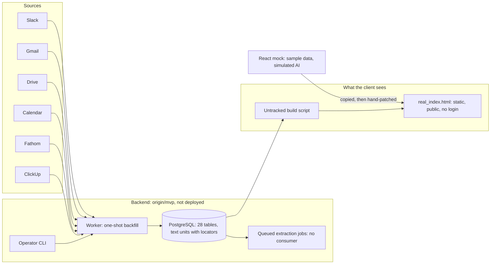
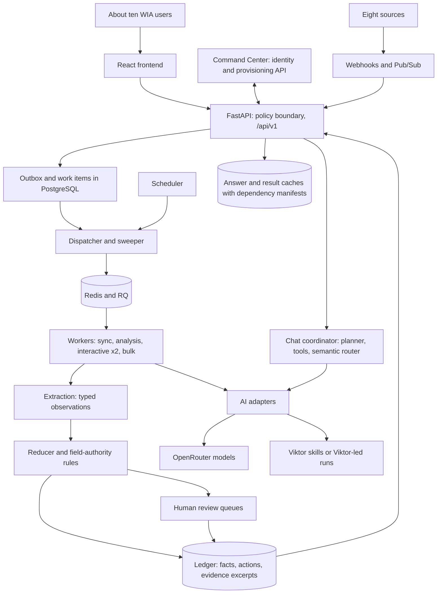

# WIA Client Knowledge Base: System Audit and Gap Analysis

**Date:** 12 November 2026
**Type:** Independent discovery and direction audit. Nothing is redesigned or implemented here.
**Purpose:** The primary input for a first-principles redesign of the solution architecture.

**Baselines audited**

| Repository | Ref | Last commit | What it holds |
|---|---|---|---|
| `wia-knowledge-base` | `main` @ `1326db9` | 26 Oct 2026 | Documents, mock React UI, source-access probes. No backend |
| `wia-knowledge-base` | `origin/mvp` @ `1f63ef8` | 4 Nov 2026 | Everything on `main`, plus the Python backend (`backend/`), the ingestion design and the deployed static MVP (`mvp/`). Contains `origin/feat/ingestion-backend` |
| `WIA-Command-Center` | `n10/atelier-cleanup` @ `dad821f`; `origin/main` @ `1626d9c` | 25–27 Oct 2026 | The central dashboard |

`main` was already up to date with its remote, and the working tree was clean. The newest work is on `origin/mvp`, so that branch was read from an extracted snapshot without switching branches or touching the working tree.

**How to read the evidence labels**

| Label | Meaning |
|---|---|
| **[V]** Verified | Read directly in code, configuration, git history or probe output during this audit |
| **[D]** Documented | Stated in a project document. Not independently confirmed |
| **[I]** Inferred | A conclusion drawn from verified or documented facts. The reasoning is given |
| **[A]** Assumption | Not established by anything in the repositories. Needs the owner's confirmation |

The system is at an early stage. An unbuilt feature is not treated as a defect anywhere in this document. Findings are about direction: which decisions set the current course, whether they fit the intended product, and what should be reconsidered before more is built on them.

---

## Contents

1. [Executive summary](#1-executive-summary)
2. [The intended product](#2-the-intended-product)
3. [What exists today](#3-what-exists-today)
4. [The documented target architecture](#4-the-documented-target-architecture)
5. [Where the direction diverged](#5-where-the-direction-diverged)
6. [Root causes](#6-root-causes)
7. [The AI and knowledge-base design](#7-the-ai-and-knowledge-base-design)
8. [Viktor](#8-viktor)
9. [Command Center integration](#9-command-center-integration)
10. [Constraints, gaps and risks](#10-constraints-gaps-and-risks)
11. [What to preserve and what to reconsider](#11-what-to-preserve-and-what-to-reconsider)
12. [Requirements and considerations for the redesign](#12-requirements-and-considerations-for-the-redesign)
13. [Open questions for the owner](#13-open-questions-for-the-owner)
- [Appendix A: Evidence index](#appendix-a-evidence-index)
- [Appendix B: Status of the 26 October review's findings](#appendix-b-status-of-the-26-october-reviews-findings)
- [Appendix C: Backend inventory](#appendix-c-backend-inventory)
- [Appendix D: Method and limits](#appendix-d-method-and-limits)

---

## 1. Executive summary

### Verdict

**The project set out to build an AI-driven knowledge base and has so far designed and built a records-management system with no AI in it.** The owner's concerns are supported by the evidence, with one correction: the reliance on Viktor is in the documents and the product framing, not in the code, so it is cheap to remove.

The intended product is described consistently wherever it is described briefly: "everything about every client in one place, with sources", where "answers arrive with the client-specific evidence behind them, instead of living in one person's memory". Its core value is a language model reading client communications and producing short, cited answers, summaries, briefs and lists of open asks.

What the architecture documents specify instead is an evidence ledger: a system of record with its own action lifecycle, human review queues, field-authority rules, per-user permission overrides, retention categories, dependency-validated caches and recovery targets. In that design the language model is one bounded step called "interpretation", and who performs it was left as an open choice between an in-house route and Viktor.

### The seven findings that matter most

| # | Finding | Evidence |
|---|---|---|
| 1 | **The AI is the product, and it is the one part nobody has started.** Every screen in the mockups depends on model output. After five weeks there is no model call, prompt, retrieval code or evaluation set anywhere | [V] No LLM, embedding or search code in `backend/` or `frontend/`. Extraction jobs are queued and never consumed (§3.3, §7) |
| 2 | **The knowledge base was redefined as a system of record.** The design maintains its own mutable truth about tasks, facts and money, and needs people to curate it through review queues | [D] Solution Architecture §4.5, §4.10, §6; Functional Requirements FR-ACT, FR-REV, FR-ADM (§5.2) |
| 3 | **One product became about seven.** The Command Center roadmap lists the knowledge base as one initiative beside separate ones for action chasing, paid-media watches and recap drafting. The current scope merges several of them into six tabs plus supporting screens, with 171 numbered requirements | [V] `WIA-Command-Center/src/data/timeline.ts`; [V] 171 distinct `FR-` IDs (§5.3) |
| 4 | **Two foundational decisions work against a knowledge base.** Keeping only extracted facts and excerpts (not the text), and requiring all history from all eight sources before first launch | [D] ARCH-Q03; FR-INT-02. The backend already ignores the first one and stores full text (§5.4, §5.5) |
| 5 | **The machinery is sized for a different system.** The design specifies webhooks, two queue layers, five worker processes, cache manifests, a semantic router and a global policy lock for about ten trusted users and 24 clients | [D] Solution Architecture §2.5, §7.6, §7.7, §9.6; [D] 24 active clients in `backend/docs/people-roster-validation.md` (§5.6) |
| 6 | **Viktor has nine roles in the documents and none in the code.** It was kept as a candidate for retrieval, interpretation, orchestration and chat. None of that was tested, and none of it is needed for the knowledge base | [V] Zero Viktor references in backend code; [D] roles in §8.2 |
| 7 | **The client is already reviewing an MVP that bypasses the architecture.** It is a hand-patched static file with real client data, served on a public URL with no login | [V] `mvp/README.md` on `origin/mvp` (§3.4, §10.2) |

Finding 7 is the most telling. When something had to be shown to the client, the architecture could not deliver it, so a separate path was created outside it.

### What this means for the redesign

- **The foundation worth keeping is small and real:** six working read-only connectors, normalised text with citable locators, a client-to-source mapping, the product research in the tab scopes, and the source-access evidence.
- **Most of what would be removed is specification, not code.** The backend is about 7,600 lines. The documents are about 132,000 words.
- **Removing Viktor from the architecture is a documentation change.** Replacing what Viktor does for WIA today (call preparation and ad monitoring) is a separate question, covered in §8.
- **Command Center integration is settled by the owner:** reuse its sign-in, and link to the knowledge base with a launch card as Content Atelier is linked. Nothing else is shared (§9).

---

## 2. The intended product

### 2.1 Vision

There is no single vision document in the repository. The vision below is reconstructed from the places where the product is described in one or two sentences, which agree with each other.

| Source | Statement |
|---|---|
| [V] Command Center landing card, `src/components/v1/ExploreSection.tsx:34-41` | "Organizes client context, decisions, assets, meeting history and brand guidance into a searchable operating record the whole team can use." Outcome: "Answers arrive with the client-specific evidence behind them, instead of living in one person's memory." |
| [V] Command Center automations registry on `origin/main` | "Everything about every client in one place, with sources: open asks, call prep and history from Slack, email and calls." |
| [V] Command Center onboarding journey, `OnboardingJourney.tsx:145-149` | "Transcript into the client knowledge base", which "replaces the per-client ChatGPT project, and keeps it current" |
| [D] `kb_tab_scope/06-chatbot.md:12-16` | "Ask anything about our clients and get a cited answer, without clicking through every tab." Today the founder asks Viktor in Slack; the complaints are that it is verbose, lives in Slack threads and is not owned. The product must be "short, cited, organised and owned" |
| [D] `kb_tab_scope/02-client-portfolio.md` | The per-client record as the "agency brain" |
| [D] Feasibility Study §1 | "The KB's job is to maintain continuity and accountable follow-through." |

**Reconstructed vision [I]:** an internal tool that reads what WIA already has about each client (Slack, email, call transcripts, tasks, documents, calendar) and lets the team see where a client stands, what is outstanding, what was said and agreed, and how to prepare for the next call. Every statement carries its source. It replaces two things WIA does today: per-client ChatGPT projects, and asking Viktor in Slack.

**Owner's stated concerns for this audit:** the architecture does not reflect that vision; there are too many moving parts; there is too much reliance on Viktor; the AI capability should be built and owned in-house.

The owner's own definition of the vision is not written down anywhere in the repository [V]. The reconstruction above should be confirmed or corrected before the redesign starts (§13, question 1).

### 2.2 Users and scale

| Item | Value | Label |
|---|---|---|
| Users | About ten WIA team members: founder and admin, operations coordinator, ads and account managers, a LeadLock specialist. Internal only; no client portal | [D] |
| Current roster | 3 staff and 6 contractors | [D] `backend/docs/people-roster-validation.md` |
| Clients | 24 active; planning range 15–20 growing to 30–40 | [D] |
| Trust model | Trusted employees. Access rules protect against accidental exposure and the finance boundary, not hostile insiders | [D] |
| Original target dates | Development complete 6 November 2026; launch 26 November 2026. Both were described in the documents as unvalidated | [D] |

### 2.3 Functional scope as documented

The six tab scope documents in `kb_tab_scope/` (22 October) are the best product material in the repository. Each is grounded in how WIA actually works today.

| Tab | Stage | The one question it answers | What it replaces today |
|---|---|---|---|
| Action Register | 1 | What needs doing, by whom, by when, and on what basis? | A ClickUp filter; Viktor's daily "open loops" and Monday digest |
| Client Portfolio and client record | 1 | Which clients are in our care, and where does each one stand? | Reconstructing context by hand; per-client ChatGPT projects |
| Call Preparation | 2 | What do we need to know and settle on this call? | Viktor's morning call prep (valued, but verbose and unaware of call types) |
| Health & Sentiment | 3 | Which clients need care, and why? | Nothing on the relationship side; Viktor covers the ads side |
| Invoices & Contracts | 3 | What commercial terms and payments can we establish? | Looking in GoHighLevel and Dubsado emails |
| Client 360 (chatbot) | Unsequenced | Ask anything about a client and get a cited answer | Asking Viktor in Slack |

Supporting screens in the mock: Overview, Source Library and evidence drawer, Connections. Supporting workflows named in the requirements but not mocked: review queues, correction proposals, user administration, retention administration.

### 2.4 What the mockups require the system to produce

This is the functional core of the product. Every row is language-model work.

| Screen element (mock) | Capability required |
|---|---|
| Action items sourced from Slack, email and calls, with the original quote | Extract requests and commitments, with owner and date where stated, and cite the passage |
| "Current picture" and "Focus" on the client record; Handover brief | Summarise a client's position from recent evidence |
| Client profile fields with source labels | Extract profile facts from questionnaires, documents and calls |
| Meeting list with decisions and resulting commitments | Summarise each transcript into decisions and actions |
| Call brief shaped by call type; "regenerate with instructions"; after-call recap; follow-up email draft | Generate briefs and drafts from client context |
| Health "why", client voice quotes, mood and tone readings | Classify sentiment, attribute speakers, explain drivers |
| Client 360 answer cards with Fact / Interpretation / Suggestion labels, citations and gaps | Retrieval and question answering with citations |
| Chase-email draft on Invoices | Draft from structured finance data |

Capabilities that are **not** model work: counts and overdue calculations, ClickUp task fields, calendar matching, invoice and payment records, sync status.

### 2.5 Core requirements that hold regardless of architecture

These recur across every document and are the requirements the redesign should keep [I]:

1. **Every substantive statement shows its source.** Citations open the exact passage.
2. **Unknown is shown as unknown.** No invented owners, dates, amounts or zeros.
3. **Facts, interpretations and suggestions are labelled differently.**
4. **Counts come from records, not from retrieved passages.**
5. **A bot's or staff member's words are never presented as the client's words.** This includes Viktor's posts.
6. **Finance is visible to admins only**, including where it would surface inside other views and chat answers.
7. **Content from channels and calls shared by several clients must not leak between clients.**
8. **The system is read-only towards source tools** in the first release.
9. **Freshness is visible.** Each view shows when its sources were last read successfully.
10. **The team owns it.** Prompts, data and outputs live in WIA-controlled systems.

---

## 3. What exists today

### 3.1 Timeline [V]

| Date | Commit | What happened |
|---|---|---|
| 9 Oct | `ee4615a` | First mock UI |
| 20–21 Oct | `187151e` | Feasibility Study, Architecture Discovery (23 decisions), Technical Gap Analysis, Solution Architecture, Functional Requirements |
| 22–23 Oct | `cf2929b`, `a788ab7` | Six tab scope documents; mock UI reworked, with second and third layouts added |
| 26 Oct | `3d5a2d4`, `1326db9` | Independent architecture review (26 findings); further mock UI changes. **Last commit on `main`** |
| 27–30 Oct | `ccc9b0f` … `e3557d5` | Ingestion Pipeline Design (dated 26 Oct) and the backend ingestion slice; 30-day test run on three clients |
| 2–4 Nov | `6f96dec` … `1f63ef8` | Static MVP for client review, then real data for four pilot clients. **Last commit anywhere** |
| 6 Nov | — | Original development-complete target |
| 26 Nov | — | Original launch target |

### 3.2 Documentation [V]

About 132,000 words of Markdown on `origin/mvp`, against about 7,600 lines of backend code.

| Document | Lines | Role |
|---|---|---|
| `docs/Client-Knowledge-Base-Solution-Architecture.md` | 1,833 | The architecture. Last revised 21 October; unchanged since |
| `docs/Client-Knowledge-Base-Architecture-Review.md` | 1,300 | Independent review of 26 October (AR-01 to AR-26) |
| `docs/chatbot_KB.md` | 654 | Chatbot scope, routing and caching |
| `docs/Client-Knowledge-Base-Feasibility-Study.md` | 500 | Feasibility and the two "implementation candidates" |
| `docs/Ingestion-Pipeline-Design.md` (on `origin/mvp`) | 444 | Design of the first backend slice |
| `docs/functional_requirements.md` | 400 | 171 requirement IDs |
| `docs/Client-Knowledge-Base-Architecture-Technical-Gap-Analysis.md` | 394 | 22 "technical depth" gaps (TG-01 to TG-22) |
| `docs/Client-Knowledge-Base-Architecture-Discovery.md` | 253 | Decision register ARCH-Q01 to Q23 |
| `kb_tab_scope/*.md` | 1,604 | Six tab scopes |
| `mvp/readme_changes.md` (on `origin/mvp`) | 584 | Hand-patch log for the deployed MVP |

Characteristics that affect their usefulness:

- **The authoritative decision register is missing.** Every document cites `knowledgebase_changes.md` (decisions KB-CH-01 to KB-CH-69). It is not in the repository and was not found on this machine. The same is true of `backend_build.md` (the team's FastAPI standard), `viktor_at_wia.md`, the per-source scope files and three verification registers. The 26 October review counted 75 broken links to 19 missing files [D]; none has been fixed [V].
- **Most of the architecture is hedged.** The Solution Architecture uses "proposed" 81 times and "remain" 85 times [V]. Much of it describes mechanisms that are neither decided nor rejected.
- **The same decisions are restated in five documents**, and they have drifted apart (§5.8).

### 3.3 Backend [V, on `origin/mvp`]

An ingestion-only slice. Full inventory in Appendix C.

| Aspect | State |
|---|---|
| Purpose | Read approved sources and store versioned, citable text units with provenance |
| Stack | FastAPI, PostgreSQL 16, SQLAlchemy 2, psycopg 3, Alembic, httpx, pypdf, python-docx. No Redis, vector store, search index or LLM SDK |
| Size | 7,579 lines of Python excluding tests; 1,949 lines of tests; 28 tables in 5 migrations |
| Interfaces | 5 read-only HTTP routes (2 health, 3 operations behind a token); a 15-command operator CLI; a worker process |
| Connectors | Slack, ClickUp, Gmail, Drive (Docs, Sheets, PDF, DOCX), Calendar, Fathom. Read-only. None for GoHighLevel, Dubsado or Zoom |
| What runs | Client registry from YAML; discovery and human approval of channels, lists, folders and contacts; one-shot backfill; identity resolution against a team roster |
| What is written but not wired | Incremental sync (about 900 lines). Nothing calls it, and it imports a module, `rate_limits`, that is not in the repository, so it cannot run with real connectors |
| What does not exist | Extraction, retrieval, search, any product API, sign-in, any AI call |
| Tested at | A 30-day window for three clients, then four pilot clients for the MVP |
| Deployment | None. The backend has no Railway configuration |

Work items of kind `record.extract` are queued for every stored version (`services/intake/pipeline.py:136`). No worker consumes them.

### 3.4 Frontend, mockups and the MVP [V]

There are four parallel artifacts, and they no longer describe the same product.

| Artifact | What it is |
|---|---|
| `frontend/src` (React 19, Vite) | The mock application. Hard-coded sample data for six fictional clients. No HTTP calls to any backend, no sign-in, no AI |
| `frontend/exports/client-portfolio.html` | A single-file build of the mock. The tab scopes cite this as "the mockup". The committed copy is stale |
| `mvp/index.html` and `mvp/real_index.html` (on `origin/mvp`) | A copy of an uncommitted export, then edited by hand inside the minified bundle. `real_index.html` (21.7 MB) is what the client reviews |
| `client-portfolio-readable.html`, `client-portfolio-workspace.html` | Two further standalone prototypes that do not use React |

Facts that bear on direction:

- **The mock has 11 navigation entries for 6 tabs.** Action Register exists in three layouts, Health in three, Call Preparation in two and Invoices in two. Roughly 60% of the source is spent on those four tabs. The decisions on which layout wins are open in the scope documents.
- **Everything that looks like AI is simulated.** The chatbot is a regular-expression rule engine with timed "thinking" steps (`views/Client360.tsx:46-52`). "Regenerate" is a timer.
- **"Live" data is a build-time snapshot.** Three scripts write JSON files that replace the sample data at build time. One of them, `backend/scripts/export_frontend_snapshot.py`, reads the backend database and writes every AI-dependent field as "Not extracted yet".
- **The MVP has diverged from its source.** `mvp/readme_changes.md` logs 54 technical notes to reapply by hand after any re-export. Features in the deployed page, such as "Action Hub" and "Ping on Slack", do not exist in the React source.
- **The deployed page cannot be rebuilt from the repository.** It is generated by `backend/.local/raw_pull/scripts/build_real_index.py`, which is gitignored and absent.
- **The MVP narrowed the scope by itself.** Only Client Portfolio and Action Hub are live. Overview, Call Preparation, Health, Client 360 and Invoices are marked "Coming soon".

### 3.5 Source access [V from probe outputs dated 19, 20 and 26 October]

All probes were bounded and read-only. None is a full backfill or a webhook test.

| Source | Access | Credential | Main constraint |
|---|---|---|---|
| Slack | Works on 6 client channels | Bot token reused from Content Atelier | The bot must be invited to each channel; programme channels mix clients and are excluded |
| Gmail | Works | One person's OAuth consent on the shared mailbox; refresh token on a developer machine | One mailbox; about 33,800 messages |
| Drive | Works on samples | Same grant | Completeness of folders unknown |
| Calendar | Works | Same grant | Only calendars the shared mailbox can see |
| Fathom | Works after a key mix-up was fixed | WIA team key | Total volume unknown; action items carry no due dates |
| ClickUp | Works on 5 lists (338 tasks) | A personal token for a user named "E2M AI" | About 100 requests a minute |
| GoHighLevel finance (WIA's own account) | Works since 26 Oct: 347 invoices, 391 transactions, 53 schedules | A dedicated token | Products endpoint denied |
| GoHighLevel client data (59 sub-accounts) | **Blocked.** Every lead, pipeline and appointment read is denied | Agency token | Needs a private OAuth app installed per location. Not built |
| Dubsado | Indirect only, through notification emails | — | The backend currently never admits these emails |
| Historical Zoom | Not verified by this project | — | Command Center's resource ledger records 150 Zoom transcripts already held by Content Atelier [D] |
| Paid media (Google, Meta) | Not an approved source | — | Shown in the mock anyway |
| Viktor | Never accessed. No API test, no billing check | — | — |

### 3.6 As-built picture

There is no arrow from the backend to a user-facing application, and no AI component, because neither exists.

---

## 4. The documented target architecture

This section summarises what the Solution Architecture (21 October) specifies, so the redesign can see the whole of what is being reconsidered. Parts already changed by the Ingestion Pipeline Design are marked.

| Area | What is specified | Status in the document |
|---|---|---|
| Deployment | Dedicated Railway project. API, four kinds of worker (five processes), scheduler, PostgreSQL, Redis. Staging and production fully isolated | Recommended |
| Ingestion | Push-first: Gmail through Cloud Pub/Sub, Drive and Calendar channels, Slack Events, ClickUp and Fathom signed webhooks, plus five-minute reconciliation | Specified. **Changed to polling** by the Ingestion Pipeline Design |
| Queue | Work items and outbox in PostgreSQL, dispatched into Redis/RQ, re-claimed in PostgreSQL | Specified. **Changed to PostgreSQL-only** by the Ingestion Pipeline Design |
| Retention | Keep extracted facts, excerpts and metadata. Full text is a temporary processing input | Agreed (ARCH-Q03) |
| Knowledge model | Source records and versions; evidence excerpts; observations separate from reviewed fact values; a reducer with a per-field authority matrix | Proposed |
| Actions | Separate dimensions for progress, review state, origin, acknowledgement and verification; reopening rules; correction proposals | Agreed in principle |
| Review | Persisted review gates for ambiguity, staleness, conflicts and AI proposals; per-user read state per change revision | Agreed |
| Access | Central sign-in; KB membership; custom roles; per-user Inherit / Allow / Deny overrides; client and module grants; a global policy lock; row-level security for chat | Agreed in principle; grants not configured |
| AI | Two candidates: "selective hybrid" (connectors, OpenRouter, Viktor skills) and "Viktor-led" (Viktor retrieves and interprets). Models, prompts and embeddings unselected | Test-dependent |
| Retrieval | PostgreSQL full-text search over retained excerpts; optional semantic candidates fused by rank; at most 12 excerpts into context | Proposed |
| Chat | Query plan, one planner call, at most four tool steps; Mode A (stored evidence only) versus Mode B (live source reads); private threads | Scope agreed; delivery position open |
| Caching | Answer cache with signed dependency manifests, in-flight coalescing, fencing tokens; semantic intent router; embedding reuse | Method agreed (KB-CH-68); disabled initially |
| Recovery | At most one hour of lost changes; restore within four hours; point-in-time recovery; monthly restore drills | Agreed as targets |
| Launch condition | All obtainable history from all eight sources for all active clients, with a signed gap report | Agreed |

---

## 5. Where the direction diverged

### 5.1 The AI is peripheral in the design and absent in the build

**What the documents say.** The Solution Architecture's section on AI opens with a table whose default is deterministic code and whose AI rows are "tested interpretation" and "bounded synthesis" (§8.1). The build plan puts "Candidate evaluation" at step 5 of 10, after foundation, durable intake, and evidence and review (§14). The Ingestion Pipeline Design states that the first backend slice "stops before AI extraction", and the document setting out its purpose opens with: "WIA is not buying a search box."

**What exists.** No model call, prompt, embedding, search index or evaluation data [V]. The profile and narrative text in the deployed MVP was produced by an untracked process; the repository does not say how [V].

**Why it matters [I].** Section 2.4 shows that almost every element of the mockups is model output. In the current sequence, the first real evidence of whether the product is any good arrives after connectors, versioning, coverage accounting, identity resolution, review workflows and permissions are complete. That is the wrong order for a product whose risk is concentrated in answer quality. The plumbing is well understood; the quality of extracted commitments, briefs and answers on WIA's real data is not, and nothing built so far reduces that uncertainty.

**Why it was designed this way [I].** The design process started from correctness risks (wrong client, invented deadline, stale request, leaked finance) and answered each with a deterministic mechanism. Those risks are real. The result, though, is an architecture that is mostly safeguards around a capability that has not been attempted.

### 5.2 The knowledge base became a system of record

The design does not only read WIA's tools. It maintains its own mutable state and asks people to curate it.

| KB-owned mutable state in the design | Source |
|---|---|
| Action progress, owner and deadline, editable in the KB | [D] `kb_tab_scope/01-action-register.md`; SA §4.5 |
| Owner acknowledgement events, by message, button or configured emoji | [D] FR-ACT-12, FR-ADM-07 |
| Done versus Verified, named reviewers, self-verification as a configurable permission, verification superseded on reopening | [D] FR-ACT-14 to 17; ARCH-Q09, Q23 |
| Correction proposals, resolver decisions, preserved across re-extraction | [D] FR-REV-03 to 05; ARCH-Q05, Q22 |
| Review queues for identity, staleness, conflicts and AI proposals | [D] FR-REV-01, SA §6.1 |
| Per-user read state for each change revision | [D] ARCH-Q07 |
| Snooze, deadline-change approvals, priority | [V] in the mock; partly undecided |

Consequences:

- **It competes with ClickUp.** The 26 October review found that editing ClickUp-mapped tasks in the KB without writing back produces permanent divergence, with users updating two tools (AR-09) [D]. Command Center's own notes say ClickUp remains the system of record for tasks [V].
- **It adds human work.** The same review identified the review backlog created by a full historical backfill as the likely real launch bottleneck (AR-12) [D]. The Action Register scope says of itself: "If the register shows everything ever mentioned, nobody will use it."
- **It is a different product.** Command Center's roadmap lists "OP-02 · Action-item chase & acknowledgement tracking" as a separate initiative from "FF-01 · Maintained client knowledge base" [V]. The current design absorbed it.

A system of record needs reducers, authority rules, optimistic locking, audit trails, recovery targets and fine-grained permissions. A knowledge base that reads sources and produces regenerable, cited views needs far fewer of them. Much of the architecture's weight follows from this one choice.

### 5.3 Scope aggregation

| Measure | Value | Label |
|---|---|---|
| Top-level views in the mock | Overview, 6 tabs, Source Library, Connections | [V] |
| Sub-tabs inside one client record | 11 | [V] |
| Numbered functional requirements | 171 | [V] |
| Requirement areas | 18, including review, administration, retention and operations | [V] |
| Competing layouts under review | 3 + 3 + 2 + 2 across four tabs | [V] |

The Command Center roadmap (file last changed 5 October) places the knowledge base in Phase 3, describes that phase as "deliberately sequenced last", and dates FF-01 for April–May 2027 [V]. The knowledge-base project's own target was 26 November 2026 [D]. The roadmap may have been re-sequenced since then [A], but the two were never reconciled in either repository.

The three-stage activation sequence (KB-CH-69) limits which tabs are switched on. It does not limit what must be built first, because the launch condition requires processing history for every later stage (§5.5).

### 5.4 The retention decision contradicts a knowledge base

**Decision (ARCH-Q03).** Keep extracted facts, supporting excerpts and metadata. Fetch full originals on demand. Do not keep a full text copy.

**Stated rationale [D].** Limit permanent copying of client source material.

**Consequences [D, from the 26 October review, AR-10].** Questions such as "what was discussed on the last call" can only be answered from whatever an earlier extractor chose to keep. Every change to a prompt or extraction rule means re-fetching all history from eight providers. Full-text search finds only extracted excerpts. Several decided features (client voice, reply detection, free-text research in call prep) need the text.

**What the design did to live with it.** It added transient processing windows, quote verification against a temporary original, on-demand "original hydration", two chat modes (A and B) to be tested against each other, and a "temporary originals" retention category used as a workaround.

**What the code does [V].** It stores full normalised text for every unit and lists the question as an open decision (`backend/before_production.md`, item B-09). The decision is already not being followed.

For a model-driven knowledge base, the retained text is the knowledge base. This decision should be reopened explicitly rather than worked around, with the privacy considerations in §10.2 addressed directly.

### 5.5 The launch condition front-loads the least valuable work

**Decision (FR-INT-02).** All obtainable history from all eight approved sources, for every active client, processed before first launch, including data for features whose screens are not yet enabled, with WIA signing off a source-by-source gap report.

**Effect on sequencing [I].** Ingestion had to be built first and built for completeness: coverage windows, cursors, gap accounting, three kinds of deletion state. The ingestion design itself estimates that ingesting everything takes hours, not days [D]. The cost of the decision is therefore in the accounting machinery and in the ordering, not in compute. It also conflicts with its neighbours: extracting data now for Stage 2 and 3 features whose definitions are not agreed guarantees it will be extracted again.

No evidence in the repository shows that users need complete history before the product is useful [I]. The Action Register scope proposes a 30-day cutoff for what counts as a live item [D].

### 5.6 Machinery compared with need

Scale: about ten trusted internal users, 24 clients, one team.

| Mechanism in the design | Requirement it serves | Assessment at this scale |
|---|---|---|
| Webhooks and Pub/Sub for six providers, with renewals and signature checks | 15-minute freshness | Not needed; a five-minute poll meets the target. Already dropped by the ingestion design |
| Redis/RQ plus PostgreSQL outbox, dispatcher and sweeper | Durable background work | Two queue systems for one job. Already reduced to PostgreSQL-only |
| Five worker processes in four lanes, plus a scheduler | Keep backfill from starving current work | One worker has been enough for everything run so far [V] |
| Leases, fencing tokens, heartbeats, atomic page publication; 26 of 103 tests cover this | Crash safety during ingestion | Built for a single worker and a one-time backfill. Re-running an idempotent upsert achieves the same result |
| Durable sync streams, run generations, checkpoints (about 900 lines, unwired) | Incremental updates | Premature. It cannot currently run [V] |
| Three approval state machines (scopes, contacts, account team members), with optimistic revisions | Correct client mapping | The mapping is essential. A reviewed configuration file would serve 24 clients |
| Source records, immutable versions, content units, tombstones, three deletion states | Citations that still resolve after edits | The core is useful: stable identity and a locator per text unit. The rest is speculative |
| Observations, fact values, reducer, field-authority matrix | Keep human corrections over later source changes | Only needed if the KB owns mutable truth (§5.2) |
| Custom roles, per-user Inherit / Allow / Deny, client and module grants, global policy lock, row-level security | Access control | The actual needs found are: team members only, finance for admins only, and possibly "my clients". A few lines of policy |
| Central account provisioning through an API | Admins add users from the KB | Command Center has no such API and no user store [V]. Dropped by the owner's direction (§9) |
| Answer cache with signed manifests, coalescing and fencing; semantic intent router; embedding reuse | Token cost | The review estimated chat generation at $110–220 a month and the saving at tens of dollars [D] |
| Mode A versus Mode B chat; original hydration | Work around excerpts-only retention | Disappears if text is retained (§5.4) |
| Two AI candidates behind a common contract, with a comparative evaluation regime | Keep Viktor as an option | See §8 |
| Admin-configurable retention by category, expiry jobs, tombstones | Data minimisation | No durations were ever supplied [D]; nothing expires [V] |
| One-hour recovery point, four-hour restore, point-in-time recovery, monthly drills | Protect human decisions | Scales with how much irreplaceable state the KB owns. A derived store that can be rebuilt needs a daily backup |
| Isolated staging with its own cursors and provider subscriptions | Safe testing | Reasonable later; nothing is deployed yet |
| People roster, dated shared-mailbox holders, person merging (918 lines) | Tell staff from clients | Telling staff from clients is essential. Dated holder history and merging have no callers outside tests [V] |

**Where the design was right.** PostgreSQL as the only store; no separate vector database; no microservices; no agent framework; deterministic code for counts and money; permission filtering before retrieval rather than after; connector identity checks (motivated by a real incident in which the wrong tenant's Fathom calls were returned); contact-based qualification of a shared mailbox. These should survive.

### 5.7 Open forks were carried as architecture

Three foundational choices were left open and then specified around instead of decided:

| Fork | Status in the documents | Cost of leaving it open |
|---|---|---|
| "Selective hybrid" versus "Viktor-led" for all background AI | "Test-dependent; neither selected". No test was run | Two adapters, a common output contract, an evaluation regime, and AI work held behind the comparison |
| Chat Mode A versus Mode B | "Test-dependent" | Both paths specified in detail |
| Models, prompts, embeddings | "Not selected here" | The one component that determines product quality has no concrete design |

### 5.8 Four descriptions of the product, none authoritative

| Description | Date | Divergence |
|---|---|---|
| Solution Architecture | 21 Oct | Predates about fifteen product decisions made in the tab scopes. Unchanged since |
| Tab scopes | 22 Oct | Decide outbound Slack and Gmail messaging, GoHighLevel as the finance ledger, finance hidden across all views, owner-approved narratives, admin-editable brief templates. None is in the architecture |
| React mock | 21 Oct – 3 Nov | Adds things no scope decided: a numeric tone score in Health v3 (the scope says no combined score), a paid-media Performance tab (not an approved source), priority |
| Deployed MVP | 2–4 Nov | Adds things not in the React source: "Action Hub", one-click "Ping on Slack" with no review step (the scope requires review before sending), drag and drop, archive |

The 26 October review recorded 19 specific inconsistencies [D]. Its first recommendation, a reconciliation pass, was not carried out [V]. The MVP then added a fourth version.

### 5.9 The MVP shows the architecture is not serving delivery

When the client needed something to review, the team did not use the backend's API (there is none), the React application (it has no data layer), or the architecture's delivery path. It copied a build, patched the minified file by hand, and injected real data with a script that is not in the repository.

This is not a criticism of the people who did it; it was the fastest way to show real data. It is direct evidence that the planned route to first value is too long. It has also created a second problem: client feedback is now being applied to a file that cannot be regenerated, so each review round moves the product further from its source.

### 5.10 The earlier review was right about proportion and did not go far enough

The 26 October review is careful work, and three of its recommendations were adopted: the KB owns retrieval, polling replaces webhooks, and PostgreSQL replaces Redis/RQ. This audit agrees with its findings on over-engineering (AR-15 to AR-18).

It differs on the verdict. The review concluded that "the core architecture is sound and well matched to the product" and recommended a trimmed Stage 1 slice. That slice still contained the reducer, field authority, the action state machine, review queues with bulk tools, memberships with roles and overrides, and per-user read state, with AI as one line ("one OpenRouter endpoint"). The review accepted the system-of-record framing and trimmed mechanisms inside it. It did not ask whether a knowledge base should own that state at all, or whether the AI should come first. Its own finding that human review load may be the real bottleneck (AR-12) is an argument against the framing it accepted.

---

## 6. Root causes

These are inferences from the document trail [I]. They are offered so the redesign can avoid repeating them, not to assign fault.

1. **No short statement of the product ever constrained the design.** The briefest descriptions (§2.1) say "everything about a client, with sources". Nothing in the design process tested each mechanism against that sentence.

2. **Decisions were collected one question at a time.** The Discovery document records 23 clarification questions. In many, the selected answer was the more configurable or more complete option: custom roles plus per-user overrides rather than fixed roles; configurable self-verification; configurable retention by category; API provisioning; private chat with metadata-only admin access. Each answer is defensible alone. Their combined cost was never shown, because each became a mechanism in a separate section.

3. **"Technical depth" was requested as a goal.** The Technical Gap Analysis lists 22 areas where the first draft was not specific enough and classes 17 as needed for the first release. The response was to specify everything to implementation depth, including mechanisms for a chatbot with no delivery date. Depth was added uniformly rather than where the risk was.

4. **Correctness risks were designed for before usefulness was demonstrated.** Nearly every mechanism answers a "what if it is wrong" question. No step asked "is the output good enough to use" first.

5. **The incumbent was kept open as an option instead of being decided.** Keeping "Viktor-led" alive deferred every concrete AI decision (§5.7, §8).

6. **A backend standard shaped the system before the product did.** The documents repeatedly cite the team's FastAPI standard as the reason for the folder layout, workers and Redis/RQ. That standard is not in the repository, so its actual constraints cannot be checked [V].

7. **Documents were treated as progress.** By 26 October there were about 5,000 lines of architecture and requirements and no backend. The first slice built was the one with the least product uncertainty.

8. **There was no end-to-end slice.** No single client question was ever taken from source to cited answer. Each layer was designed for completeness on its own.

---

## 7. The AI and knowledge-base design

### 7.1 Current state

| Layer | Designed | Built [V] |
|---|---|---|
| Text substrate | Retained excerpts only | Full normalised text in `content_units`, each with a typed locator, author identity, timestamp, hash and a data-domain tag |
| Search | PostgreSQL full-text index on excerpts; optional embeddings | None. No index of any kind |
| Extraction | 6,000-token windows with 256-token overlap; typed outputs (action candidates, deadline candidates, evidence spans); quote verification; one repair attempt | None. Jobs queued, no consumer |
| Reconciliation | Reducer with field-authority rules | None |
| Generation | Briefs, assessments, narratives under versioned contracts | None |
| Chat | Query plan, planner call, typed tools, validation, streaming of progress | A regular-expression mock in the frontend |
| Models | "Not selected here." OpenRouter named as the route; Gemini Flash Lite and Claude Sonnet used only as price examples | None |
| Prompts | "Skill files" under `services/intelligence/skills/` | None. The folder does not exist |
| Evaluation | Gates and case lists described | No data, no harness |
| Run logging and cost | Described | None |

### 7.2 What is sound in the AI thinking

- **Counts and current states come from queries, not from the model.**
- **Citations are issued by the backend and validated**, so a model cannot invent a source.
- **Permission and client scope are applied before text reaches a model.**
- **Model output is labelled as fact, interpretation or suggestion.**
- **Models are not re-run because a page was opened or a timer fired.** Command Center's Client Hub mock states the same principle more sharply: inference at write time (per meeting, per inbound email) has a forecastable cost; inference at read time grows with adoption [V, `src/data/opsHub.ts`].

### 7.3 Gaps the redesign must close

| Gap | Why it matters |
|---|---|
| No owned AI component exists: no model access, prompts, context assembly, output validation or run log | This is the product's core and the owner's stated priority |
| No evaluation set | There is no way to tell whether extraction or answers are good, or whether a prompt change helps |
| No decision on retained text (§5.4) | Determines what retrieval can find |
| No retrieval approach chosen | The documented one searches only excerpts |
| No policy on what may be sent to a model provider | Flagged by the earlier review (AR-23). Still open. Includes whether finance content may be sent at all |
| Sensitive fields in source text | Questionnaires contain tax numbers, phone numbers and credential prompts. One export script filters them; nothing else does (`before_production.md`, G-14) |
| Shared channels and calls | Programme channels that mix clients are simply excluded today. No per-passage client attribution exists |
| Speaker attribution | "Client voice" depends on knowing who spoke. Fathom gives speaker emails; Slack gives user IDs; Zoom transcripts give display names only [D] |
| Unclear split between write-time and read-time inference | Drives cost, freshness and how much must be stored |
| No definition for most derived measures | Health categories, lead stages, attendance rules and priority have no agreed definition [D] |

### 7.4 A relevant precedent on the same team

The sibling Content Atelier project already contains an in-house model layer. Its README describes a package holding "every model call, privacy routing, run plans, `llm_runs`", on FastAPI and PostgreSQL with pgvector, with paid calls refused unless a run plan is active [V, README only; the code was not audited]. The team has therefore already built and operated owned LLM infrastructure for WIA. The knowledge-base documents do not mention it.

---

## 8. Viktor

### 8.1 What Viktor is and does for WIA today

Viktor is a third-party AI assistant product (viktor.com) that runs as a bot in WIA's Slack [I from D]. Adding it to each new client channel is a standing onboarding task [V, `WIA-Command-Center/server/onboarding-templates.json`].

| What it does today | How WIA rates it | Source |
|---|---|---|
| Scans the founder's calendar each morning and posts a brief for each call | Valued, but verbose and unaware of call types | [D] `kb_tab_scope/05-call-preparation.md` |
| Daily "open loops" per client | Lives in Slack threads; not owned | [D] `01-action-register.md` |
| Monday ClickUp digest | Dropped: "a lot… even old ClickUp tasks" | [D] `01-action-register.md` |
| Proactive ad-problem alerts | "WIA's only behind-the-scenes client-health signal today" | [D] `04-health-sentiment.md` |
| Monday green / yellow / red ad snapshot for every client | Used to set the week's priorities | [D] `04-health-sentiment.md` |
| Ad hoc questions in Slack ("how are things going with this client?") | Used instead of searching | [D] `06-chatbot.md` |
| Pre-interview questionnaire gap checks, kickoff briefings | Used when remembered | [D] `05-call-preparation.md` |

Cost: about $1,000 a month, from recollection. No invoice was checked [D].

These descriptions come from the tab scopes, which cite `viktor_at_wia.md`. That file is not in the repository [V].

### 8.2 The roles Viktor was given in the architecture

| # | Role | Where | Status |
|---|---|---|---|
| 1 | **Evidence.** Existing Viktor posts in Slack are kept as "attributed analysis" | All documents | Agreed |
| 2 | **Interpreter.** "Specific versioned Viktor skills" perform extraction or analysis inside the hybrid candidate | SA §8.2, Feasibility §9 | Candidate, untested |
| 3 | **Orchestrator and retriever.** In "Viktor-led", Viktor obtains the source material, interprets it and returns structured records | SA §8.2, Feasibility §9 | Candidate, untested |
| 4 | **Chat specialist.** A `run_skill` tool and a "registered Viktor skill" route in the chatbot; a "verified Viktor route" for live source reads | SA §8.4–8.5, `chatbot_KB.md` §7, §10 | Candidate, untested |
| 5 | **Access workaround.** "A proven Viktor source tool" as a possible way around the denied GoHighLevel client data | Feasibility §6 | Speculative |
| 6 | **Product content.** An "Ads (Viktor)" column in Health; a Viktor rating in strategy briefs; ad figures in Call Prep v2 attributed to Viktor | Tab scopes 04, 05; mock | Decided (H3) for Health |
| 7 | **Continuing external tool.** Ad monitoring stays with Viktor, outside the KB | Tab scopes 01, 02, 04 | Agreed |
| 8 | **Business case.** Savings on Viktor spending as part of the justification | Feasibility §11, SA §15.3 | Unverified baseline |
| 9 | **Governance object.** "Viktor skills" are version-controlled alongside prompts; the architecture records Viktor's public API endpoints and names four skill task keys | SA §8.4–8.5 | Agreed (ARCH-Q19) |

Viktor is mentioned about 265 times across the documents and tab scopes [V].

**In code:** zero references in the backend. In the frontend it appears only as a label on attributed content [V]. No Viktor API call, credential, skill file or test exists. The cost comparison file records `candidate_evaluation_performed: false` and `selected_candidate: null` [V].

### 8.3 Why it was introduced

1. **It is the incumbent, and WIA values part of it.** The Feasibility Study records "excellent current call preparation and valuable Google/Meta anomaly detection" and warns that optimisation should preserve them [D].
2. **The option was explicitly retained.** Decision KB-CH-41 kept both "selective hybrid" and "Viktor-led" for comparative testing [D].
3. **It already has tool access and context in WIA's workspace**, which looked like a shortcut for retrieval and for the blocked GoHighLevel data [D].
4. **Cost.** Reducing the $1,000 a month was part of the case [D].

### 8.4 Do its roles require it?

| Role | Verdict | Reasoning |
|---|---|---|
| 1 Evidence | **No dependency.** | Viktor's posts are Slack messages from a bot. The backend already stores bot messages and resolves their author as `bot` [V]. The only rule needed is the existing one: never present them as the client's words |
| 2 Interpreter | **Not required.** | Extraction, summarising and briefing from supplied context are standard model tasks. Nothing in the documents shows Viktor does them better; the Feasibility Study notes the vendor material "does not establish a separate wedding-industry-trained model" |
| 3 Orchestrator and retriever | **Should be ruled out.** | The earlier review showed this conflicts with the design's own rules: the KB could not verify quotes, account for coverage or re-fetch originals (AR-03) [D]. The ingestion design already dropped it by building direct connectors |
| 4 Chat specialist | **Not required, and risky.** | Viktor's workspace access does not map to KB permissions. The documents themselves say a prompt telling it to use only one client's data "does not prove isolation" |
| 5 Access workaround | **Not viable.** | A third-party agent cannot turn a denied API scope into an authorised one. The real fix is the GoHighLevel OAuth app (§10.1) |
| 6 Product content | **The only real dependency on Viktor's output.** | It concerns paid media, which is outside the KB's approved sources. See §8.5 |
| 7 External tool | **A WIA business decision, outside the KB.** | Command Center's roadmap already plans in-house Google and Meta performance watches (PM-01, PM-02) [V] |
| 8 Business case | **Unverified.** | No invoice or usage data was checked |
| 9 Governance object | **Falls away** with roles 2–4 | — |

### 8.5 Reducing or eliminating Viktor

**Within the knowledge-base architecture, Viktor can be removed completely.** Roles 2, 3, 4, 5 and 9 exist only in documents. Removing them deletes a design fork, an adapter, an evaluation regime and the main reason AI decisions were deferred. No code changes.

What an owned replacement has to provide is the content of §7.3: model access, prompts in the repository, context assembly from the KB's own text, output validation, an evaluation set and a run log. Model inference would still come from a provider's API. "Owned" means the prompts, the data flow, the evaluation and the outputs are WIA's, and the model behind them can be swapped.

**Three cautions.**

1. **Removing Viktor from the architecture is not the same as WIA cancelling Viktor.** WIA relies on it today for ad anomaly alerts and the Monday ad snapshot. The KB does not replace those, because paid media is not one of its sources. If the subscription ended before an in-house ad watch existed, WIA would lose a signal it uses weekly.
2. **Call-preparation quality is unproven.** It is the Viktor output WIA values most. An in-house brief has to be at least as useful and shorter. That needs a side-by-side check on real calls before it is claimed.
3. **The "Ads (Viktor)" column needs a decision.** The options are: drop it from the KB; keep showing Viktor's Monday post as an ordinary cited Slack message, which needs no integration; or replace it when an in-house ad watch exists.

### 8.6 The cost comparison

`verification/viktor/comparison_costs.json` compares Viktor "quick task" credits with direct model calls for one analysis per client per day [V].

| Clients | Runs a month | Low-cost model | Mid-range model | Viktor (100–300 credits a run) |
|---|---|---|---|---|
| 20 | 600 | $2.53 | $28.49 | $150–$450 |
| 40 | 1,200 | $5.06 | $56.97 | $300–$900 |

The arithmetic is correct and the file states its own limits. As evidence it is weak: the token volumes are assumed, a single model call is compared with a multi-step agent task, Viktor's rates come from public documentation rather than WIA's account, and engineering time is excluded. It supports one conclusion only: model spend is not a reason to prefer Viktor at this scale. The file's count of archived Viktor posts is probably low, because it looks for thread replies under keys the Slack archive does not use [I].

---

## 9. Command Center integration

### 9.1 Owner's direction

Recorded on 12 November 2026: **the knowledge base reuses Command Center's authentication layer. Beyond that the two systems stay separate, connected only by a launch card, in the same way as Content Atelier.**

### 9.2 What Command Center is [V]

A React single-page application with one Express process, deployed on Railway. It is a launcher for WIA's automations plus mockups from the AI Blueprint. Apart from sign-in, onboarding and inherited lead tools, its client-facing screens run on fixtures in the browser. It makes no AI calls and has no connectors to Slack, Gmail, Drive, Fathom or GoHighLevel. It holds no canonical client list.

### 9.3 The authentication contract to reuse [V, `server/atelier-sso.mjs`, `server/auth-core.mjs`, `server/index.mjs`]

| Aspect | How it works |
|---|---|
| Accounts | Environment variables: one team account, one optional client account, up to 20 more. Adding a user means changing deployment variables. There is no user table and no provisioning API |
| Roles | `team` and `client` only |
| Session | A stateless signed token carrying email, role and expiry, valid for seven days, in an HttpOnly cookie |
| Sign-in hand-off | The sibling application starts a PKCE flow. Command Center issues a one-use code valid for 60 seconds. The sibling exchanges it server-side and receives the session token and the user's email, name and role |
| Per-request check | The sibling validates the token against Command Center's `/api/auth/session`, server to server |
| Sign-out | Command Center revokes the token and redirects through the sibling's sign-out endpoint |
| Endpoints the sibling must expose | `GET /api/auth/sso/start`, `GET /api/auth/sso/callback` (matched exactly as the redirect URI), `GET /api/auth/signout` |

This is the pattern Content Atelier arrived at after first being proxied and embedded inside Command Center. The proxy and the embedded screen were removed on 25 October in favour of a launch link with shared sign-in [V, commits `b4d5241`, `31da243`, `dad821f`].

### 9.4 Considerations

| Consideration | Detail |
|---|---|
| **The hand-off is hard-wired to one sibling** | The mount path, URL variable, `next` pattern, sign-out redirect and build argument all name Content Atelier. Supporting the KB needs a second mount, a new URL variable and a sign-out chain that handles two siblings. This is a small change in Command Center, but it is a change in another repository |
| **The KB must check the role itself** | Command Center has client-role accounts and applies no role gate. The KB must require `team` |
| **Admins are not a Command Center concept** | Finance is admin-only in the KB. With only `team` and `client` roles available, the KB needs its own short list of admin emails |
| **Identity is an email address** | There are no stable user IDs. Anything the KB stores per user is keyed by email |
| **Command Center becomes a runtime dependency** | One-use codes and revocations are held in process memory and one replica is assumed. A restart drops both. Rotating its session secret signs every sibling user out |
| **No embedding** | Command Center sends `X-Frame-Options: DENY`, and the embedded approach was deliberately removed |
| **The launch card already exists** | "Client Knowledge Base" is listed as "Coming soon" on the landing page and in the automations registry on `origin/main`. "Live" is decided at build time by whether a URL variable is set |
| **A second "client 360" exists** | Command Center's Ops Hub contains a mock "Client Hub (client 360)" with Now, Timeline, Meetings, Money and Attendance tabs. It overlaps the KB's client record. If both stay, WIA sees two client screens |
| **Naming collision** | In the KB, "Client 360" is the chatbot. In Command Center it is the client record |

### 9.5 What the owner's direction removes from the current design

- ARCH-Q04: KB administrators provisioning central accounts through an API.
- The proposed central interfaces `users:resolve`, `users` (create or link) and `sessions:introspect`.
- Any sharing of data stores, client lists or connectors between the two systems.

---

## 10. Constraints, gaps and risks

### 10.1 Source and data constraints

| Constraint | Effect | Label |
|---|---|---|
| GoHighLevel client data is blocked for all 59 sub-accounts | Lead outcomes, lead handling and the outcome half of Health have no data. The documented fix, a private OAuth app installed per location, has not been built | [V] |
| WIA's own GoHighLevel finance data is readable | Invoices & Contracts has a real ledger source. The Solution Architecture still says GoHighLevel is not the financial authority | [V] |
| Dubsado has no API route; its emails are not admitted by the backend | Signing and first-payment events are not ingested | [V] |
| Survey answers: location unknown | Client-voice survey input unavailable | [D] |
| Paid media is not an approved source | The Performance tab and ad figures in the mock have no data | [D] |
| Slack coverage depends on bot membership; the token belongs to another application | Seven channels today. A dedicated app and its rate tier are unconfirmed | [V] |
| Programme channels and group calls mix clients | Excluded today | [V] |
| Credentials belong to individuals | ClickUp uses a personal token; Google uses one person's consent with the refresh token on a laptop | [V] |
| Business definitions are missing | Health rules, lead stages, attendance, priority, stale-action policy, account teams | [D] |
| The active client roster and source mappings are not confirmed by WIA | Defines what "all clients" means | [D] |

### 10.2 Security and privacy

| Risk | Detail | Label |
|---|---|---|
| **Real client data on a public URL with no login** | `mvp/README.md` states the Railway domain "is public to anyone with the URL and has no login". The page embeds about 3,500 source excerpts, about 570 tasks and 42 distinct email addresses for four pilot clients | [V] for the README statement and the file; counts are from a review pass |
| **The same file is committed to git** | `mvp/real_index.html`, 21.7 MB, on `origin/mvp`. The repository is private, but the data is in history | [V] |
| **Probe outputs with personal data are committed** | `verification/**/*.json` contains Zoom join links with embedded passcodes, unauthenticated Fathom share links, email addresses, phone numbers, message excerpts and revenue figures. Raised on 26 October (AR-13); still present | [V] |
| **Mailbox handling differs from what the documents say** | The backend notes say nothing is recorded for unqualified email. The current reader lists the whole mailbox, including spam and trash, and stores headers and an identity row for every message | [V] |
| **Sensitive questionnaire fields are stored** | Tax numbers and credential prompts sit in stored text; only one export script filters them | [V] |
| **No policy for sending content to model providers** | Open since 26 October | [D] |
| **API documentation endpoints are enabled; the default database URL embeds a password** | Minor, local only today | [V] |
| **Real client and team names appear in tests and scripts** | Against the repository's own rule | [V] |

The first row needs attention independently of any redesign.

### 10.3 Technical risks in what is built

| Risk | Detail | Label |
|---|---|---|
| Drive files may be attributed to the wrong client | On the backfill path the Drive reader walks every approved folder for the account, and the pipeline attributes every file to the client whose run it is. With several client folders, the first run claims all files | [I], high confidence from reading the code; not reproduced |
| Incremental sync cannot run | Missing `rate_limits` module | [V] |
| The provider-reading code has no tests | 528 lines in `adapters/readers.py`; every pipeline test uses a fake adapter | [V] |
| Google rate limits are misread | Every 403 is treated as access denied, so a long run records false gaps | [V] |
| The backfill window is honoured by two of six connectors | `--days` applies to Slack and ClickUp only | [V] |
| Documents and code disagree in at least nine places | Appendix C | [V] |
| The frontend has no data layer | Every view reads module-level arrays. Connecting a backend means rewriting the data access of every view | [I] |

### 10.4 Delivery and organisational risks

- **The original dates have passed or are imminent**, with an ingestion slice and a static mock in place [V].
- **Decisions needed from WIA are still open**: roster, definitions, reviewers, retention, provider data policy [D].
- **The decision record is not available** to anyone working from the repository [V].
- **Client feedback is being applied to an artifact that cannot be regenerated** (§5.9) [V].
- **Replacing a tool WIA values.** If the KB's briefs and answers are not clearly better than Viktor's, adoption is at risk [I].

---

## 11. What to preserve and what to reconsider

### 11.1 Preserve

| Item | Why |
|---|---|
| The six tab scopes as product research | They record real workflows, real complaints and what each tab replaces |
| The behavioural rules in §2.5 | They are the product's quality bar and translate directly into acceptance tests |
| The six connectors and normalisers (about 1,900 lines) | Working, read-only, and they encode hard-won provider detail |
| Text units with locators, author, timestamp and domain tag | The right substrate for citation and retrieval |
| Client registry, source-scope mapping, contact-based qualification, sender rules | Mapping sources to clients is essential and specific to WIA |
| Connector identity verification | Prevents a repeat of the wrong-tenant Fathom incident |
| The staff roster for telling team from client | Needed for speaker attribution |
| PostgreSQL as the single store; polling; no separate vector database or agent framework | Proportionate |
| Source-access findings and provider traps | Calendar `updatedMin` limit, Gmail attachment IDs changing per fetch, NUL bytes in PDF text, Google 403 as rate limit, Fathom team key coverage |
| The verified GoHighLevel finance access | A real source for Invoices |
| The mock's visual design, as a UX reference | After one layout per tab is chosen |
| Command Center's PKCE hand-off | The agreed integration |
| Content Atelier's in-house model layer, as a pattern | The team has done this before |
| The earlier review's findings on outbound messaging, finance visibility and ClickUp authority | Still valid product questions |

### 11.2 Reconsider

| Item | The question to answer |
|---|---|
| The KB as a system of record | What state, if any, must the KB own rather than read or derive? |
| Action lifecycle depth: acknowledgement, verification, self-verification, corrections, snooze, deadline approvals | Which of these do users need in the KB, and which belong in ClickUp or in a later, separate tool? |
| Human review queues as a gate | Can uncertain items be shown as uncertain instead of queued for a person? |
| Observations, fact values, reducer, field authority | Needed only if the previous three stay |
| Excerpts-only retention (ARCH-Q03) | Keep the text, with what safeguards? |
| All-history-before-launch (FR-INT-02) and the signed gap report | How much history does each feature need to be useful? |
| The 15-minute freshness target | What freshness does each use actually need? |
| Custom roles, per-user overrides, module grants, policy lock | What is the smallest access model that satisfies "team only" and "finance for admins"? |
| Central provisioning (ARCH-Q04) | Removed by the owner's direction |
| "Hybrid versus Viktor-led" and every Viktor integration point | Removed by the owner's direction; see §8.5 for the cautions |
| Chat Mode A versus Mode B; original hydration | Disappear if text is retained |
| Answer caching, semantic routing, embedding reuse | Defer until measured cost justifies them |
| Durable sync as written; fencing and atomic publication proofs | What is the simplest incremental update that is correct enough? |
| Recovery targets | Set after deciding what irreplaceable state exists |
| Six tabs at once; three-stage activation | Which one or two capabilities come first, end to end? |
| The static MVP workflow | Replace with a deployable application behind sign-in |
| Three layouts per tab | Choose one each |
| The document set | One short architecture document and a decision log |

---

## 12. Requirements and considerations for the redesign

These are constraints and principles for the next phase. They are not a design.

### 12.1 Principles

1. **Start from the questions users ask.** The tab scopes list them: "where does this client stand", "what is outstanding", "what did we agree", "prepare me for this call". Each component should trace to answering one of them.
2. **The AI component is the centre and is owned.** Prompts, context assembly, output validation, evaluation data and run logs live in the repository. The model provider is replaceable. Nothing depends on Viktor's API.
3. **Prove one path end to end before widening.** One real client question, from source text to a cited answer, behind sign-in, on real data.
4. **Set a complexity budget.** List the deployable units and stores. Every mechanism must name the requirement it serves at ten users and 24–40 clients.
5. **Sources stay authoritative.** ClickUp for tasks, GoHighLevel for invoices, the calendar for meetings. The KB reads and derives.
6. **Prefer derived, regenerable outputs to curated state.** If a summary or an extracted action can be rebuilt from stored text, it needs neither a correction workflow nor a tight recovery target.
7. **Show uncertainty instead of queueing it for a person.**
8. **Decide forks instead of specifying both branches.**

### 12.2 Requirements to carry forward

| Area | Requirement |
|---|---|
| Product | The ten behavioural rules in §2.5 |
| Users | About ten internal team members; no client access |
| Sign-in | Command Center PKCE hand-off; `team` role required; KB-held admin list for finance |
| Integration | A launch card in Command Center. No shared data, proxying or embedding |
| Sources available now | Slack, Gmail, Drive, Calendar, Fathom, ClickUp, WIA's GoHighLevel finance |
| Sources not available | GoHighLevel client data, Dubsado, surveys, paid media, historical Zoom (possibly through Content Atelier's corpus) |
| Data | Full normalised text with locators, subject to an explicit retention and privacy decision |
| Client mapping | Explicit, reviewed mapping of channels, lists, folders, contacts and calendars to clients |
| Privacy | No real data on unauthenticated URLs; no real data in git; a filter for sensitive fields; a written policy for model providers |
| Read-only | No writes to source tools in the first release. Outbound messaging needs its own decision |
| Cost | Write-time inference where possible; measure cost per run from the first run |
| Evaluation | A small reviewed set of real cases per capability, kept in the repository, before any capability is called done |

### 12.3 Considerations the redesign must address explicitly

- **How text is found for a question:** what is indexed, and how client scope and the finance boundary are applied before retrieval.
- **How shared-channel and group-call content is attributed to a client.**
- **How speakers are identified**, so client words are never confused with staff or bot words.
- **What runs when new content arrives and what runs when a user asks.**
- **Which outputs are stored**, and how they are marked stale when their sources change.
- **How a user corrects a wrong output**, if at all, without building a correction ledger.
- **How incremental updates work**, in the simplest form that does not lose or duplicate records.
- **How the frontend gets data:** the mock has no data layer.
- **How the pilot clients' review continues** while the static MVP is replaced.
- **Where the Action Register stops and ClickUp begins.**
- **What happens to the "Ads (Viktor)" content.**

---

## 13. Open questions for the owner

| # | Question | Why it matters |
|---|---|---|
| 1 | Is the reconstructed vision in §2.1 correct? If not, what is the product in two or three sentences? | Everything else is measured against it |
| 2 | Which one or two capabilities matter most first: cited Q&A, the client record, open asks, or call preparation? | Sets the first end-to-end slice |
| 3 | Is the Action Register a view over ClickUp plus extracted asks, or a tracker with its own acknowledgement and verification workflow? | The largest single driver of complexity (§5.2) |
| 4 | May the KB keep full text of client communications? For how long, and with what exclusions? | Reopens ARCH-Q03 |
| 5 | What may be sent to an external model provider? Is finance content excluded? | Blocks the first model call on real data |
| 6 | Is "all history before launch" still required? | Reopens FR-INT-02 |
| 7 | Beyond "team only" and "finance for admins", is any access rule needed, such as per-client visibility? | Sizes the access model |
| 8 | Will WIA keep its Viktor subscription for ad monitoring, independently of the KB? | Determines what happens to the Ads content and the call-prep transition |
| 9 | Which layout wins for each tab with competing versions? | Stops parallel UI work |
| 10 | Who decides on the public MVP page and the personal data in git history? | §10.2 |
| 11 | Can the missing documents be supplied: `knowledgebase_changes.md`, `backend_build.md`, `viktor_at_wia.md`, the source scope files? | The decision trail cannot be checked without them |
| 12 | Is the team's FastAPI standard binding on the redesign? | It shaped the current stack (§6) |
| 13 | What are the realistic dates and who is building? | The original targets no longer apply |
| 14 | Should Command Center's mock "Client Hub" be retired once the KB exists? | Avoids two client screens |

---

## Appendix A: Evidence index

Paths are relative to the repository root unless prefixed. Files marked (mvp) exist only on `origin/mvp`.

| Topic | Evidence |
|---|---|
| Product one-liners | `WIA-Command-Center/src/components/v1/ExploreSection.tsx:34-41`; `origin/main:src/components/v1/library/automations.ts`; `src/components/onboarding/OnboardingJourney.tsx:145-154` |
| Roadmap placement | `WIA-Command-Center/src/data/timeline.ts` (FF-01, OP-02, PM-01, PM-02) |
| Decisions ARCH-Q01–Q23 | `docs/Client-Knowledge-Base-Architecture-Discovery.md` §5 |
| Target architecture | `docs/Client-Knowledge-Base-Solution-Architecture.md` §0, §2, §3, §7, §8, §9, §10, §13, §14 |
| AI candidates | Solution Architecture §8.2; `docs/Client-Knowledge-Base-Feasibility-Study.md` §9 |
| Viktor in chat | `docs/chatbot_KB.md` §7, §10 |
| Viktor today | `kb_tab_scope/01`, `04`, `05`, `06` |
| Earlier review | `docs/Client-Knowledge-Base-Architecture-Review.md` |
| Ingestion design | `docs/Ingestion-Pipeline-Design.md` (mvp) |
| Backend state | `backend/README.md`, `backend/before_production.md`, `backend/requirements.txt` (mvp) |
| Unwired sync | `backend/services/intake/execution.py:103` (mvp) |
| Queued extraction | `backend/services/intake/pipeline.py:136` (mvp) |
| Simulated chatbot | `frontend/src/views/Client360.tsx:46-52` |
| Health v3 thresholds | `frontend/src/health-v3.ts:20-37` (mvp) |
| MVP deployment | `mvp/README.md`, `mvp/readme_changes.md` (mvp) |
| Source probes | `verification/*/live_probe.json`, `verification/leadlock/finance_probe_2026-10-26.json` |
| Cost comparison | `verification/viktor/comparison_costs.json`, `comparison_costs.py` |
| Command Center auth | `WIA-Command-Center/server/atelier-sso.mjs`, `auth-core.mjs`, `production-auth.mjs`, `index.mjs` |
| Client Hub mock and inference rule | `WIA-Command-Center/src/data/opsHub.ts:1353-1372` |
| Content Atelier model layer | `WIA-Content-Atelier/README.md` |

## Appendix B: Status of the 26 October review's findings

| Finding | Status on 12 November |
|---|---|
| AR-01 Architecture out of date against tab scopes | Not addressed. Solution Architecture unchanged since 21 October |
| AR-02 No Stage 1 slice; dates not credible | Partly. The ingestion design is a slice; dates were not re-baselined in the repository |
| AR-03 KB should own retrieval; Viktor as interpreter only | Adopted for retrieval. The interpreter question was never tested |
| AR-04 Central provisioning API does not exist | Sidestepped with an operations token. No sign-in built. Now settled by the owner's direction |
| AR-05 Outbound messaging undesigned | Open. The MVP added a simulated one-click Slack ping |
| AR-06 GoHighLevel finance as ledger | Access verified on 26 October. No connector |
| AR-07 Finance visibility | A domain tag exists on text units. No enforcement, because no application exists |
| AR-08, AR-09 Action model; ClickUp divergence | Open |
| AR-10 Retention | Open. Code stores full text |
| AR-11 Generated-content lifecycle | Open |
| AR-12 Backfill and review load unsized | Ingestion measured on three clients. Review load not measured; no extraction exists |
| AR-13 Personal data in git | Worse. Probe files remain, and `real_index.html` was added and deployed publicly. A root `.gitignore` was added |
| AR-14 Missing decision register; broken links | Not addressed |
| AR-15 Polling instead of webhooks | Adopted |
| AR-16 Single queue | Adopted |
| AR-17, AR-18 Chat and permission machinery | Not built, so moot. The specifications still stand |
| AR-20 Frontend variant sprawl | Worse. Health v3 added; the MVP fork added a fourth version |
| AR-21 Credential ownership | Open; recorded in `before_production.md` |
| AR-23 Model provider data policy | Open |

## Appendix C: Backend inventory

All on `origin/mvp`.

### Size by package

| Package | Lines |
|---|---|
| `services/intake/adapters` | 1,679 |
| `services/intake` core | 1,281 |
| `services/people` | 918 |
| `scripts` | 849 |
| `models` | 774 |
| migrations | 619 |
| `services/clients` | 444 |
| `workers` | 332 |
| `services/shared` | 245 |
| `services/intake/normalise` | 229 |
| `routes` and `app.py` | 81 |
| **Total excluding tests** | **7,579** |
| Tests (103 test functions in 9 files) | 1,949 |

### Tables

| Group | Tables | Used |
|---|---|---|
| Client registry | `businesses`, `business_aliases`, `contacts`, `client_source_decisions`, `sender_rules` | Read and written |
| | `service_engagements` | Never referenced |
| Connectors and scopes | `connector_accounts`, `source_scopes` | Read and written |
| Content | `source_records`, `source_versions`, `provider_identities`, `record_associations` | Read and written |
| | `content_units` | Written; read only by export and report scripts |
| Runs | `sync_runs`, `coverage_windows`, `work_items` | Read and written |
| | `sync_cursors`, `audit_events`, `record_changes`, `association_reviews` | Written, never read |
| Unwired sync | `sync_streams`, `scope_memberships`, `drive_nodes` | Sync path only |
| | `webhook_receipts` | Never referenced |
| People | `people`, `person_addresses`, `mailbox_holders`, `account_team_members` | Read and written |

### Connector depth

| Source | Discovery | Backfill | Incremental | Content |
|---|---|---|---|---|
| Slack | Channels by client alias | History and replies | Written, unwired | Messages; files referenced only |
| ClickUp | Lists, including archived | Tasks and comments | Written, unwired | Task body, comments, custom fields |
| Gmail | Correspondents per client | Whole-mailbox metadata; body for qualified messages | Written, unwired | Authored and quoted text split; attachments referenced only |
| Drive | Folders by alias | Recursive walk | Written, unwired | Docs, Sheets, PDF, DOCX; media referenced only |
| Calendar | Calendars and attendees | Masters and instances | Written, unwired | Description and attributes |
| Fathom | Invitees | Meetings with transcript, summary, action items | Written, unwired | Transcript segments |

### Disagreements between backend documents and code

1. Backend notes say Gmail records nothing for unqualified mail; the reader stores headers for every message.
2. The people plan says no email bodies are stored; bodies are stored for qualified mail.
3. `kb backfill --days N` applies to Slack and ClickUp only.
4. The Drive rule that profile documents bypass the date window is dead code that is still tested.
5. Two items in `before_production.md` describe adapters that no longer exist in that form.
6. The design says version keys use provider tokens; the hint is set and never read.
7. The Slack thread-lookback setting is unused.
8. A generated proposal tells the operator to run a CLI action that does not exist.
9. Several files in the design's layout were never created, including `routes/clients.py`, `qualify.py`, `associate.py`, `coverage.py` and `ghl_billing.py`.

## Appendix D: Method and limits

**Read in full:** Functional Requirements, Architecture Discovery, Ingestion Pipeline Design, backend README and production notes, the chatbot tab scope, the frontend content agenda, the MVP README.

**Read in large part:** Solution Architecture (sections 0–4.11, 5, 7–10.1, 13–16 and Appendix A.1), Feasibility Study, the 26 October review (summary, AR-01 to AR-18, resolutions 5.1–5.4, sections 6–8 and Appendix A), chatbot scope sections 7–11.

**Reviewed through four parallel read-only passes, with key claims spot-checked:** backend code; frontend source, exports, MVP folder and all six tab scopes; the Command Center repository; the verification folder.

**Not done:**

- No code was run. No provider, database or deployed service was contacted. The public MVP URL was not visited; that it is public rests on the repository's own README.
- No test suite was executed.
- The files missing from the repository (the KB-CH decision register, the FastAPI standard, `viktor_at_wia.md`, source scope files) could not be read. Statements about them rely on how other documents restate them.
- The untracked MVP build script and local data folder were not available.
- Content Atelier was looked at only through its README.
- Viktor's actual API, pricing and WIA's usage were not examined. Everything about Viktor comes from project documents.
- The owner's vision was reconstructed from short product descriptions and the concerns stated for this audit. It has not been confirmed.

**Changes made by this audit:** this file only. No existing file, branch or remote was modified.
